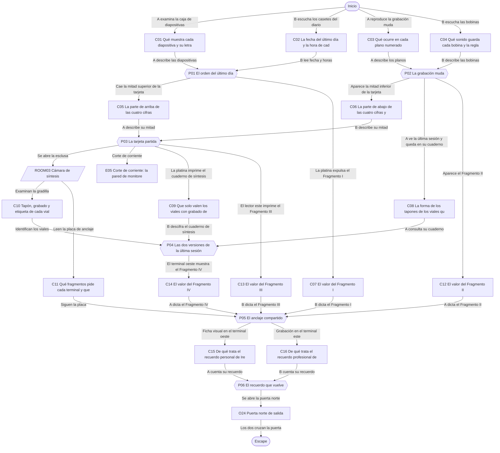
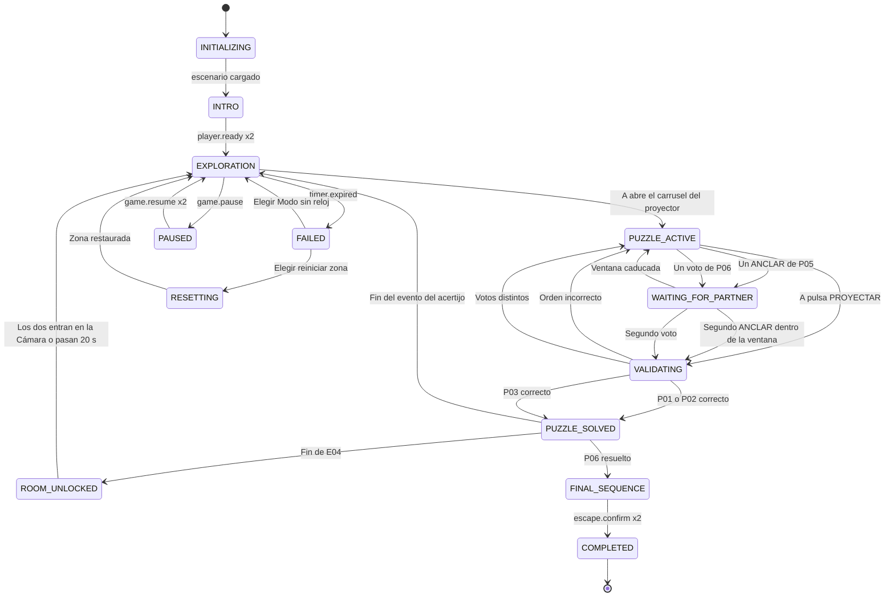

# ER01 · El laboratorio de los recuerdos

Dos voluntarios del ensayo ficticio Eco despiertan en el Laboratorio Mnemósine, donde se estudiaban recuerdos artificiales. El laboratorio ha entrado en modo custodia y solo se abrirá si reconstruyen el último día de la doctora Irene Salvat, la científica que dirigía el ensayo. A ve sus fotografías y grabaciones; B escucha sus registros de voz y descifra sus documentos. Al final deciden qué recuerdo de Irene se restaura antes de salir.

## A. Ficha técnica

| Campo | Valor |
|---|---|
| ID | ER01 |
| Nombre | El laboratorio de los recuerdos |
| Versión | 1.0.0 |
| Género | Ciencia ficción íntima |
| Sinopsis | Dos voluntarios del ensayo ficticio Eco despiertan en el Laboratorio Mnemósine, donde se estudiaban recuerdos artificiales. El laboratorio ha entrado en modo custodia y solo se abrirá si reconstruyen el último día de la doctora Irene Salvat, la científica que dirigía el ensayo. A ve sus fotografías y grabaciones; B escucha sus registros de voz y descifra sus documentos. Al final deciden qué recuerdo de Irene se restaura antes de salir. |
| Objetivo principal | OBJ01 Reconstruir el último día de Irene y abrir la esclusa de la Cámara de síntesis; OBJ02 Repetir la última sesión de síntesis y anclarla; OBJ03 Elegir qué recuerdo de Irene se restaura y salir del laboratorio |
| Objetivos secundarios | — |
| Jugadores | 2 (A: Voluntario de observación: imágenes y grabaciones; B: Voluntario de archivo: registros de voz y documentos) |
| Duración estimada | 45 min (despertar 4, descubrimiento 12, complicación 13, clímax 11, escape 5) |
| Dificultad | Media |
| Zonas | 3 |
| Acertijos | 6 principales |
| Objetos interactivos | 18 (más 8 decorativos) |
| Finales | 3 |
| Competencias | Comunicación clara, Ordenación cronológica, Asociación entre imagen y sonido, Contraste de fuentes de información, Memoria de trabajo y toma de notas, Toma de decisiones compartida |
| Condiciones iniciales | A despierta en un sillón reclinable de la Sala de observación, frente a la pared de monitores y el proyector de diapositivas. B despierta en el Archivo sonoro, entre estanterías de casetes y bobinas. Las dos salas están separadas por un cristal esmerilado que solo deja ver siluetas; se hablan por el intercomunicador del ensayo (la llamada de voz). La Cámara de síntesis, al norte, está cerrada por una esclusa con lector doble. Todo lo que ocurre es ficticio: los recuerdos que aparecen son de Irene Salvat, un personaje inventado, nunca de los jugadores. |
| Condición de victoria | Completar OBJ01, OBJ02, OBJ03 |
| Condición de fallo | 45 min de cuenta atrás: La reserva de la sesión se agota y LUMEN pausa el laboratorio con luz suave. Los jugadores eligen reiniciar la zona actual o seguir en Modo sin reloj. Nada de lo resuelto se pierde. |
| Condición de reinicio | Cualquiera de los dos pulsa Reiniciar zona y el otro lo confirma; también se ofrece al agotarse el reloj. El reinicio completo vuelve al estado inicial y a la intro. |

## B. Guion narrativo

**1. Introducción cinematográfica.** Fundido desde blanco. Un pitido lento de monitor marca el ritmo. La cámara recorre un pasillo de cristal con letras grabadas: Laboratorio Mnemósine, Ensayo Eco. En una pizarra, tres capas dibujadas una sobre otra. Una voz sintética y tranquila dice: Sesión de cierre interrumpida. Modo custodia activado. La imagen se divide en dos: una sala llena de pantallas apagadas y otra llena de cintas.

**2. Por qué están aquí.** Los dos se apuntaron como voluntarios a la última sesión del ensayo Eco, que probaba un reproductor de recuerdos artificiales con los recuerdos de referencia que donó la propia directora, la doctora Irene Salvat. Durante la sesión hubo un fallo y el laboratorio se selló para proteger esos recuerdos.

**3. Situación inicial.** LUMEN, el sistema del laboratorio, explica que el modo custodia solo se levanta si alguien demuestra que conoce la última sesión de Irene: reconstruir su último día, repetir su síntesis y anclarla. Las puertas están cerradas, pero nadie corre peligro.

**4. Objetivo.** Ordenar el último día de Irene, sincronizar su grabación muda con sus sonidos, abrir la esclusa con la tarjeta partida, repetir la síntesis de cierre, anclarla con el código compartido y decidir qué recuerdo suyo se restaura.

**5. Primer descubrimiento.** A encuentra la caja de diapositivas con seis fotografías del último día de Irene, pero ninguna tiene hora. B encuentra los casetes del diario de voz de Irene, con horas, pero sin imágenes. Solo juntando las dos cosas se puede ordenar el día.

**6. Progresión de los acontecimientos.**

- Con el día ordenado, el proyector muestra la secuencia completa y la platina del Archivo expulsa la tarjeta del Fragmento I. Del carrusel cae media tarjeta de acceso.
- La pared de monitores reproduce una grabación muda. B tiene los sonidos en bobinas; juntos los sincronizan y la grabación se oye por fin, con la última sesión de Irene al final.
- Cada uno tiene media tarjeta de acceso con cifras cortadas por la mitad. Juntando las dos mitades descifran el código de la esclusa.
- Al abrirse la Cámara de síntesis hay un corte de corriente: la pared de monitores de A se apaga y solo queda lo que A anotó en su cuaderno.
- Con lo que A anotó de la grabación y el cuaderno cifrado de B, repiten la síntesis de cierre cargando tres viales.
- Los dos terminales de la Cámara piden los fragmentos que cada uno no ha visto. Los intercambian y anclan la sesión a la vez.
- El sintetizador ofrece restaurar un recuerdo de Irene. Deciden juntos cuál.

**7. Obstáculos narrativos.**

- Las fotografías no tienen hora y los registros de voz no tienen imagen.
- La grabación de la pared de monitores no tiene sonido y las bobinas no tienen imagen.
- La tarjeta de acceso está partida: cada mitad muestra cifras cortadas que por sí solas pueden ser dos números distintos.
- El corte de corriente apaga la pared de monitores; A ya no puede volver a ver la grabación.
- El cuaderno de síntesis de Irene tiene palabras escritas al revés y un plan que no coincide con lo que hizo.

**8. Revelaciones.**

- Irene no huyó del laboratorio: cerró el proyecto con calma y dejó preparada una sesión de cierre para quien viniera después.
- La caja de la primera síntesis que cerró por la tarde guardaba el recuerdo del día en que su equipo consiguió el primer eco estable.
- Irene siempre cambiaba de idea en el último momento: por eso su grabación y su plan escrito no coinciden, y por eso la grabación manda.

**9. Clímax.** Con la síntesis anclada, la Cámara se llena de una luz cálida. El sintetizador solo tiene carga para restaurar un recuerdo completo en el archivo personal de Irene antes de cerrar la sesión. A ve la ficha visual de uno; B escucha la grabación del otro. Votan juntos.

**10. Escena de escape.** El recuerdo elegido se proyecta un momento sobre las paredes de la Cámara, como una película suave. LUMEN levanta el modo custodia, la puerta norte se abre y los dos salen juntos a un pasillo iluminado por la mañana.

**11. Epílogo.** En el pasillo hay una carta con el sello del laboratorio: Gracias por terminar lo que yo dejé a medias. Me llegará el recuerdo que hayáis elegido; el otro sigue a salvo en el archivo. Firmado: Irene Salvat.

### Diálogos y textos del sistema

Cada línea es un subtítulo. Las líneas de canal `document` quedan además guardadas en el registro de pistas.

| ID | Quién | Texto | Cuándo | Para | Canal |
|---|---|---|---|---|---|
| D01 | LUMEN | Buenos días. Soy LUMEN, el sistema del Laboratorio Mnemósine. La sesión de cierre se interrumpió y el laboratorio está en modo custodia. | E01 | Ambos | audio_subtitled |
| D02 | LUMEN | Nadie corre peligro. Las puertas se abrirán cuando demostréis que conocéis la última sesión de la doctora Salvat. | E01 | Ambos | audio_subtitled |
| D03 | Narrador | Despiertas en un sillón blanco. Frente a ti, una pared de monitores apagados. Al otro lado del cristal se mueve una silueta. | START | Jugador A | subtitle |
| D04 | Narrador | Despiertas entre estanterías de cintas. Huele a papel viejo. Al otro lado del cristal se mueve una silueta. | START | Jugador B | subtitle |
| D05 | Irene Salvat (casete) | Martes, catorce de octubre. Llego antes que nadie y riego el helecho; sigue torcido hacia el cristal. | C02_DISCOVERED | Jugador B | audio_subtitled |
| D06 | Sistema | El proyector recorre el día de la mañana a la noche. | E02 | Ambos | popup |
| D07 | Narrador | Algo cae del carrusel con un golpe seco: media tarjeta de plástico. | E02 | Jugador A | subtitle |
| D08 | Narrador | La platina se abre sola y deja salir una tarjeta de cartón. | E02 | Jugador B | subtitle |
| D09 | Irene Salvat (grabación) | ¿Diga? Sí, soy Irene. No, hoy no vuelvo tarde. Solo me queda una sesión. | E03 | Jugador A | audio_subtitled |
| D10 | Irene Salvat (grabación) | Seis y veinte. Sesión de cierre. Si alguien ve esto, que se fije en lo que hago y no en lo que escribí. | E03 | Jugador A | audio_subtitled |
| D11 | Sistema | Lo que has visto se ha guardado en tu cuaderno de observación. | E03 | Jugador A | popup |
| D12 | Narrador | En la caja de la bobina sobrante hay media tarjeta de plástico. | E03 | Jugador B | subtitle |
| D13 | LUMEN | Esclusa abierta. Atención: la apertura ha consumido la reserva de la sala de observación. | E04 | Ambos | audio_subtitled |
| D14 | Narrador | Los monitores se apagan uno a uno, despacio. Solo queda encendida la lámpara de la mesa, como en la diapositiva R. | E05 | Jugador A | subtitle |
| D15 | Narrador | Los fluorescentes bajan. La platina imprime una hoja escrita a mano por Irene. | E05 | Jugador B | subtitle |
| D16 | LUMEN | Recuerda que el cuaderno de observación guarda todo lo que viste en la pared de monitores, aunque esté apagada. | E11 | Ambos | audio_subtitled |
| D17 | Sistema | La corriente vuelve a la Cámara. El terminal oeste muestra un número. | E06 | Ambos | popup |
| D18 | LUMEN | Necesito los dos anclajes a la vez y con los fragmentos del otro. | P05 | Ambos | audio_subtitled |
| D19 | LUMEN | Síntesis anclada. Tengo carga para restaurar un recuerdo completo en el archivo personal de la doctora. El otro quedará guardado. | E07 | Ambos | audio_subtitled |
| D20 | Sistema | Han votado distinto. Cuéntense lo que han visto y oído y voten otra vez. | P06 | Ambos | popup |
| D21 | Irene Salvat (grabación) | Gracias por terminar lo que yo dejé a medias. El recuerdo que elijáis me llegará; el otro sigue a salvo. | E08 | Ambos | audio_subtitled |
| D22 | LUMEN | Modo custodia desactivado. Podéis salir cuando queráis. | E08 | Ambos | audio_subtitled |
| D23 | LUMEN | La reserva de la sesión se ha agotado. Podéis reiniciar esta zona o seguir sin reloj. No se pierde nada de lo resuelto. | E10 | Ambos | popup |
| D24 | LUMEN | Si os ayuda: cada uno tiene la mitad de lo que necesitáis. Contadle al otro lo que tenéis delante. | E09 | Ambos | audio_subtitled |

## C. Escenografía y planos

Coordenadas en metros con origen en la esquina suroeste del suelo de cada zona: `x` hacia el este, `y` hacia arriba, `z` hacia el norte.

### ROOM01 · Sala de observación

Sala blanca y silenciosa con un sillón reclinable del ensayo, una mesa con proyector de diapositivas y una pared entera de monitores. Al este, un cristal esmerilado la separa del Archivo sonoro.

**Medidas:** 5 × 4 m, altura 3 m. **Acceso:** A sí, B no. **Se abre:** desde el inicio.

**Qué ve cada jugador.** A: Toda la sala: monitores, proyector, diapositivas y lector oeste. B: Solo la silueta de A al otro lado del cristal esmerilado; no distingue pantallas ni papeles.

**Distribución.** Pared de monitores en la pared oeste. Mesa central con el proyector, la caja de diapositivas y el cuaderno de observación; la pantalla de proyección baja del techo frente a la pared sur. Sillón reclinable en la esquina suroeste. Cristal esmerilado en la pared este. Esclusa con el lector oeste y la puerta a la Cámara en la pared norte. Helecho junto al cristal, esquina sureste. Perchero con batas junto a la entrada sur, que está condenada.

| ID | Elemento | Tipo o pared | Posición (x, y, z) | Notas |
|---|---|---|---|---|
| DOOR01 | Puerta a Cámara de síntesis | pared north | (3, 0, 4) | Se abre con P03_SOLVED |
| — | Ventana | pared east | (5, 1.5, 2) | Cristal esmerilado hacia el Archivo sonoro: solo se ven siluetas; no es interactivo |
| O01 | Proyector de diapositivas | 8 Mecanismo cooperativo | (2.6, 0.9, 2.1) | Proyector beis con carrusel circular de cinco ranuras numeradas del 1 al 5 y un botón grande con la palabra PROYECTAR |
| O02 | Caja de diapositivas | 2 Examinar | (1.9, 0.9, 2) | Caja de madera con seis diapositivas enmarcadas en cartón, cada marco con una letra grabada, y una etiqueta escrita a mano |
| O03 | Pared de monitores | 2 Examinar | (0.1, 1.6, 2) | Nueve monitores unidos que forman una sola imagen; abajo, un mando con PLAY y PAUSA |
| O04 | Mitad superior de la tarjeta de acceso | 3 Recoger | (2.7, 0.75, 2.2) | Media tarjeta de plástico blanco cortada en horizontal, con la parte de arriba de cuatro cifras de barras |
| O05 | Lector oeste de la esclusa | 8 Mecanismo cooperativo | (3.9, 1.2, 3.9) | Ranura de tarjeta con pantalla pequeña y teclado de diez cifras en la pared norte, junto a la puerta de la Cámara |
| O06 | Cuaderno de observación | 9 Elemento narrativo | (2.2, 0.9, 1.5) | Cuaderno de tapas grises con el logotipo del ensayo Eco; se abre como panel lateral |
| O07 | Sillón reclinable del ensayo | 1 Decorativo | (1, 0, 0.8) | Sillón blanco acolchado con reposacabezas y un brazo articulado sin cables |
| O08 | Helecho torcido | 1 Decorativo | (4.6, 0, 0.4) | Helecho en maceta de barro inclinado hacia el cristal, el mismo de la diapositiva T |
| O09 | Perchero con batas | 1 Decorativo | (0.4, 0, 0.3) | Perchero metálico con dos batas blancas; una lleva bordado I. Salvat |

| Luz | Tipo | Posición | Color | Intensidad | Uso |
|---|---|---|---|---|---|
| L01 | Panel de techo difuso | (2.5, 2.9, 2) | #EEF4FF | 0.7 | Luz de laboratorio; se apaga en el corte de corriente (E05) |
| L02 | Lámpara de mesa | (2.2, 1.3, 1.6) | #FFD9A0 | 0.4 | La misma lámpara de la diapositiva R; sigue encendida durante el corte con la batería del laboratorio |
| L03 | Brillo de la pared de monitores | (0.3, 1.6, 2) | #9FC8FF | 0.5 | Activo mientras los monitores están encendidos |

**Sonido ambiente:** Zumbido bajo de equipos y pitido lento de monitor cada cuatro segundos. **Música:** Piano lento con pads suaves, muy bajo.

**Cambios dinámicos:**

- E02: La pantalla de proyección muestra las cinco diapositivas en orden y del carrusel cae media tarjeta de acceso
- E03: La pared de monitores reproduce la grabación con sonido y termina en la última sesión de Irene
- E05: Corte de corriente: el panel de techo y la pared de monitores se apagan; queda solo la lámpara de mesa

**Para el motor:** Escena del jugador A. La pared de monitores es una textura de vídeo (VideoPlayer en Unity, Media Texture en Unreal, VideoStreamPlayer en Godot, <video> en web) con subtítulos descriptivos de cada plano. El proyector usa un carrusel de cinco ranuras con arrastrar y soltar o selección por teclado. El cristal esmerilado es un material translúcido con desenfoque que solo muestra la silueta del avatar de B. En el corte se desactivan L01 y L03 y la pared de monitores pasa a un material negro.

### ROOM02 · Archivo sonoro

Sala estrecha con estanterías de casetes, un banco de bobinas, una platina de reproducción y una mesa de sincronía con cuatro canales. Huele a cinta magnética y papel viejo.

**Medidas:** 5 × 4 m, altura 3 m. **Acceso:** A no, B sí. **Se abre:** desde el inicio.

**Qué ve cada jugador.** A: Solo la silueta de B al otro lado del cristal esmerilado. B: Toda la sala: casetes, bobinas, platina, mesa de sincronía y lector este.

**Distribución.** Estantería de casetes en la pared este. Platina en la mesa central. Mesa de sincronía junto a la pared sur. Banco de bobinas en la esquina noroeste. Lector este de la esclusa y la puerta a la Cámara en la pared norte. Cristal esmerilado en la pared oeste. Archivadores en la esquina noreste y un gramófono de exposición en la esquina suroeste.

| ID | Elemento | Tipo o pared | Posición (x, y, z) | Notas |
|---|---|---|---|---|
| DOOR02 | Puerta a Cámara de síntesis | pared north | (2, 0, 4) | Se abre con P03_SOLVED |
| — | Ventana | pared west | (0, 1.5, 2) | Cristal esmerilado hacia la Sala de observación; no es interactivo |
| O10 | Estantería de casetes del diario | 2 Examinar | (4.8, 1.2, 2) | Estante con cinco casetes numerados del 1 al 5 y una etiqueta común: Diario de voz de I. Salvat |
| O11 | Platina de reproducción | 2 Examinar | (2.5, 0.9, 2) | Platina de casetes con ventanilla de texto, una bandeja de expulsión y una impresora de tiques integrada |
| O12 | Banco de bobinas | 2 Examinar | (0.8, 1, 3.6) | Caja abierta con cinco bobinas; cada una lleva una forma en relieve en el lomo: círculo, cuadrado, triángulo, estrella y rombo |
| O13 | Mesa de sincronía | 8 Mecanismo cooperativo | (2.5, 0.9, 0.6) | Mesa de mezclas con cuatro ranuras numeradas 1, 2, 3 y 4 en relieve y un botón SINCRONIZAR |
| O14 | Mitad inferior de la tarjeta de acceso | 3 Recoger | (1, 0.8, 3.4) | Media tarjeta de plástico blanco con la parte de abajo de cuatro cifras de barras, dentro de la caja de la bobina sobrante |
| O15 | Lector este de la esclusa | 8 Mecanismo cooperativo | (1.2, 1.2, 3.9) | Ranura de tarjeta con pantalla pequeña e impresora de tiques en la pared norte del archivo |
| O16 | Archivadores metálicos | 1 Decorativo | (4.6, 0, 3.6) | Tres archivadores grises con cajones rotulados por años |
| O17 | Gramófono de exposición | 1 Decorativo | (0.5, 0.8, 0.5) | Gramófono antiguo con bocina de latón dentro de una vitrina |
| O18 | Auriculares de estudio colgados | 1 Decorativo | (2.8, 1.6, 3.9) | Dos auriculares cerrados colgados de un gancho junto a la puerta |

| Luz | Tipo | Posición | Color | Intensidad | Uso |
|---|---|---|---|---|---|
| L04 | Tubos fluorescentes cálidos | (2.5, 2.9, 2) | #FFF0D0 | 0.6 | Luz general; en el corte bajan al 30 % (circuito de reserva del archivo) |
| L05 | Piloto de la platina | (2.5, 1, 2) | #FFB347 | 0.2 | Indica reproducción; se acompaña siempre de la palabra REPRODUCIENDO en la ventanilla |

**Sonido ambiente:** Siseo leve de cinta y crujido de papel. **Música:** Piano lento con pads suaves, muy bajo.

**Cambios dinámicos:**

- E02: La platina expulsa una tarjeta de cartón: Fragmento I
- E03: En la caja de la bobina sobrante aparece la otra mitad de la tarjeta de acceso
- E05: Los fluorescentes bajan al 30 % y la platina recibe el último registro de Irene

**Para el motor:** Escena del jugador B. Cada casete y cada bobina se reproduce con audio y muestra a la vez su transcripción en pantalla; ninguna información depende solo del sonido. La mesa de sincronía tiene cuatro ranuras de canal numeradas en relieve que aceptan bobinas por forma. Las bobinas tienen la forma en relieve en el lomo (círculo, cuadrado, triángulo, estrella, rombo).

### ROOM03 · Cámara de síntesis

Sala circular de techo alto con el sintetizador de recuerdos en el centro, una gradilla de viales, dos terminales enfrentados en las paredes oeste y este, cápsulas de reposo vacías y la pizarra de las tres capas.

**Medidas:** 8 × 6 m, altura 4 m. **Acceso:** A sí, B sí. **Se abre:** P03_SOLVED.

**Qué ve cada jugador.** A: Toda la sala y la pantalla del terminal oeste; la pantalla del terminal este queda de espaldas. B: Toda la sala y la pantalla del terminal este; la pantalla del terminal oeste queda de espaldas.

**Distribución.** Entradas en la pared sur: desde la Sala de observación en x 1.5 y desde el Archivo sonoro en x 6.5. Sintetizador en el centro, con la gradilla de viales delante al norte. Terminal oeste en la pared oeste y terminal este en la pared este, separados por el sintetizador: desde uno no se lee la pantalla del otro. Placa de anclaje en la pared norte sobre la puerta de salida. Cápsulas de reposo en la esquina noroeste y pizarra en la esquina noreste.

| ID | Elemento | Tipo o pared | Posición (x, y, z) | Notas |
|---|---|---|---|---|
| DOOR03 | Puerta a Sala de observación | pared south | (1.5, 0, 0) | Se abre con P03_SOLVED |
| DOOR04 | Puerta a Archivo sonoro | pared south | (6.5, 0, 0) | Se abre con P03_SOLVED |
| DOOR05 | Puerta de salida | pared north | (4, 0, 6) | Se abre con P06_SOLVED |
| O19 | Gradilla de viales | 2 Examinar | (4, 1, 4) | Gradilla de acero con seis viales de vidrio; cada uno tiene un tapón con forma (cuadrado, triángulo o círculo), un grabado en relieve (ola o edificio) y una etiqueta |
| O20 | Sintetizador de recuerdos | 8 Mecanismo cooperativo | (4, 0, 3) | Columna de vidrio y acero con tres ranuras para viales numeradas 1, 2 y 3 de izquierda a derecha y un anillo de luz en lo alto |
| O21 | Terminal oeste | 8 Mecanismo cooperativo | (0.5, 1.1, 3) | Atril con pantalla, teclado numérico y un pulsador redondo con la palabra ANCLAR; solo responde a A |
| O22 | Terminal este | 8 Mecanismo cooperativo | (7.5, 1.1, 3) | Atril con pantalla, altavoz, teclado numérico y un pulsador redondo con la palabra ANCLAR; solo responde a B |
| O23 | Placa de anclaje | 2 Examinar | (4, 2.2, 5.9) | Placa de metal grabada sobre la puerta norte, con texto en relieve y en braille |
| O24 | Puerta norte de salida | 10 Objeto de salida | (4, 0, 5.95) | Puerta de vidrio opaco con el rótulo Salida y un indicador CUSTODIA / LIBRE escrito en letras |
| O25 | Cápsulas de reposo vacías | 1 Decorativo | (1, 0, 5) | Dos cápsulas abiertas con almohadas blancas y luz interior apagada |
| O26 | Pizarra de las tres capas | 1 Decorativo | (7, 1.5, 5.9) | Pizarra blanca con tres capas dibujadas una sobre otra y rotuladas imagen, sonido y emoción |

| Luz | Tipo | Posición | Color | Intensidad | Uso |
|---|---|---|---|---|---|
| L06 | Anillo de luz sobre el sintetizador | (4, 3.6, 3) | #CFE8FF | 0.2 | Apagado durante el corte; sube al cargar los viales (E06) y se vuelve cálido al anclar (E07) |
| L07 | Luces de emergencia | (4, 3.8, 0.2) | #FFC680 | 0.35 | Luz ámbar fija, sin destellos, durante el corte; suficiente para leer de cerca |
| L08 | Luz de la puerta de salida | (4, 2.4, 5.9) | #FFF4D6 | 0.6 | Se enciende al resolver P06 |

**Sonido ambiente:** Eco amplio de sala y respiración lenta de ventiladores. **Música:** Tema de Irene: cuerdas y celesta, sube de capas con cada fragmento.

**Cambios dinámicos:**

- E05: La Cámara se abre a oscuras con las luces de emergencia ámbar
- E06: El sintetizador se ilumina con los tres viales y vuelve la luz general
- E07: El anillo de luz pasa a cálido y los terminales muestran los dos recuerdos
- E08: El recuerdo elegido se proyecta en las paredes y se abre la puerta norte

**Para el motor:** Escena compartida que se carga al resolver P03. Las pantallas de los terminales son paneles de interfaz por jugador: el terminal oeste solo acepta entradas de A y el este solo de B, y cada pantalla solo se muestra al jugador que la usa. La proyección final sobre las paredes es un material con textura de vídeo y una alternativa de imagen fija. Los viales tienen colisión para coger y soltar en las tres ranuras del sintetizador.

## D. Inventario de objetos

| object_id | Nombre | Descripción visual | Zona | Posición | Tipo | Estado inicial | Acción | Activación | Resultado | Pista | Acertijo | Jugador | Estado final |
|---|---|---|---|---|---|---|---|---|---|---|---|---|---|
| O01 | Proyector de diapositivas | Proyector beis con carrusel circular de cinco ranuras numeradas del 1 al 5 y un botón grande con la palabra PROYECTAR | ROOM01 | (2.6, 0.9, 2.1) | 8 Mecanismo cooperativo | EMPTY | Colocar diapositivas en las ranuras y pulsar PROYECTAR | — | Si el orden es correcto, proyecta el día completo de Irene; si no, la imagen se funde a gris y el carrusel devuelve las diapositivas | — | P01 | Jugador A | PROJECTED |
| O02 | Caja de diapositivas | Caja de madera con seis diapositivas enmarcadas en cartón, cada marco con una letra grabada, y una etiqueta escrita a mano | ROOM01 | (1.9, 0.9, 2) | 2 Examinar | CLOSED | Abrir y examinar cada diapositiva a contraluz | — | Guarda la pista C01 en el cuaderno de A | C01 | P01 | Jugador A | EXAMINED |
| O03 | Pared de monitores | Nueve monitores unidos que forman una sola imagen; abajo, un mando con PLAY y PAUSA | ROOM01 | (0.1, 1.6, 2) | 2 Examinar | STANDBY | Reproducir la grabación | — | Reproduce la grabación muda (C03); tras P02 la reproduce con sonido y muestra la última sesión (C08) y el Fragmento II (C12). Se apaga en el corte de corriente | C03 | P02 | Jugador A | OFF |
| O04 | Mitad superior de la tarjeta de acceso | Media tarjeta de plástico blanco cortada en horizontal, con la parte de arriba de cuatro cifras de barras | ROOM01 | (2.7, 0.75, 2.2) | 3 Recoger | HIDDEN | Recoger | P01_SOLVED | Cae del carrusel al proyectar; pasa al inventario de A y guarda C05 | C05 | P03 | Jugador A | INSERTED |
| O05 | Lector oeste de la esclusa | Ranura de tarjeta con pantalla pequeña y teclado de diez cifras en la pared norte, junto a la puerta de la Cámara | ROOM01 | (3.9, 1.2, 3.9) | 8 Mecanismo cooperativo | WAITING | Insertar media tarjeta y teclear el código | O04_COLLECTED | Con las dos mitades insertadas muestra: Tarjeta dañada, introduzca el código a mano. Acepta el código de cuatro cifras | — | P03 | Jugador A | ACCEPTED |
| O06 | Cuaderno de observación | Cuaderno de tapas grises con el logotipo del ensayo Eco; se abre como panel lateral | ROOM01 | (2.2, 0.9, 1.5) | 9 Elemento narrativo | OPEN | Abrir y escribir notas | — | Muestra todas las pistas de A guardadas automáticamente y las notas libres que A escriba; sigue disponible durante el corte de corriente | — | — | Jugador A | OPEN |
| O07 | Sillón reclinable del ensayo | Sillón blanco acolchado con reposacabezas y un brazo articulado sin cables | ROOM01 | (1, 0, 0.8) | 1 Decorativo | STATIC | none | — | Sin interacción | — | — | Nadie | STATIC |
| O08 | Helecho torcido | Helecho en maceta de barro inclinado hacia el cristal, el mismo de la diapositiva T | ROOM01 | (4.6, 0, 0.4) | 1 Decorativo | STATIC | none | — | Sin interacción | — | — | Nadie | STATIC |
| O09 | Perchero con batas | Perchero metálico con dos batas blancas; una lleva bordado I. Salvat | ROOM01 | (0.4, 0, 0.3) | 1 Decorativo | STATIC | none | — | Sin interacción | — | — | Nadie | STATIC |
| O10 | Estantería de casetes del diario | Estante con cinco casetes numerados del 1 al 5 y una etiqueta común: Diario de voz de I. Salvat | ROOM02 | (4.8, 1.2, 2) | 2 Examinar | DEFAULT | Escuchar los casetes | — | Reproduce los cinco registros con transcripción y guarda C02 | C02 | P01 | Jugador B | EXAMINED |
| O11 | Platina de reproducción | Platina de casetes con ventanilla de texto, una bandeja de expulsión y una impresora de tiques integrada | ROOM02 | (2.5, 0.9, 2) | 2 Examinar | IDLE | Examinar lo que expulsa o imprime | — | Tras P01 expulsa el Fragmento I (C07); tras abrir la Cámara recibe y transcribe el cuaderno de síntesis de Irene (C09) | C07 | P05 | Jugador B | EJECTED |
| O12 | Banco de bobinas | Caja abierta con cinco bobinas; cada una lleva una forma en relieve en el lomo: círculo, cuadrado, triángulo, estrella y rombo | ROOM02 | (0.8, 1, 3.6) | 2 Examinar | DEFAULT | Escuchar las bobinas | — | Reproduce cada bobina con su transcripción y guarda C04 | C04 | P02 | Jugador B | EXAMINED |
| O13 | Mesa de sincronía | Mesa de mezclas con cuatro ranuras numeradas 1, 2, 3 y 4 en relieve y un botón SINCRONIZAR | ROOM02 | (2.5, 0.9, 0.6) | 8 Mecanismo cooperativo | EMPTY | Colocar bobinas en los canales y pulsar SINCRONIZAR | — | Si cada bobina está en el canal de su plano, la grabación de A suena; si no, se oye un zumbido suave y las bobinas se quedan donde están | — | P02 | Jugador B | SYNCED |
| O14 | Mitad inferior de la tarjeta de acceso | Media tarjeta de plástico blanco con la parte de abajo de cuatro cifras de barras, dentro de la caja de la bobina sobrante | ROOM02 | (1, 0.8, 3.4) | 3 Recoger | HIDDEN | Recoger | P02_SOLVED | Pasa al inventario de B y guarda C06 | C06 | P03 | Jugador B | INSERTED |
| O15 | Lector este de la esclusa | Ranura de tarjeta con pantalla pequeña e impresora de tiques en la pared norte del archivo | ROOM02 | (1.2, 1.2, 3.9) | 8 Mecanismo cooperativo | WAITING | Insertar media tarjeta | O14_COLLECTED | Registra la mitad de B; al abrirse la esclusa imprime el Fragmento III (C13) | C13 | P03 | Jugador B | ACCEPTED |
| O16 | Archivadores metálicos | Tres archivadores grises con cajones rotulados por años | ROOM02 | (4.6, 0, 3.6) | 1 Decorativo | STATIC | none | — | Sin interacción | — | — | Nadie | STATIC |
| O17 | Gramófono de exposición | Gramófono antiguo con bocina de latón dentro de una vitrina | ROOM02 | (0.5, 0.8, 0.5) | 1 Decorativo | STATIC | none | — | Sin interacción | — | — | Nadie | STATIC |
| O18 | Auriculares de estudio colgados | Dos auriculares cerrados colgados de un gancho junto a la puerta | ROOM02 | (2.8, 1.6, 3.9) | 1 Decorativo | STATIC | none | — | Sin interacción | — | — | Nadie | STATIC |
| O19 | Gradilla de viales | Gradilla de acero con seis viales de vidrio; cada uno tiene un tapón con forma (cuadrado, triángulo o círculo), un grabado en relieve (ola o edificio) y una etiqueta | ROOM03 | (4, 1, 4) | 2 Examinar | DEFAULT | Examinar los viales | — | Guarda C10 para los dos | C10 | P04 | Ambos | EXAMINED |
| O20 | Sintetizador de recuerdos | Columna de vidrio y acero con tres ranuras para viales numeradas 1, 2 y 3 de izquierda a derecha y un anillo de luz en lo alto | ROOM03 | (4, 0, 3) | 8 Mecanismo cooperativo | IDLE | Colocar viales en las ranuras y pulsar INICIAR | P03_SOLVED | Con los tres viales correctos inicia la síntesis de cierre; si no, devuelve los viales a la gradilla | — | P04 | Jugador B | RESTORED |
| O21 | Terminal oeste | Atril con pantalla, teclado numérico y un pulsador redondo con la palabra ANCLAR; solo responde a A | ROOM03 | (0.5, 1.1, 3) | 8 Mecanismo cooperativo | DARK | Teclear dos cifras, pulsar ANCLAR y votar | P04_SOLVED | Muestra el Fragmento IV (C14), acepta la mitad del código de anclaje y después la ficha visual de un recuerdo (C15) y el voto de A | C14 | P05 | Jugador A | ANCHORED |
| O22 | Terminal este | Atril con pantalla, altavoz, teclado numérico y un pulsador redondo con la palabra ANCLAR; solo responde a B | ROOM03 | (7.5, 1.1, 3) | 8 Mecanismo cooperativo | DARK | Teclear dos cifras, pulsar ANCLAR y votar | P04_SOLVED | Acepta la otra mitad del código de anclaje y después reproduce la grabación de un recuerdo (C16) y recoge el voto de B | C16 | P05 | Jugador B | ANCHORED |
| O23 | Placa de anclaje | Placa de metal grabada sobre la puerta norte, con texto en relieve y en braille | ROOM03 | (4, 2.2, 5.9) | 2 Examinar | DEFAULT | Leer | — | Guarda C11 para los dos | C11 | P05 | Ambos | EXAMINED |
| O24 | Puerta norte de salida | Puerta de vidrio opaco con el rótulo Salida y un indicador CUSTODIA / LIBRE escrito en letras | ROOM03 | (4, 0, 5.95) | 10 Objeto de salida | LOCKED | Salir | P06_SOLVED | Confirma la salida de quien la cruza; la partida termina cuando la cruzan los dos | — | — | Ambos | OPEN |
| O25 | Cápsulas de reposo vacías | Dos cápsulas abiertas con almohadas blancas y luz interior apagada | ROOM03 | (1, 0, 5) | 1 Decorativo | STATIC | none | — | Sin interacción | — | — | Nadie | STATIC |
| O26 | Pizarra de las tres capas | Pizarra blanca con tres capas dibujadas una sobre otra y rotuladas imagen, sonido y emoción | ROOM03 | (7, 1.5, 5.9) | 1 Decorativo | STATIC | none | — | Sin interacción | — | — | Nadie | STATIC |

## E. Pistas

| clue_id | Contenido exacto | Alternativa accesible | Ubicación | Descubrimiento | Quién | Acertijo | Revela | Depende de | Se habilita | Nivel | Descubierta cuando |
|---|---|---|---|---|---|---|---|---|---|---|---|
| C01 | Etiqueta de la caja: El último día de la doctora Salvat. Proyectar de la mañana a la noche; el carrusel tiene cinco ranuras. Diapositivas: K: dos personas comen sentadas en una azotea y una servilleta sale volando entre ellas. M: una mujer con bata señala una pizarra con tres capas dibujadas; delante, tres personas sentadas de espaldas. R: una sala a oscuras con una sola lámpara de mesa encendida. S: la mujer sopla las velas de una tarta en una sala de descanso; en la pared, un calendario de hojas marca lunes, 13 de octubre. T: la mujer riega un helecho torcido hacia el cristal de una ventana. V: una caja de cartón cerrada con cinta adhesiva; en la tapa, escrito a mano: Primera síntesis. | Lista en texto grande y con lectura en voz: letra de cada diapositiva y lo que muestra. K azotea y servilleta; M pizarra de tres capas; R sala a oscuras con lámpara; S tarta y calendario del lunes 13 de octubre; T riego del helecho; V caja Primera síntesis. | O02 Caja de diapositivas | A abre la caja de diapositivas y las mira a contraluz | Jugador A | P01 | Qué muestra cada diapositiva y su letra | — | — | 0 | O02_EXAMINED |
| C02 | Diario de voz de Irene Salvat. Martes, 14 de octubre. Casete 1, 13:15: Como en la azotea con Tomás; hace tanto viento que se nos vuela la servilleta. Casete 2, 19:05: Apago la sala de observación; solo dejo encendida la lámpara de la mesa. Casete 3, 07:50: Llego antes que nadie y riego el helecho; sigue torcido hacia el cristal. Casete 4, 16:40: Cierro con cinta la caja de la primera síntesis; ya no la necesito. Casete 5, 10:30: Reunión con el comité; les dibujo en la pizarra el esquema de las tres capas. | Transcripción completa en pantalla con la fecha, martes 14 de octubre, y una línea por casete con su hora y lo que cuenta Irene. | O10 Estantería de casetes del diario | B escucha los cinco casetes de la estantería | Jugador B | P01 | La fecha del último día y la hora de cada momento | — | — | 0 | O10_EXAMINED |
| C03 | Grabación muda del 14 de octubre, con el número de plano en la esquina. Plano 1: Irene junto a una ventana; gotas gruesas resbalan por el cristal. Plano 2: Irene abre la puerta de un horno de muestras; un piloto parpadea tres veces y sale una nube de vapor por una válvula. Plano 3: Irene descuelga un teléfono de pared y habla. Plano 4: Irene mira por la ventana un campanario y varias palomas salen volando de la torre. | Audiodescripción en texto de cada plano con su número: 1 lluvia en el cristal; 2 piloto que parpadea tres veces y vapor; 3 teléfono; 4 campanario y palomas. | O03 Pared de monitores | A reproduce la grabación en la pared de monitores | Jugador A | P02 | Qué ocurre en cada plano numerado | — | — | 0 | O03_PLAYING |
| C04 | Banco de bobinas. Bobina círculo: tres pitidos cortos y un silbido de vapor. Bobina cuadrado: campanadas lejanas y aleteo de muchas alas. Bobina triángulo: lluvia que golpea un cristal. Bobina estrella: timbre de teléfono y una voz que dice: ¿Diga? Sí, soy Irene. Bobina rombo: teclas de una máquina de escribir. Instrucción de la mesa: cada canal se sincroniza con el plano de vídeo del mismo número. | Cada bobina tiene su forma en relieve y su transcripción entre corchetes en pantalla; la instrucción de la mesa también está en texto y en braille. | O12 Banco de bobinas | B escucha las bobinas del banco | Jugador B | P02 | Qué sonido guarda cada bobina y la regla de los canales | — | — | 0 | O12_EXAMINED |
| C05 | Mitad superior de la tarjeta. El corte pasa justo por debajo de la barra central, así que esta mitad conserva la barra superior, las dos barras altas y la central. Cifra 1: superior, alta derecha y central. Cifra 2: superior, alta izquierda y central. Cifra 3: superior, alta izquierda, alta derecha y central. Cifra 4: superior, alta derecha y central. Al dorso, tabla del lector: 0 superior, alta izquierda, alta derecha, baja izquierda, baja derecha, inferior. 1 alta derecha, baja derecha. 2 superior, alta derecha, central, baja izquierda, inferior. 3 superior, alta derecha, central, baja derecha, inferior. 4 alta izquierda, alta derecha, central, baja derecha. 5 superior, alta izquierda, central, baja derecha, inferior. 6 superior, alta izquierda, central, baja izquierda, baja derecha, inferior. 7 superior, alta derecha, baja derecha. 8 las siete barras. 9 superior, alta izquierda, alta derecha, central, baja derecha, inferior. | Descripción en texto de las barras visibles de cada cifra y la tabla del lector completa en lista, con lectura en voz; las barras se dibujan también como contorno grueso. | O04 Mitad superior de la tarjeta de acceso | A recoge la media tarjeta que cae del carrusel | Jugador A | P03 | La parte de arriba de las cuatro cifras y la tabla del lector | — | P01_SOLVED | 0 | O04_COLLECTED |
| C06 | Mitad inferior de la tarjeta. Esta mitad conserva las dos barras bajas y la inferior. Cifra 1: baja derecha e inferior. Cifra 2: baja izquierda, baja derecha e inferior. Cifra 3: baja derecha e inferior. Cifra 4: baja izquierda e inferior. Al dorso, la misma tabla del lector: 0 superior, alta izquierda, alta derecha, baja izquierda, baja derecha, inferior. 1 alta derecha, baja derecha. 2 superior, alta derecha, central, baja izquierda, inferior. 3 superior, alta derecha, central, baja derecha, inferior. 4 alta izquierda, alta derecha, central, baja derecha. 5 superior, alta izquierda, central, baja derecha, inferior. 6 superior, alta izquierda, central, baja izquierda, baja derecha, inferior. 7 superior, alta derecha, baja derecha. 8 las siete barras. 9 superior, alta izquierda, alta derecha, central, baja derecha, inferior. | Descripción en texto de las barras visibles de cada cifra y la tabla del lector completa en lista, con lectura en voz; las barras se dibujan también como contorno grueso. | O14 Mitad inferior de la tarjeta de acceso | B recoge la media tarjeta de la caja de la bobina sobrante | Jugador B | P03 | La parte de abajo de las cuatro cifras y la tabla del lector | — | P02_SOLVED | 0 | O14_COLLECTED |
| C07 | Tarjeta de cartón expulsada por la platina: Fragmento I de IV. Número: 4. Guárdalo: otro terminal lo pedirá. | Texto grande: Fragmento I, número 4. | O11 Platina de reproducción | La platina expulsa la tarjeta al resolver P01 | Jugador B | P05 | El valor del Fragmento I | — | P01_SOLVED | 0 | O11_EJECTED |
| C08 | Grabación de la última sesión, 14 de octubre, 18:20. Irene coloca tres viales en el sintetizador, de la ranura 1 a la 3. La luz roja de la sala no deja leer las etiquetas, pero los tapones se ven bien: en la ranura 1 un tapón cuadrado, en la 2 un tapón triangular y en la 3 un tapón redondo. | Audiodescripción en texto guardada en el cuaderno de A: ranura 1 tapón cuadrado, ranura 2 tapón triangular, ranura 3 tapón redondo; etiquetas ilegibles. | O03 Pared de monitores | Final de la grabación con sonido que se reproduce al resolver P02; se guarda sola en el cuaderno de observación | Jugador A | P04 | La forma de los tapones de los viales que Irene usó, en orden | — | P02_SOLVED | 0 | P02_SOLVED |
| C09 | Cuaderno de síntesis de Irene, transcrito por la platina. 14 de octubre, 18:05. Las palabras entre corchetes están escritas al revés. Para la sesión de cierre usaré solo viales con el grabado de la [ALO], ninguno del [OICIFIDE]. Plan de orden: tapón [ODNODER], después [RALUGNAIRT] y al final [ODARDAUC]. Si alguien repite esta sesión, que siga lo que hice y no lo que planeé: siempre cambio de idea en el último momento. | Texto con lectura en voz; las palabras entre corchetes se leen letra a letra. El mismo texto se ofrece con las palabras al revés subrayadas. | O11 Platina de reproducción | Al abrirse la Cámara, la platina recibe el último documento de Irene y lo imprime para B | Jugador B | P04 | Que solo valen los viales con grabado de ola y que el plan escrito no es lo que Irene hizo | — | P03_SOLVED | 0 | P03_SOLVED |
| C10 | Gradilla de seis viales. Vial 1: tapón cuadrado, grabado de ola, etiqueta Muelle de Cabo Lince. Vial 2: tapón cuadrado, grabado de edificio, etiqueta Tranvía de la avenida. Vial 3: tapón triangular, grabado de edificio, etiqueta Mercado del centro. Vial 4: tapón triangular, grabado de ola, etiqueta Faro al anochecer. Vial 5: tapón redondo, grabado de ola, etiqueta Playa de las Barcas. Vial 6: tapón redondo, grabado de edificio, etiqueta Azotea del instituto. | Tabla de seis filas: número, forma del tapón, grabado (ola o edificio) y etiqueta. Los grabados son relieves que se describen con palabras; ningún dato depende del color. | O19 Gradilla de viales | Cualquiera de los dos examina la gradilla de la Cámara | Ambos | P04 | Tapón, grabado y etiqueta de cada vial | — | P03_SOLVED | 0 | — |
| C11 | Placa de anclaje: Para anclar la sesión, cada terminal pide los fragmentos que su operador no ha visto. Terminal oeste, que solo responde a A: fragmento I seguido del fragmento III. Terminal este, que solo responde a B: fragmento II seguido del fragmento IV. Escribid las dos cifras y pulsad ANCLAR a la vez; la cámara tolera dos segundos y medio de diferencia. | Texto de la placa en pantalla, en relieve y en braille, con lectura en voz. | O23 Placa de anclaje | Cualquiera de los dos lee la placa sobre la puerta norte | Ambos | P05 | Qué fragmentos pide cada terminal y que hay que pulsar a la vez | — | P03_SOLVED | 0 | — |
| C12 | Al terminar la grabación con sonido, la pared de monitores muestra en grande: Fragmento II de IV. Número: 9. | Texto grande en pantalla y en el cuaderno de A: Fragmento II, número 9. | O03 Pared de monitores | Aparece al resolver P02 y se guarda solo en el cuaderno de observación | Jugador A | P05 | El valor del Fragmento II | — | P02_SOLVED | 0 | P02_SOLVED |
| C13 | Tique impreso por el lector este al abrirse la esclusa: Fragmento III de IV. Número: 1. | Texto grande: Fragmento III, número 1. | O15 Lector este de la esclusa | El lector este lo imprime al resolver P03 | Jugador B | P05 | El valor del Fragmento III | — | P03_SOLVED | 0 | P03_SOLVED |
| C14 | Pantalla del terminal oeste al iniciarse la síntesis: Fragmento IV de IV. Número: 6. | Texto grande en la pantalla y en el cuaderno de A: Fragmento IV, número 6. | O21 Terminal oeste | Aparece en el terminal oeste al resolver P04 | Jugador A | P05 | El valor del Fragmento IV | — | P04_SOLVED | 0 | O21_READY |
| C15 | Ficha visual en el terminal oeste. Recuerdo: La noche del faro. Una niña de unos nueve años y su abuela sentadas en las rocas de Cabo Lince, mirando cómo se enciende el faro. La abuela le enseña a contar los segundos entre destellos. Nota de Irene: De aquí viene todo lo que he estudiado. | Descripción en texto de la imagen y de la nota, con lectura en voz. | O21 Terminal oeste | Aparece en el terminal oeste al anclar la sesión | Jugador A | P06 | De qué trata el recuerdo personal de Irene | — | P05_SOLVED | 0 | P05_SOLVED |
| C16 | Grabación en el terminal este. Recuerdo: El primer eco. Voces del equipo celebrando, risas y una cuenta atrás: tres, dos, uno. Irene dice: Lo tenemos, el eco aguanta. Guardad esta noche, porque es de todos. Nota de Irene: Este recuerdo es también de mi equipo. | Transcripción completa en pantalla con quién habla en cada línea. | O22 Terminal este | Se reproduce en el terminal este al anclar la sesión | Jugador B | P06 | De qué trata el recuerdo profesional de Irene | — | P05_SOLVED | 0 | P05_SOLVED |
| C17 | LUMEN: Recuerda que el cuaderno de observación guarda todo lo que viste en la pared de monitores, aunque esté apagada. | Aviso en texto en el lateral de la pantalla de los dos jugadores. | O06 Cuaderno de observación | Ayuda contextual que ofrece el sistema si nadie progresa 90 segundos después del corte de corriente | Ambos | P04 | Que la información de la grabación sigue en el cuaderno de A | — | P03_SOLVED, IDLE_90 | 1 | IDLE_90 |

### Ayudas progresivas por acertijo

| Acertijo | Nivel 1: dónde mirar | Nivel 2: principio | Nivel 3: ayuda concreta |
|---|---|---|---|
| P01 El orden del último día | Las fotografías no tienen hora, pero el diario de voz sí: compárenlos. | Cada registro del diario describe un detalle que se ve en una sola diapositiva; una diapositiva no es de ese día. | La primera diapositiva es la del helecho (T) y la S sobra porque es del lunes 13. |
| P02 La grabación muda | A tiene la imagen y B el sonido: descríbanse lo que ven y oyen. | Busquen en cada plano algo que haga ruido: la lluvia, el piloto, el teléfono, las campanas. | El piloto que parpadea tres veces del plano 2 suena como los tres pitidos de la bobina círculo. |
| P03 La tarjeta partida | Cada mitad muestra solo una parte de las barras: juntas forman las cifras enteras. | Para cada cifra, busquen en la tabla la única que tenga a la vez las barras de arriba de A y las de abajo de B. | La primera cifra es 3: arriba podría ser 2 o 3, pero abajo no tiene la barra baja izquierda. |
| P04 Las dos versiones de la última sesión | La pared de monitores está apagada, pero el cuaderno de A guarda lo que vio en la grabación. | El cuaderno de B y la grabación de A no dicen el mismo orden: Irene explica cuál de los dos vale. | Sigan la grabación: ranura 1 tapón cuadrado, 2 triangular, 3 redondo, y solo viales con grabado de ola. |
| P05 El anclaje compartido | Cada terminal pide lo que su operador no ha visto: tendrán que dictarse los fragmentos. | A tiene II y IV; B tiene I y III. El oeste pide I y III; el este, II y IV. | A teclea 41, B teclea 96 y pulsan ANCLAR a la vez tras contar tres. |
| P06 El recuerdo que vuelve | A tiene la imagen de un recuerdo y B el sonido del otro. | No hay opción incorrecta: el recuerdo que no elijan sigue guardado. | Voten la misma opción en los dos terminales. |

## F. Acertijos

### P01 · El orden del último día

1. **ID.** P01
2. **Nombre.** El orden del último día
3. **Narrativa.** LUMEN pide la primera prueba de conocimiento: proyectar el último día de Irene tal como ocurrió. Las fotografías no tienen hora; el diario de voz sí.
4. **Objetivo.** Cargar en el carrusel las cinco diapositivas del último día, de la mañana a la noche, y proyectarlas.
5. **Situación.** A tiene seis diapositivas con letras y un carrusel de cinco ranuras. B tiene cinco casetes del diario de Irene con su hora y la fecha.
6. **Elementos necesarios.** O01 Proyector de diapositivas, O02 Caja de diapositivas, O10 Estantería de casetes del diario
7. **Información de A.** Lo que muestra cada diapositiva y su letra (C01), incluida una con un calendario del lunes 13 de octubre.
8. **Información de B.** La fecha del diario, martes 14 de octubre, y la hora de cada momento del día (C02).
9. **Qué deben comunicarse.** B lee la fecha y cada registro con su hora; A busca la diapositiva que corresponde a cada registro, descarta la que no es de ese día y dicta las letras en orden para confirmar con B antes de proyectar.
10. **Reglas.** El carrusel tiene cinco ranuras y solo se proyecta con las cinco llenas. Se valida al pulsar PROYECTAR. Una diapositiva sobra.
11. **Pasos.** (1) B escucha los cinco casetes y lee en voz alta la fecha y las horas. (2) A examina las seis diapositivas. (3) Emparejan cada registro con una diapositiva: helecho T, pizarra M, azotea K, caja V y lámpara R. (4) Descartan S porque su calendario marca el lunes 13 y el diario es del martes 14. (5) Ordenan por hora: 07:50 T, 10:30 M, 13:15 K, 16:40 V y 19:05 R. (6) A carga T, M, K, V y R en las ranuras 1 a 5 y pulsa PROYECTAR.
12. **Respuesta correcta.** T · M · K · V · R (sequence; Letras de las diapositivas de la ranura 1 a la 5, en mayúsculas)
13. **Respuestas incorrectas posibles.** K · R · T · V · M: Es el orden de los casetes por su número (1, 2, 3, 4, 5), no por la hora.; S · T · M · K · V: Incluye la diapositiva S, que es del lunes 13 de octubre, y deja fuera la noche.; R · V · K · M · T: Es el día al revés, de la noche a la mañana.
14. **Validación.** Al pulsar PROYECTAR, la lista de letras de las ranuras 1 a 5 debe coincidir con las diapositivas que corresponden a los registros de C02 (variante activa) ordenados por hora. C01 debe estar descubierta por A y C02 por B. Introduce: Jugador A. Pistas exigidas: C01, C02. Modelo M1 Información dividida.
15. **Al resolverlo.** El proyector recorre el último día de Irene, de la mañana a la noche. Eventos: E02. Estado: O01_PROJECTED.
16. **Al fallar.** La imagen se funde a gris. LUMEN: Ese no es el día que recuerdo. El carrusel devuelve las diapositivas a la caja; las pistas se conservan.
17. **Intentos.** ilimitados; pausa de 15 s cada 3 fallos seguidos
18. **Sistema de pistas.** Pistas C01, C02 y tres niveles de ayuda (tabla de ayudas).
19. **Tiempo estimado.** 7 min
20. **Desbloquea.** P03
21. **Reinicio.** Tras un fallo el carrusel se vacía. Un reinicio de zona deja la caja cerrada y el proyector en EMPTY.
22. **Casos límite.** A pulsa PROYECTAR con ranuras vacías: no se valida y no cuenta como fallo. A coloca la misma diapositiva en dos ranuras: imposible, cada diapositiva es un objeto único. B se desconecta tras escuchar los casetes: C02 sigue en su registro y la transcripción reaparece al volver. Doble pulsación de PROYECTAR con el mismo actionId: se ignora la segunda.

**Requisitos previos:** START. **Zona:** ROOM01.

**Por qué la solución es válida:** Cada registro de C02 nombra un detalle que solo aparece en una diapositiva: helecho (T), pizarra de tres capas (M), servilleta en la azotea (K), caja Primera síntesis (V) y lámpara de mesa en la sala a oscuras (R). La diapositiva S muestra un calendario del lunes 13 y el diario es del martes 14, así que se descarta. Las cinco horas son distintas, por lo que el orden es único: T, M, K, V, R. A no sabe las horas ni la fecha y B no ve las diapositivas.

### P02 · La grabación muda

1. **ID.** P02
2. **Nombre.** La grabación muda
3. **Narrativa.** La pared de monitores reproduce una grabación de Irene sin sonido. Sus sonidos están guardados por separado en el Archivo, en bobinas sin imagen.
4. **Objetivo.** Colocar en cada canal de la mesa de sincronía la bobina que corresponde al plano del mismo número y sincronizar.
5. **Situación.** A ve la grabación muda con cuatro planos numerados. B tiene cinco bobinas con forma en relieve y la mesa de cuatro canales.
6. **Elementos necesarios.** O03 Pared de monitores, O12 Banco de bobinas, O13 Mesa de sincronía
7. **Información de A.** Lo que ocurre en cada plano numerado (C03).
8. **Información de B.** Qué sonido guarda cada bobina y que cada canal va con el plano de su número (C04).
9. **Qué deben comunicarse.** A describe cada plano con su número; B escucha las bobinas y dice cuál encaja; B coloca las bobinas y repite la asignación antes de pulsar SINCRONIZAR.
10. **Reglas.** Hay cinco bobinas y cuatro canales: una sobra. Se valida al pulsar SINCRONIZAR. Mover bobinas antes de sincronizar no cuenta como intento.
11. **Pasos.** (1) A reproduce la grabación y describe los cuatro planos. (2) B escucha las cinco bobinas. (3) Plano 1, lluvia en el cristal: bobina triángulo. (4) Plano 2, piloto que parpadea tres veces y vapor: bobina círculo. (5) Plano 3, teléfono: bobina estrella. (6) Plano 4, campanario y palomas: bobina cuadrado. (7) B deja fuera la bobina rombo y pulsa SINCRONIZAR.
12. **Respuesta correcta.** {"1":"TRIANGULO","2":"CIRCULO","3":"ESTRELLA","4":"CUADRADO"} (position; Forma de la bobina en cada canal en el momento de sincronizar, sin tildes)
13. **Respuestas incorrectas posibles.** {"1":"CIRCULO","2":"CUADRADO","3":"TRIANGULO","4":"ESTRELLA"}: Es el orden en que están las bobinas en la caja, sin relación con los planos.; {"1":"TRIANGULO","2":"ROMBO","3":"ESTRELLA","4":"CUADRADO"}: En el plano 2 no hay máquina de escribir: el piloto que parpadea tres veces va con los tres pitidos de la bobina círculo.
14. **Validación.** Al pulsar SINCRONIZAR, cada canal debe tener la bobina cuyo sonido corresponde al plano del mismo número en C03. La entrada viene de B y C03 debe estar descubierta por A. Introduce: Jugador B. Pistas exigidas: C03, C04. Modelo M2 Observación y ejecución.
15. **Al resolverlo.** La grabación de Irene suena por fin, y al final aparece su última sesión. Eventos: E03. Estado: O13_SYNCED.
16. **Al fallar.** Se oye un zumbido suave: imagen y sonido no encajan. Las bobinas se quedan en sus canales para que puedan corregirlas.
17. **Intentos.** ilimitados; pausa de 10 s cada 3 fallos seguidos
18. **Sistema de pistas.** Pistas C03, C04 y tres niveles de ayuda (tabla de ayudas).
19. **Tiempo estimado.** 6 min
20. **Desbloquea.** P03
21. **Reinicio.** Las bobinas se quedan tras un fallo. Un reinicio de zona devuelve las bobinas a la caja y la mesa a EMPTY.
22. **Casos límite.** B pulsa SINCRONIZAR antes de que A haya reproducido la grabación: se rechaza con el mensaje Falta la imagen y no cuenta como fallo. B coloca una bobina en un canal ocupado: la anterior vuelve a la caja. A pausa la grabación a mitad: los planos ya vistos siguen en su cuaderno.

**Requisitos previos:** START. **Zona:** ROOM02.

**Por qué la solución es válida:** Cada plano de C03 contiene una sola fuente de sonido que coincide con una sola bobina de C04: lluvia en el cristal con triángulo, piloto de tres destellos y vapor con círculo (tres pitidos y silbido), teléfono con estrella y campanario con palomas con cuadrado (campanas y aleteo). La bobina rombo no tiene plano. La regla de canal igual a número de plano fija la posición. A no oye las bobinas y B no ve los planos.

### P03 · La tarjeta partida

1. **ID.** P03
2. **Nombre.** La tarjeta partida
3. **Narrativa.** La tarjeta de acceso de Irene a la Cámara de síntesis se partió en dos. Cada mitad cayó en una sala y cada una solo muestra media cifra.
4. **Objetivo.** Insertar las dos mitades en sus lectores y teclear el código de cuatro cifras que forman juntas.
5. **Situación.** A tiene la mitad superior y el teclado del lector oeste. B tiene la mitad inferior y el lector este. Las dos mitades llevan al dorso la tabla de barras del lector.
6. **Elementos necesarios.** O04 Mitad superior de la tarjeta de acceso, O14 Mitad inferior de la tarjeta de acceso, O05 Lector oeste de la esclusa, O15 Lector este de la esclusa
7. **Información de A.** Las barras superiores, altas y central de cada cifra (C05) y la tabla del lector.
8. **Información de B.** Las barras bajas e inferior de cada cifra (C06) y la misma tabla.
9. **Qué deben comunicarse.** Cada uno describe, cifra por cifra, qué barras ve en su mitad; juntos buscan en la tabla la única cifra que tiene exactamente esas barras arriba y abajo; A teclea el código y B confirma cada cifra.
10. **Reglas.** Las dos mitades deben estar insertadas antes de teclear. El código tiene cuatro cifras. Se valida al pulsar la tecla de confirmar del lector oeste.
11. **Pasos.** (1) A inserta la mitad superior en el lector oeste y B la inferior en el lector este. (2) Cifra 1: arriba superior, alta derecha y central (2 o 3); abajo baja derecha e inferior (3, 5 o 9): es 3. (3) Cifra 2: arriba superior, alta izquierda y central (5 o 6); abajo dos bajas e inferior (0, 6 u 8): es 6. (4) Cifra 3: arriba las cuatro barras (8 o 9); abajo baja derecha e inferior (3, 5 o 9): es 9. (5) Cifra 4: arriba superior, alta derecha y central (2 o 3); abajo baja izquierda e inferior: es 2. (6) A teclea 3692 y confirma.
12. **Respuesta correcta.** 3692 (code; Cuatro cifras sin espacios)
13. **Respuestas incorrectas posibles.** 2582: Usa solo la mitad superior y elige la primera opción de cada cifra; la mitad inferior la descarta.; 2963: Lee las cifras de derecha a izquierda; la tarjeta se lee de izquierda a derecha, de la cifra 1 a la 4.; 9052: Usa solo la mitad inferior: 9, 0 y 5 encajan abajo, pero arriba la cifra 1 no tiene barra alta izquierda, la cifra 2 sí tiene barra central y la cifra 3 tiene barra alta derecha.
14. **Validación.** O05 y O15 deben estar en HALF_IN (las dos mitades insertadas) y el código tecleado por A debe coincidir con las cifras que cumplen a la vez C05 y C06 según la tabla del lector (variante activa). Introduce: Jugador A. Pistas exigidas: C05, C06. Modelo M5 Objetos complementarios.
15. **Al resolverlo.** La esclusa se abre con un suspiro de aire. La Cámara de síntesis está a oscuras. Eventos: E04, E05. Estado: O04_INSERTED, O14_INSERTED, O05_ACCEPTED, O15_ACCEPTED.
16. **Al fallar.** El lector parpadea: Código no válido. Las mitades siguen insertadas. Se borra el código tecleado; nada más cambia.
17. **Intentos.** ilimitados; pausa de 15 s cada 3 fallos seguidos
18. **Sistema de pistas.** Pistas C05, C06 y tres niveles de ayuda (tabla de ayudas).
19. **Tiempo estimado.** 7 min
20. **Desbloquea.** P04
21. **Reinicio.** Tras un fallo se borra el código. Un reinicio de zona devuelve cada mitad al inventario de su jugador y los lectores a WAITING.
22. **Casos límite.** A teclea el código con una sola mitad insertada: el lector muestra Falta la otra mitad y no cuenta como fallo. B intenta teclear: el lector este no tiene teclado; su pantalla le recuerda que el código se teclea en el lector oeste. Un jugador saca su mitad tras insertarla: el lector vuelve a pedirla sin borrar el progreso de la sala. Doble confirmación con el código correcto: la segunda se ignora.

**Requisitos previos:** P01_SOLVED, P02_SOLVED. **Zona:** ROOM01.

**Por qué la solución es válida:** Con la tabla del lector, la mitad superior de cada cifra deja dos candidatos (2 o 3; 5 o 6; 8 o 9; 2 o 3) y la inferior deja otros (3, 5 o 9; 0, 6 u 8; 3, 5 o 9; solo 2). La intersección de cada par es una sola cifra: 3, 6, 9 y 2. Ninguna mitad sola da el código y cada jugador solo tiene una mitad.

### P04 · Las dos versiones de la última sesión

1. **ID.** P04
2. **Nombre.** Las dos versiones de la última sesión
3. **Narrativa.** Con la Cámara abierta, un corte de corriente apaga la pared de monitores. Para repetir la síntesis de cierre solo quedan lo que A anotó de la grabación y el cuaderno de Irene, que no cuentan lo mismo.
4. **Objetivo.** Cargar en las tres ranuras del sintetizador los viales que Irene usó, en el orden en que los colocó, y pulsar INICIAR.
5. **Situación.** Los dos están en la Cámara con luz de emergencia. La gradilla tiene seis viales. A tiene en su cuaderno lo que vio en la grabación; B tiene el cuaderno de síntesis cifrado. B es quien coloca los viales.
6. **Elementos necesarios.** O19 Gradilla de viales, O20 Sintetizador de recuerdos, O06 Cuaderno de observación, O11 Platina de reproducción
7. **Información de A.** La forma de los tapones en cada ranura según la grabación (C08), guardada en el cuaderno de observación.
8. **Información de B.** Que solo se usan viales con grabado de ola, el plan escrito de Irene y su aviso de que vale lo que hizo y no lo que planeó (C09).
9. **Qué deben comunicarse.** B descifra y lee el cuaderno; A lee su nota de la grabación; contrastan las dos versiones del orden, eligen la de la grabación y, con la gradilla, B identifica los viales de ola que tienen cada tapón y los coloca.
10. **Reglas.** Se usan exactamente tres viales. Las ranuras se cuentan de izquierda a derecha, del 1 al 3. Se valida al pulsar INICIAR.
11. **Pasos.** (1) B lee C09 y da la vuelta a las palabras entre corchetes: ola, edificio, redondo, triangular, cuadrado. (2) A lee en su cuaderno C08: cuadrado, triangular y redondo. (3) Notan que el plan de Irene (redondo, triangular, cuadrado) contradice la grabación y siguen la grabación, como pide el propio cuaderno. (4) En la gradilla, el vial cuadrado con ola es Muelle de Cabo Lince, el triangular con ola es Faro al anochecer y el redondo con ola es Playa de las Barcas. (5) B coloca Muelle, Faro y Playa en las ranuras 1, 2 y 3 y pulsa INICIAR.
12. **Respuesta correcta.** MUELLE · FARO · PLAYA (sequence; Primera palabra de la etiqueta del vial en cada ranura, de la 1 a la 3, sin tildes)
13. **Respuestas incorrectas posibles.** PLAYA · FARO · MUELLE: Es el plan escrito de Irene; ella misma avisa de que vale lo que hizo en la grabación.; TRANVIA · MERCADO · AZOTEA: Tienen los tapones en el orden correcto pero el grabado de edificio, que Irene descartó.; MUELLE · MERCADO · PLAYA: El vial triangular de la ranura 2 debe tener grabado de ola: es Faro al anochecer.
14. **Validación.** Al pulsar INICIAR, las ranuras 1 a 3 deben contener los viales con grabado de ola cuyo tapón coincide con el orden de C08 (variante activa). La entrada viene de B y C08 debe estar descubierta por A. Introduce: Jugador B. Pistas exigidas: C08, C09, C10. Modelo M1 Información dividida.
15. **Al resolverlo.** El sintetizador se ilumina y la corriente vuelve a la Cámara. Eventos: E06. Estado: O20_LOADED.
16. **Al fallar.** El sintetizador devuelve los viales con un clic suave: esa no fue la sesión de Irene. Los viales vuelven a la gradilla; las pistas se conservan.
17. **Intentos.** ilimitados; pausa de 15 s cada 3 fallos seguidos
18. **Sistema de pistas.** Pistas C08, C09, C10 y tres niveles de ayuda (tabla de ayudas).
19. **Tiempo estimado.** 8 min
20. **Desbloquea.** P05
21. **Reinicio.** Tras un fallo los viales vuelven a la gradilla. Un reinicio de zona deja el sintetizador en IDLE y repite el corte de corriente al entrar.
22. **Casos límite.** A intenta colocar viales: el sintetizador le indica que la carga la hace B desde el lado este; A puede señalar los viales. B pulsa INICIAR con dos viales: no se valida y no cuenta como fallo. A no abrió el cuaderno de observación: la ayuda de nivel 1 (C17) se lo recuerda tras 90 s sin progreso. Un jugador se desconecta durante el corte: al volver ve la Cámara con luz de emergencia y su registro completo.

**Requisitos previos:** P03_SOLVED. **Zona:** ROOM03.

**Por qué la solución es válida:** C09 limita los viales a los tres con grabado de ola (1, 4 y 5), que tienen tapones distintos: cuadrado, triangular y redondo. C08 fija el orden cuadrado, triangular y redondo, y C09 indica que la grabación manda sobre el plan. El resultado único es Muelle, Faro y Playa. Sin C08 hay dos órdenes posibles y sin C09 hay dos viales por cada forma de tapón.

### P05 · El anclaje compartido

1. **ID.** P05
2. **Nombre.** El anclaje compartido
3. **Narrativa.** La síntesis está en marcha, pero se disolverá si no se ancla. Los cuatro fragmentos que fueron apareciendo forman el código de anclaje, repartido de forma que nadie lo tenga entero.
4. **Objetivo.** Teclear en cada terminal los dos fragmentos que pide y pulsar ANCLAR a la vez en los dos terminales.
5. **Situación.** A está en el terminal oeste y B en el terminal este, separados por el sintetizador. A vio los fragmentos II y IV; B vio el I y el III. Cada terminal pide los fragmentos que su operador no ha visto.
6. **Elementos necesarios.** O21 Terminal oeste, O22 Terminal este, O23 Placa de anclaje
7. **Información de A.** Fragmento II: 9 (C12) y Fragmento IV: 6 (C14).
8. **Información de B.** Fragmento I: 4 (C07) y Fragmento III: 1 (C13).
9. **Qué deben comunicarse.** B dicta a A los fragmentos I y III; A dicta a B los fragmentos II y IV; cuando los dos han tecleado, uno cuenta en voz alta tres, dos, uno y los dos pulsan ANCLAR.
10. **Reglas.** El terminal oeste solo acepta entradas de A y el este solo de B. Cada terminal pide sus dos cifras en el orden de la placa. Los dos ANCLAR deben pulsarse con menos de 2,5 segundos de diferencia. Si uno pulsa y el otro no, el primero queda en espera durante la ventana y después se cancela sin penalización.
11. **Pasos.** (1) Leen la placa de anclaje (C11). (2) B dice: el fragmento I es 4 y el III es 1. A teclea 41. (3) A dice: el fragmento II es 9 y el IV es 6. B teclea 96. (4) Uno cuenta tres, dos, uno. (5) A pulsa ANCLAR en el terminal oeste y B en el este a la vez.
12. **Respuesta correcta.** {"A":"41","B":"96"} (simultaneous; Dos cifras por terminal y pulsación de ANCLAR de A y de B dentro de la ventana)
13. **Respuestas incorrectas posibles.** {"A":"96","B":"41"}: Cada uno teclea los fragmentos que ha visto; la placa pide justo los del otro.; {"A":"14","B":"69"}: Fragmentos correctos en orden inverso: la placa pide I antes que III y II antes que IV.; {"A":"41","B":"96","gap_ms":4000}: Cifras correctas, pero las dos pulsaciones llegan con 4 segundos de diferencia, fuera de la ventana.
14. **Validación.** El servidor recibe ANCLAR de A con el texto del terminal oeste y ANCLAR de B con el del terminal este. Se acepta si el oeste contiene los fragmentos I y III y el este los II y IV (variante activa) y la diferencia entre las dos marcas de tiempo del servidor es de 2500 ms o menos. Introduce: Jugador A y Jugador B. Pistas exigidas: C07, C12, C13, C14, C11. Modelo M3 Acciones simultáneas, ventana 2500 ms.
15. **Al resolverlo.** La síntesis queda anclada. La luz de la Cámara se vuelve cálida. Eventos: E07. Estado: O20_ANCHORED, O21_ANCHORED, O22_ANCHORED.
16. **Al fallar.** La síntesis tiembla y vuelve a su sitio. LUMEN: Necesito los dos anclajes a la vez y con los fragmentos del otro. Se borran las cifras de los dos terminales; los fragmentos siguen en los registros.
17. **Intentos.** ilimitados; pausa de 10 s cada 3 fallos seguidos
18. **Sistema de pistas.** Pistas C07, C12, C13, C14, C11 y tres niveles de ayuda (tabla de ayudas).
19. **Tiempo estimado.** 5 min
20. **Desbloquea.** P06
21. **Reinicio.** Tras un fallo se borran las cifras. Un reinicio de zona deja los terminales en READY y el sintetizador en LOADED.
22. **Casos límite.** A pulsa ANCLAR y B pulsa 3 s después: fuera de ventana, se cancela y no cuenta como fallo de cifras. Un jugador pulsa ANCLAR sin cifras: el terminal pide primero las dos cifras. Un jugador se desconecta con su pulsación en espera: la espera se cancela y el estado vuelve a PUZZLE_ACTIVE al reconectar. Los dos pulsan dentro de la ventana con cifras incorrectas: falla y se indica en qué terminal está el error, sin decir la cifra.

**Requisitos previos:** P04_SOLVED. **Zona:** ROOM03.

**Por qué la solución es válida:** Los cuatro fragmentos son números fijos (I 4, II 9, III 1, IV 6) y la placa C11 fija qué terminal pide cuáles y en qué orden, por lo que solo vale oeste 41 y este 96. A nunca ve I ni III y B nunca ve II ni IV, así que cada terminal depende de lo que dicte el otro, y la pulsación exige a los dos a la vez.

### P06 · El recuerdo que vuelve

1. **ID.** P06
2. **Nombre.** El recuerdo que vuelve
3. **Narrativa.** El sintetizador solo tiene carga para restaurar un recuerdo completo en el archivo personal de Irene antes de cerrar la sesión. El otro quedará guardado y a salvo.
4. **Objetivo.** Elegir juntos qué recuerdo de Irene se restaura.
5. **Situación.** A ve en el terminal oeste la ficha visual de un recuerdo y B escucha en el terminal este la grabación del otro. Cada uno vota en su terminal.
6. **Elementos necesarios.** O21 Terminal oeste, O22 Terminal este
7. **Información de A.** La noche del faro: Irene niña con su abuela en Cabo Lince (C15).
8. **Información de B.** El primer eco: la noche en que su equipo logró la primera síntesis estable (C16).
9. **Qué deben comunicarse.** Cada uno cuenta el recuerdo que ha visto u oído y deciden juntos cuál restaurar.
10. **Reglas.** Los dos votan en secreto. Si votan distinto, se pide que hablen y vuelvan a votar. Las dos opciones abren la salida y ninguna se considera incorrecta.
11. **Pasos.** (1) A lee la ficha visual. (2) B escucha la grabación. (3) Se cuentan lo que tienen y votan la misma opción.
12. **Respuesta correcta.** Decisión compartida: FARO (Restaurar La noche del faro: Irene recupera el recuerdo de su abuela; el epílogo muestra a Irene volviendo a Cabo Lince.); EQUIPO (Restaurar El primer eco: El recuerdo del equipo vuelve al archivo; el epílogo muestra a Irene reuniendo a su antiguo equipo.)
13. **Respuestas incorrectas posibles.** No aplica: cualquier opción acordada es válida
14. **Validación.** Se acepta cuando el voto de A y el de B coinciden; se registra la opción elegida. Introduce: Jugador A y Jugador B. Pistas exigidas: C15, C16. Modelo M6 Decisión compartida.
15. **Al resolverlo.** El recuerdo elegido llena la Cámara un momento. La puerta norte se abre. Eventos: E08. Estado: O20_RESTORED.
16. **Al fallar.** Han votado distinto. Cuéntense lo que han visto y oído y voten otra vez. Se borran los dos votos.
17. **Intentos.** ilimitados; pausa de 5 s cada 3 fallos seguidos
18. **Sistema de pistas.** Pistas C15, C16 y tres niveles de ayuda (tabla de ayudas).
19. **Tiempo estimado.** 3 min
20. **Desbloquea.** —
21. **Reinicio.** Reinicio de zona: se borran los votos.
22. **Casos límite.** Un jugador vota y el otro se desconecta: el voto se conserva hasta que vuelva. Un jugador cambia su voto antes de que vote el otro: cuenta el último. Se agota el reloj durante la votación: se ofrece seguir sin reloj y los votos se conservan.

**Requisitos previos:** P05_SOLVED. **Zona:** ROOM03.

**Por qué la solución es válida:** Es una decisión compartida: cualquier opción en la que coincidan es válida, abre la salida y solo cambia el epílogo. A conoce un recuerdo y B el otro, así que la elección informada exige que hablen.

## G. Dependencia real entre los jugadores

### M01 · Fotografías sin hora y voces sin imagen (M1 Información dividida, P01)

- **Por qué no lo resuelve una sola persona.** A tiene las imágenes pero ninguna hora ni la fecha; B tiene las horas y la fecha pero no ve las diapositivas.
- **Qué tiene A.** Seis diapositivas con letra y contenido.
- **Qué tiene B.** Cinco registros con hora y la fecha del día.
- **Qué comunica A.** Qué muestra cada diapositiva y su letra.
- **Qué comunica B.** La fecha y la hora de cada registro con su detalle.
- **Qué hace A.** Cargar el carrusel y proyectar.
- **Qué hace B.** Leer los registros y confirmar el orden.
- **Cómo se valida la cooperación.** El servidor exige C01 descubierta por A, C02 por B y la entrada desde el proyector de A.
- **Si se comunican mal.** Si ordenan por número de casete o incluyen la diapositiva S, la imagen se funde a gris y la ayuda recuerda la fecha.
- **Para que nadie domine.** B conoce el criterio de orden (horas y fecha) y A ejecuta: ninguno puede decidir solo.
- **Con distinta habilidad.** La relación entre detalle e imagen es directa; la ayuda de nivel 3 da la primera diapositiva y la que sobra.

### M02 · La imagen de uno y el sonido del otro (M2 Observación y ejecución, P02)

- **Por qué no lo resuelve una sola persona.** Los planos solo se ven en la pared de A y los sonidos solo se oyen en el archivo de B.
- **Qué tiene A.** Cuatro planos numerados.
- **Qué tiene B.** Cinco bobinas con sonido y forma.
- **Qué comunica A.** Qué ocurre en cada plano y su número.
- **Qué comunica B.** Qué suena en cada bobina.
- **Qué hace A.** Observar y describir la grabación.
- **Qué hace B.** Colocar las bobinas y sincronizar.
- **Cómo se valida la cooperación.** La entrada viene de B y C03 debe estar descubierta por A antes del intento.
- **Si se comunican mal.** Si una bobina queda en el plano equivocado, suena un zumbido suave y las bobinas se quedan para corregir.
- **Para que nadie domine.** Quien observa no puede tocar la mesa y quien la toca no ve la imagen.
- **Con distinta habilidad.** Las transcripciones permiten jugar sin oír; las descripciones de planos permiten jugar sin ver el vídeo.

### M03 · Dos mitades de una tarjeta (M5 Objetos complementarios, P03)

- **Por qué no lo resuelve una sola persona.** Cada mitad de la tarjeta deja dos o tres cifras posibles por posición; solo la combinación de las dos da una.
- **Qué tiene A.** La mitad superior de las cuatro cifras.
- **Qué tiene B.** La mitad inferior de las cuatro cifras.
- **Qué comunica A.** Qué barras ve arriba en cada cifra.
- **Qué comunica B.** Qué barras ve abajo en cada cifra.
- **Qué hace A.** Insertar su mitad y teclear el código.
- **Qué hace B.** Insertar su mitad y confirmar cada cifra.
- **Cómo se valida la cooperación.** Los dos lectores deben estar en HALF_IN, con C05 de A y C06 de B descubiertas, antes de aceptar el código.
- **Si se comunican mal.** Si confunden izquierda y derecha, el código falla y la ayuda de nivel 2 explica cómo cruzar las dos mitades con la tabla.
- **Para que nadie domine.** Los dos objetos son imprescindibles y cada uno está en la sala del otro lado del cristal.
- **Con distinta habilidad.** La tabla del lector está escrita con palabras; la ayuda de nivel 3 resuelve la primera cifra como ejemplo.

### M04 · Lo que se vio y lo que se escribió (M1 Información dividida, P04)

- **Por qué no lo resuelve una sola persona.** La grabación anotada por A da el orden de los tapones pero no qué viales; el cuaderno de B dice qué viales pero propone un orden equivocado.
- **Qué tiene A.** Orden de los tapones según la grabación.
- **Qué tiene B.** Filtro de grabado, plan escrito y aviso de Irene.
- **Qué comunica A.** El orden de tapones que vio antes del corte.
- **Qué comunica B.** Las palabras descifradas y el aviso de seguir lo que hizo.
- **Qué hace A.** Consultar el cuaderno de observación y señalar viales.
- **Qué hace B.** Descifrar el cuaderno y cargar los viales.
- **Cómo se valida la cooperación.** La entrada viene de B y C08 debe estar descubierta por A.
- **Si se comunican mal.** Si siguen el plan escrito, el sintetizador devuelve los viales; la ayuda de nivel 2 señala que las dos versiones no coinciden.
- **Para que nadie domine.** La carga pasa a B mientras la memoria de la grabación es de A, que ya no puede volver a verla.
- **Con distinta habilidad.** Las palabras al revés tienen una versión subrayada; el cuaderno de A guarda la nota automáticamente para no depender de la memoria.

### M05 · Anclar a la vez con los números del otro (M3 Acciones simultáneas, P05)

- **Por qué no lo resuelve una sola persona.** Cada terminal pide fragmentos que solo vio el otro y los dos ANCLAR deben llegar dentro de 2,5 segundos.
- **Qué tiene A.** Fragmentos II y IV.
- **Qué tiene B.** Fragmentos I y III.
- **Qué comunica A.** Los valores de II y IV.
- **Qué comunica B.** Los valores de I y III.
- **Qué hace A.** Teclear 41 en el terminal oeste y pulsar ANCLAR.
- **Qué hace B.** Teclear 96 en el terminal este y pulsar ANCLAR.
- **Cómo se valida la cooperación.** El servidor compara las marcas de tiempo de las dos pulsaciones (ventana de 2500 ms) y el contenido de cada terminal.
- **Si se comunican mal.** Si cada uno teclea sus propios fragmentos, falla y se indica que la placa pide los del otro; si pulsan a destiempo, se cancela sin castigo.
- **Para que nadie domine.** Las dos pulsaciones valen lo mismo y cada terminal solo acepta a su operador.
- **Con distinta habilidad.** La ventana de 2,5 s es amplia; en modo fácil se amplía a 4 s y aparece una cuenta atrás compartida.

### M06 · Qué recuerdo vuelve (M6 Decisión compartida, P06)

- **Por qué no lo resuelve una sola persona.** A conoce un recuerdo y B el otro, y la restauración exige los dos votos iguales.
- **Qué tiene A.** La noche del faro.
- **Qué tiene B.** El primer eco.
- **Qué comunica A.** Qué muestra la ficha visual.
- **Qué comunica B.** Qué se oye en la grabación.
- **Qué hace A.** Votar en el terminal oeste.
- **Qué hace B.** Votar en el terminal este.
- **Cómo se valida la cooperación.** Solo se aplica una opción cuando los dos votos coinciden.
- **Si se comunican mal.** Si votan distinto se borran los votos y se pide hablar; no hay penalización.
- **Para que nadie domine.** El voto es secreto hasta que votan los dos.
- **Con distinta habilidad.** No hay respuesta correcta; solo hace falta ponerse de acuerdo.

## Mapa de dependencias

Las flechas continuas son obligatorias y las discontinuas opcionales; la etiqueta es la condición para avanzar.

| Desde | Hacia | Condición | Tipo |
|---|---|---|---|
| START | C01 | A examina la caja de diapositivas | obligatoria |
| START | C02 | B escucha los casetes del diario | obligatoria |
| START | C03 | A reproduce la grabación muda | obligatoria |
| START | C04 | B escucha las bobinas | obligatoria |
| C01 | P01 | A describe las diapositivas | obligatoria |
| C02 | P01 | B lee fecha y horas | obligatoria |
| C03 | P02 | A describe los planos | obligatoria |
| C04 | P02 | B describe las bobinas | obligatoria |
| P01 | C05 | Cae la mitad superior de la tarjeta | obligatoria |
| P01 | C07 | La platina expulsa el Fragmento I | obligatoria |
| P02 | C06 | Aparece la mitad inferior de la tarjeta | obligatoria |
| P02 | C08 | A ve la última sesión y queda en su cuaderno | obligatoria |
| P02 | C12 | Aparece el Fragmento II | obligatoria |
| C05 | P03 | A describe su mitad | obligatoria |
| C06 | P03 | B describe su mitad | obligatoria |
| P03 | ROOM03 | Se abre la esclusa | obligatoria |
| P03 | E05 | Corte de corriente | obligatoria |
| P03 | C09 | La platina imprime el cuaderno de síntesis | obligatoria |
| P03 | C13 | El lector este imprime el Fragmento III | obligatoria |
| ROOM03 | C10 | Examinan la gradilla | obligatoria |
| ROOM03 | C11 | Leen la placa de anclaje | obligatoria |
| C08 | P04 | A consulta su cuaderno | obligatoria |
| C09 | P04 | B descifra el cuaderno de síntesis | obligatoria |
| C10 | P04 | Identifican los viales | obligatoria |
| P04 | C14 | El terminal oeste muestra el Fragmento IV | obligatoria |
| C07 | P05 | B dicta el Fragmento I | obligatoria |
| C13 | P05 | B dicta el Fragmento III | obligatoria |
| C12 | P05 | A dicta el Fragmento II | obligatoria |
| C14 | P05 | A dicta el Fragmento IV | obligatoria |
| C11 | P05 | Siguen la placa | obligatoria |
| P05 | C15 | Ficha visual en el terminal oeste | obligatoria |
| P05 | C16 | Grabación en el terminal este | obligatoria |
| C15 | P06 | A cuenta su recuerdo | obligatoria |
| C16 | P06 | B cuenta su recuerdo | obligatoria |
| P06 | O24 | Se abre la puerta norte | obligatoria |
| O24 | ESCAPE | Los dos cruzan la puerta | obligatoria |

## Máquina de estados del escenario

Usa la máquina común del documento maestro; estas son las transiciones propias de este escenario.

| Origen | Evento | Condiciones | Validaciones | Efectos | Destino | Mensaje |
|---|---|---|---|---|---|---|
| INTRO | player.ready x2 | Los dos pulsan Listo o saltan la intro | Ambos jugadores conectados y asignados | Arranca el reloj de 45 min y LUMEN da la bienvenida (E01) | EXPLORATION | Modo custodia activo. Demostrad que conocéis la última sesión. |
| EXPLORATION | A abre el carrusel del proyector | P01 disponible | Jugador A | Muestra las cinco ranuras | PUZZLE_ACTIVE | Carrusel del proyector |
| PUZZLE_ACTIVE | A pulsa PROYECTAR | Cinco ranuras llenas | validatePuzzle(P01) | Bloquea el carrusel mientras valida | VALIDATING | Comprobando… |
| VALIDATING | Orden incorrecto | Secuencia distinta de la solución | Contador de fallos | Devuelve las diapositivas | PUZZLE_ACTIVE | Ese no es el día que recuerdo. |
| VALIDATING | P01 o P02 correcto | Respuesta correcta | Pistas exigidas descubiertas por su jugador | E02 o E03 | PUZZLE_SOLVED | Un fragmento del día vuelve a su sitio. |
| PUZZLE_SOLVED | Fin del evento del acertijo | Quedan acertijos en la zona | Ninguna | Aparece la media tarjeta correspondiente | EXPLORATION | Algo ha caído cerca de ti. |
| VALIDATING | P03 correcto | Dos mitades insertadas y código correcto | O05 y O15 en HALF_IN | E04 y E05 | PUZZLE_SOLVED | La esclusa se abre. |
| PUZZLE_SOLVED | Fin de E04 | exit_conditions de ROOM01 y ROOM02 cumplidas | Ninguna | Carga ROOM03 y abre DOOR01 y DOOR02; empieza el corte de corriente | ROOM_UNLOCKED | La Cámara de síntesis está a oscuras. |
| ROOM_UNLOCKED | Los dos entran en la Cámara o pasan 20 s | Escena cargada | Ninguna | Luz de emergencia; pared de monitores en OFF | EXPLORATION | Solo queda lo que anotaste. |
| PUZZLE_ACTIVE | Un ANCLAR de P05 | Falta la pulsación del otro | Jugador en su terminal | Abre la ventana de 2500 ms y muestra Esperando a tu pareja | WAITING_FOR_PARTNER | Esperando el anclaje de tu pareja… |
| WAITING_FOR_PARTNER | Segundo ANCLAR dentro de la ventana | Diferencia de 2500 ms o menos | validateSimultaneous(P05) | Compara cifras de los dos terminales | VALIDATING | Anclando… |
| WAITING_FOR_PARTNER | Ventana caducada | Pasan 2500 ms sin el segundo ANCLAR | Hora del servidor | Cancela la pulsación sin contar fallo | PUZZLE_ACTIVE | Hay que pulsar a la vez. Contad tres y probad otra vez. |
| PUZZLE_ACTIVE | Un voto de P06 | Falta el voto del otro | Jugador con C15 o C16 | Guarda el voto oculto | WAITING_FOR_PARTNER | Esperando el voto de tu pareja… |
| WAITING_FOR_PARTNER | Segundo voto | Los dos votaron | submitDecision(P06) | Compara votos | VALIDATING | Comprobando… |
| VALIDATING | Votos distintos | Opciones distintas | Ninguna | Borra los votos | PUZZLE_ACTIVE | Han votado distinto. Hablen y voten otra vez. |
| PUZZLE_SOLVED | P06 resuelto | Votos coincidentes | Ninguna | E08: proyección del recuerdo y apertura de la puerta norte | FINAL_SEQUENCE | El recuerdo vuelve a casa. |
| FINAL_SEQUENCE | escape.confirm x2 | Los dos cruzan la puerta norte | O24 en OPEN | Calcula el final según P06 | COMPLETED | Modo custodia desactivado. |
| EXPLORATION | timer.expired | Reloj a cero en modo con reloj | Hora del servidor | E10: pausa suave del laboratorio | FAILED | La reserva de la sesión se ha agotado. ¿Reiniciar la zona o seguir sin reloj? |
| FAILED | Elegir Modo sin reloj | Los dos aceptan | Ninguna | Oculta el reloj y conserva el progreso | EXPLORATION | Seguid a vuestro ritmo. |
| FAILED | Elegir reiniciar zona | Los dos aceptan | Ninguna | Aplica reset_rules de la zona actual | RESETTING | Restaurando la zona… |
| RESETTING | Zona restaurada | Estado restaurado | Ninguna | Reloj con 15 min extra | EXPLORATION | Zona restaurada. |
| ANY | game.pause | Cualquiera pulsa Pausa | Ninguna | Congela el reloj, las ventanas de simultaneidad y las entradas | PAUSED | Pausado. |
| PAUSED | game.resume x2 | Los dos pulsan Reanudar | Ambos conectados | Reanuda el reloj y los eventos donde quedaron | EXPLORATION | Seguimos. |

## Escenografía dinámica y eventos

| ID | Se activa con | Estado previo | Acción | Afecta | Duración | Sonido | Efecto visual | Termina cuando | Si se interrumpe | Repetición |
|---|---|---|---|---|---|---|---|---|---|---|
| E01 | START | INTRO | LUMEN da la bienvenida y explica el modo custodia a los dos | ROOM01, ROOM02 | 20 s | A07 Voz de LUMEN, neutra, cálida y pausada | — | Termina el mensaje | Si se pausa, se reanuda donde se quedó; el texto ya está en el historial | Se puede volver a oír desde el menú de ayuda |
| E02 | P01_SOLVED | PUZZLE_SOLVED | El proyector muestra las cinco diapositivas en orden; del carrusel cae la mitad superior de la tarjeta y la platina expulsa el Fragmento I | O01, O04, O11 | 12 s | A04 Clac del carrusel del proyector al avanzar cada diapositiva | V01 Las cinco diapositivas se suceden en la pantalla con un fundido cálido | O04 en FOUND y O11 en EJECTED | Se aplica el estado final | Una sola vez; A puede volver a proyectar la secuencia sin efectos |
| E03 | P02_SOLVED | PUZZLE_SOLVED | La grabación suena con sus sonidos y termina con la última sesión de Irene y el Fragmento II; en el archivo aparece la mitad inferior de la tarjeta | O03, O13, O14 | 35 s | A05 Mezcla de lluvia, pitidos, teléfono y campanas de la grabación sincronizada | V02 La grabación recupera el color al sincronizarse y muestra el Fragmento II en grande | C08 y C12 guardadas en el cuaderno de A y O14 en FOUND | Las pistas se guardan aunque se pause o se desconecte A | A puede repetir la grabación hasta el corte de corriente |
| E04 | P03_SOLVED | PUZZLE_SOLVED | Se abre la esclusa con las dos puertas a la Cámara y el lector este imprime el Fragmento III | DOOR01, DOOR02, ROOM03, O15 | 6 s | A06 Suspiro neumático de la esclusa al abrirse | V03 Las hojas de la esclusa se deslizan y entra una corriente de niebla fría muy tenue | ROOM03 accesible | Se aplica el estado final | Una sola vez |
| E05 | P03_SOLVED | ROOM_UNLOCKED | Corte de corriente: la pared de monitores y el panel de techo de A se apagan, el archivo baja al 30 % y la Cámara queda con luz de emergencia; la platina imprime el cuaderno de síntesis | O03, ROOM01, ROOM02, ROOM03, O11 | 8 s | A08 Descenso suave del zumbido eléctrico durante dos segundos, sin golpe ni chasquido | V04 Las luces bajan durante dos segundos y se encienden las de emergencia ámbar fijas; sin parpadeos | O03 en OFF y luces de emergencia activas hasta E06 | Se aplica el estado final; el cuaderno de A conserva todo | Una sola vez por partida (se repite tras un reinicio de zona de ROOM03) |
| E06 | P04_SOLVED | PUZZLE_SOLVED | El sintetizador se ilumina, vuelve la luz general de la Cámara y el terminal oeste muestra el Fragmento IV | O20, O21, O22, ROOM03 | 8 s | A09 Zumbido ascendente del sintetizador al cargar | V05 El anillo del sintetizador gira y pasa de azul frío a luz cálida | O21 y O22 en READY | Se aplica el estado final | Una sola vez |
| E07 | P05_SOLVED | PUZZLE_SOLVED | La síntesis queda anclada y cada terminal muestra un recuerdo de Irene | O20, O21, O22 | 6 s | A10 Acorde de campanas suave al anclar | V05 El anillo del sintetizador gira y pasa de azul frío a luz cálida | C15 y C16 disponibles | Se aplica el estado final | Una sola vez |
| E08 | P06_SOLVED | PUZZLE_SOLVED | El recuerdo elegido se proyecta en las paredes de la Cámara y se abre la puerta norte | ROOM03, O24, DOOR05 | 20 s | A12 Tema de Irene: cuerdas y celesta, sube de capas con cada fragmento | V06 El recuerdo elegido se proyecta sobre las paredes como una película suave | O24 en OPEN | La puerta queda abierta | Una sola vez |
| E09 | IDLE_120 | EXPLORATION | LUMEN ofrece la ayuda de nivel 1 del acertijo activo | ROOM01, ROOM02, ROOM03 | 5 s | A07 Voz de LUMEN, neutra, cálida y pausada | — | Aviso mostrado | Se descarta | Cada 2 min sin progreso, como máximo una vez por nivel de ayuda |
| E10 | TIMER_EXPIRED | EXPLORATION | Las luces bajan con suavidad y se ofrece reiniciar la zona o seguir sin reloj | ROOM01, ROOM02, ROOM03 | 8 s | A07 Voz de LUMEN, neutra, cálida y pausada | V07 Las luces de la sala bajan lentamente a un tono suave | Los dos eligen | Se vuelve a mostrar la elección | Una vez por partida con reloj |
| E11 | E05_DONE, IDLE_90 | EXPLORATION | LUMEN recuerda que el cuaderno de observación conserva lo visto en los monitores (C17) | O06 | 5 s | A07 Voz de LUMEN, neutra, cálida y pausada | — | Aviso mostrado | Se descarta | Una sola vez |

### Audio

| ID | Tipo | Descripción | Bucle | Subtítulo |
|---|---|---|---|---|
| A01 | ambient | Zumbido bajo de equipos y pitido lento de monitor cada cuatro segundos | sí | [zumbido de equipos] |
| A02 | music | Piano lento con pads suaves, muy bajo | sí | — |
| A03 | ambient | Siseo leve de cinta y crujido de papel | sí | [siseo de cinta] |
| A04 | sfx | Clac del carrusel del proyector al avanzar cada diapositiva | no | [clac del proyector] |
| A05 | sfx | Mezcla de lluvia, pitidos, teléfono y campanas de la grabación sincronizada | no | [suena la grabación] |
| A06 | sfx | Suspiro neumático de la esclusa al abrirse | no | [la esclusa se abre] |
| A07 | voice | Voz de LUMEN, neutra, cálida y pausada | no | Ver diálogos |
| A08 | sfx | Descenso suave del zumbido eléctrico durante dos segundos, sin golpe ni chasquido | no | [se va la corriente] |
| A09 | sfx | Zumbido ascendente del sintetizador al cargar | no | [el sintetizador arranca] |
| A10 | sfx | Acorde de campanas suave al anclar | no | [acorde de anclaje] |
| A11 | ambient | Eco amplio de sala y respiración lenta de ventiladores | sí | [eco de la cámara] |
| A12 | music | Tema de Irene: cuerdas y celesta, sube de capas con cada fragmento | sí | — |
| A13 | sfx | Zumbido corto y suave de error, nunca estridente | no | [zumbido suave] |
| A14 | voice | Voz de Irene Salvat, cincuentona, serena, con grano de cinta | no | Ver diálogos |

### Efectos visuales

| ID | Descripción | Alternativa con movimiento reducido |
|---|---|---|
| V01 | Las cinco diapositivas se suceden en la pantalla con un fundido cálido | Las cinco diapositivas aparecen a la vez en una cuadrícula fija |
| V02 | La grabación recupera el color al sincronizarse y muestra el Fragmento II en grande | Imagen fija del último plano con el Fragmento II |
| V03 | Las hojas de la esclusa se deslizan y entra una corriente de niebla fría muy tenue | Fundido a la esclusa abierta sin niebla |
| V04 | Las luces bajan durante dos segundos y se encienden las de emergencia ámbar fijas; sin parpadeos | Cambio directo a la iluminación de emergencia |
| V05 | El anillo del sintetizador gira y pasa de azul frío a luz cálida | El anillo cambia de color sin girar |
| V06 | El recuerdo elegido se proyecta sobre las paredes como una película suave | Imagen fija del recuerdo con su texto |
| V07 | Las luces de la sala bajan lentamente a un tono suave | Cambio de iluminación sin transición |

## Finales y rejugabilidad

| ID | Final | Tipo | Condición | Texto |
|---|---|---|---|---|
| END01 | Custodia levantada | main | O24_OPEN | Los dos salen al pasillo de cristal iluminado por la mañana. LUMEN apaga el laboratorio con un saludo y en el suelo los espera la carta de Irene. |
| END02 | La noche del faro | decision | P06_OPT_FARO, O24_OPEN | En la carta hay una postal de Cabo Lince: Irene ha vuelto a las rocas donde su abuela le enseñó a contar los destellos del faro. Escribe: Ya lo recuerdo entero. |
| END03 | El primer eco | decision | P06_OPT_EQUIPO, O24_OPEN | En la carta hay una fotografía del antiguo equipo reunido en la azotea del instituto. Irene escribe: Les he devuelto su noche. Vamos a escribir juntos lo que aprendimos. |

El resumen final muestra objetivos completados, acertijos resueltos con quién aportó cada parte, duración total, ayudas usadas por nivel y la lista de mecanismos cooperativos superados. No califica a los jugadores ni a la pareja.

**Recomendaciones para una segunda partida:**

- Intercambien los papeles: quien vio las imágenes, que escuche los registros.
- Elijan el otro recuerdo para ver el otro epílogo.
- Prueben el modo difícil: la grabación de la última sesión solo se ve una vez y no se guarda sola en el cuaderno; hay que anotarla.
- Jueguen una variante: cambian las horas del diario, el código de la tarjeta o los fragmentos.

| Variante | Qué cambia | Pistas que cambian | Respuestas que cambian | Ayudas y textos de la variante |
|---|---|---|---|---|
| VAR01 | Cambian las horas del diario de voz y con ellas el orden del día | C02: Diario de voz de Irene Salvat. Martes, 14 de octubre. Casete 1, 14:45: Como en la azotea con Tomás; hace tanto viento que se nos vuela la servilleta. Casete 2, 19:05: Apago la sala de observación; solo dejo encendida la lámpara de la mesa. Casete 3, 07:50: Llego antes que nadie y riego el helecho; sigue torcido hacia el cristal. Casete 4, 10:20: Cierro con cinta la caja de la primera síntesis; ya no la necesito. Casete 5, 12:30: Reunión con el comité; les dibujo en la pizarra el esquema de las tres capas. | P01: T · V · M · K · R | P01 ayudas: Las fotografías no tienen hora, pero el diario de voz sí: compárenlos. · Cada registro del diario describe un detalle que se ve en una sola diapositiva; una diapositiva no es de ese día. · La primera diapositiva es la del helecho (T) y la S sobra porque es del lunes 13. |
| VAR02 | Cambia el código de la tarjeta partida | C05: Mitad superior de la tarjeta. Conserva la barra superior, las dos altas y la central. Cifra 1: superior, alta izquierda y central. Cifra 2: superior, alta izquierda y alta derecha, sin central. Cifra 3: superior, alta izquierda, alta derecha y central. Cifra 4: superior, alta derecha y central. Al dorso, tabla del lector: 0 superior, alta izquierda, alta derecha, baja izquierda, baja derecha, inferior. 1 alta derecha, baja derecha. 2 superior, alta derecha, central, baja izquierda, inferior. 3 superior, alta derecha, central, baja derecha, inferior. 4 alta izquierda, alta derecha, central, baja derecha. 5 superior, alta izquierda, central, baja derecha, inferior. 6 superior, alta izquierda, central, baja izquierda, baja derecha, inferior. 7 superior, alta derecha, baja derecha. 8 las siete barras. 9 superior, alta izquierda, alta derecha, central, baja derecha, inferior. / C06: Mitad inferior de la tarjeta. Conserva las dos bajas y la inferior. Cifra 1: baja derecha e inferior. Cifra 2: baja izquierda, baja derecha e inferior. Cifra 3: baja izquierda, baja derecha e inferior. Cifra 4: baja derecha e inferior. Al dorso, tabla del lector: 0 superior, alta izquierda, alta derecha, baja izquierda, baja derecha, inferior. 1 alta derecha, baja derecha. 2 superior, alta derecha, central, baja izquierda, inferior. 3 superior, alta derecha, central, baja derecha, inferior. 4 alta izquierda, alta derecha, central, baja derecha. 5 superior, alta izquierda, central, baja derecha, inferior. 6 superior, alta izquierda, central, baja izquierda, baja derecha, inferior. 7 superior, alta derecha, baja derecha. 8 las siete barras. 9 superior, alta izquierda, alta derecha, central, baja derecha, inferior. | P03: 5083 | P03 ayudas: Cada mitad muestra solo una parte de las barras: juntas forman las cifras enteras. · Para cada cifra, busquen en la tabla la única que tenga a la vez las barras de arriba de A y las de abajo de B. · La primera cifra es 5: arriba podría ser 5 o 6, pero abajo no tiene la barra baja izquierda. |
| VAR03 | Cambian los fragmentos que ve B y con ellos el código del terminal oeste | C07: Tarjeta de cartón expulsada por la platina: Fragmento I de IV. Número: 7. Guárdalo: otro terminal lo pedirá. / C13: Tique impreso por el lector este al abrirse la esclusa: Fragmento III de IV. Número: 2. | P05: {"A":"72","B":"96"} | P05 ayudas: Cada terminal pide lo que su operador no ha visto: tendrán que dictarse los fragmentos. · A tiene II y IV; B tiene I y III. El oeste pide I y III; el este, II y IV. · A teclea 72, B teclea 96 y pulsan ANCLAR a la vez tras contar tres. |

## Balance de dificultad

| Fase | Minutos |
|---|---|
| Despertar | 4 |
| Descubrimiento | 12 |
| Complicación | 13 |
| Clímax | 11 |
| Escape y epílogo | 5 |
| Total | 45 |

**Modo fácil:** La caja de diapositivas trae solo las cinco del día, sin la S. La ventana de P05 se amplía a 4000 ms y aparece una cuenta atrás compartida. Las palabras al revés de C09 aparecen ya subrayadas y con la primera letra resaltada. La ayuda de nivel 1 se ofrece a los 90 s de inactividad.

**Modo difícil:** La grabación de la última sesión (C08) se ve una sola vez y no se guarda sola: A debe escribirla en su cuaderno antes del corte; si no lo hace, la ayuda de nivel 3 la ofrece con penalización de 2 minutos. La gradilla tiene ocho viales, con un segundo vial cuadrado de ola marcado como Muestra vacía. La ventana de P05 baja a 1500 ms. La ayuda solo se ofrece si se pide.

## Reinicio

| Alcance | Objetivo | Restaura | Conserva |
|---|---|---|---|
| puzzle | P01 | Carrusel vacío y diapositivas en la caja | Pistas C01 y C02 |
| puzzle | P03 | Código borrado; las mitades siguen insertadas | Pistas C05 y C06 y los acertijos P01 y P02 |
| puzzle | P05 | Cifras de los dos terminales borradas y ventana cerrada | Los cuatro fragmentos y la síntesis cargada |
| room | ROOM01 | P01 y P03 sin resolver si no se ha abierto la Cámara; proyector vacío y mitad superior de nuevo en el carrusel | Lo resuelto por B en ROOM02 y las pistas de B |
| room | ROOM02 | P02 sin resolver si no se ha abierto la Cámara; bobinas en la caja | Lo resuelto por A en ROOM01 y las pistas de A |
| room | ROOM03 | P04, P05 y P06 sin resolver, viales en la gradilla, terminales en DARK, votos borrados y el corte de corriente se repite al entrar | P01 a P03, las pistas C01 a C13 y el cuaderno de A |
| full | ALL | Estado inicial completo e intro | Nada salvo los ajustes de accesibilidad |

## Plan de pruebas

| ID | Categoría | Prueba | Pasos | Resultado esperado | Cubre |
|---|---|---|---|---|---|
| T01 | 1 Inicio | Inicio correcto | Cargar ER01 → A y B pulsan Listo | A en ROOM01, B en ROOM02, reloj en 45:00, E01 suena una vez, ROOM03 cerrada | ROOM01, ROOM02, E01 |
| T02 | 2 Pistas obligatorias | Todas las pistas obligatorias se pueden descubrir | Recorrer la ruta de victoria → Revisar el registro de pistas de cada jugador | C01 a C16 descubiertas por su jugador; C17 solo aparece tras inactividad | C01, C02, C03, C04, C05, C06, C07, C08, C09, C10, C11, C12, C13, C14, C15, C16 |
| T03 | 3 Resolución correcta | P01 correcto | A carga T, M, K, V, R → A pulsa PROYECTAR | P01 resuelto, E02 una vez, O04 en FOUND, O11 en EJECTED y C07 en el registro de B | P01, M01, E02, C07 |
| T04 | 4 Rechazo de incorrectas | P01 con la diapositiva del lunes | A carga S, T, M, K, V y proyecta | Rechazo, fails = 1, diapositivas devueltas a la caja, nada más cambia | P01 |
| T05 | 3 Resolución correcta | P02 correcto | A reproduce la grabación → B coloca triángulo, círculo, estrella y cuadrado en los canales 1 a 4 y sincroniza | P02 resuelto, E03, C08 y C12 en el cuaderno de A, O14 en FOUND | P02, M02, E03, C08, C12 |
| T06 | 6 Validación cooperativa | P02 sin que A haya reproducido la grabación | B coloca la solución correcta y sincroniza sin C03 descubierta | Rechazo MISSING_CLUE con el mensaje Falta la imagen; no cuenta como fallo | P02, M02, C03 |
| T07 | 5 Acciones prematuras | Código de la esclusa con una sola mitad | Resolver P01 y P02 → A inserta su mitad y teclea 3692 sin que B inserte la suya | Rechazo LOCKED Falta la otra mitad; no cuenta como fallo | P03, M03, O05, O15 |
| T08 | 3 Resolución correcta | P03 correcto | A y B insertan sus mitades → A teclea 3692 | P03 resuelto, E04 y E05, ROOM03 accesible, O03 en OFF, C09 y C13 en el registro de B | P03, M03, E04, E05, ROOM03 |
| T09 | 4 Rechazo de incorrectas | P03 usando solo la mitad superior | A teclea 2582 | Rechazo, el código se borra y las mitades siguen insertadas | P03 |
| T10 | 6 Validación cooperativa | P04 siguiendo el plan escrito y luego la grabación | B carga Playa, Faro, Muelle e inicia → B carga Muelle, Faro, Playa e inicia | Primero rechazo con los viales devueltos; después P04 resuelto, E06 y C14 en el terminal oeste | P04, M04, E06, C14 |
| T11 | 14 Accesibilidad | Corte de corriente y accesibilidad de la grabación | Resolver P03 con lector de pantalla y modo sin color activos → A abre el cuaderno de observación durante el corte | C08 está legible en texto en el cuaderno; los viales se describen por forma de tapón y grabado, no por color; las luces de emergencia no parpadean | C08, C10, O06, V04 |
| T12 | 7 Simultaneidad | Anclaje dentro de la ventana | A teclea 41 y B 96 → A pulsa ANCLAR y B pulsa 1200 ms después | WAITING_FOR_PARTNER durante 1200 ms y después P05 resuelto y E07 | P05, M05, E07 |
| T13 | 7 Simultaneidad | Anclaje fuera de la ventana | A teclea 41 y B 96 → A pulsa ANCLAR y B pulsa 3000 ms después | La espera caduca a los 2500 ms, vuelve a PUZZLE_ACTIVE sin contar fallo y se muestra el mensaje de pulsar a la vez | P05, M05 |
| T14 | 4 Rechazo de incorrectas | Anclaje con los fragmentos propios | A teclea 96 y B 41 → Pulsan ANCLAR a la vez | Rechazo, se borran las cifras y D18 recuerda que la placa pide los del otro | P05, D18 |
| T15 | 6 Validación cooperativa | Votos distintos en P06 | A vota FARO → B vota EQUIPO | Se borran los votos y aparece D20 | P06, M06, D20 |
| T16 | 11 Final exitoso | Final con el recuerdo del faro | Resolver todo y votar FARO los dos → A y B cruzan la puerta norte | COMPLETED con END01 y END02 en el resumen | P06, M06, END01, END02, O24, E08 |
| T17 | 11 Final exitoso | Final con el recuerdo del equipo | Resolver todo y votar EQUIPO los dos → Cruzar la puerta norte | COMPLETED con END01 y END03 | END01, END03, P06 |
| T18 | 8 Desbloqueos duplicados | Doble envío de PROYECTAR correcto | A pulsa PROYECTAR dos veces con el mismo actionId y luego con otro | E02 se dispara una sola vez; la segunda respuesta es ALREADY_SOLVED y no aparece una segunda media tarjeta | P01, E02, O04 |
| T19 | 9 Pausa y reanudación | Pausa durante el corte de corriente | Resolver P03 → B pausa durante E05 → Reanudar los dos | El reloj se congela; al reanudar O03 está en OFF, la Cámara con luz de emergencia y el cuaderno de A completo | E05, O03, ROOM03 |
| T20 | 10 Reinicio | Reinicio completo | Resolver P01 a P04 → Reinicio completo | Objetos y pistas en estado inicial, pared de monitores en STANDBY, ROOM03 cerrada y reloj a 45:00 | P01, P02, P03, P04, O03 |
| T21 | 12 Errores de secuencia | Intentar cargar viales antes de abrir la Cámara | Con P01 y P02 resueltos, B intenta interactuar con el sintetizador | No es posible: ROOM03 sigue cerrada y P04 rechaza con LOCKED | P04, O20, ROOM03 |
| T22 | 13 Desconexión | Desconexión con el anclaje en espera | A pulsa ANCLAR → A se desconecta antes de que B pulse → A vuelve a los 20 s | La espera se cancela, P05 vuelve a PUZZLE_ACTIVE, las cifras tecleadas se conservan y A recibe el estado completo | P05, M05, O21 |
| T23 | 15 Rutas sin salida | Validador de rutas sin salida | Ejecutar validate.mjs ER01 | Todos los acertijos principales, objetivos y finales alcanzables | P01, P02, P03, P04, P05, P06 |

### Trazabilidad

| Requisito | Acertijo | Eventos | Objetos | Pruebas |
|---|---|---|---|---|
| OBJ01 Reconstruir el último día de Irene y abrir la esclusa de la Cámara de síntesis | P01 El orden del último día | E02 | O01, O02, O10 | T03, T04, T18, T20, T23 |
| OBJ01 Reconstruir el último día de Irene y abrir la esclusa de la Cámara de síntesis | P02 La grabación muda | E03 | O03, O12, O13 | T05, T06, T20, T23 |
| OBJ01 Reconstruir el último día de Irene y abrir la esclusa de la Cámara de síntesis | P03 La tarjeta partida | E04, E05 | O04, O14, O05, O15 | T07, T08, T09, T20, T23 |
| OBJ02 Repetir la última sesión de síntesis y anclarla | P04 Las dos versiones de la última sesión | E06 | O19, O20, O06, O11 | T10, T20, T21, T23 |
| OBJ02 Repetir la última sesión de síntesis y anclarla | P05 El anclaje compartido | E07 | O21, O22, O23 | T12, T13, T14, T22, T23 |
| OBJ03 Elegir qué recuerdo de Irene se restaura y salir del laboratorio | P06 El recuerdo que vuelve | E08 | O21, O22 | T15, T16, T17, T23 |
| Cooperación M1 Información dividida | P01 | E02 | O01, O02, O10 | T03 |
| Cooperación M2 Observación y ejecución | P02 | E03 | O03, O12, O13 | T05, T06 |
| Cooperación M5 Objetos complementarios | P03 | E04, E05 | O04, O14, O05, O15 | T07, T08 |
| Cooperación M1 Información dividida | P04 | E06 | O19, O20, O06, O11 | T10 |
| Cooperación M3 Acciones simultáneas | P05 | E07 | O21, O22, O23 | T12, T13, T22 |
| Cooperación M6 Decisión compartida | P06 | E08 | O21, O22 | T15, T16 |

## Recursos que hay que producir

| Tipo | Lista |
|---|---|
| Modelos 3D | Sala de observación con sillón reclinable y pared de nueve monitores, Proyector de diapositivas con carrusel de cinco ranuras, Caja de diapositivas con seis marcos, Archivo sonoro con estanterías de casetes y banco de bobinas, Platina con impresora de tiques, Mesa de sincronía de cuatro canales, Dos lectores de esclusa con ranura de media tarjeta, Dos mitades de tarjeta de acceso, Cámara de síntesis con sintetizador de vidrio y anillo de luz, Gradilla con seis viales de tapones de tres formas, Dos terminales con pulsador ANCLAR, Cápsulas de reposo, Pizarra de tres capas, Helecho, perchero, gramófono y archivadores |
| Texturas | Laboratorio blanco mate, Cristal esmerilado, Cinta magnética y etiquetas manuscritas, Diapositivas con fotografías sepia, Grabados en relieve de ola y edificio, Tarjeta con cifras de barras cortadas |
| Sonidos | A01 a A14 |
| Animaciones | Carrusel del proyector, Expulsión de la platina, Bobinas encajando en los canales, Caída de la media tarjeta, Apertura de la esclusa, Apagado de monitores, Carga de viales, Giro del anillo de luz, Proyección del recuerdo |
| Interfaz | Cuaderno de observación con pistas guardadas y notas libres, Carrusel de cinco ranuras, Reproductor de vídeo con audiodescripción, Reproductor de casetes y bobinas con transcripción, Mesa de cuatro canales, Teclado de cuatro cifras, Terminal con teclado de dos cifras y ANCLAR, Indicador de espera de la pareja, Votación oculta de dos opciones |
| Efectos | V01 a V07 |
| Diálogos | 24 líneas subtituladas |
| Mecanismos | Ordenación cronológica de diapositivas, Asociación imagen y sonido por canales, Código con dos mitades de tarjeta, Carga de viales por contraste de fuentes, Código compartido con pulsación simultánea, Votación compartida |

Especificación programable: `design/escape-rooms/ER01.json`.
