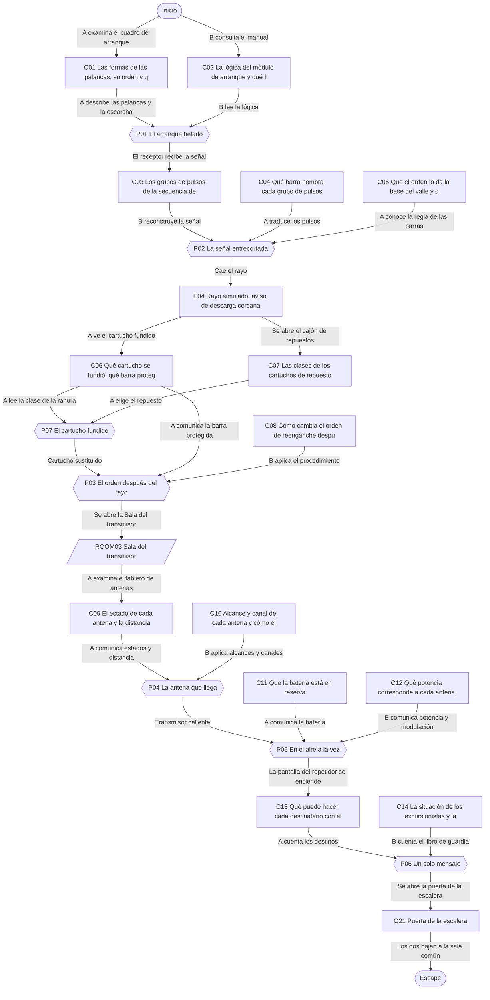
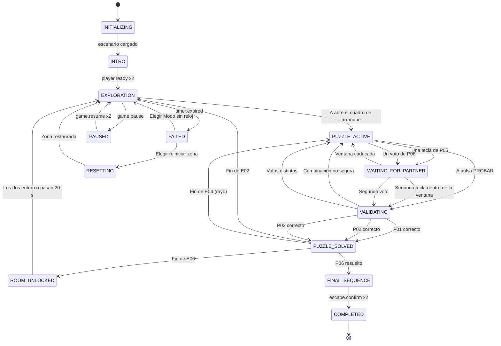

# ER02 · La última transmisión

Una tormenta de nieve deja sin corriente la estación de radio de Pico Albar, aislada en la montaña. Los dos guardas de la noche tienen hasta que se agote la batería de emergencia para devolver la vida a la estación y enviar el último parte. A maneja el cuadro de mando y ve los indicadores; B tiene el manual técnico y escucha una señal entrecortada. Un rayo lo complica todo y, al final, la batería solo alcanza para un mensaje: deciden juntos quién lo recibe.

## A. Ficha técnica

| Campo | Valor |
|---|---|
| ID | ER02 |
| Nombre | La última transmisión |
| Versión | 1.0.0 |
| Género | Thriller de supervivencia (moderado) |
| Sinopsis | Una tormenta de nieve deja sin corriente la estación de radio de Pico Albar, aislada en la montaña. Los dos guardas de la noche tienen hasta que se agote la batería de emergencia para devolver la vida a la estación y enviar el último parte. A maneja el cuadro de mando y ve los indicadores; B tiene el manual técnico y escucha una señal entrecortada. Un rayo lo complica todo y, al final, la batería solo alcanza para un mensaje: deciden juntos quién lo recibe. |
| Objetivo principal | OBJ01 Arrancar el generador auxiliar y reconectar las barras de la estación; OBJ02 Recuperar la antena después del rayo y fijar el canal de emisión; OBJ03 Emitir el último parte, elegir quién lo recibe y bajar a la sala común |
| Objetivos secundarios | — |
| Jugadores | 2 (A: Guarda del cuadro: palancas e indicadores; B: Guarda de radio: manual y señal) |
| Duración estimada | 50 min (despertar 4, descubrimiento 13, complicación 15, clímax 12, escape 6) |
| Dificultad | Media |
| Zonas | 3 |
| Acertijos | 6 principales y 1 microacertijos |
| Objetos interactivos | 15 (más 8 decorativos) |
| Finales | 3 |
| Competencias | Comunicación de instrucciones, Escucha activa, Razonamiento lógico, Seguimiento de procedimientos, Coordinación temporal, Toma de decisiones compartida |
| Condiciones iniciales | A empieza en la Sala de cuadros, frente al cuadro de mando de la estación, con una linterna de mano. B empieza en la Cabina de radio, con el manual técnico sobre la mesa y el receptor apagado. Las dos salas están separadas por un muro; se hablan por el interfono de la estación (la llamada de voz). La Sala del transmisor, al norte, está cerrada. El reloj de la partida es la batería de emergencia. Todo es ficticio: el cuadro, las palancas, los cartuchos y los relés son elementos de juego inventados y no reproducen ninguna instalación eléctrica real. |
| Condición de victoria | Completar OBJ01, OBJ02, OBJ03 |
| Condición de fallo | 50 min de cuenta atrás: La batería de emergencia entra en modo de ahorro y la estación espera en silencio. Los jugadores eligen reiniciar la zona actual o seguir en Modo sin reloj con la batería en reserva indefinida. No se pierde nada de lo resuelto. |
| Condición de reinicio | Cualquiera de los dos pulsa Reiniciar zona y el otro lo confirma; también se ofrece al agotarse la batería. El reinicio completo vuelve al estado inicial y a la intro. |

## B. Guion narrativo

**1. Introducción cinematográfica.** Viento fuerte contra madera. La cámara sube por una ladera nevada hasta una caseta con una antena torcida: Estación de radio Pico Albar, 2.300 m. Dentro, una luz se apaga. Una voz automática anuncia: Corte de suministro. Batería de emergencia activada. Autonomía: cincuenta minutos. La imagen se divide: a un lado, un cuadro de mando con palancas; al otro, un receptor mudo y un manual grueso.

**2. Por qué están aquí.** Los dos hacen la guardia de noche en la estación, que cada hora envía el parte meteorológico del puerto de montaña. Esta noche la tormenta ha cortado el suministro justo antes del último parte.

**3. Situación inicial.** La batería de emergencia mantiene encendidos los indicadores y el interfono, pero no el transmisor. El último mensaje recibido en el libro de guardia habla de dos excursionistas refugiados en una cabaña y de una carretera que quizá haya que cerrar.

**4. Objetivo.** Arrancar el generador auxiliar, reconectar las barras siguiendo la señal de la base del valle, recuperar la antena tras el rayo, fijar el canal, emitir a la vez y decidir quién recibe el único mensaje que permite la batería.

**5. Primer descubrimiento.** A ve que una de las palancas del cuadro de arranque está helada y no se mueve. B encuentra en el manual la lógica del módulo de arranque, pero las entradas tienen nombres de forma que solo A puede ver en el cuadro.

**6. Progresión de los acontecimientos.**

- El generador auxiliar arranca y enciende el receptor. Por él llega, entrecortada, la señal automática de la base de Valle Hondo con la secuencia de reconexión de barras.
- B reconstruye la secuencia juntando tres repeticiones con huecos y A conecta las barras en ese orden. La estación vuelve a zumbar.
- Un rayo cae cerca de la antena. Se funde un cartucho de protección del cuadro y las barras de antena caen. El orden de reenganche ya no es el mismo.
- A sustituye el cartucho y B aplica el procedimiento tras descarga: el orden cambia según lo que se fundió.
- La Sala del transmisor se abre. Con el tablero de antenas de A y la tabla de alcances de B, eligen la única antena que llega al repetidor y fijan su canal.
- Potencia y modulación se pulsan a la vez y la estación sale al aire.
- El repetidor de Peña Gris solo puede reenviar un mensaje antes del amanecer. Deciden juntos a quién.

**7. Obstáculos narrativos.**

- Una palanca del cuadro de arranque está helada.
- La señal de la base llega con cortes y cada repetición se oye incompleta.
- El rayo funde un cartucho y desconecta las barras de antena.
- Dos antenas no sirven: una está helada y otra dañada por el rayo.
- La emisión solo arranca si los dos pulsan a la vez.

**8. Revelaciones.**

- La señal entrecortada no es una persona pidiendo ayuda: es la baliza automática de la base, que repite la secuencia de reconexión cada noche de tormenta.
- La antena que parecía la más débil es la única que llega esta noche al repetidor.
- Los dos excursionistas están a salvo en la cabaña del Collado; lo urgente es avisar a tiempo, no rescatar a nadie en plena tormenta.

**9. Clímax.** Con la estación en el aire, la pantalla del repetidor de Peña Gris avisa de que solo puede reenviar un mensaje antes del amanecer. A ve en la pantalla qué puede hacer cada destinatario; B tiene en el libro de guardia lo que ha pasado esta noche. Votan juntos.

**10. Escena de escape.** El mensaje sale. La aguja del transmisor baja despacio, la tormenta amaina y el viento deja de golpear la caseta. La puerta de la escalera se desbloquea y los dos bajan a la sala común, donde la estufa ya calienta.

**11. Epílogo.** Al amanecer, la radio de la sala común recibe la respuesta de quien eligieron. Por la ventana se ve la ladera limpia de nieve y, a lo lejos, la luz de la máquina quitanieves subiendo por el puerto.

### Diálogos y textos del sistema

Cada línea es un subtítulo. Las líneas de canal `document` quedan además guardadas en el registro de pistas.

| ID | Quién | Texto | Cuándo | Para | Canal |
|---|---|---|---|---|---|
| D01 | Voz automática de la estación | Corte de suministro. Batería de emergencia activada. Autonomía: cincuenta minutos. | E01 | Ambos | audio_subtitled |
| D02 | Narrador | La linterna ilumina un cuadro de palancas. Una de ellas brilla de escarcha. | START | Jugador A | subtitle |
| D03 | Narrador | El receptor está mudo. Sobre la mesa, el manual técnico de la estación, grueso como un listín. | START | Jugador B | subtitle |
| D04 | Narrador | El viento golpea la caseta, pero las paredes aguantan. Estáis a cubierto. | START | Ambos | subtitle |
| D05 | Sistema | El generador auxiliar arranca. Se encienden las luces. | E02 | Ambos | popup |
| D06 | Baliza de Valle Hondo | Valle Hondo para Pico Albar, secuencia de reconexión de barras, cuatro grupos y fin. | E02 | Jugador B | audio_subtitled |
| D07 | Sistema | Las cuatro barras están conectadas. | E03 | Ambos | popup |
| D08 | Voz automática de la estación | Atención: descarga cercana en tres segundos. | E04 | Ambos | audio_subtitled |
| D09 | Narrador | Un destello blanco en el ventanuco y un trueno largo, amortiguado por la madera. Un piloto del panel de cartuchos muestra un aspa. | E04 | Jugador A | subtitle |
| D10 | Narrador | La ventana se ilumina un instante. Los cuatro relés del panel de reenganche caen con un clac. | E04 | Jugador B | subtitle |
| D11 | Voz automática de la estación | Antena desenganchada. Aplicad el procedimiento tras descarga, página nueve del manual. | E04 | Ambos | audio_subtitled |
| D12 | Sistema | Cartucho sustituido. Panel de reenganche listo. | E05 | Ambos | popup |
| D13 | Sistema | Antena enganchada. La puerta de la Sala del transmisor se abre. | E06 | Ambos | popup |
| D14 | Voz automática de la estación | Canal fijado. Transmisor en calentamiento. | E07 | Ambos | audio_subtitled |
| D15 | Sistema | El transmisor no arranca. Comprobad las teclas y pulsad a la vez. | P05 | Ambos | popup |
| D16 | Voz automática de la estación | En el aire. Enlace con el repetidor de Peña Gris establecido. | E08 | Ambos | audio_subtitled |
| D17 | Operadora de Peña Gris (grabación) | Aquí Peña Gris. Os recibo. Me queda batería para reenviar un solo mensaje antes del amanecer. Decidid a quién. | E08 | Ambos | audio_subtitled |
| D18 | Sistema | Han votado distinto. Cuéntense lo que saben y voten otra vez. | P06 | Ambos | popup |
| D19 | Operadora de Peña Gris (grabación) | Recibido y reenviado. El otro aviso sale en el parte de mediodía. Buen trabajo, Pico Albar. | E09 | Ambos | audio_subtitled |
| D20 | Narrador | El viento se calma. Por el ventanal entra la primera luz del día. | E09 | Ambos | subtitle |
| D21 | Voz automática de la estación | Cada uno de vosotros ve una parte del sistema. Antes de tocar nada, contaos lo que tenéis delante. | E10 | Ambos | audio_subtitled |
| D22 | Voz automática de la estación | Batería en modo de ahorro. Podéis reiniciar esta zona o seguir sin reloj. No se pierde nada de lo resuelto. | E11 | Ambos | popup |
| D23 | Libro de guardia | 19:00. Dos excursionistas en la cabaña del Collado. Están bien, con leña y comida para dos días. | C14_DISCOVERED | Jugador B | document |

## C. Escenografía y planos

Coordenadas en metros con origen en la esquina suroeste del suelo de cada zona: `x` hacia el este, `y` hacia arriba, `z` hacia el norte.

### ROOM01 · Sala de cuadros

Cuarto estrecho de paredes de madera con el cuadro de mando de la estación: el módulo de arranque, los interruptores de barra y el panel de cartuchos de protección. Huele a leña fría.

**Medidas:** 5 × 4 m, altura 2.8 m. **Acceso:** A sí, B no. **Se abre:** desde el inicio.

**Qué ve cada jugador.** A: Todo el cuarto: palancas, pilotos, cartuchos e indicador de batería. B: No lo ve; oye a A por el interfono y el zumbido del cuadro a través del muro.

**Distribución.** Cuadro de arranque en la pared oeste, al sur. Interruptores de barra en la pared oeste, al norte. Panel de cartuchos en la pared norte, junto a la puerta de la Sala del transmisor. Cajón de repuestos bajo el panel de cartuchos. Indicador de batería en la pared este, junto al interfono. Estufa de leña en la esquina sureste, mapa de rutas en la pared sur y taquilla en la esquina suroeste.

| ID | Elemento | Tipo o pared | Posición (x, y, z) | Notas |
|---|---|---|---|---|
| DOOR01 | Puerta a Sala del transmisor | pared north | (4, 0, 4) | Se abre con P03_SOLVED |
| — | Ventana | pared south | (2.5, 1.6, 0) | Ventanuco con nieve pegada; deja ver la ventisca y los destellos de la tormenta; no es interactivo |
| O01 | Cuadro de arranque auxiliar | 8 Mecanismo cooperativo | (0.2, 1.2, 1.5) | Caja metálica con cuatro palancas en fila, cada una con una forma en relieve, tres pilotos rotulados y un botón PROBAR |
| O02 | Interruptores de barra | 8 Mecanismo cooperativo | (0.2, 1.2, 3) | Cuatro interruptores grandes rotulados NORTE, SUR, ESTE y OESTE, cada uno con un piloto que dice CONECTADA o DESCONECTADA |
| O03 | Panel de cartuchos de protección | 5 Combinar | (3, 1.3, 3.9) | Cuatro cartuchos cerámicos ficticios rotulados F1 a F4, cada uno con un piloto que muestra círculo y CORRECTO o aspa y FUNDIDO, y una placa con la barra que protege |
| O04 | Cajón de cartuchos de repuesto | 3 Recoger | (3, 0.5, 3.8) | Cajón metálico con tres cartuchos de repuesto marcados con uno, tres y cinco puntos en relieve y la palabra CLASE |
| O05 | Indicador de batería de emergencia | 9 Elemento narrativo | (4.9, 1.5, 2) | Barra vertical de diez segmentos junto al interfono, con los minutos de autonomía en números grandes |
| O06 | Estufa de leña apagada | 1 Decorativo | (4.5, 0, 0.5) | Estufa de hierro con la puerta entreabierta y ceniza fría |
| O07 | Mapa de rutas de montaña | 1 Decorativo | (2.5, 1.5, 0.05) | Mapa enmarcado del macizo con senderos marcados a lápiz y la cabaña del Collado rodeada |
| O08 | Taquilla con chaquetones | 1 Decorativo | (0.4, 0, 0.4) | Taquilla de madera abierta con dos chaquetones de plumas y unos crampones colgados |

| Luz | Tipo | Posición | Color | Intensidad | Uso |
|---|---|---|---|---|---|
| L01 | Linterna de mano de A | (2.5, 1.4, 2) | #FFF4DD | 0.6 | Luz principal hasta P01; sigue la mirada de A |
| L02 | Plafón de techo | (2.5, 2.7, 2) | #FFE6B8 | 0.7 | Apagado al inicio; se enciende con el generador auxiliar (E02) y baja al 40 % tras el rayo (E04) |
| L03 | Pilotos del cuadro | (0.2, 1.4, 2.5) | #9CFF9C | 0.2 | Cada piloto tiene además una palabra y una forma (círculo correcto, aspa fundido); nunca solo color |

**Sonido ambiente:** Viento fuerte contra madera y crujidos de la caseta, sin golpes bruscos. **Música:** Pulso grave de sintetizador y cuerdas tenues; tensión moderada que sube un poco tras el rayo.

**Cambios dinámicos:**

- E02: Se enciende el plafón y los interruptores de barra reciben corriente
- E04: Destello en el ventanuco, trueno amortiguado; el piloto de un cartucho pasa a FUNDIDO con aspa y se abre el cajón de repuestos
- E05: El cartucho nuevo encaja y el piloto vuelve a CORRECTO con círculo

**Para el motor:** Escena del jugador A. El cuadro es un panel de interfaz diegético: palancas con estado ARRIBA o ABAJO que se muestra con posición, flecha y texto. Los pilotos solo cambian al pulsar PROBAR, para que la lógica no se resuelva por tanteo visual. El rayo es un destello único limitado a una subida de luminancia del 30 % durante 0,3 s, con aviso sonoro previo de 3 s, apto para personas fotosensibles; con movimiento reducido se sustituye por un cambio de color del ventanuco. Ningún elemento imita una instalación real.

### ROOM02 · Cabina de radio

Cabina pequeña con mesa corrida, el receptor de onda corta con su lámpara de pulsos, el panel de reenganche de antena y el manual técnico de la estación. Una ventana helada da a la ladera.

**Medidas:** 4 × 4 m, altura 2.8 m. **Acceso:** A no, B sí. **Se abre:** desde el inicio.

**Qué ve cada jugador.** A: No la ve; oye a B por el interfono. B: Toda la cabina: receptor, lámpara de pulsos, manual, panel de reenganche y libro de guardia.

**Distribución.** Mesa corrida en la pared este con el receptor en el centro y el manual a su izquierda. Panel de reenganche de antena en la pared norte, junto a la puerta de la Sala del transmisor. Libro de guardia en la esquina suroeste, sobre un atril. Silla giratoria frente al receptor. Ventana helada en la pared sur. Banderines de radioaficionados en la pared oeste. Termo y taza en la mesa.

| ID | Elemento | Tipo o pared | Posición (x, y, z) | Notas |
|---|---|---|---|---|
| DOOR02 | Puerta a Sala del transmisor | pared north | (1, 0, 4) | Se abre con P03_SOLVED |
| — | Ventana | pared south | (2, 1.5, 0) | Ventana helada; se ve la nieve en horizontal y los destellos lejanos; no es interactiva |
| O09 | Manual técnico de la estación | 2 Examinar | (3.6, 0.8, 2.8) | Carpeta gruesa de anillas con la portada Manual técnico, Estación Pico Albar, edición de entrenamiento, y un índice con pestañas |
| O10 | Receptor de onda corta | 2 Examinar | (3.7, 0.9, 2) | Receptor con altavoz, pantalla de texto y una lámpara de pulsos redonda encima |
| O11 | Panel de reenganche de antena | 8 Mecanismo cooperativo | (2.5, 1.3, 3.9) | Panel con cuatro relés rotulados NORTE, SUR, ESTE y OESTE, cada uno con una flecha a su punto cardinal y un indicador ENGANCHADO o ABAJO |
| O12 | Libro de guardia | 2 Examinar | (0.5, 1, 0.5) | Libro de tapas verdes abierto sobre un atril, con anotaciones a mano y la hora de cada una |
| O13 | Termo y taza | 1 Decorativo | (3.6, 0.8, 1.2) | Termo de acero y una taza con el escudo de la estación, aún templada |
| O14 | Banderines de radioaficionados | 1 Decorativo | (0.05, 1.6, 2.5) | Tarjetas y banderines de estaciones lejanas clavados en el corcho de la pared oeste |
| O15 | Silla giratoria | 1 Decorativo | (2.8, 0, 2) | Silla de oficina gastada con una manta doblada encima |

| Luz | Tipo | Posición | Color | Intensidad | Uso |
|---|---|---|---|---|---|
| L04 | Lámpara de emergencia de pared | (0.2, 2.2, 2) | #FFD08A | 0.35 | Luz tenue alimentada por la batería; suficiente para leer el manual |
| L05 | Lámpara de pulsos del receptor | (3.8, 1.1, 2) | #FFFFFF | 0.3 | Destella corto o largo con cada pulso de la señal; se acompaña siempre del texto corto o largo en la pantalla |
| L06 | Flexo de la mesa | (3.6, 1.3, 1) | #FFF1D6 | 0.5 | Se enciende con el generador auxiliar |

**Sonido ambiente:** Estática suave de radio y viento lejano. **Música:** Pulso grave de sintetizador y cuerdas tenues; tensión moderada que sube un poco tras el rayo.

**Cambios dinámicos:**

- E02: El receptor se enciende y empieza a sonar la señal entrecortada, con la lámpara de pulsos y el texto
- E04: La ventana se ilumina un instante y los relés del panel de reenganche caen a ABAJO
- E06: Los cuatro relés quedan ENGANCHADOS y se abre la puerta norte

**Para el motor:** Escena del jugador B. La señal del receptor es un audio de pitidos cortos y largos con ruido; cada pulso se muestra a la vez como destello de la lámpara y como texto (corto, largo, [ruido]) en la pantalla del receptor y en el registro de pistas. El manual es un documento de varias páginas con índice navegable por teclado. El panel de reenganche tiene cuatro relés rotulados con texto y con una flecha que indica su punto cardinal.

### ROOM03 · Sala del transmisor

Sala alta con el armario del transmisor en el centro, que la divide en dos lados. Al oeste, la consola de potencia con el tablero de antenas; al este, la consola de modulación. Un ventanal da a la cresta y a la antena.

**Medidas:** 7 × 5 m, altura 3.2 m. **Acceso:** A sí, B sí. **Se abre:** P03_SOLVED.

**Qué ve cada jugador.** A: Toda la sala; desde la consola de potencia ve el tablero de antenas y la pantalla del repetidor, pero no la pantalla de la consola de modulación. B: Toda la sala; desde la consola de modulación ve su dial y sus teclas, pero no el tablero de antenas ni la pantalla del repetidor.

**Distribución.** Entradas en la pared sur: desde la Sala de cuadros en x 5.5 y desde la Cabina de radio en x 1.5. Armario del transmisor en el centro, de pared a pared hasta media altura. Consola de potencia, tablero de antenas y pantalla del repetidor en la mitad oeste. Consola de modulación en la mitad este. Puerta de la escalera a la sala común en la pared norte, centro. Barómetro en la pared este y vitrina de válvulas antiguas en la esquina noroeste. Ventanal en la pared norte.

| ID | Elemento | Tipo o pared | Posición (x, y, z) | Notas |
|---|---|---|---|---|
| DOOR03 | Puerta a Sala de cuadros | pared south | (5.5, 0, 0) | Se abre con P03_SOLVED |
| DOOR04 | Puerta a Cabina de radio | pared south | (1.5, 0, 0) | Se abre con P03_SOLVED |
| DOOR05 | Puerta de salida | pared north | (3.5, 0, 5) | Se abre con P06_SOLVED |
| — | Ventana | pared north | (5.5, 1.8, 5) | Ventanal a la cresta: se ven las tres antenas y cómo amaina la tormenta tras P06; no es interactivo |
| O16 | Armario del transmisor | 9 Elemento narrativo | (3.5, 0, 2.5) | Armario metálico gris de pared a pared hasta media altura, con aguja de temperatura y un rótulo EN EL AIRE encima |
| O17 | Consola de potencia | 8 Mecanismo cooperativo | (0.6, 1, 2.5) | Consola en la mitad oeste con indicador de batería y tres teclas: BAJA con triángulo, MEDIA con cuadrado y ALTA con círculo; solo responde a A |
| O18 | Tablero de antenas | 2 Examinar | (0.1, 1.6, 3.5) | Tablero en la mitad oeste con las tres antenas dibujadas, su estado escrito y un mapa de cobertura con distancias |
| O19 | Consola de modulación | 8 Mecanismo cooperativo | (6.4, 1, 2.5) | Consola en la mitad este con dial de tres ruedas, botón FIJAR y dos teclas: ESTRECHA con línea recta y ANCHA con onda; solo responde a B |
| O20 | Pantalla del repetidor | 2 Examinar | (0.1, 1.6, 1.5) | Pantalla pequeña junto al tablero de antenas con el rótulo Repetidor de Peña Gris |
| O21 | Puerta de la escalera | 10 Objeto de salida | (3.5, 0, 4.95) | Puerta de madera con barra antipánico y un letrero: Sala común |
| O22 | Vitrina de válvulas antiguas | 1 Decorativo | (0.5, 0, 4.5) | Vitrina con válvulas de radio de cristal de los primeros años de la estación, con etiquetas de fecha |
| O23 | Barómetro de pared | 1 Decorativo | (6.95, 1.7, 4) | Barómetro de latón con la aguja en Tormenta; tras el final sube a Variable |

| Luz | Tipo | Posición | Color | Intensidad | Uso |
|---|---|---|---|---|---|
| L07 | Tubos de techo | (3.5, 3.1, 2.5) | #EAF2FF | 0.6 | Encendidos al entrar |
| L08 | Indicador EN EL AIRE | (3.5, 2.6, 2.5) | #FF6B6B | 0.4 | Rótulo con las palabras EN EL AIRE; se ilumina al resolver P05 y no parpadea |
| L09 | Luz del amanecer | (5.5, 2.2, 4.8) | #FFC9A3 | 0.5 | Entra por el ventanal en la secuencia final |

**Sonido ambiente:** Eco de sala alta con viento al otro lado del ventanal. **Música:** Tema de la estación: piano y cuerdas, más luminoso que A02.

**Cambios dinámicos:**

- E07: El armario del transmisor se calienta: sube la aguja de temperatura y suena un zumbido grave
- E08: Se enciende EN EL AIRE y la pantalla del repetidor muestra los dos destinatarios
- E09: La tormenta amaina en el ventanal, entra la luz del amanecer y se abre la puerta de la escalera

**Para el motor:** Escena compartida que se carga al resolver P03. El armario del transmisor tiene colisión de pared a media altura: los avatares se ven por encima, pero las pantallas de cada consola son paneles de interfaz por jugador (la consola de potencia solo acepta a A y la de modulación solo a B). El dial de canal tiene tres ruedas del 0 al 9. Las teclas de potencia y modulación llevan forma, palabra y braille.

## D. Inventario de objetos

| object_id | Nombre | Descripción visual | Zona | Posición | Tipo | Estado inicial | Acción | Activación | Resultado | Pista | Acertijo | Jugador | Estado final |
|---|---|---|---|---|---|---|---|---|---|---|---|---|---|
| O01 | Cuadro de arranque auxiliar | Caja metálica con cuatro palancas en fila, cada una con una forma en relieve, tres pilotos rotulados y un botón PROBAR | ROOM01 | (0.2, 1.2, 1.5) | 8 Mecanismo cooperativo | COLD | Subir o bajar palancas y pulsar PROBAR | — | Si la combinación cumple la lógica del manual, arranca el generador auxiliar; si no, los pilotos muestran la combinación probada y nada arranca | C01 | P01 | Jugador A | STARTED |
| O02 | Interruptores de barra | Cuatro interruptores grandes rotulados NORTE, SUR, ESTE y OESTE, cada uno con un piloto que dice CONECTADA o DESCONECTADA | ROOM01 | (0.2, 1.2, 3) | 8 Mecanismo cooperativo | UNPOWERED | Conectar las barras de una en una | P01_SOLVED | Si el orden es correcto, las cuatro barras quedan conectadas; si no, todas se desconectan | C05 | P02 | Jugador A | CONNECTED |
| O03 | Panel de cartuchos de protección | Cuatro cartuchos cerámicos ficticios rotulados F1 a F4, cada uno con un piloto que muestra círculo y CORRECTO o aspa y FUNDIDO, y una placa con la barra que protege | ROOM01 | (3, 1.3, 3.9) | 5 Combinar | NORMAL | Examinar; colocar un cartucho de repuesto en la ranura vacía | P02_SOLVED | Tras el rayo muestra qué cartucho se fundió (C06); con el repuesto correcto vuelve a CORRECTO | C06 | P07 | Jugador A | REPAIRED |
| O04 | Cajón de cartuchos de repuesto | Cajón metálico con tres cartuchos de repuesto marcados con uno, tres y cinco puntos en relieve y la palabra CLASE | ROOM01 | (3, 0.5, 3.8) | 3 Recoger | LOCKED | Abrir y coger un cartucho | P02_SOLVED | Se abre solo con el aviso de avería tras el rayo; el cartucho elegido pasa al inventario de A | C07 | P07 | Jugador A | USED |
| O05 | Indicador de batería de emergencia | Barra vertical de diez segmentos junto al interfono, con los minutos de autonomía en números grandes | ROOM01 | (4.9, 1.5, 2) | 9 Elemento narrativo | DRAINING | Mirar | — | Muestra el reloj de la partida en minutos y segmentos | — | — | Jugador A | DRAINING |
| O06 | Estufa de leña apagada | Estufa de hierro con la puerta entreabierta y ceniza fría | ROOM01 | (4.5, 0, 0.5) | 1 Decorativo | STATIC | none | — | Sin interacción | — | — | Nadie | STATIC |
| O07 | Mapa de rutas de montaña | Mapa enmarcado del macizo con senderos marcados a lápiz y la cabaña del Collado rodeada | ROOM01 | (2.5, 1.5, 0.05) | 1 Decorativo | STATIC | none | — | Sin interacción | — | — | Nadie | STATIC |
| O08 | Taquilla con chaquetones | Taquilla de madera abierta con dos chaquetones de plumas y unos crampones colgados | ROOM01 | (0.4, 0, 0.4) | 1 Decorativo | STATIC | none | — | Sin interacción | — | — | Nadie | STATIC |
| O09 | Manual técnico de la estación | Carpeta gruesa de anillas con la portada Manual técnico, Estación Pico Albar, edición de entrenamiento, y un índice con pestañas | ROOM02 | (3.6, 0.8, 2.8) | 2 Examinar | CLOSED | Abrir y consultar páginas | — | Guarda en el registro de B cada página consultada: C02, C08, C10 y C12 | C02 | P01 | Jugador B | EXAMINED |
| O10 | Receptor de onda corta | Receptor con altavoz, pantalla de texto y una lámpara de pulsos redonda encima | ROOM02 | (3.7, 0.9, 2) | 2 Examinar | OFF | Escuchar y leer la pantalla | P01_SOLVED | Con el generador auxiliar recibe la señal de Valle Hondo (C03), la reproduce en bucle y la transcribe | C03 | P02 | Jugador B | ON |
| O11 | Panel de reenganche de antena | Panel con cuatro relés rotulados NORTE, SUR, ESTE y OESTE, cada uno con una flecha a su punto cardinal y un indicador ENGANCHADO o ABAJO | ROOM02 | (2.5, 1.3, 3.9) | 8 Mecanismo cooperativo | ENGAGED_OLD | Enganchar relés de uno en uno | P07_SOLVED | Si el orden cumple el procedimiento tras descarga, la antena queda enganchada y se abre la Sala del transmisor; si no, los relés vuelven a ABAJO | — | P03 | Jugador B | ENGAGED |
| O12 | Libro de guardia | Libro de tapas verdes abierto sobre un atril, con anotaciones a mano y la hora de cada una | ROOM02 | (0.5, 1, 0.5) | 2 Examinar | DEFAULT | Leer | — | Guarda C14 | C14 | P06 | Jugador B | EXAMINED |
| O13 | Termo y taza | Termo de acero y una taza con el escudo de la estación, aún templada | ROOM02 | (3.6, 0.8, 1.2) | 1 Decorativo | STATIC | none | — | Sin interacción | — | — | Nadie | STATIC |
| O14 | Banderines de radioaficionados | Tarjetas y banderines de estaciones lejanas clavados en el corcho de la pared oeste | ROOM02 | (0.05, 1.6, 2.5) | 1 Decorativo | STATIC | none | — | Sin interacción | — | — | Nadie | STATIC |
| O15 | Silla giratoria | Silla de oficina gastada con una manta doblada encima | ROOM02 | (2.8, 0, 2) | 1 Decorativo | STATIC | none | — | Sin interacción | — | — | Nadie | STATIC |
| O16 | Armario del transmisor | Armario metálico gris de pared a pared hasta media altura, con aguja de temperatura y un rótulo EN EL AIRE encima | ROOM03 | (3.5, 0, 2.5) | 9 Elemento narrativo | COLD | Mirar | — | Muestra el estado del transmisor con su aguja y su rótulo | — | — | Ambos | ON_AIR |
| O17 | Consola de potencia | Consola en la mitad oeste con indicador de batería y tres teclas: BAJA con triángulo, MEDIA con cuadrado y ALTA con círculo; solo responde a A | ROOM03 | (0.6, 1, 2.5) | 8 Mecanismo cooperativo | LOCKED | Pulsar una tecla de potencia y votar | P04_SOLVED | Envía la potencia elegida en el momento de la emisión; después recoge el voto de A | C11 | P05 | Jugador A | ON_AIR |
| O18 | Tablero de antenas | Tablero en la mitad oeste con las tres antenas dibujadas, su estado escrito y un mapa de cobertura con distancias | ROOM03 | (0.1, 1.6, 3.5) | 2 Examinar | DEFAULT | Examinar | — | Guarda C09 | C09 | P04 | Jugador A | EXAMINED |
| O19 | Consola de modulación | Consola en la mitad este con dial de tres ruedas, botón FIJAR y dos teclas: ESTRECHA con línea recta y ANCHA con onda; solo responde a B | ROOM03 | (6.4, 1, 2.5) | 8 Mecanismo cooperativo | LOCKED | Marcar el canal y pulsar FIJAR; pulsar una tecla de modulación; votar | P03_SOLVED | Fija el canal de emisión, envía la modulación y recoge el voto de B | — | P04 | Jugador B | ON_AIR |
| O20 | Pantalla del repetidor | Pantalla pequeña junto al tablero de antenas con el rótulo Repetidor de Peña Gris | ROOM03 | (0.1, 1.6, 1.5) | 2 Examinar | DARK | Leer | P05_SOLVED | Con la estación en el aire muestra los dos destinatarios posibles (C13) | C13 | P06 | Jugador A | LIVE |
| O21 | Puerta de la escalera | Puerta de madera con barra antipánico y un letrero: Sala común | ROOM03 | (3.5, 0, 4.95) | 10 Objeto de salida | LOCKED | Bajar a la sala común | P06_SOLVED | Confirma la salida de quien la cruza; la partida termina cuando la cruzan los dos | — | — | Ambos | OPEN |
| O22 | Vitrina de válvulas antiguas | Vitrina con válvulas de radio de cristal de los primeros años de la estación, con etiquetas de fecha | ROOM03 | (0.5, 0, 4.5) | 1 Decorativo | STATIC | none | — | Sin interacción | — | — | Nadie | STATIC |
| O23 | Barómetro de pared | Barómetro de latón con la aguja en Tormenta; tras el final sube a Variable | ROOM03 | (6.95, 1.7, 4) | 1 Decorativo | STATIC | none | — | Sin interacción | — | — | Nadie | STATIC |

## E. Pistas

| clue_id | Contenido exacto | Alternativa accesible | Ubicación | Descubrimiento | Quién | Acertijo | Revela | Depende de | Se habilita | Nivel | Descubierta cuando |
|---|---|---|---|---|---|---|---|---|---|---|---|
| C01 | Cuadro de arranque auxiliar. Cuatro palancas de izquierda a derecha, cada una con su forma en relieve: círculo, rombo, triángulo y cuadrado. Todas están abajo. La palanca del triángulo está cubierta de escarcha y no se mueve: se queda abajo. Pilotos: ARRANQUE, ALERTA y SOBRECARGA. Placa: El generador arranca al pulsar PROBAR si la combinación es segura. | Lista en texto grande: palancas círculo, rombo, triángulo (helada, abajo) y cuadrado; pilotos ARRANQUE, ALERTA y SOBRECARGA. La escarcha se indica con texto y con un icono de copo de nieve. | O01 Cuadro de arranque auxiliar | A examina el cuadro de arranque con la linterna | Jugador A | P01 | Las formas de las palancas, su orden y que la del triángulo está helada | — | — | 0 | — |
| C02 | Manual técnico, página 4: Módulo de arranque auxiliar. Entradas: E1 palanca triángulo, E2 palanca círculo, E3 palanca cuadrado, E4 palanca rombo. Palanca arriba vale 1 y abajo vale 0. Una puerta O da 1 si al menos una de sus entradas vale 1. Una puerta Y da 1 solo si sus dos entradas valen 1. ARRANQUE = (E1 O E2) Y (E3 O E4). ALERTA = E2 Y E4. SOBRECARGA = E1 Y E3. El generador solo arranca con ARRANQUE encendido y ALERTA y SOBRECARGA apagados. | Texto de la página con lectura en voz; el esquema de puertas se describe también en frases y como tabla de verdad de cada piloto. | O09 Manual técnico de la estación | B consulta la página 4 del manual | Jugador B | P01 | La lógica del módulo de arranque y qué forma corresponde a cada entrada | — | — | 0 | O09_EXAMINED |
| C03 | Señal automática de la base Valle Hondo, transcrita por el receptor: Valle Hondo para Pico Albar, secuencia de reconexión de barras, cuatro grupos y fin. Repetición 1: largo corto / largo largo corto / [ruido] / [ruido] / [ruido]. Repetición 2: [ruido] / largo largo corto / corto largo / [ruido] / [ruido]. Repetición 3: [ruido] / [ruido] / corto largo / corto corto largo / corto corto corto. | Cada pulso se oye como pitido corto o largo, se ve como destello corto o largo de la lámpara y se escribe en la pantalla como corto o largo; los cortes de la señal aparecen como [ruido]. | O10 Receptor de onda corta | B escucha el receptor cuando arranca el generador auxiliar | Jugador B | P02 | Los grupos de pulsos de la secuencia de reconexión, repartidos entre tres repeticiones incompletas | — | P01_SOLVED | 0 | O10_ON |
| C04 | Tabla plastificada atornillada junto a los interruptores de barra: Código de pulsos de la red de montaña. corto largo: barra NORTE. largo corto: barra SUR. corto corto largo: barra ESTE. largo largo corto: barra OESTE. corto corto corto: fin de secuencia. Si una repetición llega incompleta, completadla con las demás: los grupos siempre van en el mismo orden. | Tabla en texto grande con lectura en voz: cada combinación de cortos y largos y la barra que nombra. | O02 Interruptores de barra | A examina los interruptores de barra | Jugador A | P02 | Qué barra nombra cada grupo de pulsos | — | — | 0 | — |
| C05 | Placa de los interruptores de barra: Conectad las barras de una en una en el orden que transmita la base del valle. Un orden distinto las desconecta todas. Interruptores: NORTE, SUR, ESTE y OESTE. | Texto de la placa en grande; cada interruptor tiene su nombre escrito y su estado en palabras. | O02 Interruptores de barra | A examina los interruptores de barra | Jugador A | P02 | Que el orden lo da la base del valle y qué interruptores hay | — | — | 0 | — |
| C06 | Panel de cartuchos tras el rayo. F1 protege la barra OESTE: círculo, CORRECTO. F2 protege la barra NORTE: aspa, FUNDIDO. F3 protege la barra SUR: círculo, CORRECTO. F4 protege la barra ESTE: círculo, CORRECTO. Placa de la ranura de F2: Clase 3. | Lista en texto: F1 Oeste correcto; F2 Norte fundido, clase 3; F3 Sur correcto; F4 Este correcto. El estado se indica con palabra y forma, no con color. | O03 Panel de cartuchos de protección | A examina el panel de cartuchos tras el rayo | Jugador A | P03 | Qué cartucho se fundió, qué barra protege y qué clase de repuesto necesita | — | P02_SOLVED | 0 | O03_FUSED |
| C07 | Cajón de repuestos: tres cartuchos. Uno con un punto en relieve y la palabra CLASE 1, otro con tres puntos y CLASE 3, y otro con cinco puntos y CLASE 5. | Texto: repuestos de clase 1, 3 y 5, marcados también con uno, tres y cinco puntos en relieve. | O04 Cajón de cartuchos de repuesto | A abre el cajón cuando se abre solo tras el rayo | Jugador A | P07 | Las clases de los cartuchos de repuesto | — | P02_SOLVED | 0 | P02_SOLVED |
| C08 | Manual técnico, página 9: Procedimiento tras una descarga. Primero: sustituid el cartucho fundido por uno de su misma clase. Segundo: reenganchad los relés de antena en el orden inverso al de la última reconexión de barras. Tercero: el relé de la barra que protegía el cartucho fundido no se engancha en su turno, sino el último de todos. | Texto de la página en tres pasos numerados con lectura en voz. | O09 Manual técnico de la estación | B consulta la página 9 del manual | Jugador B | P03 | Cómo cambia el orden de reenganche después de un rayo | — | — | 0 | O09_EXAMINED |
| C09 | Tablero de antenas. Antena Norte: copo de nieve y texto HIELO. Antena Cresta: círculo y texto EN SERVICIO. Antena Collado: aspa y texto DAÑADA POR EL RAYO. Mapa de cobertura: el repetidor de Peña Gris está a 40 km de la estación. | Lista en texto: Norte con hielo, Cresta en servicio, Collado dañada; repetidor a 40 km. Cada estado se indica con palabra y forma. | O18 Tablero de antenas | A examina el tablero de antenas de la consola de potencia | Jugador A | P04 | El estado de cada antena y la distancia al repetidor | — | P03_SOLVED | 0 | O18_EXAMINED |
| C10 | Manual técnico, página 12: Antenas de la estación. Alcance con buen tiempo y canal: Collado, 80 km, canal 518. Norte, 60 km, canal 147. Cresta, 45 km, canal 362. Una antena con hielo solo alcanza la mitad de su distancia. Una antena dañada no emite. Emitid siempre por la antena que funcione y llegue al destino; si llegan varias, por la de mayor alcance. | Tabla de tres filas con antena, alcance y canal, y las reglas en frases, con lectura en voz. | O09 Manual técnico de la estación | B consulta la página 12 del manual | Jugador B | P04 | Alcance y canal de cada antena y cómo elegir | — | — | 0 | O09_EXAMINED |
| C11 | Indicador de batería de la consola de potencia: 3 de 10 segmentos encendidos y la palabra RESERVA. | Texto: batería en RESERVA, 3 de 10 segmentos. | O17 Consola de potencia | A mira la consola de potencia | Jugador A | P05 | Que la batería está en reserva | — | P03_SOLVED | 0 | — |
| C12 | Manual técnico, página 13: Emisión. Potencia según la antena: Norte, ALTA (tecla círculo); Cresta, MEDIA (tecla cuadrado); Collado, BAJA (tecla triángulo). Modulación según la batería: si el indicador marca RESERVA, ESTRECHA (tecla de línea recta); si no, ANCHA (tecla de onda). La emisión arranca solo si la tecla de potencia y la de modulación se pulsan a la vez, con menos de dos segundos de diferencia. | Dos tablas con lectura en voz: antena y potencia con su forma; batería y modulación con su forma; y la regla de pulsar a la vez. | O09 Manual técnico de la estación | B consulta la página 13 del manual | Jugador B | P05 | Qué potencia corresponde a cada antena, qué modulación corresponde a la batería y la regla de simultaneidad | — | — | 0 | O09_EXAMINED |
| C13 | Pantalla del repetidor de Peña Gris: Batería del repetidor baja. Solo puedo reenviar un mensaje antes del amanecer. Destino 1, Refugio Valle Hondo: su equipo de montaña puede subir a la cabaña del Collado en cuanto amanezca. Destino 2, Ayuntamiento de Sorbe: puede cerrar la carretera del puerto antes de las ocho de la mañana. El mensaje que no se envíe saldrá en el siguiente parte de mediodía. | Texto en pantalla con lectura en voz; los dos destinos en tarjetas con icono de montaña y de carretera además del nombre. | O20 Pantalla del repetidor | Aparece en la pantalla del repetidor al salir al aire | Jugador A | P06 | Qué puede hacer cada destinatario con el mensaje | — | P05_SOLVED | 0 | O20_LIVE |
| C14 | Libro de guardia. 19:00: dos excursionistas avisan por radio de que pasan la noche en la cabaña del Collado; están bien, tienen leña y comida para dos días, pero no conocen el camino de bajada con nieve. 21:30: el Ayuntamiento de Sorbe pregunta si debe cerrar la carretera del puerto por la helada; mañana a las ocho sube el autobús de la escuela. 22:10: corte de suministro. | Las tres anotaciones en texto grande con su hora, con lectura en voz. | O12 Libro de guardia | B lee el libro de guardia | Jugador B | P06 | La situación de los excursionistas y la pregunta de Sorbe | — | — | 0 | O12_EXAMINED |
| C15 | Voz automática de la estación: Cada uno de vosotros ve una parte del sistema. Antes de tocar nada, contaos lo que tenéis delante. | Aviso en texto en la pantalla de los dos jugadores. | O05 Indicador de batería de emergencia | Ayuda contextual que ofrece el sistema si nadie progresa en 2 minutos | Ambos | P01 | Que la información está repartida entre los dos | — | IDLE_120 | 1 | IDLE_120 |

### Ayudas progresivas por acertijo

| Acertijo | Nivel 1: dónde mirar | Nivel 2: principio | Nivel 3: ayuda concreta |
|---|---|---|---|
| P01 El arranque helado | A ve las palancas y B tiene la lógica: lean juntos las fórmulas. | Empiecen por lo que no pueden cambiar: la palanca helada. | El triángulo es E1 y está abajo, así que el círculo (E2) tiene que subir. |
| P02 La señal entrecortada | La señal llega a B; la tabla de pulsos y los interruptores los tiene A. | Ninguna repetición está completa: junten las tres, porque los grupos siempre van en el mismo orden. | El primer grupo es largo corto: la barra SUR. |
| P07 El cartucho fundido | Mira la placa de la ranura vacía. | El repuesto debe ser de la misma clase. | Usa el cartucho de tres puntos. |
| P03 El orden después del rayo | El procedimiento lo tiene B y el cartucho fundido lo ve A. | Inviertan la última secuencia de barras y luego miren qué barra protegía el cartucho fundido. | Al revés queda ESTE, NORTE, OESTE, SUR; NORTE pasa al final. |
| P04 La antena que llega | El estado de las antenas lo ve A; los alcances están en el manual de B. | Descarten las antenas que no emiten o que no llegan a 40 km. | El hielo deja la antena Norte en 30 km; solo la Cresta llega. |
| P05 En el aire a la vez | A ve la batería y B sabe qué significa; B sabe la potencia y A tiene la tecla. | La potencia depende de la antena elegida y la modulación del indicador de batería. | A pulsa MEDIA y B ESTRECHA, a la vez, tras contar tres. |
| P06 Un solo mensaje | A sabe qué puede hacer cada destinatario y B sabe qué ha pasado esta noche. | No hay opción incorrecta: el otro mensaje sale en el parte de mediodía. | Voten la misma opción en las dos consolas. |

## F. Acertijos

### P01 · El arranque helado

1. **ID.** P01
2. **Nombre.** El arranque helado
3. **Narrativa.** Sin el generador auxiliar no hay receptor ni luz. El módulo de arranque tiene una lógica de seguridad que solo explica el manual, y una de sus palancas está helada.
4. **Objetivo.** Poner las cuatro palancas del cuadro de arranque en una combinación segura y pulsar PROBAR.
5. **Situación.** A está ante el cuadro con cuatro palancas de formas y tres pilotos. B tiene el manual con la lógica, pero no ve las palancas ni sabe que una está helada.
6. **Elementos necesarios.** O01 Cuadro de arranque auxiliar, O09 Manual técnico de la estación
7. **Información de A.** Las formas de las palancas, su orden y que la del triángulo está helada abajo (C01).
8. **Información de B.** Qué forma es cada entrada y las fórmulas de ARRANQUE, ALERTA y SOBRECARGA (C02).
9. **Qué deben comunicarse.** B lee las fórmulas y la correspondencia entre entradas y formas; A informa de que la palanca del triángulo no se mueve; razonan juntos qué palancas deben subir y A confirma la combinación con B antes de PROBAR.
10. **Reglas.** Las palancas se mueven libremente; solo se valida al pulsar PROBAR. Los pilotos solo muestran el resultado de la combinación probada. La palanca del triángulo no se puede subir.
11. **Pasos.** (1) B lee la página 4 del manual. (2) A describe el cuadro y la palanca helada. (3) Como E1 (triángulo) vale 0, para ARRANQUE hace falta E2 (círculo) = 1. (4) Con E2 = 1, ALERTA obliga a E4 (rombo) = 0. (5) Con E4 = 0, ARRANQUE obliga a E3 (cuadrado) = 1; SOBRECARGA queda apagada porque E1 = 0. (6) A sube círculo y cuadrado, deja abajo rombo y triángulo, y pulsa PROBAR.
12. **Respuesta correcta.** {"CIRCULO":"ARRIBA","ROMBO":"ABAJO","TRIANGULO":"ABAJO","CUADRADO":"ARRIBA"} (position; Posición de cada palanca, nombrada por su forma, en el momento de pulsar PROBAR)
13. **Respuestas incorrectas posibles.** {"CIRCULO":"ABAJO","ROMBO":"ARRIBA","TRIANGULO":"ARRIBA","CUADRADO":"ABAJO"}: Cumple la lógica del manual, pero la palanca del triángulo está helada y no sube: esta combinación no se puede formar.; {"CIRCULO":"ARRIBA","ROMBO":"ARRIBA","TRIANGULO":"ABAJO","CUADRADO":"ARRIBA"}: Con círculo y rombo arriba se enciende ALERTA (E2 Y E4).; {"CIRCULO":"ARRIBA","ROMBO":"ABAJO","TRIANGULO":"ABAJO","CUADRADO":"ABAJO"}: Sin cuadrado ni rombo, la segunda puerta O da 0 y ARRANQUE no se enciende.
14. **Validación.** Al pulsar PROBAR, el servidor calcula ARRANQUE, ALERTA y SOBRECARGA con la combinación y la tabla de C02. Se acepta si ARRANQUE = 1, ALERTA = 0 y SOBRECARGA = 0 con la palanca del triángulo abajo. C01 debe estar descubierta por A y C02 por B. Introduce: Jugador A. Pistas exigidas: C01, C02. Modelo M1 Información dividida.
15. **Al resolverlo.** El generador auxiliar tose y arranca. Se enciende la luz. Eventos: E02. Estado: O01_STARTED.
16. **Al fallar.** Los pilotos muestran la combinación probada; el generador no arranca. Las palancas se quedan donde están; los pilotos se apagan a los 5 s.
17. **Intentos.** ilimitados; pausa de 15 s cada 3 fallos seguidos
18. **Sistema de pistas.** Pistas C01, C02 y tres niveles de ayuda (tabla de ayudas).
19. **Tiempo estimado.** 6 min
20. **Desbloquea.** P02
21. **Reinicio.** Las palancas no se mueven tras un fallo. Un reinicio de zona baja todas las palancas y deja el cuadro en COLD.
22. **Casos límite.** A intenta subir la palanca del triángulo: no se mueve, se oye un roce de hielo y no cuenta como intento. A pulsa PROBAR muy seguido: cada 3 fallos hay una pausa de 15 s para evitar el tanteo. B se desconecta tras leer el manual: C02 sigue en su registro. Doble pulsación de PROBAR con el mismo actionId: se ignora la segunda.

**Requisitos previos:** START. **Zona:** ROOM01.

**Por qué la solución es válida:** Con E1 = 0 por la escarcha, ARRANQUE exige E2 = 1; ALERTA apagada exige entonces E4 = 0; ARRANQUE exige E3 = 1; SOBRECARGA = E1 Y E3 = 0. La combinación es única: círculo y cuadrado arriba. Sin la información de la escarcha existiría otra solución (triángulo y rombo arriba), y sin el manual A no sabe qué forma es cada entrada ni qué hace cada piloto.

### P02 · La señal entrecortada

1. **ID.** P02
2. **Nombre.** La señal entrecortada
3. **Narrativa.** El receptor recoge la baliza automática de la base de Valle Hondo, que transmite la secuencia de reconexión de barras. La tormenta corta trozos de cada repetición.
4. **Objetivo.** Conectar las cuatro barras de la estación en el orden que transmite la base.
5. **Situación.** B oye la señal y ve la lámpara de pulsos. A tiene los interruptores de barra y, junto a ellos, la tabla del código de pulsos.
6. **Elementos necesarios.** O02 Interruptores de barra, O10 Receptor de onda corta, O09 Manual técnico de la estación
7. **Información de A.** Los interruptores de barra (C05) y la tabla del código de pulsos (C04).
8. **Información de B.** Las tres repeticiones incompletas de la señal (C03).
9. **Qué deben comunicarse.** B junta las repeticiones y dicta los grupos de pulsos uno a uno; A traduce cada grupo con la tabla, dice en voz alta la barra, la conecta y confirma que su piloto dice CONECTADA.
10. **Reglas.** Las barras se conectan de una en una. Si se conecta una fuera de orden, se desconectan todas y se puede empezar otra vez. La señal se repite en bucle sin límite.
11. **Pasos.** (1) B escucha las tres repeticiones, junta los grupos y se los dicta a A. (2) A traduce el grupo 1 (repetición 1), largo corto, con la tabla: SUR. (3) Grupo 2 (repeticiones 1 y 2): largo largo corto, OESTE. (4) Grupo 3 (repeticiones 2 y 3): corto largo, NORTE. (5) Grupo 4 (repetición 3): corto corto largo, ESTE; después corto corto corto, fin. (6) A conecta SUR, OESTE, NORTE y ESTE.
12. **Respuesta correcta.** SUR · OESTE · NORTE · ESTE (sequence; Lista de barras en el orden en que se conectan)
13. **Respuestas incorrectas posibles.** NORTE · SUR · ESTE · OESTE: Es el orden en que están rotulados los interruptores, no el de la señal.; NORTE · OESTE · SUR · ESTE: Confunde corto largo (NORTE) con largo corto (SUR): intercambia los grupos 1 y 3.; OESTE · NORTE · ESTE: Usa solo la repetición 2 y la 3 y pierde el primer grupo.
14. **Validación.** Cada barra se valida al conectarla contra la posición que le toca en la secuencia de C03 traducida con C04 (variante activa). La entrada viene de A y C03 debe estar descubierta por B. Introduce: Jugador A. Pistas exigidas: C03, C04, C05. Modelo M2 Observación y ejecución.
15. **Al resolverlo.** Las cuatro barras quedan CONECTADAS y la estación vuelve a zumbar. Eventos: E03, E04. Estado: O02_CONNECTED.
16. **Al fallar.** Las barras se desconectan con un chasquido sordo. Revisad el orden con la señal. Las cuatro barras vuelven a DESCONECTADA; nada más cambia.
17. **Intentos.** ilimitados; pausa de 10 s cada 3 fallos seguidos
18. **Sistema de pistas.** Pistas C03, C04, C05 y tres niveles de ayuda (tabla de ayudas).
19. **Tiempo estimado.** 7 min
20. **Desbloquea.** P07, P03
21. **Reinicio.** Las barras se desconectan solas tras un error. Un reinicio de zona deja las barras en POWERED y la señal en bucle desde el principio.
22. **Casos límite.** A conecta barras antes de que B haya oído la señal: se permite, pero si falla vuelve todo a cero. B no oye bien los pitidos: la lámpara y el texto de la pantalla dan la misma información. A desconecta una barra a mitad: la secuencia vuelve a cero sin contar como fallo. Desconexión de B a mitad: la secuencia de A se conserva en el servidor.

**Requisitos previos:** P01_SOLVED. **Zona:** ROOM01.

**Por qué la solución es válida:** Cada grupo aparece completo en al menos una repetición: el 1 en la primera, el 2 en la primera y la segunda, el 3 en la segunda y la tercera y el 4 en la tercera, seguido del fin. La tabla C04 asigna una sola barra a cada grupo, así que el orden es único: SUR, OESTE, NORTE, ESTE. A no oye la señal y B no tiene la tabla ni los interruptores.

### P07 · El cartucho fundido (microacertijo)

1. **ID.** P07
2. **Nombre.** El cartucho fundido
3. **Narrativa.** El rayo ha fundido un cartucho de protección del cuadro. Sin sustituirlo, el manual no permite reenganchar la antena.
4. **Objetivo.** Colocar en la ranura vacía un cartucho de repuesto de la misma clase.
5. **Situación.** A ve el panel de cartuchos con la placa de clase y el cajón de repuestos abierto.
6. **Elementos necesarios.** O03 Panel de cartuchos de protección, O04 Cajón de cartuchos de repuesto
7. **Información de A.** La clase de la ranura (C06) y los repuestos disponibles (C07).
8. **Información de B.** El manual recuerda que el cartucho debe ser de la misma clase (C08); B puede decirlo, aunque la placa también lo indica.
9. **Qué deben comunicarse.** No es obligatorio; B puede recordar el primer paso del procedimiento.
10. **Reglas.** Solo encaja el cartucho de la clase de la ranura. Probar otro no gasta nada.
11. **Pasos.** (1) A lee la placa de la ranura: Clase 3. (2) A coge el repuesto de tres puntos. (3) A lo coloca en la ranura.
12. **Respuesta correcta.** O04_CLASE_3 · O03 (combine; Cartucho de tres puntos (clase 3) del cajón O04 usado sobre O03)
13. **Respuestas incorrectas posibles.** O04_CLASE_1 · O03: El cartucho de clase 1 no encaja en una ranura de clase 3.
14. **Validación.** A usa el cartucho cuya clase coincide con la placa de la ranura fundida en C06 (variante activa) sobre O03 en estado FUSED. Introduce: Jugador A. Pistas exigidas: C06, C07.
15. **Al resolverlo.** El cartucho encaja con un clic y su piloto vuelve a CORRECTO. Eventos: E05. Estado: O03_REPAIRED, O04_USED.
16. **Al fallar.** Ese cartucho no encaja en esta ranura. Ninguno; el cartucho vuelve al cajón.
17. **Intentos.** ilimitados; pausa de 5 s cada 3 fallos seguidos
18. **Sistema de pistas.** Pistas C06, C07 y tres niveles de ayuda (tabla de ayudas).
19. **Tiempo estimado.** 2 min
20. **Desbloquea.** P03
21. **Reinicio.** Reinicio de zona: el cartucho vuelve al cajón y la ranura a FUSED.
22. **Casos límite.** A coloca el cartucho antes de que B lea el procedimiento: se acepta. A intenta colocar un cartucho en una ranura correcta: no se puede, la ranura está ocupada.

**Requisitos previos:** P02_SOLVED. **Zona:** ROOM01.

**Por qué la solución es válida:** La placa de la ranura indica una sola clase y solo hay un repuesto de esa clase. Es un microacertijo de enlace que no cuenta como acertijo principal.

### P03 · El orden después del rayo

1. **ID.** P03
2. **Nombre.** El orden después del rayo
3. **Narrativa.** El rayo ha soltado los relés de antena. El procedimiento tras descarga cambia el orden de reenganche, y el cambio depende de qué cartucho se fundió.
4. **Objetivo.** Enganchar los cuatro relés de antena en el orden que marca el procedimiento.
5. **Situación.** B está en el panel de reenganche, con el procedimiento en el manual. A ve en su panel qué cartucho se fundió y qué barra protegía. Los dos recuerdan el orden en que se conectaron las barras.
6. **Elementos necesarios.** O11 Panel de reenganche de antena, O03 Panel de cartuchos de protección
7. **Información de A.** El cartucho fundido es F2, que protege la barra NORTE (C06).
8. **Información de B.** El procedimiento de la página 9 (C08) y la secuencia de la señal que reconstruyó (C03).
9. **Qué deben comunicarse.** A dice qué cartucho se fundió y qué barra protege; B lee el procedimiento, invierte en voz alta la secuencia de barras, mueve al final la barra protegida por el cartucho fundido y A confirma el resultado antes de que B enganche.
10. **Reglas.** Los relés se enganchan de uno en uno. Si se engancha uno fuera de orden, los cuatro vuelven a ABAJO. No se puede enganchar antes de sustituir el cartucho.
11. **Pasos.** (1) A lee el panel de cartuchos: F2 fundido, protege NORTE. (2) B lee la página 9. (3) La última reconexión fue SUR, OESTE, NORTE, ESTE; al revés queda ESTE, NORTE, OESTE, SUR. (4) NORTE sale de su turno y pasa al final: ESTE, OESTE, SUR, NORTE. (5) B engancha ESTE, OESTE, SUR y NORTE.
12. **Respuesta correcta.** ESTE · OESTE · SUR · NORTE (sequence; Lista de relés en el orden en que se enganchan)
13. **Respuestas incorrectas posibles.** ESTE · NORTE · OESTE · SUR: Invierte la secuencia pero no mueve al final la barra NORTE, protegida por el cartucho fundido.; SUR · OESTE · NORTE · ESTE: Repite el orden anterior al rayo; el procedimiento pide invertirlo.; NORTE · OESTE · SUR · ESTE: Mueve al final la barra ESTE porque confunde F2 con F4.
14. **Validación.** Cada relé se valida al engancharlo contra la secuencia de C03 (variante activa) invertida, con la barra protegida por el cartucho fundido de C06 (variante activa) movida al final. La entrada viene de B y C06 debe estar descubierta por A; O03 debe estar en REPAIRED. Introduce: Jugador B. Pistas exigidas: C06, C08, C03. Modelo M1 Información dividida.
15. **Al resolverlo.** Los cuatro relés quedan ENGANCHADOS. La puerta de la Sala del transmisor se abre. Eventos: E06. Estado: O11_ENGAGED.
16. **Al fallar.** Los relés vuelven a ABAJO. Revisad el procedimiento tras descarga. Los cuatro relés vuelven a ABAJO; las pistas se conservan.
17. **Intentos.** ilimitados; pausa de 10 s cada 3 fallos seguidos
18. **Sistema de pistas.** Pistas C06, C08, C03 y tres niveles de ayuda (tabla de ayudas).
19. **Tiempo estimado.** 7 min
20. **Desbloquea.** P04
21. **Reinicio.** Los relés vuelven a ABAJO tras un error. Un reinicio de zona los deja en DOWN y conserva el cartucho sustituido.
22. **Casos límite.** B intenta enganchar antes de que A sustituya el cartucho: el panel muestra Cartucho fundido, sustituir antes y no cuenta como fallo. B engancha y desengancha un relé: la secuencia vuelve a cero sin contar como fallo. A se desconecta tras sustituir el cartucho: el estado REPAIRED se conserva.

**Requisitos previos:** P07_SOLVED. **Zona:** ROOM02.

**Por qué la solución es válida:** La secuencia anterior es única (P02) y su inversión también. C06 indica un único cartucho fundido, que protege una sola barra, NORTE, y el tercer paso de C08 la lleva al final. Resultado único: ESTE, OESTE, SUR, NORTE. B no sabe qué cartucho se fundió ni qué barra protege; A no tiene el procedimiento.

### P04 · La antena que llega

1. **ID.** P04
2. **Nombre.** La antena que llega
3. **Narrativa.** En la Sala del transmisor hay que elegir por qué antena sale el parte. El rayo y el hielo han dejado fuera de juego a dos de las tres.
4. **Objetivo.** Marcar en el dial de la consola de modulación el canal de la antena correcta y pulsar FIJAR.
5. **Situación.** A está en la consola de potencia, frente al tablero de antenas y el mapa de cobertura. B está en la consola de modulación con el dial, y tiene en el manual los alcances y canales.
6. **Elementos necesarios.** O18 Tablero de antenas, O19 Consola de modulación, O09 Manual técnico de la estación
7. **Información de A.** Estado de cada antena y distancia al repetidor de Peña Gris, 40 km (C09).
8. **Información de B.** Alcance y canal de cada antena y las reglas de hielo, daño y elección (C10).
9. **Qué deben comunicarse.** A describe el estado de cada antena y la distancia; B aplica las reglas en voz alta antena por antena; B marca el canal y A lo confirma antes de FIJAR.
10. **Reglas.** El dial tiene tres ruedas del 0 al 9. Se valida al pulsar FIJAR. Fijar un canal incorrecto no daña nada.
11. **Pasos.** (1) A lee el tablero: Norte con hielo, Cresta en servicio, Collado dañada; repetidor a 40 km. (2) B lee la página 12. (3) Collado está dañada: no emite. (4) Norte con hielo alcanza 30 km, menos de 40: no llega. (5) Cresta alcanza 45 km: llega. (6) B marca 362 y pulsa FIJAR.
12. **Respuesta correcta.** 362 (code; Tres cifras sin espacios)
13. **Respuestas incorrectas posibles.** 518: Es el canal del Collado, la antena de mayor alcance, pero está dañada por el rayo.; 147: Es el canal de la antena Norte; con hielo solo alcanza 30 km y el repetidor está a 40.
14. **Validación.** El canal fijado por B debe ser el de la antena que funciona y alcanza la distancia de C09 según las reglas de C10 (variante activa); si llegan varias, la de mayor alcance efectivo. La entrada viene de B y C09 debe estar descubierta por A. Introduce: Jugador B. Pistas exigidas: C09, C10. Modelo M2 Observación y ejecución.
15. **Al resolverlo.** El canal queda fijado. El transmisor empieza a calentarse. Eventos: E07. Estado: O19_TUNED.
16. **Al fallar.** La aguja del transmisor no se mueve: por ese canal no llegaréis al repetidor. El dial se queda en el número marcado para corregirlo.
17. **Intentos.** ilimitados; pausa de 10 s cada 3 fallos seguidos
18. **Sistema de pistas.** Pistas C09, C10 y tres niveles de ayuda (tabla de ayudas).
19. **Tiempo estimado.** 6 min
20. **Desbloquea.** P05
21. **Reinicio.** El dial se conserva tras un fallo. Un reinicio de zona pone el dial a 000.
22. **Casos límite.** B fija el canal antes de que A examine el tablero: se rechaza con el mensaje Falta el estado de las antenas y no cuenta como fallo. A intenta tocar el dial: la consola de modulación solo responde a B. B fija dos veces el canal correcto: la segunda no repite el evento.

**Requisitos previos:** P03_SOLVED. **Zona:** ROOM03.

**Por qué la solución es válida:** Con las reglas de C10 y los estados de C09: Collado dañada (no emite), Norte con hielo (60 / 2 = 30 km, menos de 40) y Cresta en servicio (45 km, más de 40). Solo llega la Cresta, canal 362. B no conoce el estado de las antenas ni la distancia y A no conoce alcances ni canales.

### P05 · En el aire a la vez

1. **ID.** P05
2. **Nombre.** En el aire a la vez
3. **Narrativa.** El transmisor está caliente. Para salir al aire hacen falta dos manos: la potencia en la consola oeste y la modulación en la este, pulsadas a la vez.
4. **Objetivo.** Pulsar a la vez la tecla de potencia correcta en la consola de potencia y la tecla de modulación correcta en la consola de modulación.
5. **Situación.** A ve la batería en su consola y tiene las teclas de potencia. B tiene en el manual qué potencia y qué modulación corresponden, y las teclas de modulación.
6. **Elementos necesarios.** O17 Consola de potencia, O19 Consola de modulación
7. **Información de A.** La batería está en RESERVA (C11) y la antena elegida es la Cresta (C09).
8. **Información de B.** La potencia de cada antena, la modulación según la batería y la regla de simultaneidad (C12).
9. **Qué deben comunicarse.** B dice a A qué potencia corresponde a la Cresta; A dice a B que la batería marca RESERVA; uno cuenta tres, dos, uno y pulsan a la vez.
10. **Reglas.** Cada consola solo acepta a su operador. Las dos teclas deben pulsarse con menos de 2 segundos de diferencia. Si solo pulsa uno, la emisión no arranca y la pulsación se cancela al cerrarse la ventana.
11. **Pasos.** (1) B lee la página 13. (2) B dice: con la Cresta, potencia MEDIA, tecla cuadrado. (3) A dice: la batería marca RESERVA, así que modulación ESTRECHA, tecla de línea recta. (4) Cuentan tres, dos, uno. (5) A pulsa MEDIA y B pulsa ESTRECHA a la vez.
12. **Respuesta correcta.** {"A":"MEDIA","B":"ESTRECHA"} (simultaneous; Tecla pulsada por A en la consola de potencia y por B en la de modulación, dentro de la ventana)
13. **Respuestas incorrectas posibles.** {"A":"ALTA","B":"ESTRECHA"}: ALTA es la potencia de la antena Norte; esta noche se emite por la Cresta.; {"A":"MEDIA","B":"ANCHA"}: La batería está en RESERVA y el manual pide modulación ESTRECHA.; {"A":"MEDIA","B":"ESTRECHA","gap_ms":3500}: Teclas correctas, pero pulsadas con 3,5 segundos de diferencia, fuera de la ventana.
14. **Validación.** El servidor recibe la tecla de A y la de B con su marca de tiempo. Se acepta si A pulsó la potencia de la antena elegida en P04 y B la modulación que corresponde al indicador de C11 según C12 (variante activa), y la diferencia es de 2000 ms o menos. Introduce: Jugador A y Jugador B. Pistas exigidas: C11, C12, C09. Modelo M3 Acciones simultáneas, ventana 2000 ms.
15. **Al resolverlo.** Se enciende EN EL AIRE. Pico Albar vuelve a emitir. Eventos: E08. Estado: O16_ON_AIR, O17_ON_AIR, O19_ON_AIR.
16. **Al fallar.** El transmisor no arranca. Comprobad las teclas y pulsad a la vez. Se cancelan las dos pulsaciones; nada más cambia.
17. **Intentos.** ilimitados; pausa de 10 s cada 3 fallos seguidos
18. **Sistema de pistas.** Pistas C11, C12, C09 y tres niveles de ayuda (tabla de ayudas).
19. **Tiempo estimado.** 5 min
20. **Desbloquea.** P06
21. **Reinicio.** Tras un fallo se cancelan las pulsaciones. Un reinicio de zona deja las consolas en READY y TUNED.
22. **Casos límite.** A pulsa y B pulsa 2,5 s después: fuera de ventana, se cancela sin contar como fallo de teclas. Los dos pulsan dentro de la ventana con una tecla equivocada: falla y se indica en qué consola está el error. Un jugador se desconecta con su pulsación en espera: la espera se cancela y vuelve a PUZZLE_ACTIVE al reconectar. Un jugador pulsa dos teclas: cuenta solo la última dentro de la ventana.

**Requisitos previos:** P04_SOLVED. **Zona:** ROOM03.

**Por qué la solución es válida:** La antena de P04 es la Cresta, cuya potencia en C12 es MEDIA; el indicador de C11 marca RESERVA, cuya modulación en C12 es ESTRECHA. No hay otra combinación válida. A no tiene la tabla de potencias y B no ve la batería, y la ventana de 2 s exige que los dos actúen a la vez.

### P06 · Un solo mensaje

1. **ID.** P06
2. **Nombre.** Un solo mensaje
3. **Narrativa.** La estación está en el aire, pero el repetidor de Peña Gris solo puede reenviar un mensaje antes del amanecer.
4. **Objetivo.** Decidir juntos quién recibe el último parte de la noche.
5. **Situación.** A ve en la pantalla del repetidor qué puede hacer cada destinatario. B tiene en el libro de guardia lo que ha pasado esta noche. Cada uno vota en su consola.
6. **Elementos necesarios.** O20 Pantalla del repetidor, O12 Libro de guardia, O17 Consola de potencia, O19 Consola de modulación
7. **Información de A.** Lo que pueden hacer Valle Hondo y Sorbe con el mensaje, y que el otro saldrá a mediodía (C13).
8. **Información de B.** Los excursionistas de la cabaña del Collado y la pregunta de Sorbe sobre la carretera (C14).
9. **Qué deben comunicarse.** Cada uno cuenta lo que sabe y deciden un destinatario.
10. **Reglas.** Los dos votan en secreto. Si votan distinto, se pide que hablen y vuelvan a votar. Las dos opciones envían el mensaje y abren la salida.
11. **Pasos.** (1) A lee la pantalla del repetidor. (2) B lee el libro de guardia. (3) Hablan y votan la misma opción.
12. **Respuesta correcta.** Decisión compartida: VALLE (Enviar el parte al Refugio Valle Hondo: El equipo de montaña sube al amanecer a la cabaña del Collado y acompaña a los excursionistas en la bajada.); SORBE (Enviar el parte al Ayuntamiento de Sorbe: Sorbe cierra la carretera del puerto antes de las ocho y el autobús de la escuela hace la ruta del valle.)
13. **Respuestas incorrectas posibles.** No aplica: cualquier opción acordada es válida
14. **Validación.** Se acepta cuando el voto de A y el de B coinciden; se registra la opción elegida. Introduce: Jugador A y Jugador B. Pistas exigidas: C13, C14. Modelo M6 Decisión compartida.
15. **Al resolverlo.** El mensaje sale hacia Peña Gris. La tormenta empieza a amainar. Eventos: E09. Estado: —.
16. **Al fallar.** Han votado distinto. Cuéntense lo que saben y voten otra vez. Se borran los dos votos.
17. **Intentos.** ilimitados; pausa de 5 s cada 3 fallos seguidos
18. **Sistema de pistas.** Pistas C13, C14 y tres niveles de ayuda (tabla de ayudas).
19. **Tiempo estimado.** 3 min
20. **Desbloquea.** —
21. **Reinicio.** Reinicio de zona: se borran los votos.
22. **Casos límite.** Un jugador vota y el otro se desconecta: el voto se conserva hasta que vuelva. Un jugador cambia su voto antes de que el otro vote: cuenta el último. Se agota la batería durante la votación: se ofrece seguir sin reloj y los votos se conservan.

**Requisitos previos:** P05_SOLVED. **Zona:** ROOM03.

**Por qué la solución es válida:** Es una decisión compartida: cualquier opción en la que coincidan es válida, envía el mensaje y abre la salida; el otro destinatario recibe el aviso a mediodía, así que nadie queda desatendido. Solo cambia el epílogo.

## G. Dependencia real entre los jugadores

### M01 · La palanca helada y la lógica del manual (M1 Información dividida, P01)

- **Por qué no lo resuelve una sola persona.** A no sabe qué forma es cada entrada ni qué enciende cada piloto; B no ve las palancas ni sabe que una está helada, y sin ese dato hay dos soluciones.
- **Qué tiene A.** Formas de las palancas y la palanca helada.
- **Qué tiene B.** Correspondencia entre entradas y formas y las fórmulas de los pilotos.
- **Qué comunica A.** Qué palanca no se mueve y el orden de las formas.
- **Qué comunica B.** Las fórmulas y qué entrada es cada forma.
- **Qué hace A.** Mover las palancas y pulsar PROBAR.
- **Qué hace B.** Razonar la lógica en voz alta con A.
- **Cómo se valida la cooperación.** El servidor exige C01 descubierta por A, C02 por B y la entrada desde el cuadro de A.
- **Si se comunican mal.** Si prueban la combinación que exige la palanca helada, no se puede formar y la ayuda de nivel 2 pide empezar por lo que no se puede cambiar.
- **Para que nadie domine.** B entiende la lógica pero no la puede tocar; A la toca pero no la conoce.
- **Con distinta habilidad.** La tabla de verdad está escrita en frases; la ayuda de nivel 3 resuelve el primer paso del razonamiento.

### M02 · El oído de B y las manos de A (M2 Observación y ejecución, P02)

- **Por qué no lo resuelve una sola persona.** La señal solo llega al receptor de B; la tabla de pulsos y los interruptores solo están en el cuadro de A.
- **Qué tiene A.** Interruptores de barra, su regla y la tabla de pulsos.
- **Qué tiene B.** Tres repeticiones de la señal.
- **Qué comunica A.** Qué barra nombra cada grupo, cuál acaba de conectar y si su piloto dice CONECTADA.
- **Qué comunica B.** Los grupos de pulsos de la señal, uno a uno.
- **Qué hace A.** Traducir los grupos con la tabla y conectar las barras.
- **Qué hace B.** Reconstruir la señal y dictar los grupos.
- **Cómo se valida la cooperación.** La entrada viene de A y C03 debe estar descubierta por B antes del primer intento válido.
- **Si se comunican mal.** Si confunden corto largo con largo corto, las barras se desconectan y la ayuda de nivel 2 recuerda juntar las repeticiones.
- **Para que nadie domine.** Quien escucha no tiene la tabla ni puede conectar, y quien traduce y conecta no puede escuchar.
- **Con distinta habilidad.** La señal se repite sin límite y siempre está escrita en texto; en modo fácil una repetición llega completa.

### M03 · El procedimiento y la avería (M1 Información dividida, P03)

- **Por qué no lo resuelve una sola persona.** El orden depende de qué cartucho se fundió, que solo ve A, y del procedimiento, que solo tiene B.
- **Qué tiene A.** Cartucho fundido y barra que protege.
- **Qué tiene B.** Procedimiento tras descarga y la secuencia anterior.
- **Qué comunica A.** Que se fundió F2 y protege NORTE.
- **Qué comunica B.** Los tres pasos del procedimiento y la secuencia invertida.
- **Qué hace A.** Sustituir el cartucho y confirmar el orden.
- **Qué hace B.** Enganchar los relés.
- **Cómo se valida la cooperación.** La entrada viene de B, exige C06 descubierta por A y O03 en REPAIRED.
- **Si se comunican mal.** Si solo invierten la secuencia, los relés caen y la ayuda de nivel 2 recuerda el tercer paso.
- **Para que nadie domine.** Aquí la entrada pasa a B después de dos acertijos en el cuadro de A.
- **Con distinta habilidad.** La inversión de cuatro elementos se puede hacer en voz alta paso a paso; la ayuda de nivel 3 da la secuencia invertida.

### M04 · El tablero de A y el dial de B (M2 Observación y ejecución, P04)

- **Por qué no lo resuelve una sola persona.** El estado de las antenas y la distancia solo se ven en la consola de A; los alcances, canales y el dial están en el lado de B.
- **Qué tiene A.** Estado de las tres antenas y distancia al repetidor.
- **Qué tiene B.** Alcances, canales y reglas.
- **Qué comunica A.** El estado de cada antena y los 40 km.
- **Qué comunica B.** Qué antena queda y su canal.
- **Qué hace A.** Observar el tablero y confirmar el canal.
- **Qué hace B.** Marcar el canal y pulsar FIJAR.
- **Cómo se valida la cooperación.** La entrada viene de B y C09 debe estar descubierta por A.
- **Si se comunican mal.** Si eligen la antena de más alcance sin mirar su estado, la aguja no se mueve y el dial se conserva para corregir.
- **Para que nadie domine.** A observa y valida, B decide con las reglas y ejecuta.
- **Con distinta habilidad.** La única cuenta es dividir 60 entre 2; la ayuda de nivel 3 la da hecha.

### M05 · Potencia y modulación a la vez (M3 Acciones simultáneas, P05)

- **Por qué no lo resuelve una sola persona.** Las dos teclas están en consolas distintas que solo acepta su operador, deben pulsarse dentro de 2 s y cada uno necesita un dato del otro para elegir la suya.
- **Qué tiene A.** Batería en RESERVA.
- **Qué tiene B.** Tabla de potencia y modulación.
- **Qué comunica A.** Que la batería marca RESERVA.
- **Qué comunica B.** Que la Cresta lleva potencia MEDIA.
- **Qué hace A.** Pulsar MEDIA en la consola de potencia.
- **Qué hace B.** Pulsar ESTRECHA en la consola de modulación.
- **Cómo se valida la cooperación.** El servidor compara las marcas de tiempo (ventana de 2000 ms) y las dos teclas.
- **Si se comunican mal.** Si uno pulsa la tecla equivocada se indica en qué consola está el error; si pulsan a destiempo, se cancela sin castigo.
- **Para que nadie domine.** Las dos pulsaciones valen lo mismo y ninguna emisión arranca con una sola.
- **Con distinta habilidad.** En modo fácil la ventana es de 3,5 s y aparece una cuenta atrás compartida.

### M06 · Quién recibe el último parte (M6 Decisión compartida, P06)

- **Por qué no lo resuelve una sola persona.** A sabe qué puede hacer cada destinatario y B sabe qué pasó esta noche; el envío exige los dos votos iguales.
- **Qué tiene A.** Pantalla del repetidor.
- **Qué tiene B.** Libro de guardia.
- **Qué comunica A.** Qué puede hacer Valle Hondo y qué puede hacer Sorbe.
- **Qué comunica B.** La situación de los excursionistas y del autobús.
- **Qué hace A.** Votar en la consola de potencia.
- **Qué hace B.** Votar en la consola de modulación.
- **Cómo se valida la cooperación.** Solo se aplica una opción cuando los dos votos coinciden.
- **Si se comunican mal.** Si votan distinto se borran los votos y se pide hablar; no hay penalización.
- **Para que nadie domine.** El voto es secreto hasta que votan los dos.
- **Con distinta habilidad.** No hay respuesta correcta; solo hace falta ponerse de acuerdo.

## Mapa de dependencias

Las flechas continuas son obligatorias y las discontinuas opcionales; la etiqueta es la condición para avanzar.

| Desde | Hacia | Condición | Tipo |
|---|---|---|---|
| START | C01 | A examina el cuadro de arranque | obligatoria |
| START | C02 | B consulta el manual | obligatoria |
| C01 | P01 | A describe las palancas y la escarcha | obligatoria |
| C02 | P01 | B lee la lógica | obligatoria |
| P01 | C03 | El receptor recibe la señal | obligatoria |
| C03 | P02 | B reconstruye la señal | obligatoria |
| C04 | P02 | A traduce los pulsos | obligatoria |
| C05 | P02 | A conoce la regla de las barras | obligatoria |
| P02 | E04 | Cae el rayo | obligatoria |
| E04 | C06 | A ve el cartucho fundido | obligatoria |
| E04 | C07 | Se abre el cajón de repuestos | obligatoria |
| C06 | P07 | A lee la clase de la ranura | obligatoria |
| C07 | P07 | A elige el repuesto | obligatoria |
| P07 | P03 | Cartucho sustituido | obligatoria |
| C06 | P03 | A comunica la barra protegida | obligatoria |
| C08 | P03 | B aplica el procedimiento | obligatoria |
| P03 | ROOM03 | Se abre la Sala del transmisor | obligatoria |
| ROOM03 | C09 | A examina el tablero de antenas | obligatoria |
| C09 | P04 | A comunica estados y distancia | obligatoria |
| C10 | P04 | B aplica alcances y canales | obligatoria |
| P04 | P05 | Transmisor caliente | obligatoria |
| C11 | P05 | A comunica la batería | obligatoria |
| C12 | P05 | B comunica potencia y modulación | obligatoria |
| P05 | C13 | La pantalla del repetidor se enciende | obligatoria |
| C13 | P06 | A cuenta los destinos | obligatoria |
| C14 | P06 | B cuenta el libro de guardia | obligatoria |
| P06 | O21 | Se abre la puerta de la escalera | obligatoria |
| O21 | ESCAPE | Los dos bajan a la sala común | obligatoria |

## Máquina de estados del escenario

Usa la máquina común del documento maestro; estas son las transiciones propias de este escenario.

| Origen | Evento | Condiciones | Validaciones | Efectos | Destino | Mensaje |
|---|---|---|---|---|---|---|
| INTRO | player.ready x2 | Los dos pulsan Listo o saltan la intro | Ambos jugadores conectados y asignados | Arranca la batería de 50 min y suena el aviso automático (E01) | EXPLORATION | Batería de emergencia activada. Autonomía: cincuenta minutos. |
| EXPLORATION | A abre el cuadro de arranque | P01 disponible | Jugador A | Muestra las cuatro palancas y los pilotos | PUZZLE_ACTIVE | Cuadro de arranque auxiliar |
| PUZZLE_ACTIVE | A pulsa PROBAR | Cualquier combinación | validatePuzzle(P01) | Bloquea las palancas mientras valida | VALIDATING | Probando… |
| VALIDATING | Combinación no segura | Algún piloto distinto del exigido | Contador de fallos | Muestra los pilotos 5 s | PUZZLE_ACTIVE | El generador no arranca. |
| VALIDATING | P01 correcto | Combinación segura | C01 y C02 descubiertas | E02 | PUZZLE_SOLVED | El generador auxiliar arranca. |
| PUZZLE_SOLVED | Fin de E02 | Quedan acertijos | Ninguna | Receptor encendido | EXPLORATION | Llega una señal entrecortada. |
| VALIDATING | P02 correcto | Cuarta barra en su turno | C03 descubierta por B | E03 y, tras 4 s, E04 | PUZZLE_SOLVED | Las barras están conectadas. |
| PUZZLE_SOLVED | Fin de E04 (rayo) | Cartucho fundido | Ninguna | Relés en DOWN, panel de cartuchos en FUSED y cajón abierto | PUZZLE_ACTIVE | Un rayo ha caído cerca de la antena. Seguid el procedimiento tras descarga. |
| VALIDATING | P03 correcto | Cuarto relé en su turno | C06 descubierta por A; O03 en REPAIRED | E06 | PUZZLE_SOLVED | Antena enganchada. |
| PUZZLE_SOLVED | Fin de E06 | exit_conditions de ROOM01 y ROOM02 cumplidas | Ninguna | Carga ROOM03 y abre DOOR01 y DOOR02 | ROOM_UNLOCKED | La Sala del transmisor está abierta. |
| ROOM_UNLOCKED | Los dos entran o pasan 20 s | Escena cargada | Ninguna | Consolas visibles | EXPLORATION | Elegid la antena. |
| PUZZLE_ACTIVE | Una tecla de P05 | Falta la tecla del otro | Jugador en su consola | Abre la ventana de 2000 ms | WAITING_FOR_PARTNER | Esperando a tu pareja… |
| WAITING_FOR_PARTNER | Segunda tecla dentro de la ventana | Diferencia de 2000 ms o menos | validateSimultaneous(P05) | Compara las dos teclas | VALIDATING | Saliendo al aire… |
| WAITING_FOR_PARTNER | Ventana caducada | Pasan 2000 ms sin la segunda tecla | Hora del servidor | Cancela la pulsación sin contar fallo | PUZZLE_ACTIVE | Hay que pulsar a la vez. Contad tres y probad otra vez. |
| PUZZLE_ACTIVE | Un voto de P06 | Falta el voto del otro | Jugador con C13 o C14 | Guarda el voto oculto | WAITING_FOR_PARTNER | Esperando el voto de tu pareja… |
| WAITING_FOR_PARTNER | Segundo voto | Los dos votaron | submitDecision(P06) | Compara votos | VALIDATING | Comprobando… |
| VALIDATING | Votos distintos | Opciones distintas | Ninguna | Borra los votos | PUZZLE_ACTIVE | Han votado distinto. Hablen y voten otra vez. |
| PUZZLE_SOLVED | P06 resuelto | Votos coincidentes | Ninguna | E09: envío, fin de la tormenta y apertura de la escalera | FINAL_SEQUENCE | El último parte sale hacia Peña Gris. |
| FINAL_SEQUENCE | escape.confirm x2 | Los dos cruzan la puerta de la escalera | O21 en OPEN | Calcula el final según P06 | COMPLETED | Pico Albar ha cumplido su guardia. |
| EXPLORATION | timer.expired | Batería a cero en modo con reloj | Hora del servidor | E11: modo de ahorro | FAILED | La batería entra en modo de ahorro. ¿Reiniciar la zona o seguir sin reloj? |
| FAILED | Elegir Modo sin reloj | Los dos aceptan | Ninguna | Oculta el reloj y conserva el progreso | EXPLORATION | La batería aguanta en reserva. Seguid a vuestro ritmo. |
| FAILED | Elegir reiniciar zona | Los dos aceptan | Ninguna | Aplica reset_rules de la zona actual | RESETTING | Reiniciando la zona… |
| RESETTING | Zona restaurada | Estado restaurado | Ninguna | Batería con 15 min extra | EXPLORATION | Zona reiniciada. |
| ANY | game.pause | Cualquiera pulsa Pausa | Ninguna | Congela la batería, las ventanas de simultaneidad, la señal en bucle y las entradas | PAUSED | Pausado. |
| PAUSED | game.resume x2 | Los dos pulsan Reanudar | Ambos conectados | Reanuda la batería y la señal donde quedaron | EXPLORATION | Seguimos. |

## Escenografía dinámica y eventos

| ID | Se activa con | Estado previo | Acción | Afecta | Duración | Sonido | Efecto visual | Termina cuando | Si se interrumpe | Repetición |
|---|---|---|---|---|---|---|---|---|---|---|
| E01 | START | INTRO | La voz automática anuncia el corte y la autonomía de la batería | ROOM01, ROOM02, O05 | 12 s | A06 Voz automática de la estación, neutra y serena | — | Termina el aviso | Si se pausa, se reanuda donde se quedó; el texto ya está en el historial | Se puede volver a oír desde el menú de ayuda |
| E02 | P01_SOLVED | PUZZLE_SOLVED | Arranca el generador auxiliar: se encienden el plafón, el flexo y el receptor, que empieza a reproducir la señal en bucle | O01, O02, O10, ROOM01, ROOM02 | 6 s | A04 Generador que tose y arranca con un ronroneo constante | V01 Las luces se encienden de una en una con un breve calentamiento | O10 en ON y O02 en POWERED | Se aplica el estado final | Una sola vez; la señal sigue en bucle hasta P02 |
| E03 | P02_SOLVED | PUZZLE_SOLVED | Las cuatro barras quedan conectadas y la estación zumba | O02, ROOM01 | 4 s | A05 Zumbido eléctrico que sube con cada barra conectada | — | O02 en CONNECTED | Se aplica el estado final | Una sola vez |
| E04 | P02_SOLVED | PUZZLE_SOLVED | Rayo simulado: aviso de descarga cercana, destello suave y trueno amortiguado; se funde un cartucho, caen los relés de antena y se abre el cajón de repuestos | O03, O04, O11, ROOM01, ROOM02 | 8 s | A07 Aviso de tres pitidos, trueno largo con volumen limitado y caída de relés; sin golpe súbito | V02 Destello único y suave en las ventanas (subida de luminancia limitada al 30 % durante 0,3 s) tras un aviso de 3 s | O03 en FUSED, O04 en OPEN y O11 en DOWN | Se aplica el estado final | Una sola vez por partida (se repite tras un reinicio de zona) |
| E05 | P07_SOLVED | PUZZLE_SOLVED | El cartucho nuevo encaja y el panel de reenganche de B muestra Listo para reenganchar | O03, O11 | 3 s | A08 Clic firme de cartucho o relé que encaja | — | O03 en REPAIRED | Se aplica el estado final | Una sola vez |
| E06 | P03_SOLVED | PUZZLE_SOLVED | Los relés quedan enganchados y se abren las dos puertas de la Sala del transmisor | O11, DOOR01, DOOR02, ROOM03 | 5 s | A08 Clic firme de cartucho o relé que encaja | — | ROOM03 accesible | Se aplica el estado final | Una sola vez |
| E07 | P04_SOLVED | PUZZLE_SOLVED | El transmisor se calienta: sube la aguja de temperatura y las consolas pasan a listas | O16, O17, O19 | 6 s | A09 Zumbido grave del transmisor al calentarse | V03 La aguja de temperatura del transmisor sube lentamente | O16 en WARM y O17 en READY | Se aplica el estado final | Una sola vez |
| E08 | P05_SOLVED | PUZZLE_SOLVED | Se enciende EN EL AIRE y la pantalla del repetidor muestra los dos destinatarios | O16, O20 | 6 s | A12 Tono limpio de portadora y voz de Peña Gris con grano de radio | V04 El rótulo EN EL AIRE se ilumina con un fundido de un segundo | O20 en LIVE | Se aplica el estado final | Una sola vez |
| E09 | P06_SOLVED | PUZZLE_SOLVED | El mensaje sale, la tormenta amaina, entra la luz del amanecer y se abre la puerta de la escalera | ROOM03, O21, DOOR05 | 20 s | A13 Final: cuerdas que se abren y viento que se apaga | V05 La nieve del ventanal se calma y entra luz rosada de amanecer | O21 en OPEN | La puerta queda abierta | Una sola vez |
| E10 | IDLE_120 | EXPLORATION | La voz automática ofrece la ayuda de nivel 1 del acertijo activo (C15 al principio) | ROOM01, ROOM02, ROOM03 | 5 s | A06 Voz automática de la estación, neutra y serena | — | Aviso mostrado | Se descarta | Cada 2 min sin progreso, como máximo una vez por nivel de ayuda |
| E11 | TIMER_EXPIRED | EXPLORATION | La batería entra en modo de ahorro: luces al mínimo y oferta de reiniciar zona o seguir sin reloj | ROOM01, ROOM02, ROOM03, O05 | 8 s | A06 Voz automática de la estación, neutra y serena | V06 Las luces bajan despacio al mínimo de ahorro | Los dos eligen | Se vuelve a mostrar la elección | Una vez por partida con reloj |

### Audio

| ID | Tipo | Descripción | Bucle | Subtítulo |
|---|---|---|---|---|
| A01 | ambient | Viento fuerte contra madera y crujidos de la caseta, sin golpes bruscos | sí | [viento contra la caseta] |
| A02 | music | Pulso grave de sintetizador y cuerdas tenues; tensión moderada que sube un poco tras el rayo | sí | — |
| A03 | ambient | Estática suave de radio y viento lejano | sí | [estática suave] |
| A04 | sfx | Generador que tose y arranca con un ronroneo constante | no | [arranca el generador] |
| A05 | sfx | Zumbido eléctrico que sube con cada barra conectada | no | [zumbido de barras] |
| A06 | voice | Voz automática de la estación, neutra y serena | no | Ver diálogos |
| A07 | sfx | Aviso de tres pitidos, trueno largo con volumen limitado y caída de relés; sin golpe súbito | no | [pitidos de aviso, trueno lejano] |
| A08 | sfx | Clic firme de cartucho o relé que encaja | no | [clic] |
| A09 | sfx | Zumbido grave del transmisor al calentarse | no | [el transmisor se calienta] |
| A10 | ambient | Eco de sala alta con viento al otro lado del ventanal | sí | [viento tras el ventanal] |
| A11 | music | Tema de la estación: piano y cuerdas, más luminoso que A02 | sí | — |
| A12 | sfx | Tono limpio de portadora y voz de Peña Gris con grano de radio | no | [tono de emisión] |
| A13 | music | Final: cuerdas que se abren y viento que se apaga | no | [la tormenta amaina] |
| A14 | sfx | Pitidos cortos y largos de la baliza entre ruido de estática | sí | [pulsos: ver texto en pantalla] |
| A15 | sfx | Chasquido sordo y suave de error | no | [chasquido sordo] |

### Efectos visuales

| ID | Descripción | Alternativa con movimiento reducido |
|---|---|---|
| V01 | Las luces se encienden de una en una con un breve calentamiento | Las luces se encienden todas a la vez |
| V02 | Destello único y suave en las ventanas (subida de luminancia limitada al 30 % durante 0,3 s) tras un aviso de 3 s | Las ventanas cambian a un tono más claro durante 1 s sin destello y aparece el texto Rayo cercano |
| V03 | La aguja de temperatura del transmisor sube lentamente | La aguja aparece directamente en su posición final |
| V04 | El rótulo EN EL AIRE se ilumina con un fundido de un segundo | El rótulo se enciende sin fundido |
| V05 | La nieve del ventanal se calma y entra luz rosada de amanecer | Imagen fija del amanecer sin partículas |
| V06 | Las luces bajan despacio al mínimo de ahorro | Cambio de iluminación sin transición |
| V07 | Destellos cortos y largos de la lámpara de pulsos del receptor | La lámpara no destella: se muestra el texto corto o largo de cada pulso |

## Finales y rejugabilidad

| ID | Final | Tipo | Condición | Texto |
|---|---|---|---|---|
| END01 | La última transmisión | main | O21_OPEN | Los dos bajan a la sala común. La estufa calienta, la radio susurra y el barómetro sube hacia Variable. Pico Albar ha enviado su parte. |
| END02 | Bajada al amanecer | decision | P06_OPT_VALLE, O21_OPEN | A las ocho, la radio de la sala común trae la voz del equipo de Valle Hondo: Ya estamos con los excursionistas. Bajamos juntos por el camino del Collado. A mediodía, Sorbe confirma que la quitanieves llegó antes que el autobús. |
| END03 | La carretera cerrada | decision | P06_OPT_SORBE, O21_OPEN | A las siete y media, Sorbe responde: Carretera del puerto cerrada, el autobús va por el valle. A mediodía, el guarda del parque sube en su ronda a la cabaña del Collado y baja con los dos excursionistas. |

El resumen final muestra objetivos completados, acertijos resueltos con quién aportó cada parte, duración total, ayudas usadas por nivel y la lista de mecanismos cooperativos superados. No califica a los jugadores ni a la pareja.

**Recomendaciones para una segunda partida:**

- Intercambien los papeles: quien manejó el cuadro, que escuche la señal.
- Elijan el otro destinatario para ver el otro epílogo.
- Prueben el modo difícil: la señal solo se repite dos veces por minuto y los pilotos no se muestran tras PROBAR.
- Jueguen una variante: cambian la señal, el cartucho que funde el rayo o el estado de las antenas.

| Variante | Qué cambia | Pistas que cambian | Respuestas que cambian | Ayudas y textos de la variante |
|---|---|---|---|---|
| VAR01 | Cambia la secuencia de la señal y con ella el orden de reenganche tras el rayo | C03: Señal automática de la base Valle Hondo, transcrita por el receptor: Valle Hondo para Pico Albar, secuencia de reconexión de barras, cuatro grupos y fin. Repetición 1: largo largo corto / corto corto largo / [ruido] / [ruido] / [ruido]. Repetición 2: [ruido] / corto corto largo / largo corto / [ruido] / [ruido]. Repetición 3: [ruido] / [ruido] / largo corto / corto largo / corto corto corto. | P02: OESTE · ESTE · SUR · NORTE / P03: SUR · ESTE · OESTE · NORTE | P02 ayudas: La señal llega a B; la tabla de pulsos y los interruptores los tiene A. · Ninguna repetición está completa: junten las tres, porque los grupos siempre van en el mismo orden. · El primer grupo es largo largo corto: la barra OESTE. / P03 ayudas: El procedimiento lo tiene B y el cartucho fundido lo ve A. · Inviertan la última secuencia de barras y luego miren qué barra protegía el cartucho fundido. · Al revés queda NORTE, SUR, ESTE, OESTE; NORTE pasa al final. |
| VAR02 | El rayo funde otro cartucho | C06: Panel de cartuchos tras el rayo. F1 protege la barra OESTE: aspa, FUNDIDO. F2 protege la barra NORTE: círculo, CORRECTO. F3 protege la barra SUR: círculo, CORRECTO. F4 protege la barra ESTE: círculo, CORRECTO. Placa de la ranura de F1: Clase 3. | P03: ESTE · NORTE · SUR · OESTE | P03 ayudas: El procedimiento lo tiene B y el cartucho fundido lo ve A. · Inviertan la última secuencia de barras y luego miren qué barra protegía el cartucho fundido. · Al revés queda ESTE, NORTE, OESTE, SUR; OESTE pasa al final. |
| VAR03 | Cambia el estado de las antenas y con él el canal y la potencia | C09: Tablero de antenas. Antena Norte: círculo y texto EN SERVICIO. Antena Cresta: copo de nieve y texto HIELO. Antena Collado: aspa y texto DAÑADA POR EL RAYO. Mapa de cobertura: el repetidor de Peña Gris está a 40 km de la estación. | P04: 147 / P05: {"A":"ALTA","B":"ESTRECHA"} | P04 ayudas: El estado de las antenas lo ve A; los alcances están en el manual de B. · Descarten las antenas que no emiten o que no llegan a 40 km. · El hielo deja la Cresta en 22,5 km; solo la Norte llega. / P05 ayudas: A ve la batería y B sabe qué significa; B sabe la potencia y A tiene la tecla. · La potencia depende de la antena elegida y la modulación del indicador de batería. · A pulsa ALTA y B ESTRECHA, a la vez, tras contar tres. |

## Balance de dificultad

| Fase | Minutos |
|---|---|
| Despertar | 4 |
| Descubrimiento | 13 |
| Complicación | 15 |
| Clímax | 12 |
| Escape y epílogo | 6 |
| Total | 50 |

**Modo fácil:** La palanca helada tiene además una etiqueta E1 visible para A. Una de las tres repeticiones de la señal llega completa. La ventana de P05 se amplía a 3500 ms y aparece una cuenta atrás compartida. La ayuda de nivel 1 se ofrece a los 90 s de inactividad.

**Modo difícil:** Los pilotos no se encienden tras PROBAR si la combinación falla; solo se oye el chasquido. La señal solo se repite dos veces por minuto (el texto se conserva en el registro de B). El tablero de antenas no muestra la distancia: A debe medirla en el mapa de cobertura con su escala. La ventana de P05 baja a 1200 ms. La ayuda solo se ofrece si se pide.

## Reinicio

| Alcance | Objetivo | Restaura | Conserva |
|---|---|---|---|
| puzzle | P01 | Todas las palancas abajo y pilotos apagados | Pistas C01 y C02 |
| puzzle | P02 | Las cuatro barras desconectadas y la señal desde el principio | Pistas C03, C04 y C05 y el generador en marcha |
| puzzle | P03 | Los cuatro relés en ABAJO | El cartucho sustituido y las pistas C06 y C08 |
| room | ROOM01 | P01, P02 y P07 sin resolver si la Sala del transmisor no se ha abierto; palancas abajo, barras desconectadas y cartucho en el cajón | Las pistas del manual descubiertas por B |
| room | ROOM02 | P03 sin resolver y relés en ABAJO | P01, P02 y P07 resueltos y todas las pistas |
| room | ROOM03 | P04, P05 y P06 sin resolver, dial a 000, consolas bloqueadas y votos borrados | Todo lo resuelto en ROOM01 y ROOM02 y las pistas C01 a C08 |
| full | ALL | Estado inicial completo e intro, batería a 50 min | Nada salvo los ajustes de accesibilidad |

## Plan de pruebas

| ID | Categoría | Prueba | Pasos | Resultado esperado | Cubre |
|---|---|---|---|---|---|
| T01 | 1 Inicio | Inicio correcto | Cargar ER02 → A y B pulsan Listo | A en ROOM01, B en ROOM02, batería en 50:00, E01 suena una vez, receptor apagado | ROOM01, ROOM02, E01, O05 |
| T02 | 2 Pistas obligatorias | Todas las pistas obligatorias se pueden descubrir | Recorrer la ruta de victoria → Revisar el registro de pistas de cada jugador | C01 a C14 descubiertas por su jugador; C15 solo aparece tras inactividad | C01, C02, C03, C04, C05, C06, C07, C08, C09, C10, C11, C12, C13, C14 |
| T03 | 3 Resolución correcta | P01 correcto | A sube círculo y cuadrado → A pulsa PROBAR | P01 resuelto, E02 una vez, O10 en ON, C03 disponible para B | P01, M01, E02, O10 |
| T04 | 4 Rechazo de incorrectas | P01 con ALERTA encendida | A sube círculo, rombo y cuadrado → A pulsa PROBAR | Rechazo; los pilotos muestran ARRANQUE y ALERTA durante 5 s; fails = 1 | P01 |
| T05 | 5 Acciones prematuras | Subir la palanca helada | A intenta subir la palanca del triángulo | La palanca no se mueve, se muestra Helada y no cuenta como intento | P01, O01, C01 |
| T06 | 3 Resolución correcta | P02 correcto | Resolver P01 → A conecta SUR, OESTE, NORTE, ESTE | P02 resuelto, E03 y E04 en ese orden, O03 en FUSED, O11 en DOWN | P02, M02, E03, E04 |
| T07 | 4 Rechazo de incorrectas | P02 en el orden del rótulo | A conecta NORTE como primera barra | Se desconectan todas al primer error; fails = 1 | P02 |
| T08 | 12 Errores de secuencia | Reenganchar antes de sustituir el cartucho | Resolver P02 → B intenta enganchar ESTE | Rechazo LOCKED con el mensaje Cartucho fundido, sustituir antes; no cuenta como fallo | P03, P07, O11 |
| T09 | 3 Resolución correcta | Microacertijo del cartucho | A coge el cartucho de clase 3 y lo coloca en la ranura de F2 | O03 en REPAIRED, O04 en USED y E05 | P07, O03, O04, E05 |
| T10 | 6 Validación cooperativa | P03 sin mover la barra protegida y después correcto | B engancha ESTE, NORTE → B engancha ESTE, OESTE, SUR, NORTE | Primer intento rechazado al enganchar NORTE en segundo lugar; segundo resuelve P03 y abre ROOM03 | P03, M03, E06, ROOM03 |
| T11 | 6 Validación cooperativa | P04 sin que A haya examinado el tablero | B marca 362 y pulsa FIJAR sin C09 descubierta | Rechazo MISSING_CLUE Falta el estado de las antenas; no cuenta como fallo | P04, M04, C09 |
| T12 | 4 Rechazo de incorrectas | P04 con el canal del Collado y luego correcto | B fija 518 → B fija 362 | Primero rechazo con el dial conservado; después P04 resuelto y E07 | P04, M04, E07 |
| T13 | 7 Simultaneidad | Emisión dentro de la ventana | A pulsa MEDIA → B pulsa ESTRECHA 900 ms después | WAITING_FOR_PARTNER durante 900 ms y después P05 resuelto y E08 | P05, M05, E08 |
| T14 | 7 Simultaneidad | Emisión fuera de la ventana | A pulsa MEDIA → B pulsa ESTRECHA 2500 ms después | La espera caduca a los 2000 ms, vuelve a PUZZLE_ACTIVE sin contar fallo | P05, M05 |
| T15 | 4 Rechazo de incorrectas | Emisión con potencia equivocada | A pulsa ALTA y B ESTRECHA a la vez | Rechazo, D15 y se indica que el error está en la consola de potencia | P05, D15 |
| T16 | 6 Validación cooperativa | Votos distintos en P06 | A vota VALLE → B vota SORBE | Se borran los votos y aparece D18 | P06, M06, D18 |
| T17 | 11 Final exitoso | Final con aviso a Valle Hondo | Resolver todo y votar VALLE los dos → Cruzar la puerta de la escalera | COMPLETED con END01 y END02 en el resumen | P06, M06, END01, END02, O21, E09 |
| T18 | 11 Final exitoso | Final con aviso a Sorbe | Resolver todo y votar SORBE los dos → Cruzar la puerta | COMPLETED con END01 y END03 | END01, END03, P06 |
| T19 | 8 Desbloqueos duplicados | Doble envío de la última barra | A conecta ESTE dos veces con el mismo actionId y luego con otro | E03 y E04 se disparan una sola vez; la segunda respuesta es ALREADY_SOLVED y no se funde un segundo cartucho | P02, E04 |
| T20 | 9 Pausa y reanudación | Pausa durante el rayo | Resolver P02 → A pausa durante E04 → Reanudar los dos | La batería se congela; al reanudar O03 está en FUSED, O11 en DOWN y el cajón abierto | E04, O03, O04, O11 |
| T21 | 10 Reinicio | Reinicio completo | Resolver P01 a P04 → Reinicio completo | Palancas abajo, barras desconectadas, cartucho F2 en NORMAL, ROOM03 cerrada y batería a 50:00 | P01, P02, P03, P04, P07 |
| T22 | 13 Desconexión | Desconexión de B durante la señal | A conecta SUR y OESTE → B se desconecta 30 s y vuelve | Las dos barras siguen conectadas, la señal sigue en bucle y B recibe C03 completa en su registro | P02, O02, C03 |
| T23 | 14 Accesibilidad | Señal y pilotos sin audio ni color | Activar subtítulos, sin sonido y modo sin color → Leer C03 y C06 | La señal se lee como texto corto y largo y la lámpara destella o, con movimiento reducido, muestra texto; los cartuchos se distinguen por palabra y forma (círculo o aspa) | C03, C06, V07, V02 |
| T24 | 15 Rutas sin salida | Validador de rutas sin salida | Ejecutar validate.mjs ER02 | Todos los acertijos principales, objetivos y finales alcanzables | P01, P02, P03, P04, P05, P06, P07 |

### Trazabilidad

| Requisito | Acertijo | Eventos | Objetos | Pruebas |
|---|---|---|---|---|
| OBJ01 Arrancar el generador auxiliar y reconectar las barras de la estación | P01 El arranque helado | E02 | O01, O09 | T03, T04, T05, T21, T24 |
| OBJ01 Arrancar el generador auxiliar y reconectar las barras de la estación | P02 La señal entrecortada | E03, E04 | O02, O10, O09 | T06, T07, T19, T21, T22, T24 |
| OBJ02 Recuperar la antena después del rayo y fijar el canal de emisión | P07 El cartucho fundido | E05 | O03, O04 | T08, T09, T21, T24 |
| OBJ02 Recuperar la antena después del rayo y fijar el canal de emisión | P03 El orden después del rayo | E06 | O11, O03 | T08, T10, T21, T24 |
| OBJ02 Recuperar la antena después del rayo y fijar el canal de emisión | P04 La antena que llega | E07 | O18, O19, O09 | T11, T12, T21, T24 |
| OBJ03 Emitir el último parte, elegir quién lo recibe y bajar a la sala común | P05 En el aire a la vez | E08 | O17, O19 | T13, T14, T15, T24 |
| OBJ03 Emitir el último parte, elegir quién lo recibe y bajar a la sala común | P06 Un solo mensaje | E09 | O20, O12, O17, O19 | T16, T17, T18, T24 |
| Cooperación M1 Información dividida | P01 | E02 | O01, O09 | T03 |
| Cooperación M2 Observación y ejecución | P02 | E03, E04 | O02, O10, O09 | T06 |
| Cooperación M1 Información dividida | P03 | E06 | O11, O03 | T10 |
| Cooperación M2 Observación y ejecución | P04 | E07 | O18, O19, O09 | T11, T12 |
| Cooperación M3 Acciones simultáneas | P05 | E08 | O17, O19 | T13, T14 |
| Cooperación M6 Decisión compartida | P06 | E09 | O20, O12, O17, O19 | T16, T17 |

## Recursos que hay que producir

| Tipo | Lista |
|---|---|
| Modelos 3D | Caseta de montaña con sala de cuadros, cabina de radio y sala del transmisor, Cuadro de arranque con cuatro palancas de formas, Interruptores de barra rotulados, Panel de cuatro cartuchos ficticios y cajón de repuestos, Receptor de onda corta con lámpara de pulsos, Manual técnico de anillas, Panel de reenganche con cuatro relés, Libro de guardia en atril, Armario del transmisor con aguja y rótulo EN EL AIRE, Consolas de potencia y modulación con teclas de formas, Tablero de antenas con mapa de cobertura, Estufa, taquilla, termo, banderines, vitrina de válvulas y barómetro |
| Texturas | Madera de caseta, Metal pintado de cuadro, Escarcha, Nieve pegada al cristal, Papel de manual y libro de guardia |
| Sonidos | A01 a A15 |
| Animaciones | Palancas, Interruptores de barra, Cartucho encajando, Relés cayendo y enganchando, Aguja del transmisor, Nieve en el ventanal y amanecer |
| Interfaz | Cuadro con palancas y pilotos tras PROBAR, Receptor con transcripción de pulsos, Manual navegable con índice, Panel de relés, Dial de tres ruedas, Teclas de potencia y modulación con indicador de espera de la pareja, Votación oculta de dos opciones |
| Efectos | V01 a V07 |
| Diálogos | 23 líneas subtituladas |
| Mecanismos | Combinación lógica de palancas, Secuencia de barras a partir de señal fragmentada, Usar objeto sobre objeto, Secuencia de relés con orden modificado, Selección de canal por reglas, Pulsación simultánea, Votación compartida |

Especificación programable: `design/escape-rooms/ER02.json`.
