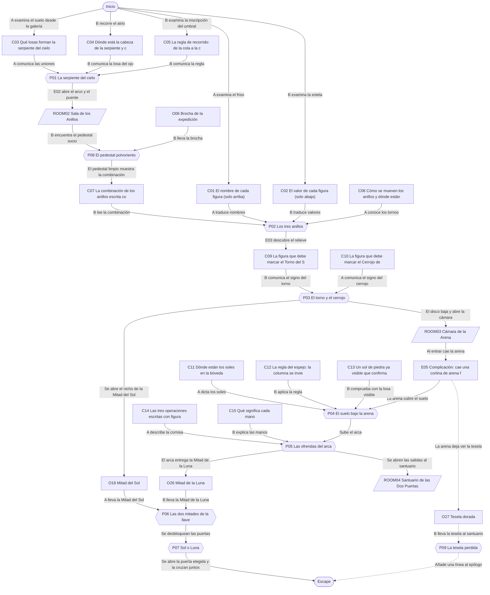
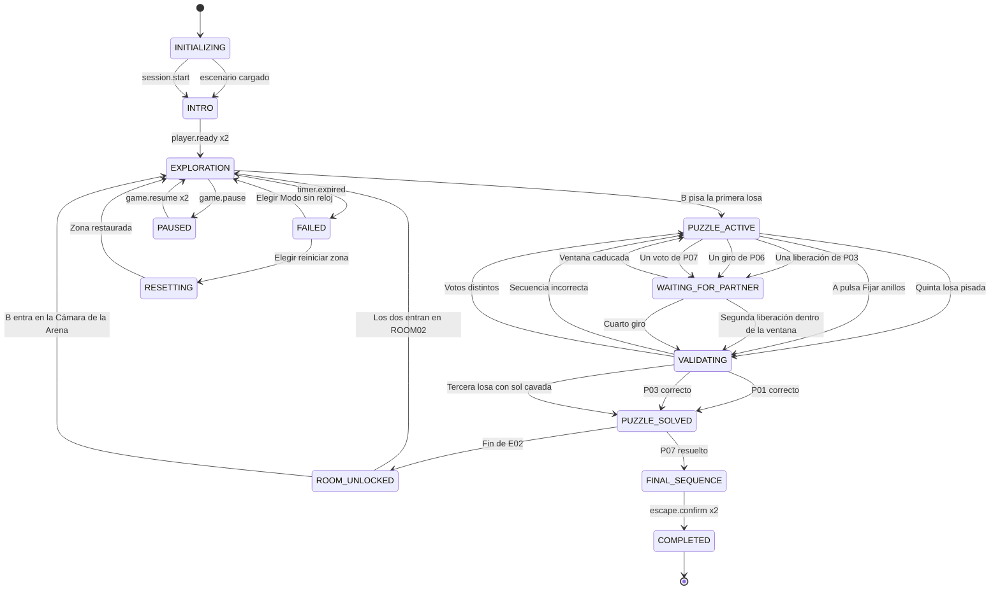

# ER03 · El templo de las dos llaves

Dos ayudantes de la expedición de la doctora Mara Ilse quedan dentro del templo de Sarhal, construido por el pueblo velarí, cuando una losa se cierra a su espalda. El Jugador A recorre las galerías altas y lee los frisos y la bóveda; el Jugador B camina por el suelo y descubre las inscripciones ocultas. El templo se escribió para dos: solo juntando lo que ve cada uno despertarán los anillos, encontrarán las dos mitades de la llave y elegirán salir por la Puerta del Sol o por la de la Luna.

## A. Ficha técnica

| Campo | Valor |
|---|---|
| ID | ER03 |
| Nombre | El templo de las dos llaves |
| Versión | 1.0.0 |
| Género | Aventura arqueológica |
| Sinopsis | Dos ayudantes de la expedición de la doctora Mara Ilse quedan dentro del templo de Sarhal, construido por el pueblo velarí, cuando una losa se cierra a su espalda. El Jugador A recorre las galerías altas y lee los frisos y la bóveda; el Jugador B camina por el suelo y descubre las inscripciones ocultas. El templo se escribió para dos: solo juntando lo que ve cada uno despertarán los anillos, encontrarán las dos mitades de la llave y elegirán salir por la Puerta del Sol o por la de la Luna. |
| Objetivo principal | OBJ01 Recorrer la constelación y despertar los tres anillos del disco; OBJ02 Encontrar las dos mitades de la llave y abrir las cerraduras del santuario; OBJ03 Salir juntos por la Puerta del Sol o por la Puerta de la Luna |
| Objetivos secundarios | OBJ04 Devolver la tesela dorada al mosaico de los fundadores |
| Jugadores | 2 (A: Guardián del Sol: lee desde las galerías altas; B: Guardián de la Luna: descubre lo escrito en el suelo y los muros) |
| Duración estimada | 55 min (despertar 5, descubrimiento 14, complicación 16, clímax 14, escape 6) |
| Dificultad | Media |
| Zonas | 4 |
| Acertijos | 7 principales y 2 microacertijos |
| Objetos interactivos | 30 (más 9 decorativos) |
| Finales | 4 |
| Competencias | Interpretación de símbolos, Razonamiento espacial y de simetría, Aritmética sencilla, Comunicación precisa de formas y posiciones, Coordinación temporal, Toma de decisiones compartida |
| Condiciones iniciales | A empieza en la galería sur del Atrio de la Constelación, a 4,5 m de altura, con la lámpara de la expedición. B empieza en el suelo del atrio, junto a la losa de entrada ya cerrada, con un farol de mano y la libreta de traducción de la expedición, que traduce las frases velarí pero no los nombres ni los valores de los signos. La escalera de madera que unía los dos niveles está tendida en el suelo. La llamada de voz está abierta; en la ficción, los dos se hablan a viva voz, porque el templo lleva el sonido de la galería al suelo. |
| Condición de victoria | Completar OBJ01, OBJ02, OBJ03 |
| Condición de fallo | 55 min de cuenta atrás: Las lámparas de la expedición se agotan y la doctora Ilse avisa por radio de que abrirá la losa desde fuera con el equipo del campamento. Los jugadores eligen reiniciar la zona actual o seguir en Modo sin reloj con la luz de reserva. No se pierde ningún acertijo resuelto. |
| Condición de reinicio | Cualquiera de los dos pulsa Reiniciar zona y el otro lo confirma; también se ofrece al agotarse el reloj. El reinicio completo devuelve el templo al estado inicial y repite la intro. |

## B. Guion narrativo

**1. Introducción cinematográfica.** Atardecer en el valle de Ashkar. Una cámara baja por una escalinata cubierta de arena hasta una fachada de piedra rojiza con dos discos tallados, un sol y una luna. Dentro, el último rayo entra por un óculo y cae sobre un suelo de losas. Se oye viento entre columnas y, lejos, la radio del campamento.

**2. Por qué están aquí.** La pareja trabaja como ayudantes de documentación de la expedición de la doctora Mara Ilse. Ella les ha pedido fotografiar el atrio del templo antes de que anochezca. A sube por la escalera de madera de la expedición a la galería alta para tomar fotos desde arriba; B se queda abajo con el farol.

**3. Situación inicial.** Al dar B un paso sobre la losa del umbral, la losa de entrada baja despacio y se cierra. La vibración desliza la escalera de madera, que queda tendida en el suelo sin hacer daño a nadie. A está arriba y B abajo. La radio funciona: la doctora Ilse explica que la losa solo se abre desde dentro y que el templo se diseñó para dos personas, una arriba y otra abajo.

**4. Objetivo.** Recorrer la constelación del atrio, despertar los anillos, bajar el disco, leer el suelo enterrado por la arena, abrir el arca de las ofrendas, girar juntos las dos mitades de la llave y decidir por qué puerta salir.

**5. Primer descubrimiento.** A descubre desde la galería que el suelo esconde estrellas de nácar unidas por líneas, que solo brillan vistas desde arriba. B descubre a ras de suelo un ojo tallado en una losa y una inscripción que habla de una serpiente del cielo. Ninguno sabe por dónde empezar sin el otro.

**6. Progresión de los acontecimientos.**

- Con la constelación recorrida, se abren el arco del suelo y el puente de la galería hacia la Sala de los Anillos.
- A descubre en el friso los nombres de los signos y B, en una estela, sus valores. Con la brocha de la expedición B limpia el pedestal del disco y encuentra la combinación de los anillos.
- A gira los anillos con los tornos de la galería. Al encajar, cae el polvo de un relieve oculto y aparece la regla de los dos cerrojos.
- Los dos sueltan a la vez el Torno del Sol y el Cerrojo de la Luna. El disco baja y se convierte en rampa; en la galería se abre un nicho con la Mitad del Sol de la llave.
- En la Cámara de la Arena cae una cortina de arena que cubre casi todo el suelo. A lee en la bóveda dónde están los soles y B, con la regla del espejo, sabe dónde cavar.
- Del suelo sube el arca de las ofrendas. A tiene las ruedas y la cornisa; B, la tapa con las reglas de las manos. Dentro está la Mitad de la Luna.
- En el santuario cada uno mete su mitad en su cerradura y entre los dos reconstruyen la inscripción partida para girarlas por turnos.
- Con las puertas desbloqueadas, la pareja decide si sale por la Puerta del Sol o por la Puerta de la Luna.

**7. Obstáculos narrativos.**

- El nácar del suelo solo brilla visto desde la galería; desde abajo B no ve ninguna estrella.
- Los nombres de los signos solo están en el friso alto y sus valores solo en la estela del suelo: ninguno puede traducir solo.
- El pedestal está cubierto por una costra de polvo y hay que limpiarlo con la brocha.
- Los tornos de los anillos arrastran a otro anillo al girar y solo giran hacia delante.
- La arena cubre el suelo de la Cámara de la Arena y B ya no ve dónde están los soles de piedra.
- La inscripción de la llave está partida entre las dos mitades y sus renglones no están en el mismo orden.

**8. Revelaciones.**

- Los velarí tenían dos órdenes de guardianes: los del Sol vivían en las galerías y guardaban los nombres; los de la Luna vivían en el suelo y guardaban los números. Nadie podía leer el templo solo.
- La losa de entrada no es una trampa: el templo se cierra cuando entran dos personas separadas por la altura, para obligarlas a hablarse.
- El mosaico de los fundadores muestra a dos figuras sin rostro sosteniendo una llave partida: el templo no honra a un rey, sino a una pareja de constructores.

**9. Clímax.** En el santuario, A en el balcón y B junto al altar meten cada uno su mitad de la llave. Leen en voz alta sus renglones partidos, los emparejan por las muescas y giran las cerraduras por turnos. Las dos puertas se desbloquean y la pareja vota por cuál salir.

**10. Escena de escape.** La escalera de las dos llaves sube del suelo hasta el balcón. A baja y se reúne con B junto al altar. La puerta elegida se abre: por la del Sol entra la luz rosada del amanecer; por la de la Luna, un cielo lleno de estrellas sobre un cañón. Los dos la cruzan juntos.

**11. Epílogo.** Fuera, la doctora Ilse los espera con mantas y té caliente. Escucha lo que han descubierto y apunta en su cuaderno: El templo de las dos llaves se lee entre dos. Si devolvieron la tesela, añade que el mosaico de los fundadores volvió a estar completo.

### Diálogos y textos del sistema

Cada línea es un subtítulo. Las líneas de canal `document` quedan además guardadas en el registro de pistas.

| ID | Quién | Texto | Cuándo | Para | Canal |
|---|---|---|---|---|---|
| D01 | Narrador | El templo de Sarhal lleva siglos esperando bajo la arena del valle de Ashkar. | START | Ambos | subtitle |
| D02 | Dra. Mara Ilse (radio) | ¿Estáis bien? He oído la losa desde el campamento. No os preocupéis, nadie está en peligro. | E01 | Ambos | audio_subtitled |
| D03 | Dra. Mara Ilse (radio) | Esa losa no se mueve desde fuera. Los velarí la hicieron para abrirse desde dentro, cuando el templo se ha leído entero. | E01 | Ambos | audio_subtitled |
| D04 | Dra. Mara Ilse (radio) | Uno arriba y otro abajo... Así lo diseñaron. Contaos todo lo que veáis, hasta lo que parezca pequeño. | E01 | Ambos | audio_subtitled |
| D05 | Narrador | Desde la galería, la luz del óculo arranca destellos blancos del suelo. | C03_DISCOVERED | Jugador A | subtitle |
| D06 | Narrador | Bajo el farol, una losa te devuelve la mirada: tiene un ojo tallado. | C04_DISCOVERED | Jugador B | subtitle |
| D07 | Inscripción del umbral | La serpiente del cielo se recorre de la cola a la cabeza. | C05_DISCOVERED | Jugador B | document |
| D08 | Narrador | Las estrellas de nácar se encienden una tras otra. Al norte, la piedra se aparta. | E02 | Ambos | subtitle |
| D09 | Dra. Mara Ilse (radio) | ¿Un friso con nombres arriba y una estela con números abajo? Entonces ninguno de los dos puede leer solo. | C02_DISCOVERED | Ambos | audio_subtitled |
| D10 | Narrador | Los anillos encajan con un golpe sordo. Del muro oeste cae una lluvia de polvo. | E03 | Ambos | subtitle |
| D11 | Placa del Torno del Sol | Ninguno de los dos cede solo: soltadlos en el mismo latido. | C10_DISCOVERED | Jugador A | document |
| D12 | Narrador | Un cierre cede y el otro no. Vuelven a su sitio con un clac. | P03 | Ambos | popup |
| D13 | Narrador | El disco baja despacio. En la galería, un nicho se abre y deja ver un brillo dorado. | E04 | Ambos | subtitle |
| D14 | Narrador | Del techo cae una cortina de arena fina, suave como harina. En pocos segundos el suelo es un mar de dunas. | E05 | Ambos | subtitle |
| D15 | Dra. Mara Ilse (radio) | Tranquilos, es arena de la grieta. Los velarí la usaban para esconder cosas, no para hacer daño. | E05 | Ambos | audio_subtitled |
| D16 | Narrador | Desde aquí arriba la bóveda está tan cerca que podrías tocar sus soles. | C11_DISCOVERED | Jugador A | subtitle |
| D17 | Narrador | La arena se abre en el centro de la cámara y sube un arca de piedra. | E06 | Ambos | subtitle |
| D18 | Narrador | Dentro del arca, sobre un paño gastado, descansa media llave de plata. | E07 | Jugador B | subtitle |
| D19 | Dra. Mara Ilse (radio) | Dos medias llaves... Cada renglón está partido. Leedlos juntos. | C17_DISCOVERED | Ambos | audio_subtitled |
| D20 | Narrador | Las cerraduras vuelven al principio con un chasquido. | P06 | Ambos | popup |
| D21 | Narrador | Las dos puertas retumban. Bajo una entra luz cálida; bajo la otra, luz de luna. | E08 | Ambos | subtitle |
| D22 | Dra. Mara Ilse (radio) | La decisión es vuestra. Cualquiera de las dos puertas os trae de vuelta al campamento. | E08 | Ambos | audio_subtitled |
| D23 | Narrador | Por la Puerta del Sol entra el amanecer. A lo lejos, las tiendas del campamento se encienden. | P07_OPT_SOL | Ambos | subtitle |
| D24 | Narrador | Por la Puerta de la Luna se ve un cañón bajo un cielo lleno de estrellas. Detrás, la arena vuelve a cubrir la fachada. | P07_OPT_LUNA | Ambos | subtitle |
| D25 | Dra. Mara Ilse (radio) | Os quedan pocas lámparas. Si queréis, os doy luz de reserva y seguís sin prisa. | E11 | Ambos | audio_subtitled |
| D26 | Dra. Mara Ilse (radio) | Contaos otra vez lo que tenéis delante. Muchas veces la respuesta está en lo que ve el otro. | E10 | Ambos | audio_subtitled |

## C. Escenografía y planos

Coordenadas en metros con origen en la esquina suroeste del suelo de cada zona: `x` hacia el este, `y` hacia arriba, `z` hacia el norte.

### ROOM01 · Atrio de la Constelación

Sala cuadrada de piedra rojiza con un óculo en el techo. Una galería alta recorre los muros sur, oeste y este a 4,5 m. El suelo tiene dieciséis losas de 2 m con incrustaciones de nácar que solo brillan vistas desde arriba.

**Medidas:** 12 × 12 m, altura 9 m. **Acceso:** A sí, B sí. **Se abre:** desde el inicio.

**Qué ve cada jugador.** A: Desde la galería ve todo el suelo, el nácar iluminado por el óculo, el friso y la barandilla numerada. No puede leer relieves pequeños a ras de suelo ni bajar.. B: Recorre el suelo y lee de cerca losas, estela e inscripción. No ve el nácar ni alcanza a leer el friso alto..

**Distribución.** Losa de entrada cerrada en el muro sur, centro. Cuadrícula de 4 por 4 losas entre x 2–10 y z 2–10. Galería alta a 4,5 m en los muros sur, oeste y este, de 1,8 m de ancho, con barandilla numerada. Friso de los nombres en el muro oeste de la galería. Inscripción del umbral en el muro norte, a ras de suelo. Estela de los números junto al muro este. Arco del suelo y puente de la galería en el muro norte hacia la Sala de los Anillos. Estatua del guardián en la esquina noroeste y braseros en la noreste.

| ID | Elemento | Tipo o pared | Posición (x, y, z) | Notas |
|---|---|---|---|---|
| DOOR01 | Puerta a Sala de los Anillos | pared north | (6, 0, 12) | Se abre con P01_SOLVED |
| DOOR02 | Puerta a Sala de los Anillos | pared north | (10.8, 4.5, 12) | Se abre con P01_SOLVED |
| — | Ventana | pared north | (6, 9, 6) | Óculo circular en el techo; da la luz rasante que hace brillar el nácar. No es interactivo. |
| O01 | Friso de los nombres | 2 Examinar | (0.1, 5.6, 6) | Banda pintada bajo la cornisa oeste de la galería: seis figuras negras sobre ocre, cada una con su nombre en sílabas debajo |
| O02 | Constelación de nácar | 2 Examinar | (6, 0, 6) | Incrustaciones de nácar en el suelo del atrio que brillan con la luz del óculo vistas desde la galería: siete estrellas, cinco unidas por líneas |
| O03 | Losas del atrio | 6 Activar | (6, 0, 6) | Dieciséis losas de 2 m que se hunden un dedo al pisarlas; la de la esquina noreste tiene un ojo tallado |
| O04 | Inscripción del umbral | 2 Examinar | (6, 0.5, 11.9) | Renglones de sílabas velarí en el muro norte, a la altura de las rodillas, medio tapados por polvo suelto |
| O05 | Estela de los números | 2 Examinar | (11.2, 0, 4) | Piedra vertical de 1,2 m junto al muro este con seis figuras talladas y, bajo cada una, una fila de puntos hundidos |
| O06 | Brocha de la expedición | 3 Recoger | (2, 0, 1.4) | Brocha de cerdas suaves con mango de madera y una cinta roja con el nombre Ilse, caída junto a la escalera |
| O07 | Estatua del guardián | 1 Decorativo | (1.2, 0, 10.8) | Figura de piedra de 3 m con un brazo hacia arriba y otro hacia el suelo, sin rostro |
| O08 | Losa de entrada cerrada | 1 Decorativo | (6, 0, 0.2) | Losa de 3 m por 3 m con un sol y una luna tallados, encajada en el muro sur |
| O09 | Braseros apagados | 1 Decorativo | (10.8, 0, 10.8) | Tres cuencos de bronce sobre trípodes, fríos y cubiertos de arena |
| O10 | Cuaderno de campo de la doctora Ilse | 2 Examinar | (3, 4.5, 0.8) | Cuaderno de tapas de lona olvidado en la galería, con dibujos de signos y notas a lápiz |

| Luz | Tipo | Posición | Color | Intensidad | Uso |
|---|---|---|---|---|---|
| L01 | Haz de luz del óculo (direccional) | (6, 9, 6) | #FFD9A8 | 0.9 | Luz de atardecer; hace brillar el nácar solo desde el ángulo de la galería |
| L02 | Lámpara de la expedición en la galería | (3, 5.2, 0.9) | #FFF2D6 | 0.5 | Acompaña a A; ilumina el friso |
| L03 | Farol de mano de B (puntual móvil) | (6, 1.2, 1) | #FFE6B5 | 0.6 | Sigue a B; radio de 4 m |

**Sonido ambiente:** Viento suave entre columnas y arena que se desliza. **Música:** Tema del templo: flauta de caña y tambor de marco, lento y bajo.

**Cambios dinámicos:**

- E01: La losa de entrada baja con un retumbo suave y la escalera de madera se desliza al suelo
- E02: Las estrellas de nácar se encienden una a una; el arco del suelo y el puente de la galería se abren al norte

**Para el motor:** Una sola escena con dos niveles de navegación: la navmesh de A es la galería (y = 4,5) y la de B el suelo (y = 0); no hay enlace entre ellas hasta el santuario. El nácar es un material emisivo que solo se activa cuando el ángulo entre la cámara y la normal del suelo supera 50°, de modo que la cámara de B nunca lo ve. Las losas son 16 colisionadores de presión con ID (columna, fila). En Unity, capas por jugador; en Godot, grupos de visibilidad; en web, dos cámaras sobre la misma escena.

### ROOM02 · Sala de los Anillos

Sala rectangular con un gran disco de piedra en el suelo formado por tres anillos concéntricos, cada uno con seis signos tallados. Una galería alta en el muro norte guarda los tornos que mueven los anillos y el Torno del Sol.

**Medidas:** 12 × 10 m, altura 9 m. **Acceso:** A sí, B sí. **Se abre:** P01_SOLVED.

**Qué ve cada jugador.** A: Desde la galería norte ve los tres anillos desde arriba con sus signos grandes, los tornos y su placa. No lee el pedestal ni el relieve del muro oeste.. B: En el suelo ve el canto del disco, el pedestal, el cerrojo y el muro oeste. Desde abajo no distingue qué signo señala la flecha en cada anillo..

**Distribución.** Entrada del suelo y de la galería por el muro sur. Disco de 5 m de diámetro en el centro (6, 0, 4,5) con una flecha tallada que señala al norte. Pedestal al sur del disco. Cerrojo de la Luna al norte del disco, a ras de suelo. Galería alta en el muro norte (z 8,2–10) con los dos tornos de los anillos, el Torno del Sol y el nicho. Relieve oculto en el muro oeste. Columnas con aves en la esquina suroeste y vasijas en la sureste.

| ID | Elemento | Tipo o pared | Posición (x, y, z) | Notas |
|---|---|---|---|---|
| DOOR03 | Puerta a Atrio de la Constelación | pared south | (6, 0, 0) | Abierta |
| DOOR04 | Puerta a Atrio de la Constelación | pared south | (10.8, 4.5, 0) | Abierta |
| DOOR05 | Puerta a Cámara de la Arena | pared east | (12, 0, 4.5) | Se abre con P03_SOLVED |
| DOOR06 | Puerta a Cámara de la Arena | pared east | (12, 4.5, 9) | Se abre con P03_SOLVED |
| O11 | Disco de los tres anillos | 6 Activar | (6, 0, 4.5) | Disco de piedra de 5 m con tres anillos concéntricos; cada anillo lleva seis signos tallados y una flecha fija señala al norte |
| O12 | Tornos de los anillos | 4 Usar | (4, 4.5, 9.2) | Dos manivelas de bronce en la barandilla de la galería norte, la izquierda y la derecha, con una placa entre ellas |
| O13 | Pedestal del disco | 2 Examinar | (6, 0, 1.2) | Bloque de piedra al sur del disco con renglones tallados bajo una costra de polvo |
| O14 | Relieve del cerrojo | 2 Examinar | (0.1, 1, 4.5) | Relieve en el muro oeste, oculto bajo polvo que se desprende cuando los anillos encajan |
| O15 | Torno del Sol | 8 Mecanismo cooperativo | (8, 4.5, 9.4) | Manivela dorada en la galería norte con un selector de seis figuras y una palanca de liberación; placa con un sol |
| O16 | Cerrojo de la Luna | 8 Mecanismo cooperativo | (6, 0, 7.6) | Cerrojo de piedra al norte del disco, a ras de suelo, con un selector de seis figuras y una palanca de liberación |
| O17 | Columnas de las aves | 1 Decorativo | (1, 0, 1) | Dos columnas con garzas talladas subiendo en espiral |
| O18 | Mitad del Sol | 3 Recoger | (2, 4.6, 9.6) | Media llave de bronce dorado con un sol en el ojo y un paletón partido con cuatro renglones grabados |
| O19 | Vasijas de ofrendas | 1 Decorativo | (11, 0, 1) | Vasijas altas de barro con bandas de signos, una de ellas volcada |

| Luz | Tipo | Posición | Color | Intensidad | Uso |
|---|---|---|---|---|---|
| L04 | Lámparas de aceite de la expedición en la galería | (6, 5.5, 9.5) | #FFE0A0 | 0.6 | Iluminan los tornos y la placa |
| L05 | Luz cenital suave sobre el disco | (6, 8.5, 4.5) | #E8D8C0 | 0.5 | Sube a 0,8 cuando los anillos encajan |
| L06 | Farol de mano de B | (6, 1.2, 1) | #FFE6B5 | 0.6 | Sigue a B |

**Sonido ambiente:** Eco de sala grande y gotas lejanas. **Música:** Tema del templo: flauta de caña y tambor de marco, lento y bajo.

**Cambios dinámicos:**

- E03: Los anillos encajan con un golpe sordo, cae polvo del muro oeste y aparece el relieve del cerrojo
- E04: El disco baja y forma una rampa hacia el este; en la galería se abre el nicho con la Mitad del Sol

**Para el motor:** Los tres anillos son mallas independientes que giran 60° por paso alrededor del eje vertical del disco; el estado se guarda como índice 0–5 por anillo en el servidor. Los tornos son dos botones de A con animación de manivela. La cámara de B tiene un ángulo máximo de 25° sobre el disco, lo que impide leer los signos. El Cerrojo de la Luna y el Torno del Sol envían su pulsación con marca de tiempo del servidor para la ventana de simultaneidad.

### ROOM03 · Cámara de la Arena

Cámara alta y cuadrada con la bóveda pintada como un cielo y un suelo de veinticinco losas. Una galería estrecha a 6 m deja a A casi a la altura de la bóveda. Al entrar B cae del techo una cortina de arena fina que cubre casi todo el suelo.

**Medidas:** 10 × 10 m, altura 9 m. **Acceso:** A sí, B sí. **Se abre:** P03_SOLVED.

**Qué ve cada jugador.** A: Desde la galería alta ve la bóveda pintada de cerca, la cornisa con las ruedas y el suelo cubierto de dunas; no distingue losas bajo la arena.. B: En el suelo ve las dunas, la losa descubierta, la inscripción del estanque y el arca cuando sube. La bóveda queda demasiado alta y oscura para leerla..

**Distribución.** Entrada del suelo por el muro oeste y de la galería por el muro oeste a 6 m. Cuadrícula de 5 por 5 losas de 1,6 m entre x 1–9 y z 1–9. Inscripción del estanque en el muro oeste, a ras de suelo. Losa descubierta en la columna 5, fila 2. Cornisa con tres ruedas de piedra en el muro norte de la galería. Salidas al Santuario por el muro norte en los dos niveles. Vasijas rotas en la esquina noroeste.

| ID | Elemento | Tipo o pared | Posición (x, y, z) | Notas |
|---|---|---|---|---|
| DOOR07 | Puerta a Sala de los Anillos | pared west | (0, 0, 4.5) | Abierta |
| DOOR08 | Puerta a Sala de los Anillos | pared west | (0, 6, 8.5) | Abierta |
| DOOR09 | Puerta a Santuario de las Dos Puertas | pared north | (5, 0, 10) | Se abre con P05_SOLVED |
| DOOR10 | Puerta a Santuario de las Dos Puertas | pared north | (8.5, 6, 10) | Se abre con P05_SOLVED |
| — | Ventana | pared north | (5, 9, 5) | Grieta en el centro de la bóveda por la que cae la arena; no es interactiva |
| O20 | Bóveda pintada | 2 Examinar | (5, 8.9, 5) | Bóveda azul oscuro con una cuadrícula de 5 por 5 casillas y soles dorados de ocho rayos; la cornisa numera columnas y filas con puntos |
| O21 | Suelo de la Cámara de la Arena | 6 Activar | (5, 0, 5) | Veinticinco losas de 1,6 m; tras la caída de arena solo se ven dunas suaves |
| O22 | Inscripción del estanque | 2 Examinar | (0.1, 1.2, 2) | Renglones de sílabas velarí en el muro oeste, junto a un estanque seco dibujado en relieve |
| O23 | Losa descubierta | 2 Examinar | (8.2, 0, 3.4) | La única losa sin arena, pegada al muro este, con un sol de ocho rayos tallado |
| O24 | Arca de las ofrendas | 7 Bloqueado | (5, 0, 5) | Cofre de piedra de 1 m con tapa grabada y una cadena que sube hasta las ruedas de la cornisa |
| O25 | Cornisa de las ofrendas | 4 Usar | (5, 6.4, 9.9) | Cornisa del muro norte, a la altura de la galería, con tres frases de figuras y manos sobre tres ruedas de piedra de 1 a 9 puntos |
| O26 | Mitad de la Luna | 3 Recoger | (5, 0.6, 5) | Media llave de bronce plateado con una luna en el ojo y un paletón partido con cuatro renglones grabados |
| O27 | Tesela dorada | 3 Recoger | (8.6, 0, 8.6) | Tesela cuadrada de 5 cm, dorada, medio enterrada en la duna de la esquina noreste |
| O28 | Vasijas rotas | 1 Decorativo | (1, 0, 9) | Tres vasijas partidas medio cubiertas de arena |
| O29 | Pilastras de las dunas | 1 Decorativo | (9.5, 0, 0.5) | Pilastras con relieves de dunas onduladas en las cuatro esquinas |

| Luz | Tipo | Posición | Color | Intensidad | Uso |
|---|---|---|---|---|---|
| L07 | Lámpara de la expedición en la galería | (2, 6.8, 9.5) | #FFF2D6 | 0.6 | Ilumina la bóveda y la cornisa |
| L08 | Luz difusa de la grieta | (5, 8.8, 5) | #F2D9B0 | 0.4 | Se llena de polvo dorado durante la caída de arena |
| L09 | Farol de mano de B | (1, 1.2, 4.5) | #FFE6B5 | 0.6 | Sigue a B |

**Sonido ambiente:** Susurro continuo de arena fina. **Música:** Variación del tema con pulso suave, sin crescendos bruscos.

**Cambios dinámicos:**

- E05: Cae una cortina de arena fina durante 12 s y cubre el suelo salvo una losa junto al muro este; aparece un destello en la duna noreste
- E06: La arena se abre en el centro y sube el arca de las ofrendas
- E07: El arca se abre y se desbloquean las salidas norte de los dos niveles

**Para el motor:** La arena es una malla de altura sobre el suelo con 25 celdas; cavar una celda baja su altura a 0 con una animación de 2 s y la vuelve a llenar en 8 s si debajo no hay sol. La caída de arena usa partículas suaves, sin sacudida de cámara. La bóveda es una textura con la cuadrícula y la numeración de la cornisa; solo es legible desde la galería (distancia menor de 3 m).

### ROOM04 · Santuario de las Dos Puertas

Nave alargada con un altar central. La Puerta del Sol ocupa el muro este y la Puerta de la Luna el oeste. Un balcón en el muro sur, a 5 m, guarda la Cerradura del Sol; en el altar está la Cerradura de la Luna.

**Medidas:** 14 × 10 m, altura 10 m. **Acceso:** A sí, B sí. **Se abre:** P05_SOLVED.

**Qué ve cada jugador.** A: Desde el balcón ve el altar, las dos puertas y el mural del amanecer; no lee la inscripción de la noche ni el mosaico.. B: En el suelo ve el altar, las dos puertas, la inscripción de la noche y el mosaico; el mural del amanecer queda a contraluz..

**Distribución.** Entrada del suelo por el muro sur (x 5) y del balcón por el muro sur a 5 m (x 8,5). Altar en el centro (7, 0, 6). Balcón en el muro sur, z 0–2, a 5 m. Puerta del Sol en el muro este y mural del amanecer sobre ella. Puerta de la Luna en el muro oeste e inscripción de la noche a su lado. Mosaico de los fundadores en el muro norte. Escalera escondida bajo el suelo junto al balcón. Estatuas gemelas en el noroeste y pebeteros en el noreste.

| ID | Elemento | Tipo o pared | Posición (x, y, z) | Notas |
|---|---|---|---|---|
| DOOR11 | Puerta a Cámara de la Arena | pared south | (5, 0, 0) | Abierta |
| DOOR12 | Puerta a Cámara de la Arena | pared south | (8.5, 5, 0) | Abierta |
| DOOR13 | Puerta de salida | pared east | (14, 0, 5) | Se abre con P07_OPT_SOL |
| DOOR14 | Puerta de salida | pared west | (0, 0, 5) | Se abre con P07_OPT_LUNA |
| O30 | Cerradura del Sol | 8 Mecanismo cooperativo | (7, 5, 1.5) | Anillo de bronce dorado en el balcón con seis figuras alrededor de un hueco de llave |
| O31 | Cerradura de la Luna | 8 Mecanismo cooperativo | (7, 1, 6) | Anillo de bronce plateado en el altar con seis figuras alrededor de un hueco de llave |
| O32 | Mural del amanecer | 2 Examinar | (13.9, 6, 5) | Pintura sobre la Puerta del Sol: dos figuras salen hacia un camino lleno de gente |
| O33 | Inscripción de la noche | 2 Examinar | (0.1, 1.5, 3) | Renglones tallados junto a la Puerta de la Luna, bajo una luna creciente |
| O34 | Puerta del Sol | 10 Objeto de salida | (14, 0, 5) | Puerta de piedra de 4 m con un sol de ocho rayos en relieve |
| O35 | Puerta de la Luna | 10 Objeto de salida | (0, 0, 5) | Puerta de piedra de 4 m con una luna creciente en relieve |
| O36 | Mosaico de los fundadores | 4 Usar | (7, 1.2, 9.9) | Mosaico del muro norte: dos figuras sin rostro sostienen una llave partida; falta una tesela en el centro |
| O37 | Escalera de las dos llaves | 9 Elemento narrativo | (11, 0, 2) | Escalera de piedra plegada bajo el suelo que sube hasta el balcón |
| O38 | Estatuas gemelas | 1 Decorativo | (3, 0, 9) | Dos figuras de piedra espalda con espalda, una con un sol en el pecho y otra con una luna |
| O39 | Pebeteros de bronce | 1 Decorativo | (11, 0, 9) | Dos pebeteros con incienso frío |

| Luz | Tipo | Posición | Color | Intensidad | Uso |
|---|---|---|---|---|---|
| L10 | Rendija de luz cálida bajo la Puerta del Sol | (13.8, 0.3, 5) | #FFC58A | 0.4 | Crece al desbloquearse la puerta |
| L11 | Rendija de luz fría bajo la Puerta de la Luna | (0.2, 0.3, 5) | #B8C8FF | 0.4 | Crece al desbloquearse la puerta |
| L12 | Lámpara de la expedición en el balcón | (7, 5.8, 1) | #FFF2D6 | 0.6 | Ilumina la Cerradura del Sol |
| L13 | Farol de mano de B | (5, 1.2, 1) | #FFE6B5 | 0.6 | Sigue a B |

**Sonido ambiente:** Silencio de nave con brisa bajo las puertas. **Música:** Tema del templo: flauta de caña y tambor de marco, lento y bajo.

**Cambios dinámicos:**

- E08: Las dos puertas se desbloquean con luz cálida y fría; sube la escalera de las dos llaves hasta el balcón
- E09: Se abre la puerta elegida; la música del final correspondiente sustituye a la del templo
- E12: El mosaico de los fundadores se ilumina con la tesela dorada en su sitio

**Para el motor:** Las dos cerraduras son anillos de seis posiciones con un hueco de llave; aceptan el giro solo con su mitad insertada y en el turno que les toca (el servidor guarda la lista de giros). La escalera es una plataforma animada que une las navmesh de galería y suelo tras E08. Las puertas de salida son dos disparadores de fin de partida que exigen a los dos jugadores dentro del volumen de la puerta elegida.

## D. Inventario de objetos

| object_id | Nombre | Descripción visual | Zona | Posición | Tipo | Estado inicial | Acción | Activación | Resultado | Pista | Acertijo | Jugador | Estado final |
|---|---|---|---|---|---|---|---|---|---|---|---|---|---|
| O01 | Friso de los nombres | Banda pintada bajo la cornisa oeste de la galería: seis figuras negras sobre ocre, cada una con su nombre en sílabas debajo | ROOM01 | (0.1, 5.6, 6) | 2 Examinar | DEFAULT | Examinar | — | Abre el friso a pantalla completa y guarda C01 | C01 | P02 | Jugador A | EXAMINED |
| O02 | Constelación de nácar | Incrustaciones de nácar en el suelo del atrio que brillan con la luz del óculo vistas desde la galería: siete estrellas, cinco unidas por líneas | ROOM01 | (6, 0, 6) | 2 Examinar | DEFAULT | Examinar desde la barandilla | — | Muestra la vista cenital con la numeración de la barandilla y guarda C03 | C03 | P01 | Jugador A | EXAMINED |
| O03 | Losas del atrio | Dieciséis losas de 2 m que se hunden un dedo al pisarlas; la de la esquina noreste tiene un ojo tallado | ROOM01 | (6, 0, 6) | 6 Activar | IDLE | Pisar una losa | — | Cada losa pisada se hunde y queda marcada; la secuencia completa se valida | C04 | P01 | Jugador B | SOLVED |
| O04 | Inscripción del umbral | Renglones de sílabas velarí en el muro norte, a la altura de las rodillas, medio tapados por polvo suelto | ROOM01 | (6, 0.5, 11.9) | 2 Examinar | DEFAULT | Examinar con la libreta de traducción | — | Traduce la inscripción y guarda C05 | C05 | P01 | Jugador B | EXAMINED |
| O05 | Estela de los números | Piedra vertical de 1,2 m junto al muro este con seis figuras talladas y, bajo cada una, una fila de puntos hundidos | ROOM01 | (11.2, 0, 4) | 2 Examinar | DEFAULT | Examinar y palpar los puntos | — | Muestra la estela de cerca y guarda C02 | C02 | P02 | Jugador B | EXAMINED |
| O06 | Brocha de la expedición | Brocha de cerdas suaves con mango de madera y una cinta roja con el nombre Ilse, caída junto a la escalera | ROOM01 | (2, 0, 1.4) | 3 Recoger | DEFAULT | Recoger | — | Pasa al inventario de B | — | P08 | Jugador B | COLLECTED |
| O07 | Estatua del guardián | Figura de piedra de 3 m con un brazo hacia arriba y otro hacia el suelo, sin rostro | ROOM01 | (1.2, 0, 10.8) | 1 Decorativo | DEFAULT | none | — | Ambientación: anuncia la idea de los dos niveles | — | — | Nadie | DEFAULT |
| O08 | Losa de entrada cerrada | Losa de 3 m por 3 m con un sol y una luna tallados, encajada en el muro sur | ROOM01 | (6, 0, 0.2) | 1 Decorativo | DEFAULT | none | — | Ambientación: la entrada no se puede abrir desde dentro sin terminar el templo | — | — | Nadie | DEFAULT |
| O09 | Braseros apagados | Tres cuencos de bronce sobre trípodes, fríos y cubiertos de arena | ROOM01 | (10.8, 0, 10.8) | 1 Decorativo | DEFAULT | none | — | Ambientación | — | — | Nadie | DEFAULT |
| O10 | Cuaderno de campo de la doctora Ilse | Cuaderno de tapas de lona olvidado en la galería, con dibujos de signos y notas a lápiz | ROOM01 | (3, 4.5, 0.8) | 2 Examinar | DEFAULT | Examinar | — | Muestra la página marcada; la nota de ayuda C21 se añade al registro si el sistema la ofrece | C21 | P02 | Jugador A | EXAMINED |
| O11 | Disco de los tres anillos | Disco de piedra de 5 m con tres anillos concéntricos; cada anillo lleva seis signos tallados y una flecha fija señala al norte | ROOM02 | (6, 0, 4.5) | 6 Activar | IDLE | Ver desde arriba; se mueve con los tornos | — | Muestra los signos que señala la flecha en cada anillo | — | P02 | Jugador A | LOWERED |
| O12 | Tornos de los anillos | Dos manivelas de bronce en la barandilla de la galería norte, la izquierda y la derecha, con una placa entre ellas | ROOM02 | (4, 4.5, 9.2) | 4 Usar | DEFAULT | Examinar la placa / girar un torno | — | Cada vuelta mueve los anillos según la placa; examinar guarda C06 | C06 | P02 | Jugador A | EXAMINED |
| O13 | Pedestal del disco | Bloque de piedra al sur del disco con renglones tallados bajo una costra de polvo | ROOM02 | (6, 0, 1.2) | 2 Examinar | DUSTY | Examinar / usar la brocha | — | Sucio: guarda C08. Limpio: guarda C07 | C07 | P08 | Jugador B | CLEAN |
| O14 | Relieve del cerrojo | Relieve en el muro oeste, oculto bajo polvo que se desprende cuando los anillos encajan | ROOM02 | (0.1, 1, 4.5) | 2 Examinar | HIDDEN | Examinar | — | Guarda C09 | C09 | P03 | Jugador B | VISIBLE |
| O15 | Torno del Sol | Manivela dorada en la galería norte con un selector de seis figuras y una palanca de liberación; placa con un sol | ROOM02 | (8, 4.5, 9.4) | 8 Mecanismo cooperativo | LOCKED | Elegir figura y soltar la palanca | P02_SOLVED | Envía la pulsación de A a la ventana de simultaneidad; examinar guarda C10 | C10 | P03 | Jugador A | RELEASED |
| O16 | Cerrojo de la Luna | Cerrojo de piedra al norte del disco, a ras de suelo, con un selector de seis figuras y una palanca de liberación | ROOM02 | (6, 0, 7.6) | 8 Mecanismo cooperativo | LOCKED | Elegir figura y soltar la palanca | P02_SOLVED | Envía la pulsación de B a la ventana de simultaneidad | — | P03 | Jugador B | RELEASED |
| O17 | Columnas de las aves | Dos columnas con garzas talladas subiendo en espiral | ROOM02 | (1, 0, 1) | 1 Decorativo | DEFAULT | none | — | Ambientación | — | — | Nadie | DEFAULT |
| O18 | Mitad del Sol | Media llave de bronce dorado con un sol en el ojo y un paletón partido con cuatro renglones grabados | ROOM02 | (2, 4.6, 9.6) | 3 Recoger | HIDDEN | Recoger del nicho | P03_SOLVED | Pasa al inventario de A y guarda C16 | C16 | P06 | Jugador A | INSERTED |
| O19 | Vasijas de ofrendas | Vasijas altas de barro con bandas de signos, una de ellas volcada | ROOM02 | (11, 0, 1) | 1 Decorativo | DEFAULT | none | — | Ambientación | — | — | Nadie | DEFAULT |
| O20 | Bóveda pintada | Bóveda azul oscuro con una cuadrícula de 5 por 5 casillas y soles dorados de ocho rayos; la cornisa numera columnas y filas con puntos | ROOM03 | (5, 8.9, 5) | 2 Examinar | DEFAULT | Examinar desde la galería | — | Muestra la bóveda con la cuadrícula; guarda C11 tras la caída de arena | C11 | P04 | Jugador A | EXAMINED |
| O21 | Suelo de la Cámara de la Arena | Veinticinco losas de 1,6 m; tras la caída de arena solo se ven dunas suaves | ROOM03 | (5, 0, 5) | 6 Activar | CLEAR | Cavar en una losa | — | Cada losa cavada se valida; si no tiene sol, la arena vuelve a cubrirla | — | P04 | Jugador B | DUG |
| O22 | Inscripción del estanque | Renglones de sílabas velarí en el muro oeste, junto a un estanque seco dibujado en relieve | ROOM03 | (0.1, 1.2, 2) | 2 Examinar | DEFAULT | Examinar con la libreta de traducción | — | Traduce y guarda C12 | C12 | P04 | Jugador B | EXAMINED |
| O23 | Losa descubierta | La única losa sin arena, pegada al muro este, con un sol de ocho rayos tallado | ROOM03 | (8.2, 0, 3.4) | 2 Examinar | DEFAULT | Examinar | — | Guarda C13 tras la caída de arena | C13 | P04 | Jugador B | EXAMINED |
| O24 | Arca de las ofrendas | Cofre de piedra de 1 m con tapa grabada y una cadena que sube hasta las ruedas de la cornisa | ROOM03 | (5, 0, 5) | 7 Bloqueado | HIDDEN | Examinar la tapa | P04_SOLVED | Guarda C15; se abre al resolver P05 | C15 | P05 | Jugador B | OPEN |
| O25 | Cornisa de las ofrendas | Cornisa del muro norte, a la altura de la galería, con tres frases de figuras y manos sobre tres ruedas de piedra de 1 a 9 puntos | ROOM03 | (5, 6.4, 9.9) | 4 Usar | DEFAULT | Examinar / girar las ruedas | — | Examinar guarda C14; las ruedas reciben el código de P05 | C14 | P05 | Jugador A | EXAMINED |
| O26 | Mitad de la Luna | Media llave de bronce plateado con una luna en el ojo y un paletón partido con cuatro renglones grabados | ROOM03 | (5, 0.6, 5) | 3 Recoger | HIDDEN | Recoger del arca | P05_SOLVED | Pasa al inventario de B y guarda C17 | C17 | P06 | Jugador B | INSERTED |
| O27 | Tesela dorada | Tesela cuadrada de 5 cm, dorada, medio enterrada en la duna de la esquina noreste | ROOM03 | (8.6, 0, 8.6) | 3 Recoger | HIDDEN | Cavar y recoger | — | Pasa al inventario de B | C19 | P09 | Jugador B | PLACED |
| O28 | Vasijas rotas | Tres vasijas partidas medio cubiertas de arena | ROOM03 | (1, 0, 9) | 1 Decorativo | DEFAULT | none | — | Ambientación | — | — | Nadie | DEFAULT |
| O29 | Pilastras de las dunas | Pilastras con relieves de dunas onduladas en las cuatro esquinas | ROOM03 | (9.5, 0, 0.5) | 1 Decorativo | DEFAULT | none | — | Ambientación | — | — | Nadie | DEFAULT |
| O30 | Cerradura del Sol | Anillo de bronce dorado en el balcón con seis figuras alrededor de un hueco de llave | ROOM04 | (7, 5, 1.5) | 8 Mecanismo cooperativo | LOCKED | Insertar la Mitad del Sol y girar hasta una figura | O18_COLLECTED | Registra el giro de A en la lista de turnos | — | P06 | Jugador A | TURNED |
| O31 | Cerradura de la Luna | Anillo de bronce plateado en el altar con seis figuras alrededor de un hueco de llave | ROOM04 | (7, 1, 6) | 8 Mecanismo cooperativo | LOCKED | Insertar la Mitad de la Luna y girar hasta una figura | O26_COLLECTED | Registra el giro de B en la lista de turnos | — | P06 | Jugador B | TURNED |
| O32 | Mural del amanecer | Pintura sobre la Puerta del Sol: dos figuras salen hacia un camino lleno de gente | ROOM04 | (13.9, 6, 5) | 2 Examinar | DEFAULT | Examinar desde el balcón | P06_SOLVED | Guarda C18 | C18 | P07 | Jugador A | EXAMINED |
| O33 | Inscripción de la noche | Renglones tallados junto a la Puerta de la Luna, bajo una luna creciente | ROOM04 | (0.1, 1.5, 3) | 2 Examinar | DEFAULT | Examinar con la libreta de traducción | P06_SOLVED | Guarda C20 | C20 | P07 | Jugador B | EXAMINED |
| O34 | Puerta del Sol | Puerta de piedra de 4 m con un sol de ocho rayos en relieve | ROOM04 | (14, 0, 5) | 10 Objeto de salida | SEALED | Cruzar | P07_SOLVED | Lleva al final del Sol | — | — | Ambos | OPEN |
| O35 | Puerta de la Luna | Puerta de piedra de 4 m con una luna creciente en relieve | ROOM04 | (0, 0, 5) | 10 Objeto de salida | SEALED | Cruzar | P07_SOLVED | Lleva al final de la Luna | — | — | Ambos | OPEN |
| O36 | Mosaico de los fundadores | Mosaico del muro norte: dos figuras sin rostro sostienen una llave partida; falta una tesela en el centro | ROOM04 | (7, 1.2, 9.9) | 4 Usar | INCOMPLETE | Examinar / colocar una tesela | — | Examinar guarda C22; con la tesela pasa a COMPLETE | C22 | P09 | Jugador B | COMPLETE |
| O37 | Escalera de las dos llaves | Escalera de piedra plegada bajo el suelo que sube hasta el balcón | ROOM04 | (11, 0, 2) | 9 Elemento narrativo | HIDDEN | Bajar por ella (A) | P06_SOLVED | Une el balcón y el suelo para que A baje junto a B | — | — | Jugador A | RAISED |
| O38 | Estatuas gemelas | Dos figuras de piedra espalda con espalda, una con un sol en el pecho y otra con una luna | ROOM04 | (3, 0, 9) | 1 Decorativo | DEFAULT | none | — | Ambientación | — | — | Nadie | DEFAULT |
| O39 | Pebeteros de bronce | Dos pebeteros con incienso frío | ROOM04 | (11, 0, 9) | 1 Decorativo | DEFAULT | none | — | Ambientación | — | — | Nadie | DEFAULT |

## E. Pistas

| clue_id | Contenido exacto | Alternativa accesible | Ubicación | Descubrimiento | Quién | Acertijo | Revela | Depende de | Se habilita | Nivel | Descubierta cuando |
|---|---|---|---|---|---|---|---|---|---|---|---|
| C01 | Friso de los nombres. Cada figura lleva su nombre debajo: círculo con un punto en el centro, KEL. Dos líneas onduladas paralelas, DOA. Triángulo con el vértice hacia arriba, TIR. Cuadrado, QUEN. Estrella de cinco puntas, ILO. Hexágono, VASH. | Tabla de seis filas leída en voz y en texto grande: Kel, círculo con punto. Doa, dos ondas. Tir, triángulo. Quen, cuadrado. Ilo, estrella de cinco puntas. Vash, hexágono. | O01 Friso de los nombres | A examina el friso del muro oeste de la galería | Jugador A | P02 | El nombre de cada figura (solo arriba) | — | — | 0 | O01_EXAMINED |
| C02 | Estela de los números. Bajo cada figura hay una fila de puntos hundidos: círculo con un punto, 3 puntos. Dos líneas onduladas, 5 puntos. Triángulo, 1 punto. Cuadrado, 6 puntos. Estrella de cinco puntas, 2 puntos. Hexágono, 4 puntos. Debajo, en sílabas: Los números no se cuentan en la figura; se aprenden en la piedra. | Tabla de seis filas con lectura en voz: círculo con punto vale 3, dos ondas 5, triángulo 1, cuadrado 6, estrella 2, hexágono 4. Los puntos también se pueden palpar con vibración del mando. | O05 Estela de los números | B examina la estela junto al muro este | Jugador B | P02 | El valor de cada figura (solo abajo) | — | — | 0 | O05_EXAMINED |
| C03 | Desde la galería, con la luz del óculo, el suelo deja ver siete estrellas de nácar sobre las losas. La barandilla numera las columnas del 1 al 4 de oeste a este y las filas del 1 al 4 de sur a norte; cada losa se nombra (columna, fila). Hay cuatro líneas de nácar: entre (4,1) y (3,3); entre (1,4) y (2,2); entre (3,3) y (4,4); entre (2,2) y (4,1). Las estrellas de (1,1) y (3,2) no tocan ninguna línea. | Lista leída en voz: cuatro uniones, 4-1 con 3-3, 1-4 con 2-2, 3-3 con 4-4, 2-2 con 4-1. Estrellas sueltas en 1-1 y 3-2. En pantalla se muestra además una cuadrícula con las estrellas como círculos numerados y las líneas en trazo grueso. | O02 Constelación de nácar | A examina el suelo desde la barandilla de la galería | Jugador A | P01 | Qué losas forman la serpiente del cielo y cómo se unen | — | — | 0 | O02_EXAMINED |
| C04 | En la losa de la esquina noreste, la cuarta columna desde el muro oeste y la cuarta fila desde el muro sur, hay un ojo tallado del tamaño de una mano. En el zócalo, grupos de puntos numeran las columnas del 1 al 4 de oeste a este y las filas del 1 al 4 de sur a norte. Las losas se hunden un dedo al pisarlas. | Texto y voz: el ojo está en la losa columna 4, fila 4. El zócalo numera igual que la barandilla de la galería. | O03 Losas del atrio | B recorre el suelo del atrio con el farol | Jugador B | P01 | Dónde está la cabeza de la serpiente y cómo se numeran las losas | — | — | 0 | — |
| C05 | Inscripción del umbral, traducida: La serpiente del cielo se recorre de la cola a la cabeza, pisando solo sus estrellas y siguiendo sus líneas. Su cabeza descansa sobre el ojo de piedra. Quien pise fuera de la serpiente volverá a empezar. | La misma regla en texto grande y con lectura en voz. | O04 Inscripción del umbral | B examina el muro norte con la libreta de traducción | Jugador B | P01 | La regla de recorrido: de la cola a la cabeza, junto al ojo | — | — | 0 | O04_EXAMINED |
| C06 | Placa de los tornos, vista desde arriba. Torno izquierdo: cada vuelta gira el anillo exterior un signo en el sentido de las agujas del reloj y el anillo medio un signo en sentido contrario. Torno derecho: cada vuelta gira el anillo medio un signo en el sentido de las agujas del reloj y arrastra el interior un signo en el mismo sentido. Los tornos solo giran hacia delante. Los tres anillos llevan los mismos seis signos en este orden, en el sentido de las agujas del reloj: círculo con punto, dos ondas, triángulo, cuadrado, estrella, hexágono. Ahora la flecha del norte señala: exterior, estrella; medio, círculo con punto; interior, dos ondas. | Texto y voz con un esquema accesible de tres anillos: cada anillo se muestra como una fila de seis casillas con el signo actual resaltado con marco grueso, y se describe en voz qué hace cada torno. | O12 Tornos de los anillos | A examina la placa entre los dos tornos | Jugador A | P02 | Cómo se mueven los anillos y dónde están ahora | — | — | 0 | O12_EXAMINED |
| C07 | Pedestal del disco, traducido: Despiertan los anillos cuando la flecha del norte señala: en el exterior, TIR; en el medio, el signo que vale lo que TIR y KEL juntos; en el interior, el signo que vale lo que queda de DOA si le quitas KEL. | La misma frase en texto grande y voz. Los nombres en mayúsculas se deletrean. | O13 Pedestal del disco | B limpia el pedestal con la brocha y lo examina | Jugador B | P02 | La combinación de los anillos escrita con nombres y operaciones | C08 | — | 0 | O13_CLEAN |
| C08 | El pedestal está cubierto por una costra de polvo endurecido. Debajo se adivinan renglones tallados, pero no se leen. Hace falta algo suave para limpiarlo sin rayar la piedra. | Texto y voz con la misma descripción. | O13 Pedestal del disco | B examina el pedestal sucio | Jugador B | P08 | Que el pedestal necesita limpiarse | — | — | 0 | — |
| C09 | Relieve del cerrojo, traducido: El torno de arriba descansa en el signo que vale seis. | Texto grande y voz: el torno de arriba, en el signo que vale 6. | O14 Relieve del cerrojo | B examina el muro oeste cuando cae el polvo | Jugador B | P03 | La figura que debe marcar el Torno del Sol (en valor) | — | — | 0 | O14_VISIBLE |
| C10 | Placa del Torno del Sol: El cerrojo de abajo descansa en DOA. Ninguno de los dos cede solo: soltadlos en el mismo latido. | Texto grande y voz: el cerrojo de abajo, en Doa; soltar los dos a la vez. | O15 Torno del Sol | A examina la placa del Torno del Sol | Jugador A | P03 | La figura que debe marcar el Cerrojo de la Luna (en nombre) y la regla de simultaneidad | — | P02_SOLVED | 0 | P02_SOLVED |
| C11 | La bóveda pintada, a un brazo de la galería: una cuadrícula de 5 por 5 casillas con cuatro soles de ocho rayos. Los puntos de la cornisa numeran las columnas del 1 al 5 de oeste a este y las filas del 1 al 5 de sur a norte. Los soles están en (1,2), (4,1), (5,3) y (2,5), leídas (columna, fila). | Lista en voz y texto: soles en 1-2, 4-1, 5-3 y 2-5. En pantalla, cuadrícula con los soles marcados con un círculo de rayos y su par de números. | O20 Bóveda pintada | A examina la bóveda desde la galería alta | Jugador A | P04 | Dónde están los soles en la bóveda | — | E05_DONE | 0 | E05_DONE, O20_EXAMINED |
| C12 | Inscripción del estanque, traducida: La bóveda es el reflejo del suelo, como el cielo en el agua quieta. Lo que arriba está al este, abajo está al oeste; lo que arriba está al norte, abajo sigue al norte. Bajo cada sol del cielo duerme un sol de piedra. Cavad solo donde duerme el sol. | La regla en texto grande y voz, con un dibujo accesible: una flecha este-oeste invertida y otra norte-sur sin cambio. | O22 Inscripción del estanque | B examina el muro oeste con la libreta | Jugador B | P04 | La regla del espejo: la columna se invierte y la fila se mantiene | — | — | 0 | O22_EXAMINED |
| C13 | La única losa que la arena no cubrió está pegada al muro este, en la segunda fila desde el sur. Tiene tallado un sol de ocho rayos. Los puntos del zócalo dicen: columna 5, fila 2. | Texto y voz: losa descubierta en 5-2 con un sol tallado. | O23 Losa descubierta | B examina la losa sin arena | Jugador B | P04 | Un sol de piedra ya visible que confirma la regla del espejo | — | E05_DONE | 0 | E05_DONE, O23_EXAMINED |
| C14 | Cornisa de las ofrendas, sobre tres ruedas de 1 a 9 puntos. Primera rueda: triángulo, mano abierta, dos líneas onduladas. Segunda rueda: cuadrado, mano cerrada, estrella. Tercera rueda: hexágono, dos manos unidas, estrella. | Texto y voz con las tres frases de figuras; las manos se describen como abierta, cerrada y dos manos unidas. | O25 Cornisa de las ofrendas | A examina la cornisa desde la galería | Jugador A | P05 | Las tres operaciones escritas con figuras | — | — | 0 | O25_EXAMINED |
| C15 | Tapa del arca, traducida: La mano abierta junta lo que toca. La mano cerrada quita a lo de su izquierda lo que tiene a su derecha. Las dos manos unidas multiplican. Las ruedas de arriba guardan la ofrenda, de la primera a la tercera. | Texto grande y voz: mano abierta suma, mano cerrada resta la figura de la derecha a la de la izquierda, dos manos multiplican. | O24 Arca de las ofrendas | B examina la tapa del arca cuando sube | Jugador B | P05 | Qué significa cada mano | — | P04_SOLVED | 0 | O24_LOCKED |
| C16 | Mitad del Sol. En su paletón hay cuatro renglones que terminan en el borde roto, cada uno en una muesca distinta. Primero, el Sol gira hasta... (muesca recta). Segundo, la Luna gira hasta... (muesca curva). Tercero, el Sol gira hasta... (muesca en V). Cuarto, la Luna gira hasta... (muesca doble). | Lista en voz y texto con el ordinal, quién gira y el nombre de la muesca; las muescas también se dibujan con trazo grueso. | O18 Mitad del Sol | A recoge la Mitad del Sol y la examina | Jugador A | P06 | El orden de los giros y la muesca de cada renglón | — | — | 0 | O18_COLLECTED |
| C17 | Mitad de la Luna. Cuatro renglones empiezan en el borde roto, cada uno con su muesca: (muesca en V) ...el signo que vale dos. (muesca doble) ...el signo que vale tres. (muesca recta) ...TIR. (muesca curva) ...VASH. | Lista en voz y texto con la muesca y el final de cada renglón. | O26 Mitad de la Luna | B recoge la Mitad de la Luna y la examina | Jugador B | P06 | El final de cada renglón, desordenado | — | — | 0 | O26_COLLECTED |
| C18 | Mural del amanecer: Quien sale por el Sol lleva el templo a la luz. Los caminos se abrirán y otros vendrán a leer lo que habéis leído. | Texto y voz con la descripción del mural: dos figuras salen hacia un camino con mucha gente. | O32 Mural del amanecer | A examina el mural desde el balcón | Jugador A | P07 | Qué significa salir por la Puerta del Sol | — | — | 0 | O32_EXAMINED |
| C19 | Desde la galería ves un destello dorado en la duna de la esquina noreste del suelo: una tesela cuadrada medio enterrada, a un paso de la esquina. | Texto y voz: tesela dorada en la esquina noreste, junto a la losa 5-5. | O27 Tesela dorada | A mira el suelo desde la galería tras la caída de arena | Jugador A | P09 | Dónde está la tesela perdida | — | E05_DONE | 0 | O27_VISIBLE |
| C20 | Inscripción de la noche, traducida: Quien sale por la Luna devuelve el templo al sueño. La arena lo guardará intacto hasta que otros dos lo despierten. | Texto grande y voz. | O33 Inscripción de la noche | B examina la inscripción junto a la Puerta de la Luna | Jugador B | P07 | Qué significa salir por la Puerta de la Luna | — | — | 0 | O33_EXAMINED |
| C21 | Nota a lápiz de la doctora Ilse: Los velarí no contaban lados. El valor de cada signo está en la estela y su nombre en el friso; quien solo mira la figura se equivoca. | Texto y voz. | O10 Cuaderno de campo de la doctora Ilse | El sistema la ofrece como ayuda tras 3 minutos sin progreso en la Sala de los Anillos | Jugador A | P02 | Ayuda: no deducir valores por el número de lados | — | ROOM02_UNLOCKED | 1 | IDLE_180 |
| C22 | Mosaico de los fundadores: dos figuras sin rostro sostienen una llave partida. En el centro de la llave falta una tesela cuadrada; el hueco tiene bordes dorados. | Texto y voz con la descripción del mosaico y del hueco. | O36 Mosaico de los fundadores | B examina el mosaico del muro norte | Jugador B | P09 | Que falta una tesela dorada | — | — | 0 | ROOM04_UNLOCKED |

### Ayudas progresivas por acertijo

| Acertijo | Nivel 1: dónde mirar | Nivel 2: principio | Nivel 3: ayuda concreta |
|---|---|---|---|
| P01 La serpiente del cielo | A ve las líneas y B sabe dónde está la cabeza: cuéntense lo que ven. | Encadenen las uniones: cada estrella de en medio toca dos líneas y los extremos solo una. | La cabeza es (4,4), así que la primera losa es el otro extremo: (1,4). |
| P08 El pedestal polvoriento | Busquen algo de la expedición que sirva para limpiar. | La brocha de la doctora Ilse se cayó junto a la escalera. | La brocha está en la esquina suroeste del atrio. |
| P02 Los tres anillos | El pedestal habla con nombres; A tiene los nombres y B los valores. | Los valores no son los lados de la figura: miren la estela. El triángulo vale 1 y el círculo con punto 3. | Exterior en triángulo, medio en hexágono, interior en estrella: 4 vueltas al torno izquierdo y 3 al derecho. |
| P03 El torno y el cerrojo | La placa de A habla del cerrojo de B y el relieve de B habla del torno de A. | El signo que vale seis no es el hexágono: miren la estela. Doa son las dos ondas. | A: cuadrado. B: dos ondas. Cuenten tres, dos, uno y suelten a la vez. |
| P04 El suelo bajo la arena | La bóveda es el reflejo del suelo: A ve dónde están los soles y B sabe cómo reflejarlos. | Usen la losa descubierta para comprobar: el sol de la bóveda en (1,2) corresponde a la losa (5,2). | Restén la columna de 6 y dejen la fila: cavad (2,1), (1,3) y (4,5). |
| P05 Las ofrendas del arca | A tiene las frases y B sabe qué hacen las manos. | Los valores son los de la estela: triángulo 1, ondas 5, cuadrado 6, estrella 2, hexágono 4. | 6, 4 y 8. |
| P06 Las dos mitades de la llave | Cada renglón empieza en una mitad y acaba en la otra: léanse los dos lados. | Emparejen por la muesca: recta con recta, curva con curva, en V con en V, doble con doble. | Sol a triángulo, Luna a hexágono, Sol a estrella, Luna a círculo con punto. |
| P07 Sol o Luna | A tiene el mural y B la inscripción. | No hay puerta equivocada: elijan la que prefieran para el templo. | Voten la misma puerta en las dos pantallas. |
| P09 La tesela perdida | Algo brilló en la arena de la cámara. | Desde la galería se ve mejor la duna de la esquina noreste. | La tesela va en el hueco del centro de la llave del mosaico. |

## F. Acertijos

### P01 · La serpiente del cielo

1. **ID.** P01
2. **Nombre.** La serpiente del cielo
3. **Narrativa.** El atrio guarda un camino que solo se ve desde arriba. Los guardianes del Sol lo dibujaron en nácar y los de la Luna marcaron en piedra dónde empieza.
4. **Objetivo.** Pisar, en orden, las cinco losas de la serpiente de nácar, de la cola a la cabeza.
5. **Situación.** B está en el suelo, sobre dieciséis losas que parecen iguales salvo una con un ojo tallado. A, desde la galería, ve siete estrellas de nácar y las líneas que unen cinco de ellas.
6. **Elementos necesarios.** O02 Constelación de nácar, O03 Losas del atrio, O04 Inscripción del umbral
7. **Información de A.** Las uniones de nácar entre losas y las dos estrellas sueltas (C03).
8. **Información de B.** Dónde está el ojo de piedra y cómo se numeran las losas (C04) y la regla de cola a cabeza (C05).
9. **Qué deben comunicarse.** A describe las uniones; B cuenta que la cabeza está en el ojo, en (4,4). Juntos encadenan las líneas desde el otro extremo y B pisa en ese orden.
10. **Reglas.** Solo cuentan las losas con estrella unidas por líneas. Si B pisa una losa fuera de la serpiente o fuera de orden, todas las losas suben y se empieza de nuevo. Pisar la misma losa dos veces seguidas no cuenta.
11. **Pasos.** (1) A examina el suelo desde la barandilla y lee las cuatro uniones. (2) B examina la inscripción del umbral y encuentra el ojo en la losa (4,4). (3) Encadenan las líneas: (1,4)–(2,2)–(4,1)–(3,3)–(4,4). (4) Como la cabeza es (4,4), la cola es (1,4). (5) B pisa (1,4), (2,2), (4,1), (3,3) y (4,4).
12. **Respuesta correcta.** 1-4 · 2-2 · 4-1 · 3-3 · 4-4 (sequence; Lista de losas pisadas como columna-fila, en orden)
13. **Respuestas incorrectas posibles.** 4-4 · 3-3 · 4-1 · 2-2 · 1-4: Es la serpiente de la cabeza a la cola, al revés de la regla.; 4-1 · 3-3 · 1-4 · 2-2 · 4-4: Sigue el orden en que A leyó las uniones, no el trazo encadenado.; 1-1 · 1-4 · 2-2 · 4-1 · 3-3 · 4-4: Incluye una estrella suelta que no toca ninguna línea.
14. **Validación.** Cada losa pisada se compara con la posición que le toca en el recorrido de la cola a la cabeza de C03 (variante activa); la cabeza es la losa del ojo de C04. Se acepta al pisar la quinta losa correcta. Introduce: Jugador B. Pistas exigidas: C03, C04, C05. Modelo M4 Perspectivas complementarias.
15. **Al resolverlo.** Las estrellas de nácar se encienden una tras otra y el templo suspira. Eventos: E02. Estado: O03_SOLVED.
16. **Al fallar.** Las losas suben con un roce de piedra. La serpiente se recorre de la cola a la cabeza. Las losas vuelven arriba; nada más cambia.
17. **Intentos.** ilimitados; pausa de 10 s cada 3 fallos seguidos
18. **Sistema de pistas.** Pistas C03, C04, C05 y tres niveles de ayuda (tabla de ayudas).
19. **Tiempo estimado.** 6 min
20. **Desbloquea.** P08, P02
21. **Reinicio.** Las losas suben solas tras un error. Un reinicio de zona deja las losas arriba y el nácar apagado.
22. **Casos límite.** B pisa losas antes de que A lea el suelo: se permite; solo se valida la secuencia. B pisa una losa correcta y se queda encima mucho tiempo: no cuenta como segunda pisada. A se desconecta a mitad: la secuencia de B se conserva en el servidor. B pisa en diagonal entre dos losas: cuenta la losa con más superficie bajo el pie.

**Requisitos previos:** START. **Zona:** ROOM01.

**Por qué la solución es válida:** Las cuatro uniones de C03 forman una sola cadena sin ramas: (1,4) y (4,4) tocan una línea cada una y (2,2), (4,1) y (3,3) tocan dos, así que solo hay dos recorridos posibles, uno en cada sentido. C04 sitúa el ojo en (4,4) y C05 dice que la cabeza descansa sobre el ojo y que se va de la cola a la cabeza; queda un único orden. Las estrellas sueltas no tocan líneas y la regla manda pisar solo la serpiente. A no ve el ojo ni la regla y B no ve el nácar, así que hacen falta los dos.

### P08 · El pedestal polvoriento (microacertijo)

1. **ID.** P08
2. **Nombre.** El pedestal polvoriento
3. **Narrativa.** El pedestal del disco guarda la combinación de los anillos, pero siglos de polvo la tapan.
4. **Objetivo.** Limpiar el pedestal con la brocha de la expedición.
5. **Situación.** B encuentra el pedestal cubierto por una costra. La brocha quedó en el atrio, junto a la escalera caída.
6. **Elementos necesarios.** O06 Brocha de la expedición, O13 Pedestal del disco
7. **Información de A.** Desde la galería del atrio A ve la cinta roja de la brocha junto a la escalera y puede guiar a B si no la encuentra.
8. **Información de B.** B sabe que el pedestal necesita limpiarse (C08) y puede recoger la brocha.
9. **Qué deben comunicarse.** Si B no encuentra la brocha, A le indica que está en la esquina suroeste del atrio.
10. **Reglas.** Solo la brocha limpia el polvo sin dañar la piedra. Usar otro objeto no gasta nada.
11. **Pasos.** (1) B examina el pedestal. (2) B recoge la brocha en el atrio. (3) B usa la brocha sobre el pedestal.
12. **Respuesta correcta.** O06 · O13 (combine; Objeto del inventario usado sobre el objeto destino)
13. **Respuestas incorrectas posibles.** O26 · O13: Una media llave rayaría la piedra; el juego responde que hace falta algo suave.
14. **Validación.** B tiene O06 en COLLECTED y lo usa sobre O13 en estado DUSTY. Introduce: Jugador B. Pistas exigidas: C08.
15. **Al resolverlo.** El polvo cae en láminas finas y aparecen los renglones del pedestal. Eventos: —. Estado: O13_CLEAN.
16. **Al fallar.** Eso rayaría la piedra. Hace falta algo suave. Ninguno.
17. **Intentos.** ilimitados; pausa de 5 s cada 3 fallos seguidos
18. **Sistema de pistas.** Pistas C08 y tres niveles de ayuda (tabla de ayudas).
19. **Tiempo estimado.** 2 min
20. **Desbloquea.** P02
21. **Reinicio.** Reinicio de zona: la brocha vuelve al atrio y el pedestal a DUSTY.
22. **Casos límite.** B recoge la brocha antes de ver el pedestal: se acepta y se guarda C08 al usarla. Usar la brocha dos veces: la segunda no hace nada.

**Requisitos previos:** P01_SOLVED. **Zona:** ROOM02.

**Por qué la solución es válida:** Es el único objeto de limpieza del escenario y el pedestal solo admite el estado CLEAN. Es un microacertijo de enlace y no cuenta como principal.

### P02 · Los tres anillos

1. **ID.** P02
2. **Nombre.** Los tres anillos
3. **Narrativa.** El disco de la sala solo despierta cuando sus tres anillos señalan los signos que pide el pedestal. El pedestal habla con nombres y números; los anillos solo tienen figuras.
4. **Objetivo.** Dejar los tres anillos con la flecha del norte en Tir, Vash e Ilo.
5. **Situación.** A ve los anillos desde arriba y maneja los tornos. B lee el pedestal. Los nombres están en el friso del atrio (A) y los valores en la estela (B).
6. **Elementos necesarios.** O11 Disco de los tres anillos, O12 Tornos de los anillos, O13 Pedestal del disco
7. **Información de A.** Los nombres de las figuras (C01), cómo mueven los tornos los anillos y dónde están ahora (C06).
8. **Información de B.** Los valores de las figuras (C02) y la frase del pedestal (C07).
9. **Qué deben comunicarse.** B lee la frase; A traduce los nombres a figuras; B convierte las figuras en valores, opera y devuelve una figura; A traduce esa figura a su nombre si hace falta y calcula las vueltas de cada torno.
10. **Reglas.** Cada torno solo gira hacia delante, un signo por vuelta. El torno izquierdo mueve el exterior y, al revés, el medio; el derecho mueve el medio y el interior. Se valida cuando A pulsa Fijar anillos.
11. **Pasos.** (1) B lee el pedestal: exterior TIR; medio, TIR y KEL juntos; interior, DOA menos KEL. (2) A traduce: Tir es el triángulo, Kel el círculo con punto, Doa las dos ondas. (3) B mira la estela: triángulo 1, círculo con punto 3, dos ondas 5. (4) Medio: 1 + 3 = 4, el hexágono (Vash). Interior: 5 − 3 = 2, la estrella (Ilo). (5) A calcula: el exterior va de estrella a triángulo, 4 vueltas del torno izquierdo; el interior va de dos ondas a estrella, 3 vueltas del derecho; el medio queda en círculo con punto − 4 + 3 = hexágono. (6) A da 4 vueltas al torno izquierdo y 3 al derecho y pulsa Fijar anillos.
12. **Respuesta correcta.** {"exterior":"TIR","medio":"VASH","interior":"ILO"} (position; Signo que señala la flecha norte en cada anillo)
13. **Respuestas incorrectas posibles.** {"exterior":"TIR","medio":"QUEN","interior":"KEL"}: Supone que cada figura vale sus lados (triángulo 3, círculo 1): ignora la estela. Además los tornos no pueden dejar esa combinación.; {"exterior":"TIR","medio":"KEL","interior":"ILO"}: Olvida que el torno izquierdo hace retroceder el anillo medio.; {"exterior":"QUEN","medio":"VASH","interior":"ILO"}: Confunde Tir con el cuadrado al traducir el nombre.
14. **Validación.** Al pulsar Fijar anillos, el servidor compara el índice de cada anillo con la combinación del pedestal de C07 traducida con C01 y C02 (variante activa). Introduce: Jugador A. Pistas exigidas: C01, C02, C06, C07.
15. **Al resolverlo.** Los anillos encajan con un golpe sordo. Del muro oeste cae una lluvia de polvo. Eventos: E03. Estado: O11_ALIGNED.
16. **Al fallar.** Los anillos tiemblan y no encajan. Revisen los nombres y los valores. Los anillos se quedan donde están; se puede seguir girando.
17. **Intentos.** ilimitados; pausa de 15 s cada 3 fallos seguidos
18. **Sistema de pistas.** Pistas C01, C02, C06, C07 y tres niveles de ayuda (tabla de ayudas).
19. **Tiempo estimado.** 8 min
20. **Desbloquea.** P03
21. **Reinicio.** Un reinicio de acertijo devuelve los anillos a estrella, círculo con punto y dos ondas.
22. **Casos límite.** A da más vueltas de la cuenta: puede dar seis más al mismo torno para volver al mismo punto. A pulsa Fijar con los anillos sin tocar: cuenta como fallo normal. B lee el pedestal antes de limpiarlo: solo ve C08.

**Requisitos previos:** P08_SOLVED. **Zona:** ROOM02.

**Por qué la solución es válida:** C07 nombra Tir, Kel y Doa. C01 da sus figuras (triángulo, círculo con punto, dos ondas) y C02 sus valores (1, 3 y 5). 1 + 3 = 4 y en C02 solo el hexágono vale 4; 5 − 3 = 2 y solo la estrella vale 2. Los tornos son lineales módulo 6: el exterior necesita e ≡ 4 vueltas, el interior m ≡ 3, y el medio queda en 0 − 4 + 3 ≡ 5, el hexágono, que coincide con lo pedido. Las alternativas fallan porque usan valores por lados o nombres mal traducidos. A no tiene la frase ni los valores y B no tiene los nombres ni ve los anillos.

### P03 · El torno y el cerrojo

1. **ID.** P03
2. **Nombre.** El torno y el cerrojo
3. **Narrativa.** El disco está despierto, pero lo sujetan dos cierres: uno arriba, de los guardianes del Sol, y otro abajo, de los de la Luna. Ninguno cede solo.
4. **Objetivo.** Poner cada selector en su figura y soltar el Torno del Sol y el Cerrojo de la Luna a la vez.
5. **Situación.** A tiene el Torno del Sol en la galería y su placa habla del cerrojo de abajo. B tiene el Cerrojo de la Luna y el relieve del muro habla del torno de arriba.
6. **Elementos necesarios.** O15 Torno del Sol, O16 Cerrojo de la Luna, O14 Relieve del cerrojo
7. **Información de A.** La figura del cerrojo de abajo por su nombre, Doa, y la regla de soltarlos a la vez (C10); los nombres del friso (C01).
8. **Información de B.** La figura del torno de arriba por su valor, seis (C09); los valores de la estela (C02).
9. **Qué deben comunicarse.** A dice a B que su cerrojo va en Doa, las dos ondas. B dice a A que su torno va en el signo que vale 6, el cuadrado. Cuentan tres, dos, uno y sueltan.
10. **Reglas.** Cada selector tiene seis figuras. Las dos palancas deben soltarse con menos de 2 segundos de diferencia. Si una se suelta sola, vuelve a su sitio a los 2 segundos sin penalización.
11. **Pasos.** (1) A lee la placa del Torno del Sol. (2) B lee el relieve del muro oeste. (3) A pone su selector en el cuadrado; B pone el suyo en las dos ondas. (4) Cuentan en voz alta y sueltan las dos palancas a la vez.
12. **Respuesta correcta.** {"A":"Selector del Torno del Sol en cuadrado (QUEN) y soltar la palanca","B":"Selector del Cerrojo de la Luna en dos ondas (DOA) y soltar la palanca"} (simultaneous; Dos pulsaciones de liberación con sus selectores, separadas menos de window_ms)
13. **Respuestas incorrectas posibles.** {"A":"Selector en hexágono (VASH)","B":"Selector en dos ondas (DOA)"}: Supone que el signo que vale seis es el de seis lados; la estela dice que el hexágono vale 4 y el cuadrado 6.; {"A":"Selector en cuadrado (QUEN)","B":"Selector en círculo con punto (KEL)"}: B no recibe el nombre Doa de A y elige otra figura.; {"A":"Cuadrado, suelta en t","B":"Dos ondas, suelta en t + 3 s"}: Figuras correctas, pero fuera de la ventana de 2 segundos.
14. **Validación.** El servidor registra cada liberación con su marca de tiempo y su selector. Se acepta si las dos llegan con menos de 2000 ms de diferencia, A con el selector en la figura que vale 6 según C02 y B con la figura que C01 llama Doa (variante activa). Introduce: Jugador A y Jugador B. Pistas exigidas: C01, C02, C09, C10. Modelo M3 Acciones simultáneas, ventana 2000 ms.
15. **Al resolverlo.** Los dos cierres ceden a la vez. El disco baja despacio y se convierte en una rampa. Eventos: E04. Estado: O15_RELEASED, O16_RELEASED, O11_LOWERED.
16. **Al fallar.** Un cierre cede y el otro no. Los dos vuelven a su sitio con un clac. Las palancas vuelven a LOCKED; los selectores se quedan como estaban.
17. **Intentos.** ilimitados; pausa de 10 s cada 4 fallos seguidos
18. **Sistema de pistas.** Pistas C01, C02, C09, C10 y tres niveles de ayuda (tabla de ayudas).
19. **Tiempo estimado.** 5 min
20. **Desbloquea.** P04
21. **Reinicio.** Tras un fallo las palancas vuelven solas. Un reinicio de zona pone los selectores en el círculo con punto.
22. **Casos límite.** Uno suelta antes de que el otro haya elegido figura: se rechaza y se avisa de que falta el compañero. Doble pulsación de la misma palanca dentro de la ventana: se ignora la segunda. Latencia alta: se usa la marca de tiempo del servidor al recibir cada pulsación, con tolerancia extra de 300 ms si el ping supera 250 ms. Uno se desconecta tras soltar: la pulsación caduca a los 2 s y se pide repetir al volver.

**Requisitos previos:** P02_SOLVED. **Zona:** ROOM02.

**Por qué la solución es válida:** C09 pide para el torno el signo que vale 6, y en C02 solo el cuadrado vale 6. C10 pide para el cerrojo Doa, que según C01 son las dos ondas. Cada jugador tiene la condición del dispositivo del otro, y la ventana de 2 s exige actuar juntos. El hexágono falla porque vale 4; el círculo con punto es Kel, no Doa.

### P04 · El suelo bajo la arena

1. **ID.** P04
2. **Nombre.** El suelo bajo la arena
3. **Narrativa.** Una cortina de arena ha cubierto el suelo de la cámara. La bóveda, que es su reflejo, sigue a la vista desde la galería.
4. **Objetivo.** Cavar las tres losas cubiertas que guardan un sol de piedra.
5. **Situación.** B está sobre las dunas y solo ve una losa descubierta. A, en la galería alta, tiene la bóveda a un brazo de distancia.
6. **Elementos necesarios.** O20 Bóveda pintada, O21 Suelo de la Cámara de la Arena, O22 Inscripción del estanque, O23 Losa descubierta
7. **Información de A.** Las cuatro casillas con sol de la bóveda (C11).
8. **Información de B.** La regla del espejo (C12) y la losa descubierta con su sol en (5,2), que sirve de comprobación (C13).
9. **Qué deben comunicarse.** A dicta las casillas de la bóveda; B aplica la regla (la columna se invierte, 6 menos la columna, y la fila se mantiene), comprueba que (1,2) da (5,2) y cava las otras tres.
10. **Reglas.** Cavar una losa sin sol hace que la arena vuelva a cubrirla en 8 segundos. La losa ya descubierta no hace falta cavarla. Se resuelve al dejar al aire los tres soles cubiertos, en cualquier orden.
11. **Pasos.** (1) A examina la bóveda: soles en (1,2), (4,1), (5,3) y (2,5). (2) B lee la inscripción del estanque y examina la losa descubierta (5,2). (3) Comprueban: (1,2) de la bóveda da (6 − 1, 2) = (5,2), la losa descubierta. (4) Las otras: (4,1) da (2,1); (5,3) da (1,3); (2,5) da (4,5). (5) B cava (2,1), (1,3) y (4,5).
12. **Respuesta correcta.** 2-1 · 1-3 · 4-5 (set; Conjunto de losas cavadas como columna-fila, sin orden)
13. **Respuestas incorrectas posibles.** 4-1 · 5-3 · 2-5: Copia las casillas de la bóveda sin reflejarlas; la losa (5,2) visible demuestra que hay que invertir la columna.; 4-5 · 5-3 · 2-1: Invierte las filas en lugar de las columnas; con esa regla (1,2) daría (1,4), que no es la losa descubierta.; 2-1 · 1-3 · 4-5 · 5-2: Incluye la losa ya descubierta; no es un error grave, pero no cuenta y el sistema solo avisa de que ya está al aire.
14. **Validación.** Cada celda cavada se compara con el reflejo este-oeste (columna 6 − c, misma fila) de los soles de C11 (variante activa), quitando la losa de C13. Se resuelve cuando las tres celdas están DUG. Introduce: Jugador B. Pistas exigidas: C11, C12, C13. Modelo M4 Perspectivas complementarias.
15. **Al resolverlo.** Los tres soles de piedra brillan bajo la arena y en el centro de la cámara empieza a subir algo. Eventos: E06. Estado: O21_DUG, O24_LOCKED.
16. **Al fallar.** Bajo esta losa solo hay piedra lisa. La arena vuelve a cubrirla. La celda vuelve a COVERED en 8 s; las celdas correctas ya cavadas siguen al aire.
17. **Intentos.** ilimitados; pausa de 8 s cada 4 fallos seguidos
18. **Sistema de pistas.** Pistas C11, C12, C13 y tres niveles de ayuda (tabla de ayudas).
19. **Tiempo estimado.** 7 min
20. **Desbloquea.** P05
21. **Reinicio.** Reinicio de zona: la arena vuelve a cubrir todo salvo la losa (5,2).
22. **Casos límite.** B cava antes de que caiga la arena: no es posible, porque el acertijo solo se activa tras E05. B cava una losa correcta dos veces: la segunda no hace nada. A se desconecta: B conserva las celdas cavadas y puede seguir cuando A vuelva. B cava en el borde entre dos celdas: cuenta la celda con más superficie bajo el pie.

**Requisitos previos:** E05_DONE. **Zona:** ROOM03.

**Por qué la solución es válida:** C12 da una regla única: columna c pasa a 6 − c y la fila no cambia. Aplicada a C11, el sol de (1,2) cae en (5,2), que C13 confirma como losa ya visible; los otros tres caen en (2,1), (1,3) y (4,5), todos cubiertos. Sin reflejar no se cumple la comprobación de (5,2) y reflejando filas tampoco. A no ve el suelo ni la regla; B no ve la bóveda.

### P05 · Las ofrendas del arca

1. **ID.** P05
2. **Nombre.** Las ofrendas del arca
3. **Narrativa.** El arca de las ofrendas sube de la arena con su tapa grabada. Su cadena llega hasta tres ruedas de piedra en la cornisa de la galería.
4. **Objetivo.** Poner las tres ruedas de la cornisa en el número correcto de puntos.
5. **Situación.** A tiene delante las ruedas y las frases de figuras y manos. B tiene la tapa del arca, que explica las manos, y conoce los valores de la estela.
6. **Elementos necesarios.** O24 Arca de las ofrendas, O25 Cornisa de las ofrendas
7. **Información de A.** Las tres frases de figuras y manos de la cornisa (C14).
8. **Información de B.** Qué hace cada mano (C15) y los valores de las figuras (C02).
9. **Qué deben comunicarse.** A describe cada frase; B traduce las figuras a valores, aplica la mano y dice el resultado; A pone cada rueda.
10. **Reglas.** Cada rueda marca de 1 a 9 puntos. Se valida cuando A pulsa Ofrecer. Tras tres fallos seguidos las ruedas se bloquean 20 segundos.
11. **Pasos.** (1) A lee la cornisa: triángulo, mano abierta, dos ondas; cuadrado, mano cerrada, estrella; hexágono, dos manos, estrella. (2) B lee la tapa: abierta suma, cerrada resta lo de la derecha a lo de la izquierda, dos manos multiplican. (3) B usa la estela: 1 + 5 = 6; 6 − 2 = 4; 4 × 2 = 8. (4) A pone las ruedas en 6, 4 y 8 y pulsa Ofrecer.
12. **Respuesta correcta.** 648 (code; Tres cifras sin espacios, de la primera a la tercera rueda)
13. **Respuestas incorrectas posibles.** 546: Usa los lados de las figuras (triángulo 3, ondas 2...) en lugar de la estela; además 4 − 5 no daría un número válido.; 646: Toma las dos manos unidas como suma: 4 + 2 = 6.; 846: Pone las ruedas en orden inverso.
14. **Validación.** El código de A debe coincidir con las tres operaciones de C14 resueltas con los valores de C02 y las reglas de C15 (variante activa). Introduce: Jugador A. Pistas exigidas: C02, C14, C15.
15. **Al resolverlo.** La cadena tira de la tapa y el arca se abre con un soplo de aire frío. Eventos: E07. Estado: O24_OPEN.
16. **Al fallar.** Las ruedas vuelven a un punto. La ofrenda no es esa. Las ruedas vuelven a 1; tras tres fallos se bloquean 20 s.
17. **Intentos.** ilimitados; pausa de 20 s cada 3 fallos seguidos
18. **Sistema de pistas.** Pistas C02, C14, C15 y tres niveles de ayuda (tabla de ayudas).
19. **Tiempo estimado.** 5 min
20. **Desbloquea.** P06
21. **Reinicio.** Reinicio de acertijo: las ruedas vuelven a 1. Reinicio de zona: el arca vuelve bajo la arena.
22. **Casos límite.** A gira ruedas antes de que suba el arca: las ruedas giran pero Ofrecer está desactivado. Doble pulsación de Ofrecer: se ignora la segunda. B lee la tapa en voz alta y A ya la conoce por la ayuda: no cambia la validación.

**Requisitos previos:** P04_SOLVED. **Zona:** ROOM03.

**Por qué la solución es válida:** Con C02: triángulo 1, dos ondas 5, cuadrado 6, estrella 2, hexágono 4. Con C15: 1 + 5 = 6, 6 − 2 = 4 y 4 × 2 = 8, todos entre 1 y 9; la respuesta es 648 y no hay otra lectura de las reglas que dé tres cifras válidas. A no conoce valores ni manos y B no ve la cornisa.

### P06 · Las dos mitades de la llave

1. **ID.** P06
2. **Nombre.** Las dos mitades de la llave
3. **Narrativa.** Las dos mitades de la llave guardan una inscripción partida por la mitad. Cada renglón empieza en una mitad y termina en la otra.
4. **Objetivo.** Girar la Cerradura del Sol y la de la Luna, por turnos, hasta las figuras que dice la inscripción completa.
5. **Situación.** A está en el balcón con la Mitad del Sol y su cerradura. B está en el altar con la Mitad de la Luna y la suya. Ninguno puede leer la frase entera.
6. **Elementos necesarios.** O18 Mitad del Sol, O26 Mitad de la Luna, O30 Cerradura del Sol, O31 Cerradura de la Luna
7. **Información de A.** El principio de cada renglón, con su orden y su muesca (C16), y los nombres del friso (C01).
8. **Información de B.** El final de cada renglón, desordenado, con su muesca (C17), y los valores de la estela (C02).
9. **Qué deben comunicarse.** Emparejan los renglones por la muesca. A traduce los nombres (Vash es el hexágono) y B los valores (dos es la estrella, tres el círculo con punto). Se avisan antes de cada giro.
10. **Reglas.** Cada cerradura solo gira con su mitad insertada. Los giros se hacen por turnos: Sol, Luna, Sol, Luna. Si un giro no es el que toca, las dos cerraduras vuelven al principio.
11. **Pasos.** (1) A lee sus renglones: primero Sol (muesca recta), segundo Luna (curva), tercero Sol (en V), cuarto Luna (doble). (2) B lee los suyos: en V, el que vale dos; doble, el que vale tres; recta, Tir; curva, Vash. (3) Emparejan: 1 Sol a Tir; 2 Luna a Vash; 3 Sol al que vale dos; 4 Luna al que vale tres. (4) Traducen: Tir triángulo; Vash hexágono; vale dos, estrella (Ilo); vale tres, círculo con punto (Kel). (5) A gira a triángulo, B a hexágono, A a estrella y B a círculo con punto.
12. **Respuesta correcta.** SOL:TIR · LUNA:VASH · SOL:ILO · LUNA:KEL (sequence; Lista de giros cerradura:signo en el orden en que se hicieron)
13. **Respuestas incorrectas posibles.** SOL:ILO · LUNA:KEL · SOL:TIR · LUNA:VASH: Une los renglones en el orden en que están escritos en la Mitad de la Luna, sin mirar las muescas.; SOL:TIR · LUNA:VASH · SOL:DOA · LUNA:TIR: Traduce los valores contando lados (dos líneas, triángulo de tres).; LUNA:VASH · SOL:TIR · LUNA:KEL · SOL:ILO: Figuras correctas pero empieza la Luna; el primer renglón es del Sol.
14. **Validación.** El servidor guarda la lista de giros con quién los hizo. Cada giro se compara con el renglón que le toca: el principio de C16 unido por muesca con el final de C17 (variante activa), traducido con C01 y C02. Solo se aceptan giros de A en la Cerradura del Sol y de B en la de la Luna. Introduce: Jugador A y Jugador B. Pistas exigidas: C01, C02, C16, C17. Modelo M5 Objetos complementarios.
15. **Al resolverlo.** Las dos llaves giran solas la última media vuelta. Las puertas del santuario retumban. Eventos: E08. Estado: O30_TURNED, O31_TURNED, O18_INSERTED, O26_INSERTED.
16. **Al fallar.** Las cerraduras vuelven al principio con un chasquido. Emparejen los renglones por la muesca. Las dos cerraduras vuelven a LOCKED con las mitades dentro; la lista de giros se borra.
17. **Intentos.** ilimitados; pausa de 10 s cada 3 fallos seguidos
18. **Sistema de pistas.** Pistas C01, C02, C16, C17 y tres niveles de ayuda (tabla de ayudas).
19. **Tiempo estimado.** 7 min
20. **Desbloquea.** P07
21. **Reinicio.** Tras un fallo las cerraduras vuelven solas. Un reinicio de zona saca las mitades y las devuelve a los inventarios.
22. **Casos límite.** B gira antes de que A haya hecho el primer giro: se rechaza como giro fuera de turno. Uno saca su mitad a mitad de la secuencia: la lista de giros se borra sin contar fallo. Desconexión de uno: los giros hechos se conservan 60 s. A gira dos veces seguidas: el segundo giro se rechaza.

**Requisitos previos:** O18_COLLECTED, O26_COLLECTED. **Zona:** ROOM04.

**Por qué la solución es válida:** Cada muesca aparece una sola vez en cada mitad, así que el emparejamiento de C16 con C17 es único: 1 Sol-Tir, 2 Luna-Vash, 3 Sol-vale dos, 4 Luna-vale tres. Con C01, Tir es el triángulo y Vash el hexágono; con C02, solo la estrella vale 2 y solo el círculo con punto vale 3. Cada mitad sola da medio renglón y cada cerradura solo la gira quien tiene su mitad, así que la llave exige los dos objetos y a los dos jugadores.

### P07 · Sol o Luna

1. **ID.** P07
2. **Nombre.** Sol o Luna
3. **Narrativa.** Las dos puertas del santuario están abiertas al tacto. El templo deja que quienes lo han leído decidan qué será de él.
4. **Objetivo.** Decidir juntos por qué puerta salir.
5. **Situación.** A lee desde el balcón el mural del amanecer. B lee junto a la Puerta de la Luna la inscripción de la noche. Los dos votan en su pantalla.
6. **Elementos necesarios.** O32 Mural del amanecer, O33 Inscripción de la noche, O34 Puerta del Sol, O35 Puerta de la Luna
7. **Información de A.** Qué significa salir por el Sol (C18).
8. **Información de B.** Qué significa salir por la Luna (C20).
9. **Qué deben comunicarse.** Cada uno cuenta lo que ha leído y deciden una puerta.
10. **Reglas.** Los dos votan en secreto. Si votan distinto, se pide que hablen y vuelvan a votar. Las dos puertas son buenas salidas y llevan a un final completo.
11. **Pasos.** (1) A lee el mural. (2) B lee la inscripción. (3) Hablan y votan la misma puerta.
12. **Respuesta correcta.** Decisión compartida: SOL (Salir por la Puerta del Sol: El templo queda abierto y la expedición lo documentará para que otros lo visiten; el epílogo es un amanecer con el campamento.); LUNA (Salir por la Puerta de la Luna: El templo vuelve a cerrarse bajo la arena, intacto; el epílogo es una noche estrellada y la doctora Ilse guarda solo sus notas.)
13. **Respuestas incorrectas posibles.** No aplica: cualquier opción acordada es válida
14. **Validación.** Se acepta cuando los votos de A y B coinciden; se guarda la opción elegida. Introduce: Jugador A y Jugador B. Pistas exigidas: C18, C20. Modelo M6 Decisión compartida.
15. **Al resolverlo.** La escalera de las dos llaves os espera. La puerta elegida se abre. Eventos: E09. Estado: —.
16. **Al fallar.** Han votado puertas distintas. Cuéntense lo que han leído y voten otra vez. Se borran los dos votos.
17. **Intentos.** ilimitados; pausa de 5 s cada 3 fallos seguidos
18. **Sistema de pistas.** Pistas C18, C20 y tres niveles de ayuda (tabla de ayudas).
19. **Tiempo estimado.** 3 min
20. **Desbloquea.** —
21. **Reinicio.** Reinicio de zona: se borran los votos.
22. **Casos límite.** Un jugador vota y el otro se desconecta: el voto se guarda hasta que vuelva. Un jugador cambia su voto antes de que vote el otro: cuenta el último.

**Requisitos previos:** P06_SOLVED. **Zona:** ROOM04.

**Por qué la solución es válida:** Es una decisión compartida: cualquier puerta en la que coincidan es válida y lleva a un final completo.

### P09 · La tesela perdida (microacertijo)

1. **ID.** P09
2. **Nombre.** La tesela perdida
3. **Narrativa.** Con la arena salió a la luz una tesela dorada. En el santuario, el mosaico de los fundadores tiene un hueco del mismo tamaño.
4. **Objetivo.** Colocar la tesela en el mosaico de los fundadores.
5. **Situación.** A vio el destello desde la galería de la cámara. B puede recoger la tesela y llevarla al santuario.
6. **Elementos necesarios.** O27 Tesela dorada, O36 Mosaico de los fundadores
7. **Información de A.** Dónde está la tesela (C19).
8. **Información de B.** Que el mosaico tiene un hueco dorado (C22) y la tesela en el inventario.
9. **Qué deben comunicarse.** A indica a B dónde cavar; B coloca la tesela en el mosaico.
10. **Reglas.** Es opcional y no bloquea la salida. Se puede hacer en cualquier momento antes de cruzar la puerta.
11. **Pasos.** (1) A ve el destello en la duna noreste. (2) B cava allí y recoge la tesela. (3) B usa la tesela sobre el mosaico.
12. **Respuesta correcta.** O27 · O36 (combine; Objeto del inventario usado sobre el objeto destino)
13. **Respuestas incorrectas posibles.** O06 · O36: La brocha no completa el mosaico.
14. **Validación.** B tiene O27 en COLLECTED y lo usa sobre O36 en INCOMPLETE. Introduce: Jugador B. Pistas exigidas: C19, C22.
15. **Al resolverlo.** La tesela encaja y la llave del mosaico brilla entera. Eventos: E12. Estado: O27_PLACED, O36_COMPLETE.
16. **Al fallar.** Eso no encaja en el mosaico. Ninguno.
17. **Intentos.** ilimitados; pausa de 5 s cada 3 fallos seguidos
18. **Sistema de pistas.** Pistas C19, C22 y tres niveles de ayuda (tabla de ayudas).
19. **Tiempo estimado.** 2 min
20. **Desbloquea.** —
21. **Reinicio.** Reinicio de zona de la Cámara de la Arena: la tesela vuelve a la duna si no estaba colocada.
22. **Casos límite.** B encuentra la tesela sin la ayuda de A cavando por azar: se acepta igual. Se coloca después de resolver P07 y antes de cruzar: se acepta y cambia el epílogo.

**Requisitos previos:** O27_COLLECTED, ROOM04_UNLOCKED. **Zona:** ROOM04.

**Por qué la solución es válida:** Solo hay una tesela y un hueco en el escenario. Es opcional y añade una línea al epílogo.

## G. Dependencia real entre los jugadores

### M01 · Nácar desde arriba, ojo desde abajo (M4 Perspectivas complementarias, P01)

- **Por qué no lo resuelve una sola persona.** El nácar solo brilla desde la galería y el ojo y la regla solo se leen a ras de suelo.
- **Qué tiene A.** Las uniones entre estrellas.
- **Qué tiene B.** La losa del ojo y la regla de cola a cabeza.
- **Qué comunica A.** Las cuatro uniones y las estrellas sueltas.
- **Qué comunica B.** Que la cabeza es (4,4) y que se empieza por la cola.
- **Qué hace A.** Encadenar las líneas y dictar el orden.
- **Qué hace B.** Pisar las losas.
- **Cómo se valida la cooperación.** La secuencia solo se acepta si C03 (A) y C04 y C05 (B) están descubiertas y la entrada viene de B.
- **Si se comunican mal.** Si pisan la serpiente al revés, las losas suben y la ayuda 2 recuerda que la cabeza está en el ojo.
- **Para que nadie domine.** A no puede pisar y B no ve el camino; cada uno tiene la mitad indispensable.
- **Con distinta habilidad.** Encadenar cuatro uniones es sencillo; la ayuda 3 da la primera losa sin dar el resto.

### M02 · El mismo latido (M3 Acciones simultáneas, P03)

- **Por qué no lo resuelve una sola persona.** Cada dispositivo está en un nivel distinto y la condición de cada uno la tiene el otro jugador.
- **Qué tiene A.** El cerrojo de abajo va en Doa.
- **Qué tiene B.** El torno de arriba va en el signo que vale seis.
- **Qué comunica A.** Que Doa son las dos ondas y cuándo suelta.
- **Qué comunica B.** Que el seis es el cuadrado y la cuenta atrás.
- **Qué hace A.** Poner el selector en cuadrado y soltar el Torno del Sol.
- **Qué hace B.** Poner el selector en dos ondas y soltar el Cerrojo de la Luna.
- **Cómo se valida la cooperación.** Dos liberaciones con menos de 2000 ms de diferencia y los dos selectores correctos.
- **Si se comunican mal.** Si uno suelta antes, su palanca vuelve sola y el mensaje indica que falta el compañero.
- **Para que nadie domine.** Ninguno puede pulsar por el otro; la cuenta la puede llevar cualquiera.
- **Con distinta habilidad.** En modo fácil la ventana sube a 3000 ms y se muestra una cuenta atrás compartida.

### M03 · Cielo y arena (M4 Perspectivas complementarias, P04)

- **Por qué no lo resuelve una sola persona.** La arena tapa el suelo para B y la bóveda queda fuera de su vista; A ve la bóveda pero no conoce la regla ni puede cavar.
- **Qué tiene A.** Los cuatro soles de la bóveda.
- **Qué tiene B.** La regla del espejo y la losa de comprobación.
- **Qué comunica A.** Las casillas de la bóveda.
- **Qué comunica B.** La regla y si la comprobación cuadra.
- **Qué hace A.** Dictar y comprobar con B el reflejo.
- **Qué hace B.** Reflejar y cavar.
- **Cómo se valida la cooperación.** Las tres celdas cavadas deben ser los reflejos de C11 con la regla de C12, excluida la de C13.
- **Si se comunican mal.** Si no reflejan, la comprobación de (5,2) no cuadra y la arena vuelve a cubrir lo cavado sin penalizar.
- **Para que nadie domine.** B decide dónde cavar, pero solo puede saberlo con lo que dicta A.
- **Con distinta habilidad.** La operación es restar de 6; la losa visible sirve de ejemplo resuelto.

### M04 · La llave partida (M5 Objetos complementarios, P06)

- **Por qué no lo resuelve una sola persona.** Cada mitad de la llave tiene medio renglón y cada cerradura solo gira con su mitad, que tiene un solo jugador.
- **Qué tiene A.** El principio de los renglones y su orden.
- **Qué tiene B.** El final de los renglones.
- **Qué comunica A.** Cada principio con su muesca y el nombre Vash traducido.
- **Qué comunica B.** Cada final con su muesca y los valores traducidos.
- **Qué hace A.** Girar la Cerradura del Sol en los turnos 1 y 3.
- **Qué hace B.** Girar la Cerradura de la Luna en los turnos 2 y 4.
- **Cómo se valida la cooperación.** Lista de cuatro giros alternos con los signos correctos, cada uno desde la cerradura de su mitad.
- **Si se comunican mal.** Si emparejan mal, las cerraduras vuelven al principio y la ayuda 2 recuerda emparejar por muescas.
- **Para que nadie domine.** Los giros se alternan por diseño: nadie puede hacer dos seguidos.
- **Con distinta habilidad.** Las muescas se describen con palabras y dibujo grueso; no requiere vista fina.

### M05 · El destino del templo (M6 Decisión compartida, P07)

- **Por qué no lo resuelve una sola persona.** A ha leído lo que promete el Sol y B lo que promete la Luna; el voto exige a los dos.
- **Qué tiene A.** Mural del amanecer.
- **Qué tiene B.** Inscripción de la noche.
- **Qué comunica A.** Qué pasará si salen por el Sol.
- **Qué comunica B.** Qué pasará si salen por la Luna.
- **Qué hace A.** Votar.
- **Qué hace B.** Votar.
- **Cómo se valida la cooperación.** Solo se aplica una opción cuando los dos votos coinciden.
- **Si se comunican mal.** Votos distintos se borran sin penalización y se pide hablar.
- **Para que nadie domine.** El voto es secreto hasta que votan los dos.
- **Con distinta habilidad.** No hay respuesta correcta; basta con ponerse de acuerdo.

## Mapa de dependencias

Las flechas continuas son obligatorias y las discontinuas opcionales; la etiqueta es la condición para avanzar.

| Desde | Hacia | Condición | Tipo |
|---|---|---|---|
| START | C03 | A examina el suelo desde la galería | obligatoria |
| START | C04 | B recorre el atrio | obligatoria |
| START | C05 | B examina la inscripción del umbral | obligatoria |
| START | C01 | A examina el friso | obligatoria |
| START | C02 | B examina la estela | obligatoria |
| C03 | P01 | A comunica las uniones | obligatoria |
| C04 | P01 | B comunica la losa del ojo | obligatoria |
| C05 | P01 | B comunica la regla | obligatoria |
| P01 | ROOM02 | E02 abre el arco y el puente | obligatoria |
| ROOM02 | P08 | B encuentra el pedestal sucio | obligatoria |
| O06 | P08 | B lleva la brocha | obligatoria |
| P08 | C07 | El pedestal limpio muestra la combinación | obligatoria |
| C01 | P02 | A traduce nombres | obligatoria |
| C02 | P02 | B traduce valores | obligatoria |
| C06 | P02 | A conoce los tornos | obligatoria |
| C07 | P02 | B lee la combinación | obligatoria |
| P02 | C09 | E03 descubre el relieve | obligatoria |
| C09 | P03 | B comunica el signo del torno | obligatoria |
| C10 | P03 | A comunica el signo del cerrojo | obligatoria |
| P03 | O18 | Se abre el nicho de la Mitad del Sol | obligatoria |
| P03 | ROOM03 | El disco baja y abre la cámara | obligatoria |
| ROOM03 | E05 | Al entrar cae la arena | obligatoria |
| E05 | P04 | La arena cubre el suelo | obligatoria |
| C11 | P04 | A dicta los soles | obligatoria |
| C12 | P04 | B aplica la regla | obligatoria |
| C13 | P04 | B comprueba con la losa visible | obligatoria |
| P04 | P05 | Sube el arca | obligatoria |
| C14 | P05 | A describe la cornisa | obligatoria |
| C15 | P05 | B explica las manos | obligatoria |
| P05 | O26 | El arca entrega la Mitad de la Luna | obligatoria |
| P05 | ROOM04 | Se abren las salidas al santuario | obligatoria |
| O18 | P06 | A lleva la Mitad del Sol | obligatoria |
| O26 | P06 | B lleva la Mitad de la Luna | obligatoria |
| P06 | P07 | Se desbloquean las puertas | obligatoria |
| E05 | O27 | La arena deja ver la tesela | opcional |
| O27 | P09 | B lleva la tesela al santuario | opcional |
| P09 | ESCAPE | Añade una línea al epílogo | opcional |
| P07 | ESCAPE | Se abre la puerta elegida y la cruzan juntos | obligatoria |

## Máquina de estados del escenario

Usa la máquina común del documento maestro; estas son las transiciones propias de este escenario.

| Origen | Evento | Condiciones | Validaciones | Efectos | Destino | Mensaje |
|---|---|---|---|---|---|---|
| INITIALIZING | session.start | Dos jugadores conectados con rol asignado | A en ROOM01 galería, B en ROOM01 suelo | Carga el atrio y la cinemática | INTRO | Valle de Ashkar, al atardecer. |
| INTRO | player.ready x2 | Los dos pulsan Listo o saltan la intro | Ambos conectados | Arranca el reloj de 55 min; E01 cierra la losa y suena la radio | EXPLORATION | La losa se ha cerrado. El templo se abre desde dentro. |
| EXPLORATION | B pisa la primera losa | P01 disponible | Jugador B en el suelo del atrio | Empieza a registrar la secuencia | PUZZLE_ACTIVE | La losa se hunde un dedo. |
| PUZZLE_ACTIVE | Quinta losa pisada | Cinco losas en la secuencia | validatePuzzle(P01) | Bloquea las losas mientras valida | VALIDATING | Comprobando… |
| VALIDATING | Secuencia incorrecta | Una losa fuera de la serpiente o de orden | Contador de fallos | Las losas suben | PUZZLE_ACTIVE | Las losas suben con un roce de piedra. |
| VALIDATING | P01 correcto | Secuencia de cola a cabeza | C03, C04 y C05 descubiertas | E02 | PUZZLE_SOLVED | Las estrellas de nácar se encienden. |
| PUZZLE_SOLVED | Fin de E02 | Exit_conditions de ROOM01 | Ninguna | Abre DOOR01 y DOOR02 hacia la Sala de los Anillos | ROOM_UNLOCKED | El arco y el puente se abren al norte. |
| ROOM_UNLOCKED | Los dos entran en ROOM02 | Escena cargada | Ninguna | Activa el pedestal y los tornos | EXPLORATION | La Sala de los Anillos. |
| PUZZLE_ACTIVE | A pulsa Fijar anillos | P08 resuelto | validatePuzzle(P02) | Bloquea los tornos | VALIDATING | Los anillos se detienen. |
| PUZZLE_ACTIVE | Una liberación de P03 | Falta la del otro dispositivo | Marca de tiempo del servidor | Abre la ventana de 2000 ms | WAITING_FOR_PARTNER | Tu cierre espera al otro… |
| WAITING_FOR_PARTNER | Segunda liberación dentro de la ventana | Diferencia menor de 2000 ms | Selectores de C09 y C10 | Compara selectores | VALIDATING | Comprobando… |
| WAITING_FOR_PARTNER | Ventana caducada | Pasaron 2000 ms sin la segunda liberación | Ninguna | La palanca vuelve a LOCKED | PUZZLE_ACTIVE | Un cierre cede y el otro no. Inténtenlo a la vez. |
| VALIDATING | P03 correcto | Selectores correctos y a tiempo | Ninguna | E04: baja el disco y aparece la Mitad del Sol | PUZZLE_SOLVED | El disco baja y se convierte en rampa. |
| ROOM_UNLOCKED | B entra en la Cámara de la Arena | P03 resuelto | Ninguna | E05: cae la arena | EXPLORATION | Cae una cortina de arena fina. No hay peligro: solo cubre el suelo. |
| VALIDATING | Tercera losa con sol cavada | Tres reflejos correctos | C11, C12 y C13 descubiertas | E06: sube el arca | PUZZLE_SOLVED | Los soles de piedra brillan bajo la arena. |
| PUZZLE_ACTIVE | Un giro de P06 | Falta el giro del otro en la lista | Turno y cerradura correctos | Guarda el giro y pasa el turno | WAITING_FOR_PARTNER | Turno de tu pareja… |
| WAITING_FOR_PARTNER | Cuarto giro | Lista completa | validatePuzzle(P06) | Compara la lista | VALIDATING | Las llaves giran… |
| PUZZLE_ACTIVE | Un voto de P07 | Falta el voto del otro | Jugador con C18 o C20 | Guarda el voto oculto | WAITING_FOR_PARTNER | Esperando el voto de tu pareja… |
| VALIDATING | Votos distintos | Opciones distintas | Ninguna | Borra los votos | PUZZLE_ACTIVE | Han votado puertas distintas. Hablen y voten otra vez. |
| PUZZLE_SOLVED | P07 resuelto | Votos coincidentes | Ninguna | E09: sube la escalera, A baja y se abre la puerta elegida | FINAL_SEQUENCE | La puerta elegida se abre. |
| FINAL_SEQUENCE | escape.confirm x2 | A y B dentro del volumen de la puerta abierta | O34 u O35 en OPEN | Calcula el final según P07 y P09 | COMPLETED | Habéis leído el templo de las dos llaves. |
| EXPLORATION | timer.expired | Reloj a cero en modo con reloj | Hora del servidor | E11: las lámparas se agotan suavemente | FAILED | Las lámparas se agotan. La doctora Ilse os ofrece luz de reserva. |
| FAILED | Elegir Modo sin reloj | Los dos aceptan | Ninguna | Oculta el reloj; conserva todo | EXPLORATION | Sigan a su ritmo con la luz de reserva. |
| FAILED | Elegir reiniciar zona | Los dos aceptan | Ninguna | Aplica reset_rules de la zona | RESETTING | El templo vuelve a colocar sus piedras… |
| RESETTING | Zona restaurada | Estado restaurado | Ninguna | Reloj con 15 min extra | EXPLORATION | Zona reiniciada. |
| ANY | game.pause | Cualquiera pulsa Pausa | Ninguna | Congela el reloj, la arena y las ventanas de simultaneidad | PAUSED | Pausado. |
| PAUSED | game.resume x2 | Los dos pulsan Continuar | Ambos conectados | Reanuda reloj y animaciones; una ventana M3 abierta se cancela | EXPLORATION | Continuamos. |

## Escenografía dinámica y eventos

| ID | Se activa con | Estado previo | Acción | Afecta | Duración | Sonido | Efecto visual | Termina cuando | Si se interrumpe | Repetición |
|---|---|---|---|---|---|---|---|---|---|---|
| E01 | START | INTRO | La losa de entrada baja, la escalera se desliza al suelo y la doctora Ilse habla por radio | O08, ROOM01 | 20 s | A11 Voz de la doctora Mara Ilse por la radio de campaña | — | Termina el mensaje de radio | Si se pausa, se reanuda; el texto queda en el historial | El mensaje se puede volver a escuchar desde la radio del inventario |
| E02 | P01_SOLVED | PUZZLE_SOLVED | Las estrellas de nácar se encienden y se abren el arco y el puente hacia la Sala de los Anillos | O02, DOOR01, DOOR02, ROOM02 | 8 s | A06 Losas que se hunden y tintineo cristalino del nácar | V01 Las estrellas de nácar se encienden una tras otra a lo largo de la serpiente | DOOR01 y DOOR02 abiertas | Se aplica el estado final | Una sola vez |
| E03 | P02_SOLVED | PUZZLE_SOLVED | Los anillos encajan y cae el polvo del muro oeste dejando ver el relieve del cerrojo | O11, O14 | 6 s | A07 Anillos de piedra girando con un golpe sordo final | V06 Láminas de polvo que se desprenden del muro y descubren el relieve | O14 en VISIBLE | Se aplica el estado final | Una sola vez |
| E04 | P03_SOLVED | PUZZLE_SOLVED | El disco baja y forma una rampa; en la galería se abre el nicho con la Mitad del Sol; se abren los pasos a la cámara | O11, O18, DOOR05, DOOR06, ROOM03 | 10 s | A08 Dos cierres que ceden a la vez y el disco que baja | V02 El disco desciende girando lentamente y se convierte en rampa | O11 en LOWERED y O18 en VISIBLE | Se aplica el estado final | Una sola vez |
| E05 | ROOM03_UNLOCKED | EXPLORATION | Complicación: cae una cortina de arena fina que cubre el suelo de la cámara salvo la losa (5,2) y deja asomar la tesela | O21, O23, O27, ROOM03 | 12 s | A09 Cortina de arena cayendo, suave y continua, sin estruendo | V03 Cortina de partículas de arena dorada que cae del centro de la bóveda y forma dunas | O21 en COVERED | Al reanudar, el suelo aparece ya cubierto | Una sola vez por partida (se repite tras un reinicio de zona) |
| E06 | P04_SOLVED | PUZZLE_SOLVED | La arena se abre en el centro y sube el arca de las ofrendas | O24 | 6 s | A10 Piedra que sube y cadena que tira de una tapa | — | O24 en LOCKED | Se aplica el estado final | Una sola vez |
| E07 | P05_SOLVED | PUZZLE_SOLVED | El arca se abre con la Mitad de la Luna y se abren los pasos al santuario | O24, O26, DOOR09, DOOR10, ROOM04 | 6 s | A10 Piedra que sube y cadena que tira de una tapa | — | O26 en VISIBLE | Se aplica el estado final | Una sola vez |
| E08 | P06_SOLVED | PUZZLE_SOLVED | Las dos puertas se desbloquean, se iluminan el mural y la inscripción y sube la escalera de las dos llaves | O34, O35, O32, O33, O37 | 10 s | A12 Llaves que giran y dos puertas que retumban | V04 Luz cálida o fría que se cuela por la puerta y la llena al abrirse | O34 y O35 en UNSEALED | Se aplica el estado final | Una sola vez |
| E09 | P07_SOLVED | FINAL_SEQUENCE | A baja por la escalera, se abre la puerta elegida y suena la música de su final | O37, O34, O35, DOOR13, DOOR14 | 15 s | A13 Final: tema del templo completo, con cuerdas cálidas (Sol) o campanillas (Luna) según la elección | V04 Luz cálida o fría que se cuela por la puerta y la llena al abrirse | Los dos cruzan la puerta | La puerta queda abierta | Una sola vez |
| E10 | IDLE_150 | EXPLORATION | La doctora Ilse comenta por radio la ayuda de nivel 1 del acertijo activo | ROOM01, ROOM02, ROOM03, ROOM04 | 6 s | A11 Voz de la doctora Mara Ilse por la radio de campaña | — | Aviso mostrado | Se descarta | Cada 150 s sin progreso, como máximo una vez por nivel de ayuda |
| E11 | TIMER_EXPIRED | EXPLORATION | Las lámparas bajan poco a poco y se ofrece reiniciar zona o seguir sin reloj | ROOM01, ROOM02, ROOM03, ROOM04 | 8 s | — | V05 Las lámparas bajan de intensidad poco a poco hasta un tono ámbar | Los dos eligen | Se vuelve a mostrar la elección | Una vez por partida con reloj |
| E12 | P09_SOLVED | PUZZLE_SOLVED | El mosaico de los fundadores brilla con la tesela en su sitio | O36, O27 | 4 s | A15 Campanilla al encajar la tesela | — | O36 en COMPLETE | Queda completo | Una sola vez |

### Audio

| ID | Tipo | Descripción | Bucle | Subtítulo |
|---|---|---|---|---|
| A01 | ambient | Viento suave entre columnas y arena que se desliza | sí | [viento suave] |
| A02 | music | Tema del templo: flauta de caña y tambor de marco, lento y bajo | sí | — |
| A03 | ambient | Eco de sala grande y gotas lejanas | sí | [eco y gotas lejanas] |
| A04 | ambient | Susurro continuo de arena fina | sí | [arena que susurra] |
| A05 | ambient | Silencio de nave con brisa bajo las puertas | sí | [brisa bajo las puertas] |
| A06 | sfx | Losas que se hunden y tintineo cristalino del nácar | no | [las losas suenan; tintineo] |
| A07 | sfx | Anillos de piedra girando con un golpe sordo final | no | [piedra que gira y encaja] |
| A08 | sfx | Dos cierres que ceden a la vez y el disco que baja | no | [dos cierres ceden; el disco baja] |
| A09 | sfx | Cortina de arena cayendo, suave y continua, sin estruendo | no | [cae arena fina] |
| A10 | sfx | Piedra que sube y cadena que tira de una tapa | no | [sube el arca; la cadena tira] |
| A11 | voice | Voz de la doctora Mara Ilse por la radio de campaña | no | Dra. Mara Ilse (radio) |
| A12 | sfx | Llaves que giran y dos puertas que retumban | no | [las llaves giran; retumban las puertas] |
| A13 | music | Final: tema del templo completo, con cuerdas cálidas (Sol) o campanillas (Luna) según la elección | no | — |
| A14 | sfx | Chasquido de cerraduras que vuelven al principio | no | [chasquido] |
| A15 | sfx | Campanilla al encajar la tesela | no | [campanilla] |
| A16 | music | Variación del tema con pulso suave, sin crescendos bruscos | sí | — |

### Efectos visuales

| ID | Descripción | Alternativa con movimiento reducido |
|---|---|---|
| V01 | Las estrellas de nácar se encienden una tras otra a lo largo de la serpiente | Las estrellas se encienden a la vez, sin recorrido |
| V02 | El disco desciende girando lentamente y se convierte en rampa | Fundido corto y el disco aparece ya convertido en rampa |
| V03 | Cortina de partículas de arena dorada que cae del centro de la bóveda y forma dunas | Fundido de 2 s a la sala ya cubierta, con un texto: La arena ha cubierto el suelo |
| V04 | Luz cálida o fría que se cuela por la puerta y la llena al abrirse | La puerta aparece abierta con luz fija |
| V05 | Las lámparas bajan de intensidad poco a poco hasta un tono ámbar | Cambio directo al tono ámbar con aviso en texto |
| V06 | Láminas de polvo que se desprenden del muro y descubren el relieve | El relieve aparece limpio con un brillo breve |

## Finales y rejugabilidad

| ID | Final | Tipo | Condición | Texto |
|---|---|---|---|---|
| END01 | El templo leído entre dos | main | P07_SOLVED, E09_DONE | A baja por la escalera de las dos llaves y se reúne con B junto al altar. Cruzan juntos la puerta elegida y la doctora Ilse los recibe fuera. |
| END02 | La Puerta del Sol | decision | P07_OPT_SOL, E09_DONE | Salen al amanecer. La expedición documentará el templo y en unos años otras parejas vendrán a leerlo. La doctora Ilse os pide que firméis el primer registro de visitas. |
| END03 | La Puerta de la Luna | decision | P07_OPT_LUNA, E09_DONE | Salen a un cañón bajo las estrellas. Detrás, la arena cubre la fachada con suavidad. La doctora Ilse guarda en su cuaderno lo que habéis contado y dice que algunos lugares merecen seguir dormidos. |
| END04 | El mosaico completo | alternative | P09_SOLVED, E09_DONE | Se añade al epílogo: la doctora Ilse dibuja el mosaico de los fundadores con su tesela dorada, dos figuras que sostienen una llave entera. |

El resumen final muestra objetivos completados, acertijos resueltos con quién aportó cada parte, duración total, ayudas usadas por nivel y la lista de mecanismos cooperativos superados. No califica a los jugadores ni a la pareja.

**Recomendaciones para una segunda partida:**

- Intercambien los papeles: quien estuvo en la galería, que baje al suelo.
- Elijan la otra puerta para ver el otro epílogo.
- Busquen la tesela dorada si no la encontraron: completa el mosaico.
- Prueben el modo difícil: la ventana de simultaneidad es más corta y la bóveda tiene un sol más.

| Variante | Qué cambia | Pistas que cambian | Respuestas que cambian |
|---|---|---|---|
| VAR01 | Cambia la combinación del pedestal de los anillos | C07: Pedestal del disco, traducido: Despiertan los anillos cuando la flecha del norte señala: en el exterior, TIR; en el medio, el signo que vale lo que KEL e ILO juntos; en el interior, el signo que vale lo que queda de QUEN si le quitas KEL. | P02: {"exterior":"TIR","medio":"DOA","interior":"KEL"} |
| VAR02 | Cambia los soles de la bóveda y la losa descubierta | C11: La bóveda pintada, a un brazo de la galería: una cuadrícula de 5 por 5 casillas con cuatro soles de ocho rayos. Los puntos de la cornisa numeran las columnas del 1 al 5 de oeste a este y las filas del 1 al 5 de sur a norte. Los soles están en (2,4), (5,1), (3,2) y (1,5), leídas (columna, fila). / C13: La única losa que la arena no cubrió está en la cuarta columna desde el oeste y la cuarta fila desde el sur. Tiene tallado un sol de ocho rayos. Los puntos del zócalo dicen: columna 4, fila 4. | P04: 1-1 · 3-2 · 5-5 |
| VAR03 | Cambia los finales de los renglones de la Mitad de la Luna | C17: Mitad de la Luna. Cuatro renglones empiezan en el borde roto, cada uno con su muesca: (muesca curva) ...DOA. (muesca recta) ...el signo que vale seis. (muesca doble) ...el signo que vale cuatro. (muesca en V) ...KEL. | P06: SOL:QUEN · LUNA:DOA · SOL:KEL · LUNA:VASH |

## Balance de dificultad

| Fase | Minutos |
|---|---|
| Despertar | 5 |
| Descubrimiento | 14 |
| Complicación | 16 |
| Clímax | 14 |
| Escape y epílogo | 6 |
| Total | 55 |

**Modo fácil:** La ventana de simultaneidad de P03 sube a 3000 ms y se muestra una cuenta atrás compartida. La ayuda de nivel 1 se ofrece a los 90 s de inactividad. La cuadrícula del atrio muestra a B la numeración de cada losa al acercarse. La losa descubierta de la Cámara de la Arena brilla para recordar que sirve de comprobación.

**Modo difícil:** La ventana de P03 baja a 1500 ms. La bóveda tiene un quinto sol en (3,4), en la columna central, cuyo reflejo es la misma losa (3,4), que también hay que cavar; el atrio tiene una tercera estrella suelta en (2,3). Las ruedas de la cornisa se bloquean 30 s tras dos fallos. La ayuda solo se ofrece si se pide.

## Reinicio

| Alcance | Objetivo | Restaura | Conserva |
|---|---|---|---|
| puzzle | P01 | Las dieciséis losas arriba y la secuencia vacía | Pistas C03, C04 y C05 |
| puzzle | P02 | Anillos en estrella, círculo con punto y dos ondas | Pedestal limpio y pistas descubiertas |
| puzzle | P03 | Palancas en LOCKED y selectores en círculo con punto | Anillos alineados y relieve visible |
| puzzle | P06 | Cerraduras en LOCKED y lista de giros vacía | Las dos mitades en los inventarios |
| room | ROOM02 | P08, P02 y P03 sin resolver, pedestal sucio, anillos en su posición inicial, brocha en el atrio | P01 resuelto y pistas de nombres y valores |
| room | ROOM03 | Arena repuesta (E05 se repite), P04 y P05 sin resolver, arca bajo la arena, tesela en la duna si no estaba colocada | Mitad del Sol de A y todo lo resuelto en las salas anteriores |
| full | ALL | Estado inicial de todas las zonas, objetos, pistas, votos y reloj; se repite la intro | Ajustes de accesibilidad y dificultad |

## Plan de pruebas

| ID | Categoría | Prueba | Pasos | Resultado esperado | Cubre |
|---|---|---|---|---|---|
| T01 | 1 Inicio | Inicio correcto | Cargar ER03 → A y B pulsan Listo | A en la galería de ROOM01, B en el suelo de ROOM01, reloj en 55:00, E01 una vez | ROOM01, E01 |
| T02 | 2 Pistas obligatorias | Pistas obligatorias descubribles | Recorrer la ruta de victoria → Revisar los registros de pistas | C01–C20 y C22 descubiertas por su jugador; C21 solo aparece por inactividad | C01, C02, C03, C04, C05, C06, C07, C08, C09, C10, C11, C12, C13, C14, C15, C16, C17, C18, C20 |
| T03 | 3 Resolución correcta | P01 de la cola a la cabeza | B pisa 1-4, 2-2, 4-1, 3-3, 4-4 | P01 resuelto, E02 una vez, DOOR01 y DOOR02 abiertas | P01, M01, E02 |
| T04 | 4 Rechazo de incorrectas | P01 al revés | B pisa 4-4, 3-3, 4-1, 2-2, 1-4 | Las losas suben, fallo 1, nada más cambia | P01 |
| T05 | 5 Acciones prematuras | Fijar anillos con el pedestal sucio | Sin resolver P08, A pulsa Fijar anillos | El botón está desactivado y aparece el aviso de que el pedestal no se lee | P02, P08, O13 |
| T06 | 3 Resolución correcta | Brocha y pedestal | B recoge O06 → B usa O06 sobre O13 | O13 en CLEAN, C07 descubierta | P08, O06, C07 |
| T07 | 3 Resolución correcta | P02 correcto | A da 4 vueltas al torno izquierdo y 3 al derecho → A pulsa Fijar anillos | Anillos en Tir, Vash, Ilo; E03 una vez; O14 VISIBLE | P02, E03, O14 |
| T08 | 4 Rechazo de incorrectas | P02 con valores por lados | A intenta dejar Tir, Quen, Kel y pulsa Fijar | Rechazo, los anillos se quedan donde están, la ayuda 2 menciona la estela | P02, C21 |
| T09 | 7 Simultaneidad | P03 dentro de la ventana | A selector cuadrado, B dos ondas → A suelta en t y B en t + 1,2 s | P03 resuelto, E04, O18 VISIBLE | P03, M02, E04, O18 |
| T10 | 7 Simultaneidad | P03 fuera de la ventana | Selectores correctos → A suelta en t y B en t + 3 s | WAITING_FOR_PARTNER caduca a los 2 s; palanca de A vuelve; fallo 1 | P03, M02 |
| T11 | 6 Validación cooperativa | P03 con el hexágono | A selector hexágono, B dos ondas, sueltan a la vez | Rechazo por selector incorrecto aunque llegaron a tiempo | P03, C09, C02 |
| T12 | 3 Resolución correcta | P04 con el reflejo | Tras E05, B cava 2-1, 1-3 y 4-5 | P04 resuelto, E06, O24 LOCKED, C15 descubrible | P04, M03, E05, E06 |
| T13 | 4 Rechazo de incorrectas | P04 sin reflejar | B cava 4-1 | Piedra lisa, la arena la cubre a los 8 s, fallo 1 | P04, O21 |
| T14 | 3 Resolución correcta | P05 código 648 | A pone 6, 4, 8 y pulsa Ofrecer | Arca abierta, E07, O26 VISIBLE y ROOM04 desbloqueada | P05, E07, O26 |
| T15 | 12 Errores de secuencia | P06 fuera de turno | Con las dos mitades insertadas, B gira primero a hexágono | Giro rechazado como fuera de turno; la lista sigue vacía | P06, M04 |
| T16 | 6 Validación cooperativa | P06 correcto por turnos | A a triángulo → B a hexágono → A a estrella → B a círculo con punto | P06 resuelto, E08, O34 y O35 UNSEALED, O37 RAISED | P06, M04, E08, O30, O31 |
| T17 | 6 Validación cooperativa | Votos distintos en P07 | A vota SOL → B vota LUNA | Votos borrados, mensaje de hablar, sin penalización | P07, M05 |
| T18 | 11 Final exitoso | Final por la Luna con mosaico | Resolver P09 → Ambos votan LUNA → Ambos cruzan DOOR14 | COMPLETED con END01, END03 y END04 | END01, END03, END04, P09, E12, O35 |
| T19 | 11 Final exitoso | Final por el Sol | Ambos votan SOL → Ambos cruzan DOOR13 | COMPLETED con END01 y END02 | END01, END02, O34, E09 |
| T20 | 8 Desbloqueos duplicados | Doble envío del código del arca | A pulsa Ofrecer dos veces seguidas con 648 | Se procesa una vez; E07 se dispara una sola vez | P05, E07 |
| T21 | 9 Pausa y reanudación | Pausa durante la caída de arena | Pausar a mitad de E05 → Reanudar | Al reanudar el suelo aparece cubierto; el reloj no avanzó durante la pausa | E05, ROOM03 |
| T22 | 10 Reinicio | Reinicio completo | Con P04 resuelto, los dos piden reinicio completo | Todo vuelve al estado inicial; se repite E01; inventarios vacíos | P01, P02, P03, P04 |
| T23 | 13 Desconexión | Desconexión de B en P06 | A hace el primer giro → B se desconecta 30 s y vuelve | El giro de A se conserva (menos de 60 s) y B puede seguir en su turno | P06, O31 |
| T24 | 14 Accesibilidad | Pistas esenciales sin color ni audio | Activar lector de pantalla y modo sin color → Revisar C01, C02, C03, C11, C16 y C17 | Todas las figuras y muescas se describen con palabras; las cuadrículas tienen números; nada depende del color ni del sonido | C01, C02, C03, C11, C16, C17, V03 |
| T25 | 15 Rutas sin salida | Validador de rutas sin salida | Ejecutar validate.mjs ER03 y sus variantes | Todos los acertijos principales son alcanzables; ninguna variante deja una combinación imposible para los tornos | P01, P02, P03, P04, P05, P06, P07, P08, P09 |
| T26 | 5 Acciones prematuras | Girar cerraduras sin la mitad | B intenta girar O31 antes de abrir el arca | La cerradura no responde y el texto dice que falta la llave | O31, P06, O26 |

### Trazabilidad

| Requisito | Acertijo | Eventos | Objetos | Pruebas |
|---|---|---|---|---|
| OBJ01 Recorrer la constelación y despertar los tres anillos del disco | P01 La serpiente del cielo | E02 | O02, O03, O04 | T03, T04, T22, T25 |
| Progreso hacia P02 | P08 El pedestal polvoriento | — | O06, O13 | T05, T06, T25 |
| OBJ01 Recorrer la constelación y despertar los tres anillos del disco | P02 Los tres anillos | E03 | O11, O12, O13 | T05, T07, T08, T22, T25 |
| OBJ01 Recorrer la constelación y despertar los tres anillos del disco | P03 El torno y el cerrojo | E04 | O15, O16, O14 | T09, T10, T11, T22, T25 |
| OBJ02 Encontrar las dos mitades de la llave y abrir las cerraduras del santuario | P04 El suelo bajo la arena | E06 | O20, O21, O22, O23 | T12, T13, T22, T25 |
| OBJ02 Encontrar las dos mitades de la llave y abrir las cerraduras del santuario | P05 Las ofrendas del arca | E07 | O24, O25 | T14, T20, T25 |
| OBJ02 Encontrar las dos mitades de la llave y abrir las cerraduras del santuario | P06 Las dos mitades de la llave | E08 | O18, O26, O30, O31 | T15, T16, T23, T25, T26 |
| OBJ03 Salir juntos por la Puerta del Sol o por la Puerta de la Luna | P07 Sol o Luna | E09 | O32, O33, O34, O35 | T17, T25 |
| OBJ04 Devolver la tesela dorada al mosaico de los fundadores | P09 La tesela perdida | E12 | O27, O36 | T18, T25 |
| Cooperación M4 Perspectivas complementarias | P01 | E02 | O02, O03, O04 | T03 |
| Cooperación M3 Acciones simultáneas | P03 | E04 | O15, O16, O14 | T09, T10 |
| Cooperación M4 Perspectivas complementarias | P04 | E06 | O20, O21, O22, O23 | T12 |
| Cooperación M5 Objetos complementarios | P06 | E08 | O18, O26, O30, O31 | T15, T16 |
| Cooperación M6 Decisión compartida | P07 | E09 | O32, O33, O34, O35 | T17 |

## Recursos que hay que producir

| Tipo | Lista |
|---|---|
| Modelos 3D | Atrio con óculo, galería y barandilla numerada, Dieciséis losas de presión con incrustaciones de nácar, Estela, friso e inscripciones, Disco de tres anillos con dos tornos, Torno del Sol y Cerrojo de la Luna con selectores, Cámara con bóveda pintada y suelo de 25 celdas de arena, Arca de piedra con cadena y ruedas de cornisa, Dos medias llaves de bronce, Santuario con dos puertas, altar, balcón y escalera plegable, Mosaico de los fundadores, Estatuas, braseros, vasijas y pebeteros decorativos |
| Texturas | Piedra rojiza arenisca, Nácar emisivo dependiente del ángulo, Arena dorada fina, Bronce dorado y plateado, Pintura de bóveda azul con soles |
| Sonidos | A01 a A16 |
| Animaciones | Losas que se hunden, Anillos que giran 60° por paso, Palancas de liberación, Disco que baja a rampa, Caída de arena y dunas, Excavación de celdas, Arca que sube y se abre, Cerraduras que giran, Puertas que se abren, Escalera que se despliega |
| Interfaz | Vista desde la galería con cuadrícula numerada, Panel de selector de seis figuras, Botón de liberación con indicador de espera, Tres ruedas de 1 a 9 puntos, Lista de giros por turnos, Votación oculta de dos opciones, Registro de pistas con alternativas en texto |
| Efectos | V01 a V06 |
| Diálogos | 26 líneas subtituladas |
| Mecanismos | Secuencia de losas, Anillos acoplados, Liberación simultánea, Excavación por celdas, Código de tres ruedas, Giros alternos con dos llaves, Votación compartida, Usar objeto sobre objeto |

Especificación programable: `design/escape-rooms/ER03.json`.
