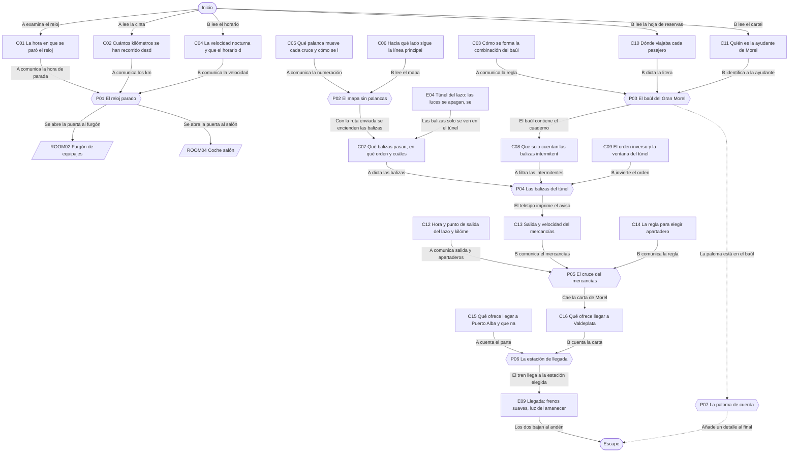
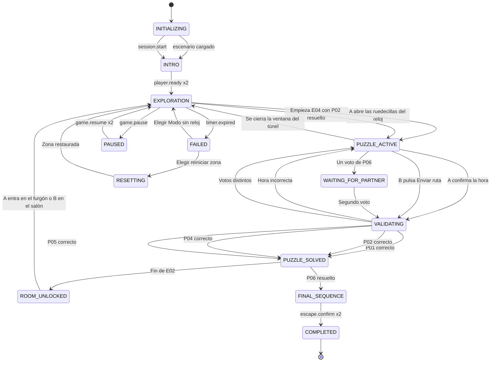

# ER04 · El tren de medianoche

Invierno de 1934, en una línea ferroviaria inventada. El Expreso Lucerna da vueltas sin tripulación por el Lazo de Orsa, un bucle con un túnel que se repite cada cuatro minutos. Si nadie programa su telemando, a la 01:08 saldrá hacia un apeadero abandonado. El Jugador A explora la cabina y el furgón; el Jugador B investiga el coche cama y el coche salón. Siguiendo el rastro que dejó el ilusionista Gran Morel, reconstruyen la ruta, abren su baúl, confirman la vía en el túnel, esquivan un mercancías y eligen en qué estación llegar.

## A. Ficha técnica

| Campo | Valor |
|---|---|
| ID | ER04 |
| Nombre | El tren de medianoche |
| Versión | 1.0.0 |
| Género | Misterio de época (años 30 ficticios) |
| Sinopsis | Invierno de 1934, en una línea ferroviaria inventada. El Expreso Lucerna da vueltas sin tripulación por el Lazo de Orsa, un bucle con un túnel que se repite cada cuatro minutos. Si nadie programa su telemando, a la 01:08 saldrá hacia un apeadero abandonado. El Jugador A explora la cabina y el furgón; el Jugador B investiga el coche cama y el coche salón. Siguiendo el rastro que dejó el ilusionista Gran Morel, reconstruyen la ruta, abren su baúl, confirman la vía en el túnel, esquivan un mercancías y eligen en qué estación llegar. |
| Objetivo principal | OBJ01 Poner en hora el reloj patrón y reconstruir la ruta de salida del lazo; OBJ02 Confirmar la ruta en el túnel y programar el cruce con el mercancías; OBJ03 Elegir la estación de llegada y bajar al andén |
| Objetivos secundarios | OBJ04 Hacer volar la paloma de cuerda del Gran Morel |
| Jugadores | 2 (A: Viajero en la cabina: máquinas, vía y furgón; B: Viajero en los coches de pasaje: documentos y telemando) |
| Duración estimada | 50 min (despertar 4, descubrimiento 13, complicación 15, clímax 12, escape 6) |
| Dificultad | Media |
| Zonas | 4 |
| Acertijos | 6 principales y 1 microacertijos |
| Objetos interactivos | 27 (más 11 decorativos) |
| Finales | 4 |
| Competencias | Aritmética de horarios (distancia, velocidad y tiempo), Orientación en mapas y cambio de perspectiva, Deducción a partir de documentos, Observación bajo tiempo limitado, Comunicación precisa, Toma de decisiones compartida |
| Condiciones iniciales | A despierta en la cabina del automotor, a la que llegó buscando al personal; la puerta trasera se ha cerrado con la cerradura horaria del regulador. B despierta en el compartimento 5 del coche cama; la puerta al coche salón está cerrada con la misma cerradura. No queda nadie más a bordo. El reloj de la cabina está parado. Los dos se hablan por el interfono de servicio del tren, que en el juego es la llamada de voz. Cada cuatro minutos el tren cruza el túnel del lazo durante 40 segundos. |
| Condición de victoria | Completar OBJ01, OBJ02, OBJ03 |
| Condición de fallo | 50 min de cuenta atrás: Faltan dos minutos para la salida automática: el regulador toma la vía del Apeadero de los Pinos y el tren se detiene allí con suavidad. Los jugadores eligen reiniciar la zona actual o seguir en Modo sin reloj: el telemando puede seguir programándose desde el apeadero y el tren vuelve al lazo. No se pierde ningún acertijo resuelto. |
| Condición de reinicio | Cualquiera de los dos pulsa Reiniciar zona y el otro lo confirma; también se ofrece al agotarse el reloj. El reinicio completo vuelve al estado inicial y repite la intro. |

## B. Guion narrativo

**1. Introducción cinematográfica.** Noche de nieve, 1934. Un automotor aerodinámico color crema y granate sale de un túnel y vuelve a entrar en él, dando vueltas alrededor de una montaña. En el coche salón, un gramófono gira sin disco. En la cabina, el reloj está parado y no se mueve.

**2. Por qué están aquí.** La pareja viaja en el Expreso Lucerna hacia la costa. En la parada técnica de Mirabel, el jefe de estación anunció por error que el tren quedaba fuera de servicio y todo el pasaje cambió de tren. Ellos dormían y nadie los vio. Poco después, el regulador automático del Lucerna tomó el mando y llevó el tren al Lazo de Orsa, donde espera órdenes.

**3. Situación inicial.** A se despertó, fue hacia delante buscando al personal y la puerta de la cabina se cerró a su espalda. B está en su compartimento. Por el interfono descubren que no hay nadie más. Una placa de la cabina explica que, sin órdenes, a la 01:08 el tren saldrá del lazo por la vía programada: la del Apeadero de los Pinos, cerrado desde hace años.

**4. Objetivo.** Poner en hora el reloj patrón, reconstruir la ruta con el mapa, abrir el baúl del Gran Morel, confirmar la ruta con las balizas del túnel, elegir el apartadero donde esperar al mercancías y decidir si llegan a Valdeplata o a Puerto Alba.

**5. Primer descubrimiento.** A encuentra el reloj parado y la cinta del registrador con los kilómetros recorridos; B encuentra en su compartimento el horario de invierno con las velocidades de marcha. Solo con las dos cosas se puede saber qué hora es.

**6. Progresión de los acontecimientos.**

- Con el reloj patrón en hora se abren las cerraduras horarias: A puede pasar al furgón y B al coche salón, donde despierta el telemando.
- A sabe qué palanca mueve cada cruce y B tiene el mapa turístico de la línea. Juntos deciden hacia qué lado poner cada aguja.
- En el furgón, A encuentra el baúl del Gran Morel. La combinación depende de la litera de su ayudante, que B encuentra en la hoja de reservas.
- Dentro del baúl, el cuaderno de Morel explica qué balizas del túnel confirman la ruta. A las ve desde el parabrisas y B las marca en la consola antes de salir del túnel.
- El teletipo del salón anuncia un mercancías por la vía única. Con el horario y la placa del regulador eligen el apartadero donde esperar.
- Aparece la carta de Morel. La pareja decide la estación de llegada.

**7. Obstáculos narrativos.**

- El reloj está parado y el horario no sirve por sí solo: el tren salió de Mirabel con retraso.
- El selector del salón solo numera las palancas, y el tablero de la cabina no dice adónde lleva cada lado.
- El mapa tiene el norte arriba, pero las palancas se entienden mirando hacia donde avanza el tren.
- Las balizas solo se ven en la oscuridad del túnel, 40 segundos cada cuatro minutos.
- Un mercancías ocupa la vía única: si eligen mal el apartadero, el bloqueo automático los dejará parados horas.

**8. Revelaciones.**

- Nadie abandonó a la pareja: el parte del maquinista muestra que la tripulación creía el tren vacío.
- El Gran Morel programó la ruta hacia los Pinos como despedida del pueblo donde estrenó su primer número, pero se arrepintió y dejó pistas para corregirla.
- El baúl no guarda trucos de escenario, sino el número que Morel y su hermana Elvira nunca llegaron a estrenar.

**9. Clímax.** Con la ruta confirmada y el apartadero elegido, solo falta la palanca de la Bifurcación de Orsa. A lee el parte del maquinista y B la carta de Morel. Votan la estación y el telemando cierra la hoja de marcha.

**10. Escena de escape.** A la 01:08 el Lucerna sale del lazo, cruza el Pinar y las Minas, espera en el apartadero mientras pasa el mercancías y sigue hacia la estación elegida. Fundido al amanecer: los frenos suspiran, las puertas de la cabina y del salón se abren y A y B bajan al andén, donde se encuentran.

**11. Epílogo.** El jefe de la estación los recibe con café y una manta. Escucha la historia del tren que daba vueltas y anota en el libro de incidencias: Llegada sin tripulación, con dos viajeros que supieron leer el horario.

### Diálogos y textos del sistema

Cada línea es un subtítulo. Las líneas de canal `document` quedan además guardadas en el registro de pistas.

| ID | Quién | Texto | Cuándo | Para | Canal |
|---|---|---|---|---|---|
| D01 | Narrador | Expreso Lucerna, invierno de 1934. El tren da vueltas a la montaña y nadie lo conduce. | START | Ambos | subtitle |
| D02 | Gran Morel (gramófono) | Buenas noches, distinguido público. Si me oís, es que el tren os ha elegido como últimos espectadores. | E01 | Ambos | audio_subtitled |
| D03 | Gran Morel (gramófono) | Todo buen truco necesita dos manos: una que mira y otra que actúa. No os separéis… aunque estéis en vagones distintos. | E01 | Ambos | audio_subtitled |
| D04 | Narrador | El reloj del pupitre está parado. La aguja no se mueve. | C01_DISCOVERED | Jugador A | subtitle |
| D05 | Narrador | Sobre la mesita del compartimento hay un horario de invierno con una nota a lápiz. | C04_DISCOVERED | Jugador B | subtitle |
| D06 | Narrador | El tren entra en el túnel. Las luces se apagan y todo queda en azul. | E04 | Ambos | subtitle |
| D07 | Narrador | Tic. El reloj patrón arranca y, en algún lugar del tren, dos cerraduras se abren. | E02 | Ambos | subtitle |
| D08 | Placa del regulador | Sin órdenes, el tren sale del lazo a la 01:08 por la vía programada. | C12_DISCOVERED | Jugador A | document |
| D09 | Narrador | El mapa del salón tiene una rosa de los vientos dorada. El norte, arriba. | C06_DISCOVERED | Jugador B | subtitle |
| D10 | Telemando | Ruta recibida. Confirme con las balizas del próximo túnel. | E03 | Ambos | popup |
| D11 | Telemando | Ruta no válida: conduce a una vía cerrada. | P02 | Jugador B | popup |
| D12 | Narrador | La etiqueta del baúl está escrita con tinta violeta y letra de artista. | C03_DISCOVERED | Jugador A | subtitle |
| D13 | Narrador | La tapa del baúl salta con un muelle. Dentro huele a terciopelo y aceite de reloj. | E05 | Jugador A | subtitle |
| D14 | Cuaderno de Morel | Mis balizas son las que parpadean. Las demás no cuentan. | C08_DISCOVERED | Jugador A | document |
| D15 | Narrador | En el espejo del salón brilla una frase que antes no estaba. | C19_DISCOVERED | Jugador B | subtitle |
| D16 | Telemando | Ruta confirmada. | E06 | Ambos | popup |
| D17 | Teletipo | Aviso de circulación número siete: mercancías 412 en vía única. | E06 | Ambos | audio_subtitled |
| D18 | Narrador | Nada de choques: el bloqueo automático nunca deja dos trenes en la misma vía. Pero elegir mal el apartadero puede costar horas. | E06 | Ambos | subtitle |
| D19 | Narrador | Un sobre lacrado con una estrella cae del marco del mapa. | E07 | Jugador B | subtitle |
| D20 | Gran Morel (carta) | Cambié la ruta para despedirme del teatro donde empecé, y me arrepentí tarde. | C16_DISCOVERED | Jugador B | document |
| D21 | Narrador | A la 01:08 el Lucerna deja el lazo. En el apartadero, el mercancías pasa despacio, con sus faroles rojos. | E08 | Ambos | subtitle |
| D22 | Narrador | Valdeplata amanece con olor a pan. En la cantina, una mujer con el pelo recogido mira el baúl y sonríe. | P06_OPT_VALDEPLATA | Ambos | subtitle |
| D23 | Narrador | Puerto Alba amanece con gaviotas. El jefe de estación levanta la gorra al ver bajar a dos viajeros. | P06_OPT_PUERTO_ALBA | Ambos | subtitle |
| D24 | Regulador | Faltan dos minutos para la salida programada hacia los Pinos. | E11 | Ambos | popup |
| D25 | Gran Morel (gramófono) | Un truco nunca sale si cada mano va a lo suyo. Contad lo que veis. | E10 | Ambos | audio_subtitled |

## C. Escenografía y planos

Coordenadas en metros con origen en la esquina suroeste del suelo de cada zona: `x` hacia el este, `y` hacia arriba, `z` hacia el norte.

### ROOM01 · Cabina del automotor

Cabina estrecha de madera barnizada y latón con un gran parabrisas curvo. Pupitre con el reloj patrón, el registrador de marcha, el tablero de cruces del telemando y el selector de apartadero.

**Medidas:** 3.2 × 4.5 m, altura 2.6 m. **Acceso:** A sí, B no. **Se abre:** desde el inicio.

**Qué ve cada jugador.** A: Toda la cabina y la vía delante por el parabrisas; en el túnel, las balizas.. B: No la ve; oye a A por el interfono de servicio..

**Distribución.** Parabrisas en el frente (pared norte). Pupitre bajo el parabrisas con el reloj a la izquierda, el tablero de cruces en el centro y el registrador a la derecha; selector de apartadero junto al registrador. Placa del regulador en la pared oeste. Puerta lateral de salida en la pared este. Puerta al furgón en la pared sur. Gorra colgada junto a la puerta trasera.

| ID | Elemento | Tipo o pared | Posición (x, y, z) | Notas |
|---|---|---|---|---|
| DOOR01 | Puerta a Furgón de equipajes | pared south | (1.6, 0, 0) | Se abre con P01_SOLVED |
| DOOR02 | Puerta de salida | pared east | (3.2, 0, 2.5) | Se abre con E09_DONE |
| — | Ventana | pared north | (1.6, 1.6, 4.5) | Parabrisas curvo: nieve y montaña fuera del túnel; balizas dentro del túnel |
| — | Ventana | pared west | (0, 1.6, 3) | Ventanilla lateral con escarcha; no es interactiva |
| O01 | Reloj patrón del pupitre | 4 Usar | (1, 1.5, 4.2) | Reloj redondo de esfera blanca y números romanos, parado, con dos ruedecillas para ponerlo en hora |
| O02 | Registrador de marcha | 2 Examinar | (2.4, 1, 4) | Caja de latón con una cinta de papel perforado que sale por una ranura |
| O03 | Tablero de cruces del telemando | 2 Examinar | (1.6, 1.4, 4.3) | Panel negro con tres pilotos numerados, cada uno con una placa de esmalte y una flecha IZQ/DER |
| O04 | Placa del regulador y perfil de la línea | 2 Examinar | (0.1, 1.6, 2.5) | Placa de bronce atornillada en la pared oeste con un dibujo de la vía y sus kilómetros |
| O05 | Selector de apartadero | 4 Usar | (2.2, 1, 3.6) | Rueda de latón con tres posiciones grabadas: Molino, Ermita, Orsa; y un pulsador Programar |
| O06 | Parabrisas frontal | 2 Examinar | (1.6, 1.6, 4.45) | Cristal curvo; en el túnel se ven pasar balizas con forma junto a la vía |
| O07 | Parte del maquinista | 2 Examinar | (0.6, 0.9, 3.2) | Carpeta de cartón con hojas mecanografiadas y un sello de la Compañía |
| O08 | Puerta lateral de la cabina | 10 Objeto de salida | (3.2, 0, 2.5) | Puerta de chapa con ventanuco y asidero de latón |
| O09 | Silbato de latón | 1 Decorativo | (2.8, 2.2, 4.2) | Tirador de silbato colgado del techo |
| O10 | Termo y taza del maquinista | 1 Decorativo | (0.4, 0.9, 3.6) | Termo de esmalte verde y taza con café frío |
| O11 | Gorra colgada | 1 Decorativo | (0.1, 1.8, 0.8) | Gorra de maquinista con la insignia de la Compañía del Ferrocarril de Orsa |

| Luz | Tipo | Posición | Color | Intensidad | Uso |
|---|---|---|---|---|---|
| L01 | Lámpara de pupitre con pantalla de latón | (1.6, 2.3, 3.8) | #FFE7B0 | 0.6 | Se apaga en el túnel |
| L02 | Luz azul de túnel (piloto de emergencia) | (1.6, 2.5, 2.2) | #7F9CFF | 0.25 | Solo encendida en el túnel |
| L03 | Reflejo del faro frontal | (1.6, 1, 4.5) | #FFF6D8 | 0.4 | Ilumina la vía; en el túnel deja ver las balizas |

**Sonido ambiente:** Traqueteo rítmico del automotor y zumbido del motor desde la cabina. **Música:** Piano de salón lento con contrabajo, al estilo de los años treinta, muy bajo.

**Cambios dinámicos:**

- E04: Túnel: la lámpara se apaga, se enciende la luz azul y por el parabrisas pasan las balizas
- E02: El reloj patrón arranca y la puerta al furgón se desbloquea
- E09: Luz del amanecer por el parabrisas y la puerta lateral se abre al andén

**Para el motor:** Escena interior con cámara en primera persona y balanceo suave desactivable. El exterior del parabrisas es una textura en bucle de 4 minutos: 200 s de montaña nevada y 40 s de túnel. El ciclo del túnel lo marca el servidor (evento E04) para que A y B lo vean a la vez. Las balizas son sprites con forma y texto; su estado fijo o intermitente también se escribe en el registro de A.

### ROOM02 · Furgón de equipajes

Furgón de madera con sacas de correo, una bicicleta colgada y, en el centro, el gran baúl negro del Gran Morel con candado de cuatro ruedas. En la pared hay un tubo de correspondencia que llega al coche cama.

**Medidas:** 2.8 × 12 m, altura 2.6 m. **Acceso:** A sí, B no. **Se abre:** P01_SOLVED.

**Qué ve cada jugador.** A: Todo el furgón.. B: No lo ve; puede recibir lo que A envíe por el tubo de correspondencia..

**Distribución.** Puerta a la cabina en la pared norte. Baúl en el centro (z 6). Sacas de correo al norte, jaulas vacías al este, bicicleta en la pared oeste. Tubo de correspondencia en la esquina sureste. Puerta de intercomunicación con el coche cama en la pared sur, cerrada hasta la llegada.

| ID | Elemento | Tipo o pared | Posición (x, y, z) | Notas |
|---|---|---|---|---|
| DOOR03 | Puerta a Cabina del automotor | pared north | (1.4, 0, 12) | Abierta |
| DOOR04 | Puerta a Coche cama | pared south | (1.4, 0, 0) | Se abre con E09_DONE |
| — | Ventana | pared west | (0, 1.7, 8) | Ventanuco con barrotes; no es interactivo |
| O12 | Baúl del Gran Morel | 7 Bloqueado | (1.4, 0, 6) | Baúl negro con estrellas pintadas y candado de cuatro ruedas numeradas |
| O13 | Etiqueta del baúl | 2 Examinar | (1.4, 0.8, 6.5) | Etiqueta de cartón atada al asa con letra elegante |
| O14 | Cuaderno de funciones de Morel | 2 Examinar | (1.4, 0.6, 6) | Cuaderno de tapas rojas con dibujos de balizas y notas |
| O15 | Paloma de cuerda | 3 Recoger | (1.5, 0.6, 6) | Paloma mecánica de hojalata plateada con una tarjeta atada a la pata |
| O16 | Tubo de correspondencia (furgón) | 4 Usar | (2.7, 1.3, 1) | Tubo de latón con tapa y una palanca de envío rotulada Coche cama |
| O17 | Sacas de correo | 1 Decorativo | (0.5, 0, 10) | Sacas de lona con el sello de Correos y etiquetas de destino |
| O18 | Bicicleta colgada | 1 Decorativo | (0.1, 1.5, 3) | Bicicleta negra colgada de dos ganchos con una etiqueta de equipaje |
| O19 | Jaulas vacías | 1 Decorativo | (2.3, 0, 9) | Jaulas de mimbre para aves de corral, vacías |

| Luz | Tipo | Posición | Color | Intensidad | Uso |
|---|---|---|---|---|---|
| L04 | Bombilla con rejilla | (1.4, 2.5, 6) | #FFD8A0 | 0.5 | Se apaga en el túnel |
| L05 | Luz azul de túnel | (1.4, 2.5, 2) | #7F9CFF | 0.2 | Solo en el túnel |

**Sonido ambiente:** Traqueteo y crujidos de madera en el furgón. **Música:** Piano de salón lento con contrabajo, al estilo de los años treinta, muy bajo.

**Cambios dinámicos:**

- E04: Túnel: bombilla apagada y luz azul tenue
- E05: El baúl se abre con un muelle y deja ver el cuaderno y la paloma de cuerda

**Para el motor:** Furgón como escena contigua a la cabina, cargada al desbloquear DOOR01. El candado del baúl es una interfaz de cuatro ruedas 0–9. El tubo de correspondencia es un disparador que mueve un objeto del inventario de A a O24 en el coche cama (cambio de estado en el servidor, sin física).

### ROOM03 · Coche cama

Coche cama de caoba con pasillo al este y cinco compartimentos al oeste, numerados del 1 (norte) al 5 (sur), más la cabina del revisor al extremo sur.

**Medidas:** 2.8 × 20 m, altura 2.7 m. **Acceso:** A no, B sí. **Se abre:** desde el inicio.

**Qué ve cada jugador.** A: No lo ve; oye a B por el interfono.. B: Todo el coche cama, compartimento por compartimento..

**Distribución.** Pasillo de x 2,0 a 2,8. Compartimentos de x 0 a 2,0: 1 (z 16,6–20), 2 (z 13,2–16,6), 3 (z 9,8–13,2), 4 (z 6,4–9,8), 5 (z 3,0–6,4); cabina del revisor (z 0–3,0). Cartel de la función en la pared del pasillo frente al compartimento 3. Salida del tubo de correspondencia en el extremo norte del pasillo. Puerta al furgón al norte (cerrada) y al coche salón al sur.

| ID | Elemento | Tipo o pared | Posición (x, y, z) | Notas |
|---|---|---|---|---|
| DOOR05 | Puerta a Furgón de equipajes | pared north | (1.4, 0, 20) | Se abre con E09_DONE |
| DOOR06 | Puerta a Coche salón | pared south | (1.4, 0, 0) | Se abre con P01_SOLVED |
| — | Ventana | pared west | (0, 1.5, 4.7) | Ventanillas de cada compartimento con cortinilla; fuera, nieve o la pared del túnel |
| O20 | Horario de invierno | 2 Examinar | (1, 1, 4.6) | Folleto plegado de la Compañía con tablas de horas y una nota a lápiz |
| O21 | Hoja de reservas del revisor | 2 Examinar | (1, 1, 1.5) | Hoja pautada en una tablilla con pinza, en la cabina del revisor |
| O22 | Cartel de la función | 2 Examinar | (2.75, 1.5, 11) | Cartel a dos tintas con un mago de chistera y una joven con capa |
| O23 | Llave de cuerda | 3 Recoger | (0.8, 0.7, 8) | Llave pequeña de mariposa olvidada en la litera del compartimento 4 |
| O24 | Paloma en el tubo (coche cama) | 5 Combinar | (2.7, 1.3, 19.5) | La paloma de hojalata dentro del cajetín de llegada del tubo |
| O25 | Maletas en las rejillas | 1 Decorativo | (1, 2.1, 15) | Maletas de cuero y sombrereras olvidadas en las rejillas |
| O26 | Lámparas de litera | 1 Decorativo | (0.3, 1.6, 7) | Lámparas con pantalla de cristal esmerilado |
| O27 | Cortinillas de terciopelo | 1 Decorativo | (0.05, 1.4, 12) | Cortinillas granates con borlas doradas |

| Luz | Tipo | Posición | Color | Intensidad | Uso |
|---|---|---|---|---|---|
| L06 | Apliques del pasillo | (2.4, 2.5, 10) | #FFE2B8 | 0.5 | Se apagan en el túnel |
| L07 | Lámpara de lectura del compartimento 5 | (0.3, 1.6, 5) | #FFF0C8 | 0.4 | Permanece encendida a baja intensidad en el túnel |
| L08 | Luz azul de túnel | (2.4, 2.6, 15) | #7F9CFF | 0.2 | Solo en el túnel |

**Sonido ambiente:** Traqueteo amortiguado y cortinillas que se balancean. **Música:** Piano de salón lento con contrabajo, al estilo de los años treinta, muy bajo.

**Cambios dinámicos:**

- E04: Túnel: los apliques se apagan y queda la luz azul; las ventanillas se oscurecen
- E02: La cerradura horaria de la puerta sur se abre con un chasquido

**Para el motor:** Escena alargada con puertas correderas de compartimento abiertas. Cada compartimento es una subzona con su propia lámpara. Las pistas de papel se abren a pantalla completa con texto seleccionable para lector de pantalla.

### ROOM04 · Coche salón

Coche salón con butacas, un piano pequeño y, al extremo norte, el pupitre del jefe de tren con el selector de ruta, la consola del telemando y un teletipo.

**Medidas:** 2.8 × 20 m, altura 2.7 m. **Acceso:** A no, B sí. **Se abre:** P01_SOLVED.

**Qué ve cada jugador.** A: No lo ve; oye a B por el interfono.. B: Todo el salón..

**Distribución.** Puerta al coche cama en la pared norte. Pupitre del jefe de tren junto a ella: selector de ruta en el centro, consola a su izquierda, manual encima y teletipo a la derecha. Mapa turístico enmarcado en la pared oeste junto al pupitre y reglamento debajo. Mesas con copas en el centro, espejo en la pared este, piano al sur. Puerta del andén en la pared este, cerca del extremo sur.

| ID | Elemento | Tipo o pared | Posición (x, y, z) | Notas |
|---|---|---|---|---|
| DOOR07 | Puerta a Coche cama | pared north | (1.4, 0, 20) | Abierta |
| DOOR08 | Puerta de salida | pared east | (2.8, 0, 5) | Se abre con E09_DONE |
| — | Ventana | pared west | (0, 1.5, 10) | Ventanales panorámicos; en el túnel reflejan el salón |
| O28 | Selector de ruta del jefe de tren | 4 Usar | (1.4, 1, 18.8) | Tres palancas de madera numeradas 1, 2 y 3, cada una con posiciones IZQ y DER, y un pulsador Enviar ruta |
| O29 | Mapa turístico de la Compañía | 2 Examinar | (0.05, 1.5, 17) | Mapa enmarcado a color con dibujos de pinos, minas, campanarios y un faro; rosa de los vientos en la esquina |
| O30 | Consola del telemando | 4 Usar | (1, 1, 18.8) | Caja de nogal con cinco teclas de baquelita con forma: círculo, triángulo, cuadrado, rombo y estrella |
| O31 | Manual del telemando | 2 Examinar | (1.8, 0.9, 18.5) | Librito de tapas grises atado a la consola con un cordel |
| O32 | Aviso del teletipo | 2 Examinar | (2.6, 1.1, 18) | Tira de papel que sale del teletipo con un aviso de circulación |
| O33 | Reglamento de vía única | 2 Examinar | (0.05, 1.2, 15) | Cartel enmarcado con el artículo 14 del reglamento de circulación |
| O34 | Carta del Gran Morel | 2 Examinar | (1.4, 0.8, 16) | Sobre lacrado con una estrella, caído del marco del mapa |
| O35 | Espejo del salón | 2 Examinar | (2.75, 1.5, 10) | Espejo biselado; en el túnel aparece una frase fosforescente |
| O36 | Puerta del andén | 10 Objeto de salida | (2.8, 0, 5) | Puerta de doble hoja con cristal grabado y estribo plegable |
| O37 | Piano pequeño | 1 Decorativo | (0.8, 0, 2.5) | Piano vertical con la tapa abierta y una partitura de vals |
| O38 | Mesas con copas | 1 Decorativo | (1.4, 0, 12) | Mesas redondas con mantel blanco y copas que tintinean |

| Luz | Tipo | Posición | Color | Intensidad | Uso |
|---|---|---|---|---|---|
| L09 | Lámparas de mesa con flecos | (1.4, 1.2, 12) | #FFD9A0 | 0.5 | Se apagan en el túnel |
| L10 | Flexo del pupitre | (1.4, 1.5, 19) | #FFF1D6 | 0.5 | Sigue encendido en el túnel para que B use la consola |
| L11 | Luz azul de túnel | (1.4, 2.6, 8) | #7F9CFF | 0.2 | Solo en el túnel; deja ver la frase fosforescente del espejo |

**Sonido ambiente:** Traqueteo con tintineo de copas. **Música:** Piano de salón lento con contrabajo, al estilo de los años treinta, muy bajo.

**Cambios dinámicos:**

- E04: Túnel: el salón queda en luz azul, el espejo muestra una frase fosforescente y la consola admite entradas
- E06: El teletipo imprime el aviso del mercancías 412 (complicación)
- E07: La carta de Morel cae del marco del mapa
- E09: Luz del amanecer por los ventanales y la puerta del andén se abre

**Para el motor:** El selector de ruta tiene tres palancas IZQ/DER; la tercera está bloqueada por servidor hasta P06. La consola del telemando tiene cinco teclas con forma (círculo, triángulo, cuadrado, rombo, estrella) y solo acepta entradas mientras E04 está activo o en los 30 s siguientes. El teletipo es una animación de papel que sale con texto real legible.

## D. Inventario de objetos

| object_id | Nombre | Descripción visual | Zona | Posición | Tipo | Estado inicial | Acción | Activación | Resultado | Pista | Acertijo | Jugador | Estado final |
|---|---|---|---|---|---|---|---|---|---|---|---|---|---|
| O01 | Reloj patrón del pupitre | Reloj redondo de esfera blanca y números romanos, parado, con dos ruedecillas para ponerlo en hora | ROOM01 | (1, 1.5, 4.2) | 4 Usar | STOPPED | Examinar / poner en hora | — | Examinar guarda C01; la hora introducida se valida en P01 | C01 | P01 | Jugador A | SET |
| O02 | Registrador de marcha | Caja de latón con una cinta de papel perforado que sale por una ranura | ROOM01 | (2.4, 1, 4) | 2 Examinar | DEFAULT | Leer la cinta | — | Guarda C02 | C02 | P01 | Jugador A | EXAMINED |
| O03 | Tablero de cruces del telemando | Panel negro con tres pilotos numerados, cada uno con una placa de esmalte y una flecha IZQ/DER | ROOM01 | (1.6, 1.4, 4.3) | 2 Examinar | DEFAULT | Examinar | — | Guarda C05 | C05 | P02 | Jugador A | EXAMINED |
| O04 | Placa del regulador y perfil de la línea | Placa de bronce atornillada en la pared oeste con un dibujo de la vía y sus kilómetros | ROOM01 | (0.1, 1.6, 2.5) | 2 Examinar | DEFAULT | Examinar | — | Guarda C12 | C12 | P05 | Jugador A | EXAMINED |
| O05 | Selector de apartadero | Rueda de latón con tres posiciones grabadas: Molino, Ermita, Orsa; y un pulsador Programar | ROOM01 | (2.2, 1, 3.6) | 4 Usar | IDLE | Elegir apartadero y pulsar Programar | P04_SOLVED | Envía el apartadero elegido al telemando | — | P05 | Jugador A | PROGRAMMED |
| O06 | Parabrisas frontal | Cristal curvo; en el túnel se ven pasar balizas con forma junto a la vía | ROOM01 | (1.6, 1.6, 4.45) | 2 Examinar | DEFAULT | Mirar durante el túnel | — | Durante el túnel con la ruta enviada guarda C07 | C07 | P04 | Jugador A | EXAMINED |
| O07 | Parte del maquinista | Carpeta de cartón con hojas mecanografiadas y un sello de la Compañía | ROOM01 | (0.6, 0.9, 3.2) | 2 Examinar | DEFAULT | Leer | — | Guarda C15 | C15 | P06 | Jugador A | EXAMINED |
| O08 | Puerta lateral de la cabina | Puerta de chapa con ventanuco y asidero de latón | ROOM01 | (3.2, 0, 2.5) | 10 Objeto de salida | LOCKED | Bajar al andén | E09_DONE | A baja al andén | — | — | Jugador A | OPEN |
| O09 | Silbato de latón | Tirador de silbato colgado del techo | ROOM01 | (2.8, 2.2, 4.2) | 1 Decorativo | DEFAULT | none | — | Ambientación | — | — | Nadie | DEFAULT |
| O10 | Termo y taza del maquinista | Termo de esmalte verde y taza con café frío | ROOM01 | (0.4, 0.9, 3.6) | 1 Decorativo | DEFAULT | none | — | Ambientación | — | — | Nadie | DEFAULT |
| O11 | Gorra colgada | Gorra de maquinista con la insignia de la Compañía del Ferrocarril de Orsa | ROOM01 | (0.1, 1.8, 0.8) | 1 Decorativo | DEFAULT | none | — | Ambientación | — | — | Nadie | DEFAULT |
| O12 | Baúl del Gran Morel | Baúl negro con estrellas pintadas y candado de cuatro ruedas numeradas | ROOM02 | (1.4, 0, 6) | 7 Bloqueado | LOCKED | Girar las ruedas del candado | — | Se abre con el código de P03 | — | P03 | Jugador A | OPEN |
| O13 | Etiqueta del baúl | Etiqueta de cartón atada al asa con letra elegante | ROOM02 | (1.4, 0.8, 6.5) | 2 Examinar | DEFAULT | Leer | — | Guarda C03 | C03 | P03 | Jugador A | EXAMINED |
| O14 | Cuaderno de funciones de Morel | Cuaderno de tapas rojas con dibujos de balizas y notas | ROOM02 | (1.4, 0.6, 6) | 2 Examinar | HIDDEN | Leer | P03_SOLVED | Guarda C08 | C08 | P04 | Jugador A | EXAMINED |
| O15 | Paloma de cuerda | Paloma mecánica de hojalata plateada con una tarjeta atada a la pata | ROOM02 | (1.5, 0.6, 6) | 3 Recoger | HIDDEN | Recoger / meter en el tubo | P03_SOLVED | Guarda C17; se puede enviar por el tubo | C17 | P07 | Jugador A | SENT |
| O16 | Tubo de correspondencia (furgón) | Tubo de latón con tapa y una palanca de envío rotulada Coche cama | ROOM02 | (2.7, 1.3, 1) | 4 Usar | DEFAULT | Meter un objeto y enviar | — | Envía el objeto al coche cama | — | P07 | Jugador A | DEFAULT |
| O17 | Sacas de correo | Sacas de lona con el sello de Correos y etiquetas de destino | ROOM02 | (0.5, 0, 10) | 1 Decorativo | DEFAULT | none | — | Ambientación | — | — | Nadie | DEFAULT |
| O18 | Bicicleta colgada | Bicicleta negra colgada de dos ganchos con una etiqueta de equipaje | ROOM02 | (0.1, 1.5, 3) | 1 Decorativo | DEFAULT | none | — | Ambientación | — | — | Nadie | DEFAULT |
| O19 | Jaulas vacías | Jaulas de mimbre para aves de corral, vacías | ROOM02 | (2.3, 0, 9) | 1 Decorativo | DEFAULT | none | — | Ambientación | — | — | Nadie | DEFAULT |
| O20 | Horario de invierno | Folleto plegado de la Compañía con tablas de horas y una nota a lápiz | ROOM03 | (1, 1, 4.6) | 2 Examinar | DEFAULT | Leer | — | Guarda C04 | C04 | P01 | Jugador B | EXAMINED |
| O21 | Hoja de reservas del revisor | Hoja pautada en una tablilla con pinza, en la cabina del revisor | ROOM03 | (1, 1, 1.5) | 2 Examinar | DEFAULT | Leer | — | Guarda C10 | C10 | P03 | Jugador B | EXAMINED |
| O22 | Cartel de la función | Cartel a dos tintas con un mago de chistera y una joven con capa | ROOM03 | (2.75, 1.5, 11) | 2 Examinar | DEFAULT | Leer | — | Guarda C11 | C11 | P03 | Jugador B | EXAMINED |
| O23 | Llave de cuerda | Llave pequeña de mariposa olvidada en la litera del compartimento 4 | ROOM03 | (0.8, 0.7, 8) | 3 Recoger | DEFAULT | Recoger | — | Pasa al inventario de B y guarda C18 | C18 | P07 | Jugador B | COLLECTED |
| O24 | Paloma en el tubo (coche cama) | La paloma de hojalata dentro del cajetín de llegada del tubo | ROOM03 | (2.7, 1.3, 19.5) | 5 Combinar | HIDDEN | Darle cuerda con la llave | — | Con la llave, la paloma bate las alas | — | P07 | Jugador B | FLYING |
| O25 | Maletas en las rejillas | Maletas de cuero y sombrereras olvidadas en las rejillas | ROOM03 | (1, 2.1, 15) | 1 Decorativo | DEFAULT | none | — | Ambientación | — | — | Nadie | DEFAULT |
| O26 | Lámparas de litera | Lámparas con pantalla de cristal esmerilado | ROOM03 | (0.3, 1.6, 7) | 1 Decorativo | DEFAULT | none | — | Ambientación | — | — | Nadie | DEFAULT |
| O27 | Cortinillas de terciopelo | Cortinillas granates con borlas doradas | ROOM03 | (0.05, 1.4, 12) | 1 Decorativo | DEFAULT | none | — | Ambientación | — | — | Nadie | DEFAULT |
| O28 | Selector de ruta del jefe de tren | Tres palancas de madera numeradas 1, 2 y 3, cada una con posiciones IZQ y DER, y un pulsador Enviar ruta | ROOM04 | (1.4, 1, 18.8) | 4 Usar | IDLE | Mover palancas y pulsar Enviar ruta | P01_SOLVED | Envía la ruta al telemando | — | P02 | Jugador B | SENT |
| O29 | Mapa turístico de la Compañía | Mapa enmarcado a color con dibujos de pinos, minas, campanarios y un faro; rosa de los vientos en la esquina | ROOM04 | (0.05, 1.5, 17) | 2 Examinar | DEFAULT | Examinar | — | Guarda C06 | C06 | P02 | Jugador B | EXAMINED |
| O30 | Consola del telemando | Caja de nogal con cinco teclas de baquelita con forma: círculo, triángulo, cuadrado, rombo y estrella | ROOM04 | (1, 1, 18.8) | 4 Usar | IDLE | Pulsar teclas durante el túnel | P02_SOLVED | Envía la secuencia de confirmación | — | P04 | Jugador B | CONFIRMED |
| O31 | Manual del telemando | Librito de tapas grises atado a la consola con un cordel | ROOM04 | (1.8, 0.9, 18.5) | 2 Examinar | DEFAULT | Leer | — | Guarda C09 | C09 | P04 | Jugador B | EXAMINED |
| O32 | Aviso del teletipo | Tira de papel que sale del teletipo con un aviso de circulación | ROOM04 | (2.6, 1.1, 18) | 2 Examinar | HIDDEN | Leer | P04_SOLVED | Guarda C13 | C13 | P05 | Jugador B | EXAMINED |
| O33 | Reglamento de vía única | Cartel enmarcado con el artículo 14 del reglamento de circulación | ROOM04 | (0.05, 1.2, 15) | 2 Examinar | DEFAULT | Leer | — | Guarda C14 | C14 | P05 | Jugador B | EXAMINED |
| O34 | Carta del Gran Morel | Sobre lacrado con una estrella, caído del marco del mapa | ROOM04 | (1.4, 0.8, 16) | 2 Examinar | HIDDEN | Leer | P05_SOLVED | Guarda C16 | C16 | P06 | Jugador B | EXAMINED |
| O35 | Espejo del salón | Espejo biselado; en el túnel aparece una frase fosforescente | ROOM04 | (2.75, 1.5, 10) | 2 Examinar | DEFAULT | Mirar en el túnel | — | Guarda C19 | C19 | P02 | Jugador B | EXAMINED |
| O36 | Puerta del andén | Puerta de doble hoja con cristal grabado y estribo plegable | ROOM04 | (2.8, 0, 5) | 10 Objeto de salida | LOCKED | Bajar al andén | E09_DONE | B baja al andén | — | — | Jugador B | OPEN |
| O37 | Piano pequeño | Piano vertical con la tapa abierta y una partitura de vals | ROOM04 | (0.8, 0, 2.5) | 1 Decorativo | DEFAULT | none | — | Ambientación | — | — | Nadie | DEFAULT |
| O38 | Mesas con copas | Mesas redondas con mantel blanco y copas que tintinean | ROOM04 | (1.4, 0, 12) | 1 Decorativo | DEFAULT | none | — | Ambientación | — | — | Nadie | DEFAULT |

## E. Pistas

| clue_id | Contenido exacto | Alternativa accesible | Ubicación | Descubrimiento | Quién | Acertijo | Revela | Depende de | Se habilita | Nivel | Descubierta cuando |
|---|---|---|---|---|---|---|---|---|---|---|---|
| C01 | El reloj patrón está parado en las 23:56. Una etiqueta de la Compañía dice: El reloj se detiene cuando el regulador automático toma el mando. Póngase en hora antes de dar órdenes al telemando. | Texto y voz: reloj parado en las veintitrés cincuenta y seis. | O01 Reloj patrón del pupitre | A examina el reloj del pupitre | Jugador A | P01 | La hora en que se paró el reloj | — | — | 0 | — |
| C02 | Cinta del registrador, última línea, impresa al abrirse la puerta de la cabina: Poste kilométrico 146, Salida del Lazo. Recorrido desde la parada del reloj: 15 km. Hora: sin dato (reloj parado). | Texto y voz: kilómetro 146; 15 kilómetros desde que se paró el reloj. | O02 Registrador de marcha | A lee la cinta del registrador | Jugador A | P01 | Cuántos kilómetros se han recorrido desde que se paró el reloj | — | — | 0 | O02_EXAMINED |
| C03 | Etiqueta del baúl: Baúl n.º 3 del Gran Morel. Mi ayudante sabe abrirlo: la combinación es el número de su coche, el de su compartimento y el de su litera, y al final la suma de los tres. | Texto y voz. | O13 Etiqueta del baúl | A lee la etiqueta del asa | Jugador A | P03 | Cómo se forma la combinación del baúl | — | — | 0 | O13_EXAMINED |
| C04 | Horario de invierno de 1934, Expreso Lucerna, Mirabel – Puerto Alba. Velocidad de marcha: de 06:00 a 22:00, 60 km/h; de 22:00 a 06:00, marcha nocturna a 45 km/h. Mirabel, km 113: llegada 22:50, salida 23:05. Valdeplata, km 190. Puerto Alba, km 214. Nota a lápiz del revisor: Esta noche salimos de Mirabel con retraso; hora sin anotar. | Tabla leída en voz y en texto grande: día 60, noche 45 kilómetros por hora; salida de Mirabel con retraso no anotado. | O20 Horario de invierno | B lee el folleto en su compartimento | Jugador B | P01 | La velocidad nocturna y que el horario de Mirabel no sirve esta noche | — | — | 0 | O20_EXAMINED |
| C05 | Tablero de cruces del telemando. Piloto 1: Cruce de las Minas, km 157. Piloto 2: Cruce del Pinar, km 148. Piloto 3: Bifurcación de Orsa, km 178, bloqueado hasta confirmar la ruta. IZQ y DER se entienden mirando hacia donde avanza el tren. Ahora: 1 en IZQ, 2 en DER. | Lista en voz y texto: palanca 1, Minas; palanca 2, Pinar; palanca 3, Bifurcación. Izquierda y derecha según la marcha. | O03 Tablero de cruces del telemando | A examina el tablero | Jugador A | P02 | Qué palanca mueve cada cruce y cómo se leen IZQ y DER | — | — | 0 | O03_EXAMINED |
| C06 | Mapa turístico de la Compañía, con el norte arriba. Desde la Salida de Poniente del Lazo de Orsa la línea corre hacia el oeste. En el Cruce del Pinar, un ramal sube hacia el norte hasta el Apeadero de los Pinos, cerrado desde 1929; la línea principal sigue por el sur. En el Cruce de las Minas, un ramal baja hacia el sur hasta las Minas de Orsa, cerradas a viajeros; la línea principal sigue por el norte. En la Bifurcación de Orsa, el ramal norte lleva a Valdeplata y el sur a Puerto Alba. | Descripción en texto y voz de cada cruce con sus ramales norte y sur; los dibujos de pino, mina, campanario y faro llevan su nombre escrito. | O29 Mapa turístico de la Compañía | B examina el mapa del salón | Jugador B | P02 | Hacia qué lado sigue la línea principal en cada cruce | — | — | 0 | O29_EXAMINED |
| C07 | Balizas del túnel del lazo, vistas desde el parabrisas, en el orden en que pasan: 1 círculo con luz fija; 2 triángulo con luz intermitente; 3 cuadrado con luz intermitente; 4 rombo con luz fija; 5 estrella con luz intermitente; 6 círculo con luz intermitente. Se repiten igual en cada vuelta. | Lista en texto y voz con la forma y la palabra fija o intermitente de cada baliza; se guarda en el registro de A tras el primer túnel. | O06 Parabrisas frontal | A mira por el parabrisas durante un túnel después de enviar la ruta | Jugador A | P04 | Qué balizas pasan, en qué orden y cuáles parpadean | — | P02_SOLVED | 0 | P02_SOLVED, E04_DONE, O06_EXAMINED |
| C08 | Cuaderno de funciones de Morel: Mis balizas de confirmación son las que parpadean. Las de luz fija son señales normales de la Compañía y no cuentan. | Texto y voz. | O14 Cuaderno de funciones de Morel | A lee el cuaderno del baúl | Jugador A | P04 | Que solo cuentan las balizas intermitentes | — | — | 0 | O14_EXAMINED |
| C09 | Manual del telemando, página 9: Para confirmar la ruta, marque en la consola los símbolos de confirmación en orden inverso al de su paso por el túnel. La consola solo acepta la marca durante el túnel o en los 30 segundos siguientes. | Texto y voz. | O31 Manual del telemando | B lee el manual atado a la consola | Jugador B | P04 | El orden inverso y la ventana del túnel | — | — | 0 | O31_EXAMINED |
| C10 | Hoja de reservas del revisor, coche cama n.º 2. Compartimento 1, litera 1: Sr. Bastián Roca. Compartimento 1, litera 2: Sra. Carmen Vidal. Compartimento 3, litera 2: Sr. Gran Morel. Compartimento 4, litera 1: Srta. Clara Vidal. Compartimento 5, literas 1 y 2: billete doble sin nombres anotados. Todos bajaron en Mirabel salvo el billete doble. | Tabla en texto y voz con compartimento, litera y nombre. | O21 Hoja de reservas del revisor | B lee la tablilla de la cabina del revisor | Jugador B | P03 | Dónde viajaba cada pasajero | — | — | 0 | O21_EXAMINED |
| C11 | Cartel de la función: El Gran Morel y su fiel ayudante, la señorita Clara, presentan La Desaparición del Tren. Teatro del Pinar, temporada de 1929. | Texto y voz con la descripción del cartel. | O22 Cartel de la función | B lee el cartel del pasillo | Jugador B | P03 | Quién es la ayudante de Morel | — | — | 0 | O22_EXAMINED |
| C12 | Placa del regulador: Sin órdenes, el tren sale del lazo a la 01:08 por la Salida de Poniente, km 146, y toma la vía programada. Perfil de la línea tras la salida: vía única con apartaderos en el km 152 (Molino), el km 161 (Ermita) y el km 170 (Orsa); Bifurcación de Orsa en el km 178. | Texto y voz; el perfil se muestra como una línea con marcas y kilómetros. | O04 Placa del regulador y perfil de la línea | A examina la placa de la pared oeste | Jugador A | P05 | Hora y punto de salida del lazo y kilómetros de los apartaderos | — | — | 0 | O04_EXAMINED |
| C13 | Aviso de circulación n.º 7, por teletipo: El mercancías 412 saldrá de la Bifurcación de Orsa, km 178, a la 01:22, por la vía única en dirección al Lazo, a 30 km/h. | Texto y voz. | O32 Aviso del teletipo | B lee la tira del teletipo | Jugador B | P05 | Salida y velocidad del mercancías | — | P04_SOLVED | 0 | O32_EXAMINED |
| C14 | Reglamento de vía única, artículo 14: Cuando un tren de viajeros y un mercancías circulan en sentidos opuestos, el de viajeros espera en el apartadero más lejano al que llegue antes que el mercancías. Si llegan a la vez, se considera que el mercancías llegó primero. | Texto y voz. | O33 Reglamento de vía única | B lee el cartel del reglamento | Jugador B | P05 | La regla para elegir apartadero | — | — | 0 | O33_EXAMINED |
| C15 | Parte del maquinista, última hoja: Mirabel, 23:20. Nos comunican que el Lucerna queda fuera de servicio y el pasaje pasa al tren de socorro. Comprobado: coches vacíos. Destino oficial: Puerto Alba, final de línea, con telégrafo y oficina de objetos perdidos; la Compañía espera el tren para la revista de la mañana. | Texto y voz. | O07 Parte del maquinista | A lee la carpeta del pupitre | Jugador A | P06 | Qué ofrece llegar a Puerto Alba y que nadie abandonó a los viajeros a propósito | — | — | 0 | O07_EXAMINED |
| C16 | Carta del Gran Morel: A quien haya llegado hasta aquí. Cambié la ruta hacia los Pinos para despedirme del teatro donde empecé, y me arrepentí tarde. Mi hermana Elvira lleva la cantina de la estación de Valdeplata. Si el tren para allí, dadle mi baúl: dentro está el número que nunca estrenamos. Si preferís Puerto Alba, la Compañía se lo hará llegar igualmente. | Texto y voz. | O34 Carta del Gran Morel | B lee la carta caída del marco | Jugador B | P06 | Qué ofrece llegar a Valdeplata | — | — | 0 | O34_EXAMINED |
| C17 | Tarjeta atada a la paloma: Dale cuerda quien tenga la llave pequeña. Viaja bien por el tubo de correspondencia. | Texto y voz. | O15 Paloma de cuerda | A recoge la paloma del baúl | Jugador A | P07 | Que la paloma necesita la llave y puede enviarse por el tubo | — | — | 0 | O15_COLLECTED |
| C18 | Llave pequeña de mariposa, de las que dan cuerda a juguetes. Tiene grabada una estrella como la del baúl de Morel. | Texto y voz. | O23 Llave de cuerda | B recoge la llave en el compartimento 4 | Jugador B | P07 | Una llave de cuerda de Morel | — | — | 0 | O23_COLLECTED |
| C19 | En el túnel, sobre el espejo del salón brilla una frase fosforescente: El mapa mira al norte; las palancas miran adonde va el tren. | Texto y voz; la frase queda en el registro de B aunque no se vea en la oscuridad. | O35 Espejo del salón | B mira el espejo durante un túnel | Jugador B | P02 | Recordatorio de la diferencia de perspectiva entre mapa y palancas | — | ROOM04_UNLOCKED | 0 | E04_DONE, O35_EXAMINED |
| C20 | Nota del sistema con la voz de Morel en el gramófono: Un buen truco siempre necesita dos manos. Contad lo que veis antes de tocar nada. | Texto y voz. | O30 Consola del telemando | El sistema la ofrece tras 2 minutos sin progreso | Jugador B | P04 | Ayuda general de comunicación | — | ROOM04_UNLOCKED | 1 | IDLE_120 |

### Ayudas progresivas por acertijo

| Acertijo | Nivel 1: dónde mirar | Nivel 2: principio | Nivel 3: ayuda concreta |
|---|---|---|---|
| P01 El reloj parado | A sabe cuándo se paró el reloj y cuánto se ha recorrido; B sabe a qué velocidad. | De noche el tren va a 45 km/h: 3 km cada 4 minutos. | 15 km son 20 minutos: 23:56 más 20 minutos. |
| P02 El mapa sin palancas | El selector solo numera las palancas; A sabe qué cruce mueve cada una. | Mirando hacia el oeste, el norte queda a la derecha. | Palanca 1 (Minas) a DER y palanca 2 (Pinar) a IZQ. |
| P03 El baúl del Gran Morel | A tiene la regla del candado y B los papeles de los pasajeros. | Hay dos Vidal: el cartel dice cuál es la ayudante. | Clara Vidal: coche 2, compartimento 4, litera 1. |
| P04 Las balizas del túnel | A ve las balizas y B sabe cómo marcarlas. | Solo cuentan las que parpadean y se marcan al revés. | Círculo, estrella, cuadrado, triángulo. |
| P05 El cruce del mercancías | A tiene la salida y los kilómetros; B el mercancías y la regla. | Calculen la hora de cada tren en cada apartadero: 45 km/h son 3 km cada 4 minutos y 30 km/h, 1 km cada 2 minutos. | En Orsa el mercancías llega a las 01:38 y el Lucerna a las 01:40: la respuesta es Ermita. |
| P06 La estación de llegada | A tiene el parte y B la carta. | No hay estación equivocada. | Voten la misma en las dos pantallas. |
| P07 La paloma de cuerda | En el baúl había algo más que un cuaderno. | El tubo de correspondencia llega al coche cama. | La llave pequeña está en la litera del compartimento 4. |

## F. Acertijos

### P01 · El reloj parado

1. **ID.** P01
2. **Nombre.** El reloj parado
3. **Narrativa.** El telemando no acepta órdenes sin la hora exacta, y el reloj patrón se paró cuando el regulador tomó el mando.
4. **Objetivo.** Poner el reloj patrón en la hora de la última anotación del registrador.
5. **Situación.** A tiene el reloj parado y la cinta. B tiene el horario con las velocidades de marcha.
6. **Elementos necesarios.** O01 Reloj patrón del pupitre, O02 Registrador de marcha, O20 Horario de invierno
7. **Información de A.** Hora en que se paró el reloj (C01) y kilómetros recorridos desde entonces (C02).
8. **Información de B.** Velocidad nocturna y aviso de retraso en Mirabel (C04).
9. **Qué deben comunicarse.** A dice 23:56 y 15 km; B dice que de noche se va a 45 km/h; calculan 20 minutos.
10. **Reglas.** La hora se introduce como HH:MM. Tras tres fallos, el reloj se bloquea 20 segundos.
11. **Pasos.** (1) A lee el reloj (23:56) y la cinta (15 km). (2) B lee el horario: marcha nocturna a 45 km/h, es decir 3 km cada 4 minutos. (3) 15 km a 45 km/h son 20 minutos. (4) 23:56 + 20 min = 00:16. (5) A pone el reloj en 00:16.
12. **Respuesta correcta.** 00:16 (code; Hora en formato HH:MM con dos cifras)
13. **Respuestas incorrectas posibles.** 00:11: Usa la velocidad de día (60 km/h): 15 minutos. Son más de las 22:00, así que rige la nocturna.; 23:49: Parte de la salida programada de Mirabel (23:05) y 33 km; el revisor anotó que esa noche salieron con retraso.; 23:56: Es la hora en que se paró el reloj, no la actual.
14. **Validación.** La hora de A debe ser la de C01 más los km de C02 divididos por la velocidad nocturna de C04 (variante activa). Introduce: Jugador A. Pistas exigidas: C01, C02, C04. Modelo M1 Información dividida.
15. **Al resolverlo.** El reloj arranca con un tic seco. Las cerraduras horarias se abren. Eventos: E02. Estado: O01_SET.
16. **Al fallar.** El regulador no reconoce esa hora. La aguja vuelve a las 23:56. El reloj vuelve a STOPPED.
17. **Intentos.** ilimitados; pausa de 20 s cada 3 fallos seguidos
18. **Sistema de pistas.** Pistas C01, C02, C04 y tres niveles de ayuda (tabla de ayudas).
19. **Tiempo estimado.** 5 min
20. **Desbloquea.** P02, P03
21. **Reinicio.** Reinicio de zona: el reloj vuelve a 23:56 y las puertas horarias se cierran.
22. **Casos límite.** A escribe 0:16: se normaliza a 00:16. A pone la hora antes de hablar con B: se valida igual. B se desconecta: A puede seguir intentando; el horario queda en el registro de B al volver.

**Requisitos previos:** START. **Zona:** ROOM01.

**Por qué la solución es válida:** C04 fija 45 km/h entre las 22:00 y las 06:00, y las 23:56 están en ese tramo. 15 km a 0,75 km por minuto son exactamente 20 minutos; 23:56 + 0:20 = 00:16. La salida de Mirabel no sirve porque el revisor anotó retraso sin hora. A no tiene la velocidad y B no tiene la hora ni los kilómetros.

### P02 · El mapa sin palancas

1. **ID.** P02
2. **Nombre.** El mapa sin palancas
3. **Narrativa.** El telemando está despierto, pero la ruta programada lleva a un apeadero cerrado. Hay que mover las agujas del Pinar y de las Minas.
4. **Objetivo.** Poner las palancas 1 y 2 del selector para seguir siempre la línea principal.
5. **Situación.** B está ante el selector, que solo numera las palancas. A tiene en la cabina el tablero que dice qué cruce mueve cada una. El mapa del salón tiene el norte arriba.
6. **Elementos necesarios.** O28 Selector de ruta del jefe de tren, O29 Mapa turístico de la Compañía, O03 Tablero de cruces del telemando
7. **Información de A.** Palanca 1 es el Cruce de las Minas y palanca 2 el del Pinar; IZQ y DER según la marcha (C05).
8. **Información de B.** Hacia dónde sigue la línea principal en cada cruce, con el norte arriba y la marcha hacia el oeste (C06).
9. **Qué deben comunicarse.** A dice qué cruce mueve cada palanca; B cuenta qué lado es la línea principal y los dos traducen norte y sur a derecha e izquierda mirando hacia el oeste.
10. **Reglas.** Las palancas se pueden mover libremente; solo se valida al pulsar Enviar ruta. La palanca 3 está bloqueada.
11. **Pasos.** (1) A lee el tablero: palanca 1, Minas; palanca 2, Pinar. (2) B lee el mapa: en el Pinar la principal va por el sur; en las Minas, por el norte. (3) Mirando hacia el oeste, el norte queda a la derecha y el sur a la izquierda. (4) Pinar (palanca 2) en IZQ; Minas (palanca 1) en DER. (5) B pulsa Enviar ruta.
12. **Respuesta correcta.** {"PALANCA_1":"DER","PALANCA_2":"IZQ"} (position; Posición de cada palanca al pulsar Enviar ruta)
13. **Respuestas incorrectas posibles.** {"PALANCA_1":"IZQ","PALANCA_2":"DER"}: Supone que la palanca 1 es el primer cruce (Pinar), o lee el norte como izquierda: es la ruta programada hacia los Pinos.; {"PALANCA_1":"DER","PALANCA_2":"DER"}: Acierta las Minas pero en el Pinar toma el ramal norte, hacia el apeadero cerrado.; {"PALANCA_1":"IZQ","PALANCA_2":"IZQ"}: Acierta el Pinar pero en las Minas toma el ramal sur, cerrado a viajeros.
14. **Validación.** Al pulsar Enviar ruta, cada palanca se compara con el lado de la línea principal de C06, traducido a IZQ/DER con marcha hacia el oeste y asignado según la numeración de C05. Introduce: Jugador B. Pistas exigidas: C05, C06. Modelo M4 Perspectivas complementarias.
15. **Al resolverlo.** El telemando acepta la ruta y pide confirmación en el próximo túnel. Eventos: E03. Estado: O28_SENT.
16. **Al fallar.** El telemando rechaza la ruta: lleva a una vía cerrada. Las palancas se quedan donde están.
17. **Intentos.** ilimitados; pausa de 15 s cada 3 fallos seguidos
18. **Sistema de pistas.** Pistas C05, C06 y tres niveles de ayuda (tabla de ayudas).
19. **Tiempo estimado.** 6 min
20. **Desbloquea.** P04
21. **Reinicio.** Reinicio de acertijo: palanca 1 en IZQ y palanca 2 en DER, como al principio.
22. **Casos límite.** B mueve la palanca 3: no se mueve y aparece Bloqueada hasta confirmar la ruta. B envía dos veces la ruta correcta: la segunda se ignora. A se desconecta: B puede enviar; se valida igual.

**Requisitos previos:** P01_SOLVED. **Zona:** ROOM04.

**Por qué la solución es válida:** C06 da el lado de la línea principal en cada cruce (Pinar sur, Minas norte) y la marcha hacia el oeste; mirando al oeste, norte es DER y sur es IZQ. C05 asigna la palanca 1 a las Minas y la 2 al Pinar, al revés del orden de paso. La única combinación que evita los dos ramales cerrados es 1 DER y 2 IZQ. B no conoce la numeración y A no tiene el mapa.

### P03 · El baúl del Gran Morel

1. **ID.** P03
2. **Nombre.** El baúl del Gran Morel
3. **Narrativa.** En el furgón espera el baúl del ilusionista que cambió la ruta. Su etiqueta habla de una ayudante.
4. **Objetivo.** Abrir el candado de cuatro ruedas del baúl.
5. **Situación.** A tiene el baúl y su etiqueta. B tiene la hoja de reservas y el cartel de la función.
6. **Elementos necesarios.** O12 Baúl del Gran Morel, O13 Etiqueta del baúl, O21 Hoja de reservas del revisor, O22 Cartel de la función
7. **Información de A.** La regla de la combinación (C03).
8. **Información de B.** Quién es la ayudante (C11) y dónde viajaba cada pasajero (C10).
9. **Qué deben comunicarse.** A lee la regla; B identifica a Clara Vidal y dicta coche 2, compartimento 4, litera 1; suman 7.
10. **Reglas.** Cuatro ruedas de 0 a 9. Tras tres fallos el candado se bloquea 20 segundos.
11. **Pasos.** (1) A lee la etiqueta. (2) B lee el cartel: la ayudante es la señorita Clara. (3) B busca en la hoja: Srta. Clara Vidal, coche 2, compartimento 4, litera 1. (4) 2 + 4 + 1 = 7. (5) A marca 2417.
12. **Respuesta correcta.** 2417 (code; Cuatro cifras sin espacios)
13. **Respuestas incorrectas posibles.** 2125: Es la litera de Carmen Vidal: mismo apellido, pero la ayudante es Clara.; 2327: Es la litera del propio Morel.; 2410: Pone la suma como una cifra más en lugar de la cuarta rueda: debe ser 7.
14. **Validación.** El código de A debe ser coche, compartimento y litera de la persona de C10 que coincide con la ayudante de C11, más su suma, según C03 (variante activa). Introduce: Jugador A. Pistas exigidas: C03, C10, C11. Modelo M1 Información dividida.
15. **Al resolverlo.** El candado cede con un clic y la tapa se levanta sola con un muelle. Eventos: E05. Estado: O12_OPEN.
16. **Al fallar.** Las ruedas giran en falso. Esa no es la litera de la ayudante. Las ruedas vuelven a 0000.
17. **Intentos.** ilimitados; pausa de 20 s cada 3 fallos seguidos
18. **Sistema de pistas.** Pistas C03, C10, C11 y tres niveles de ayuda (tabla de ayudas).
19. **Tiempo estimado.** 5 min
20. **Desbloquea.** P04, P07
21. **Reinicio.** Reinicio de zona: el baúl se cierra con su contenido dentro.
22. **Casos límite.** A prueba códigos al azar: tras tres fallos hay bloqueo de 20 s, sin otra penalización. Doble envío del código correcto: se procesa una vez.

**Requisitos previos:** P01_SOLVED. **Zona:** ROOM02.

**Por qué la solución es válida:** C11 llama a la ayudante señorita Clara; en C10 solo hay una Clara, la Srta. Clara Vidal del coche 2, compartimento 4, litera 1. Con C03 la combinación es 2, 4, 1 y 2 + 4 + 1 = 7: 2417. Carmen Vidal y Morel no son la ayudante. A no tiene los papeles y B no sabe la regla ni ve el baúl.

### P04 · Las balizas del túnel

1. **ID.** P04
2. **Nombre.** Las balizas del túnel
3. **Narrativa.** El telemando pide confirmar la ruta con las balizas que Morel instaló en el túnel del lazo. Solo se ven desde la cabina, y la consola está en el salón.
4. **Objetivo.** Marcar en la consola los símbolos de confirmación en el orden correcto durante un túnel.
5. **Situación.** Cada 4 minutos el tren entra 40 segundos en el túnel. A ve las balizas por el parabrisas. B tiene la consola y su manual.
6. **Elementos necesarios.** O06 Parabrisas frontal, O14 Cuaderno de funciones de Morel, O30 Consola del telemando, O31 Manual del telemando
7. **Información de A.** Las seis balizas en orden con su forma y si son fijas o intermitentes (C07); que solo cuentan las intermitentes (C08).
8. **Información de B.** Que se marcan en orden inverso y solo durante el túnel o 30 s después (C09).
9. **Qué deben comunicarse.** A dicta las balizas intermitentes en el orden en que pasan; B las invierte y las marca antes de que se cierre la ventana.
10. **Reglas.** La consola solo acepta entradas durante el túnel o en los 30 s siguientes. Las balizas se repiten igual en cada túnel. Un error borra la secuencia; se puede repetir en el mismo túnel si queda tiempo.
11. **Pasos.** (1) A lee el cuaderno de Morel. (2) En un túnel, A observa: círculo fijo, triángulo intermitente, cuadrado intermitente, rombo fijo, estrella intermitente, círculo intermitente. (3) A se queda con las intermitentes: triángulo, cuadrado, estrella, círculo. (4) B lee el manual: orden inverso. (5) Dentro de la ventana, B marca círculo, estrella, cuadrado, triángulo.
12. **Respuesta correcta.** CIRCULO · ESTRELLA · CUADRADO · TRIANGULO (sequence; Teclas pulsadas en orden)
13. **Respuestas incorrectas posibles.** TRIANGULO · CUADRADO · ESTRELLA · CIRCULO: Es el orden de paso, sin invertir.; CIRCULO · ESTRELLA · ROMBO · CUADRADO · TRIANGULO · CIRCULO: Incluye las balizas fijas, que no cuentan.; CIRCULO · ESTRELLA · CUADRADO: Falta una baliza: A dictó solo las tres últimas.
14. **Validación.** La secuencia de B, hecha con E04 activo o en los 30 s siguientes, debe ser la de las balizas intermitentes de C07 en orden inverso (variante activa). Introduce: Jugador B. Pistas exigidas: C07, C08, C09. Modelo M2 Observación y ejecución.
15. **Al resolverlo.** La consola emite un timbre doble: ruta confirmada. El teletipo empieza a teclear. Eventos: E06. Estado: O30_CONFIRMED.
16. **Al fallar.** Timbre grave: confirmación no válida. Las balizas volverán en el próximo túnel. Se borra la secuencia.
17. **Intentos.** ilimitados; pausa de 10 s cada 4 fallos seguidos
18. **Sistema de pistas.** Pistas C07, C08, C09 y tres niveles de ayuda (tabla de ayudas).
19. **Tiempo estimado.** 7 min
20. **Desbloquea.** P05
21. **Reinicio.** Reinicio de acertijo: se borra la secuencia; los túneles siguen su ciclo.
22. **Casos límite.** B marca fuera de la ventana: la consola no responde y muestra Espere al túnel. El túnel acaba a mitad de la secuencia: B tiene 30 s más para terminarla. Pausa durante el túnel: al reanudar, el túnel continúa con el tiempo que le quedaba. A se desconecta: B puede usar lo que A ya dictó; las balizas quedan en el registro de A.

**Requisitos previos:** P02_SOLVED, P03_SOLVED. **Zona:** ROOM04.

**Por qué la solución es válida:** C08 descarta las balizas fijas 1 y 4 de C07; quedan triángulo, cuadrado, estrella y círculo, en ese orden de paso. C09 manda invertir: círculo, estrella, cuadrado, triángulo. El círculo fijo no cuenta, así que el círculo aparece una sola vez. A ve las balizas pero no tiene la consola ni la regla del orden; B tiene la consola pero no ve la vía.

### P05 · El cruce del mercancías

1. **ID.** P05
2. **Nombre.** El cruce del mercancías
3. **Narrativa.** Complicación: el teletipo anuncia un mercancías por la vía única. El regulador necesita saber en qué apartadero esperar.
4. **Objetivo.** Programar el apartadero correcto en el selector de la cabina.
5. **Situación.** A tiene la placa del regulador con la hora de salida y los kilómetros, y el selector. B tiene el aviso del mercancías, el reglamento y el horario.
6. **Elementos necesarios.** O04 Placa del regulador y perfil de la línea, O05 Selector de apartadero, O32 Aviso del teletipo, O33 Reglamento de vía única
7. **Información de A.** Salida del lazo a la 01:08 desde el km 146 y apartaderos en los km 152, 161 y 170 (C12).
8. **Información de B.** Mercancías desde el km 178 a la 01:22 a 30 km/h (C13); regla del apartadero más lejano (C14); 45 km/h de noche (C04).
9. **Qué deben comunicarse.** Comparan, apartadero por apartadero, a qué hora llega cada tren y aplican el artículo 14.
10. **Reglas.** Tres posiciones: Molino, Ermita, Orsa. Si llegan a la vez, cuenta como si el mercancías llegara antes. Tras tres fallos el selector se bloquea 20 segundos.
11. **Pasos.** (1) Lucerna a 45 km/h desde el km 146 a la 01:08: Molino (6 km) 01:16; Ermita (15 km) 01:28; Orsa (24 km) 01:40. (2) Mercancías a 30 km/h desde el km 178 a la 01:22: Orsa (8 km) 01:38; Ermita (17 km) 01:56; Molino (26 km) 02:14. (3) Orsa: el mercancías llega antes (01:38 frente a 01:40), no vale. (4) Ermita: el Lucerna llega antes (01:28 frente a 01:56), y es la más lejana que cumple. (5) A elige Ermita y pulsa Programar.
12. **Respuesta correcta.** ERMITA (code; Nombre del apartadero en mayúsculas)
13. **Respuestas incorrectas posibles.** ORSA: Usa 60 km/h: llegaría a las 01:32, pero de noche se va a 45 km/h y se llega a las 01:40, después del mercancías.; MOLINO: Es seguro pero no es el más lejano posible, como pide el artículo 14.
14. **Validación.** El apartadero de A debe ser el de mayor kilómetro de C12 en el que la hora de llegada del Lucerna (01:08 + distancia / 45 km/h) sea estrictamente anterior a la del mercancías de C13 (variante activa). Introduce: Jugador A. Pistas exigidas: C04, C12, C13, C14. Modelo M1 Información dividida.
15. **Al resolverlo.** El regulador anota el apartadero de espera. Del marco del mapa cae un sobre. Eventos: E07. Estado: O05_PROGRAMMED.
16. **Al fallar.** El bloqueo automático no acepta ese apartadero. El selector vuelve a Molino.
17. **Intentos.** ilimitados; pausa de 20 s cada 3 fallos seguidos
18. **Sistema de pistas.** Pistas C04, C12, C13, C14 y tres niveles de ayuda (tabla de ayudas).
19. **Tiempo estimado.** 7 min
20. **Desbloquea.** P06
21. **Reinicio.** Reinicio de acertijo: el selector vuelve a Molino; el aviso sigue en el salón.
22. **Casos límite.** A programa antes de que llegue el aviso: el selector está desactivado hasta P04. Doble pulsación de Programar: se procesa una vez.

**Requisitos previos:** P04_SOLVED. **Zona:** ROOM01.

**Por qué la solución es válida:** A 45 km/h (C04) el Lucerna recorre 6, 15 y 24 km en 8, 20 y 32 min: 01:16, 01:28 y 01:40. A 30 km/h el mercancías recorre 8, 17 y 26 km en 16, 34 y 52 min desde la 01:22: 01:38, 01:56 y 02:14. Orsa queda descartada por dos minutos y Ermita es la más lejana que cumple. A no tiene el mercancías ni la regla; B no tiene la hora de salida ni los kilómetros.

### P06 · La estación de llegada

1. **ID.** P06
2. **Nombre.** La estación de llegada
3. **Narrativa.** Solo falta la palanca de la Bifurcación de Orsa. Las dos estaciones son buenas; cada una cierra la historia de una manera.
4. **Objetivo.** Decidir juntos si el Lucerna llega a Valdeplata o a Puerto Alba.
5. **Situación.** A lee el parte del maquinista; B la carta del Gran Morel. Los dos votan en su pantalla y el telemando mueve la palanca 3.
6. **Elementos necesarios.** O07 Parte del maquinista, O34 Carta del Gran Morel, O28 Selector de ruta del jefe de tren
7. **Información de A.** Qué espera en Puerto Alba (C15).
8. **Información de B.** Qué espera en Valdeplata (C16).
9. **Qué deben comunicarse.** Cada uno cuenta lo que ha leído y eligen.
10. **Reglas.** Los dos votan en secreto. Si votan distinto, se pide hablar y votar otra vez. Las dos estaciones llevan a un final completo.
11. **Pasos.** (1) A lee el parte. (2) B lee la carta. (3) Votan la misma estación.
12. **Respuesta correcta.** Decisión compartida: VALDEPLATA (Llegar a Valdeplata: El telemando pone la palanca 3 en DER (ramal norte); entregan el baúl a Elvira en la cantina.); PUERTO_ALBA (Llegar a Puerto Alba: El telemando pone la palanca 3 en IZQ (ramal sur); la Compañía recibe el tren y envía el baúl a Valdeplata.)
13. **Respuestas incorrectas posibles.** No aplica: cualquier opción acordada es válida
14. **Validación.** Se acepta cuando los dos votos coinciden; se guarda la opción y se fija la palanca 3. Introduce: Jugador A y Jugador B. Pistas exigidas: C15, C16. Modelo M6 Decisión compartida.
15. **Al resolverlo.** La palanca 3 se mueve sola. El telemando cierra la hoja de marcha. Eventos: E08. Estado: —.
16. **Al fallar.** Han elegido estaciones distintas. Cuéntense lo que han leído y voten otra vez. Se borran los votos.
17. **Intentos.** ilimitados; pausa de 5 s cada 3 fallos seguidos
18. **Sistema de pistas.** Pistas C15, C16 y tres niveles de ayuda (tabla de ayudas).
19. **Tiempo estimado.** 3 min
20. **Desbloquea.** —
21. **Reinicio.** Reinicio de zona: se borran los votos.
22. **Casos límite.** Un jugador vota y el otro se desconecta: el voto se guarda. Cambiar el voto antes de que vote el otro: cuenta el último.

**Requisitos previos:** P05_SOLVED. **Zona:** ROOM04.

**Por qué la solución es válida:** Es una decisión compartida: cualquier estación en la que coincidan es válida y no penaliza.

### P07 · La paloma de cuerda (microacertijo)

1. **ID.** P07
2. **Nombre.** La paloma de cuerda
3. **Narrativa.** En el baúl de Morel hay una paloma de hojalata. Su llave se quedó en la litera de la ayudante.
4. **Objetivo.** Enviar la paloma por el tubo y darle cuerda en el coche cama.
5. **Situación.** A tiene la paloma y el tubo del furgón; B encontró una llave pequeña en el compartimento 4.
6. **Elementos necesarios.** O15 Paloma de cuerda, O16 Tubo de correspondencia (furgón), O23 Llave de cuerda, O24 Paloma en el tubo (coche cama)
7. **Información de A.** La tarjeta de la paloma (C17).
8. **Información de B.** La llave de cuerda (C18).
9. **Qué deben comunicarse.** A avisa de que envía la paloma; B la recoge y le da cuerda.
10. **Reglas.** Es opcional. Se puede hacer en cualquier momento antes de la llegada.
11. **Pasos.** (1) A recoge la paloma y la mete en el tubo. (2) B recoge la llave. (3) B usa la llave sobre la paloma en el tubo.
12. **Respuesta correcta.** O23 · O24 (combine; Objeto del inventario usado sobre el objeto destino)
13. **Respuestas incorrectas posibles.** O20 · O24: El horario no da cuerda.
14. **Validación.** B tiene O23 en COLLECTED y lo usa sobre O24 en ARRIVED. Introduce: Jugador B. Pistas exigidas: C17, C18.
15. **Al resolverlo.** La paloma bate las alas y recorre el pasillo con un zumbido de cuerda. Eventos: E12. Estado: O24_FLYING.
16. **Al fallar.** Eso no le da cuerda. Ninguno.
17. **Intentos.** ilimitados; pausa de 5 s cada 3 fallos seguidos
18. **Sistema de pistas.** Pistas C17, C18 y tres niveles de ayuda (tabla de ayudas).
19. **Tiempo estimado.** 2 min
20. **Desbloquea.** —
21. **Reinicio.** Reinicio de zona: la paloma vuelve al baúl y la llave al compartimento 4.
22. **Casos límite.** B recoge la llave antes de que llegue la paloma: se guarda en el inventario. A envía otro objeto por el tubo: el tubo solo admite la paloma.

**Requisitos previos:** O24_ARRIVED. **Zona:** ROOM03.

**Por qué la solución es válida:** Solo hay una paloma y una llave de cuerda. Es opcional y añade un detalle al final.

## G. Dependencia real entre los jugadores

### M01 · Reloj y horario (M1 Información dividida, P01)

- **Por qué no lo resuelve una sola persona.** La hora de parada y los kilómetros están en la cabina; la velocidad nocturna está en el horario del compartimento.
- **Qué tiene A.** 23:56 y 15 km.
- **Qué tiene B.** 45 km/h de noche y salida de Mirabel con retraso.
- **Qué comunica A.** La hora del reloj y la cinta.
- **Qué comunica B.** La velocidad que rige de noche.
- **Qué hace A.** Poner el reloj en hora.
- **Qué hace B.** Hacer o comprobar el cálculo.
- **Cómo se valida la cooperación.** Solo se acepta con C01 y C02 (A) y C04 (B) descubiertas y la entrada de A.
- **Si se comunican mal.** Si usan 60 km/h o la salida de Mirabel, el reloj vuelve a 23:56 y la ayuda 2 recuerda la marcha nocturna.
- **Para que nadie domine.** Cada uno tiene un dato indispensable; el reloj solo lo toca A.
- **Con distinta habilidad.** La cuenta es 15 km a 3 km cada 4 minutos; la ayuda 3 da los 20 minutos.

### M02 · Norte en el mapa, derecha en la vía (M4 Perspectivas complementarias, P02)

- **Por qué no lo resuelve una sola persona.** El mapa no dice qué palanca es cada cruce y el tablero no dice adónde lleva cada lado.
- **Qué tiene A.** Numeración de palancas y lectura según la marcha.
- **Qué tiene B.** Ramales norte y sur de cada cruce y marcha hacia el oeste.
- **Qué comunica A.** Palanca 1 Minas, palanca 2 Pinar.
- **Qué comunica B.** Pinar principal al sur, Minas principal al norte.
- **Qué hace A.** Comprobar en el tablero los pilotos tras el envío.
- **Qué hace B.** Mover las palancas y enviar.
- **Cómo se valida la cooperación.** Solo se acepta 1 DER y 2 IZQ con C05 y C06 descubiertas.
- **Si se comunican mal.** Si ponen la ruta hacia los Pinos, el telemando la rechaza sin penalización y el espejo recuerda la perspectiva.
- **Para que nadie domine.** B mueve las palancas, pero solo A sabe cuál es cada una.
- **Con distinta habilidad.** Se muestra una rosa de los vientos girada en modo fácil.

### M03 · La etiqueta y las reservas (M1 Información dividida, P03)

- **Por qué no lo resuelve una sola persona.** La regla está en el baúl y los datos del pasaje en el coche cama.
- **Qué tiene A.** Regla: coche, compartimento, litera y suma.
- **Qué tiene B.** Cartel y hoja de reservas.
- **Qué comunica A.** Cómo se forma el código.
- **Qué comunica B.** Quién es la ayudante y su litera.
- **Qué hace A.** Girar el candado.
- **Qué hace B.** Buscar a la ayudante.
- **Cómo se valida la cooperación.** Código 2417 con C03 (A) y C10 y C11 (B) descubiertas.
- **Si se comunican mal.** Si eligen a Carmen Vidal, el candado no abre y la ayuda 2 menciona los dos Vidal.
- **Para que nadie domine.** B deduce y A ejecuta; ninguno tiene los dos lados.
- **Con distinta habilidad.** La suma es de una cifra; la deducción se basa en un nombre de pila.

### M04 · Vigía en el túnel (M2 Observación y ejecución, P04)

- **Por qué no lo resuelve una sola persona.** Las balizas solo se ven desde la cabina y la consola solo está en el salón.
- **Qué tiene A.** Balizas y regla de las intermitentes.
- **Qué tiene B.** Orden inverso y ventana del túnel.
- **Qué comunica A.** Las cuatro intermitentes en orden de paso.
- **Qué comunica B.** Cuándo marca y el orden invertido.
- **Qué hace A.** Observar y dictar.
- **Qué hace B.** Marcar en la consola.
- **Cómo se valida la cooperación.** Secuencia invertida de intermitentes dentro de la ventana, con C07 descubierta por A.
- **Si se comunican mal.** Si fallan, el próximo túnel repite las mismas balizas; no se pierde nada.
- **Para que nadie domine.** A no puede pulsar y B no puede ver.
- **Con distinta habilidad.** En modo fácil la ventana se amplía a 60 s tras el túnel y A tiene la lista desde el primer paso.

### M05 · ¿Valdeplata o Puerto Alba? (M6 Decisión compartida, P06)

- **Por qué no lo resuelve una sola persona.** Cada uno ha leído lo que ofrece una estación; el voto exige a los dos.
- **Qué tiene A.** Parte del maquinista.
- **Qué tiene B.** Carta de Morel.
- **Qué comunica A.** Qué espera en Puerto Alba.
- **Qué comunica B.** Qué espera en Valdeplata.
- **Qué hace A.** Votar.
- **Qué hace B.** Votar.
- **Cómo se valida la cooperación.** Se aplica solo cuando los dos votos coinciden.
- **Si se comunican mal.** Votos distintos se borran sin penalización.
- **Para que nadie domine.** Voto secreto hasta que votan los dos.
- **Con distinta habilidad.** No hay respuesta correcta.

## Mapa de dependencias

Las flechas continuas son obligatorias y las discontinuas opcionales; la etiqueta es la condición para avanzar.

| Desde | Hacia | Condición | Tipo |
|---|---|---|---|
| START | C01 | A examina el reloj | obligatoria |
| START | C02 | A lee la cinta | obligatoria |
| START | C04 | B lee el horario | obligatoria |
| C01 | P01 | A comunica la hora de parada | obligatoria |
| C02 | P01 | A comunica los km | obligatoria |
| C04 | P01 | B comunica la velocidad | obligatoria |
| P01 | ROOM02 | Se abre la puerta al furgón | obligatoria |
| P01 | ROOM04 | Se abre la puerta al salón | obligatoria |
| C05 | P02 | A comunica la numeración | obligatoria |
| C06 | P02 | B lee el mapa | obligatoria |
| START | C10 | B lee la hoja de reservas | obligatoria |
| START | C11 | B lee el cartel | obligatoria |
| C03 | P03 | A comunica la regla | obligatoria |
| C10 | P03 | B dicta la litera | obligatoria |
| C11 | P03 | B identifica a la ayudante | obligatoria |
| P03 | C08 | El baúl contiene el cuaderno | obligatoria |
| P02 | C07 | Con la ruta enviada se encienden las balizas | obligatoria |
| E04 | C07 | Las balizas solo se ven en el túnel | obligatoria |
| C07 | P04 | A dicta las balizas | obligatoria |
| C08 | P04 | A filtra las intermitentes | obligatoria |
| C09 | P04 | B invierte el orden | obligatoria |
| P04 | C13 | El teletipo imprime el aviso | obligatoria |
| C12 | P05 | A comunica salida y apartaderos | obligatoria |
| C13 | P05 | B comunica el mercancías | obligatoria |
| C14 | P05 | B comunica la regla | obligatoria |
| P05 | C16 | Cae la carta de Morel | obligatoria |
| C15 | P06 | A cuenta el parte | obligatoria |
| C16 | P06 | B cuenta la carta | obligatoria |
| P06 | E09 | El tren llega a la estación elegida | obligatoria |
| E09 | ESCAPE | Los dos bajan al andén | obligatoria |
| P03 | P07 | La paloma está en el baúl | opcional |
| P07 | ESCAPE | Añade un detalle al final | opcional |

## Máquina de estados del escenario

Usa la máquina común del documento maestro; estas son las transiciones propias de este escenario.

| Origen | Evento | Condiciones | Validaciones | Efectos | Destino | Mensaje |
|---|---|---|---|---|---|---|
| INITIALIZING | session.start | Dos jugadores conectados | A en ROOM01, B en ROOM03 | Carga cabina y coche cama | INTRO | Expreso Lucerna, invierno de 1934. |
| INTRO | player.ready x2 | Los dos pulsan Listo o saltan la intro | Ambos conectados | Arranca el reloj de 50 min y el ciclo de túneles E04; E01 | EXPLORATION | No queda nadie a bordo. El reloj está parado. |
| EXPLORATION | A abre las ruedecillas del reloj | P01 disponible | Jugador A | Muestra el reloj ampliado | PUZZLE_ACTIVE | Reloj patrón |
| PUZZLE_ACTIVE | A confirma la hora | Hora con formato HH:MM | validatePuzzle(P01) | Bloquea el reloj mientras valida | VALIDATING | Comprobando… |
| VALIDATING | Hora incorrecta | Distinta de la solución | Contador de fallos | El reloj vuelve a la hora en que se paró (C01) | PUZZLE_ACTIVE | El regulador no reconoce esa hora. |
| VALIDATING | P01 correcto | 00:16 en la variante base | C01, C02 y C04 descubiertas | E02 | PUZZLE_SOLVED | El reloj arranca. |
| PUZZLE_SOLVED | Fin de E02 | Exit_conditions de ROOM01 y ROOM03 | Ninguna | Abre DOOR01 (furgón) y DOOR06 (salón) | ROOM_UNLOCKED | Las cerraduras horarias se abren. |
| ROOM_UNLOCKED | A entra en el furgón o B en el salón | Escena cargada | Ninguna | Activa selector de ruta y baúl | EXPLORATION | El telemando despierta. |
| PUZZLE_ACTIVE | B pulsa Enviar ruta | P01 resuelto | validatePuzzle(P02) | Bloquea las palancas | VALIDATING | Enviando ruta… |
| VALIDATING | P02 correcto | 1 DER, 2 IZQ | C05 y C06 descubiertas | E03: balizas activas en el próximo túnel | PUZZLE_SOLVED | Ruta aceptada. Confírmenla en el túnel. |
| EXPLORATION | Empieza E04 con P02 resuelto | Túnel activo | Ninguna | La consola admite entradas 40 s + 30 s | PUZZLE_ACTIVE | EN TÚNEL |
| PUZZLE_ACTIVE | Se cierra la ventana del túnel | Pasaron 30 s tras E04 sin secuencia válida | Ninguna | Se borra la secuencia parcial | EXPLORATION | Fuera del túnel. Las balizas volverán en 4 minutos. |
| VALIDATING | P04 correcto | Secuencia invertida dentro de ventana | C07, C08 y C09 descubiertas | E06: el teletipo imprime el aviso | PUZZLE_SOLVED | Ruta confirmada. |
| VALIDATING | P05 correcto | Ermita en la variante base | C04, C12, C13 y C14 descubiertas | E07: cae la carta de Morel | PUZZLE_SOLVED | Espera programada en el apartadero. |
| PUZZLE_ACTIVE | Un voto de P06 | Falta el voto del otro | Jugador con C15 o C16 | Guarda el voto oculto | WAITING_FOR_PARTNER | Esperando el voto de tu pareja… |
| WAITING_FOR_PARTNER | Segundo voto | Los dos votaron | submitDecision | Compara votos | VALIDATING | Comprobando… |
| VALIDATING | Votos distintos | Estaciones distintas | Ninguna | Borra los votos | PUZZLE_ACTIVE | Han elegido estaciones distintas. Hablen y voten otra vez. |
| PUZZLE_SOLVED | P06 resuelto | Votos coincidentes | Ninguna | E08 y E09: salida del lazo, viaje y llegada | FINAL_SEQUENCE | Hoja de marcha completa. |
| FINAL_SEQUENCE | escape.confirm x2 | A baja por O08 y B por O36 | O08 y O36 en OPEN | Calcula el final según P06 y P07 | COMPLETED | Han llegado. |
| EXPLORATION | timer.expired | Reloj a cero en modo con reloj | Hora del servidor | E11 | FAILED | El regulador toma la vía de los Pinos. ¿Reiniciar la zona o seguir sin reloj? |
| FAILED | Elegir Modo sin reloj | Los dos aceptan | Ninguna | El tren espera en los Pinos y vuelve al lazo; se conserva todo | EXPLORATION | Sigan a su ritmo. |
| FAILED | Elegir reiniciar zona | Los dos aceptan | Ninguna | Aplica reset_rules | RESETTING | Reiniciando… |
| RESETTING | Zona restaurada | Estado restaurado | Ninguna | Reloj con 15 min extra | EXPLORATION | Zona reiniciada. |
| ANY | game.pause | Cualquiera pulsa Pausa | Ninguna | Congela el reloj y el ciclo de túneles | PAUSED | Pausado. |
| PAUSED | game.resume x2 | Los dos pulsan Continuar | Ambos conectados | Reanuda el ciclo de túneles donde se quedó | EXPLORATION | Continuamos. |

## Escenografía dinámica y eventos

| ID | Se activa con | Estado previo | Acción | Afecta | Duración | Sonido | Efecto visual | Termina cuando | Si se interrumpe | Repetición |
|---|---|---|---|---|---|---|---|---|---|---|
| E01 | START | INTRO | El registrador imprime su línea de control y suena el gramófono del salón con la voz de Morel | O02, ROOM01, ROOM03 | 20 s | A11 Voz del Gran Morel en disco de gramófono, con crepitar suave | — | Termina el disco | El texto queda en el historial | Se puede volver a escuchar desde el historial |
| E02 | P01_SOLVED | PUZZLE_SOLVED | El reloj arranca y se abren las cerraduras horarias del furgón y del salón | O01, DOOR01, DOOR06, ROOM02, ROOM04 | 4 s | A07 Tic del reloj que arranca y chasquido de cerraduras | — | Puertas abiertas | Se aplica el estado final | Una sola vez |
| E03 | P02_SOLVED | PUZZLE_SOLVED | El telemando acepta la ruta y enciende las balizas de confirmación del túnel | O28, O03, O06 | 3 s | A08 Palancas de madera y relé del telemando | — | Balizas activas | Se aplica el estado final | Una sola vez |
| E04 | START | EXPLORATION | Túnel del lazo: las luces se apagan, se enciende la luz azul, aparecen las balizas y la frase del espejo; la consola admite entradas | ROOM01, ROOM02, ROOM03, ROOM04, O06, O30, O35 | 40 s | A06 Cambio de sonido al entrar en el túnel: eco y rumor grave, sin estruendo | V01 Entrada en el túnel: fundido de las luces cálidas a azul y balizas que pasan por el parabrisas | Salida del túnel a los 40 s | En pausa se congela; al reanudar sigue el tiempo restante | Cada 240 s durante toda la partida |
| E05 | P03_SOLVED | PUZZLE_SOLVED | El baúl se abre con un muelle y muestra el cuaderno y la paloma | O12, O14, O15 | 3 s | A09 Candado que cede y muelle de tapa | — | O14 y O15 en VISIBLE | Se aplica el estado final | Una sola vez |
| E06 | P04_SOLVED | PUZZLE_SOLVED | Complicación: el teletipo imprime el aviso del mercancías 412 y el selector de apartadero se activa | O32, O05 | 8 s | A10 Teletipo tecleando | — | O32 en VISIBLE | El aviso queda impreso | Una sola vez |
| E07 | P05_SOLVED | PUZZLE_SOLVED | Cae la carta de Morel del marco del mapa | O34 | 3 s | — | — | O34 en VISIBLE | Se aplica el estado final | Una sola vez |
| E08 | P06_SOLVED | FINAL_SEQUENCE | La palanca 3 se mueve sola; fundido a la 01:08 y el tren sale del lazo, espera en el apartadero programado y sigue hacia la estación elegida | O28, ROOM01, ROOM04 | 25 s | A13 Tema de viaje: piano y cuerdas que aceleran suavemente | V04 Viaje acelerado: paisaje nevado, mercancías que pasa y amanecer en el andén | El tren frena en la estación | Se salta al final del viaje | Una sola vez |
| E09 | E08_DONE | FINAL_SEQUENCE | Llegada: frenos suaves, luz del amanecer y se abren la puerta de la cabina y la del andén | O08, O36, DOOR02, DOOR08, DOOR04, DOOR05 | 8 s | A16 Frenos suaves, vapor de la calefacción y campana de estación | V04 Viaje acelerado: paisaje nevado, mercancías que pasa y amanecer en el andén | O08 y O36 en OPEN | Las puertas quedan abiertas | Una sola vez |
| E10 | IDLE_150 | EXPLORATION | Suena un fragmento del gramófono con la ayuda de nivel 1 del acertijo activo | ROOM01, ROOM04 | 6 s | A11 Voz del Gran Morel en disco de gramófono, con crepitar suave | — | Aviso mostrado | Se descarta | Cada 150 s sin progreso, una vez por nivel |
| E11 | TIMER_EXPIRED | EXPLORATION | El regulador anuncia la salida hacia los Pinos; se ofrece reiniciar zona o seguir sin reloj | ROOM01, ROOM02, ROOM03, ROOM04 | 8 s | — | V05 Las luces del tren bajan a ámbar mientras el regulador anuncia la salida | Los dos eligen | Se vuelve a mostrar la elección | Una vez por partida con reloj |
| E12 | P07_SOLVED | PUZZLE_SOLVED | La paloma de cuerda recorre el pasillo del coche cama | O24 | 5 s | A15 Aleteo mecánico y zumbido de cuerda | V06 La paloma de hojalata vuela por el pasillo | La paloma se posa en la rejilla | Queda posada | Una sola vez |

### Audio

| ID | Tipo | Descripción | Bucle | Subtítulo |
|---|---|---|---|---|
| A01 | ambient | Traqueteo rítmico del automotor y zumbido del motor desde la cabina | sí | [traqueteo del tren] |
| A02 | music | Piano de salón lento con contrabajo, al estilo de los años treinta, muy bajo | sí | — |
| A03 | ambient | Traqueteo y crujidos de madera en el furgón | sí | [crujidos de madera] |
| A04 | ambient | Traqueteo amortiguado y cortinillas que se balancean | sí | [traqueteo suave] |
| A05 | ambient | Traqueteo con tintineo de copas | sí | [tintineo de copas] |
| A06 | sfx | Cambio de sonido al entrar en el túnel: eco y rumor grave, sin estruendo | no | [entramos en el túnel] |
| A07 | sfx | Tic del reloj que arranca y chasquido de cerraduras | no | [tic; se abren cerraduras] |
| A08 | sfx | Palancas de madera y relé del telemando | no | [clac de palancas] |
| A09 | sfx | Candado que cede y muelle de tapa | no | [clic; la tapa se abre] |
| A10 | sfx | Teletipo tecleando | no | [el teletipo teclea] |
| A11 | voice | Voz del Gran Morel en disco de gramófono, con crepitar suave | no | Gran Morel (gramófono) |
| A12 | sfx | Teclas de baquelita y timbre doble o grave de la consola | no | [teclas; timbre] |
| A13 | music | Tema de viaje: piano y cuerdas que aceleran suavemente | no | — |
| A14 | sfx | Silbido neumático del tubo de correspondencia | no | [silbido del tubo] |
| A15 | sfx | Aleteo mecánico y zumbido de cuerda | no | [aleteo de hojalata] |
| A16 | sfx | Frenos suaves, vapor de la calefacción y campana de estación | no | [frenos; campana de estación] |

### Efectos visuales

| ID | Descripción | Alternativa con movimiento reducido |
|---|---|---|
| V01 | Entrada en el túnel: fundido de las luces cálidas a azul y balizas que pasan por el parabrisas | Cambio de luz instantáneo y lista de balizas en un panel fijo, sin movimiento |
| V02 | Balizas fijas e intermitentes con su forma | Las intermitentes muestran la palabra Parpadea junto a la forma, sin destello |
| V03 | Frase fosforescente que se aviva en el espejo | La frase aparece fija con contraste alto |
| V04 | Viaje acelerado: paisaje nevado, mercancías que pasa y amanecer en el andén | Tres imágenes fijas con fundido: salida, apartadero y llegada |
| V05 | Las luces del tren bajan a ámbar mientras el regulador anuncia la salida | Cambio directo a ámbar con aviso en texto |
| V06 | La paloma de hojalata vuela por el pasillo | La paloma aparece posada en la rejilla con un brillo breve |

## Finales y rejugabilidad

| ID | Final | Tipo | Condición | Texto |
|---|---|---|---|---|
| END01 | Llegada al amanecer | main | P06_SOLVED, E09_DONE | El Lucerna se detiene sin una sacudida. A baja de la cabina y B del salón, y se encuentran en el andén. |
| END02 | Valdeplata | decision | P06_OPT_VALDEPLATA, E09_DONE | Elvira abre el baúl de su hermano en la cantina y encuentra el guion del número que nunca estrenaron. Promete representarlo en el teatro del pueblo y os invita al estreno. |
| END03 | Puerto Alba | decision | P06_OPT_PUERTO_ALBA, E09_DONE | La Compañía recibe el tren con mantas y un desayuno en la cantina del puerto. El periódico de la mañana titula: El tren que dio vueltas toda la noche llega a su destino. El baúl sale ese mismo día hacia Valdeplata. |
| END04 | La paloma de Morel | alternative | P07_SOLVED, E09_DONE | Se añade al final: al abrirse las puertas, la paloma de hojalata sale volando hasta el reloj de la estación y se queda allí, como si hubiera sido siempre parte del truco. |

El resumen final muestra objetivos completados, acertijos resueltos con quién aportó cada parte, duración total, ayudas usadas por nivel y la lista de mecanismos cooperativos superados. No califica a los jugadores ni a la pareja.

**Recomendaciones para una segunda partida:**

- Intercambien los papeles: quien estuvo en la cabina, que investigue los coches de pasaje.
- Elijan la otra estación para ver el otro final.
- Busquen la llave de cuerda y la paloma si no las encontraron.
- En modo difícil las balizas pasan una sola vez por túnel y no quedan en el registro.

| Variante | Qué cambia | Pistas que cambian | Respuestas que cambian | Ayudas y textos de la variante |
|---|---|---|---|---|
| VAR01 | El mercancías sale cuatro minutos más tarde | C13: Aviso de circulación n.º 7, por teletipo: El mercancías 412 saldrá de la Bifurcación de Orsa, km 178, a la 01:26, por la vía única en dirección al Lazo, a 30 km/h. | P05: ORSA | P05 ayudas: A tiene la salida y los kilómetros; B el mercancías y la regla. · Calculen la hora de cada tren en cada apartadero: 45 km/h son 3 km cada 4 minutos y 30 km/h, 1 km cada 2 minutos. · En Orsa el mercancías llega a la 01:42 y el Lucerna a la 01:40: la respuesta es Orsa. |
| VAR02 | La ayudante viaja en otra litera | C10: Hoja de reservas del revisor, coche cama n.º 2. Compartimento 1, litera 1: Sr. Bastián Roca. Compartimento 1, litera 2: Sra. Carmen Vidal. Compartimento 3, litera 1: Srta. Clara Vidal. Compartimento 4, litera 2: Sr. Gran Morel. Compartimento 5, literas 1 y 2: billete doble sin nombres anotados. Todos bajaron en Mirabel salvo el billete doble. | P03: 2316 | P03 ayudas: A tiene la regla del candado y B los papeles de los pasajeros. · Hay dos Vidal: el cartel dice cuál es la ayudante. · Clara Vidal: coche 2, compartimento 3, litera 1. |
| VAR03 | El reloj se paró antes | C01: El reloj patrón está parado en las 23:46. Una etiqueta de la Compañía dice: El reloj se detiene cuando el regulador automático toma el mando. Póngase en hora antes de dar órdenes al telemando. / C02: Cinta del registrador, última línea, impresa al abrirse la puerta de la cabina: Poste kilométrico 146, Salida del Lazo. Recorrido desde la parada del reloj: 18 km. Hora: sin dato (reloj parado). | P01: 00:10 | P01 ayudas: A sabe cuándo se paró el reloj y cuánto se ha recorrido; B sabe a qué velocidad. · De noche el tren va a 45 km/h: 3 km cada 4 minutos. · 18 km son 24 minutos: 23:46 más 24 minutos. |
| VAR04 | Cambian las balizas del túnel | C07: Balizas del túnel del lazo, vistas desde el parabrisas, en el orden en que pasan: 1 triángulo con luz fija; 2 estrella con luz intermitente; 3 rombo con luz intermitente; 4 círculo con luz fija; 5 cuadrado con luz intermitente; 6 triángulo con luz intermitente. Se repiten igual en cada vuelta. | P04: TRIANGULO · CUADRADO · ROMBO · ESTRELLA | P04 ayudas: A ve las balizas y B sabe cómo marcarlas. · Solo cuentan las que parpadean y se marcan al revés. · Triángulo, cuadrado, rombo, estrella. |

## Balance de dificultad

| Fase | Minutos |
|---|---|
| Despertar | 4 |
| Descubrimiento | 13 |
| Complicación | 15 |
| Clímax | 12 |
| Escape y epílogo | 6 |
| Total | 50 |

**Modo fácil:** La consola admite entradas hasta 60 s después del túnel. Las balizas quedan en el registro de A desde el primer túnel, aunque la ruta no esté enviada. El mapa muestra una rosa de los vientos girada hacia el oeste junto al selector. La ayuda de nivel 1 se ofrece a los 90 s de inactividad.

**Modo difícil:** Las balizas no quedan en el registro: hay que verlas en cada túnel (la alternativa accesible se mantiene si está activada). La hoja de reservas incluye una tercera Vidal, Clotilde, y el cartel da solo la inicial C. y el oficio de ayudante; la etiqueta añade que la ayudante viajaba sola en su compartimento, lo que descarta a Clotilde. El selector de apartadero se bloquea 40 s tras dos fallos. La ayuda solo se ofrece si se pide.

## Reinicio

| Alcance | Objetivo | Restaura | Conserva |
|---|---|---|---|
| puzzle | P01 | Reloj en la hora de parada de C01 | Pistas C01, C02 y C04 |
| puzzle | P02 | Palanca 1 en IZQ y palanca 2 en DER | Pistas C05 y C06 |
| puzzle | P04 | Secuencia de la consola vacía | Ruta enviada y balizas en el registro |
| room | ROOM02 | Baúl cerrado con cuaderno y paloma dentro | Reloj en hora y todo lo resuelto en el salón |
| room | ROOM04 | P02, P04 y P06 sin resolver, aviso y carta sin imprimir ni caer, votos borrados | Reloj en hora, baúl abierto |
| full | ALL | Estado inicial completo, reloj de partida y ciclo de túneles; se repite la intro | Ajustes de accesibilidad y dificultad |

## Plan de pruebas

| ID | Categoría | Prueba | Pasos | Resultado esperado | Cubre |
|---|---|---|---|---|---|
| T01 | 1 Inicio | Inicio correcto | Cargar ER04 → A y B pulsan Listo | A en ROOM01, B en ROOM03, reloj de partida en 50:00, E01 una vez, E04 cada 240 s | ROOM01, ROOM03, E01, E04 |
| T02 | 2 Pistas obligatorias | Pistas obligatorias descubribles | Recorrer la ruta de victoria | C01–C19 descubiertas por su jugador; C20 solo por inactividad | C01, C02, C03, C04, C05, C06, C07, C08, C09, C10, C11, C12, C13, C14, C15, C16 |
| T03 | 3 Resolución correcta | P01 a las 00:16 | A introduce 00:16 | P01 resuelto, E02, DOOR01 y DOOR06 abiertas | P01, M01, E02 |
| T04 | 4 Rechazo de incorrectas | P01 con velocidad de día | A introduce 00:11 | Rechazo, reloj a 23:56, fallo 1 | P01 |
| T05 | 5 Acciones prematuras | Enviar ruta antes de poner el reloj | B intenta entrar en ROOM04 sin P01 | La puerta horaria no se abre | P02, ROOM04 |
| T06 | 3 Resolución correcta | P02 correcto | B pone 1 DER, 2 IZQ y pulsa Enviar | P02 resuelto, E03 una vez | P02, M02, E03 |
| T07 | 6 Validación cooperativa | P02 con la numeración por orden de paso | B pone 1 IZQ, 2 DER y envía | Rechazo de ruta cerrada; las palancas se quedan | P02, C05 |
| T08 | 3 Resolución correcta | P03 código 2417 | A marca 2417 | Baúl abierto, E05, O14 y O15 VISIBLE | P03, M03, E05 |
| T09 | 4 Rechazo de incorrectas | P03 con Carmen Vidal | A marca 2125 | Rechazo, ruedas a 0000 | P03, C11 |
| T10 | 7 Simultaneidad | P04 dentro y fuera de la ventana del túnel | B marca la secuencia correcta 20 s después de salir del túnel → Repetir 45 s después de salir | La primera se acepta; la segunda se rechaza con Espere al túnel | P04, M04, E04 |
| T11 | 6 Validación cooperativa | P04 en orden de paso | B marca triángulo, cuadrado, estrella, círculo en el túnel | Timbre grave, secuencia borrada | P04, C09 |
| T12 | 3 Resolución correcta | P05 Ermita | A elige Ermita y pulsa Programar | P05 resuelto, E07, O34 VISIBLE | P05, E07, O05 |
| T13 | 4 Rechazo de incorrectas | P05 Orsa | A elige Orsa | Rechazo; selector vuelve a Molino | P05, C04 |
| T14 | 6 Validación cooperativa | Votos distintos en P06 | A vota PUERTO_ALBA → B vota VALDEPLATA | Votos borrados sin penalización | P06, M05 |
| T15 | 11 Final exitoso | Final en Valdeplata con paloma | Resolver P07 → Votar VALDEPLATA → Bajar los dos | COMPLETED con END01, END02 y END04 | END01, END02, END04, P07, E08, E09, O08, O36 |
| T16 | 11 Final exitoso | Final en Puerto Alba | Votar PUERTO_ALBA → Bajar los dos | COMPLETED con END01 y END03 | END01, END03, E09 |
| T17 | 8 Desbloqueos duplicados | Doble envío de la ruta | B pulsa Enviar ruta dos veces con la ruta correcta | E03 se dispara una vez | P02, E03 |
| T18 | 9 Pausa y reanudación | Pausa durante un túnel | Pausar a los 20 s de túnel → Reanudar | Quedan 20 s de túnel y la ventana sigue abierta; el reloj no avanzó | E04, P04 |
| T19 | 10 Reinicio | Reinicio completo | Con P04 resuelto, pedir reinicio completo | Reloj parado, baúl cerrado, palancas iniciales, intro repetida | P01, P02, P03, P04 |
| T20 | 12 Errores de secuencia | Balizas antes de enviar la ruta | A mira el parabrisas en un túnel sin P02 | No aparecen balizas de confirmación; C07 no se guarda | C07, O06, P04 |
| T21 | 13 Desconexión | Desconexión de A en el túnel | A dicta dos balizas y se desconecta → Vuelve al siguiente túnel | La secuencia parcial de B se borra al cerrar la ventana; C07 sigue en el registro de A | P04, C07 |
| T22 | 14 Accesibilidad | Pistas sin color ni audio | Activar lector de pantalla y modo sin color → Revisar C06, C07 y C13 | Balizas con forma y palabra fija o intermitente; mapa descrito en texto; aviso legible | C06, C07, C13, V02 |
| T23 | 15 Rutas sin salida | Validador de rutas sin salida | Ejecutar validate.mjs ER04 y revisar variantes | Todos los acertijos alcanzables; cada variante cambia pista y respuesta | P01, P02, P03, P04, P05, P06, P07 |
| T24 | 5 Acciones prematuras | Programar apartadero antes del aviso | A pulsa Programar sin P04 | Selector desactivado | P05, O05 |

### Trazabilidad

| Requisito | Acertijo | Eventos | Objetos | Pruebas |
|---|---|---|---|---|
| OBJ01 Poner en hora el reloj patrón y reconstruir la ruta de salida del lazo | P01 El reloj parado | E02 | O01, O02, O20 | T03, T04, T19, T23 |
| OBJ01 Poner en hora el reloj patrón y reconstruir la ruta de salida del lazo | P02 El mapa sin palancas | E03 | O28, O29, O03 | T05, T06, T07, T17, T19, T23 |
| OBJ02 Confirmar la ruta en el túnel y programar el cruce con el mercancías | P03 El baúl del Gran Morel | E05 | O12, O13, O21, O22 | T08, T09, T19, T23 |
| OBJ02 Confirmar la ruta en el túnel y programar el cruce con el mercancías | P04 Las balizas del túnel | E06 | O06, O14, O30, O31 | T10, T11, T18, T19, T20, T21, T23 |
| OBJ02 Confirmar la ruta en el túnel y programar el cruce con el mercancías | P05 El cruce del mercancías | E07 | O04, O05, O32, O33 | T12, T13, T23, T24 |
| OBJ03 Elegir la estación de llegada y bajar al andén | P06 La estación de llegada | E08 | O07, O34, O28 | T14, T23 |
| OBJ04 Hacer volar la paloma de cuerda del Gran Morel | P07 La paloma de cuerda | E12 | O15, O16, O23, O24 | T15, T23 |
| Cooperación M1 Información dividida | P01 | E02 | O01, O02, O20 | T03 |
| Cooperación M4 Perspectivas complementarias | P02 | E03 | O28, O29, O03 | T06 |
| Cooperación M1 Información dividida | P03 | E05 | O12, O13, O21, O22 | T08 |
| Cooperación M2 Observación y ejecución | P04 | E06 | O06, O14, O30, O31 | T10 |
| Cooperación M6 Decisión compartida | P06 | E08 | O07, O34, O28 | T14 |

## Recursos que hay que producir

| Tipo | Lista |
|---|---|
| Modelos 3D | Cabina de automotor de 1934 con pupitre, Reloj patrón, registrador y tablero de cruces, Furgón con baúl, sacas y tubo neumático, Coche cama con cinco compartimentos, Coche salón con pupitre, consola, teletipo, piano y espejo, Paloma de hojalata, Andén de estación |
| Texturas | Madera barnizada y latón, Papel de horario y teletipo, Terciopelo granate, Nieve y roca de túnel |
| Sonidos | A01 a A16 |
| Animaciones | Reloj que arranca, Palancas, Candado y tapa, Teletipo, Ciclo de túnel, Paloma volando, Llegada al andén |
| Interfaz | Reloj con ruedecillas, Selector de tres palancas, Consola de cinco teclas con indicador EN TÚNEL, Candado de cuatro ruedas, Selector de apartadero, Votación oculta |
| Efectos | V01 a V06 |
| Diálogos | 25 líneas subtituladas |
| Mecanismos | Hora calculada, Selector de agujas, Código de candado, Secuencia con ventana temporal, Selector de apartadero, Votación compartida, Envío por tubo |

Especificación programable: `design/escape-rooms/ER04.json`.
