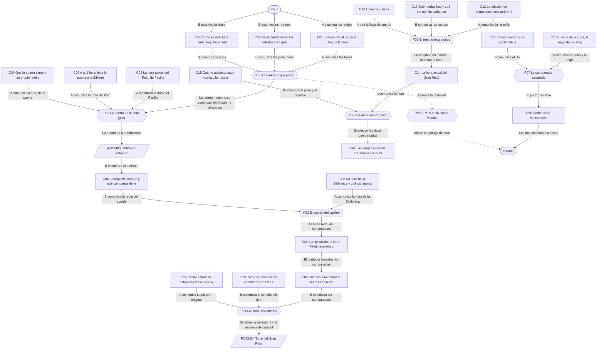
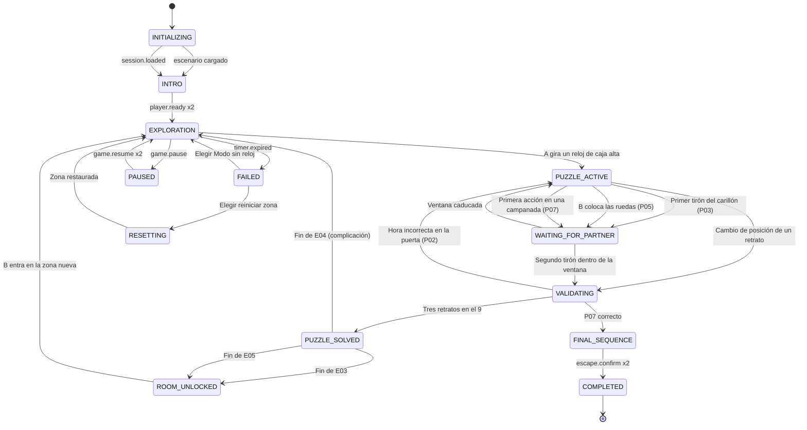

# ER05 · La mansión de los relojes

La Mansión Ambrós lleva cien años detenida un poco antes de la medianoche y sus habitaciones cambian de sitio según la hora que marcan sus relojes. El Jugador A queda en la Sala de los Relojes, donde puede mover las agujas; el Jugador B recorre el ala este y ve lo que esos cambios provocan. Juntos deben devolver la medianoche al Gran Reloj para que la casa termine su noche y les deje salir.

## A. Ficha técnica

| Campo | Valor |
|---|---|
| ID | ER05 |
| Nombre | La mansión de los relojes |
| Versión | 1.0.0 |
| Género | Fantasía gótica amable |
| Sinopsis | La Mansión Ambrós lleva cien años detenida un poco antes de la medianoche y sus habitaciones cambian de sitio según la hora que marcan sus relojes. El Jugador A queda en la Sala de los Relojes, donde puede mover las agujas; el Jugador B recorre el ala este y ve lo que esos cambios provocan. Juntos deben devolver la medianoche al Gran Reloj para que la casa termine su noche y les deje salir. |
| Objetivo principal | OBJ01 Despertar la galería y abrir el paso a la Biblioteca; OBJ02 Despertar al Gran Reloj y encontrar la puerta de la Torre después de que la casa se reordene; OBJ03 Reparar la maquinaria del Gran Reloj y dejarlo a punto para la medianoche; OBJ04 Hacer sonar la medianoche y salir juntos por el Portón de la medianoche |
| Objetivos secundarios | OBJ05 Devolver la manivela a la caja de música de Clotilde |
| Jugadores | 2 (A: Guardián de los relojes; B: Exploradora del ala este) |
| Duración estimada | 60 min (despertar 6, descubrimiento 16, complicación 16, clímax 14, escape 8) |
| Dificultad | Difícil |
| Zonas | 4 |
| Acertijos | 7 principales y 1 microacertijos |
| Objetos interactivos | 31 (más 12 decorativos) |
| Finales | 2 |
| Competencias | Razonamiento causa-efecto, Aritmética de reloj, Sincronización temporal, Comunicación precisa de datos, Coordinación de secuencias de acciones, Reparto de responsabilidades |
| Condiciones iniciales | A empieza en la Sala de los Relojes con los relojes de la casa, el Libro de horas y los tiradores del carillón; no puede salir de la sala hasta que la Torre quede alineada. B empieza en la Galería de los Retratos del ala este; no puede tocar ningún reloj de la sala, pero ve cómo se mueven los retratos, las puertas y las estanterías. Todos los relojes están parados y solo se mueven cuando A los gira. La llamada de voz está abierta; en la ficción, los dos se oyen a través de los tubos acústicos de la casa. |
| Condición de victoria | Completar OBJ01, OBJ02, OBJ03, OBJ04 |
| Condición de fallo | 60 min de cuenta atrás: Por las ventanas entra la primera luz del alba y la casa se adormece: los relojes se detienen de nuevo. Los jugadores eligen seguir en Modo sin reloj o reiniciar la zona actual. Nada de lo ya resuelto se pierde. |
| Condición de reinicio | Cualquiera de los dos pulsa Reiniciar zona y el otro lo confirma; también se ofrece al agotarse el reloj. El reinicio completo vuelve al estado inicial y a la intro. |

## B. Guion narrativo

**1. Introducción cinematográfica.** Plano lento por un pasillo de terciopelo granate iluminado por velas. Decenas de relojes cuelgan de las paredes, todos parados a horas distintas. Fuera, una luna llena que no se mueve. Se oye un tictac que se detiene de golpe y, después, una voz amable que tararea un vals. La cámara se eleva hasta la torre de la mansión, donde la esfera del Gran Reloj marca una hora equivocada.

**2. Por qué están aquí.** La pareja ha recibido una invitación con lacre azul para la Última Velada de la Mansión Ambrós, una casa que, según el pueblo, lleva cien años sin dar la medianoche. Al cruzar el vestíbulo, las puertas se cierran con suavidad y la casa se reordena: A aparece en la Sala de los Relojes y B en la Galería de los Retratos, al otro lado de la casa.

**3. Situación inicial.** Una carta sobre la mesa de la sala, firmada por la relojera Clotilde Ambrós, explica que la casa se quedó atrapada en su última noche y que solo terminará si alguien devuelve la medianoche al Gran Reloj. Los tubos acústicos permiten que A y B se oigan, pero ninguno ve lo que ve el otro.

**4. Objetivo.** Usar los relojes de la sala para mover la casa, abrir el camino de B hasta la Torre, reparar y ajustar el Gran Reloj y hacer que dé las doce para que la mansión termine su noche y libere a los invitados.

**5. Primer descubrimiento.** A descubre que cada uno de los tres relojes de caja alta de la sala tiene tallado el mismo emblema que uno de los retratos de la galería. Cuando A gira uno, B ve girar el retrato correspondiente. Ninguno puede saber cuánto girar sin lo que ve el otro.

**6. Progresión de los acontecimientos.**

- Con los tres retratos mirando a la ventana, la galería se ilumina y el retrato del Niño se abre como una portezuela.
- A y B descubren que la puerta de doble hoja obedece al reloj pequeño que tiene encima y no al Reloj de Pasillo, que adelanta. Ajustando la diferencia, la puerta da a la Biblioteca rotonda.
- En la Biblioteca, B encuentra la partitura del carillón y A, en la sala, el reloj que indica la hora de la Biblioteca. Tocan juntos un acorde y el Gran Reloj despierta.
- El Gran Reloj da campanadas y la rotonda gira. La puerta de la Torre ya no está donde dice el plano de A.
- En la Torre, A y B se separan en dos niveles: A en la pasarela de la esfera, B en la sala de máquinas. Reparan el tren de engranajes y ajustan las agujas con la manivela.
- Las doce campanadas empiezan y los dos actúan en la misma campanada para liberar el péndulo y el portón.

**7. Obstáculos narrativos.**

- Todos los relojes están parados y la casa cambia de forma según su hora, así que cada error mueve algo en el ala de B.
- El Reloj de Pasillo y el reloj de la puerta no marcan lo mismo: el Libro de horas de A no lo sabe.
- Las campanadas del Gran Reloj reordenan la Biblioteca y dejan anticuado el plano de A.
- En la Torre, quien ve la esfera no puede tocar la manivela y quien la gira no ve la esfera.

**8. Revelaciones.**

- Clotilde Ambrós detuvo la casa a propósito: no quería que terminara la fiesta en la que celebraba su último reloj, y la casa se quedó esperando desde entonces.
- Los retratos son los relojes de la familia: el Capitán, la Dama y el Niño eran los que daban cuerda cada noche, y por eso se mueven con ellos.
- Clotilde no está atrapada: es la voz de la casa, y solo quiere que alguien dé por terminada la velada para poder descansar.

**9. Clímax.** El Gran Reloj empieza a dar las doce. Con cada campanada se ilumina un número en las esferas de los dos. En la campanada acordada, A suelta el pestillo del péndulo desde la pasarela y B tira de la cuerda del portón desde la sala de máquinas. El péndulo se balancea libre por primera vez en cien años.

**10. Escena de escape.** La torre vibra con un tictac grave y regular. Las habitaciones vuelven a su sitio con un rumor de madera, la escalera interior queda libre y A baja hasta la sala de máquinas. El Portón de la medianoche se abre hacia el jardín y los dos salen juntos bajo una luna que, por fin, se mueve.

**11. Epílogo.** Desde el jardín ven cómo se apagan una a una las velas de la mansión, como si la casa se fuera a dormir. En el último ventanal, una silueta con delantal de relojera saluda con la mano. En el bolsillo de cada uno aparece un pequeño reloj de bolsillo que marca la misma hora, con una inscripción: Gracias por terminar mi noche.

### Diálogos y textos del sistema

Cada línea es un subtítulo. Las líneas de canal `document` quedan además guardadas en el registro de pistas.

| ID | Quién | Texto | Cuándo | Para | Canal |
|---|---|---|---|---|---|
| D01 | Narrador | Las puertas del vestíbulo se cierran con suavidad. Cuando abres los ojos, estás en una sala llena de relojes parados. | START | Jugador A | subtitle |
| D02 | Clotilde Ambrós (carta) | Queridos invitados: esta casa se quedó dormida en mi última velada, un poco antes de la medianoche. Fue culpa mía, lo confieso. | E01 | Ambos | audio_subtitled |
| D03 | Clotilde Ambrós (carta) | Sus habitaciones obedecen a los relojes. Uno de vosotros puede moverlos; el otro verá lo que provocan. Hablad mucho. | E01 | Ambos | audio_subtitled |
| D04 | Clotilde Ambrós (carta) | Si el Gran Reloj vuelve a dar las doce, la noche terminará y las puertas se abrirán. No tengáis prisa, pero tampoco os durmáis. | E01 | Ambos | document |
| D05 | Narrador | Estás en una galería larga. Tres retratos de cuerpo entero miran hacia lugares distintos. Oyes la voz de tu pareja por un tubo de latón. | START | Jugador B | subtitle |
| D06 | Sistema | Un retrato ha girado en la galería. | P01 | Jugador B | popup |
| D07 | Clotilde Ambrós (voz en los relojes) | El Capitán, la Dama y el Niño. Cada noche daban cuerda a sus relojes. Qué alegría verlos mirar el jardín otra vez. | E02 | Ambos | audio_subtitled |
| D08 | Narrador | Con un chasquido, el retrato del Niño se separa de la pared como una portezuela. | E02 | Jugador B | subtitle |
| D09 | Sistema | Detrás de la puerta solo hay un muro de ladrillo. La puerta se cierra sola. | P02 | Jugador B | popup |
| D10 | Narrador | La puerta se abre a una sala redonda forrada de libros. Doce estanterías iguales te rodean. | E03 | Jugador B | subtitle |
| D11 | Clotilde Ambrós (voz en los relojes) | Mi carillón necesita dos manos, una en cada ala de la casa. Siempre me gustó tocarlo con alguien. | E03 | Ambos | audio_subtitled |
| D12 | Sistema | Tu campana suena. Esperando la campana de tu pareja… | P03 | Ambos | popup |
| D13 | Narrador | Muy arriba, algo enorme se despereza. El Gran Reloj empieza a dar campanadas y el suelo de la biblioteca vibra. | E04 | Ambos | subtitle |
| D14 | Narrador | Las estanterías giran a tu alrededor con cada campanada. Los números del suelo no se mueven. | E04 | Jugador B | subtitle |
| D15 | Narrador | Las agujas de todos los relojes de la sala giran solas mientras dura el sonido. Las velas se inclinan, pero no se apagan. | E04 | Jugador A | subtitle |
| D16 | Clotilde Ambrós (voz en los relojes) | Ay, cuando el Gran Reloj se despierta lo cambia todo de sitio. Mis planos no saben nada de esto. | E04 | Ambos | audio_subtitled |
| D17 | Narrador | Subes por la escalera de caracol hasta una pasarela estrecha. Delante tienes la esfera del Gran Reloj, vista por detrás. | E05 | Jugador A | subtitle |
| D18 | Narrador | La escalera de piedra termina en una sala de máquinas llena de ejes y ruedas. El péndulo cuelga en el centro y tapa la escalera interior. | E05 | Jugador B | subtitle |
| D19 | Clotilde Ambrós (voz en los relojes) | Le faltan dos ruedas desde aquella noche. Las guardé abajo, en la caja de repuestos. La llave, como siempre, junto al fuego. | E05 | Ambos | audio_subtitled |
| D20 | Sistema | Ruedas colocadas. Esperando a que tu pareja dé cuerda… | P05 | Ambos | popup |
| D21 | Narrador | Las agujas corren los últimos cinco minutos. Empiezan las doce campanadas. | E07 | Ambos | subtitle |
| D22 | Sistema | No ha sido en la misma campanada. Cuando terminen las doce, el reloj volverá a las doce menos cinco. | P07 | Ambos | popup |
| D23 | Clotilde Ambrós (voz en los relojes) | Medianoche. Por fin. Gracias por terminar mi velada. Ya podéis iros a casa, y yo también. | E08 | Ambos | audio_subtitled |
| D24 | Narrador | Suena un vals lento por toda la casa. En algún lugar, alguien tararea al compás. | E09 | Ambos | subtitle |
| D25 | Clotilde Ambrós (voz en los relojes) | Los relojes de esta casa nunca mienten, pero no todos dicen la misma hora. Preguntad siempre qué ve el otro antes de mover una aguja. | E10 | Ambos | audio_subtitled |
| D26 | Narrador | La primera luz del alba entra por las ventanas y los relojes se detienen otra vez. ¿Seguir sin reloj o reiniciar la zona? | E11 | Ambos | popup |

## C. Escenografía y planos

Coordenadas en metros con origen en la esquina suroeste del suelo de cada zona: `x` hacia el este, `y` hacia arriba, `z` hacia el norte.

### ROOM01 · Sala de los Relojes

Salón alargado con papel pintado de lirios oscuros, una chimenea encendida y relojes de todas las épocas. En la pared oeste hay tres relojes de caja alta con emblemas tallados; en la norte, el Reloj de Pasillo; en la este, un reloj tras una vitrina y tres tiradores de carillón.

**Medidas:** 9 × 7 m, altura 5 m. **Acceso:** A sí, B no. **Se abre:** desde el inicio.

**Qué ve cada jugador.** A: Toda la sala: relojes, esferas, libros, plano y tiradores. B: No la ve; oye a A por los tubos acústicos y, a lo lejos, el tictac de la sala cuando un reloj se mueve.

**Distribución.** Chimenea con la llave de cuerda en la repisa, en la pared sur hacia el este. Retrato decorativo de Clotilde en la pared sur, centro. Plano de la Biblioteca enmarcado en la pared sur, al oeste. Tres relojes de caja alta en la pared oeste. Reloj de Pasillo en la pared norte, centro, y montaplatos en la esquina noroeste. Escalera de caracol a la Torre en la esquina noreste (puerta en la pared norte). Atril con el Libro de horas al centro-este. Reloj de la Biblioteca en vitrina y tiradores del carillón en la pared este. Mesa con la caja de música y la carta de bienvenida al centro-oeste.

| ID | Elemento | Tipo o pared | Posición (x, y, z) | Notas |
|---|---|---|---|---|
| DOOR01 | Puerta a Torre del Gran Reloj | pared north | (8, 0, 7) | Se abre con P04_SOLVED |
| — | Ventana | pared north | (6.5, 3.8, 7) | Ventana ojival alta con la luna llena inmóvil; no es interactiva |
| O01 | Tres relojes de caja alta | 8 Mecanismo cooperativo | (0.4, 0, 3.5) | Tres relojes de pie de nogal en la pared oeste. Cada uno tiene un emblema tallado en la caja: un ancla, un abanico y una peonza. Sus péndulos están quietos. |
| O02 | Reloj de Pasillo | 6 Activar | (4.5, 1.6, 6.8) | Reloj de pared grande con esfera de porcelana y agujas de hierro calado; un rótulo dice Reloj de Pasillo |
| O03 | Libro de horas de la mansión | 2 Examinar | (6, 1.1, 3) | Libro grueso de tapas azules abierto sobre un atril de bronce, con dibujos de puertas y relojes |
| O04 | Reloj de la Biblioteca | 2 Examinar | (8.7, 1.8, 4.5) | Reloj de esfera negra con números dorados dentro de una vitrina cerrada; una placa dice Hora de la Biblioteca |
| O05 | Tiradores del carillón (lado de la sala) | 8 Mecanismo cooperativo | (8.7, 1.2, 2.5) | Tres tiradores de cordón con una campanita de latón cada uno, numerados I, II y III, con un círculo, un triángulo y un cuadrado en relieve |
| O06 | Plano de la Biblioteca rotonda | 2 Examinar | (2, 1.6, 0.1) | Grabado enmarcado de una sala circular con doce estanterías numeradas como una esfera; una de ellas tiene dibujada una torre |
| O07 | Caja de música de Clotilde | 5 Combinar | (3.5, 0.9, 2) | Caja de madera taraceada con una bailarina con delantal de relojera; en un costado hay un agujero vacío para la manivela |
| O08 | Montaplatos (lado de la sala) | 4 Usar | (1.2, 1, 6.8) | Portezuela de madera en la pared con un timbre; por dentro, una bandeja que sube y baja |
| O10 | Llave de cuerda | 3 Recoger | (6.5, 1.3, 0.3) | Llave de hierro de cabeza cuadrada y mango en forma de lira, sobre la repisa de la chimenea |
| O11 | Chimenea de mármol | 1 Decorativo | (6.5, 0, 0.4) | Chimenea de mármol negro con fuego bajo y morillos en forma de búho |
| O12 | Butaca de terciopelo | 1 Decorativo | (5, 0, 1.5) | Butaca orejera granate con una manta de cuadros doblada |
| O13 | Retrato de Clotilde Ambrós | 1 Decorativo | (4.5, 2.5, 0.1) | Óleo de una mujer mayor con gafas de relojera en la frente y una lupa colgada al cuello, sonriendo |
| O15 | Carta de bienvenida | 9 Elemento narrativo | (3.8, 0.9, 2.3) | Sobre abierto con lacre azul sobre la mesa; letra inclinada y elegante |

| Luz | Tipo | Posición | Color | Intensidad | Uso |
|---|---|---|---|---|---|
| L01 | Candelabro colgante de velas | (4.5, 4.2, 3.5) | #FFC98A | 0.6 | Luz general cálida; las llamas tiemblan levemente cuando un reloj se mueve |
| L02 | Luz de luna por la ventana ojival | (6.5, 3.8, 6.8) | #A9BCE6 | 0.25 | Fija hasta el final; en E08 empieza a desplazarse despacio |
| L03 | Fuego de la chimenea | (6.5, 0.6, 0.4) | #FF9F5A | 0.45 | Ilumina la repisa con la llave de cuerda |
| L04 | Foco tenue sobre la vitrina | (8.6, 2.8, 4.5) | #FFE6C0 | 0.3 | Destaca el Reloj de la Biblioteca y los tiradores |

**Sonido ambiente:** Fuego bajo en la chimenea y tictac lejano y desordenado de muchos relojes que se paran y arrancan. **Música:** Clavicémbalo y violonchelo suaves en compás de vals, muy bajos; ganan una capa con cada objetivo completado.

**Cambios dinámicos:**

- E02: Los tres relojes de caja alta quedan bloqueados en su hora y sus péndulos empiezan a oscilar
- E04: Todas las agujas de la sala giran solas durante las campanadas y las velas se inclinan; al terminar, los tiradores del carillón quedan recogidos
- E05: Se desbloquea la puerta de la escalera de caracol de la esquina noreste
- E08: Todos los relojes de la sala marcan las doce a la vez y la luna de la ventana empieza a moverse

**Para el motor:** Escena propia de A. Cada reloj interactivo es un objeto con agujas rotables por pasos (relojes de caja alta: pasos de 1 hora, 30 grados; Reloj de Pasillo: pasos de 5 minutos, 30 grados la aguja larga). El giro se envía al servidor como acción con actionId y el servidor replica el efecto en la escena de B (rotación de retratos o cambio de la puerta). En Unity/Unreal/Godot: un componente ClockDial con propiedad hour (0-11) y minute (0-55) sincronizada; en web, un SVG con dos agujas y botones de más y menos. La vitrina del Reloj de la Biblioteca no admite interacción de giro.

### ROOM02 · Galería de los Retratos

Pasillo largo de madera oscura con tres retratos de cuerpo entero montados sobre raíles giratorios, una gran ventana al oeste y una puerta de doble hoja al este con un reloj pequeño encima.

**Medidas:** 14 × 4 m, altura 5 m. **Acceso:** A no, B sí. **Se abre:** desde el inicio.

**Qué ve cada jugador.** A: No la ve; oye por el tubo acústico el chirrido de los raíles cuando un retrato gira. B: Toda la galería: retratos, arcos numerados, placa, puerta y su reloj; no ve ningún reloj de la sala.

**Distribución.** Ventana grande en la pared oeste. Montaplatos en la esquina noroeste. Los tres retratos en la pared norte, de oeste a este: Capitán, Dama y Niño, cada uno con un arco numerado del 1 al 12 a sus pies. Placa de latón en la pared sur, centro. Candelabros de pie junto a la pared sur, al oeste. Armadura con lavanda en el lado noreste. Alfombra a lo largo del centro. Puerta de doble hoja en la pared este, con el reloj de la puerta encima.

| ID | Elemento | Tipo o pared | Posición (x, y, z) | Notas |
|---|---|---|---|---|
| DOOR02 | Puerta a Biblioteca rotonda | pared east | (14, 0, 2) | Se abre con P02_SOLVED |
| — | Ventana | pared west | (0, 2.2, 2) | Ventana grande hacia el jardín; en los arcos de los retratos corresponde a la posición 9 |
| O20 | Retratos giratorios | 2 Examinar | (7, 0, 3.6) | Tres retratos de cuerpo entero sobre raíles: un capitán con un ancla bordada, una dama con un abanico y un niño con una peonza. A los pies de cada uno, un arco de latón con los números del 1 al 12 y una flecha que marca hacia dónde mira. |
| O21 | Placa de latón de la galería | 2 Examinar | (7, 1.4, 0.1) | Placa atornillada a la pared con letras grabadas y tres emblemas: ancla, abanico y peonza |
| O22 | Reloj de la puerta | 2 Examinar | (13.8, 3.2, 2) | Reloj pequeño de esfera blanca encima de la puerta de doble hoja, con una placa debajo |
| O23 | Puerta de doble hoja | 7 Bloqueado | (13.8, 0, 2) | Puerta alta de roble con dos hojas y pomos en forma de luna |
| O24 | Montaplatos (lado de la galería) | 4 Usar | (1.5, 1, 3.8) | Portezuela en la pared con una bandeja y una cuerda para subirla; una plaquita dice A la sala |
| O25 | Manivela de la caja de música | 3 Recoger | (9.5, 1.2, 3.8) | Manivela pequeña de latón con una etiqueta de papel atada, escondida detrás del retrato del Niño |
| O26 | Candelabros de pie | 1 Decorativo | (3, 0, 0.5) | Dos candelabros de hierro forjado con velas largas |
| O27 | Alfombra de la galería | 1 Decorativo | (7, 0, 2) | Alfombra larga de dibujos de hojas, gastada en el centro |
| O28 | Armadura con lavanda | 1 Decorativo | (12, 0, 3.5) | Armadura antigua sin yelmo que sostiene un ramo de lavanda seca en lugar de una lanza |

| Luz | Tipo | Posición | Color | Intensidad | Uso |
|---|---|---|---|---|---|
| L05 | Luz de luna por la ventana oeste | (0.5, 3, 2) | #9FB4E0 | 0.3 | Suficiente para leer los arcos y la placa de cerca |
| L06 | Candelabros de pie | (3, 1.8, 0.5) | #FFB870 | 0.5 | Luz cálida baja |
| L07 | Lámparas de los retratos | (7, 3.2, 3.6) | #FFE0B0 | 0 | Apagadas al inicio; se encienden a 0.6 con E02 |

**Sonido ambiente:** Viento suave contra la ventana grande y crepitar de velas. **Música:** Clavicémbalo y violonchelo suaves en compás de vals, muy bajos; ganan una capa con cada objetivo completado.

**Cambios dinámicos:**

- E02: Los tres retratos quedan mirando a la ventana, sus lámparas se encienden y el retrato del Niño se abre como una portezuela dejando ver la manivela
- E03: La puerta de doble hoja se abre hacia la Biblioteca rotonda con un soplo de polvo dorado
- E08: Los retratos sonríen y se apagan sus lámparas, como si se despidieran

**Para el motor:** Escena propia de B. Los retratos son objetos con rotación sobre el eje vertical; la flecha del arco indica una posición entera de 1 a 12 y se muestra siempre también como número en la interfaz. La rotación de cada retrato se calcula en el servidor a partir de la hora de su reloj en ROOM01: Capitán = hora + 2, Dama = 9 - hora, Niño = hora + 4 (módulo 12, 0 se muestra como 12; los desplazamientos cambian con la variante activa). La puerta de doble hoja carga una de tres vistas (muro de ladrillo, jardín de invierno cerrado o Biblioteca) según la hora del reloj de la puerta.

### ROOM03 · Biblioteca rotonda

Sala circular de dos alturas con doce estanterías-puerta idénticas dispuestas como las horas de una esfera. En el centro, una columna con el contador de campanadas; delante, el atril del carillón.

**Medidas:** 12 × 12 m, altura 7 m. **Acceso:** A no, B sí. **Se abre:** P02_SOLVED.

**Qué ve cada jugador.** A: No la ve; solo tiene el plano antiguo de la rotonda en la sala. B: Toda la rotonda: estanterías, números del suelo, atril, contador y placa.

**Distribución.** Círculo de 5 m de radio centrado en (6, 6). Las doce estanterías ocupan el perímetro; el suelo tiene los números del 1 al 12 incrustados en latón delante de cada una, fijos (el 12 al norte, el 3 al este, el 6 al sur, el 9 al oeste). B entra por la estantería del 6. Atril del carillón al sur de la columna. Placa del suelo al norte de la columna. Escalera con ruedas al suroeste, globo celeste al sureste y mesa de lectura al noroeste.

| ID | Elemento | Tipo o pared | Posición (x, y, z) | Notas |
|---|---|---|---|---|
| DOOR03 | Puerta a Galería de los Retratos | pared south | (6, 0, 1) | Se abre con P02_SOLVED |
| DOOR04 | Puerta a Torre del Gran Reloj | pared north | (8.5, 0, 10.3) | Se abre con P04_SOLVED |
| — | Ventana | pared north | (6, 6, 12) | Claraboya circular en lo alto con la luna; no es interactiva |
| O30 | Atril del carillón | 8 Mecanismo cooperativo | (6, 0, 4.6) | Atril de bronce con una partitura y tres tiradores de cordón numerados IV, V y VI, con una estrella, una luna y una gota en relieve |
| O31 | Contador de campanadas | 2 Examinar | (6, 1.5, 5.6) | Ventanilla en la columna central con un número grande de latón sobre fondo blanco |
| O32 | Placa del suelo | 2 Examinar | (6, 0, 7.4) | Losa de mármol con una inscripción y una flecha curva en el sentido de las agujas del reloj |
| O33 | Doce estanterías-puerta | 8 Mecanismo cooperativo | (6, 0, 11) | Doce estanterías idénticas de caoba con un tirador en forma de llave; delante de cada una, un número de latón fijo en el suelo |
| O34 | Escalera de biblioteca con ruedas | 1 Decorativo | (2.5, 0, 3) | Escalera de madera enganchada a un riel alto |
| O35 | Globo celeste | 1 Decorativo | (9.3, 0, 3) | Esfera de constelaciones pintadas sobre un pie de tres patas |
| O36 | Mesa de lectura con velas | 1 Decorativo | (3.5, 0, 8.5) | Mesa redonda con libros abiertos, un tintero y dos velas |

| Luz | Tipo | Posición | Color | Intensidad | Uso |
|---|---|---|---|---|---|
| L08 | Lámpara de araña central | (6, 6, 6) | #FFD39A | 0.5 | Se balancea despacio durante el giro de E04 (sin balanceo en modo de movimiento reducido) |
| L09 | Luz de la columna del contador | (6, 2, 6) | #E8E0FF | 0.3 | Se intensifica con cada campanada y deja el número del contador bien legible |
| L10 | Velas de la mesa de lectura | (3.5, 1, 8.5) | #FFB46B | 0.3 | Decorativa |

**Sonido ambiente:** Crujido de madera y páginas que se mueven solas, muy suave. **Música:** Clavicémbalo y violonchelo suaves en compás de vals, muy bajos; ganan una capa con cada objetivo completado.

**Cambios dinámicos:**

- E04: El Gran Reloj da campanadas; con cada una la rotonda gira una posición en el sentido de las agujas y el contador suma uno
- E05: La estantería que ahora ocupa la posición correcta se abre hacia la escalera de la Torre

**Para el motor:** Escena cargada al resolver P02. La rotación es del anillo de estanterías, no del suelo: los números de latón son fijos y las estanterías se desplazan 30 grados por campanada en sentido horario visto desde arriba. La estantería de la Torre es la que estaba en la posición 2 antes de E04. P03 se valida con un tirador en esta zona y otro en ROOM01; el servidor guarda la marca de tiempo de cada tirón y compara la diferencia con window_ms.

### ROOM04 · Torre del Gran Reloj

Torre cuadrada de piedra con dos niveles: abajo, la sala de máquinas con ejes, ruedas y la manivela de ajuste; arriba, la pasarela de la esfera, desde la que se ve la esfera grande por detrás y la pequeña Esfera de la Luna. El péndulo cuelga por el hueco central y bloquea la escalera interior.

**Medidas:** 6 × 6 m, altura 16 m. **Acceso:** A sí, B sí. **Se abre:** P04_SOLVED.

**Qué ve cada jugador.** A: Solo el nivel alto: la esfera por detrás, la Esfera de la Luna, el plano y el pestillo; ve el péndulo pero no la sala de máquinas. B: Solo el nivel bajo: ejes, ruedas, manivela, Rueda del Sol y portón; no ve las esferas.

**Distribución.** Nivel bajo (suelo a 0 m): Portón de la medianoche en la pared sur, centro; caja de ruedas en la esquina suroeste; ejes de la maquinaria en el centro; manivela de ajuste al sureste; cuerda del portón junto a la pared este; Rueda del Sol en la pared este, al norte; banco de herramientas en la pared oeste. Nivel alto (pasarela a 11-13 m): entrada desde la escalera de caracol de la sala por la pared oeste; plano de la maquinaria en la pared oeste; esfera grande, cerradura de cuerda y Esfera de la Luna en la pared norte; pestillo del péndulo sobre el hueco central. Campanas en lo alto, a 14,5 m.

| ID | Elemento | Tipo o pared | Posición (x, y, z) | Notas |
|---|---|---|---|---|
| DOOR05 | Puerta a Sala de los Relojes | pared west | (0, 11, 3) | Se abre con P04_SOLVED |
| DOOR06 | Puerta a Biblioteca rotonda | pared east | (6, 0, 3) | Se abre con P04_SOLVED |
| DOOR07 | Puerta de salida | pared south | (3, 0, 0) | Se abre con P07_SOLVED |
| — | Ventana | pared north | (3, 12.5, 6) | La esfera grande es translúcida: la luna se ve a través de ella desde la pasarela |
| O40 | Plano de la maquinaria | 2 Examinar | (0.2, 12, 3.5) | Lámina técnica clavada en la piedra con el dibujo de ejes, piñones y dos ruedas vacías marcadas Alfa y Beta |
| O41 | Caja de ruedas de repuesto | 2 Examinar | (1, 0.8, 1) | Caja de madera con cuatro ruedas dentadas de latón, cada una con su número de dientes grabado |
| O42 | Ejes de la maquinaria | 8 Mecanismo cooperativo | (3, 1.2, 3) | Bastidor de hierro con un eje de minutos con piñón fijo y dos ejes vacíos, uno de sección cuadrada y otro redonda |
| O43 | Cerradura de cuerda | 6 Activar | (3.8, 12, 5.8) | Orificio cuadrado de bronce junto a la esfera, con la inscripción Cuerda |
| O44 | Esfera del Gran Reloj | 2 Examinar | (3, 12.5, 5.9) | Esfera translúcida de dos metros vista por detrás desde la pasarela; los números están pintados también por dentro para leerse desde la torre |
| O45 | Manivela de ajuste | 8 Mecanismo cooperativo | (4.5, 1, 2) | Manivela grande de hierro con un contador de vueltas y una palanca marcada Fijar; una placa de latón al lado |
| O46 | Esfera de la Luna | 2 Examinar | (1.5, 12.5, 5.9) | Esfera pequeña junto a la grande, con una luna de nácar en la punta de su aguja y los números del 1 al 12 |
| O47 | Rueda del Sol | 2 Examinar | (5.8, 1.5, 4) | Rueda de bronce en la pared con un sol grabado y una marca que señala uno de los números del 1 al 12 |
| O48 | Pestillo del péndulo | 8 Mecanismo cooperativo | (3, 11.5, 3.5) | Pestillo de hierro con forma de media luna que sujeta la varilla del péndulo sobre el hueco central |
| O49 | Cuerda del portón | 8 Mecanismo cooperativo | (5.5, 1, 1) | Cuerda gruesa con borla azul que baja desde una polea junto a la pared este |
| O50 | Portón de la medianoche | 10 Objeto de salida | (3, 0, 0.1) | Portón de roble con herrajes en forma de agujas de reloj y una luna llena tallada en el centro |
| O51 | Campanas del Gran Reloj | 1 Decorativo | (3, 14.5, 3) | Cinco campanas de bronce colgadas en lo alto de la torre |
| O52 | Palomas de piedra | 1 Decorativo | (5, 13, 5.5) | Dos palomas de piedra en la cornisa interior, con musgo |
| O53 | Banco de herramientas antiguo | 1 Decorativo | (0.8, 0, 4.5) | Banco de madera con limas, pinzas y un delantal de cuero colgado |

| Luz | Tipo | Posición | Color | Intensidad | Uso |
|---|---|---|---|---|---|
| L11 | Lámpara de taller de la sala de máquinas | (3, 3.5, 3) | #FFCF8F | 0.5 | Ilumina ejes y ruedas |
| L12 | Luz de luna a través de la esfera | (3, 12.5, 5.8) | #B8C8F0 | 0.4 | Deja leer los números de la esfera por detrás |
| L13 | Farol de la pasarela | (1, 12.8, 1) | #FFC070 | 0.4 | Ilumina el plano y el pestillo |
| L14 | Destello de campanada | (3, 14.5, 3) | #FFF4D0 | 0 | Pulso suave de 0.5 por campanada en E07, siempre acompañado del número de la campanada en pantalla |

**Sonido ambiente:** Viento alto en la torre y aleteo lejano. **Música:** Cuerdas graves con pulso de péndulo, tensión moderada sin golpes bruscos.

**Cambios dinámicos:**

- E06: Las ruedas giran y la torre se llena de un tictac grave; el péndulo queda trabado por el pestillo
- E07: Las agujas recorren los últimos cinco minutos y empiezan las doce campanadas, con un número grande por campanada en las dos pantallas
- E08: El péndulo se balancea libre, la escalera interior queda despejada, A baja al nivel inferior y el portón se abre al jardín

**Para el motor:** Una sola escena con dos niveles y dos cámaras: la de A queda limitada al volumen y de 10 a 14 m y la de B al volumen y de 0 a 4 m; los objetos de cada nivel solo son interactivos para su jugador. El péndulo es un objeto físico animado que atraviesa los dos niveles y se usa como referencia visual común. Las campanadas de E07 se emiten desde el servidor con marcas de tiempo; el cliente muestra el número y el destello en el mismo fotograma en que reproduce el sonido.

## D. Inventario de objetos

| object_id | Nombre | Descripción visual | Zona | Posición | Tipo | Estado inicial | Acción | Activación | Resultado | Pista | Acertijo | Jugador | Estado final |
|---|---|---|---|---|---|---|---|---|---|---|---|---|---|
| O01 | Tres relojes de caja alta | Tres relojes de pie de nogal en la pared oeste. Cada uno tiene un emblema tallado en la caja: un ancla, un abanico y una peonza. Sus péndulos están quietos. | ROOM01 | (0.4, 0, 3.5) | 8 Mecanismo cooperativo | STOPPED | Examinar y girar la aguja de cada reloj una hora adelante o atrás | — | Al examinarlos se guarda C01. Cada giro mueve el retrato correspondiente en la galería de B | C01 | P01 | Jugador A | ALIGNED |
| O02 | Reloj de Pasillo | Reloj de pared grande con esfera de porcelana y agujas de hierro calado; un rótulo dice Reloj de Pasillo | ROOM01 | (4.5, 1.6, 6.8) | 6 Activar | STOPPED | Girar las agujas de cinco en cinco minutos y tirar de la cadenilla Dar la hora | — | Al tirar de la cadenilla, el reloj de la puerta de la galería se mueve lo mismo y la puerta cambia de destino | C04 | P02 | Jugador A | SET |
| O03 | Libro de horas de la mansión | Libro grueso de tapas azules abierto sobre un atril de bronce, con dibujos de puertas y relojes | ROOM01 | (6, 1.1, 3) | 2 Examinar | DEFAULT | Examinar | — | Abre el libro a pantalla completa y guarda C05 | C05 | P02 | Jugador A | EXAMINED |
| O04 | Reloj de la Biblioteca | Reloj de esfera negra con números dorados dentro de una vitrina cerrada; una placa dice Hora de la Biblioteca | ROOM01 | (8.7, 1.8, 4.5) | 2 Examinar | DEFAULT | Examinar (no se puede girar) | — | Guarda C07 | C07 | P03 | Jugador A | EXAMINED |
| O05 | Tiradores del carillón (lado de la sala) | Tres tiradores de cordón con una campanita de latón cada uno, numerados I, II y III, con un círculo, un triángulo y un cuadrado en relieve | ROOM01 | (8.7, 1.2, 2.5) | 8 Mecanismo cooperativo | IDLE | Tirar de un cordón | P02_SOLVED | Envía la campana elegida al carillón; si coincide con la de B dentro de la ventana, suena el acorde | — | P03 | Jugador A | LOCKED |
| O06 | Plano de la Biblioteca rotonda | Grabado enmarcado de una sala circular con doce estanterías numeradas como una esfera; una de ellas tiene dibujada una torre | ROOM01 | (2, 1.6, 0.1) | 2 Examinar | DEFAULT | Examinar | — | Guarda C11 | C11 | P04 | Jugador A | EXAMINED |
| O07 | Caja de música de Clotilde | Caja de madera taraceada con una bailarina con delantal de relojera; en un costado hay un agujero vacío para la manivela | ROOM01 | (3.5, 0.9, 2) | 5 Combinar | SILENT | Colocar objeto y girar | P01_SOLVED | Con la manivela, suena el vals de la última velada | C19 | P08 | Jugador A | PLAYING |
| O08 | Montaplatos (lado de la sala) | Portezuela de madera en la pared con un timbre; por dentro, una bandeja que sube y baja | ROOM01 | (1.2, 1, 6.8) | 4 Usar | EMPTY | Abrir y recoger lo que haya en la bandeja | — | Si B ha enviado algo desde la galería, pasa al inventario de A | — | P08 | Jugador A | RECEIVED |
| O10 | Llave de cuerda | Llave de hierro de cabeza cuadrada y mango en forma de lira, sobre la repisa de la chimenea | ROOM01 | (6.5, 1.3, 0.3) | 3 Recoger | FOUND | Recoger | — | Pasa al inventario de A; se usa en la cerradura de cuerda de la Torre | — | P05 | Jugador A | USED |
| O11 | Chimenea de mármol | Chimenea de mármol negro con fuego bajo y morillos en forma de búho | ROOM01 | (6.5, 0, 0.4) | 1 Decorativo | STATIC | none | — | Sin interacción | — | — | Nadie | STATIC |
| O12 | Butaca de terciopelo | Butaca orejera granate con una manta de cuadros doblada | ROOM01 | (5, 0, 1.5) | 1 Decorativo | STATIC | none | — | Sin interacción | — | — | Nadie | STATIC |
| O13 | Retrato de Clotilde Ambrós | Óleo de una mujer mayor con gafas de relojera en la frente y una lupa colgada al cuello, sonriendo | ROOM01 | (4.5, 2.5, 0.1) | 1 Decorativo | STATIC | none | — | Sin interacción | — | — | Nadie | STATIC |
| O15 | Carta de bienvenida | Sobre abierto con lacre azul sobre la mesa; letra inclinada y elegante | ROOM01 | (3.8, 0.9, 2.3) | 9 Elemento narrativo | UNREAD | Leer | — | Reproduce D02 a D04 y los guarda en el historial de los dos | — | — | Jugador A | READ |
| O20 | Retratos giratorios | Tres retratos de cuerpo entero sobre raíles: un capitán con un ancla bordada, una dama con un abanico y un niño con una peonza. A los pies de cada uno, un arco de latón con los números del 1 al 12 y una flecha que marca hacia dónde mira. | ROOM02 | (7, 0, 3.6) | 2 Examinar | FACING_AWAY | Examinar | — | Guarda C02. Los retratos giran cuando A mueve los relojes | C02 | P01 | Jugador B | FACING_WINDOW |
| O21 | Placa de latón de la galería | Placa atornillada a la pared con letras grabadas y tres emblemas: ancla, abanico y peonza | ROOM02 | (7, 1.4, 0.1) | 2 Examinar | DEFAULT | Examinar | — | Guarda C03 | C03 | P01 | Jugador B | EXAMINED |
| O22 | Reloj de la puerta | Reloj pequeño de esfera blanca encima de la puerta de doble hoja, con una placa debajo | ROOM02 | (13.8, 3.2, 2) | 2 Examinar | DEFAULT | Examinar | — | Guarda C06 | C06 | P02 | Jugador B | EXAMINED |
| O23 | Puerta de doble hoja | Puerta alta de roble con dos hojas y pomos en forma de luna | ROOM02 | (13.8, 0, 2) | 7 Bloqueado | LOCKED | Abrir y mirar al otro lado | — | Muestra a B adónde lleva la puerta con la hora actual; con la hora correcta se abre a la Biblioteca | — | P02 | Jugador B | OPEN |
| O24 | Montaplatos (lado de la galería) | Portezuela en la pared con una bandeja y una cuerda para subirla; una plaquita dice A la sala | ROOM02 | (1.5, 1, 3.8) | 4 Usar | EMPTY | Poner un objeto en la bandeja y tirar de la cuerda | — | El objeto sube a la sala de A | — | P08 | Jugador B | SENT |
| O25 | Manivela de la caja de música | Manivela pequeña de latón con una etiqueta de papel atada, escondida detrás del retrato del Niño | ROOM02 | (9.5, 1.2, 3.8) | 3 Recoger | HIDDEN | Recoger | P01_SOLVED | Pasa al inventario de B y guarda C18 | C18 | P08 | Jugador B | USED |
| O26 | Candelabros de pie | Dos candelabros de hierro forjado con velas largas | ROOM02 | (3, 0, 0.5) | 1 Decorativo | STATIC | none | — | Sin interacción | — | — | Nadie | STATIC |
| O27 | Alfombra de la galería | Alfombra larga de dibujos de hojas, gastada en el centro | ROOM02 | (7, 0, 2) | 1 Decorativo | STATIC | none | — | Sin interacción | — | — | Nadie | STATIC |
| O28 | Armadura con lavanda | Armadura antigua sin yelmo que sostiene un ramo de lavanda seca en lugar de una lanza | ROOM02 | (12, 0, 3.5) | 1 Decorativo | STATIC | none | — | Sin interacción | — | — | Nadie | STATIC |
| O30 | Atril del carillón | Atril de bronce con una partitura y tres tiradores de cordón numerados IV, V y VI, con una estrella, una luna y una gota en relieve | ROOM03 | (6, 0, 4.6) | 8 Mecanismo cooperativo | IDLE | Leer la partitura y tirar de un cordón | — | Al examinarlo se guarda C08; tirar envía la campana elegida al carillón | C08 | P03 | Jugador B | LOCKED |
| O31 | Contador de campanadas | Ventanilla en la columna central con un número grande de latón sobre fondo blanco | ROOM03 | (6, 1.5, 5.6) | 2 Examinar | SILENT | Examinar | — | Tras las campanadas muestra cuántas sonaron y guarda C09 | C09 | P04 | Jugador B | COUNTED |
| O32 | Placa del suelo | Losa de mármol con una inscripción y una flecha curva en el sentido de las agujas del reloj | ROOM03 | (6, 0, 7.4) | 2 Examinar | DEFAULT | Examinar | — | Guarda C10 | C10 | P04 | Jugador B | EXAMINED |
| O33 | Doce estanterías-puerta | Doce estanterías idénticas de caoba con un tirador en forma de llave; delante de cada una, un número de latón fijo en el suelo | ROOM03 | (6, 0, 11) | 8 Mecanismo cooperativo | LOCKED | Tirar del tirador de la estantería que hay delante de un número | P03_SOLVED | Si es la estantería de la Torre, se abre; si no, se oye un clic y no pasa nada | — | P04 | Jugador B | OPEN |
| O34 | Escalera de biblioteca con ruedas | Escalera de madera enganchada a un riel alto | ROOM03 | (2.5, 0, 3) | 1 Decorativo | STATIC | none | — | Sin interacción | — | — | Nadie | STATIC |
| O35 | Globo celeste | Esfera de constelaciones pintadas sobre un pie de tres patas | ROOM03 | (9.3, 0, 3) | 1 Decorativo | STATIC | none | — | Sin interacción | — | — | Nadie | STATIC |
| O36 | Mesa de lectura con velas | Mesa redonda con libros abiertos, un tintero y dos velas | ROOM03 | (3.5, 0, 8.5) | 1 Decorativo | STATIC | none | — | Sin interacción | — | — | Nadie | STATIC |
| O40 | Plano de la maquinaria | Lámina técnica clavada en la piedra con el dibujo de ejes, piñones y dos ruedas vacías marcadas Alfa y Beta | ROOM04 | (0.2, 12, 3.5) | 2 Examinar | DEFAULT | Examinar | — | Guarda C12 | C12 | P05 | Jugador A | EXAMINED |
| O41 | Caja de ruedas de repuesto | Caja de madera con cuatro ruedas dentadas de latón, cada una con su número de dientes grabado | ROOM04 | (1, 0.8, 1) | 2 Examinar | DEFAULT | Examinar y tomar ruedas | — | Guarda C13 y permite llevar ruedas a los ejes | C13 | P05 | Jugador B | EXAMINED |
| O42 | Ejes de la maquinaria | Bastidor de hierro con un eje de minutos con piñón fijo y dos ejes vacíos, uno de sección cuadrada y otro redonda | ROOM04 | (3, 1.2, 3) | 8 Mecanismo cooperativo | EMPTY | Colocar una rueda en cada eje vacío | — | Con las dos ruedas puestas y la cuerda dada por A, la máquina arranca si la relación es la correcta | — | P05 | Jugador B | RUNNING |
| O43 | Cerradura de cuerda | Orificio cuadrado de bronce junto a la esfera, con la inscripción Cuerda | ROOM04 | (3.8, 12, 5.8) | 6 Activar | EMPTY | Introducir la llave de cuerda y girar | — | Da cuerda a la máquina; solo arranca si B ha puesto las ruedas correctas | — | P05 | Jugador A | WOUND |
| O44 | Esfera del Gran Reloj | Esfera translúcida de dos metros vista por detrás desde la pasarela; los números están pintados también por dentro para leerse desde la torre | ROOM04 | (3, 12.5, 5.9) | 2 Examinar | STOPPED | Examinar | — | Con la máquina en marcha guarda C14 | C14 | P06 | Jugador A | MIDNIGHT |
| O45 | Manivela de ajuste | Manivela grande de hierro con un contador de vueltas y una palanca marcada Fijar; una placa de latón al lado | ROOM04 | (4.5, 1, 2) | 8 Mecanismo cooperativo | IDLE | Girar vueltas completas y bajar la palanca Fijar | P05_SOLVED | Adelanta las agujas del Gran Reloj; al fijar, el servidor comprueba la hora | C15 | P06 | Jugador B | SET |
| O46 | Esfera de la Luna | Esfera pequeña junto a la grande, con una luna de nácar en la punta de su aguja y los números del 1 al 12 | ROOM04 | (1.5, 12.5, 5.9) | 2 Examinar | DEFAULT | Examinar | — | Guarda C16 | C16 | P07 | Jugador A | EXAMINED |
| O47 | Rueda del Sol | Rueda de bronce en la pared con un sol grabado y una marca que señala uno de los números del 1 al 12 | ROOM04 | (5.8, 1.5, 4) | 2 Examinar | DEFAULT | Examinar | — | Guarda C17 | C17 | P07 | Jugador B | EXAMINED |
| O48 | Pestillo del péndulo | Pestillo de hierro con forma de media luna que sujeta la varilla del péndulo sobre el hueco central | ROOM04 | (3, 11.5, 3.5) | 8 Mecanismo cooperativo | LOCKED | Soltar el pestillo | P06_SOLVED | Libera el péndulo si se hace en la campanada correcta y a la vez que B | — | P07 | Jugador A | RELEASED |
| O49 | Cuerda del portón | Cuerda gruesa con borla azul que baja desde una polea junto a la pared este | ROOM04 | (5.5, 1, 1) | 8 Mecanismo cooperativo | IDLE | Tirar de la cuerda | P06_SOLVED | Abre el cerrojo del portón si se hace en la campanada correcta y a la vez que A | — | P07 | Jugador B | PULLED |
| O50 | Portón de la medianoche | Portón de roble con herrajes en forma de agujas de reloj y una luna llena tallada en el centro | ROOM04 | (3, 0, 0.1) | 10 Objeto de salida | LOCKED | Salir | P07_SOLVED | Cada jugador confirma su salida; con los dos confirmados, termina la partida | — | — | Ambos | OPEN |
| O51 | Campanas del Gran Reloj | Cinco campanas de bronce colgadas en lo alto de la torre | ROOM04 | (3, 14.5, 3) | 1 Decorativo | STATIC | none | — | Sin interacción | — | — | Nadie | STATIC |
| O52 | Palomas de piedra | Dos palomas de piedra en la cornisa interior, con musgo | ROOM04 | (5, 13, 5.5) | 1 Decorativo | STATIC | none | — | Sin interacción | — | — | Nadie | STATIC |
| O53 | Banco de herramientas antiguo | Banco de madera con limas, pinzas y un delantal de cuero colgado | ROOM04 | (0.8, 0, 4.5) | 1 Decorativo | STATIC | none | — | Sin interacción | — | — | Nadie | STATIC |

## E. Pistas

| clue_id | Contenido exacto | Alternativa accesible | Ubicación | Descubrimiento | Quién | Acertijo | Revela | Depende de | Se habilita | Nivel | Descubierta cuando |
|---|---|---|---|---|---|---|---|---|---|---|---|
| C01 | Tres relojes de caja alta, parados. Reloj del Capitán (ancla tallada): marca las 4 en punto. Reloj de la Dama (abanico tallado): marca las 7 en punto. Reloj del Niño (peonza tallada): marca las 11 en punto. Sus agujas solo se mueven de hora en hora, adelante o atrás. | Lista en texto grande y con lectura en voz: Capitán, ancla, 4. Dama, abanico, 7. Niño, peonza, 11. Cada esfera muestra además el número de la hora en cifras. | O01 Tres relojes de caja alta | A examina los relojes de la pared oeste | Jugador A | P01 | La hora inicial de cada reloj de la familia | — | — | 0 | — |
| C02 | Tres retratos sobre raíles. Bajo cada uno, un arco con los números del 1 al 12 y una flecha que indica hacia dónde mira. El Capitán (ancla) mira al 6. La Dama (abanico) mira al 2. El Niño (peonza) mira al 3. En los arcos, la ventana de la galería está en el 9. | Texto grande: Capitán mira al 6, Dama al 2, Niño al 3; la ventana es la posición 9. La flecha de cada arco se anuncia con su número cada vez que cambia. | O20 Retratos giratorios | B examina los retratos | Jugador B | P01 | Hacia dónde miran los retratos y en qué posición está la ventana | — | — | 0 | — |
| C03 | Placa de la galería: Cada retrato sigue a su reloj hora por hora y en su mismo sentido. Solo la Dama, que siempre llevó la contraria, gira al revés que el suyo: cuando su reloj adelanta una hora, ella retrocede una posición. Cuando los tres miren a la ventana, la galería descansará. | La misma regla en texto grande y con lectura en voz, con los emblemas descritos con palabras: ancla, abanico y peonza. | O21 Placa de latón de la galería | B examina la placa de latón | Jugador B | P01 | Cómo se relaciona cada reloj con su retrato y cuál es la meta | — | — | 0 | O21_EXAMINED |
| C04 | El Reloj de Pasillo marca las 8:15. Sus agujas se mueven de cinco en cinco minutos y, al tirar de la cadenilla Dar la hora, la casa obedece. | Texto: Reloj de Pasillo, 8:15. La hora se muestra también en cifras junto a la esfera. | O02 Reloj de Pasillo | A examina el Reloj de Pasillo | Jugador A | P02 | La hora actual del Reloj de Pasillo | — | — | 0 | — |
| C05 | Libro de horas de la mansión, página de la galería: La puerta de doble hoja de la galería conduce a lugares distintos según la hora. A las 9:30, al jardín de invierno, que está cerrado. A las 10:40, a la Biblioteca rotonda. A cualquier otra hora, a un muro de ladrillo. Para cambiarla, mueva el Reloj de Pasillo y tire de su cadenilla. | Tabla en texto grande: 9:30 jardín de invierno (cerrado); 10:40 Biblioteca rotonda; otras horas, muro. | O03 Libro de horas de la mansión | A examina el Libro de horas en el atril | Jugador A | P02 | A qué hora lleva la puerta a la Biblioteca y que se controla desde el Reloj de Pasillo | — | — | 0 | O03_EXAMINED |
| C06 | Sobre la puerta de doble hoja, el reloj de la puerta marca las 7:50. Placa: Esta puerta obedece al reloj que lleva encima y a ningún otro. Cuando el Reloj de Pasillo se mueve, este reloj se mueve exactamente lo mismo. | Texto: reloj de la puerta, 7:50; la puerta obedece a este reloj, que se mueve igual que el Reloj de Pasillo. La hora aparece también en cifras. | O22 Reloj de la puerta | B examina el reloj de encima de la puerta | Jugador B | P02 | Que la puerta sigue a su propio reloj y la hora que marca | — | — | 0 | O22_EXAMINED |
| C07 | Hora de la Biblioteca: el reloj de la vitrina marca las 3 en punto. No tiene llave y no se puede mover. Debajo, tres tiradores de carillón: I (círculo), II (triángulo) y III (cuadrado). | Texto: Reloj de la Biblioteca, 3 en punto; tiradores I círculo, II triángulo, III cuadrado. | O04 Reloj de la Biblioteca | A examina la vitrina de la pared este | Jugador A | P03 | La hora de la Biblioteca y qué campanas tiene A | — | — | 0 | O04_EXAMINED |
| C08 | Partitura del carillón: Para despertar al Gran Reloj, tocad a la vez un acorde de dos campanas, una de la sala y otra de este atril, cuyos números sumen las horas que le faltan al reloj de la Biblioteca para llegar a las doce. Campanas de este atril: IV (estrella), V (luna) y VI (gota). Si no suenan a la vez, el carillón calla. | La regla en texto grande; las campanas del atril con número y forma: IV estrella, V luna, VI gota. | O30 Atril del carillón | B examina el atril al entrar en la Biblioteca | Jugador B | P03 | La regla del acorde y qué campanas tiene B | — | — | 0 | — |
| C09 | Contador de campanadas de la columna: 11. El número se queda fijo después de la última campanada. | Texto grande: once campanadas. Durante el evento, cada campanada se mostró con su número en pantalla y con un destello, además del sonido. | O31 Contador de campanadas | B mira la columna después de las campanadas | Jugador B | P04 | Cuántas campanadas dio el Gran Reloj | — | P03_SOLVED | 0 | O31_COUNTED |
| C10 | Placa del suelo: Los números del suelo nunca se mueven; las estanterías, sí. Con cada campanada del Gran Reloj, el anillo de estanterías gira una posición en el sentido de las agujas del reloj: la estantería que estaba delante del 2 pasa a estar delante del 3. | La regla en texto grande, con el ejemplo: del 2 pasa al 3. | O32 Placa del suelo | B examina la losa al norte de la columna | Jugador B | P04 | Cómo se mueven las estanterías con las campanadas | — | — | 0 | O32_EXAMINED |
| C11 | Plano de la Biblioteca rotonda: doce estanterías alrededor de una sala circular, delante de los números del 1 al 12 del suelo, como en una esfera (el 12 al norte). La estantería de la Torre está delante del 2. Nota al margen: dibujado con la casa en reposo. | Texto: la estantería de la Torre está en la posición 2; el plano se dibujó antes de que el Gran Reloj sonara. | O06 Plano de la Biblioteca rotonda | A examina el grabado de la pared sur | Jugador A | P04 | Dónde estaba la estantería de la Torre antes del giro | — | — | 0 | O06_EXAMINED |
| C12 | Plano de la maquinaria: La rueda de horas debe dar una vuelta por cada 12 vueltas del eje de minutos. El eje de minutos lleva un piñón fijo de 6 dientes que mueve la rueda del Eje Alfa. El Eje Alfa lleva además un piñón fijo de 8 dientes que mueve la rueda del Eje Beta, que es la rueda de horas. Cada rueda gira tantas veces más despacio que su piñón como dientes tiene la rueda dividido entre los dientes del piñón. El Eje Alfa es de sección cuadrada; el Eje Beta, redonda. Puestas las ruedas, la llave de cuerda pone la máquina en marcha. | Esquema en texto: minutos con piñón de 6, mueve la rueda Alfa; Alfa con piñón de 8, mueve la rueda Beta; relación total 12. Alfa cuadrado, Beta redondo. | O40 Plano de la maquinaria | A examina la lámina en la pared de la pasarela | Jugador A | P05 | La relación de engranajes necesaria y la forma de cada eje | — | — | 0 | O40_EXAMINED |
| C13 | Caja de ruedas de repuesto: rueda de 18 dientes con agujero cuadrado; rueda de 30 dientes con agujero redondo; rueda de 32 dientes con agujero redondo; rueda de 40 dientes con agujero cuadrado. En el bastidor quedan dos ejes vacíos sin etiqueta, uno cuadrado y otro redondo. | Lista en texto grande: 18 cuadrado, 30 redondo, 32 redondo, 40 cuadrado. La forma del agujero se describe con palabras y en relieve. | O41 Caja de ruedas de repuesto | B examina la caja de ruedas | Jugador B | P05 | Qué ruedas hay y qué eje admite cada una | — | — | 0 | O41_EXAMINED |
| C14 | Vista desde la pasarela: con la máquina en marcha y el péndulo trabado, el Gran Reloj marca las 3:10 y sus agujas no se mueven solas. Desde aquí no se pueden tocar. | Texto: el Gran Reloj marca las 3:10. La hora se repite en cifras sobre la esfera. | O44 Esfera del Gran Reloj | A mira la esfera cuando la máquina ya tiene ruedas y cuerda | Jugador A | P06 | La hora actual del Gran Reloj | — | P05_SOLVED | 0 | O44_WOUND |
| C15 | Placa de la manivela de ajuste: Cada vuelta completa adelanta las agujas del Gran Reloj 35 minutos. La manivela no gira hacia atrás. Nota de Clotilde pegada debajo: Dejadlo a las doce menos cinco, ni un minuto más ni uno menos: el péndulo necesita esos cinco minutos para tomar impulso. Después, bajad la palanca Fijar. | Texto: una vuelta adelanta 35 minutos; solo hacia delante; objetivo 11:55; después, Fijar. El contador de vueltas se muestra en cifras. | O45 Manivela de ajuste | B examina la manivela de la sala de máquinas | Jugador B | P06 | Cuánto adelanta cada vuelta y la hora a la que hay que dejar el reloj | — | — | 0 | — |
| C16 | Esfera de la Luna: su aguja señala el 8. Inscripción: La puerta de la medianoche se abre en la campanada que resulta de sumar la Luna y el Sol; si la suma pasa de doce, restad doce. Quien esté junto a la Luna soltará el pestillo del péndulo. | Texto: Luna en el 8; campanada = Luna + Sol, restando 12 si pasa de 12; A suelta el pestillo. | O46 Esfera de la Luna | A examina la esfera pequeña de la pasarela | Jugador A | P07 | El valor de la Luna, la regla de la campanada y la acción de A | — | — | 0 | O46_EXAMINED |
| C17 | Rueda del Sol: su marca señala el 7. Inscripción: Quien esté junto al Sol tirará de la cuerda del portón en la misma campanada en que su pareja suelte el péndulo. Una mano sola no abre la medianoche. | Texto: Sol en el 7; B tira de la cuerda del portón en la misma campanada en que A suelta el pestillo. | O47 Rueda del Sol | B examina la rueda de la pared este | Jugador B | P07 | El valor del Sol y la acción de B | — | — | 0 | O47_EXAMINED |
| C18 | Etiqueta de la manivela: Para la caja de música de la sala. El montaplatos de la galería sube hasta allí. | Texto de la etiqueta en grande. | O25 Manivela de la caja de música | B recoge la manivela tras el retrato del Niño | Jugador B | P08 | Para qué sirve la manivela y cómo hacerla llegar a A | — | P01_SOLVED | 0 | O25_FOUND |
| C19 | Tapa de la caja de música: Para la última velada. Le falta la manivela. | Texto: caja de música de Clotilde sin manivela. | O07 Caja de música de Clotilde | A examina la caja de la mesa | Jugador A | P08 | Que la caja necesita una manivela | — | — | 0 | — |
| C20 | Voz de Clotilde en los relojes: Los relojes de esta casa nunca mienten, pero no todos dicen la misma hora. Preguntad siempre qué ve el otro antes de mover una aguja. | Subtítulo y registro de eventos con la misma frase. | O15 Carta de bienvenida | Ayuda contextual que el sistema ofrece tras 150 segundos sin progreso | Ambos | P02 | Que hay que comparar las horas que ve cada uno | — | IDLE_150 | 1 | IDLE_150 |

### Ayudas progresivas por acertijo

| Acertijo | Nivel 1: dónde mirar | Nivel 2: principio | Nivel 3: ayuda concreta |
|---|---|---|---|
| P01 Los retratos que miran | A tiene las horas y B ve hacia dónde miran los retratos: compártanlo todo antes de girar. | Calculen cuántas posiciones va cada retrato por delante de su reloj; la Dama funciona al revés. | El reloj del Capitán debe marcar las 7; prueben a calcular los otros dos igual. |
| P02 La puerta de la hora justa | El libro de A y el reloj de B no dicen la misma hora: compárenlos. | La puerta solo hace caso a su propio reloj. ¿Cuántos minutos le saca el Reloj de Pasillo? | El reloj de la puerta va 25 minutos por detrás: sumen 25 minutos a las 10:40. |
| P03 El acorde del carillón | La partitura la tiene B; la hora de la Biblioteca, A. | Calculen cuántas horas faltan para las doce y busquen dos campanas que lo sumen. | Son III y VI: cuenten hasta tres y tiren a la vez. |
| P04 Las doce estanterías | El plano de A se dibujó antes de que sonara el Gran Reloj. | Cada campanada movió las estanterías una posición: sumen las campanadas a la posición del plano. | Si pasan del 12, vuelvan a empezar desde el 1: 2 + 11 da el 1. |
| P05 El tren de engranajes | B tiene las ruedas y A el plano y la llave: ninguno puede arrancar la máquina solo. | Multipliquen los piñones por la relación: la rueda Alfa por la rueda Beta debe dar 6 × 8 × 12. | Alfa es la de 18 dientes y Beta la de 32. |
| P06 Las doce menos cinco | Quien ve la esfera no gira y quien gira no ve: cuéntense lo que tienen. | Calculen cuántos minutos hay desde la hora de la esfera hasta las 11:55 y divídanlos entre 35. | Son 525 minutos: 15 vueltas. |
| P07 La campanada acordada | La Luna la ve A y el Sol lo ve B: sumen los dos. | Si la suma pasa de 12, réstenle 12. | Es la tercera campanada: actúen los dos en cuanto aparezca el 3. |
| P08 El vals de la última velada | Algo se abrió en la galería cuando los retratos miraron a la ventana. | El montaplatos une la galería con la sala. | La manivela va en la caja de música de la mesa. |

## F. Acertijos

### P01 · Los retratos que miran

1. **ID.** P01
2. **Nombre.** Los retratos que miran
3. **Narrativa.** La familia Ambrós daba cuerda a sus relojes cada noche y sus retratos se quedaron unidos a ellos. Mientras no miren a la ventana, la galería no descansa.
4. **Objetivo.** Girar los tres relojes de caja alta hasta que los tres retratos de la galería miren a la ventana.
5. **Situación.** A está ante los tres relojes parados y puede moverlos de hora en hora. B está en la galería y ve los retratos, sus arcos numerados y la placa con la regla. A no ve los retratos y B no ve los relojes.
6. **Elementos necesarios.** O01 Tres relojes de caja alta, O20 Retratos giratorios, O21 Placa de latón de la galería
7. **Información de A.** La hora de cada reloj (C01): Capitán 4, Dama 7, Niño 11.
8. **Información de B.** Hacia dónde mira cada retrato (C02): Capitán 6, Dama 2, Niño 3; la ventana es el 9. La regla de la placa (C03): cada retrato sigue a su reloj, salvo la Dama, que gira al revés.
9. **Qué deben comunicarse.** B lee las posiciones y la regla; A dice las horas. Juntos calculan la diferencia de cada pareja reloj-retrato. Mientras A gira, B confirma en voz alta hacia dónde miran los retratos.
10. **Reglas.** Cada reloj se mueve de hora en hora, adelante o atrás. Cada giro mueve al instante su retrato en la galería. El acertijo se resuelve cuando los tres retratos miran al 9 a la vez. Mover relojes no tiene coste ni penalización.
11. **Pasos.** (1) A examina los relojes y lee sus horas. (2) B examina los retratos y la placa. (3) Calculan: el Capitán va 2 posiciones por delante de su reloj (6 - 4), así que su reloj debe marcar 9 - 2 = 7. (4) La Dama gira al revés: la suma de reloj y retrato es siempre 9 (7 + 2), así que para mirar al 9 su reloj debe marcar 12. (5) El Niño va 4 posiciones por delante (3 - 11 + 12), así que su reloj debe marcar 5. (6) A pone el Capitán a las 7, la Dama a las 12 y el Niño a las 5 mientras B comprueba que los tres miran al 9.
12. **Respuesta correcta.** {"CAPITAN":7,"DAMA":12,"NINO":5} (position; Hora de cada reloj de 1 a 12 en el momento en que los tres retratos miran al 9)
13. **Respuestas incorrectas posibles.** {"CAPITAN":7,"DAMA":2,"NINO":5}: Trata a la Dama como a los demás: con su reloj a las 2 ella mira al 7, porque gira al revés.; {"CAPITAN":9,"DAMA":9,"NINO":9}: Pone los relojes en la hora de la ventana: los retratos quedan en 11, 12 y 1 porque cada uno tiene su propia diferencia.; {"CAPITAN":11,"DAMA":6,"NINO":1}: Suma las diferencias en lugar de restarlas: los retratos miran al 1, al 3 y al 5.
14. **Validación.** El servidor calcula la posición de cada retrato con las reglas de C03 sobre la hora de su reloj (variante activa). Se resuelve cuando Capitán, Dama y Niño están a la vez en la posición 9; la entrada son los giros de A y la observación de B. Introduce: Jugador A. Pistas exigidas: C01, C02, C03. Modelo M2 Observación y ejecución.
15. **Al resolverlo.** Los tres retratos miran a la ventana y la galería suspira, como quien por fin descansa. Eventos: E02. Estado: O01_ALIGNED, O20_FACING_WINDOW.
16. **Al fallar.** Los retratos se mueven, pero no los tres hacia la ventana. No hay fallo formal: los relojes y los retratos se quedan donde estén para seguir ajustando.
17. **Intentos.** ilimitados; sin pausa: no hay estado de fallo
18. **Sistema de pistas.** Pistas C01, C02, C03 y tres niveles de ayuda (tabla de ayudas).
19. **Tiempo estimado.** 8 min
20. **Desbloquea.** P02, P08
21. **Reinicio.** Reinicio de zona: relojes a 4, 7 y 11; retratos a 6, 2 y 3; lámparas apagadas.
22. **Casos límite.** A gira un reloj muy deprisa: el servidor procesa cada paso con su actionId y B ve el retrato pasar por cada posición. Dos retratos ya miran al 9 y A mueve uno de ellos: se recalcula sin penalización. B se desconecta mientras A gira: al volver, los retratos se muestran en la posición calculada. A pone las horas correctas antes de que B haya leído la placa: se acepta, porque la posición de los retratos es lo que se valida y C02 y C03 se marcan como requeridas para el registro.

**Requisitos previos:** START. **Zona:** ROOM01.

**Por qué la solución es válida:** Las posiciones se calculan en módulo 12. Capitán: 6 - 4 = 2, reloj = 9 - 2 = 7. Dama: retrato + reloj = 2 + 7 = 9 siempre, reloj = 9 - 9 = 0, que es 12. Niño: 3 - 11 = -8, que es +4, reloj = 9 - 4 = 5. Cada retrato depende de un solo reloj y la relación es una biyección, así que cada hora es la única que deja su retrato en el 9. A no ve los retratos ni la regla; B no ve las horas ni puede tocar los relojes.

### P02 · La puerta de la hora justa

1. **ID.** P02
2. **Nombre.** La puerta de la hora justa
3. **Narrativa.** La puerta de doble hoja cambia de destino con la hora. El Libro de horas de A dice cuándo lleva a la Biblioteca, pero el reloj de la puerta no marca lo mismo que el de la sala.
4. **Objetivo.** Dejar el Reloj de Pasillo en la hora que hace que el reloj de la puerta marque las 10:40.
5. **Situación.** A tiene el Reloj de Pasillo y el Libro de horas. B está delante de la puerta y ve su pequeño reloj y la placa.
6. **Elementos necesarios.** O02 Reloj de Pasillo, O03 Libro de horas de la mansión, O22 Reloj de la puerta, O23 Puerta de doble hoja
7. **Información de A.** El Reloj de Pasillo marca las 8:15 (C04). El Libro de horas (C05) dice que a las 10:40 la puerta lleva a la Biblioteca.
8. **Información de B.** El reloj de la puerta marca las 7:50 y la puerta solo obedece a ese reloj, que se mueve igual que el de Pasillo (C06).
9. **Qué deben comunicarse.** A dice la hora del Pasillo y la del libro; B dice la hora de la puerta y la regla de la placa. Juntos calculan la diferencia de 25 minutos y la hora a la que debe ir el Pasillo.
10. **Reglas.** El Reloj de Pasillo se mueve de cinco en cinco minutos. La puerta cambia al tirar de la cadenilla Dar la hora. Si la puerta da a un muro o al jardín cerrado, no pasa nada malo: B lo ve y se puede corregir.
11. **Pasos.** (1) A lee el Reloj de Pasillo y el Libro de horas. (2) B lee el reloj de la puerta y la placa. (3) Calculan que el reloj de la puerta va 25 minutos por detrás del Pasillo (8:15 - 7:50). (4) Para que la puerta marque 10:40, el Pasillo debe marcar 10:40 + 0:25 = 11:05. (5) A pone el Pasillo a las 11:05 y tira de la cadenilla; B abre la puerta y ve la Biblioteca.
12. **Respuesta correcta.** 11:05 (code; Hora del Reloj de Pasillo en formato H:MM de 12 horas al tirar de la cadenilla)
13. **Respuestas incorrectas posibles.** 10:40: Es la hora del libro, pero la puerta obedece a su propio reloj, que entonces marcaría las 10:15 y daría a un muro.; 10:15: Resta la diferencia en lugar de sumarla: la puerta marcaría las 9:50 y daría a un muro.; 9:55: Lleva la puerta a las 9:30: abre el jardín de invierno, que está cerrado.
14. **Validación.** Al tirar de la cadenilla, el servidor suma al Reloj de Pasillo la diferencia del reloj de la puerta de C06 (variante activa) y comprueba que el reloj de la puerta marca 10:40. Introduce: Jugador A. Pistas exigidas: C04, C05, C06. Modelo M4 Perspectivas complementarias.
15. **Al resolverlo.** El reloj de la puerta da las 10:40 con un ding claro y la puerta se abre a una biblioteca circular. Eventos: E03. Estado: O02_SET, O23_OPEN.
16. **Al fallar.** B abre la puerta y encuentra un muro de ladrillo (o el jardín de invierno cerrado). Vuelve a cerrarse con suavidad. La puerta se cierra; el Reloj de Pasillo se queda en la hora puesta para corregirla.
17. **Intentos.** ilimitados; pausa de 10 s cada 3 fallos seguidos
18. **Sistema de pistas.** Pistas C04, C05, C06 y tres niveles de ayuda (tabla de ayudas).
19. **Tiempo estimado.** 7 min
20. **Desbloquea.** P03
21. **Reinicio.** Reinicio de zona: Reloj de Pasillo a 8:15, reloj de la puerta a 7:50 y puerta cerrada.
22. **Casos límite.** A tira de la cadenilla antes de que B haya leído la placa: si la hora es correcta se acepta igualmente y C06 se marca como descubierta al abrir la puerta. A pasa por las 12 al mover las agujas: el reloj es de 12 horas y la hora 11:05 es la misma de mañana y de noche. B intenta abrir la puerta antes de P01: la puerta no tiene pomo visible hasta que la galería descansa y se muestra un mensaje que lo indica. A tira dos veces de la cadenilla con la hora correcta: la segunda se ignora.

**Requisitos previos:** P01_SOLVED. **Zona:** ROOM02.

**Por qué la solución es válida:** Los dos relojes se mueven juntos, así que su diferencia es constante: 8:15 - 7:50 = 25 minutos. La única hora del reloj de la puerta que lleva a la Biblioteca es 10:40 según C05, así que el Pasillo debe marcar 11:05, que es múltiplo de cinco minutos y por tanto alcanzable. A no conoce la hora de la puerta ni la regla de la placa; B no conoce la hora del Pasillo ni el libro.

### P03 · El acorde del carillón

1. **ID.** P03
2. **Nombre.** El acorde del carillón
3. **Narrativa.** El Gran Reloj duerme desde hace cien años. Solo un acorde del carillón, tocado desde dos puntos de la casa a la vez, puede despertarlo.
4. **Objetivo.** Tirar a la vez de una campana de la sala y otra de la biblioteca cuyos números sumen las horas que faltan para las doce en el reloj de la Biblioteca.
5. **Situación.** B está ante el atril con la partitura y las campanas IV, V y VI. A tiene en la sala el reloj de la Biblioteca y las campanas I, II y III.
6. **Elementos necesarios.** O04 Reloj de la Biblioteca, O05 Tiradores del carillón (lado de la sala), O30 Atril del carillón
7. **Información de A.** El reloj de la Biblioteca marca las 3 en punto; A tiene las campanas I (círculo), II (triángulo) y III (cuadrado) (C07).
8. **Información de B.** La regla del acorde y las campanas IV (estrella), V (luna) y VI (gota) (C08).
9. **Qué deben comunicarse.** B lee la regla; A dice la hora y sus campanas. Calculan 12 - 3 = 9, buscan la única pareja que suma 9 (III + VI) y acuerdan una cuenta atrás.
10. **Reglas.** Cada uno tira de un solo cordón. Los dos tirones deben llegar con menos de 2 segundos de diferencia. Si no coinciden en el tiempo o la suma es incorrecta, el carillón calla y los cordones vuelven a su sitio.
11. **Pasos.** (1) A examina el reloj de la Biblioteca y sus tiradores. (2) B examina la partitura y sus tiradores. (3) Calculan las horas que faltan: 12 - 3 = 9. (4) De todas las parejas (I a III con IV a VI), solo III + VI suma 9. (5) Cuentan hacia atrás juntos: A tira de III (cuadrado) y B de VI (gota) en el mismo momento.
12. **Respuesta correcta.** {"A":"III","B":"VI"} (simultaneous; Campana elegida por cada jugador; las dos marcas de tiempo deben distar menos de window_ms)
13. **Respuestas incorrectas posibles.** {"A":"II","B":"VI"}: Suma 8: serían las horas que faltan si el reloj marcara las 4.; {"A":"III","B":"V"}: Suma 8, no 9.; {"A":"III","B":"IV"}: Suma 7: confundir la hora con las horas que faltan no da 9.
14. **Validación.** El servidor recibe un tirón de A (I, II o III) y uno de B (IV, V o VI) con su marca de tiempo. Acepta si la suma de números es 12 menos la hora de C07 (variante activa) y la diferencia de tiempo es menor que 2000 ms. Introduce: Jugador A y Jugador B. Pistas exigidas: C07, C08. Modelo M3 Acciones simultáneas, ventana 2000 ms.
15. **Al resolverlo.** Suena un acorde grave y luminoso. Desde lo alto de la casa, el Gran Reloj responde. Eventos: E04. Estado: O05_LOCKED, O30_LOCKED.
16. **Al fallar.** Las dos campanas suenan por separado y el carillón se queda en silencio. Los cordones vuelven a su sitio; no hay más consecuencia.
17. **Intentos.** ilimitados; pausa de 8 s cada 3 fallos seguidos
18. **Sistema de pistas.** Pistas C07, C08 y tres niveles de ayuda (tabla de ayudas).
19. **Tiempo estimado.** 6 min
20. **Desbloquea.** P04
21. **Reinicio.** Tras un fallo los cordones vuelven solos. Reinicio de zona: carillón en IDLE y Gran Reloj dormido.
22. **Casos límite.** Un solo jugador tira: el estado pasa a WAITING_FOR_PARTNER durante 2 s y después el tirón caduca sin contar como fallo. Los dos tiran a la vez con la pareja equivocada: cuenta como fallo. Latencia alta: se usan las marcas de tiempo del cliente corregidas con el desfase medido al conectar. A tira dos cordones seguidos: cuenta solo el último dentro de la ventana.

**Requisitos previos:** P02_SOLVED. **Zona:** ROOM03.

**Por qué la solución es válida:** Faltan 12 - 3 = 9 horas. Las sumas posibles son I+IV 5, I+V 6, I+VI 7, II+IV 6, II+V 7, II+VI 8, III+IV 7, III+V 8 y III+VI 9: solo una suma 9. A no conoce la regla ni las campanas de B; B no ve el reloj de la Biblioteca ni las campanas de A, y cada uno solo puede tirar de las suyas.

### P04 · Las doce estanterías

1. **ID.** P04
2. **Nombre.** Las doce estanterías
3. **Narrativa.** El Gran Reloj despierta y, con cada campanada, la rotonda gira. La puerta de la Torre ya no está donde la dibujó Clotilde.
4. **Objetivo.** Abrir la estantería que ahora lleva a la Torre.
5. **Situación.** B está en la rotonda; los números del suelo siguen en su sitio, pero las estanterías han girado y son todas iguales. A tiene el plano antiguo.
6. **Elementos necesarios.** O06 Plano de la Biblioteca rotonda, O31 Contador de campanadas, O32 Placa del suelo, O33 Doce estanterías-puerta
7. **Información de A.** En el plano (C11), la estantería de la Torre estaba delante del 2.
8. **Información de B.** El contador (C09) marca 11 campanadas y la placa (C10) dice que cada campanada mueve las estanterías una posición en el sentido de las agujas.
9. **Qué deben comunicarse.** A dice dónde estaba la estantería de la Torre; B dice cuántas campanadas sonaron y en qué sentido gira la rotonda. Calculan la nueva posición y B tira del tirador correcto.
10. **Reglas.** Solo una estantería da a la Torre. Tirar de una estantería equivocada no tiene consecuencias, pero tras tres intentos fallidos hay que esperar 10 segundos. Los números del suelo son fijos.
11. **Pasos.** (1) B lee el contador y la placa. (2) A lee el plano. (3) Calculan 2 + 11 = 13, que en una esfera de 12 es el 1. (4) B tira de la estantería que está delante del 1.
12. **Respuesta correcta.** 1 (code; Número del suelo delante del que está la estantería abierta)
13. **Respuestas incorrectas posibles.** 2: Es la posición del plano antiguo, antes de las campanadas.; 3: Gira en sentido contrario: 2 - 11 = -9, que es el 3, pero la placa dice que se gira en el sentido de las agujas.; 11: Es el número de campanadas, no la posición final.
14. **Validación.** El servidor calcula (posición de C11 + campanadas de C09) módulo 12, con 0 como 12 (variante activa), y acepta si B tira de la estantería de esa posición. Introduce: Jugador B. Pistas exigidas: C09, C10, C11. Modelo M4 Perspectivas complementarias.
15. **Al resolverlo.** La estantería se aparta con un rumor de libros y deja ver una escalera de piedra hacia la Torre. Eventos: E05. Estado: O33_OPEN.
16. **Al fallar.** Clic. Detrás de esta estantería solo hay pared. Nada cambia; el contador y el plano siguen igual.
17. **Intentos.** ilimitados; pausa de 10 s cada 3 fallos seguidos
18. **Sistema de pistas.** Pistas C09, C10, C11 y tres niveles de ayuda (tabla de ayudas).
19. **Tiempo estimado.** 6 min
20. **Desbloquea.** P05
21. **Reinicio.** Reinicio de zona: estanterías en su giro de E04 y cerradas; el contador conserva su número.
22. **Casos límite.** B tira de estanterías mientras aún suenan las campanadas: se ignora hasta que termina E04. B prueba las doce de una en una: el enfriamiento de 10 s tras cada tres fallos lo hace lento y la ayuda de nivel 1 se ofrece. A no ha examinado el plano: si B acierta igualmente, se acepta y C11 se marca como requerida para el registro.

**Requisitos previos:** P03_SOLVED. **Zona:** ROOM03.

**Por qué la solución es válida:** La estantería de la Torre estaba en el 2 (C11). Once giros de una posición en sentido horario (C09, C10) la llevan a 2 + 11 = 13, que en una esfera de 12 posiciones es el 1. El sentido contrario daría el 3, que la placa descarta. Solo una estantería da a la Torre. B no sabe dónde estaba la Torre; A no sabe cuántas campanadas sonaron ni cómo gira la rotonda.

### P05 · El tren de engranajes

1. **ID.** P05
2. **Nombre.** El tren de engranajes
3. **Narrativa.** La maquinaria del Gran Reloj perdió dos ruedas hace cien años. Sin ellas, el reloj no puede contar las horas.
4. **Objetivo.** Poner en los ejes Alfa y Beta las ruedas que dan una vuelta de horas por cada 12 de minutos y dar cuerda a la máquina.
5. **Situación.** B está en la sala de máquinas con la caja de ruedas y los dos ejes vacíos. A está en la pasarela con el plano de la maquinaria y la cerradura de cuerda, con la llave de la sala en el bolsillo.
6. **Elementos necesarios.** O10 Llave de cuerda, O40 Plano de la maquinaria, O41 Caja de ruedas de repuesto, O42 Ejes de la maquinaria, O43 Cerradura de cuerda
7. **Información de A.** El plano (C12): piñones fijos de 6 y 8 dientes, relación total 12, Alfa cuadrado y Beta redondo. A tiene la llave de cuerda.
8. **Información de B.** Las ruedas disponibles (C13): 18 cuadrada, 30 redonda, 32 redonda y 40 cuadrada. B es quien puede colocarlas.
9. **Qué deben comunicarse.** A explica la relación del plano; B dice qué ruedas hay y qué agujero tiene cada una. Calculan la pareja, B la coloca y avisa, y A da cuerda.
10. **Reglas.** Cada eje admite solo ruedas con su misma forma de agujero. La máquina solo arranca si A da cuerda con las dos ruedas puestas. Si la relación no es 12, la máquina gira unos segundos, se detiene y B puede cambiar las ruedas.
11. **Pasos.** (1) A examina el plano; B examina la caja de ruedas. (2) Calculan la relación: (rueda Alfa / 6) × (rueda Beta / 8) = 12, es decir, Alfa × Beta = 576. (3) Alfa debe ser cuadrada (18 o 40) y Beta redonda (30 o 32). (4) Solo 18 × 32 = 576. (5) B pone la rueda de 18 en el eje cuadrado y la de 32 en el redondo. (6) A introduce la llave de cuerda y la gira.
12. **Respuesta correcta.** {"ALFA":18,"BETA":32} (position; Dientes de la rueda colocada en cada eje cuando A da cuerda)
13. **Respuestas incorrectas posibles.** {"ALFA":40,"BETA":32}: 40 × 32 = 1280; la relación sería 26,7 y la aguja de horas iría demasiado despacio.; {"ALFA":18,"BETA":30}: 18 × 30 = 540; la relación sería 11,25.; {"ALFA":32,"BETA":18}: El producto es correcto, pero la rueda de 32 tiene agujero redondo y no entra en el eje cuadrado.
14. **Validación.** Cuando A gira la llave (O10 en COLLECTED) en O43, el servidor comprueba que B ha colocado en O42 una rueda de agujero cuadrado en Alfa y una de agujero redondo en Beta cuyo producto, dividido entre 48, es 12 (variante activa). Introduce: Jugador B y Jugador A. Pistas exigidas: C12, C13. Modelo M5 Objetos complementarios.
15. **Al resolverlo.** Las ruedas engranan, la llave gira con suavidad y la torre se llena de un tictac grave. Eventos: E06. Estado: O42_RUNNING, O43_WOUND, O44_WOUND, O10_USED.
16. **Al fallar.** La máquina da unas vueltas torpes y se detiene. Las ruedas pueden cambiarse. La cuerda se pierde y las ruedas se quedan colocadas para que B las cambie.
17. **Intentos.** ilimitados; pausa de 10 s cada 3 fallos seguidos
18. **Sistema de pistas.** Pistas C12, C13 y tres niveles de ayuda (tabla de ayudas).
19. **Tiempo estimado.** 8 min
20. **Desbloquea.** P06
21. **Reinicio.** Reinicio de zona: ejes vacíos, ruedas en la caja, llave en el inventario de A y cerradura vacía.
22. **Casos límite.** A da cuerda antes de que B ponga las ruedas: la llave gira en vacío y se muestra Faltan las ruedas; no cuenta como fallo. B intenta poner una rueda en un eje de otra forma: no entra y se describe el motivo con texto. A no recogió la llave en la sala: la cerradura indica que hace falta la llave de cuerda; A puede volver a la sala por la escalera, que sigue abierta. B coloca y quita ruedas varias veces: solo cuenta el estado en el momento de dar cuerda.

**Requisitos previos:** P04_SOLVED. **Zona:** ROOM04.

**Por qué la solución es válida:** La relación total es (Alfa/6) × (Beta/8) = 12, así que Alfa × Beta = 576. Las combinaciones compatibles con los agujeros son 18×30 = 540, 18×32 = 576, 40×30 = 1200 y 40×32 = 1280: solo 18 y 32 cumplen, y la forma de los agujeros fija cuál va en cada eje. Las ruedas solo están al alcance de B y la llave y la cerradura solo al de A.

### P06 · Las doce menos cinco

1. **ID.** P06
2. **Nombre.** Las doce menos cinco
3. **Narrativa.** El Gran Reloj ya cuenta, pero marca una hora cualquiera. Para que la medianoche llegue como Clotilde la soñó, hay que dejarlo a las doce menos cinco.
4. **Objetivo.** Dar con la manivela el número exacto de vueltas para que el Gran Reloj marque las 11:55 y fijarlo.
5. **Situación.** A ve la esfera desde la pasarela, pero no puede tocar las agujas. B gira la manivela en la sala de máquinas, pero no ve la esfera.
6. **Elementos necesarios.** O44 Esfera del Gran Reloj, O45 Manivela de ajuste
7. **Información de A.** El Gran Reloj marca las 3:10 (C14).
8. **Información de B.** Cada vuelta adelanta 35 minutos, solo hacia delante, y la hora objetivo es 11:55 (C15).
9. **Qué deben comunicarse.** A dice la hora de la esfera; B dice cuánto adelanta cada vuelta y la hora objetivo. Calculan las vueltas; B gira contando en voz alta y A confirma la hora antes de fijar.
10. **Reglas.** La manivela solo gira hacia delante y por vueltas completas. Al bajar Fijar, el servidor comprueba la hora. Si se pasan, B puede soltar el embrague con la palanca roja, que devuelve las agujas a la hora de C14 y el contador a cero.
11. **Pasos.** (1) A lee la esfera: 3:10. (2) B lee la placa: 35 minutos por vuelta; objetivo 11:55. (3) De 3:10 a 11:55 hay 8 horas y 45 minutos, es decir, 525 minutos. (4) 525 / 35 = 15 vueltas. (5) B da 15 vueltas, A confirma que la esfera marca 11:55 y B baja Fijar.
12. **Respuesta correcta.** 15 (code; Número de vueltas completas en el contador al bajar Fijar)
13. **Respuestas incorrectas posibles.** 14: El reloj marca las 11:20; faltan 35 minutos.; 16: El reloj marca las 12:30: se ha pasado de la medianoche.; 8: Cuenta horas en lugar de vueltas: el reloj marcaría las 7:50.
14. **Validación.** Al bajar Fijar, el servidor comprueba que hora de C14 + vueltas × 35 minutos = 11:55 (variante activa) y que A tiene C14 descubierta. Introduce: Jugador B. Pistas exigidas: C14, C15. Modelo M2 Observación y ejecución.
15. **Al resolverlo.** Las agujas se detienen en las doce menos cinco. El péndulo tiembla, impaciente. Eventos: E07. Estado: O45_SET, O44_SET.
16. **Al fallar.** La palanca Fijar no baja: la hora no es la de la nota de Clotilde. Las agujas se quedan donde estén; si se han pasado, B debe soltar el embrague y volver a empezar desde 3:10.
17. **Intentos.** ilimitados; pausa de 10 s cada 3 fallos seguidos
18. **Sistema de pistas.** Pistas C14, C15 y tres niveles de ayuda (tabla de ayudas).
19. **Tiempo estimado.** 6 min
20. **Desbloquea.** P07
21. **Reinicio.** Reinicio de zona o embrague: agujas a 3:10, contador a 0, manivela en IDLE.
22. **Casos límite.** B gira antes de que la máquina tenga cuerda: la manivela no se mueve y se indica que falta la cuerda. B baja Fijar con el contador a cero: se rechaza sin contar como fallo. A se desconecta durante el giro: el contador y la hora se conservan en el servidor. B da media vuelta: no cuenta hasta completar la vuelta; el contador solo muestra vueltas enteras.

**Requisitos previos:** P05_SOLVED. **Zona:** ROOM04.

**Por qué la solución es válida:** De 3:10 a 11:55 hay 8 h 45 min = 525 min, y 525 = 15 × 35, así que 15 vueltas llevan exactamente a 11:55. Con 14 se queda en 11:20 y con 16 pasa a 12:30, y la manivela no retrocede. La medianoche exacta no se puede alcanzar (530 no es múltiplo de 35), lo que confirma que el objetivo es 11:55. A no puede girar ni conoce el paso de la manivela; B no ve la esfera.

### P07 · La campanada acordada

1. **ID.** P07
2. **Nombre.** La campanada acordada
3. **Narrativa.** Los últimos cinco minutos pasan en un suspiro y el Gran Reloj empieza a dar las doce. Una sola campanada abre la medianoche, y hacen falta dos manos.
4. **Objetivo.** Soltar el pestillo del péndulo (A) y tirar de la cuerda del portón (B) a la vez, durante la campanada correcta.
5. **Situación.** A está junto al pestillo y la Esfera de la Luna; B junto a la cuerda y la Rueda del Sol. Las campanadas suenan cada 3 segundos y su número aparece en grande en las dos pantallas.
6. **Elementos necesarios.** O46 Esfera de la Luna, O47 Rueda del Sol, O48 Pestillo del péndulo, O49 Cuerda del portón
7. **Información de A.** La Luna señala el 8 y la regla: campanada = Luna + Sol, restando 12 si pasa de 12; A suelta el pestillo (C16).
8. **Información de B.** El Sol señala el 7; B tira de la cuerda en la misma campanada que A (C17).
9. **Qué deben comunicarse.** A dice el valor de la Luna y la regla; B dice el valor del Sol. Calculan la campanada y acuerdan actuar en cuanto aparezca su número.
10. **Reglas.** Las campanadas suenan cada 3 segundos, del 1 al 12, con su número en pantalla. Las dos acciones deben ocurrir durante la campanada acordada y con menos de 2 segundos de diferencia entre ellas. Si fallan, el reloj termina las doce campanadas, retrocede cinco minutos sin que nadie toque nada y vuelve a empezar la cuenta.
11. **Pasos.** (1) A lee la Esfera de la Luna y su inscripción. (2) B lee la Rueda del Sol y su inscripción. (3) Calculan 8 + 7 = 15; como pasa de 12, 15 - 12 = 3. (4) Al ver el número 3, A suelta el pestillo y B tira de la cuerda a la vez.
12. **Respuesta correcta.** {"strike":3,"A":"SOLTAR_PESTILLO","B":"TIRAR_CUERDA"} (simultaneous; Número de campanada activa en el momento de cada acción y diferencia entre ambas menor que window_ms)
13. **Respuestas incorrectas posibles.** {"strike":1,"A":"SOLTAR_PESTILLO","B":"TIRAR_CUERDA"}: Resta en lugar de sumar: 8 - 7 = 1.; {"strike":12,"A":"SOLTAR_PESTILLO","B":"TIRAR_CUERDA"}: La última campanada no es la acordada: la suma da 3.; {"strike":8,"A":"SOLTAR_PESTILLO","B":"TIRAR_CUERDA"}: Usa solo el valor de la Luna.
14. **Validación.** El servidor emite las campanadas con marca de tiempo. Acepta si la acción de A en O48 y la de B en O49 ocurren durante la campanada (Luna + Sol) módulo 12 de C16 y C17 (variante activa) y distan menos de 2000 ms. Introduce: Jugador A y Jugador B. Pistas exigidas: C16, C17. Modelo M3 Acciones simultáneas, ventana 2000 ms.
15. **Al resolverlo.** El péndulo se balancea libre por primera vez en cien años y el cerrojo del portón cae con un golpe suave. Eventos: E08. Estado: O48_RELEASED, O49_PULLED, O44_MIDNIGHT.
16. **Al fallar.** El reloj sigue dando campanadas. Cuando termine, las agujas volverán a las doce menos cinco para intentarlo de nuevo. Se espera al final de las doce campanadas y el ciclo se repite; nada se pierde. Tras tres ciclos fallidos seguidos, el reloj espera 5 s más antes de volver a empezar.
17. **Intentos.** ilimitados; pausa de 5 s cada 3 fallos seguidos
18. **Sistema de pistas.** Pistas C16, C17 y tres niveles de ayuda (tabla de ayudas).
19. **Tiempo estimado.** 5 min
20. **Desbloquea.** —
21. **Reinicio.** Tras un fallo, el ciclo de doce campanadas se repite solo. Reinicio de zona: vuelve al estado posterior a P06.
22. **Casos límite.** Uno actúa en la campanada correcta y el otro no: el primero pasa a WAITING_FOR_PARTNER hasta que termina esa campanada y después su acción caduca. Los dos actúan en la campanada correcta pero con 2,5 s de diferencia: se rechaza por ventana. Pausa durante las campanadas: al reanudar, el ciclo empieza desde la campanada 1. Con el audio desactivado, el número grande en pantalla y el destello marcan cada campanada igual que el sonido.

**Requisitos previos:** P06_SOLVED. **Zona:** ROOM04.

**Por qué la solución es válida:** Luna 8 (C16) más Sol 7 (C17) da 15; restando 12 queda 3. Solo hay una campanada con ese número en cada ciclo. Cada valor solo lo ve un jugador y cada acción solo la puede hacer uno, así que ninguno puede resolverlo solo.

### P08 · El vals de la última velada (microacertijo)

1. **ID.** P08
2. **Nombre.** El vals de la última velada
3. **Narrativa.** Detrás del retrato del Niño aparece la manivela de la caja de música de Clotilde. La caja está en la sala, al otro lado de la casa.
4. **Objetivo.** Enviar la manivela a la sala por el montaplatos y hacer sonar la caja de música.
5. **Situación.** B tiene la manivela en la galería y el montaplatos al lado. A tiene la caja de música en la mesa y el otro extremo del montaplatos.
6. **Elementos necesarios.** O25 Manivela de la caja de música, O24 Montaplatos (lado de la galería), O08 Montaplatos (lado de la sala), O07 Caja de música de Clotilde
7. **Información de A.** La caja necesita una manivela (C19).
8. **Información de B.** La manivela es de la caja de la sala y el montaplatos sube hasta allí (C18).
9. **Qué deben comunicarse.** B avisa de que envía la manivela; A abre el montaplatos y la coloca.
10. **Reglas.** Es opcional y no bloquea nada. El montaplatos solo lleva un objeto cada vez.
11. **Pasos.** (1) B recoge la manivela tras el retrato del Niño. (2) B la pone en el montaplatos y tira de la cuerda. (3) A abre el montaplatos, recoge la manivela y la coloca en la caja de música.
12. **Respuesta correcta.** O25 · O07 (combine; Objeto del inventario usado sobre el objeto destino)
13. **Respuestas incorrectas posibles.** O10 · O07: La llave de cuerda es del Gran Reloj y no encaja en la caja.
14. **Validación.** O24 en SENT, O08 en RECEIVED y A usa O25 sobre O07. Introduce: Jugador A. Pistas exigidas: C18, C19.
15. **Al resolverlo.** La bailarina de la caja gira y suena un vals lento por toda la casa. Eventos: E09. Estado: O24_SENT, O08_RECEIVED, O25_USED, O07_PLAYING.
16. **Al fallar.** Eso no encaja en la caja de música. Ninguno.
17. **Intentos.** ilimitados; pausa de 5 s cada 3 fallos seguidos
18. **Sistema de pistas.** Pistas C18, C19 y tres niveles de ayuda (tabla de ayudas).
19. **Tiempo estimado.** 3 min
20. **Desbloquea.** —
21. **Reinicio.** Reinicio de zona de ROOM02: la manivela vuelve tras el retrato y el montaplatos queda vacío.
22. **Casos límite.** A abre el montaplatos antes de que B envíe nada: está vacío y no pasa nada. Se completa en cualquier momento antes de salir por el portón: se acepta igual. B intenta enviar la llave de cuerda: no puede, porque la llave está en la sala con A.

**Requisitos previos:** P01_SOLVED. **Zona:** ROOM01.

**Por qué la solución es válida:** Solo hay una manivela y una caja de música en la casa, y el montaplatos es el único paso entre la galería y la sala. Es opcional y añade un epílogo distinto.

## G. Dependencia real entre los jugadores

### M01 · El que gira y el que mira (M2 Observación y ejecución, P01)

- **Por qué no lo resuelve una sola persona.** A mueve los relojes pero no ve los retratos; B ve los retratos y la regla pero no puede tocar los relojes.
- **Qué tiene A.** Horas de los tres relojes.
- **Qué tiene B.** Posiciones de los retratos, la ventana y la regla de la Dama.
- **Qué comunica A.** Las tres horas y cada giro que hace.
- **Qué comunica B.** Hacia dónde mira cada retrato después de cada giro y la regla de la placa.
- **Qué hace A.** Girar los relojes.
- **Qué hace B.** Observar y confirmar las posiciones.
- **Cómo se valida la cooperación.** El servidor solo resuelve cuando los tres retratos están en el 9; los giros vienen de A y C02 y C03 deben estar descubiertas por B.
- **Si se comunican mal.** Si B no explica que la Dama gira al revés, A la moverá en el sentido equivocado; B lo verá al instante y la ayuda de nivel 2 lo recuerda.
- **Para que nadie domine.** El único que actúa no ve el resultado; necesita que B narre cada efecto.
- **Con distinta habilidad.** Se puede resolver calculando o probando giro a giro con la confirmación de B; la ayuda de nivel 3 da la hora de un reloj.

### M02 · El libro y la puerta no dicen la misma hora (M4 Perspectivas complementarias, P02)

- **Por qué no lo resuelve una sola persona.** El Libro de horas de A da una hora que no tiene en cuenta el retraso del reloj de la puerta, que solo ve B.
- **Qué tiene A.** Hora del Reloj de Pasillo y tabla del libro.
- **Qué tiene B.** Hora del reloj de la puerta y su placa.
- **Qué comunica A.** 8:15 y que la Biblioteca es a las 10:40.
- **Qué comunica B.** 7:50 y que la puerta obedece a su propio reloj.
- **Qué hace A.** Ajustar el Reloj de Pasillo y tirar de la cadenilla.
- **Qué hace B.** Abrir la puerta y describir qué hay detrás.
- **Cómo se valida la cooperación.** Se exige C04 y C05 de A y C06 de B; la hora se comprueba en el reloj de la puerta.
- **Si se comunican mal.** Si A pone 10:40 sin escuchar a B, B encuentra un muro y lo describe; no hay penalización.
- **Para que nadie domine.** Ninguna de las dos vistas basta: la de A es la teoría y la de B la realidad de la puerta.
- **Con distinta habilidad.** La resta de horas es sencilla y la ayuda de nivel 3 da la diferencia de 25 minutos.

### M03 · Un acorde desde dos alas (M3 Acciones simultáneas, P03)

- **Por qué no lo resuelve una sola persona.** Cada jugador solo alcanza tres de las seis campanas y el acorde exige una de cada lado tocadas a la vez.
- **Qué tiene A.** Hora de la Biblioteca y campanas I a III.
- **Qué tiene B.** Regla del acorde y campanas IV a VI.
- **Qué comunica A.** La hora y sus campanas.
- **Qué comunica B.** La regla y sus campanas.
- **Qué hace A.** Tirar de III en la cuenta acordada.
- **Qué hace B.** Tirar de VI en la cuenta acordada.
- **Cómo se valida la cooperación.** Dos tirones con menos de 2000 ms de diferencia y suma correcta.
- **Si se comunican mal.** Si cuentan con ritmos distintos, el carillón calla y pueden repetir; la interfaz muestra una cuenta atrás compartida opcional de 3 segundos.
- **Para que nadie domine.** Cada uno solo puede tirar de sus propias campanas.
- **Con distinta habilidad.** La ventana de 2 s es amplia; el modo fácil la amplía a 3 s y la cuenta atrás compartida está siempre disponible.

### M04 · Plano antiguo, casa girada (M4 Perspectivas complementarias, P04)

- **Por qué no lo resuelve una sola persona.** El plano de A está anticuado y B no sabe dónde estaba la Torre; solo juntando las dos perspectivas se sabe dónde está ahora.
- **Qué tiene A.** Posición original de la Torre.
- **Qué tiene B.** Número de campanadas y sentido del giro.
- **Qué comunica A.** Que la Torre estaba en el 2.
- **Qué comunica B.** Once campanadas, sentido de las agujas.
- **Qué hace A.** Calcular junto a B la nueva posición.
- **Qué hace B.** Tirar de la estantería.
- **Cómo se valida la cooperación.** La entrada viene de B y exige C11 descubierta por A.
- **Si se comunican mal.** Si giran al revés, B encuentra pared y la ayuda recuerda el sentido de la placa.
- **Para que nadie domine.** Aquí introduce B, después de dos acertijos en los que actuó A.
- **Con distinta habilidad.** La aritmética de reloj se explica con un ejemplo en la placa y la ayuda de nivel 3 muestra el cálculo.

### M05 · Ruedas abajo, llave arriba (M5 Objetos complementarios, P05)

- **Por qué no lo resuelve una sola persona.** Las ruedas solo están en la sala de máquinas de B y la llave y la cerradura de cuerda solo en la pasarela de A.
- **Qué tiene A.** Plano con relación y formas de eje; la llave.
- **Qué tiene B.** Ruedas con dientes y agujeros.
- **Qué comunica A.** La relación de 12 con piñones de 6 y 8.
- **Qué comunica B.** Las cuatro ruedas y su agujero.
- **Qué hace A.** Dar cuerda con la llave.
- **Qué hace B.** Colocar las ruedas.
- **Cómo se valida la cooperación.** El servidor solo arranca la máquina con ruedas válidas de B y cuerda de A.
- **Si se comunican mal.** Si se equivocan de pareja, la máquina se detiene y las ruedas quedan puestas para cambiarlas.
- **Para que nadie domine.** Cada uno tiene un objeto imprescindible que el otro no puede tocar.
- **Con distinta habilidad.** La multiplicación se apoya en la ayuda de nivel 2, que da el producto 576.

### M06 · La esfera y la manivela (M2 Observación y ejecución, P06)

- **Por qué no lo resuelve una sola persona.** A ve la esfera y no puede tocar las agujas; B gira la manivela y no ve la esfera.
- **Qué tiene A.** Hora actual del Gran Reloj.
- **Qué tiene B.** Paso de la manivela y hora objetivo.
- **Qué comunica A.** 3:10 y la hora tras cada vuelta.
- **Qué comunica B.** 35 minutos por vuelta, 11:55 y el número de vueltas que lleva.
- **Qué hace A.** Vigilar la esfera y confirmar.
- **Qué hace B.** Girar y fijar.
- **Cómo se valida la cooperación.** Entrada de B con C14 descubierta por A.
- **Si se comunican mal.** Si B se pasa, el embrague devuelve el reloj a 3:10 sin más coste.
- **Para que nadie domine.** Se invierte el papel de P01: ahora actúa B y observa A.
- **Con distinta habilidad.** Puede resolverse calculando o girando vuelta a vuelta con A cantando la hora.

### M07 · Dos manos para la medianoche (M3 Acciones simultáneas, P07)

- **Por qué no lo resuelve una sola persona.** El pestillo está en la pasarela y la cuerda en la sala de máquinas; cada valor del cálculo lo ve un solo jugador.
- **Qué tiene A.** Valor de la Luna y regla.
- **Qué tiene B.** Valor del Sol y su papel.
- **Qué comunica A.** Luna 8 y la regla de la suma.
- **Qué comunica B.** Sol 7.
- **Qué hace A.** Soltar el pestillo en la campanada 3.
- **Qué hace B.** Tirar de la cuerda en la campanada 3.
- **Cómo se valida la cooperación.** Ambas acciones dentro de la campanada correcta y a menos de 2000 ms.
- **Si se comunican mal.** Si actúan en campanadas distintas, el ciclo se repite sin perder nada.
- **Para que nadie domine.** Cada acción es exclusiva de un jugador y ninguna sirve sin la otra.
- **Con distinta habilidad.** Las campanadas se ven con número y destello, no solo se oyen; en modo fácil hay 5 s entre campanadas.

## Mapa de dependencias

Las flechas continuas son obligatorias y las discontinuas opcionales; la etiqueta es la condición para avanzar.

| Desde | Hacia | Condición | Tipo |
|---|---|---|---|
| START | C01 | A examina los relojes | obligatoria |
| START | C02 | B examina los retratos | obligatoria |
| START | C03 | B examina la placa | obligatoria |
| C01 | P01 | A comunica las horas | obligatoria |
| C02 | P01 | B comunica las posiciones | obligatoria |
| C03 | P01 | B comunica la regla | obligatoria |
| P01 | P02 | La puerta muestra su pomo cuando la galería descansa | obligatoria |
| C04 | P02 | A comunica la hora del Pasillo | obligatoria |
| C05 | P02 | A comunica la hora del libro | obligatoria |
| C06 | P02 | B comunica la hora de la puerta | obligatoria |
| P02 | ROOM03 | La puerta da a la Biblioteca | obligatoria |
| ROOM03 | C08 | B encuentra la partitura | obligatoria |
| C07 | P03 | A comunica la hora de la Biblioteca | obligatoria |
| C08 | P03 | B comunica la regla del acorde | obligatoria |
| P03 | E04 | El Gran Reloj da campanadas | obligatoria |
| E04 | C09 | El contador muestra las campanadas | obligatoria |
| C09 | P04 | B comunica las campanadas | obligatoria |
| C10 | P04 | B comunica el sentido del giro | obligatoria |
| C11 | P04 | A comunica la posición original | obligatoria |
| P04 | ROOM04 | Se abren la estantería y la escalera de caracol | obligatoria |
| C12 | P05 | A comunica la relación | obligatoria |
| C13 | P05 | B comunica las ruedas | obligatoria |
| O10 | P05 | A trae la llave de cuerda | obligatoria |
| P05 | C14 | La máquina en marcha muestra la hora | obligatoria |
| C14 | P06 | A comunica la hora | obligatoria |
| C15 | P06 | B comunica el paso y el objetivo | obligatoria |
| P06 | E07 | Empiezan las doce campanadas | obligatoria |
| C16 | P07 | A comunica la Luna y la regla | obligatoria |
| C17 | P07 | B comunica el Sol | obligatoria |
| P07 | O50 | El portón se abre | obligatoria |
| O50 | ESCAPE | Los dos confirman la salida | obligatoria |
| P01 | P08 | Aparece la manivela | opcional |
| P08 | ESCAPE | Añade el epílogo del vals | opcional |

## Máquina de estados del escenario

Usa la máquina común del documento maestro; estas son las transiciones propias de este escenario.

| Origen | Evento | Condiciones | Validaciones | Efectos | Destino | Mensaje |
|---|---|---|---|---|---|---|
| INITIALIZING | session.loaded | Los dos jugadores conectados y con papel asignado | Escenario ER05 y variante cargados | Reproduce la intro cinematográfica | INTRO | Bienvenidos a la Mansión Ambrós. |
| INTRO | player.ready x2 | Los dos pulsan Listo o saltan la intro | Ambos conectados | Arranca el reloj de 60 min; E01 | EXPLORATION | La casa espera su medianoche. |
| EXPLORATION | A gira un reloj de caja alta | P01 sin resolver | Jugador A en ROOM01 | Activa la sincronización de retratos en la escena de B | PUZZLE_ACTIVE | En la galería, un retrato gira. |
| PUZZLE_ACTIVE | Cambio de posición de un retrato | P01 activo | validatePuzzle(P01) con las tres posiciones | Ninguno hasta que los tres miran al 9 | VALIDATING | — |
| VALIDATING | Tres retratos en el 9 | Posiciones correctas | C01, C02 y C03 descubiertas | E02 | PUZZLE_SOLVED | La galería descansa. |
| VALIDATING | Hora incorrecta en la puerta (P02) | El reloj de la puerta no marca 10:40 | Contador de fallos | B ve el muro o el jardín cerrado | PUZZLE_ACTIVE | Detrás de la puerta solo hay ladrillo. |
| PUZZLE_SOLVED | Fin de E03 | P02 resuelto | Ninguna | Carga ROOM03 y mueve a B a la Biblioteca | ROOM_UNLOCKED | La Biblioteca rotonda. |
| ROOM_UNLOCKED | B entra en la zona nueva | Escena cargada | Ninguna | Música de la Biblioteca | EXPLORATION | Doce estanterías te rodean. |
| PUZZLE_ACTIVE | Primer tirón del carillón (P03) | Falta el tirón del otro | Marca de tiempo guardada | Abre una ventana de 2000 ms | WAITING_FOR_PARTNER | Tu campana suena. Esperando la de tu pareja… |
| WAITING_FOR_PARTNER | Segundo tirón dentro de la ventana | Diferencia menor que 2000 ms | submitSimultaneous(P03) | Comprueba la suma | VALIDATING | Comprobando el acorde… |
| WAITING_FOR_PARTNER | Ventana caducada | Pasan 2000 ms sin segundo tirón | Ninguna | Se descarta el tirón; no cuenta como fallo | PUZZLE_ACTIVE | El carillón calla. Prueben a contar juntos. |
| PUZZLE_SOLVED | Fin de E04 (complicación) | Campanadas terminadas | Ninguna | Rotonda girada, contador fijado | EXPLORATION | La casa se ha reordenado. |
| PUZZLE_SOLVED | Fin de E05 | P04 resuelto | Ninguna | Carga ROOM04: A en la pasarela y B en la sala de máquinas | ROOM_UNLOCKED | La Torre del Gran Reloj. |
| PUZZLE_ACTIVE | B coloca las ruedas (P05) | Falta la cuerda de A | Ruedas en O42 | Muestra a A el aviso Ruedas colocadas | WAITING_FOR_PARTNER | Esperando a que tu pareja dé cuerda… |
| PUZZLE_ACTIVE | Primera acción en una campanada (P07) | Falta la acción del otro | Campanada activa y marca de tiempo | Abre una ventana de 2000 ms dentro de la campanada | WAITING_FOR_PARTNER | Esperando a tu pareja… |
| VALIDATING | P07 correcto | Las dos acciones en la campanada correcta | C16 y C17 descubiertas | E08: medianoche y portón abierto | FINAL_SEQUENCE | Es medianoche. |
| FINAL_SEQUENCE | escape.confirm x2 | A y B confirman la salida por el portón | O50 en OPEN | Calcula el final según P08 | COMPLETED | La Mansión Ambrós por fin duerme. |
| EXPLORATION | timer.expired | Reloj a cero en modo con reloj | Hora del servidor | E11: amanecer | FAILED | Amanece y la casa se adormece. ¿Seguir sin reloj o reiniciar la zona? |
| FAILED | Elegir Modo sin reloj | Los dos aceptan | Ninguna | Oculta el reloj; conserva todo | EXPLORATION | Sigan a su ritmo. |
| FAILED | Elegir reiniciar zona | Los dos aceptan | Ninguna | Aplica reset_rules de la zona actual | RESETTING | La zona vuelve a su estado inicial… |
| RESETTING | Zona restaurada | Estado restaurado | Ninguna | Reloj con 15 min extra | EXPLORATION | Zona reiniciada. |
| ANY | game.pause | Cualquiera pulsa Pausa o se desconecta | Ninguna | Congela el reloj, las campanadas y las ventanas de simultaneidad | PAUSED | Pausado. |
| PAUSED | game.resume x2 | Los dos conectados y pulsan Continuar | Estado sincronizado | Reanuda el reloj; un evento de campanadas en curso se reinicia desde su inicio | EXPLORATION | Seguimos. |

## Escenografía dinámica y eventos

| ID | Se activa con | Estado previo | Acción | Afecta | Duración | Sonido | Efecto visual | Termina cuando | Si se interrumpe | Repetición |
|---|---|---|---|---|---|---|---|---|---|---|
| E01 | START | INTRO | La carta de Clotilde se lee sola con su voz y queda en el historial de los dos | O15, ROOM01, ROOM02 | 30 s | A05 Voz de Clotilde, mujer mayor, cálida y con humor, con un leve eco de caja de reloj | — | Termina la lectura | Si se pausa, continúa donde se quedó; el texto ya está en el historial | A puede releer la carta en la mesa |
| E02 | P01_SOLVED | PUZZLE_SOLVED | Los retratos quedan mirando a la ventana, sus lámparas se encienden, los relojes de caja alta empiezan a oscilar y el retrato del Niño se abre | O01, O20, O25, ROOM02 | 6 s | A06 Chirrido corto de raíles y clic de retrato encajando | V01 Los tres retratos giran sobre sus raíles hasta la ventana y sus lámparas se encienden con un halo cálido | O20 en FACING_WINDOW y O25 en FOUND | Se aplica el estado final | Una sola vez |
| E03 | P02_SOLVED | PUZZLE_SOLVED | La puerta de doble hoja se abre a la Biblioteca y B la cruza | O23, DOOR02, ROOM03 | 5 s | A07 Ding claro de reloj pequeño y puerta de roble que se abre | V02 La puerta se abre con un soplo de polvo dorado que flota unos segundos | B en ROOM03 | Si B se desconecta, aparece en la Biblioteca al volver | Una sola vez; después B puede ir y volver por la puerta |
| E04 | P03_SOLVED | PUZZLE_SOLVED | Complicación: el Gran Reloj despierta y da campanadas; con cada una, la rotonda gira una posición y el contador suma uno. En la sala, todas las agujas giran solas durante el evento | O31, O33, ROOM03, ROOM01 | 40 s | A08 Campanadas graves del Gran Reloj, separadas 3 segundos, sin estridencias; cada una con su subtítulo numerado | V03 El anillo de estanterías gira una posición por campanada mientras la lámpara de araña se balancea; el número de cada campanada aparece en grande | Última campanada; O31 en COUNTED y O33 en ROTATED | Si se pausa, al reanudar se aplica el giro completo y el contador muestra el total | Una sola vez |
| E05 | P04_SOLVED | PUZZLE_SOLVED | La estantería se abre hacia la escalera de la Torre y la puerta de la escalera de caracol de la sala se desbloquea | O33, DOOR01, DOOR04, ROOM04 | 8 s | A09 Estantería que se desliza con rumor de libros | V04 La estantería se aparta y una corriente de aire mueve las páginas cercanas | A y B en ROOM04 | Los dos aparecen en su nivel de la Torre | Una sola vez |
| E06 | P05_SOLVED | PUZZLE_SOLVED | La maquinaria arranca; el péndulo queda trabado por el pestillo y las agujas se quedan quietas | O42, O43, O44 | 6 s | A10 Engranajes que encajan y tictac grave y regular | — | O44 en WOUND | Se aplica el estado final | Una sola vez |
| E07 | P06_SOLVED | PUZZLE_SOLVED | Las agujas recorren los últimos cinco minutos en 15 segundos y empiezan las doce campanadas, una cada 3 segundos, con número grande en las dos pantallas | O44, O48, O49, ROOM04 | 51 s | A11 Doce campanadas finales, una cada 3 segundos, con subtítulo numerado | V05 Destello suave en lo alto de la torre y número grande de la campanada (1 a 12) en el centro de la pantalla de los dos jugadores | P07 resuelto o fin de la duodécima campanada | Al reanudar tras una pausa, el ciclo empieza desde la campanada 1 | En bucle hasta resolver P07: tras la duodécima, las agujas vuelven a 11:55 y se repite |
| E08 | P07_SOLVED | VALIDATING | Medianoche restaurada: el péndulo se balancea libre, las habitaciones vuelven a su sitio, A baja por la escalera interior y el portón se abre al jardín | O48, O49, O50, ROOM01, ROOM02, ROOM04 | 20 s | A12 Vals orquestal completo, cálido, que sube y se resuelve | V06 El péndulo se balancea, las habitaciones se recolocan con un barrido de luz cálida y la luna empieza a moverse | O50 en OPEN y los dos junto al portón | El portón queda abierto | Una sola vez |
| E09 | P08_SOLVED | PUZZLE_SOLVED | La caja de música toca el vals de la última velada y la bailarina gira | O07, ROOM01 | 15 s | A13 Vals de caja de música, lento y delicado | — | Termina el vals | Se puede volver a tocar | A puede repetirlo girando la manivela |
| E10 | IDLE_150 | EXPLORATION | Ayuda contextual: la voz de Clotilde dice una frase orientativa y se ofrece la ayuda de nivel 1 del acertijo activo | ROOM01, ROOM02 | 6 s | A05 Voz de Clotilde, mujer mayor, cálida y con humor, con un leve eco de caja de reloj | — | Aviso mostrado | Se descarta | Cada 150 s sin progreso, como máximo una vez por nivel de ayuda y acertijo |
| E11 | TIMER_EXPIRED | EXPLORATION | Amanece: entra luz rosada por las ventanas y se ofrecen Modo sin reloj o reiniciar zona | ROOM01, ROOM02, ROOM03, ROOM04 | 8 s | — | V07 Luz rosada de amanecer que entra por las ventanas | Los dos eligen | Se vuelve a mostrar la elección | Una vez por partida con reloj |

### Audio

| ID | Tipo | Descripción | Bucle | Subtítulo |
|---|---|---|---|---|
| A01 | ambient | Fuego bajo en la chimenea y tictac lejano y desordenado de muchos relojes que se paran y arrancan | sí | [fuego y tictac lejano] |
| A02 | music | Clavicémbalo y violonchelo suaves en compás de vals, muy bajos; ganan una capa con cada objetivo completado | sí | — |
| A03 | ambient | Viento suave contra la ventana grande y crepitar de velas | sí | [viento suave] |
| A04 | ambient | Crujido de madera y páginas que se mueven solas, muy suave | sí | [madera y páginas] |
| A05 | voice | Voz de Clotilde, mujer mayor, cálida y con humor, con un leve eco de caja de reloj | no | Ver diálogos |
| A06 | sfx | Chirrido corto de raíles y clic de retrato encajando | no | [los retratos encajan] |
| A07 | sfx | Ding claro de reloj pequeño y puerta de roble que se abre | no | [ding; la puerta se abre] |
| A08 | sfx | Campanadas graves del Gran Reloj, separadas 3 segundos, sin estridencias; cada una con su subtítulo numerado | no | [campanada 1] … [campanada n] |
| A09 | sfx | Estantería que se desliza con rumor de libros | no | [una estantería se aparta] |
| A10 | sfx | Engranajes que encajan y tictac grave y regular | sí | [tictac grave] |
| A11 | sfx | Doce campanadas finales, una cada 3 segundos, con subtítulo numerado | no | [campanada 1 de 12] … [campanada 12 de 12] |
| A12 | music | Vals orquestal completo, cálido, que sube y se resuelve | no | [vals] |
| A13 | music | Vals de caja de música, lento y delicado | no | [vals de caja de música] |
| A14 | ambient | Viento alto en la torre y aleteo lejano | sí | [viento en la torre] |
| A15 | music | Cuerdas graves con pulso de péndulo, tensión moderada sin golpes bruscos | sí | — |
| A16 | sfx | Clic seco y suave de error, nunca estridente | no | [clic] |
| A17 | sfx | Acorde de dos campanas, grave y luminoso | no | [acorde del carillón] |

### Efectos visuales

| ID | Descripción | Alternativa con movimiento reducido |
|---|---|---|
| V01 | Los tres retratos giran sobre sus raíles hasta la ventana y sus lámparas se encienden con un halo cálido | Los retratos aparecen ya orientados y las lámparas encendidas con un fundido corto |
| V02 | La puerta se abre con un soplo de polvo dorado que flota unos segundos | Fundido directo a la puerta abierta, sin partículas |
| V03 | El anillo de estanterías gira una posición por campanada mientras la lámpara de araña se balancea; el número de cada campanada aparece en grande | La sala no gira en pantalla: se muestra un contador de campanadas y, al final, una sola transición a la posición final |
| V04 | La estantería se aparta y una corriente de aire mueve las páginas cercanas | La estantería aparece abierta sin animación |
| V05 | Destello suave en lo alto de la torre y número grande de la campanada (1 a 12) en el centro de la pantalla de los dos jugadores | Sin destello: el número cambia de forma estática y un borde fijo marca la campanada activa |
| V06 | El péndulo se balancea, las habitaciones se recolocan con un barrido de luz cálida y la luna empieza a moverse | Imagen fija de la torre con el péndulo en el centro y fundido a la escena del jardín |
| V07 | Luz rosada de amanecer que entra por las ventanas | Cambio de color sin transición |

## Finales y rejugabilidad

| ID | Final | Tipo | Condición | Texto |
|---|---|---|---|---|
| END01 | Medianoche restaurada | main | O50_OPEN | El portón se abre al jardín. A y B salen juntos bajo una luna que por fin se mueve. Detrás, la Mansión Ambrós apaga sus velas una a una y en el último ventanal una silueta con delantal de relojera les dice adiós con la mano. En el bolsillo de cada uno, un reloj marca la misma hora. |
| END02 | El último vals | alternative | P08_SOLVED, O50_OPEN | Epílogo alternativo: antes de que se apaguen las velas, el vals de la caja de música suena en el jardín. Por los ventanales se ve a la familia de los retratos bailando con Clotilde en el salón. La relojera hace una reverencia hacia la pareja y la casa se duerme con la música. |

El resumen final muestra objetivos completados, acertijos resueltos con quién aportó cada parte, duración total, ayudas usadas por nivel y la lista de mecanismos cooperativos superados. No califica a los jugadores ni a la pareja.

**Recomendaciones para una segunda partida:**

- Intercambien los papeles: quien movió los relojes, que recorra el ala este.
- Busquen la manivela de la caja de música para ver el epílogo del vals.
- Jueguen con otra variante: cambian las horas de los relojes, el retraso de la puerta, las campanadas y las ruedas.
- Prueben el modo difícil: los retratos solo se ven al pulsar Observar y el contador de campanadas se apaga a los 10 s.

| Variante | Qué cambia | Pistas que cambian | Respuestas que cambian |
|---|---|---|---|
| VAR01 | Cambian las horas de los relojes de la familia y el valor del Sol | C01: Tres relojes de caja alta, parados. Reloj del Capitán (ancla tallada): marca las 10 en punto. Reloj de la Dama (abanico tallado): marca las 3 en punto. Reloj del Niño (peonza tallada): marca las 8 en punto. Sus agujas solo se mueven de hora en hora, adelante o atrás. / C17: Rueda del Sol: su marca señala el 11. Inscripción: Quien esté junto al Sol tirará de la cuerda del portón en la misma campanada en que su pareja suelte el péndulo. Una mano sola no abre la medianoche. | P01: {"CAPITAN":1,"DAMA":8,"NINO":2} / P07: {"strike":7,"A":"SOLTAR_PESTILLO","B":"TIRAR_CUERDA"} |
| VAR02 | Cambian el retraso del reloj de la puerta y la hora del Gran Reloj | C06: Sobre la puerta de doble hoja, el reloj de la puerta marca las 8:35. Placa: Esta puerta obedece al reloj que lleva encima y a ningún otro. Cuando el Reloj de Pasillo se mueve, este reloj se mueve exactamente lo mismo. / C14: Vista desde la pasarela: con la máquina en marcha y el péndulo trabado, el Gran Reloj marca las 4:20 y sus agujas no se mueven solas. Desde aquí no se pueden tocar. | P02: 10:20 / P06: 13 |
| VAR03 | Cambian la hora de la Biblioteca, el número de campanadas y las ruedas de repuesto | C07: Hora de la Biblioteca: el reloj de la vitrina marca las 7 en punto. No tiene llave y no se puede mover. Debajo, tres tiradores de carillón: I (círculo), II (triángulo) y III (cuadrado). / C09: Contador de campanadas de la columna: 7. El número se queda fijo después de la última campanada. / C13: Caja de ruedas de repuesto: rueda de 16 dientes con agujero cuadrado; rueda de 24 dientes con agujero redondo; rueda de 36 dientes con agujero redondo; rueda de 48 dientes con agujero cuadrado. En el bastidor quedan dos ejes vacíos sin etiqueta, uno cuadrado y otro redondo. | P03: {"A":"I","B":"IV"} / P04: 9 / P05: {"ALFA":16,"BETA":36} |

## Balance de dificultad

| Fase | Minutos |
|---|---|
| Despertar | 6 |
| Descubrimiento | 16 |
| Complicación | 16 |
| Clímax | 14 |
| Escape y epílogo | 8 |
| Total | 60 |

**Modo fácil:** Los retratos muestran junto a su número la diferencia con su reloj una vez que A ha girado cada reloj al menos una vez. La ventana de simultaneidad pasa a 3000 ms y las campanadas finales se separan 5 s. La ayuda de nivel 1 se ofrece a los 90 s de inactividad. El contador de vueltas de la manivela muestra también la hora resultante a B.

**Modo difícil:** Los retratos solo se ven cuando B pulsa Observar, con una pausa de 3 s entre observaciones. El contador de campanadas se apaga 10 s después de la última (C09 queda en el registro como texto). La ventana de simultaneidad baja a 1500 ms. La ayuda solo se ofrece si se pide.

## Reinicio

| Alcance | Objetivo | Restaura | Conserva |
|---|---|---|---|
| puzzle | P03 | Cordones del carillón en IDLE | Pistas C07 y C08 |
| puzzle | P06 | Agujas a la hora de C14 y contador de vueltas a 0 (embrague) | Máquina en marcha y pistas |
| puzzle | P07 | Ciclo de campanadas desde la 1 con las agujas a 11:55 | Todo lo demás |
| room | ROOM01 | Relojes de caja alta a 4, 7 y 11; Reloj de Pasillo a 8:15; caja de música sin manivela; P01 y P08 sin resolver si no se habían resuelto zonas posteriores | Pistas de B y todo lo resuelto en zonas posteriores |
| room | ROOM02 | Retratos a 6, 2 y 3 si P01 no estaba resuelto; puerta cerrada si P02 no estaba resuelto; manivela tras el retrato | Pistas de A |
| room | ROOM03 | Carillón en IDLE y estanterías cerradas; si E04 ya ocurrió, se mantiene el giro y el contador | Todo lo resuelto en la sala y la galería |
| room | ROOM04 | Ejes vacíos, ruedas en la caja, llave en el inventario de A, agujas a la hora de C14, pestillo y cuerda en su estado inicial | Todo lo resuelto antes de entrar en la Torre |
| full | ALL | Estado inicial completo, variante sorteada de nuevo e intro | Nada salvo los ajustes de accesibilidad |

## Plan de pruebas

| ID | Categoría | Prueba | Pasos | Resultado esperado | Cubre |
|---|---|---|---|---|---|
| T01 | 1 Inicio | Inicio correcto | Cargar ER05 en variante base → A y B pulsan Listo | A en ROOM01, B en ROOM02, reloj en 60:00, E01 se reproduce una vez para los dos y D01/D05 llegan a su jugador | ROOM01, ROOM02, E01, D01, D05 |
| T02 | 2 Pistas obligatorias | Todas las pistas obligatorias se pueden descubrir | Recorrer la ruta de victoria → Revisar el registro de cada jugador | C01, C04, C05, C07, C11, C12, C14, C16 en A; C02, C03, C06, C08, C09, C10, C13, C15, C17 en B; C20 solo tras inactividad | C01, C02, C03, C04, C05, C06, C07, C08, C09, C10, C11, C12, C13, C14, C15, C16, C17 |
| T03 | 3 Resolución correcta | P01 correcto | A pone Capitán 7, Dama 12, Niño 5 | Los tres retratos en 9, P01 resuelto, E02 una vez, O25 en FOUND | P01, M01, E02, O25 |
| T04 | 4 Rechazo de incorrectas | P01 con la Dama en el sentido equivocado | A pone Capitán 7, Dama 2, Niño 5 | La Dama mira al 7; no se resuelve y no hay penalización | P01, M01 |
| T05 | 4 Rechazo de incorrectas | P02 con la hora del libro | Resolver P01 → A pone el Pasillo a 10:40 y tira de la cadenilla → B abre la puerta | B ve un muro; D09; fallo 1; el Pasillo se queda en 10:40 | P02, M02, D09 |
| T06 | 3 Resolución correcta | P02 correcto | A pone el Pasillo a 11:05 y tira de la cadenilla | Reloj de la puerta a 10:40, O23 en OPEN, E03 y carga de ROOM03 | P02, M02, E03, ROOM03 |
| T07 | 7 Simultaneidad | P03 dentro y fuera de la ventana | A tira de III → B tira de VI 2,6 s después → Repetir con 0,8 s de diferencia | Primer intento: WAITING_FOR_PARTNER y caducidad sin fallo; segundo: P03 resuelto y E04 | P03, M03, E04, D12 |
| T08 | 6 Validación cooperativa | P03 a la vez con pareja equivocada | A tira de II y B de VI a la vez | Suma 8: rechazo, fallo 1, cordones en IDLE | P03, M03 |
| T09 | 5 Acciones prematuras | Estantería antes de las campanadas | Con P02 resuelto y P03 sin resolver, B tira de la estantería del 2 | Rechazo LOCKED: las estanterías no tienen tirador activo hasta que suena el Gran Reloj; no cuenta como fallo | P04, O33 |
| T10 | 3 Resolución correcta | P04 correcto | Tras E04, B tira de la estantería del 1 | O33 en OPEN, E05, ROOM04 desbloqueada para los dos y DOOR01 abierta | P04, M04, E05, ROOM04, DOOR01 |
| T11 | 4 Rechazo de incorrectas | P04 en sentido contrario | B tira de la estantería del 3 | Rechazo con clic, fallo 1; nada cambia | P04, M04 |
| T12 | 6 Validación cooperativa | P05 ruedas sin cuerda y cuerda sin llave | B coloca 18 en Alfa y 32 en Beta → A intenta dar cuerda sin haber recogido O10 → A vuelve a la sala, recoge O10 y da cuerda | WAITING_FOR_PARTNER tras las ruedas; segundo paso rechazado con Falta la llave; tercero resuelve P05 y E06 | P05, M05, O10, E06, D20 |
| T13 | 12 Errores de secuencia | Cuerda antes de las ruedas y rueda en eje incorrecto | A da cuerda con los ejes vacíos → B intenta poner la rueda de 32 en el eje cuadrado | Primero: Faltan las ruedas, sin fallo; segundo: la rueda no entra y se explica por texto | P05, O42, O43 |
| T14 | 3 Resolución correcta | P06 correcto y pasado | B da 16 vueltas y baja Fijar → B suelta el embrague → B da 15 vueltas y baja Fijar | Primer intento rechazado (12:30); embrague vuelve a 3:10; segundo resuelve P06 y E07 | P06, M06, E07 |
| T15 | 6 Validación cooperativa | P06 sin que A haya visto la esfera | Con P05 resuelto, A no examina O44 → B da 15 vueltas y baja Fijar | Rechazo MISSING_CLUE: se pide a A que mire la esfera; no cuenta como fallo | P06, M06, C14 |
| T16 | 7 Simultaneidad | P07 en la campanada correcta y en una incorrecta | A y B actúan juntos en la campanada 1 → Esperar el siguiente ciclo → A actúa en la campanada 3 y B 0,5 s después en la misma campanada | Primero: D22 y el ciclo se repite; después: P07 resuelto, E08 y O50 en OPEN | P07, M07, D22, E08 |
| T17 | 8 Desbloqueos duplicados | Doble envío de la cadenilla correcta | A tira de la cadenilla con 11:05 dos veces con el mismo actionId y luego con otro | E03 se dispara una sola vez; la segunda respuesta es ALREADY_SOLVED | P02, E03 |
| T18 | 9 Pausa y reanudación | Pausa durante la complicación | Resolver P03 → Pausar en la sexta campanada → Reanudar | Reloj congelado; al reanudar se aplica el giro completo y el contador muestra el total de C09 | E04, O31, O33 |
| T19 | 10 Reinicio | Reinicio completo | Resolver P01 a P05 → Reinicio completo confirmado por los dos | Todos los objetos, pistas y relojes en estado inicial, reloj de partida a 60:00 e intro | P01, P02, P03, P04, P05 |
| T20 | 11 Final exitoso | Final con vals | Resolver P08 en la sala → Resolver P01 a P07 → Los dos confirman la salida | COMPLETED con END01 y END02 en el resumen | END01, END02, P08, E09, O50 |
| T21 | 11 Final exitoso | Final sin el objetivo opcional | Resolver P01 a P07 sin P08 → Los dos confirman la salida | COMPLETED con END01; ningún mensaje de fallo por el objetivo opcional | END01, OBJ05 |
| T22 | 13 Desconexión | Desconexión durante las campanadas finales | Con E07 en curso, B se desconecta 20 s y vuelve | Pasa a PAUSED; al volver, el ciclo de campanadas empieza desde la 1 y las acciones previas se descartan | P07, E07 |
| T23 | 14 Accesibilidad | Pistas esenciales sin audio y sin color | Desactivar el audio y activar el modo daltónico → Recorrer P01, P04 y P07 | Retratos con número de posición; campanadas con número grande y destello (V05) y contador C09 en texto; emblemas y campanas descritos por forma y palabra | C02, C09, C16, C17, V05 |
| T24 | 15 Rutas sin salida | Validador de rutas sin salida en las tres variantes | Ejecutar validate.mjs ER05 → Aplicar VAR01, VAR02 y VAR03 y recalcular cada respuesta desde sus pistas | Todos los acertijos principales y el final alcanzables; respuestas de variante coherentes con sus pistas | P01, P02, P03, P04, P05, P06, P07, P08 |

### Trazabilidad

| Requisito | Acertijo | Eventos | Objetos | Pruebas |
|---|---|---|---|---|
| OBJ01 Despertar la galería y abrir el paso a la Biblioteca | P01 Los retratos que miran | E02 | O01, O20, O21 | T03, T04, T19, T24 |
| OBJ01 Despertar la galería y abrir el paso a la Biblioteca | P02 La puerta de la hora justa | E03 | O02, O03, O22, O23 | T05, T06, T17, T19, T24 |
| OBJ02 Despertar al Gran Reloj y encontrar la puerta de la Torre después de que la casa se reordene | P03 El acorde del carillón | E04 | O04, O05, O30 | T07, T08, T19, T24 |
| OBJ02 Despertar al Gran Reloj y encontrar la puerta de la Torre después de que la casa se reordene | P04 Las doce estanterías | E05 | O06, O31, O32, O33 | T09, T10, T11, T19, T24 |
| OBJ03 Reparar la maquinaria del Gran Reloj y dejarlo a punto para la medianoche | P05 El tren de engranajes | E06 | O10, O40, O41, O42, O43 | T12, T13, T19, T24 |
| OBJ03 Reparar la maquinaria del Gran Reloj y dejarlo a punto para la medianoche | P06 Las doce menos cinco | E07 | O44, O45 | T14, T15, T24 |
| OBJ04 Hacer sonar la medianoche y salir juntos por el Portón de la medianoche | P07 La campanada acordada | E08 | O46, O47, O48, O49 | T16, T22, T24 |
| OBJ05 Devolver la manivela a la caja de música de Clotilde | P08 El vals de la última velada | E09 | O25, O24, O08, O07 | T20, T24 |
| Cooperación M2 Observación y ejecución | P01 | E02 | O01, O20, O21 | T03, T04 |
| Cooperación M4 Perspectivas complementarias | P02 | E03 | O02, O03, O22, O23 | T05, T06 |
| Cooperación M3 Acciones simultáneas | P03 | E04 | O04, O05, O30 | T07, T08 |
| Cooperación M4 Perspectivas complementarias | P04 | E05 | O06, O31, O32, O33 | T10, T11 |
| Cooperación M5 Objetos complementarios | P05 | E06 | O10, O40, O41, O42, O43 | T12 |
| Cooperación M2 Observación y ejecución | P06 | E07 | O44, O45 | T14, T15 |
| Cooperación M3 Acciones simultáneas | P07 | E08 | O46, O47, O48, O49 | T16 |

## Recursos que hay que producir

| Tipo | Lista |
|---|---|
| Modelos 3D | Sala de los Relojes con chimenea, atril y vitrina, Tres relojes de caja alta con emblemas (ancla, abanico, peonza), Reloj de Pasillo con cadenilla, Tiradores de carillón (dos juegos), Galería con tres retratos sobre raíles y arcos numerados, Puerta de doble hoja con reloj pequeño, Montaplatos (dos portezuelas), Biblioteca rotonda con doce estanterías móviles y números de latón, Columna con contador de campanadas, Torre de dos niveles con esfera translúcida, Esfera de la Luna, Rueda del Sol, péndulo, ejes y ruedas dentadas, Portón de la medianoche, Caja de música con bailarina |
| Texturas | Papel pintado de lirios, Madera de nogal y caoba, Latón envejecido, Piedra de la torre, Porcelana de esferas con números legibles por las dos caras |
| Sonidos | A01 a A17 |
| Animaciones | Agujas por pasos, Retratos sobre raíles, Puerta de doble hoja, Giro del anillo de estanterías, Ruedas dentadas, Péndulo, Campanadas, Bailarina de la caja de música |
| Interfaz | Esfera interactiva con botones de más y menos, Arco numerado de retratos, Cuenta atrás compartida opcional para acciones simultáneas, Contador de campanadas grande, Contador de vueltas, Inventario con llave y manivela |
| Efectos | V01 a V07 |
| Diálogos | 26 líneas subtituladas |
| Mecanismos | Relojes que mueven retratos, Reloj con desfase, Acorde simultáneo, Giro modular de estanterías, Tren de engranajes con objetos repartidos, Manivela con paso fijo, Acción simultánea en campanada |

Especificación programable: `design/escape-rooms/ER05.json`.
