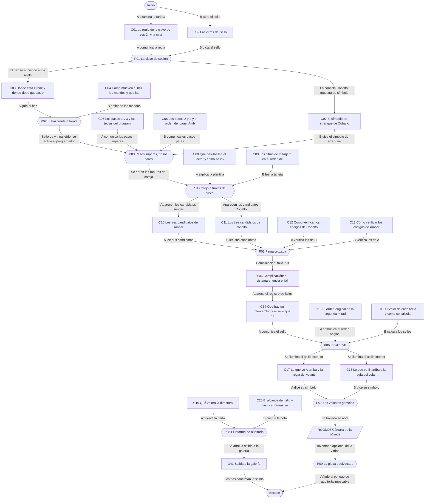
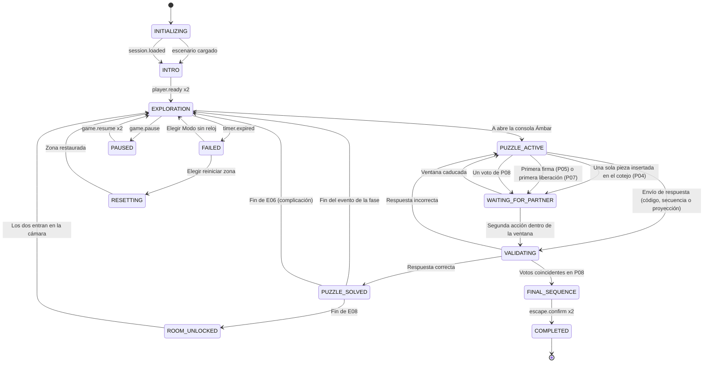

# ER06 · La bóveda dividida

La Fundación Meridiana ha contratado a dos especialistas para auditar el protocolo de apertura de su bóveda de exposición antes de la gala de esta noche. Cada uno trabaja en una cabina de control separada por un cristal: se ven los gestos, pero cada panel tiene solo una parte del procedimiento. Juntos deben completar el protocolo, superar un fallo que invierte dos pasos, abrir la bóveda y decidir qué informe entregan.

## A. Ficha técnica

| Campo | Valor |
|---|---|
| ID | ER06 |
| Nombre | La bóveda dividida |
| Versión | 1.0.0 |
| Género | Golpe elegante sin violencia (auditoría) |
| Sinopsis | La Fundación Meridiana ha contratado a dos especialistas para auditar el protocolo de apertura de su bóveda de exposición antes de la gala de esta noche. Cada uno trabaja en una cabina de control separada por un cristal: se ven los gestos, pero cada panel tiene solo una parte del procedimiento. Juntos deben completar el protocolo, superar un fallo que invierte dos pasos, abrir la bóveda y decidir qué informe entregan. |
| Objetivo principal | OBJ01 Abrir la sesión de las dos cabinas y calibrar el haz de inventario; OBJ02 Cargar la primera mitad del protocolo y superar el cotejo de tarjetas; OBJ03 Firmar la verificación cruzada y corregir el fallo de protocolo; OBJ04 Abrir la bóveda, entregar el informe de auditoría y salir de la cámara |
| Objetivos secundarios | OBJ05 Verificar el inventario de la Vitrina Meridiana |
| Jugadores | 2 (A: Auditor de la Cabina Ámbar; B: Auditora de la Cabina Cobalto) |
| Duración estimada | 60 min (despertar 6, descubrimiento 16, complicación 16, clímax 14, escape 8) |
| Dificultad | Difícil |
| Zonas | 3 |
| Acertijos | 8 principales y 1 microacertijos |
| Objetos interactivos | 28 (más 9 decorativos) |
| Finales | 4 |
| Competencias | Integración de información fragmentada, Verificación cruzada, Comunicación precisa de códigos, Razonamiento espacial con perspectivas opuestas, Coordinación de acciones simultáneas, Toma de decisiones compartida |
| Condiciones iniciales | A empieza en la Cabina Ámbar y B en la Cabina Cobalto, separadas por una pared de cristal: se ven de frente y pueden hacerse señas, pero no pueden pasarse objetos ni leer los papeles del otro. Las consolas están apagadas. La llamada de voz está abierta; en la ficción, hablan por un interfono de cabina. La interfaz ofrece además un botón de Señal (pulgar arriba, mano abierta y cuenta atrás de tres) que el otro ve en su pantalla. |
| Condición de victoria | Completar OBJ01, OBJ02, OBJ03, OBJ04 |
| Condición de fallo | 60 min de cuenta atrás: La gala está a punto de empezar y la directora pide por el interfono un último esfuerzo: los jugadores eligen seguir en Modo sin reloj o reiniciar la zona actual. Nada de lo ya resuelto se pierde. |
| Condición de reinicio | Cualquiera de los dos pulsa Reiniciar zona y el otro lo confirma; también se ofrece al agotarse el reloj. El reinicio completo vuelve al estado inicial y a la intro. |

## B. Guion narrativo

**1. Introducción cinematográfica.** Música de contrabajo y escobillas. La cámara recorre un vestíbulo de mármol con instrumentos científicos antiguos en vitrinas y se detiene ante una puerta circular de acero pulido con dos anillos de símbolos. A cada lado, una cabina de control iluminada: una con luz ámbar, otra con luz azul cobalto. Entre ellas, una pared de cristal. Un rótulo dice: Bóveda Meridiana. Apertura de auditoría.

**2. Por qué están aquí.** La Fundación Meridiana inaugura esta noche la exposición del Astrolabio de Cristal. Antes de abrir, el seguro exige que dos auditores externos comprueben que el protocolo de apertura funciona tal como está escrito. La pareja ha sido contratada para hacerlo: uno en cada cabina, como manda el procedimiento.

**3. Situación inicial.** Las consolas están apagadas y cada cabina solo tiene media documentación: una tarjeta, un sello, un manual a medias. La directora, Inés Montalbán, les saluda por el interfono y les recuerda que el protocolo está diseñado para que nadie pueda completarlo en solitario.

**4. Objetivo.** Completar las ocho fases del Protocolo Meridiano desde las dos cabinas, abrir la bóveda, revisar la cámara y entregar el informe de auditoría antes de la gala.

**5. Primer descubrimiento.** A encuentra en su cabina una tarjeta con la regla de la clave de sesión; B, un sello lacrado con las cifras que faltan. Cuando lo comparan a través del cristal entienden la idea del protocolo: cada paso exige algo de las dos cabinas.

**6. Progresión de los acontecimientos.**

- Con la clave de sesión, las dos consolas se encienden y el haz de inventario aparece en la rejilla del cristal, desviado de su objetivo.
- A guía a B para calibrar el haz y descubren que, al estar frente a frente, la derecha de uno es la izquierda del otro.
- Cargan la primera mitad del protocolo combinando los pasos impares de A con los pares de B.
- Una plantilla perforada y una tarjeta de cifras, cada una a un lado del cristal, dan el código de cotejo.
- Cada consola propone tres códigos de cierre y cada uno verifica los del otro antes de firmar a la vez.
- Complicación: el sistema anuncia el fallo de protocolo 7-B, que ha intercambiado dos pasos de la segunda mitad. Con el sello de integridad encuentran qué pasos se han invertido.
- Fijan los volantes gemelos de la puerta y la bóveda se abre.
- En la cámara, leen la carta de la directora y la nota del ingeniero y deciden qué informe entregan.

**7. Obstáculos narrativos.**

- Ninguna cabina puede leer los papeles de la otra: todo pasa por la voz o por señas.
- La rejilla de calibración solo está rotulada por el lado de Ámbar y los mandos están en Cobalto.
- Las perspectivas opuestas invierten izquierda y derecha y el orden de las columnas.
- El fallo 7-B intercambia dos pasos sin decir cuáles.

**8. Revelaciones.**

- El protocolo está pensado para que nadie pueda abrir la bóveda en solitario: cada cabina tiene exactamente la mitad necesaria.
- El fallo 7-B es conocido por el ingeniero Ulises Brandt, autor del protocolo: nunca abre la bóveda por error, pero obliga a corregir el orden a mano.
- La directora no quiere un informe complaciente: quiere saber la verdad sobre el protocolo y abrir la gala de forma segura.

**9. Clímax.** Los dos anillos de la puerta se iluminan. A ve el exterior y B el interior. Cada uno calcula la posición del volante del otro lado a partir de lo que ve su pareja, la fijan y, con una cuenta atrás compartida a través del cristal, liberan los volantes a la vez. La puerta circular gira y se abre con un suspiro de aire.

**10. Escena de escape.** Las puertas de las dos cabinas se abren hacia la cámara y la pareja se encuentra por primera vez sin cristal de por medio, frente al Astrolabio de Cristal. Leen la documentación que espera en el atril y entregan juntos su informe. La salida de la cámara se desbloquea y suena el primer aplauso de la gala, al otro lado de la pared.

**11. Epílogo.** Desde la galería, ven entrar a los primeros visitantes. La directora les da las gracias por el interfono y les entrega una placa de auditores de honor de la Fundación. En la pared de cristal de las cabinas queda la huella de dos manos, una a cada lado, a la misma altura.

### Diálogos y textos del sistema

Cada línea es un subtítulo. Las líneas de canal `document` quedan además guardadas en el registro de pistas.

| ID | Quién | Texto | Cuándo | Para | Canal |
|---|---|---|---|---|---|
| D01 | Narrador | Te sientas en la Cabina Ámbar. Al otro lado del cristal, tu pareja ocupa la Cabina Cobalto y te saluda con la mano. | START | Jugador A | subtitle |
| D02 | Narrador | Te sientas en la Cabina Cobalto. Al otro lado del cristal, tu pareja ocupa la Cabina Ámbar y te saluda con la mano. | START | Jugador B | subtitle |
| D03 | Inés Montalbán (interfono) | Buenas tardes y gracias por venir. Soy Inés Montalbán, directora de la Fundación. Necesitamos su auditoría antes de la gala. | E01 | Ambos | audio_subtitled |
| D04 | Inés Montalbán (interfono) | El Protocolo Meridiano reparte cada paso entre las dos cabinas. Ninguna tiene todo lo necesario: así está diseñado. | E01 | Ambos | audio_subtitled |
| D05 | Inés Montalbán (interfono) | Pueden hablar y hacerse señas por el cristal, pero no pasarse papeles. Cuando quieran, empiecen por la clave de sesión. | E01 | Ambos | document |
| D06 | MERIDIANA (sistema) | Sesión abierta. Calibren el haz de inventario. | E02 | Ambos | audio_subtitled |
| D07 | Sistema | Clave no válida. Revisen la regla posición por posición. | P01 | Jugador A | popup |
| D08 | MERIDIANA (sistema) | Sello de vitrina leído. Carguen la primera mitad del protocolo en el programador Ámbar. | E03 | Ambos | audio_subtitled |
| D09 | MERIDIANA (sistema) | Primera mitad cargada. Inserten la plantilla y la tarjeta en las ranuras de cotejo. | E04 | Ambos | audio_subtitled |
| D10 | Sistema | Falta la pieza de tu pareja en la ranura de cotejo. | P04 | Ambos | popup |
| D11 | MERIDIANA (sistema) | Cotejo correcto. Verificación cruzada: cada cabina firma con el código que verifique para la otra. | E05 | Ambos | audio_subtitled |
| D12 | Sistema | Esperando la firma de tu pareja… | P05 | Ambos | popup |
| D13 | MERIDIANA (sistema) | Aviso. Fallo de protocolo siete be. Dos pasos de la segunda mitad se han intercambiado. Consulte el registro de fallos en la cabina Ámbar. | E06 | Ambos | audio_subtitled |
| D14 | Inés Montalbán (interfono) | Tranquilos, el fallo no abre nada por sí solo. Justo para esto les hemos contratado. | E06 | Ambos | audio_subtitled |
| D15 | Sistema | Sello de integridad incorrecto. El programador se vacía. | P06 | Jugador B | popup |
| D16 | MERIDIANA (sistema) | Segunda mitad aceptada. Anillos de la puerta desbloqueados. Fijen los volantes y libérenlos a la vez. | E07 | Ambos | audio_subtitled |
| D17 | Sistema | No ha sido a la vez. Los volantes se bloquean cinco segundos. | P07 | Ambos | popup |
| D18 | Narrador | Los anillos giran en sentidos opuestos y la puerta se abre con un suspiro de aire. Las puertas de las cabinas se abren a la vez. | E08 | Ambos | subtitle |
| D19 | Narrador | Por primera vez, no hay cristal entre vosotros. En el centro de la cámara brilla el Astrolabio de Cristal. | E08 | Ambos | subtitle |
| D20 | Inés Montalbán (interfono) | En el atril les he dejado una carta y el ingeniero Brandt una nota. El informe es suyo. | E08 | Ambos | audio_subtitled |
| D21 | Sistema | Han votado informes distintos. Cuéntense lo que han leído y voten otra vez. | P08 | Ambos | popup |
| D22 | Inés Montalbán (interfono) | Informe recibido. Gracias por su honestidad. La salida a la galería está abierta. | E09 | Ambos | audio_subtitled |
| D23 | Narrador | La vitrina se ilumina con un sello verde: inventario verificado. | E10 | Ambos | subtitle |
| D24 | Inés Montalbán (interfono) | El protocolo nunca da a una cabina todo lo que necesita. Si algo no os cuadra, leedle a vuestra pareja exactamente lo que tenéis delante. | E11 | Ambos | audio_subtitled |
| D25 | Narrador | Al otro lado de la pared se oye a los primeros invitados. ¿Seguir sin reloj o reiniciar la zona? | E12 | Ambos | popup |

## C. Escenografía y planos

Coordenadas en metros con origen en la esquina suroeste del suelo de cada zona: `x` hacia el este, `y` hacia arriba, `z` hacia el norte.

### ROOM01 · Cabina Ámbar

Cabina estrecha con paredes de madera clara, luz ámbar y una consola de latón y cristal. La pared este es de cristal grueso y da a la Cabina Cobalto; la norte tiene una ventana a la puerta de la bóveda.

**Medidas:** 4 × 5 m, altura 3 m. **Acceso:** A sí, B no. **Se abre:** desde el inicio.

**Qué ve cada jugador.** A: Toda la cabina, el cristal con la rejilla rotulada, el anillo exterior de la puerta y a B de frente a través del cristal. B: Ve a A y sus gestos a través del cristal, la luz ámbar y la silueta de la consola, pero no puede leer pantallas, papeles ni la rejilla, que por su lado es opaca.

**Distribución.** Pared de cristal al este, con la rejilla de calibración y la ranura de cotejo empotradas. Consola Ámbar en el centro, mirando al cristal, con la pantalla de códigos, el programador de secuencia y el pulsador FIRMAR. Manual y tarjeta en la mesa auxiliar del oeste. Registro de fallos en la pared sur. Ventana al norte con el volante Ámbar y la vista del anillo exterior de la puerta; puerta a la cámara en la pared norte. Silla, archivador y lámpara de brazo decorativos.

| ID | Elemento | Tipo o pared | Posición (x, y, z) | Notas |
|---|---|---|---|---|
| DOOR01 | Puerta a Cámara de la bóveda | pared north | (1, 0, 5) | Se abre con P07_SOLVED |
| — | Ventana | pared east | (4, 1.5, 2.5) | Pared de cristal hacia la Cabina Cobalto; permite verse de frente y hacerse señas |
| — | Ventana | pared north | (2.6, 1.6, 5) | Ventana a la puerta de la bóveda; desde aquí solo se ve el anillo exterior |
| O01 | Consola Ámbar | 6 Activar | (2.8, 0.9, 2.5) | Consola de latón con teclado numérico, una pantalla de cristal verde y la placa Clave de sesión |
| O02 | Tarjeta de auditoría Ámbar | 2 Examinar | (0.5, 0.8, 2.4) | Tarjeta de cartulina color miel con cuatro cifras impresas y un texto breve |
| O03 | Rejilla de calibración | 2 Examinar | (3.9, 1.6, 3.2) | Cuadrícula de 6 por 6 grabada en el cristal, con números en los bordes y un rombo pintado; por el otro lado es esmerilada |
| O04 | Manual Ámbar | 2 Examinar | (0.6, 0.8, 1.6) | Carpeta de anillas color miel con pestañas: Primera mitad, Verificación cruzada y Segunda mitad |
| O05 | Programador de secuencia Ámbar | 8 Mecanismo cooperativo | (2.8, 0.95, 3) | Fila de cuatro teclas grandes con símbolos en relieve y su nombre: LUNA (media luna), SOL (círculo con rayos), ESTRELLA (cinco puntas) y COMETA (estrella con cola); cuatro casillas de paso encima |
| O06 | Ranura de cotejo Ámbar | 4 Usar | (3.9, 1.1, 1.8) | Ranura horizontal en el cristal con un marco de latón y la palabra Plantilla |
| O07 | Plantilla perforada | 3 Recoger | (0.5, 0.8, 3) | Lámina de metal fino de 3 por 4 casillas con cuatro ventanas recortadas e instrucciones grabadas |
| O08 | Pantalla de códigos Ámbar | 2 Examinar | (2.4, 1.2, 2.6) | Pantalla secundaria de la consola con tres códigos de cuatro cifras |
| O09 | Pulsador FIRMAR Ámbar | 8 Mecanismo cooperativo | (3.2, 0.95, 2.5) | Botón redondo de latón con la palabra FIRMAR y un campo de cuatro cifras encima |
| O10 | Registro de fallos | 2 Examinar | (2, 1.6, 0.1) | Panel de texto en la pared sur que se ilumina con una línea de aviso y un número de sello |
| O11 | Volante Ámbar y anillo exterior | 8 Mecanismo cooperativo | (2.6, 1, 4.8) | Volante de latón con ocho posiciones de símbolos bajo la ventana norte; detrás del vidrio, el anillo exterior de la puerta con una marca en lo alto |
| O12 | Silla giratoria | 1 Decorativo | (2.8, 0, 1.8) | Silla de cuero color coñac con ruedas |
| O13 | Archivador metálico | 1 Decorativo | (0.4, 0, 0.5) | Archivador de tres cajones con etiquetas de años antiguos |
| O14 | Lámpara de brazo | 1 Decorativo | (0.6, 0.8, 2) | Lámpara articulada de latón sobre la mesa auxiliar |
| O15 | Interfono de cabina | 9 Elemento narrativo | (1, 1.7, 0.1) | Rejilla de altavoz con un piloto verde y el rótulo Dirección |

| Luz | Tipo | Posición | Color | Intensidad | Uso |
|---|---|---|---|---|---|
| L01 | Plafón cálido | (2, 2.9, 2.5) | #FFB347 | 0.6 | Luz ámbar general; en E06 pasa a un pulso lento de 4 s entre 0.4 y 0.6, nunca estroboscópico |
| L02 | Lámpara de brazo | (0.6, 1.4, 2) | #FFE2B0 | 0.5 | Ilumina la mesa con el manual y la tarjeta |
| L03 | Retroiluminación de la rejilla | (3.9, 1.6, 3.2) | #FFFFFF | 0 | Se enciende a 0.4 con E02 para mostrar el haz |

**Sonido ambiente:** Ventilación suave y zumbido cálido de equipos de la cabina Ámbar. **Música:** Jazz de cámara con contrabajo, escobillas y vibráfono, a volumen bajo; gana una capa con cada objetivo.

**Cambios dinámicos:**

- E02: La consola Ámbar se enciende y la rejilla del cristal se ilumina con el punto del haz
- E06: La luz pasa a un pulso lento y en la pared sur aparece el registro de fallos
- E07: El anillo exterior de la puerta se ilumina tras la ventana norte
- E08: La puerta norte de la cabina se abre hacia la cámara

**Para el motor:** Escena propia de A. La pared de cristal es un plano con dos materiales: por el lado de A muestra la rejilla rotulada (capa solo para la cámara de A) y por el de B un vidrio esmerilado en esa franja. El avatar de B se renderiza al otro lado del cristal con animaciones de gesto sincronizadas (señalar, pulgar arriba, mano abierta, cuenta con los dedos). El botón de Señal replica el gesto como icono con texto en la pantalla del otro. En web, el cristal puede ser un panel lateral con la vista de la otra cabina.

### ROOM02 · Cabina Cobalto

Cabina gemela de la Ámbar con paredes gris pizarra y luz azul cobalto. La pared oeste es el mismo cristal; la norte da al interior de la puerta de la bóveda.

**Medidas:** 4 × 5 m, altura 3 m. **Acceso:** A no, B sí. **Se abre:** desde el inicio.

**Qué ve cada jugador.** A: Ve a B y sus gestos a través del cristal y la luz azul, pero no puede leer pantallas ni papeles. B: Toda la cabina, el anillo interior de la puerta y a A de frente a través del cristal; la franja de la rejilla se ve esmerilada.

**Distribución.** Pared de cristal al oeste, con la ranura de cotejo Cobalto y los mandos del haz bajo ella. Consola Cobalto en el centro, mirando al cristal, con la pantalla de códigos, el programador de secuencia Cobalto y el pulsador FIRMAR. Manual, sello y tarjeta de cifras en la mesa auxiliar del este. Ventana al norte con el volante Cobalto y la vista del anillo interior; puerta a la cámara en la pared norte. Perchero, reloj de pared y planta decorativos.

| ID | Elemento | Tipo o pared | Posición (x, y, z) | Notas |
|---|---|---|---|---|
| DOOR02 | Puerta a Cámara de la bóveda | pared north | (3, 0, 5) | Se abre con P07_SOLVED |
| — | Ventana | pared west | (0, 1.5, 2.5) | Pared de cristal hacia la Cabina Ámbar |
| — | Ventana | pared north | (1.4, 1.6, 5) | Ventana a la puerta de la bóveda; desde aquí solo se ve el anillo interior |
| O20 | Consola Cobalto | 6 Activar | (1.2, 0.9, 2.5) | Consola gemela de la Ámbar, en acero azulado, con una pantalla que se enciende con la clave de sesión |
| O21 | Sello Cobalto | 2 Examinar | (3.5, 0.8, 2.4) | Sobre lacrado en azul con cuatro cifras estampadas |
| O22 | Mandos del haz | 8 Mecanismo cooperativo | (0.3, 1, 3.2) | Dos ruedas con muescas bajo el cristal, rotuladas H y V, con un contador de clics cada una y un botón Proyectar |
| O23 | Manual Cobalto | 2 Examinar | (3.4, 0.8, 1.6) | Carpeta de anillas azul con pestañas: Primera mitad, Verificación cruzada y Segunda mitad |
| O24 | Tarjeta de cifras Cobalto | 3 Recoger | (3.5, 0.8, 3) | Tarjeta rígida de 3 por 4 casillas con una cifra en cada casilla, impresa por las dos caras |
| O25 | Ranura de cotejo Cobalto | 8 Mecanismo cooperativo | (0.1, 1.1, 1.8) | Ranura en el cristal frente a la de Ámbar, con un teclado de cuatro cifras debajo |
| O26 | Pantalla de códigos Cobalto | 2 Examinar | (1.6, 1.2, 2.6) | Pantalla secundaria con tres códigos de cuatro cifras |
| O27 | Pulsador FIRMAR Cobalto | 8 Mecanismo cooperativo | (0.8, 0.95, 2.5) | Botón redondo de acero con la palabra FIRMAR y un campo de cuatro cifras |
| O28 | Programador de secuencia Cobalto | 8 Mecanismo cooperativo | (1.2, 0.95, 3) | Fila de cuatro teclas con símbolos en relieve y su nombre: ANCLA, CAMPANA, LLAVE y PLUMA; cuatro casillas de paso encima |
| O29 | Volante Cobalto y anillo interior | 8 Mecanismo cooperativo | (1.4, 1, 4.8) | Volante de acero con ocho posiciones de símbolos bajo la ventana norte; detrás del vidrio, el anillo interior de la puerta con una marca en lo alto |
| O30 | Perchero con dos batas | 1 Decorativo | (3.6, 0, 0.4) | Perchero de pie con dos batas grises con el logotipo de la Fundación |
| O31 | Reloj de pared | 1 Decorativo | (2, 2.3, 0.1) | Reloj redondo de estación con segundero rojo |
| O32 | Planta de interior | 1 Decorativo | (3.6, 0, 4.5) | Planta de hojas grandes en una maceta de cerámica azul |

| Luz | Tipo | Posición | Color | Intensidad | Uso |
|---|---|---|---|---|---|
| L04 | Plafón frío | (2, 2.9, 2.5) | #3A6FD8 | 0.55 | Luz cobalto general; en E06 pasa al mismo pulso lento que la cabina Ámbar |
| L05 | Flexo de mesa | (3.4, 1.3, 2) | #E6EEFF | 0.5 | Ilumina el manual, el sello y la tarjeta |
| L06 | Piloto de los mandos del haz | (0.3, 1, 3.2) | #9FD3FF | 0.2 | Se enciende con E02 |

**Sonido ambiente:** Ventilación y zumbido algo más frío de la cabina Cobalto. **Música:** Jazz de cámara con contrabajo, escobillas y vibráfono, a volumen bajo; gana una capa con cada objetivo.

**Cambios dinámicos:**

- E02: La consola Cobalto se enciende y muestra su símbolo de arranque
- E06: La luz pasa a un pulso lento y la consola muestra el aviso de fallo sin detalles
- E07: El anillo interior de la puerta se ilumina tras la ventana norte
- E08: La puerta norte de la cabina se abre hacia la cámara

**Para el motor:** Escena propia de B, simétrica de ROOM01 en espejo. Los mandos del haz son dos ruedas con muescas (clics) y un botón Proyectar; el desplazamiento del haz se calcula en el servidor en el sistema de coordenadas de A (columna de A = columna anterior - clics de H, porque la derecha de B es la izquierda de A) y se limita a los bordes de la rejilla. Los acertijos P05 y P07 tienen controles en las dos cabinas; se asignan a esta zona porque su validación final la emite la consola Cobalto, pero el servidor exige las dos entradas.

### ROOM03 · Cámara de la bóveda

Cámara circular de techo bajo con suelo de terrazo, pedestales con instrumentos científicos y, en el centro, el Astrolabio de Cristal bajo una campana de vidrio. Al norte, un atril con la documentación de auditoría y la salida hacia la galería de la gala.

**Medidas:** 8 × 8 m, altura 4.5 m. **Acceso:** A sí, B sí. **Se abre:** P07_SOLVED.

**Qué ve cada jugador.** A: Toda la cámara. B: Toda la cámara.

**Distribución.** Entradas desde las dos cabinas en la pared sur (Ámbar al oeste, Cobalto al este). Astrolabio en el centro. Vitrina Meridiana con cinco piezas y placas en la pared este. Lista de inventario en un atril bajo junto a la pared oeste. Atril de informes al norte, centro, con la carta de la directora a su izquierda y la nota de Brandt a su derecha. Salida a la galería en la pared norte. Pedestales y bancos de terciopelo decorativos.

| ID | Elemento | Tipo o pared | Posición (x, y, z) | Notas |
|---|---|---|---|---|
| DOOR03 | Puerta a Cabina Ámbar | pared south | (2, 0, 0) | Se abre con P07_SOLVED |
| DOOR04 | Puerta a Cabina Cobalto | pared south | (6, 0, 0) | Se abre con P07_SOLVED |
| DOOR05 | Puerta de salida | pared north | (4, 0, 8) | Se abre con P08_SOLVED |
| O40 | Atril de informes | 8 Mecanismo cooperativo | (4, 0, 7.2) | Atril de nogal con dos carpetas de informe, una ámbar y una cobalto, y dos pulsadores de voto ocultos |
| O41 | Salida a la galería | 10 Objeto de salida | (4, 0, 7.9) | Puerta de doble hoja de nogal con tiradores de latón y el rótulo Galería de la gala |
| O42 | Carta de la directora | 2 Examinar | (3.2, 1.1, 7.2) | Sobre de papel verjurado con el membrete de la Fundación, a la izquierda del atril |
| O43 | Nota del ingeniero Brandt | 2 Examinar | (4.8, 1.1, 7.2) | Tarjeta escrita a mano con letra pequeña y un dibujo de dos llaves cruzadas, a la derecha del atril |
| O44 | Vitrina Meridiana | 2 Examinar | (7.6, 0, 4) | Vitrina alargada con cinco instrumentos sobre terciopelo azul y una placa de latón delante de cada uno |
| O45 | Lista de inventario | 2 Examinar | (0.5, 1, 4) | Hoja plastificada en un atril bajo con cinco filas |
| O46 | Astrolabio de Cristal | 1 Decorativo | (4, 0, 4) | Astrolabio de vidrio tallado con anillos que reflejan la luz en el techo, bajo una campana de vidrio |
| O47 | Pedestales con instrumentos | 1 Decorativo | (1.5, 0, 6) | Tres pedestales con un telescopio de latón, un globo terráqueo y un metrónomo |
| O48 | Bancos de terciopelo | 1 Decorativo | (4, 0, 1.8) | Dos bancos largos tapizados en azul noche |

| Luz | Tipo | Posición | Color | Intensidad | Uso |
|---|---|---|---|---|---|
| L07 | Cenital sobre el astrolabio | (4, 4.3, 4) | #FFF6E8 | 0.7 | Hace brillar el astrolabio; se enciende al abrirse la puerta |
| L08 | Luz de vitrina | (7.6, 2.2, 4) | #F2F6FF | 0.5 | Deja leer las placas de las piezas |
| L09 | Lámpara del atril de informes | (4, 1.6, 7.4) | #FFE7C2 | 0.5 | Ilumina la carta, la nota y el atril |

**Sonido ambiente:** Silencio de museo con eco leve y un murmullo lejano de la gala. **Música:** Piano y cuerdas suaves en la cámara.

**Cambios dinámicos:**

- E08: La puerta de la bóveda gira, se encienden la cenital y la vitrina y las dos entradas se abren
- E09: El atril sella el informe elegido y la salida a la galería se abre con el murmullo de la gala
- E10: La vitrina muestra un sello verde de inventario verificado con la palabra VERIFICADO

**Para el motor:** Escena compartida cargada al resolver P07. Los dos jugadores tienen aquí avatar completo y pueden verse sin cristal; no hay interacción física entre avatares. La carta y la nota son objetos legibles por los dos, pero cada uno aparece primero en la tableta de su destinatario (A la carta, B la nota) para que se la cuenten. El atril de informes muestra la votación oculta hasta que votan los dos.

## D. Inventario de objetos

| object_id | Nombre | Descripción visual | Zona | Posición | Tipo | Estado inicial | Acción | Activación | Resultado | Pista | Acertijo | Jugador | Estado final |
|---|---|---|---|---|---|---|---|---|---|---|---|---|---|
| O01 | Consola Ámbar | Consola de latón con teclado numérico, una pantalla de cristal verde y la placa Clave de sesión | ROOM01 | (2.8, 0.9, 2.5) | 6 Activar | LOCKED | Teclear la clave de sesión y pulsar Aceptar | — | Con la clave correcta se encienden las dos consolas | — | P01 | Jugador A | ON |
| O02 | Tarjeta de auditoría Ámbar | Tarjeta de cartulina color miel con cuatro cifras impresas y un texto breve | ROOM01 | (0.5, 0.8, 2.4) | 2 Examinar | DEFAULT | Examinar | — | Guarda C01 | C01 | P01 | Jugador A | EXAMINED |
| O03 | Rejilla de calibración | Cuadrícula de 6 por 6 grabada en el cristal, con números en los bordes y un rombo pintado; por el otro lado es esmerilada | ROOM01 | (3.9, 1.6, 3.2) | 2 Examinar | DARK | Examinar | P01_SOLVED | Con el haz encendido guarda C03 | C03 | P02 | Jugador A | ALIGNED |
| O04 | Manual Ámbar | Carpeta de anillas color miel con pestañas: Primera mitad, Verificación cruzada y Segunda mitad | ROOM01 | (0.6, 0.8, 1.6) | 2 Examinar | DEFAULT | Examinar por pestañas | — | Guarda C05, C12 y C15 | C05 | P03 | Jugador A | EXAMINED |
| O05 | Programador de secuencia Ámbar | Fila de cuatro teclas grandes con símbolos en relieve y su nombre: LUNA (media luna), SOL (círculo con rayos), ESTRELLA (cinco puntas) y COMETA (estrella con cola); cuatro casillas de paso encima | ROOM01 | (2.8, 0.95, 3) | 8 Mecanismo cooperativo | EMPTY | Pulsar cuatro teclas en orden y Cargar | P02_SOLVED | Si la secuencia es la correcta, la primera mitad del protocolo queda cargada | — | P03 | Jugador A | LOADED |
| O06 | Ranura de cotejo Ámbar | Ranura horizontal en el cristal con un marco de latón y la palabra Plantilla | ROOM01 | (3.9, 1.1, 1.8) | 4 Usar | EMPTY | Insertar la plantilla perforada | P03_SOLVED | La plantilla queda en el lector, frente a la ranura Cobalto | — | P04 | Jugador A | INSERTED |
| O07 | Plantilla perforada | Lámina de metal fino de 3 por 4 casillas con cuatro ventanas recortadas e instrucciones grabadas | ROOM01 | (0.5, 0.8, 3) | 3 Recoger | FOUND | Recoger y examinar | — | Pasa al inventario de A y guarda C08 | C08 | P04 | Jugador A | USED |
| O08 | Pantalla de códigos Ámbar | Pantalla secundaria de la consola con tres códigos de cuatro cifras | ROOM01 | (2.4, 1.2, 2.6) | 2 Examinar | DARK | Examinar | P04_SOLVED | Guarda C10 | C10 | P05 | Jugador A | SHOWING |
| O09 | Pulsador FIRMAR Ámbar | Botón redondo de latón con la palabra FIRMAR y un campo de cuatro cifras encima | ROOM01 | (3.2, 0.95, 2.5) | 8 Mecanismo cooperativo | IDLE | Teclear el código Cobalto verificado y pulsar FIRMAR | P04_SOLVED | Envía la firma de A; solo vale si B firma a la vez | — | P05 | Jugador A | SIGNED |
| O10 | Registro de fallos | Panel de texto en la pared sur que se ilumina con una línea de aviso y un número de sello | ROOM01 | (2, 1.6, 0.1) | 2 Examinar | HIDDEN | Examinar | P05_SOLVED | Guarda C14 | C14 | P06 | Jugador A | VISIBLE |
| O11 | Volante Ámbar y anillo exterior | Volante de latón con ocho posiciones de símbolos bajo la ventana norte; detrás del vidrio, el anillo exterior de la puerta con una marca en lo alto | ROOM01 | (2.6, 1, 4.8) | 8 Mecanismo cooperativo | LOCKED | Girar el volante hasta un símbolo y pulsar Liberar | P06_SOLVED | Al examinar el anillo se guarda C17; la liberación solo vale si B libera a la vez | C17 | P07 | Jugador A | RELEASED |
| O12 | Silla giratoria | Silla de cuero color coñac con ruedas | ROOM01 | (2.8, 0, 1.8) | 1 Decorativo | STATIC | none | — | Sin interacción | — | — | Nadie | STATIC |
| O13 | Archivador metálico | Archivador de tres cajones con etiquetas de años antiguos | ROOM01 | (0.4, 0, 0.5) | 1 Decorativo | STATIC | none | — | Sin interacción | — | — | Nadie | STATIC |
| O14 | Lámpara de brazo | Lámpara articulada de latón sobre la mesa auxiliar | ROOM01 | (0.6, 0.8, 2) | 1 Decorativo | STATIC | none | — | Sin interacción | — | — | Nadie | STATIC |
| O15 | Interfono de cabina | Rejilla de altavoz con un piloto verde y el rótulo Dirección | ROOM01 | (1, 1.7, 0.1) | 9 Elemento narrativo | SILENT | Escuchar | — | Reproduce los mensajes de la directora; se oyen en las dos cabinas y quedan en el historial | — | — | Jugador A | PLAYED |
| O20 | Consola Cobalto | Consola gemela de la Ámbar, en acero azulado, con una pantalla que se enciende con la clave de sesión | ROOM02 | (1.2, 0.9, 2.5) | 6 Activar | STANDBY | Examinar la pantalla | — | Encendida, muestra su símbolo de arranque y guarda C07 | C07 | P03 | Jugador B | ON |
| O21 | Sello Cobalto | Sobre lacrado en azul con cuatro cifras estampadas | ROOM02 | (3.5, 0.8, 2.4) | 2 Examinar | DEFAULT | Abrir y examinar | — | Guarda C02 | C02 | P01 | Jugador B | EXAMINED |
| O22 | Mandos del haz | Dos ruedas con muescas bajo el cristal, rotuladas H y V, con un contador de clics cada una y un botón Proyectar | ROOM02 | (0.3, 1, 3.2) | 8 Mecanismo cooperativo | IDLE | Programar clics en H y V y pulsar Proyectar | P01_SOLVED | Al examinar la ficha se guarda C04; al proyectar, el haz se mueve en la rejilla de A | C04 | P02 | Jugador B | ALIGNED |
| O23 | Manual Cobalto | Carpeta de anillas azul con pestañas: Primera mitad, Verificación cruzada y Segunda mitad | ROOM02 | (3.4, 0.8, 1.6) | 2 Examinar | DEFAULT | Examinar por pestañas | — | Guarda C06, C13 y C16 | C06 | P03 | Jugador B | EXAMINED |
| O24 | Tarjeta de cifras Cobalto | Tarjeta rígida de 3 por 4 casillas con una cifra en cada casilla, impresa por las dos caras | ROOM02 | (3.5, 0.8, 3) | 3 Recoger | FOUND | Recoger y examinar | — | Pasa al inventario de B y guarda C09 | C09 | P04 | Jugador B | USED |
| O25 | Ranura de cotejo Cobalto | Ranura en el cristal frente a la de Ámbar, con un teclado de cuatro cifras debajo | ROOM02 | (0.1, 1.1, 1.8) | 8 Mecanismo cooperativo | EMPTY | Insertar la tarjeta de cifras y teclear el código de cotejo | P03_SOLVED | Con las dos piezas insertadas, acepta el código leído a través de la plantilla | — | P04 | Jugador B | ACCEPTED |
| O26 | Pantalla de códigos Cobalto | Pantalla secundaria con tres códigos de cuatro cifras | ROOM02 | (1.6, 1.2, 2.6) | 2 Examinar | DARK | Examinar | P04_SOLVED | Guarda C11 | C11 | P05 | Jugador B | SHOWING |
| O27 | Pulsador FIRMAR Cobalto | Botón redondo de acero con la palabra FIRMAR y un campo de cuatro cifras | ROOM02 | (0.8, 0.95, 2.5) | 8 Mecanismo cooperativo | IDLE | Teclear el código Ámbar verificado y pulsar FIRMAR | P04_SOLVED | Envía la firma de B; solo vale si A firma a la vez | — | P05 | Jugador B | SIGNED |
| O28 | Programador de secuencia Cobalto | Fila de cuatro teclas con símbolos en relieve y su nombre: ANCLA, CAMPANA, LLAVE y PLUMA; cuatro casillas de paso encima | ROOM02 | (1.2, 0.95, 3) | 8 Mecanismo cooperativo | EMPTY | Pulsar cuatro teclas en orden y Cargar | P05_SOLVED | Si la secuencia corregida es la buena, la segunda mitad queda cargada | — | P06 | Jugador B | LOADED |
| O29 | Volante Cobalto y anillo interior | Volante de acero con ocho posiciones de símbolos bajo la ventana norte; detrás del vidrio, el anillo interior de la puerta con una marca en lo alto | ROOM02 | (1.4, 1, 4.8) | 8 Mecanismo cooperativo | LOCKED | Girar el volante hasta un símbolo y pulsar Liberar | P06_SOLVED | Al examinar el anillo se guarda C18; la liberación solo vale si A libera a la vez | C18 | P07 | Jugador B | RELEASED |
| O30 | Perchero con dos batas | Perchero de pie con dos batas grises con el logotipo de la Fundación | ROOM02 | (3.6, 0, 0.4) | 1 Decorativo | STATIC | none | — | Sin interacción | — | — | Nadie | STATIC |
| O31 | Reloj de pared | Reloj redondo de estación con segundero rojo | ROOM02 | (2, 2.3, 0.1) | 1 Decorativo | STATIC | none | — | Sin interacción | — | — | Nadie | STATIC |
| O32 | Planta de interior | Planta de hojas grandes en una maceta de cerámica azul | ROOM02 | (3.6, 0, 4.5) | 1 Decorativo | STATIC | none | — | Sin interacción | — | — | Nadie | STATIC |
| O40 | Atril de informes | Atril de nogal con dos carpetas de informe, una ámbar y una cobalto, y dos pulsadores de voto ocultos | ROOM03 | (4, 0, 7.2) | 8 Mecanismo cooperativo | OPEN | Votar un informe | P07_SOLVED | Cuando los dos votan lo mismo, el informe se sella y se envía a la dirección | — | P08 | Ambos | SEALED |
| O41 | Salida a la galería | Puerta de doble hoja de nogal con tiradores de latón y el rótulo Galería de la gala | ROOM03 | (4, 0, 7.9) | 10 Objeto de salida | LOCKED | Salir | P08_SOLVED | Cada jugador confirma su salida; con los dos confirmados, termina la partida | — | — | Ambos | OPEN |
| O42 | Carta de la directora | Sobre de papel verjurado con el membrete de la Fundación, a la izquierda del atril | ROOM03 | (3.2, 1.1, 7.2) | 2 Examinar | DEFAULT | Leer | — | Guarda C19 en la tableta de A | C19 | P08 | Jugador A | EXAMINED |
| O43 | Nota del ingeniero Brandt | Tarjeta escrita a mano con letra pequeña y un dibujo de dos llaves cruzadas, a la derecha del atril | ROOM03 | (4.8, 1.1, 7.2) | 2 Examinar | DEFAULT | Leer | — | Guarda C20 en la tableta de B | C20 | P08 | Jugador B | EXAMINED |
| O44 | Vitrina Meridiana | Vitrina alargada con cinco instrumentos sobre terciopelo azul y una placa de latón delante de cada uno | ROOM03 | (7.6, 0, 4) | 2 Examinar | UNCHECKED | Examinar placas y marcar una placa como errónea | — | Guarda C22; al marcar la placa correcta, la vitrina queda verificada | C22 | P09 | Jugador B | VERIFIED |
| O45 | Lista de inventario | Hoja plastificada en un atril bajo con cinco filas | ROOM03 | (0.5, 1, 4) | 2 Examinar | DEFAULT | Leer | — | Guarda C21 | C21 | P09 | Jugador A | EXAMINED |
| O46 | Astrolabio de Cristal | Astrolabio de vidrio tallado con anillos que reflejan la luz en el techo, bajo una campana de vidrio | ROOM03 | (4, 0, 4) | 1 Decorativo | STATIC | none | — | Sin interacción | — | — | Nadie | STATIC |
| O47 | Pedestales con instrumentos | Tres pedestales con un telescopio de latón, un globo terráqueo y un metrónomo | ROOM03 | (1.5, 0, 6) | 1 Decorativo | STATIC | none | — | Sin interacción | — | — | Nadie | STATIC |
| O48 | Bancos de terciopelo | Dos bancos largos tapizados en azul noche | ROOM03 | (4, 0, 1.8) | 1 Decorativo | STATIC | none | — | Sin interacción | — | — | Nadie | STATIC |

## E. Pistas

| clue_id | Contenido exacto | Alternativa accesible | Ubicación | Descubrimiento | Quién | Acertijo | Revela | Depende de | Se habilita | Nivel | Descubierta cuando |
|---|---|---|---|---|---|---|---|---|---|---|---|
| C01 | Tarjeta de auditoría Ámbar. Clave de sesión de Ámbar: sumad cada cifra de esta tarjeta con la cifra del sello Cobalto que ocupa la misma posición y quedaos solo con la última cifra de cada suma. Cifras de esta tarjeta, en orden: 5 8 3 6. La clave enciende las dos consolas. | Texto grande con lectura en voz: regla de la suma por posiciones, quedándose con la última cifra; cifras 5, 8, 3, 6. | O02 Tarjeta de auditoría Ámbar | A examina la tarjeta de la mesa auxiliar | Jugador A | P01 | La regla de la clave de sesión y la mitad de las cifras | — | — | 0 | O02_EXAMINED |
| C02 | Sello Cobalto. Sello de sesión: 4 7 9 2. Para uso de la cabina Ámbar. | Texto grande: cuatro, siete, nueve, dos. | O21 Sello Cobalto | B abre el sobre lacrado | Jugador B | P01 | Las cifras del sello | — | — | 0 | O21_EXAMINED |
| C03 | Rejilla de calibración vista desde Ámbar: seis columnas numeradas del 1 al 6 de izquierda a derecha y seis filas numeradas del 1 al 6 de abajo arriba. El punto del haz de inventario está en la columna 1, fila 2. El rombo objetivo está en la columna 5, fila 5. Las etiquetas y el rombo solo están pintados por la cara de Ámbar. | Texto: haz en columna 1, fila 2; objetivo en columna 5, fila 5; columnas de izquierda a derecha vistas desde Ámbar y filas de abajo arriba. La interfaz anuncia la casilla del haz cada vez que se mueve. | O03 Rejilla de calibración | A mira la rejilla cuando el haz está encendido | Jugador A | P02 | Dónde está el haz y dónde debe quedar, en las coordenadas de Ámbar | — | P01_SOLVED | 0 | O03_LIT |
| C04 | Ficha de los mandos del haz. Mando H: cada clic hacia la derecha mueve el haz una columna hacia la derecha de quien está en Cobalto; cada clic hacia la izquierda, una columna hacia su izquierda. Mando V: cada clic arriba sube el haz una fila; cada clic abajo, la baja. Ámbar y Cobalto están frente a frente, a los dos lados del cristal, así que la derecha de Cobalto es la izquierda de Ámbar. Programad los clics y pulsad Proyectar. Desde Cobalto, la rejilla es una placa esmerilada. | Texto: H mueve a la derecha o izquierda de Cobalto; V sube o baja; la derecha de Cobalto es la izquierda de Ámbar. | O22 Mandos del haz | B examina la ficha pegada junto a los mandos | Jugador B | P02 | Cómo mueven el haz los mandos y que las perspectivas están invertidas | — | — | 0 | — |
| C05 | Protocolo Meridiano, primera mitad, copia Ámbar (pasos impares). Se programa en el Programador Ámbar, que tiene cuatro teclas: LUNA (media luna), SOL (círculo con rayos), ESTRELLA (cinco puntas) y COMETA (estrella con cola). Paso 1: la tecla cuyo símbolo muestra la consola Cobalto al encenderse. Paso 3: la única tecla que no se use en los pasos 1, 2 y 4. Los pasos pares están en la copia Cobalto. | Texto: paso 1, el símbolo de arranque de Cobalto; paso 3, la tecla que sobra. Teclas descritas por forma y nombre. | O04 Manual Ámbar | A abre la pestaña Primera mitad del manual | Jugador A | P03 | Los pasos 1 y 3 y las teclas del programador | — | — | 0 | O04_EXAMINED |
| C06 | Protocolo Meridiano, primera mitad, copia Cobalto (pasos pares). Orden del panel Ámbar: LUNA, SOL, ESTRELLA, COMETA; después de COMETA vuelve LUNA. Paso 2: la tecla que sigue a la del paso 1 en el orden del panel. Paso 4: si el paso 2 fue SOL, COMETA; si no, LUNA. Ninguna tecla se repite. Los pasos impares están en la copia Ámbar. | Texto: orden del panel; paso 2, la siguiente a la del paso 1; paso 4, COMETA si el 2 fue SOL y LUNA en otro caso. | O23 Manual Cobalto | B abre la pestaña Primera mitad del manual | Jugador B | P03 | Los pasos 2 y 4 y el orden del panel Ámbar | — | — | 0 | O23_EXAMINED |
| C07 | Al encenderse, la consola Cobalto muestra en el centro de la pantalla un único símbolo: una estrella de cinco puntas, con la palabra ESTRELLA debajo. | Texto: símbolo de arranque, ESTRELLA, cinco puntas. | O20 Consola Cobalto | B mira su consola cuando se enciende | Jugador B | P03 | El símbolo de arranque de Cobalto | — | P01_SOLVED | 0 | O20_ON |
| C08 | Plantilla perforada Ámbar: cuadrícula de 3 filas por 4 columnas, vista desde Ámbar, con cuatro ventanas abiertas: fila 1 columna 2; fila 2 columna 4; fila 3 columna 1; fila 3 columna 3. Instrucciones: insertad la plantilla en la ranura Ámbar y la tarjeta de cifras en la ranura Cobalto. El lector las superpone a través del cristal y lee las ventanas fila por fila, empezando por arriba, y dentro de cada fila de izquierda a derecha, vistas desde Ámbar. La tarjeta Cobalto queda frente a frente con la plantilla, así que sus columnas se ven en orden inverso: la columna 1 de Ámbar coincide con la 4 de Cobalto, la 2 con la 3, la 3 con la 2 y la 4 con la 1. Las filas no cambian. Cobalto teclea el código leído. | Texto: ventanas en fila 1 columna 2, fila 2 columna 4, fila 3 columna 1 y fila 3 columna 3; columnas invertidas entre cabinas (1-4, 2-3, 3-2, 4-1); filas iguales. | O07 Plantilla perforada | A recoge y examina la plantilla | Jugador A | P04 | Qué casillas lee el lector y cómo se invierten las columnas | — | — | 0 | O07_COLLECTED |
| C09 | Tarjeta de cifras Cobalto, vista desde Cobalto, con columnas numeradas del 1 al 4 de izquierda a derecha. Fila 1: 4 9 1 6. Fila 2: 8 2 7 3. Fila 3: 5 0 6 2. | Tabla de 3 filas y 4 columnas leída en voz alta fila a fila: 4 9 1 6; 8 2 7 3; 5 0 6 2. | O24 Tarjeta de cifras Cobalto | B recoge y examina la tarjeta | Jugador B | P04 | Las cifras de la tarjeta en el orden de Cobalto | — | — | 0 | O24_COLLECTED |
| C10 | Códigos de cierre propuestos por la consola Ámbar: 3418, 2754 y 4545. Solo uno es auténtico; la regla para comprobarlos está en el manual Cobalto. | Texto grande: tres mil cuatrocientos dieciocho; dos mil setecientos cincuenta y cuatro; cuatro mil quinientos cuarenta y cinco, también cifra a cifra. | O08 Pantalla de códigos Ámbar | A mira su pantalla de códigos tras el cotejo | Jugador A | P05 | Los tres candidatos de Ámbar | — | P04_SOLVED | 0 | O08_SHOWING |
| C11 | Códigos de cierre propuestos por la consola Cobalto: 5520, 8037 y 2916. Solo uno es auténtico; la regla para comprobarlos está en el manual Ámbar. | Texto grande: cinco mil quinientos veinte; ocho mil treinta y siete; dos mil novecientos dieciséis, también cifra a cifra. | O26 Pantalla de códigos Cobalto | B mira su pantalla de códigos tras el cotejo | Jugador B | P05 | Los tres candidatos de Cobalto | — | P04_SOLVED | 0 | O26_SHOWING |
| C12 | Manual Ámbar, verificación cruzada: un código Cobalto es auténtico si sus cuatro cifras suman 18 y su primera cifra es mayor que la última. Ámbar teclea en su campo de firma el código Cobalto auténtico y pulsa FIRMAR a la vez que Cobalto. | Texto: código Cobalto válido si la suma es 18 y la primera cifra es mayor que la última; Ámbar firma con él. | O04 Manual Ámbar | A abre la pestaña Verificación cruzada | Jugador A | P05 | Cómo verificar los códigos de Cobalto | — | — | 0 | O04_EXAMINED |
| C13 | Manual Cobalto, verificación cruzada: un código Ámbar es auténtico si sus dos primeras cifras suman lo mismo que sus dos últimas y no repite ninguna cifra. Cobalto teclea en su campo de firma el código Ámbar auténtico y pulsa FIRMAR a la vez que Ámbar. | Texto: código Ámbar válido si las dos primeras cifras suman lo mismo que las dos últimas y no se repite ninguna; Cobalto firma con él. | O23 Manual Cobalto | B abre la pestaña Verificación cruzada | Jugador B | P05 | Cómo verificar los códigos de Ámbar | — | — | 0 | O23_EXAMINED |
| C14 | FALLO DE PROTOCOLO 7-B. Dos pasos de la segunda mitad se han intercambiado en el servidor. El Programador Cobalto solo aceptará la segunda mitad con ese intercambio aplicado. Sello de integridad que debe tener la secuencia: 28. | Texto: fallo 7-B, dos pasos intercambiados; sello de integridad 28. El aviso no depende del color de la luz. | O10 Registro de fallos | A lee el registro de fallos que aparece tras la firma | Jugador A | P06 | Que hay un intercambio y el sello que debe cumplir la secuencia | — | P05_SOLVED | 0 | O10_VISIBLE |
| C15 | Protocolo Meridiano, segunda mitad, copia Ámbar. Se programa en el Programador Cobalto. Orden original: 1 CAMPANA, 2 PLUMA, 3 ANCLA, 4 LLAVE. | Texto: orden original de la segunda mitad: campana, pluma, ancla, llave. | O04 Manual Ámbar | A abre la pestaña Segunda mitad | Jugador A | P06 | El orden original de la segunda mitad | — | — | 0 | O04_EXAMINED |
| C16 | Protocolo Meridiano, segunda mitad, copia Cobalto. Teclas del Programador Cobalto y su valor: ANCLA 1, CAMPANA 2, LLAVE 3, PLUMA 4. Sello de integridad: multiplicad el valor de cada tecla por su posición en la segunda mitad (de 1 a 4) y sumad los cuatro resultados. El orden de los pasos está en la copia Ámbar. | Texto: valores ancla 1, campana 2, llave 3, pluma 4; sello = suma de valor por posición. | O23 Manual Cobalto | B abre la pestaña Segunda mitad | Jugador B | P06 | El valor de cada tecla y cómo se calcula el sello | — | — | 0 | O23_EXAMINED |
| C17 | Anillo exterior de la puerta, visible solo desde Ámbar: el símbolo que queda arriba, bajo la marca, es GLOBO. Manual Ámbar: Ámbar fija su volante tres símbolos después del que Cobalto ve arriba en el anillo interior, siguiendo esta lista: ARCO, BÚHO, CORONA, DADO, ESPIGA, FARO, GLOBO, HOJA; después de HOJA vuelve ARCO. Después, los dos liberan los volantes a la vez. | Texto: arriba del anillo exterior, GLOBO; regla de Ámbar, tres después del símbolo de Cobalto en la lista A-B-C-D-E-F-G-H (arco, búho, corona, dado, espiga, faro, globo, hoja). Cada símbolo tiene además su dibujo en relieve. | O11 Volante Ámbar y anillo exterior | A examina el anillo exterior por la ventana norte | Jugador A | P07 | Lo que ve A arriba y la regla del volante de A | — | P06_SOLVED | 0 | O11_UNLOCKED |
| C18 | Anillo interior de la puerta, visible solo desde Cobalto: el símbolo que queda arriba, bajo la marca, es CORONA. Manual Cobalto: Cobalto fija su volante dos símbolos antes del que Ámbar ve arriba en el anillo exterior, siguiendo esta lista, que es el orden visto desde Cobalto: ARCO, HOJA, GLOBO, FARO, ESPIGA, DADO, CORONA, BÚHO; antes de ARCO va BÚHO. Después, los dos liberan los volantes a la vez. | Texto: arriba del anillo interior, CORONA; regla de Cobalto, dos antes del símbolo de Ámbar en la lista arco, hoja, globo, faro, espiga, dado, corona, búho. | O29 Volante Cobalto y anillo interior | B examina el anillo interior por la ventana norte | Jugador B | P07 | Lo que ve B arriba y la regla del volante de B | — | P06_SOLVED | 0 | O29_UNLOCKED |
| C19 | Carta de Inés Montalbán, directora de la Fundación Meridiana: Necesito un informe honesto. La gala abre a las nueve y han confirmado su visita dos colegios. Si el protocolo tiene algún fallo, quiero saberlo, aunque prefiero no retrasar la apertura si hay una forma segura de hacerlo. Confío en lo que decidan. | Texto de la carta en grande y con lectura en voz. | O42 Carta de la directora | A lee la carta en el atril de la cámara | Jugador A | P08 | Qué valora la directora | — | — | 0 | O42_EXAMINED |
| C20 | Nota del ingeniero Ulises Brandt, autor del protocolo: El fallo 7-B es conocido. Intercambia dos pasos, pero nunca abre la bóveda por error, porque siempre exige a dos personas. Puedo corregirlo en una hora. Si se abre hoy sin corregir, que haya dos personas junto a la vitrina durante la gala. | Texto de la nota en grande y con lectura en voz. | O43 Nota del ingeniero Brandt | B lee la nota en el atril de la cámara | Jugador B | P08 | El alcance del fallo y las dos formas seguras de actuar | — | — | 0 | O43_EXAMINED |
| C21 | Lista de inventario de la Vitrina Meridiana: MV-01 Astrolabio de Cristal. MV-02 Reloj de sol de bolsillo. MV-03 Esfera armilar. MV-04 Brújula de nácar. MV-05 Sextante de latón. | Lista de cinco filas con número y nombre, en texto grande. | O45 Lista de inventario | A lee la lista del atril bajo | Jugador A | P09 | El número de catálogo correcto de cada pieza | — | — | 0 | O45_EXAMINED |
| C22 | Placas de la vitrina, de izquierda a derecha: MV-01 Astrolabio de Cristal. MV-02 Reloj de sol de bolsillo. MV-03 Esfera armilar. MV-05 Brújula de nácar. MV-05 Sextante de latón. | Lista de las cinco placas en texto grande, en el orden de la vitrina. | O44 Vitrina Meridiana | B examina las placas de la vitrina | Jugador B | P09 | Lo que dicen las placas | — | — | 0 | — |
| C23 | Voz de la directora por el interfono: El protocolo nunca da a una cabina todo lo que necesita. Si algo no os cuadra, leedle a vuestra pareja exactamente lo que tenéis delante. | Subtítulo y registro de eventos con la misma frase. | O15 Interfono de cabina | Ayuda contextual que el sistema ofrece tras 150 segundos sin progreso | Ambos | P01 | Que hay que leerse los documentos literalmente | — | IDLE_150 | 1 | IDLE_150 |

### Ayudas progresivas por acertijo

| Acertijo | Nivel 1: dónde mirar | Nivel 2: principio | Nivel 3: ayuda concreta |
|---|---|---|---|
| P01 La clave de sesión | A tiene la regla y B las cifras que faltan. | Sumen la primera cifra con la primera, la segunda con la segunda, y así. | Si una suma pasa de 9, quédense con la última cifra: 15 da 5. |
| P02 El haz frente a frente | A ve la rejilla y B tiene los mandos: A debe decir cuánto mover y hacia dónde. | Están frente a frente: lo que es derecha para uno es izquierda para el otro. | Son 4 clics hacia la izquierda de B y 3 hacia arriba. |
| P03 Pasos impares, pasos pares | Los pasos impares los tiene A y los pares B; el paso 1 depende de la pantalla de B. | Resuelvan los pasos en orden: 1, 2 y 4 se deducen directamente; el 3 es lo que sobra. | El paso 1 es ESTRELLA y el 2 es COMETA. |
| P04 Cotejo a través del cristal | La plantilla la tiene A y las cifras B: ninguno puede leer el código solo. | Están frente a frente: la columna 1 de A es la 4 de B. | La primera ventana da un 1 y la segunda un 8. |
| P05 Firma cruzada | Cada uno tiene la regla para los códigos del otro: léanse los candidatos. | Apliquen todas las condiciones de la regla, no solo la primera. | A firma con 8037 y B con 2754. |
| P06 El fallo 7-B | A tiene el orden y el sello; B, los valores y la fórmula. | Calculen primero el sello del orden original y después el de cada intercambio posible: solo hay seis. | El intercambio es el de los pasos 2 y 3. |
| P07 Los volantes gemelos | Cada volante depende del símbolo que ve la otra cabina. | La lista de B está en orden inverso a la de A: cuenten cada uno en la suya. | A va a FARO y B a ARCO. |
| P08 El informe de auditoría | A tiene la carta y B la nota. | Las dos opciones son seguras y honestas: elijan la que prefieran. | Voten el mismo informe en el atril. |
| P09 La placa equivocada | Comparen cada placa con la lista. | Hay un número que aparece dos veces en las placas. | La placa errónea es la de la Brújula de nácar. |

## F. Acertijos

### P01 · La clave de sesión

1. **ID.** P01
2. **Nombre.** La clave de sesión
3. **Narrativa.** Las consolas no se encienden sin una clave de sesión que ninguna cabina tiene completa.
4. **Objetivo.** Teclear en la consola Ámbar la clave de sesión de cuatro cifras.
5. **Situación.** A tiene la tarjeta con la regla y cuatro cifras; B tiene el sello con las otras cuatro. Solo la consola Ámbar admite la clave.
6. **Elementos necesarios.** O01 Consola Ámbar, O02 Tarjeta de auditoría Ámbar, O21 Sello Cobalto
7. **Información de A.** La regla y las cifras 5 8 3 6 (C01).
8. **Información de B.** Las cifras del sello 4 7 9 2 (C02).
9. **Qué deben comunicarse.** B dicta las cifras del sello en orden; A aplica la regla posición por posición y repite la clave antes de teclearla.
10. **Reglas.** La clave tiene cuatro cifras. Se valida al pulsar Aceptar. Tras tres fallos seguidos, la consola espera 10 s.
11. **Pasos.** (1) A lee la tarjeta y B el sello. (2) Suman por posiciones: 5 + 4 = 9; 8 + 7 = 15, se queda el 5; 3 + 9 = 12, se queda el 2; 6 + 2 = 8. (3) A teclea 9528 y pulsa Aceptar.
12. **Respuesta correcta.** 9528 (code; Cuatro cifras sin espacios)
13. **Respuestas incorrectas posibles.** 4792: Es el sello sin aplicar la regla.; 8259: Es la clave correcta leída al revés.; 9628: Error en la segunda posición: 8 + 7 = 15, la última cifra es 5, no 6.
14. **Validación.** El código de A debe ser, posición a posición, (cifra de C01 + cifra de C02) módulo 10, según la variante activa. Introduce: Jugador A. Pistas exigidas: C01, C02. Modelo M1 Información dividida.
15. **Al resolverlo.** Sesión abierta. Las dos consolas se encienden con un barrido de luz. Eventos: E02. Estado: O01_ON.
16. **Al fallar.** Clave no válida. Revisen la regla posición por posición. El campo se borra; nada más cambia.
17. **Intentos.** ilimitados; pausa de 10 s cada 3 fallos seguidos
18. **Sistema de pistas.** Pistas C01, C02 y tres niveles de ayuda (tabla de ayudas).
19. **Tiempo estimado.** 4 min
20. **Desbloquea.** P02
21. **Reinicio.** Reinicio de zona: consolas apagadas y campo vacío.
22. **Casos límite.** A teclea antes de que B haya abierto el sello: si acierta, se acepta y C02 se marca como requerida; si no, cuenta como fallo normal. A pulsa Aceptar dos veces con la clave correcta: la segunda se ignora. B intenta teclear en su consola: está en espera y muestra Use la consola Ámbar.

**Requisitos previos:** START. **Zona:** ROOM01.

**Por qué la solución es válida:** La regla da un único resultado por posición: (5+4) mod 10 = 9, (8+7) mod 10 = 5, (3+9) mod 10 = 2 y (6+2) mod 10 = 8, así que la clave es 9528. A no tiene el sello y B no tiene la regla ni el teclado activo.

### P02 · El haz frente a frente

1. **ID.** P02
2. **Nombre.** El haz frente a frente
3. **Narrativa.** El haz de inventario debe apuntar al rombo de la rejilla para leer el sello de la vitrina. La rejilla está en el lado de Ámbar; los mandos, en el de Cobalto.
4. **Objetivo.** Programar los clics de los mandos H y V para llevar el haz de la columna 1, fila 2 al rombo de la columna 5, fila 5.
5. **Situación.** A ve la rejilla rotulada con el haz y el rombo. B tiene los mandos y su ficha, pero desde su lado la rejilla es esmerilada.
6. **Elementos necesarios.** O03 Rejilla de calibración, O22 Mandos del haz
7. **Información de A.** Posición del haz y del rombo en sus coordenadas (C03).
8. **Información de B.** Qué hace cada clic y que la derecha de Cobalto es la izquierda de Ámbar (C04).
9. **Qué deben comunicarse.** A dice cuántas columnas y filas hay que mover y en qué sentido desde su lado; B traduce la dirección horizontal a su lado y programa los clics. A puede señalar por el cristal.
10. **Reglas.** El haz no sale de la rejilla: si un movimiento lo llevaría fuera, se queda en el borde. Los clics se programan y se aplican al pulsar Proyectar. Cada proyección parte de la posición inicial (columna 1, fila 2).
11. **Pasos.** (1) A examina la rejilla: el haz está en (1, 2) y el rombo en (5, 5). (2) Hay que mover 4 columnas a la derecha de A y 3 filas arriba. (3) B lee la ficha: la derecha de A es la izquierda de B. (4) B programa H = 4 clics a la izquierda y V = 3 clics arriba y pulsa Proyectar.
12. **Respuesta correcta.** {"H":-4,"V":3} (position; Clics de cada mando: positivo es derecha de Cobalto o arriba, negativo es izquierda de Cobalto o abajo)
13. **Respuestas incorrectas posibles.** {"H":4,"V":3}: Olvida que están frente a frente: el haz va a la izquierda de A, choca con el borde en la columna 1 y queda en (1, 5).; {"H":-4,"V":-3}: Cuenta las filas de arriba abajo: el haz baja y queda en el borde inferior, en (5, 1).; {"H":-3,"V":3}: Cuenta las casillas en lugar de los saltos: queda en (4, 5).
14. **Validación.** Al pulsar Proyectar, el servidor calcula columna = 1 - H y fila = 2 + V en las coordenadas de A, limitadas a 1-6, y acepta si coinciden con el rombo de C03 (variante activa). Exige C03 descubierta por A. Introduce: Jugador B. Pistas exigidas: C03, C04. Modelo M2 Observación y ejecución.
15. **Al resolverlo.** El haz se posa en el rombo y la rejilla parpadea dos veces: sello de vitrina leído. Eventos: E03. Estado: O22_ALIGNED, O03_ALIGNED.
16. **Al fallar.** El haz se detiene fuera del rombo. A ve dónde ha quedado. El haz vuelve a la posición inicial para la siguiente proyección.
17. **Intentos.** ilimitados; pausa de 10 s cada 3 fallos seguidos
18. **Sistema de pistas.** Pistas C03, C04 y tres niveles de ayuda (tabla de ayudas).
19. **Tiempo estimado.** 6 min
20. **Desbloquea.** P03
21. **Reinicio.** Reinicio de zona: haz en (1, 2) y contadores a cero.
22. **Casos límite.** B proyecta sin clics: el haz no se mueve y no cuenta como fallo. A se desconecta: B puede seguir proyectando, pero no recibe información de la posición hasta que A vuelva. B gira los mandos más allá del borde: el contador admite hasta ±6 clics y el haz se detiene en el borde.

**Requisitos previos:** P01_SOLVED. **Zona:** ROOM02.

**Por qué la solución es válida:** En coordenadas de A hay que pasar de la columna 1 a la 5 (+4 hacia la derecha de A) y de la fila 2 a la 5 (+3). Como la derecha de A es la izquierda de B, H = -4 y V = +3. Cualquier otro par de clics deja el haz en otra casilla. A no puede tocar los mandos y B no ve la rejilla rotulada.

### P03 · Pasos impares, pasos pares

1. **ID.** P03
2. **Nombre.** Pasos impares, pasos pares
3. **Narrativa.** La primera mitad del Protocolo Meridiano se carga en el programador Ámbar, pero sus pasos están repartidos en las dos copias del manual y unos dependen de otros.
4. **Objetivo.** Cargar en el programador Ámbar las cuatro teclas de la primera mitad en el orden correcto.
5. **Situación.** A tiene el programador y los pasos impares. B tiene los pasos pares, el orden del panel y el símbolo de arranque de su consola.
6. **Elementos necesarios.** O04 Manual Ámbar, O05 Programador de secuencia Ámbar, O20 Consola Cobalto, O23 Manual Cobalto
7. **Información de A.** Paso 1: el símbolo de arranque de Cobalto. Paso 3: la tecla que sobra (C05).
8. **Información de B.** Orden del panel, paso 2 (la siguiente a la del paso 1) y paso 4 (C06); el símbolo de arranque es ESTRELLA (C07).
9. **Qué deben comunicarse.** B dice el símbolo de arranque y A fija el paso 1; B deduce el 2 y el 4 y se los dicta; A deduce el 3 y lee la secuencia completa antes de cargar.
10. **Reglas.** Se pulsan cuatro teclas y se pulsa Cargar. Ninguna tecla se repite. Si la secuencia es incorrecta, el programador se vacía.
11. **Pasos.** (1) B lee su pantalla: ESTRELLA. Paso 1 = ESTRELLA. (2) Paso 2: después de ESTRELLA en el panel va COMETA. (3) Paso 4: el paso 2 no fue SOL, así que es LUNA. (4) Paso 3: la que no se ha usado es SOL. (5) A pulsa ESTRELLA, COMETA, SOL, LUNA y Cargar.
12. **Respuesta correcta.** ESTRELLA · COMETA · SOL · LUNA (sequence; Lista de teclas en orden, sin tildes ni mayúsculas)
13. **Respuestas incorrectas posibles.** LUNA · SOL · ESTRELLA · COMETA: Es el orden del panel, no el del protocolo.; ESTRELLA · COMETA · LUNA · SOL: Intercambia los pasos 3 y 4: el paso 4 es LUNA porque el paso 2 no fue SOL.; ESTRELLA · LUNA · SOL · COMETA: Toma la tecla siguiente sin el orden del panel.
14. **Validación.** La secuencia de A debe coincidir con la que resulta de aplicar C05 y C06 al símbolo de C07 (variante activa). Introduce: Jugador A. Pistas exigidas: C05, C06, C07. Modelo M1 Información dividida.
15. **Al resolverlo.** Primera mitad cargada. Las ranuras de cotejo se abren en el cristal. Eventos: E04. Estado: O05_LOADED.
16. **Al fallar.** Secuencia rechazada. El programador se vacía. Las casillas de paso vuelven a estar vacías.
17. **Intentos.** ilimitados; pausa de 10 s cada 3 fallos seguidos
18. **Sistema de pistas.** Pistas C05, C06, C07 y tres niveles de ayuda (tabla de ayudas).
19. **Tiempo estimado.** 7 min
20. **Desbloquea.** P04
21. **Reinicio.** Reinicio de zona: programador vacío.
22. **Casos límite.** A pulsa una tecla repetida: el programador la rechaza en el acto sin contar como fallo. A carga con menos de cuatro teclas: se rechaza sin contar como fallo. B no ha mirado su pantalla: si A acierta igualmente, se acepta y C07 se marca como requerida.

**Requisitos previos:** P02_SOLVED. **Zona:** ROOM01.

**Por qué la solución es válida:** C07 fija el paso 1 en ESTRELLA. C06 hace el paso 2 la siguiente del panel, COMETA, y el paso 4 LUNA porque el 2 no fue SOL. C05 hace el paso 3 la única tecla sin usar, SOL. Cada paso tiene un único valor y no se repite ninguna tecla. A no conoce el símbolo de arranque ni los pasos pares; B no tiene el programador ni los impares.

### P04 · Cotejo a través del cristal

1. **ID.** P04
2. **Nombre.** Cotejo a través del cristal
3. **Narrativa.** El lector de cotejo superpone una plantilla de Ámbar y una tarjeta de Cobalto a través del cristal. Cada pieza sola no dice nada.
4. **Objetivo.** Insertar la plantilla y la tarjeta y teclear en Cobalto el código de cuatro cifras que se lee por las ventanas.
5. **Situación.** A tiene la plantilla perforada; B, la tarjeta de cifras. Cada uno inserta su pieza en su ranura y B teclea el código.
6. **Elementos necesarios.** O06 Ranura de cotejo Ámbar, O07 Plantilla perforada, O24 Tarjeta de cifras Cobalto, O25 Ranura de cotejo Cobalto
7. **Información de A.** Posición de las cuatro ventanas, orden de lectura y equivalencia de columnas (C08).
8. **Información de B.** Las cifras de la tarjeta en el orden de Cobalto (C09).
9. **Qué deben comunicarse.** A dice cada ventana y la columna de Cobalto que le corresponde; B lee la cifra de esa casilla. Juntos componen el código en el orden de lectura.
10. **Reglas.** Las dos piezas deben estar insertadas para teclear. El código tiene cuatro cifras. Tras tres fallos seguidos, el lector espera 10 s.
11. **Pasos.** (1) A inserta la plantilla y B la tarjeta. (2) Ventana fila 1 columna 2 de A = fila 1 columna 3 de B: 1. (3) Ventana fila 2 columna 4 = fila 2 columna 1: 8. (4) Ventana fila 3 columna 1 = fila 3 columna 4: 2. (5) Ventana fila 3 columna 3 = fila 3 columna 2: 0. (6) B teclea 1820.
12. **Respuesta correcta.** 1820 (code; Cuatro cifras sin espacios)
13. **Respuestas incorrectas posibles.** 9356: Lee las columnas sin invertirlas: cada cabina numera las columnas desde su propio lado.; 8102: Lee las ventanas en otro orden; el lector va fila por fila desde arriba.; 0281: Es el código correcto al revés.
14. **Validación.** Con O06 y O25 en INSERTED, el código de B debe coincidir con las cifras de C09 en las casillas (fila, 5 - columna) de las ventanas de C08, en orden de lectura (variante activa). Introduce: Jugador B. Pistas exigidas: C08, C09. Modelo M5 Objetos complementarios.
15. **Al resolverlo.** Cotejo correcto. Las pantallas de códigos se encienden en las dos cabinas. Eventos: E05. Estado: O06_INSERTED, O25_ACCEPTED, O07_USED, O24_USED.
16. **Al fallar.** Cotejo no válido. Comprueben qué columna de Cobalto corresponde a cada ventana. El teclado se borra; las piezas siguen insertadas.
17. **Intentos.** ilimitados; pausa de 10 s cada 3 fallos seguidos
18. **Sistema de pistas.** Pistas C08, C09 y tres niveles de ayuda (tabla de ayudas).
19. **Tiempo estimado.** 7 min
20. **Desbloquea.** P05
21. **Reinicio.** Reinicio de zona: piezas en el inventario de cada uno y ranuras vacías.
22. **Casos límite.** Solo una pieza insertada: el teclado está bloqueado y se muestra Falta la pieza de tu pareja; el estado pasa a WAITING_FOR_PARTNER. A retira la plantilla tras teclear B: si el código ya se validó, no cambia nada. B teclea el código antes de insertar la tarjeta: el teclado no responde.

**Requisitos previos:** P03_SOLVED. **Zona:** ROOM02.

**Por qué la solución es válida:** Las ventanas de C08 en orden de lectura son (1,2), (2,4), (3,1) y (3,3). Con la inversión de columnas pasan a (1,3), (2,1), (3,4) y (3,2) de la tarjeta de C09, que contienen 1, 8, 2 y 0. Sin invertir saldría 9356, que el lector rechaza. A no ve las cifras y B no sabe qué casillas se leen.

### P05 · Firma cruzada

1. **ID.** P05
2. **Nombre.** Firma cruzada
3. **Narrativa.** Cada consola propone tres códigos de cierre, pero solo la otra cabina sabe cuál es auténtico. El protocolo exige que cada auditor firme con el código que ha verificado para su pareja.
4. **Objetivo.** Que A firme con el código Cobalto auténtico y B con el código Ámbar auténtico, pulsando FIRMAR a la vez.
5. **Situación.** A ve sus tres candidatos y tiene la regla para los de B; B ve sus tres candidatos y tiene la regla para los de A.
6. **Elementos necesarios.** O08 Pantalla de códigos Ámbar, O09 Pulsador FIRMAR Ámbar, O26 Pantalla de códigos Cobalto, O27 Pulsador FIRMAR Cobalto
7. **Información de A.** Candidatos Ámbar 3418, 2754 y 4545 (C10) y la regla para verificar códigos Cobalto (C12).
8. **Información de B.** Candidatos Cobalto 5520, 8037 y 2916 (C11) y la regla para verificar códigos Ámbar (C13).
9. **Qué deben comunicarse.** Cada uno lee sus tres candidatos; el otro aplica su regla y dice cuál es auténtico. Cada uno teclea el código que ha verificado, lo repite en voz alta y cuentan hacia atrás para firmar.
10. **Reglas.** Cada uno teclea el código de la otra cabina que él mismo ha verificado. Las dos firmas deben llegar con menos de 3 segundos de diferencia. Si un código es incorrecto o las firmas no coinciden en el tiempo, se borran los dos campos.
11. **Pasos.** (1) A lee 3418, 2754 y 4545; B aplica su regla: 3418 (7 frente a 9) no vale, 4545 repite cifras, 2754 (9 y 9, sin repetir) es auténtico. (2) B lee 5520, 8037 y 2916; A aplica su regla: 5520 suma 12, 2916 suma 18 pero 2 < 6, 8037 suma 18 y 8 > 7: auténtico. (3) A teclea 8037 y B teclea 2754. (4) Con una cuenta atrás por el cristal, pulsan FIRMAR a la vez.
12. **Respuesta correcta.** {"A":"8037","B":"2754"} (simultaneous; Código tecleado por cada jugador; las dos firmas deben distar menos de window_ms)
13. **Respuestas incorrectas posibles.** {"A":"2754","B":"8037"}: Cada uno firma con su propio código auténtico; el protocolo exige firmar con el código verificado de la otra cabina.; {"A":"2916","B":"2754"}: 2916 suma 18, pero su primera cifra no es mayor que la última.; {"A":"8037","B":"4545"}: 4545 cumple la igualdad de sumas, pero repite cifras.
14. **Validación.** El servidor acepta si el código de A es el candidato de C11 que cumple C12, el de B es el candidato de C10 que cumple C13 (variante activa) y las dos pulsaciones de FIRMAR distan menos de 3000 ms. Introduce: Jugador A y Jugador B. Pistas exigidas: C10, C11, C12, C13. Modelo M3 Acciones simultáneas, ventana 3000 ms.
15. **Al resolverlo.** Firmas aceptadas. Primera fase del cierre completada. Eventos: E06. Estado: O09_SIGNED, O27_SIGNED.
16. **Al fallar.** Firma rechazada. Comprueben de nuevo los códigos de su pareja. Se borran los dos campos de firma.
17. **Intentos.** ilimitados; pausa de 10 s cada 3 fallos seguidos
18. **Sistema de pistas.** Pistas C10, C11, C12, C13 y tres niveles de ayuda (tabla de ayudas).
19. **Tiempo estimado.** 7 min
20. **Desbloquea.** P06
21. **Reinicio.** Tras un fallo se borran los campos. Reinicio de zona: pulsadores en IDLE.
22. **Casos límite.** Uno firma y el otro no: WAITING_FOR_PARTNER durante 3 s y después la firma caduca sin contar como fallo. Los dos firman a tiempo con un código mal: cuenta como un fallo. Latencia: se usan marcas de tiempo del cliente corregidas con el desfase medido al conectar. Un jugador usa el botón de Señal con la cuenta atrás: el otro ve 3, 2, 1 en su pantalla, sincronizado por el servidor.

**Requisitos previos:** P04_SOLVED. **Zona:** ROOM02.

**Por qué la solución es válida:** Para Cobalto (C11 con la regla C12): 5520 suma 12, 2916 suma 18 pero 2 no es mayor que 6, y 8037 suma 18 y 8 > 7: solo 8037. Para Ámbar (C10 con la regla C13): 3418 da 7 y 9, 4545 da 9 y 9 pero repite cifras, y 2754 da 9 y 9 sin repetir: solo 2754. Cada candidato está en una cabina y su regla en la otra.

### P06 · El fallo 7-B

1. **ID.** P06
2. **Nombre.** El fallo 7-B
3. **Narrativa.** Justo tras la firma, el sistema anuncia un fallo de protocolo: dos pasos de la segunda mitad se han intercambiado en el servidor y la secuencia del manual ya no sirve tal cual.
4. **Objetivo.** Descubrir qué dos pasos se intercambiaron y cargar la segunda mitad corregida en el programador Cobalto.
5. **Situación.** A tiene el registro de fallos con el sello de integridad y el orden original. B tiene el programador Cobalto y la tabla de valores con la fórmula del sello.
6. **Elementos necesarios.** O04 Manual Ámbar, O10 Registro de fallos, O23 Manual Cobalto, O28 Programador de secuencia Cobalto
7. **Información de A.** El sello que debe cumplir la secuencia, 28 (C14), y el orden original CAMPANA, PLUMA, ANCLA, LLAVE (C15).
8. **Información de B.** Valores ANCLA 1, CAMPANA 2, LLAVE 3, PLUMA 4 y la fórmula del sello (C16).
9. **Qué deben comunicarse.** A dicta el orden original y el sello; B calcula el sello del orden original y de los intercambios posibles hasta encontrar el que da 28, y lo repite antes de cargar.
10. **Reglas.** El fallo intercambia exactamente dos pasos. Se pulsan cuatro teclas y Cargar. Si la secuencia no tiene el sello del registro, se rechaza y el programador se vacía.
11. **Pasos.** (1) A lee el registro y el orden original. (2) B calcula el sello original: 2×1 + 4×2 + 1×3 + 3×4 = 25. (3) Prueban intercambios: 1-2 da 23, 1-3 da 27, 1-4 da 22, 2-3 da 28, 2-4 da 27 y 3-4 da 23. (4) Solo intercambiar los pasos 2 y 3 da 28: CAMPANA, ANCLA, PLUMA, LLAVE. (5) B pulsa CAMPANA, ANCLA, PLUMA, LLAVE y Cargar.
12. **Respuesta correcta.** CAMPANA · ANCLA · PLUMA · LLAVE (sequence; Lista de teclas en orden, sin tildes ni mayúsculas)
13. **Respuestas incorrectas posibles.** CAMPANA · PLUMA · ANCLA · LLAVE: Es el orden original: su sello es 25, no 28.; ANCLA · PLUMA · CAMPANA · LLAVE: Intercambia los pasos 1 y 3: sello 27.; CAMPANA · LLAVE · ANCLA · PLUMA: Intercambia los pasos 2 y 4: sello 27.
14. **Validación.** La secuencia de B debe ser el orden de C15 con un único intercambio de dos pasos cuyo sello, calculado con C16, sea el de C14 (variante activa). Exige C14 y C15 descubiertas por A. Introduce: Jugador B. Pistas exigidas: C14, C15, C16. Modelo M1 Información dividida.
15. **Al resolverlo.** Segunda mitad aceptada. Fallo 7-B corregido manualmente. Los anillos de la puerta se iluminan. Eventos: E07. Estado: O28_LOADED.
16. **Al fallar.** Sello de integridad incorrecto. El programador se vacía. Las casillas de paso se vacían.
17. **Intentos.** ilimitados; pausa de 10 s cada 3 fallos seguidos
18. **Sistema de pistas.** Pistas C14, C15, C16 y tres niveles de ayuda (tabla de ayudas).
19. **Tiempo estimado.** 8 min
20. **Desbloquea.** P07
21. **Reinicio.** Reinicio de zona: programador Cobalto vacío; el registro de fallos sigue visible.
22. **Casos límite.** B carga el orden original nada más ver el aviso: se rechaza como fallo normal y la ayuda de nivel 1 se ofrece al primer fallo. B pulsa una tecla repetida: el programador la rechaza en el acto. A no ha mirado el registro: B ve en su consola Fallo de protocolo sin detalles y el aviso de que el registro está en Ámbar.

**Requisitos previos:** P05_SOLVED. **Zona:** ROOM02.

**Por qué la solución es válida:** Con valores CAMPANA 2, PLUMA 4, ANCLA 1 y LLAVE 3, el orden original vale 1·2 + 2·4 + 3·1 + 4·3 = 25. Intercambiar las posiciones i y j cambia el sello en (j - i)(v_i - v_j): 1-2 da 23, 1-3 da 27, 1-4 da 22, 2-3 da 28, 2-4 da 27 y 3-4 da 23. Solo 2-3 da 28, así que la secuencia es única. A no tiene los valores ni el programador; B no tiene el orden ni el sello.

### P07 · Los volantes gemelos

1. **ID.** P07
2. **Nombre.** Los volantes gemelos
3. **Narrativa.** La puerta de la bóveda tiene dos anillos de símbolos. Cada cabina solo ve uno, y cada volante se fija según lo que ve la otra cabina.
4. **Objetivo.** Fijar el volante Ámbar y el volante Cobalto en sus símbolos y liberarlos a la vez.
5. **Situación.** A ve el anillo exterior y tiene su lista; B ve el anillo interior y tiene la suya, en orden inverso.
6. **Elementos necesarios.** O11 Volante Ámbar y anillo exterior, O29 Volante Cobalto y anillo interior
7. **Información de A.** Arriba del anillo exterior está GLOBO; su volante va tres símbolos después del que ve B, en la lista ARCO a HOJA (C17).
8. **Información de B.** Arriba del anillo interior está CORONA; su volante va dos símbolos antes del que ve A, en su lista vista desde Cobalto (C18).
9. **Qué deben comunicarse.** Cada uno dice el símbolo que ve arriba. A calcula el suyo con el de B y B con el de A. Se confirman los dos símbolos por voz o con la Señal y cuentan hacia atrás para liberar.
10. **Reglas.** Cada volante tiene ocho posiciones. Las dos liberaciones deben llegar con menos de 1,5 segundos de diferencia. Si un volante está en un símbolo incorrecto o no coinciden en el tiempo, los dos volantes se bloquean 5 s y se pueden reajustar.
11. **Pasos.** (1) A dice GLOBO; B dice CORONA. (2) A: tres después de CORONA en su lista: DADO, ESPIGA, FARO. Fija FARO. (3) B: dos antes de GLOBO en su lista (ARCO, HOJA, GLOBO…): ARCO. Fija ARCO. (4) Cuentan hasta tres y pulsan Liberar a la vez.
12. **Respuesta correcta.** {"A":"FARO","B":"ARCO"} (simultaneous; Símbolo de cada volante al liberar; las dos liberaciones deben distar menos de window_ms)
13. **Respuestas incorrectas posibles.** {"A":"BUHO","B":"ARCO"}: A cuenta desde su propio símbolo (GLOBO) en lugar del que ve B.; {"A":"FARO","B":"ESPIGA"}: B cuenta dos antes en la lista de A en lugar de la suya, que va en sentido contrario.; {"A":"FARO","B":"HOJA"}: B cuenta solo uno antes.
14. **Validación.** El servidor acepta si O11 está en el símbolo que resulta de C17 aplicado al símbolo de C18, O29 en el que resulta de C18 aplicado al de C17 (variante activa) y las dos pulsaciones de Liberar distan menos de 1500 ms. Introduce: Jugador A y Jugador B. Pistas exigidas: C17, C18. Modelo M3 Acciones simultáneas, ventana 1500 ms.
15. **Al resolverlo.** Los anillos giran en sentidos opuestos y la puerta de la bóveda se abre con un suspiro de aire. Eventos: E08. Estado: O11_RELEASED, O29_RELEASED.
16. **Al fallar.** Los volantes se bloquean un momento. Comprueben los dos símbolos y vuelvan a contar. Bloqueo de 5 s; los volantes se quedan donde estaban.
17. **Intentos.** ilimitados; pausa de 10 s cada 3 fallos seguidos
18. **Sistema de pistas.** Pistas C17, C18 y tres niveles de ayuda (tabla de ayudas).
19. **Tiempo estimado.** 6 min
20. **Desbloquea.** P08, P09
21. **Reinicio.** Reinicio de zona: volantes en su posición inicial y desbloqueados.
22. **Casos límite.** Uno pulsa Liberar y el otro no: WAITING_FOR_PARTNER durante 1,5 s y después caduca sin contar como fallo. Liberan a tiempo con un volante mal: cuenta como fallo y bloqueo de 5 s. Desconexión con un volante ya fijado: la posición se conserva en el servidor. Con la cuenta atrás de la Señal, los dos ven 3, 2, 1 sincronizados aunque no se oigan.

**Requisitos previos:** P06_SOLVED. **Zona:** ROOM02.

**Por qué la solución es válida:** En la lista de A (ARCO, BÚHO, CORONA, DADO, ESPIGA, FARO, GLOBO, HOJA), tres después de CORONA es FARO. En la lista de B (ARCO, HOJA, GLOBO, FARO, ESPIGA, DADO, CORONA, BÚHO), dos antes de GLOBO es ARCO; coincide con contar dos después de GLOBO en la lista de A, lo que confirma la coherencia de las dos perspectivas. Cada símbolo de partida solo lo ve el otro jugador.

### P08 · El informe de auditoría

1. **ID.** P08
2. **Nombre.** El informe de auditoría
3. **Narrativa.** La bóveda está abierta y el protocolo ha funcionado, con un fallo conocido. Falta decidir qué informe se entrega a la dirección.
4. **Objetivo.** Elegir juntos el informe que se entrega.
5. **Situación.** A tiene la carta de la directora y B la nota del ingeniero. Los dos votan en el atril.
6. **Elementos necesarios.** O40 Atril de informes, O42 Carta de la directora, O43 Nota del ingeniero Brandt
7. **Información de A.** La directora quiere un informe honesto y abrir a tiempo si es seguro (C19).
8. **Información de B.** Brandt puede corregir el fallo en una hora; si se abre hoy, que haya dos personas junto a la vitrina (C20).
9. **Qué deben comunicarse.** Cada uno cuenta lo que ha leído y deciden un informe.
10. **Reglas.** Los dos votan en secreto. Si votan distinto, se pide que hablen y voten otra vez. Las dos opciones son válidas y abren la salida.
11. **Pasos.** (1) A lee la carta. (2) B lee la nota. (3) Hablan y votan el mismo informe.
12. **Respuesta correcta.** Decisión compartida: CORRECCION (Informe de corrección inmediata: Se documenta el fallo 7-B y se pide corregirlo antes de abrir: la gala empieza una hora más tarde, con el protocolo reparado por Brandt.); CONFORMIDAD (Informe de conformidad con observaciones: Se certifica que la bóveda abre con el protocolo y el fallo queda anotado para corregirlo mañana: la gala abre a su hora con dos personas junto a la vitrina.)
13. **Respuestas incorrectas posibles.** No aplica: cualquier opción acordada es válida
14. **Validación.** Se acepta cuando los votos de A y B coinciden; se registra la opción elegida. Introduce: Jugador A y Jugador B. Pistas exigidas: C19, C20. Modelo M6 Decisión compartida.
15. **Al resolverlo.** El atril sella el informe y lo envía a la dirección. Eventos: E09. Estado: O40_SEALED.
16. **Al fallar.** Han votado informes distintos. Cuéntense lo que han leído y voten otra vez. Se borran los dos votos.
17. **Intentos.** ilimitados; pausa de 5 s cada 3 fallos seguidos
18. **Sistema de pistas.** Pistas C19, C20 y tres niveles de ayuda (tabla de ayudas).
19. **Tiempo estimado.** 4 min
20. **Desbloquea.** —
21. **Reinicio.** Reinicio de zona: se borran los votos.
22. **Casos límite.** Un jugador vota y el otro se desconecta: el voto se conserva hasta que vuelva. Un jugador cambia su voto antes de que vote el otro: cuenta el último. Se vota antes de leer la carta o la nota: se permite, porque ninguna opción es incorrecta.

**Requisitos previos:** P07_SOLVED. **Zona:** ROOM03.

**Por qué la solución es válida:** Es una decisión compartida: cualquier opción en la que coincidan es válida, cambia el epílogo y no bloquea la salida.

### P09 · La placa equivocada (microacertijo)

1. **ID.** P09
2. **Nombre.** La placa equivocada
3. **Narrativa.** Una auditoría completa incluye comprobar las piezas de la vitrina contra el inventario.
4. **Objetivo.** Encontrar la placa con el número de catálogo equivocado y marcar su número correcto.
5. **Situación.** A tiene la lista de inventario; B está junto a la vitrina con las placas.
6. **Elementos necesarios.** O44 Vitrina Meridiana, O45 Lista de inventario
7. **Información de A.** La lista con el número correcto de cada pieza (C21).
8. **Información de B.** Lo que dicen las placas (C22).
9. **Qué deben comunicarse.** Comparan pieza por pieza; B marca la placa errónea con el número que dicta A.
10. **Reglas.** Es opcional y no bloquea nada. Solo una placa es errónea.
11. **Pasos.** (1) A lee la lista y B las placas. (2) Las placas de la Brújula de nácar y del Sextante dicen las dos MV-05. (3) La lista dice que la Brújula es MV-04. (4) B marca la placa de la Brújula y teclea MV-04.
12. **Respuesta correcta.** {"BRUJULA":"MV-04"} (position; Placa marcada y número tecleado, sin espacios)
13. **Respuestas incorrectas posibles.** {"SEXTANTE":"MV-04"}: El Sextante sí es MV-05 según la lista; la placa errónea es la de la Brújula.
14. **Validación.** B marca la placa de la pieza cuyo número difiere de C21 y teclea el número de C21. Introduce: Jugador B. Pistas exigidas: C21, C22.
15. **Al resolverlo.** Inventario verificado. La vitrina muestra un sello verde con la palabra VERIFICADO. Eventos: E10. Estado: O44_VERIFIED.
16. **Al fallar.** Esa placa coincide con el inventario. Ninguno.
17. **Intentos.** ilimitados; pausa de 5 s cada 3 fallos seguidos
18. **Sistema de pistas.** Pistas C21, C22 y tres niveles de ayuda (tabla de ayudas).
19. **Tiempo estimado.** 3 min
20. **Desbloquea.** —
21. **Reinicio.** Reinicio de zona: vitrina sin verificar.
22. **Casos límite.** Se completa después de votar el informe pero antes de salir: se acepta y se añade al epílogo. B marca dos placas: solo cuenta la última.

**Requisitos previos:** P07_SOLVED. **Zona:** ROOM03.

**Por qué la solución es válida:** Las placas repiten MV-05 en dos piezas y la lista asigna MV-04 a la Brújula de nácar, así que la única placa errónea es la de la Brújula. Es opcional y añade un epílogo.

## G. Dependencia real entre los jugadores

### M01 · Tarjeta y sello (M1 Información dividida, P01)

- **Por qué no lo resuelve una sola persona.** La regla y la mitad de las cifras están en Ámbar; la otra mitad, en el sello de Cobalto, y solo Ámbar puede teclear.
- **Qué tiene A.** Regla y cifras 5 8 3 6.
- **Qué tiene B.** Sello 4 7 9 2.
- **Qué comunica A.** La regla y la clave resultante.
- **Qué comunica B.** Las cuatro cifras del sello en orden.
- **Qué hace A.** Calcular y teclear.
- **Qué hace B.** Dictar y comprobar la clave que repite A.
- **Cómo se valida la cooperación.** Entrada de A con C02 descubierta por B.
- **Si se comunican mal.** Si B dicta las cifras en otro orden, la clave falla y la ayuda recuerda que se suman por posición.
- **Para que nadie domine.** Quien teclea no tiene la mitad de los datos.
- **Con distinta habilidad.** Sumas de una cifra; la ayuda de nivel 3 explica el caso de las sumas mayores que 9.

### M02 · El haz frente a frente (M2 Observación y ejecución, P02)

- **Por qué no lo resuelve una sola persona.** La rejilla rotulada solo se ve desde Ámbar y los mandos solo están en Cobalto.
- **Qué tiene A.** Posición del haz y del objetivo.
- **Qué tiene B.** Funcionamiento de los mandos y la inversión de perspectiva.
- **Qué comunica A.** Cuánto mover y hacia dónde, y dónde quedó el haz tras cada proyección.
- **Qué comunica B.** Los clics que va a programar.
- **Qué hace A.** Observar y guiar (también señalando por el cristal).
- **Qué hace B.** Programar y proyectar.
- **Cómo se valida la cooperación.** Entrada de B con C03 descubierta por A.
- **Si se comunican mal.** Si no tienen en cuenta que están frente a frente, el haz va al lado contrario; A lo ve y lo cuenta, sin coste.
- **Para que nadie domine.** Quien actúa no ve el resultado; quien ve no puede actuar.
- **Con distinta habilidad.** Puede resolverse calculando o por aproximaciones sucesivas con A narrando la posición.

### M03 · Pasos impares, pasos pares (M1 Información dividida, P03)

- **Por qué no lo resuelve una sola persona.** Los pasos 1 y 3 están en Ámbar, los 2 y 4 en Cobalto, y el paso 1 depende de la pantalla de Cobalto.
- **Qué tiene A.** Pasos impares y teclas.
- **Qué tiene B.** Pasos pares, orden del panel y símbolo de arranque.
- **Qué comunica A.** Qué dicen sus pasos y la secuencia final.
- **Qué comunica B.** El símbolo de arranque y los pasos 2 y 4.
- **Qué hace A.** Cargar la secuencia.
- **Qué hace B.** Deducir los pasos pares.
- **Cómo se valida la cooperación.** Entrada de A con C06 y C07 descubiertas por B.
- **Si se comunican mal.** Si B no dice el orden del panel, A no puede deducir el paso 2; el fallo vacía el programador sin más.
- **Para que nadie domine.** Los pasos se encadenan alternando cabinas: ninguno puede adelantarse.
- **Con distinta habilidad.** Lógica de condiciones simples; la ayuda de nivel 2 sugiere resolver en el orden 1, 2, 4 y 3.

### M04 · Plantilla y tarjeta (M5 Objetos complementarios, P04)

- **Por qué no lo resuelve una sola persona.** El lector necesita a la vez la plantilla de Ámbar y la tarjeta de Cobalto, insertadas cada una en su ranura.
- **Qué tiene A.** Ventanas, orden de lectura e inversión de columnas.
- **Qué tiene B.** Cifras de la tarjeta.
- **Qué comunica A.** Cada ventana traducida a columnas de Cobalto.
- **Qué comunica B.** La cifra de cada casilla que pide A.
- **Qué hace A.** Insertar la plantilla.
- **Qué hace B.** Insertar la tarjeta y teclear el código.
- **Cómo se valida la cooperación.** El servidor exige O06 y O25 en INSERTED y la entrada de B.
- **Si se comunican mal.** Si no invierten las columnas, el lector rechaza 9356 y la ayuda recuerda que están frente a frente.
- **Para que nadie domine.** Cada uno aporta un objeto imprescindible que solo él puede insertar.
- **Con distinta habilidad.** La equivalencia de columnas está escrita en la plantilla; la ayuda de nivel 3 da dos cifras.

### M05 · Firma cruzada (M3 Acciones simultáneas, P05)

- **Por qué no lo resuelve una sola persona.** Cada uno verifica los códigos del otro y las dos firmas deben llegar a la vez.
- **Qué tiene A.** Candidatos Ámbar y regla de Cobalto.
- **Qué tiene B.** Candidatos Cobalto y regla de Ámbar.
- **Qué comunica A.** Sus tres candidatos y cuál de los de B es auténtico.
- **Qué comunica B.** Sus tres candidatos y cuál de los de A es auténtico.
- **Qué hace A.** Teclear 8037 y firmar.
- **Qué hace B.** Teclear 2754 y firmar.
- **Cómo se valida la cooperación.** Dos firmas con códigos verificados y menos de 3000 ms de diferencia.
- **Si se comunican mal.** Si cada uno firma con su propio código, se rechaza y la ayuda recuerda que se firma con el de la pareja.
- **Para que nadie domine.** Ninguno puede verificar sus propios códigos.
- **Con distinta habilidad.** Sumas de cuatro cifras; la cuenta atrás de la Señal ayuda a sincronizar.

### M06 · El fallo 7-B (M1 Información dividida, P06)

- **Por qué no lo resuelve una sola persona.** El sello y el orden original están en Ámbar; los valores, la fórmula y el programador, en Cobalto.
- **Qué tiene A.** Sello 28 y orden original.
- **Qué tiene B.** Valores y fórmula del sello.
- **Qué comunica A.** El orden y el sello objetivo.
- **Qué comunica B.** Los sellos de cada intercambio.
- **Qué hace A.** Comprobar las cuentas de B.
- **Qué hace B.** Calcular y cargar.
- **Cómo se valida la cooperación.** Entrada de B con C14 y C15 descubiertas por A.
- **Si se comunican mal.** Si B carga el orden original, el sello 25 se rechaza y la ayuda sugiere probar los seis intercambios.
- **Para que nadie domine.** A verifica cada sello que calcula B antes de cargar.
- **Con distinta habilidad.** Seis cálculos cortos; la ayuda de nivel 2 indica que solo hay seis intercambios posibles.

### M07 · Volantes gemelos (M3 Acciones simultáneas, P07)

- **Por qué no lo resuelve una sola persona.** Cada volante se fija con el símbolo que solo ve la otra cabina y los dos deben liberarse a la vez.
- **Qué tiene A.** Anillo exterior y su lista.
- **Qué tiene B.** Anillo interior y su lista inversa.
- **Qué comunica A.** GLOBO y su símbolo calculado.
- **Qué comunica B.** CORONA y su símbolo calculado.
- **Qué hace A.** Fijar FARO y liberar.
- **Qué hace B.** Fijar ARCO y liberar.
- **Cómo se valida la cooperación.** Dos volantes correctos y liberaciones a menos de 1500 ms.
- **Si se comunican mal.** Si cuentan en la lista del otro, el bloqueo de 5 s da tiempo a revisarlo.
- **Para que nadie domine.** Cada uno calcula el dato del otro y actúa solo en su volante.
- **Con distinta habilidad.** Las listas usan símbolos de A a H para facilitar el recuento; el modo fácil amplía la ventana a 3000 ms.

### M08 · El informe (M6 Decisión compartida, P08)

- **Por qué no lo resuelve una sola persona.** La carta de la directora llega a A y la nota del ingeniero a B; la votación exige a los dos.
- **Qué tiene A.** Lo que valora la directora.
- **Qué tiene B.** El alcance del fallo y las opciones seguras.
- **Qué comunica A.** Qué pide la directora.
- **Qué comunica B.** Qué propone Brandt.
- **Qué hace A.** Votar.
- **Qué hace B.** Votar.
- **Cómo se valida la cooperación.** Solo se aplica una opción cuando los dos votos coinciden.
- **Si se comunican mal.** Si votan distinto se borran los votos y se pide hablar; no hay penalización.
- **Para que nadie domine.** Voto secreto hasta que votan los dos.
- **Con distinta habilidad.** No hay respuesta correcta; solo hace falta acordar.

## Mapa de dependencias

Las flechas continuas son obligatorias y las discontinuas opcionales; la etiqueta es la condición para avanzar.

| Desde | Hacia | Condición | Tipo |
|---|---|---|---|
| START | C01 | A examina la tarjeta | obligatoria |
| START | C02 | B abre el sello | obligatoria |
| C01 | P01 | A comunica la regla | obligatoria |
| C02 | P01 | B dicta el sello | obligatoria |
| P01 | C03 | El haz se enciende en la rejilla | obligatoria |
| P01 | C07 | La consola Cobalto muestra su símbolo | obligatoria |
| C03 | P02 | A guía el haz | obligatoria |
| C04 | P02 | B entiende los mandos | obligatoria |
| P02 | P03 | Sello de vitrina leído; se activa el programador | obligatoria |
| C05 | P03 | A comunica los pasos impares | obligatoria |
| C06 | P03 | B comunica los pasos pares | obligatoria |
| C07 | P03 | B dice el símbolo de arranque | obligatoria |
| P03 | P04 | Se abren las ranuras de cotejo | obligatoria |
| C08 | P04 | A explica la plantilla | obligatoria |
| C09 | P04 | B lee la tarjeta | obligatoria |
| P04 | C10 | Aparecen los candidatos Ámbar | obligatoria |
| P04 | C11 | Aparecen los candidatos Cobalto | obligatoria |
| C10 | P05 | A lee sus candidatos | obligatoria |
| C11 | P05 | B lee sus candidatos | obligatoria |
| C12 | P05 | A verifica los de B | obligatoria |
| C13 | P05 | B verifica los de A | obligatoria |
| P05 | E06 | Complicación: fallo 7-B | obligatoria |
| E06 | C14 | Aparece el registro de fallos | obligatoria |
| C14 | P06 | A comunica el sello | obligatoria |
| C15 | P06 | A comunica el orden original | obligatoria |
| C16 | P06 | B calcula los sellos | obligatoria |
| P06 | C17 | Se ilumina el anillo exterior | obligatoria |
| P06 | C18 | Se ilumina el anillo interior | obligatoria |
| C17 | P07 | A dice su símbolo | obligatoria |
| C18 | P07 | B dice su símbolo | obligatoria |
| P07 | ROOM03 | La bóveda se abre | obligatoria |
| C19 | P08 | A cuenta la carta | obligatoria |
| C20 | P08 | B cuenta la nota | obligatoria |
| P08 | O41 | Se abre la salida a la galería | obligatoria |
| O41 | ESCAPE | Los dos confirman la salida | obligatoria |
| ROOM03 | P09 | Inventario opcional de la vitrina | opcional |
| P09 | ESCAPE | Añade el epílogo de auditoría impecable | opcional |

## Máquina de estados del escenario

Usa la máquina común del documento maestro; estas son las transiciones propias de este escenario.

| Origen | Evento | Condiciones | Validaciones | Efectos | Destino | Mensaje |
|---|---|---|---|---|---|---|
| INITIALIZING | session.loaded | Los dos jugadores conectados y con cabina asignada | Escenario ER06 y variante cargados | Reproduce la intro | INTRO | Bóveda Meridiana. Apertura de auditoría. |
| INTRO | player.ready x2 | Los dos pulsan Listo o saltan la intro | Ambos conectados | Arranca el reloj de 60 min; E01 | EXPLORATION | Las consolas esperan la clave de sesión. |
| EXPLORATION | A abre la consola Ámbar | P01 disponible | Jugador A | Muestra el teclado | PUZZLE_ACTIVE | Clave de sesión |
| PUZZLE_ACTIVE | Envío de respuesta (código, secuencia o proyección) | Entrada completa | validatePuzzle(Pxx) | Bloquea la entrada mientras valida | VALIDATING | Comprobando… |
| VALIDATING | Respuesta incorrecta | No coincide con la regla | Contador de fallos y enfriamiento | Borra el campo o vacía el programador | PUZZLE_ACTIVE | Rechazado. Revisen lo que tiene cada cabina. |
| VALIDATING | Respuesta correcta | Coincide con la regla en la variante activa | Pistas requeridas descubiertas por su jugador | Dispara los eventos de on_solve | PUZZLE_SOLVED | Fase completada. |
| PUZZLE_SOLVED | Fin del evento de la fase | Quedan fases | Ninguna | Activa el siguiente panel | EXPLORATION | Siguiente fase disponible. |
| PUZZLE_ACTIVE | Una sola pieza insertada en el cotejo (P04) | Falta la pieza del otro | O06 u O25 en INSERTED | Bloquea el teclado de cotejo | WAITING_FOR_PARTNER | Falta la pieza de tu pareja. |
| PUZZLE_ACTIVE | Primera firma (P05) o primera liberación (P07) | Falta la acción del otro | Marca de tiempo guardada | Abre la ventana de 3000 ms (P05) o 1500 ms (P07) | WAITING_FOR_PARTNER | Esperando a tu pareja… |
| WAITING_FOR_PARTNER | Segunda acción dentro de la ventana | Diferencia menor que window_ms | submitSimultaneous | Comprueba códigos o símbolos | VALIDATING | Comprobando… |
| WAITING_FOR_PARTNER | Ventana caducada | No llega la segunda acción | Ninguna | Se descarta la primera acción; no cuenta como fallo | PUZZLE_ACTIVE | No ha sido a la vez. Prueben con la cuenta atrás. |
| PUZZLE_SOLVED | Fin de E06 (complicación) | P05 resuelto | Ninguna | Registro de fallos visible en Ámbar; luces en pulso lento | EXPLORATION | Fallo de protocolo 7-B. |
| PUZZLE_SOLVED | Fin de E08 | P07 resuelto | Ninguna | Carga ROOM03 y abre las puertas norte de las dos cabinas | ROOM_UNLOCKED | La bóveda está abierta. |
| ROOM_UNLOCKED | Los dos entran en la cámara | Escena cargada | Ninguna | Música de la cámara | EXPLORATION | Cámara de la bóveda. |
| PUZZLE_ACTIVE | Un voto de P08 | Falta el voto del otro | Jugador con C19 o C20 | Guarda el voto oculto | WAITING_FOR_PARTNER | Esperando el voto de tu pareja… |
| VALIDATING | Votos coincidentes en P08 | Misma opción | submitDecision | E09: informe sellado y salida abierta | FINAL_SEQUENCE | Informe entregado. |
| FINAL_SEQUENCE | escape.confirm x2 | Los dos confirman la salida a la galería | O41 en OPEN | Calcula el final según P08 y P09 | COMPLETED | Auditoría completada. |
| EXPLORATION | timer.expired | Reloj a cero en modo con reloj | Hora del servidor | E12 | FAILED | La gala está a punto de empezar. ¿Seguir sin reloj o reiniciar la zona? |
| FAILED | Elegir Modo sin reloj | Los dos aceptan | Ninguna | Oculta el reloj; conserva todo | EXPLORATION | Sigan a su ritmo. |
| FAILED | Elegir reiniciar zona | Los dos aceptan | Ninguna | Aplica reset_rules de la zona | RESETTING | Restaurando la fase… |
| RESETTING | Zona restaurada | Estado restaurado | Ninguna | Reloj con 15 min extra | EXPLORATION | Zona reiniciada. |
| ANY | game.pause | Cualquiera pulsa Pausa o se desconecta | Ninguna | Congela el reloj y anula las ventanas de simultaneidad abiertas | PAUSED | Pausado. |
| PAUSED | game.resume x2 | Los dos conectados y pulsan Continuar | Estado sincronizado | Reanuda el reloj | EXPLORATION | Seguimos. |

## Escenografía dinámica y eventos

| ID | Se activa con | Estado previo | Acción | Afecta | Duración | Sonido | Efecto visual | Termina cuando | Si se interrumpe | Repetición |
|---|---|---|---|---|---|---|---|---|---|---|
| E01 | START | INTRO | La directora saluda por el interfono y explica la auditoría; el mensaje queda en el historial de los dos | O15, ROOM01, ROOM02 | 25 s | A05 Voz de Inés Montalbán, serena y cordial, con leve filtro de interfono | — | Termina el mensaje | Continúa donde se quedó; el texto ya está en el historial | Se puede volver a escuchar en el interfono |
| E02 | P01_SOLVED | PUZZLE_SOLVED | Las dos consolas se encienden; la rejilla muestra el haz y la consola Cobalto su símbolo de arranque | O01, O20, O03, O22 | 4 s | A06 Arranque de consolas: barrido ascendente suave | V01 Barrido de luz horizontal por las pantallas al encenderse las consolas | O20 en ON y O03 en LIT | Se aplica el estado final | Una sola vez |
| E03 | P02_SOLVED | PUZZLE_SOLVED | El haz lee el sello de la vitrina y se activa el programador Ámbar | O03, O05 | 3 s | A07 Confirmación de dos notas ascendentes | V02 El punto del haz se desliza casilla a casilla hasta el rombo y la rejilla parpadea dos veces | Programador Ámbar activo | Se aplica el estado final | Una sola vez |
| E04 | P03_SOLVED | PUZZLE_SOLVED | Se carga la primera mitad y se abren las ranuras de cotejo en el cristal | O05, O06, O25 | 4 s | A08 Cuatro clics mecánicos de carga de secuencia | — | Ranuras abiertas | Se aplica el estado final | Una sola vez |
| E05 | P04_SOLVED | PUZZLE_SOLVED | El cotejo se acepta y las pantallas de códigos muestran sus candidatos | O08, O26 | 3 s | A07 Confirmación de dos notas ascendentes | — | O08 y O26 en SHOWING | Se aplica el estado final | Una sola vez |
| E06 | P05_SOLVED | PUZZLE_SOLVED | Complicación: el sistema anuncia el fallo de protocolo 7-B; las luces de las dos cabinas pasan a un pulso lento, la consola Cobalto muestra Fallo de protocolo y el registro de fallos aparece en Ámbar | O10, O28, ROOM01, ROOM02 | 10 s | A09 Aviso de fallo: doble tono grave y suave, sin sirena | V03 Pulso lento de luz (4 s por ciclo, entre 40 y 60 por ciento) en las dos cabinas y banda de texto FALLO DE PROTOCOLO 7-B | O10 en VISIBLE | El registro queda visible | Una sola vez; el pulso de luz se mantiene hasta resolver P06 |
| E07 | P06_SOLVED | PUZZLE_SOLVED | La segunda mitad se acepta, las luces vuelven a la normalidad y los dos anillos de la puerta se iluminan | O11, O29, ROOM01, ROOM02 | 5 s | A10 Anillos de la puerta girando con un rumor metálico | V04 Los anillos de la puerta se iluminan símbolo a símbolo | O11 y O29 en UNLOCKED | Se aplica el estado final | Una sola vez |
| E08 | P07_SOLVED | VALIDATING | La puerta de la bóveda gira y se abre; las puertas norte de las dos cabinas se abren hacia la cámara | DOOR01, DOOR02, ROOM03 | 12 s | A11 Puerta de la bóveda que gira y se abre con un suspiro de aire | V05 La puerta circular gira y se abre, con reflejos del astrolabio en el techo | A y B en ROOM03 | Los dos aparecen en la cámara | Una sola vez |
| E09 | P08_SOLVED | VALIDATING | El atril sella el informe elegido y la salida a la galería se abre con el murmullo de la gala | O40, O41, ROOM03 | 10 s | A12 Tema final de jazz completo, luminoso | V06 Sello de tinta animado sobre la carpeta del informe y luz cálida en la salida | O41 en OPEN | La salida queda abierta | Una sola vez |
| E10 | P09_SOLVED | PUZZLE_SOLVED | La vitrina muestra el sello verde de inventario verificado con la palabra VERIFICADO | O44 | 3 s | A13 Golpe suave de sello de tinta | — | O44 en VERIFIED | Se aplica el estado final | Una sola vez |
| E11 | IDLE_150 | EXPLORATION | Ayuda contextual: la directora dice una frase orientativa por el interfono y se ofrece la ayuda de nivel 1 de la fase activa | ROOM01, ROOM02 | 6 s | A05 Voz de Inés Montalbán, serena y cordial, con leve filtro de interfono | — | Aviso mostrado | Se descarta | Cada 150 s sin progreso, como máximo una vez por nivel de ayuda y fase |
| E12 | TIMER_EXPIRED | EXPLORATION | Se oye el murmullo de los invitados al otro lado de la pared y se ofrecen Modo sin reloj o reiniciar zona | ROOM01, ROOM02, ROOM03 | 8 s | — | V07 Atenuación suave de las luces de las cabinas | Los dos eligen | Se vuelve a mostrar la elección | Una vez por partida con reloj |

### Audio

| ID | Tipo | Descripción | Bucle | Subtítulo |
|---|---|---|---|---|
| A01 | ambient | Ventilación suave y zumbido cálido de equipos de la cabina Ámbar | sí | [zumbido suave de equipos] |
| A02 | music | Jazz de cámara con contrabajo, escobillas y vibráfono, a volumen bajo; gana una capa con cada objetivo | sí | — |
| A03 | ambient | Ventilación y zumbido algo más frío de la cabina Cobalto | sí | [zumbido suave de equipos] |
| A04 | ambient | Silencio de museo con eco leve y un murmullo lejano de la gala | sí | [murmullo lejano] |
| A05 | voice | Voz de Inés Montalbán, serena y cordial, con leve filtro de interfono | no | Ver diálogos |
| A06 | sfx | Arranque de consolas: barrido ascendente suave | no | [las consolas se encienden] |
| A07 | sfx | Confirmación de dos notas ascendentes | no | [confirmación] |
| A08 | sfx | Cuatro clics mecánicos de carga de secuencia | no | [clics de carga] |
| A09 | sfx | Aviso de fallo: doble tono grave y suave, sin sirena | no | [aviso de fallo] |
| A10 | sfx | Anillos de la puerta girando con un rumor metálico | no | [los anillos giran] |
| A11 | sfx | Puerta de la bóveda que gira y se abre con un suspiro de aire | no | [la puerta se abre] |
| A12 | music | Tema final de jazz completo, luminoso | no | [música final] |
| A13 | sfx | Golpe suave de sello de tinta | no | [sello] |
| A14 | voice | Voz sintética neutra y tranquila del sistema MERIDIANA | no | Ver diálogos |
| A15 | music | Piano y cuerdas suaves en la cámara | sí | — |
| A16 | sfx | Tono corto de rechazo, suave y nunca estridente | no | [rechazado] |

### Efectos visuales

| ID | Descripción | Alternativa con movimiento reducido |
|---|---|---|
| V01 | Barrido de luz horizontal por las pantallas al encenderse las consolas | Las pantallas pasan de apagadas a encendidas con un fundido corto |
| V02 | El punto del haz se desliza casilla a casilla hasta el rombo y la rejilla parpadea dos veces | El haz aparece en su casilla final y un borde fijo marca el acierto, sin parpadeo |
| V03 | Pulso lento de luz (4 s por ciclo, entre 40 y 60 por ciento) en las dos cabinas y banda de texto FALLO DE PROTOCOLO 7-B | Luz fija atenuada y la misma banda de texto, sin pulso |
| V04 | Los anillos de la puerta se iluminan símbolo a símbolo | Los anillos aparecen iluminados de una vez |
| V05 | La puerta circular gira y se abre, con reflejos del astrolabio en el techo | Fundido a la puerta abierta y a la cámara |
| V06 | Sello de tinta animado sobre la carpeta del informe y luz cálida en la salida | Imagen fija del informe sellado |
| V07 | Atenuación suave de las luces de las cabinas | Cambio de intensidad sin transición |

## Finales y rejugabilidad

| ID | Final | Tipo | Condición | Texto |
|---|---|---|---|---|
| END01 | Bóveda auditada | main | O41_OPEN | La pareja sale a la galería de la gala con el informe entregado. La directora les agradece su trabajo y la Fundación les nombra auditores de honor. En la pared de cristal de las cabinas queda la huella de dos manos, una a cada lado, a la misma altura. |
| END02 | Corrección antes de la gala | decision | P08_OPT_CORRECCION, O41_OPEN | La gala abre una hora más tarde. Brandt corrige el fallo 7-B mientras la pareja le explica cómo lo resolvieron, y los colegios visitan el astrolabio con el protocolo ya reparado. |
| END03 | Gala a su hora | decision | P08_OPT_CONFORMIDAD, O41_OPEN | La gala abre puntual. Dos personas de la Fundación acompañan la vitrina toda la noche y, a la mañana siguiente, Brandt corrige el fallo con el informe de la pareja en la mano. |
| END04 | Auditoría impecable | alternative | P09_SOLVED, O41_OPEN | Se añade al epílogo: la placa de la Brújula de nácar luce su número correcto y la directora menciona en su discurso el inventario verificado por la pareja. |

El resumen final muestra objetivos completados, acertijos resueltos con quién aportó cada parte, duración total, ayudas usadas por nivel y la lista de mecanismos cooperativos superados. No califica a los jugadores ni a la pareja.

**Recomendaciones para una segunda partida:**

- Intercambien las cabinas: cada una tiene pistas, mandos y cálculos distintos.
- Elijan el otro informe para ver el otro epílogo.
- Busquen la placa equivocada de la vitrina si no la encontraron.
- Prueben otra variante: cambian el sello, la rejilla, la tarjeta, los candidatos, el sello de integridad y el anillo interior.
- Jueguen en modo difícil sin el botón de Señal, solo con voz y gestos.

| Variante | Qué cambia | Pistas que cambian | Respuestas que cambian | Ayudas y textos de la variante |
|---|---|---|---|---|
| VAR01 | Cambian el sello de sesión y el símbolo de arranque de Cobalto | C02: Sello Cobalto. Sello de sesión: 3 4 5 7. Para uso de la cabina Ámbar. / C07: Al encenderse, la consola Cobalto muestra en el centro de la pantalla un único símbolo: un círculo con rayos, con la palabra SOL debajo. | P01: 8283 / P03: SOL · ESTRELLA · COMETA · LUNA | P01 ayudas: A tiene la regla y B las cifras que faltan. · Sumen la primera cifra con la primera, la segunda con la segunda, y así. · Si una suma pasa de 9, quédense con la última cifra: 12 da 2. / P03 ayudas: Los pasos impares los tiene A y los pares B; el paso 1 depende de la pantalla de B. · Resuelvan los pasos en orden: 1, 2 y 4 se deducen directamente; el 3 es lo que sobra. · El paso 1 es SOL y el 2 es ESTRELLA. |
| VAR02 | Cambian el objetivo de la rejilla y la tarjeta de cifras | C03: Rejilla de calibración vista desde Ámbar: seis columnas numeradas del 1 al 6 de izquierda a derecha y seis filas numeradas del 1 al 6 de abajo arriba. El punto del haz de inventario está en la columna 1, fila 2. El rombo objetivo está en la columna 3, fila 4. Las etiquetas y el rombo solo están pintados por la cara de Ámbar. / C09: Tarjeta de cifras Cobalto, vista desde Cobalto, con columnas numeradas del 1 al 4 de izquierda a derecha. Fila 1: 7 3 5 0. Fila 2: 1 6 9 4. Fila 3: 2 8 4 6. | P02: {"H":-2,"V":2} / P04: 5168 | P02 ayudas: A ve la rejilla y B tiene los mandos: A debe decir cuánto mover y hacia dónde. · Están frente a frente: lo que es derecha para uno es izquierda para el otro. · Son 2 clics hacia la izquierda de B y 2 hacia arriba. / P04 ayudas: La plantilla la tiene A y las cifras B: ninguno puede leer el código solo. · Están frente a frente: la columna 1 de A es la 4 de B. · La primera ventana da un 5 y la segunda un 1. |
| VAR03 | Cambian los candidatos Ámbar, el sello de integridad y el símbolo del anillo interior | C10: Códigos de cierre propuestos por la consola Ámbar: 1863, 3636 y 4271. Solo uno es auténtico; la regla para comprobarlos está en el manual Cobalto. / C14: FALLO DE PROTOCOLO 7-B. Dos pasos de la segunda mitad se han intercambiado en el servidor. El Programador Cobalto solo aceptará la segunda mitad con ese intercambio aplicado. Sello de integridad que debe tener la secuencia: 22. / C18: Anillo interior de la puerta, visible solo desde Cobalto: el símbolo que queda arriba, bajo la marca, es DADO. Manual Cobalto: Cobalto fija su volante dos símbolos antes del que Ámbar ve arriba en el anillo exterior, siguiendo esta lista, que es el orden visto desde Cobalto: ARCO, HOJA, GLOBO, FARO, ESPIGA, DADO, CORONA, BÚHO; antes de ARCO va BÚHO. Después, los dos liberan los volantes a la vez. | P05: {"A":"8037","B":"1863"} / P06: LLAVE · PLUMA · ANCLA · CAMPANA / P07: {"A":"GLOBO","B":"ARCO"} | P05 ayudas: Cada uno tiene la regla para los códigos del otro: léanse los candidatos. · Apliquen todas las condiciones de la regla, no solo la primera. · A firma con 8037 y B con 1863. / P06 ayudas: A tiene el orden y el sello; B, los valores y la fórmula. · Calculen primero el sello del orden original y después el de cada intercambio posible: solo hay seis. · El intercambio es el de los pasos 1 y 4. / P07 ayudas: Cada volante depende del símbolo que ve la otra cabina. · La lista de B está en orden inverso a la de A: cuenten cada uno en la suya. · A va a GLOBO y B a ARCO. |

## Balance de dificultad

| Fase | Minutos |
|---|---|
| Despertar | 6 |
| Descubrimiento | 16 |
| Complicación | 16 |
| Clímax | 14 |
| Escape y epílogo | 8 |
| Total | 60 |

**Modo fácil:** Las ventanas de simultaneidad pasan a 5000 ms (P05) y 3000 ms (P07). La rejilla muestra a A una flecha con la dirección del haz tras cada proyección. La ayuda de nivel 1 se ofrece a los 90 s de inactividad. El programador Cobalto muestra el sello de la secuencia tecleada antes de cargarla.

**Modo difícil:** Sin botón de Señal: la cuenta atrás se hace por voz o con gestos a través del cristal (la Señal sigue disponible si está activado el modo de accesibilidad). Las pantallas de candidatos se apagan a los 60 s y se pueden reactivar con 10 s de espera; los códigos quedan en el registro. La ventana de P07 baja a 1000 ms. La ayuda solo se ofrece si se pide.

## Reinicio

| Alcance | Objetivo | Restaura | Conserva |
|---|---|---|---|
| puzzle | P02 | Haz en la posición inicial y contadores de los mandos a cero | Pistas C03 y C04 |
| puzzle | P05 | Campos de firma vacíos | Candidatos y reglas en el registro |
| puzzle | P07 | Volantes en su posición inicial | Pistas C17 y C18 |
| room | ROOM01 | Fases de Ámbar sin resolver en su estado inicial (consola, programador, plantilla en la mesa, firma vacía, volante inicial) | Fases ya resueltas y pistas de B |
| room | ROOM02 | Fases de Cobalto sin resolver en su estado inicial (mandos, tarjeta en la mesa, firma vacía, programador vacío, volante inicial) | Fases ya resueltas y pistas de A |
| room | ROOM03 | Votos borrados, vitrina sin verificar y salida cerrada; los dos vuelven a la entrada de la cámara | La bóveda abierta y todo lo resuelto en las cabinas |
| full | ALL | Estado inicial completo, variante sorteada de nuevo e intro | Nada salvo los ajustes de accesibilidad |

## Plan de pruebas

| ID | Categoría | Prueba | Pasos | Resultado esperado | Cubre |
|---|---|---|---|---|---|
| T01 | 1 Inicio | Inicio correcto | Cargar ER06 en variante base → A y B pulsan Listo | A en ROOM01, B en ROOM02, reloj en 60:00, consolas apagadas, E01 una vez y D01/D02 a su jugador | ROOM01, ROOM02, E01, D01, D02 |
| T02 | 2 Pistas obligatorias | Todas las pistas obligatorias se pueden descubrir | Recorrer la ruta de victoria → Revisar el registro de cada jugador | C01, C03, C05, C08, C10, C12, C14, C15, C17, C19 en A; C02, C04, C06, C07, C09, C11, C13, C16, C18, C20 en B; C23 solo tras inactividad | C01, C02, C03, C04, C05, C06, C07, C08, C09, C10, C11, C12, C13, C14, C15, C16, C17, C18, C19, C20 |
| T03 | 3 Resolución correcta | P01 correcto | A teclea 9528 | P01 resuelto, E02 una vez, O20 en ON y C07 disponible para B | P01, M01, E02, C07 |
| T04 | 4 Rechazo de incorrectas | P01 con el sello sin regla | A teclea 4792 | Rechazo, D07, fallo 1; al tercer fallo, 10 s de espera | P01, M01, D07 |
| T05 | 4 Rechazo de incorrectas | P02 sin tener en cuenta la perspectiva | B programa H +4, V +3 y proyecta | El haz queda en (1, 5); A lo ve; fallo 1; el haz vuelve a (1, 2) | P02, M02 |
| T06 | 3 Resolución correcta | P02 correcto | B programa H -4, V +3 y proyecta | Haz en (5, 5), P02 resuelto, E03 | P02, M02, E03 |
| T07 | 6 Validación cooperativa | P02 sin que A haya mirado la rejilla | Con P01 resuelto y C03 sin descubrir, B proyecta H -4, V +3 | Rechazo MISSING_CLUE: se pide a A que mire la rejilla; no cuenta como fallo | P02, M02, C03 |
| T08 | 3 Resolución correcta | P03 correcto y en orden del panel | A carga LUNA, SOL, ESTRELLA, COMETA → A carga ESTRELLA, COMETA, SOL, LUNA | Primero rechazado; después P03 resuelto y E04 | P03, M03, E04 |
| T09 | 5 Acciones prematuras | Acciones prematuras en el cotejo | Con P02 resuelto y P03 sin resolver, A intenta insertar la plantilla → Tras P03, B teclea un código con solo su tarjeta insertada | Primero LOCKED (ranuras cerradas); después teclado bloqueado, WAITING_FOR_PARTNER y D10; ninguno cuenta como fallo | P04, O06, O25, D10 |
| T10 | 6 Validación cooperativa | P04 sin invertir columnas y correcto | Con las dos piezas insertadas, B teclea 9356 → B teclea 1820 | Primero rechazado; después P04 resuelto y E05 | P04, M04, E05 |
| T11 | 7 Simultaneidad | P05 firmas dentro y fuera de la ventana | A firma 8037 → B firma 2754 4 s después → Repetir con 1 s de diferencia | Primero WAITING_FOR_PARTNER y caducidad sin fallo; después P05 resuelto y E06 | P05, M05, E06, D12 |
| T12 | 6 Validación cooperativa | P05 cada uno con su propio código | A firma 2754 y B 8037 a la vez | Rechazo, fallo 1, campos borrados | P05, M05 |
| T13 | 12 Errores de secuencia | P06 con el orden original tras el fallo | Con E06 terminado, B carga CAMPANA, PLUMA, ANCLA, LLAVE → B carga CAMPANA, ANCLA, PLUMA, LLAVE | Primero sello 25 rechazado con D15; después P06 resuelto y E07 | P06, M06, C14, D15, E07 |
| T14 | 7 Simultaneidad | P07 liberaciones fuera y dentro de la ventana | A fija FARO y B ARCO → Liberan con 2 s de diferencia → Liberan con 0,4 s de diferencia | Primero WAITING_FOR_PARTNER y caducidad; después P07 resuelto, E08 y ROOM03 accesible | P07, M07, E08, ROOM03 |
| T15 | 4 Rechazo de incorrectas | P07 con un volante en la lista equivocada | A fija FARO y B ESPIGA y liberan a la vez | Rechazo, D17 y bloqueo de 5 s | P07, M07, D17 |
| T16 | 8 Desbloqueos duplicados | Doble envío de la clave correcta | A envía 9528 dos veces con el mismo actionId y luego con otro | E02 se dispara una sola vez; la segunda respuesta es ALREADY_SOLVED | P01, E02 |
| T17 | 9 Pausa y reanudación | Pausa con una firma pendiente | A firma → B pulsa Pausa antes de firmar → Reanudar | El reloj se congela y la firma de A se anula; al reanudar, los campos siguen con sus códigos y hay que firmar de nuevo | P05, M05 |
| T18 | 10 Reinicio | Reinicio completo | Resolver P01 a P06 → Reinicio completo confirmado por los dos | Todos los objetos y pistas en estado inicial, reloj a 60:00, intro | P01, P02, P03, P04, P05, P06 |
| T19 | 6 Validación cooperativa | Votos distintos en el informe | A vota CORRECCION → B vota CONFORMIDAD | Se borran los votos y aparece D21; sin penalización | P08, M08, D21 |
| T20 | 11 Final exitoso | Final con corrección e inventario | Resolver P01 a P07 → Resolver P09 → Votar los dos CORRECCION → Los dos confirman la salida | COMPLETED con END01, END02 y END04 en el resumen | END01, END02, END04, P08, P09, E09, E10, O41 |
| T21 | 11 Final exitoso | Final con conformidad | Resolver P01 a P07 → Votar los dos CONFORMIDAD → Los dos confirman la salida | COMPLETED con END01 y END03 | END01, END03, P08, M08 |
| T22 | 13 Desconexión | Desconexión con un volante fijado | A fija FARO → A se desconecta 30 s y vuelve | Pasa a PAUSED; al volver, el volante sigue en FARO y A recibe el estado completo | P07, O11 |
| T23 | 14 Accesibilidad | Pistas esenciales sin color y sin audio | Activar el modo daltónico, desactivar el audio y activar el lector de pantalla → Recorrer P02, P06 y P07 | La rejilla anuncia la casilla del haz en texto; el fallo 7-B se comunica con banda de texto y registro (no solo con luz); los símbolos de los anillos tienen nombre y relieve; la Señal sustituye a la cuenta por voz | C03, C14, C17, C18, V03 |
| T24 | 15 Rutas sin salida | Validador de rutas sin salida en las tres variantes | Ejecutar validate.mjs ER06 → Aplicar VAR01, VAR02 y VAR03 y recalcular cada respuesta desde sus pistas | Todos los acertijos principales y los finales alcanzables; respuestas de variante coherentes con sus pistas | P01, P02, P03, P04, P05, P06, P07, P08, P09 |

### Trazabilidad

| Requisito | Acertijo | Eventos | Objetos | Pruebas |
|---|---|---|---|---|
| OBJ01 Abrir la sesión de las dos cabinas y calibrar el haz de inventario | P01 La clave de sesión | E02 | O01, O02, O21 | T03, T04, T16, T18, T24 |
| OBJ01 Abrir la sesión de las dos cabinas y calibrar el haz de inventario | P02 El haz frente a frente | E03 | O03, O22 | T05, T06, T07, T18, T24 |
| OBJ02 Cargar la primera mitad del protocolo y superar el cotejo de tarjetas | P03 Pasos impares, pasos pares | E04 | O04, O05, O20, O23 | T08, T18, T24 |
| OBJ02 Cargar la primera mitad del protocolo y superar el cotejo de tarjetas | P04 Cotejo a través del cristal | E05 | O06, O07, O24, O25 | T09, T10, T18, T24 |
| OBJ03 Firmar la verificación cruzada y corregir el fallo de protocolo | P05 Firma cruzada | E06 | O08, O09, O26, O27 | T11, T12, T17, T18, T24 |
| OBJ03 Firmar la verificación cruzada y corregir el fallo de protocolo | P06 El fallo 7-B | E07 | O04, O10, O23, O28 | T13, T18, T24 |
| OBJ04 Abrir la bóveda, entregar el informe de auditoría y salir de la cámara | P07 Los volantes gemelos | E08 | O11, O29 | T14, T15, T22, T24 |
| OBJ04 Abrir la bóveda, entregar el informe de auditoría y salir de la cámara | P08 El informe de auditoría | E09 | O40, O42, O43 | T19, T20, T21, T24 |
| OBJ05 Verificar el inventario de la Vitrina Meridiana | P09 La placa equivocada | E10 | O44, O45 | T20, T24 |
| Cooperación M1 Información dividida | P01 | E02 | O01, O02, O21 | T03, T04 |
| Cooperación M2 Observación y ejecución | P02 | E03 | O03, O22 | T05, T06, T07 |
| Cooperación M1 Información dividida | P03 | E04 | O04, O05, O20, O23 | T08 |
| Cooperación M5 Objetos complementarios | P04 | E05 | O06, O07, O24, O25 | T10 |
| Cooperación M3 Acciones simultáneas | P05 | E06 | O08, O09, O26, O27 | T11, T12, T17 |
| Cooperación M1 Información dividida | P06 | E07 | O04, O10, O23, O28 | T13 |
| Cooperación M3 Acciones simultáneas | P07 | E08 | O11, O29 | T14, T15 |
| Cooperación M6 Decisión compartida | P08 | E09 | O40, O42, O43 | T19, T21 |

## Recursos que hay que producir

| Tipo | Lista |
|---|---|
| Modelos 3D | Dos cabinas gemelas en espejo con pared de cristal compartida, Consolas Ámbar y Cobalto con pantallas, teclados y pulsadores FIRMAR, Programadores de secuencia con teclas en relieve, Rejilla de calibración grabada en cristal, Mandos del haz, Ranuras de cotejo, plantilla perforada y tarjeta de cifras, Puerta circular de bóveda con dos anillos de símbolos y dos volantes, Cámara de la bóveda con Astrolabio de Cristal, vitrina, pedestales y atril de informes |
| Texturas | Madera clara y latón (Ámbar), Pizarra y acero azulado (Cobalto), Cristal con zona esmerilada, Terrazo y terciopelo, Papel de manual con pestañas |
| Sonidos | A01 a A16 |
| Animaciones | Gestos de avatar a través del cristal (señalar, pulgar arriba, mano abierta, cuenta con los dedos), Haz en la rejilla, Carga de secuencia, Anillos y apertura de la puerta, Sello del informe |
| Interfaz | Teclados de cuatro cifras, Programadores de cuatro pasos, Mandos H y V con contador de clics, Botón de Señal con cuenta atrás sincronizada, Pantallas de candidatos, Registro de fallos, Selector de volante de ocho símbolos, Votación oculta de dos opciones |
| Efectos | V01 a V07 |
| Diálogos | 25 líneas subtituladas |
| Mecanismos | Clave por suma de posiciones, Calibración con perspectiva invertida, Secuencia condicional repartida, Superposición de plantilla y tarjeta, Verificación cruzada con firma simultánea, Detección de intercambio por sello de integridad, Volantes simultáneos con listas inversas, Votación compartida |

Especificación programable: `design/escape-rooms/ER06.json`.
