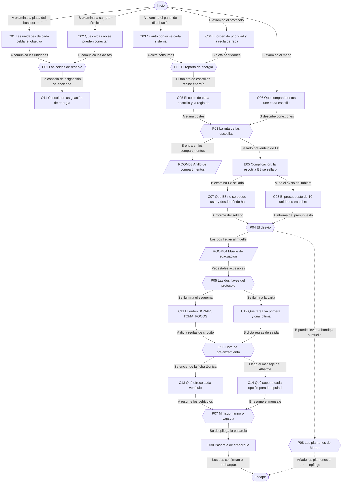
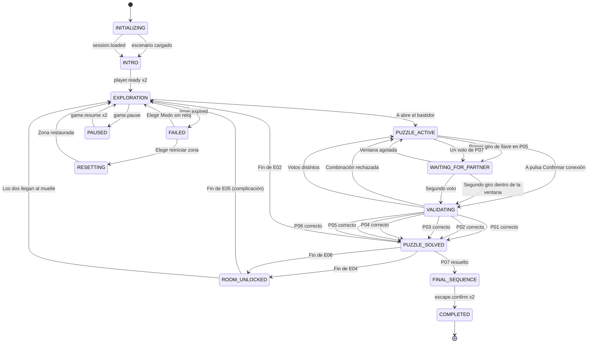

# ER07 · La estación submarina

La estación de investigación Abisal-3 ha entrado en modo seguro tras un fallo en su celda principal. La tripulación ya está a salvo en el buque de superficie y solo quedan dos visitantes. A supervisa el módulo de energía y B maneja la navegación y el mapa de compartimentos. Con la energía de reserva justa, deben repartirla, abrir una ruta hasta el muelle, activar el protocolo de evacuación y elegir cómo salir.

## A. Ficha técnica

| Campo | Valor |
|---|---|
| ID | ER07 |
| Nombre | La estación submarina |
| Versión | 1.0.0 |
| Género | Ciencia ficción técnica |
| Sinopsis | La estación de investigación Abisal-3 ha entrado en modo seguro tras un fallo en su celda principal. La tripulación ya está a salvo en el buque de superficie y solo quedan dos visitantes. A supervisa el módulo de energía y B maneja la navegación y el mapa de compartimentos. Con la energía de reserva justa, deben repartirla, abrir una ruta hasta el muelle, activar el protocolo de evacuación y elegir cómo salir. |
| Objetivo principal | OBJ01 Conectar la reserva de energía y repartirla según el protocolo EVAC-3; OBJ02 Abrir una ruta de escotillas hasta el Muelle de evacuación; OBJ03 Activar el protocolo de evacuación y completar el prelanzamiento; OBJ04 Elegir vehículo y embarcar juntos |
| Objetivos secundarios | OBJ05 Llevar los plantones de hidroponía en la caja estanca |
| Jugadores | 2 (A: Supervisor del módulo de energía; B: Navegante con el mapa de compartimentos) |
| Duración estimada | 55 min (despertar 5, descubrimiento 14, complicación 16, clímax 14, escape 6) |
| Dificultad | Media |
| Zonas | 4 |
| Acertijos | 7 principales y 1 microacertijos |
| Objetos interactivos | 23 (más 12 decorativos) |
| Finales | 4 |
| Competencias | Gestión de recursos limitados, Priorización de tareas, Comunicación técnica precisa, Lectura de mapas y rutas, Coordinación en tiempo real, Toma de decisiones compartida |
| Condiciones iniciales | A empieza en el Módulo de energía con el bastidor de celdas, el panel de distribución y el tablero de escotillas. B empieza en el Puente de navegación con la consola de cámaras, la carpeta del protocolo y el mapa de compartimentos. Las escotillas interiores están cerradas y la estación funciona con luz de emergencia. El soporte vital está garantizado en todo momento. La llamada de voz está abierta; en la ficción, hablan por el intercomunicador de la estación. |
| Condición de victoria | Completar OBJ01, OBJ02, OBJ03, OBJ04 |
| Condición de fallo | 55 min de cuenta atrás: La reserva entra en modo de espera: CORAL mantiene el soporte vital y las luces, y ofrece seguir en Modo sin reloj o reiniciar la zona actual. No se pierde ningún acertijo resuelto. |
| Condición de reinicio | Cualquiera de los dos pulsa Reiniciar zona y el otro lo confirma; también se ofrece al agotarse el reloj. El reinicio completo vuelve al estado inicial y a la intro. |

## B. Guion narrativo

**1. Introducción cinematográfica.** Plano exterior lento: una estación en forma de anillo descansa sobre el fondo marino, iluminada por peces linterna. Un letrero en el casco dice ABISAL-3. Dentro, las luces blancas parpadean y pasan a un tono ámbar tranquilo. Una voz serena anuncia: Modo seguro activado. Soporte vital estable. La cámara recorre un pasillo con escotillas cerradas hasta dos salas separadas por varios compartimentos.

**2. Por qué están aquí.** La pareja participa en una noche de divulgación científica en Abisal-3. La tripulación subió al buque Albatros en el relevo de la tarde y la pareja esperaba la lanzadera de la mañana. De madrugada, la celda de marea principal se detiene por un fallo y la estación entra en modo seguro: la lanzadera no puede acoplarse hasta que el muelle tenga energía.

**3. Situación inicial.** A se ha quedado en el Módulo de energía, donde estaba viendo los paneles, y B en el Puente de navegación. Las escotillas interiores se han cerrado por protocolo. CORAL, la voz de asistencia de la estación, explica que la reserva de baterías está desconectada y que, con ella, se puede activar el protocolo de evacuación EVAC-3 y salir en uno de los vehículos del muelle.

**4. Objetivo.** Conectar la reserva justa, repartir la energía por prioridades, abrir una ruta de escotillas hasta el Muelle de evacuación, activar el protocolo con las dos llaves, completar el prelanzamiento y elegir juntos entre el minisubmarino y la cápsula.

**5. Primer descubrimiento.** A lee en la placa del bastidor cuántas unidades da cada celda y cuántas necesita el protocolo. B, en la consola de cámaras, ve que dos celdas tienen la carcasa caliente. Ninguno puede conectar la reserva sin lo que ve el otro.

**6. Progresión de los acontecimientos.**

- Con la reserva conectada, la consola de asignación del puente se enciende: B tiene el orden de prioridades del protocolo y A sabe cuánto consume cada sistema.
- Los sistemas esenciales vuelven; la iluminación de pasillos se queda fuera del reparto y los compartimentos quedan con tiras fosforescentes.
- El tablero de escotillas de A muestra el coste de cada escotilla y el mapa de B muestra cómo se conectan los compartimentos. Programan la ruta más barata y B entra en los compartimentos.
- Cuando B llega a Hidroponía, la última escotilla de la ruta se sella por precaución. El tablero de A no lo detecta y el control remoto se bloquea: B introduce un desvío en el panel local.
- En el muelle, cada llave del protocolo tiene escrito el dato que necesita la otra. Las giran a la vez.
- El prelanzamiento exige ordenar cinco tareas con las reglas de circuitos de A y la carta de salida de B.
- Con los dos vehículos listos, la pareja decide si sale en el minisubmarino con el archivo de muestras o en la cápsula directa a la superficie.

**7. Obstáculos narrativos.**

- Dos celdas de reserva tienen la carcasa caliente y solo se ve en la cámara térmica del puente.
- La energía no llega para todo: hay que dejar fuera algunos sistemas.
- La escotilla final de la ruta se sella mientras B está en Hidroponía y el tablero de A sigue mostrándola disponible.
- Las llaves del protocolo tienen el dato cruzado: cada una dice lo que necesita la otra.

**8. Revelaciones.**

- La celda de marea no se averió sola: la ingeniera Maren Ibarra la dejó en mantenimiento programado y el relevo se adelantó, así que nadie la reconectó.
- CORAL selló la escotilla de Hidroponía por condensación en la junta: una medida preventiva, no un peligro.
- El archivo de muestras de dos años está guardado en la bodega del minisubmarino, por si alguien decide llevárselo.

**9. Clímax.** Con el protocolo activado y el prelanzamiento completo, los dos vehículos esperan en sus cunas. A lee la ficha técnica y B el mensaje del Albatros. Votan a la vez sin ver el voto del otro.

**10. Escena de escape.** La pasarela de embarque se despliega con luz azul. Los dos suben al vehículo elegido, se sientan uno junto al otro y confirman la salida. La grúa suelta la cuna con suavidad y el vehículo se aleja del muelle mientras las luces de Abisal-3 pasan a modo de espera.

**11. Epílogo.** Desde la ventanilla ven el anillo de la estación iluminado por los peces linterna. La voz de Maren Ibarra llega por la radio: Gracias por cuidar de mi estación. Mañana vuelvo a encender la celda; la próxima visita, os la enseño con todas las luces.

### Diálogos y textos del sistema

Cada línea es un subtítulo. Las líneas de canal `document` quedan además guardadas en el registro de pistas.

| ID | Quién | Texto | Cuándo | Para | Canal |
|---|---|---|---|---|---|
| D01 | CORAL | Buenas noches. Soy CORAL, el asistente de Abisal-3. La estación está en modo seguro. El soporte vital funciona y no corren ningún peligro. | START | Ambos | audio_subtitled |
| D02 | CORAL | Para salir hay que activar el protocolo de evacuación. Necesito energía de la reserva y una ruta hasta el muelle. | START | Ambos | audio_subtitled |
| D03 | Maren Ibarra (diario) | Diario de la ingeniera jefa. Dejo la celda de marea en mantenimiento hasta mañana. Si alguien necesita la reserva, que mire la placa del bastidor y no conecte nada caliente. | E01 | Jugador A | audio_subtitled |
| D04 | Maren Ibarra (diario) | La cámara térmica del bastidor se ve desde el puente. Siempre lo hacemos en pareja: uno mira, otro conecta. | E01 | Jugador A | audio_subtitled |
| D05 | Narrador | Estás en el puente. Por el ventanal pasan peces linterna. La escotilla hacia los compartimentos está cerrada. | START | Jugador B | subtitle |
| D06 | Narrador | Estás en el módulo de energía. Seis celdas esperan en su bastidor. Tu pareja está en el puente, al otro lado del anillo. | START | Jugador A | subtitle |
| D07 | CORAL | Reserva conectada: 48 unidades. La consola de asignación del puente está lista. | E02 | Ambos | audio_subtitled |
| D08 | CORAL | Reparto firmado. La iluminación de pasillos queda en reserva; sigan las tiras del suelo. | E03 | Ambos | audio_subtitled |
| D09 | CORAL | Tablero de escotillas en línea. Programen una sola ruta: la de menor coste. | E03 | Jugador A | audio_subtitled |
| D10 | Sistema | Ruta programada. Las escotillas se abren. | E04 | Ambos | popup |
| D11 | CORAL | Aviso tranquilo: detecto condensación en la junta de la escotilla de Hidroponía. La sello por precaución. | E05 | Ambos | audio_subtitled |
| D12 | CORAL | He reiniciado el circuito de esclusas: vuelve a tener 10 unidades. El control remoto queda bloqueado; usen el panel local. | E05 | Ambos | document |
| D13 | Narrador | La escotilla del muelle se cierra delante de ti con un golpe sordo. Las bandas diagonales se encienden. Las que cruzaste también se han cerrado. | E05 | Jugador B | subtitle |
| D14 | Sistema | Desvío aceptado. El ascensor de servicio baja al muelle. | E06 | Ambos | popup |
| D15 | CORAL | Bienvenidos al muelle. El protocolo exige dos llaves giradas a la vez. Lean las placas: cada una habla del otro pedestal. | E06 | Ambos | audio_subtitled |
| D16 | Sistema | Demasiado separado. Cuenten juntos y giren a la vez. | P05 | Ambos | popup |
| D17 | CORAL | Protocolo EVAC-3 activado. Coloco los vehículos en sus cunas. Falta el prelanzamiento. | E07 | Ambos | audio_subtitled |
| D18 | CORAL | Prelanzamiento completo. Los dos vehículos están listos y son igual de seguros. La elección es suya. | E08 | Ambos | audio_subtitled |
| D19 | Nuria Sol (radio del Albatros) | Aquí el Albatros. Os vemos en el sonar. Tomaos el tiempo que necesitéis. | E08 | Ambos | audio_subtitled |
| D20 | Sistema | Han votado distinto. Cuéntense lo que han leído y voten otra vez. | P07 | Ambos | popup |
| D21 | CORAL | Pasarela desplegada. Ha sido un placer. Dejo la estación en espera hasta que vuelva la tripulación. | E09 | Ambos | audio_subtitled |
| D22 | CORAL | Si necesitan una pista, pídanmela. Mientras tanto, cuéntense lo que ve cada uno. | E10 | Ambos | audio_subtitled |
| D23 | CORAL | La reserva entra en modo de espera. El soporte vital sigue activo. ¿Continuamos sin reloj o reinicio la zona? | E11 | Ambos | popup |
| D24 | Narrador | La caja estanca se cierra. Los plantones de Maren viajarán con ustedes. | E12 | Ambos | subtitle |

## C. Escenografía y planos

Coordenadas en metros con origen en la esquina suroeste del suelo de cada zona: `x` hacia el este, `y` hacia arriba, `z` hacia el norte.

### ROOM01 · Módulo de energía

Sala técnica rectangular con el bastidor de seis celdas de reserva, un panel de distribución con ocho sistemas, el tablero de escotillas y un ojo de buey hacia el fondo marino. Luz ámbar de emergencia.

**Medidas:** 8 × 6 m, altura 3.2 m. **Acceso:** A sí, B no. **Se abre:** desde el inicio.

**Qué ve cada jugador.** A: Todo el módulo: celdas, placa, panel de distribución, tablero de escotillas y terminal. No ve el puente ni los compartimentos.. B: No lo ve; solo oye a A por el intercomunicador y puede pedirle que lea los paneles.

**Distribución.** Bastidor de celdas en la pared oeste con su placa a la izquierda. Panel de distribución en la pared norte, centro. Tablero de escotillas en la pared este. Terminal de registro de la ingeniera en una mesa al sureste. Ojo de buey en la pared sur, a la izquierda. Puerta del ascensor de servicio en la pared sur, a la derecha. Conductos en el techo y taquilla en la esquina sureste.

| ID | Elemento | Tipo o pared | Posición (x, y, z) | Notas |
|---|---|---|---|---|
| DOOR01 | Puerta a Muelle de evacuación | pared south | (6.5, 0, 0) | Se abre con P04_SOLVED |
| — | Ventana | pared south | (2, 1.6, 0) | Ojo de buey con peces linterna; decorativo |
| O01 | Bastidor de celdas de reserva | 8 Mecanismo cooperativo | (0.4, 0, 3) | Armario metálico con seis celdas numeradas del 1 al 6 en grande; cada una tiene un interruptor con las posiciones CONECTADA y SUELTA y un botón Confirmar conexión |
| O02 | Placa del bastidor | 2 Examinar | (0.1, 1.5, 1.6) | Placa grabada junto al bastidor con una tabla de seis filas y una regla en letra grande |
| O03 | Panel de distribución | 2 Examinar | (4, 1.4, 5.9) | Panel ancho con ocho sistemas, cada uno con su icono, su nombre y su consumo en unidades en una ventanilla |
| O04 | Tablero de escotillas | 8 Mecanismo cooperativo | (7.9, 1.4, 3) | Pantalla vertical con la lista de escotillas E1 a E9, su coste, su estado según los sensores y un teclado para programar rutas |
| O05 | Terminal de registro de la ingeniera | 9 Elemento narrativo | (5.5, 0.9, 1.2) | Portátil reforzado sobre la mesa con una pegatina: Diario de Maren Ibarra |
| O06 | Conductos de refrigeración | 1 Decorativo | (4, 2.9, 3) | Tubos plateados con etiquetas de mantenimiento recorriendo el techo |
| O07 | Taquilla de visitantes | 1 Decorativo | (7.4, 0, 0.5) | Taquilla abierta con dos chaquetas de la estación y un termo con una pegatina de un pulpo sonriente |
| O08 | Ojo de buey | 1 Decorativo | (2, 1.6, 0.05) | Ventana redonda con remaches; fuera pasan peces linterna |

| Luz | Tipo | Posición | Color | Intensidad | Uso |
|---|---|---|---|---|---|
| L01 | Plafones de emergencia | (4, 3.1, 3) | #FFB347 | 0.45 | Luz ámbar continua desde el inicio; nunca parpadea tras la intro |
| L02 | Retroiluminación de paneles | (4, 1.4, 5.8) | #9FE8FF | 0.3 | El panel de distribución y el tablero se iluminan al recibir energía |
| L03 | Indicadores del bastidor | (0.4, 1.2, 3) | #B8FFB0 | 0.2 | Cada celda conectada muestra un círculo encendido y la palabra CONECTADA |

**Sonido ambiente:** Zumbido bajo de máquinas y goteo lejano de condensación. **Música:** Pads electrónicos lentos con un pulso suave, en tono menor amable.

**Cambios dinámicos:**

- E02: El bastidor zumba bajo; los plafones pasan de ámbar a blanco cálido y la retroiluminación del panel se enciende
- E03: El tablero de escotillas se enciende con la tabla de costes
- E05: El tablero muestra el aviso de sellado preventivo y el candado de control remoto
- E06: La puerta del ascensor de servicio se abre hacia el muelle

**Para el motor:** Escena independiente para A. Los paneles son superficies de interfaz en el mundo (canvas de UI o render-to-texture) que se abren a pantalla completa al examinarlos. El bastidor tiene seis interruptores con estado propio sincronizado por el servidor. Las celdas se identifican por número, no por color. El tablero de escotillas es la entrada de P03 y cambia de estado a REMOTE_LOCKED tras E05.

### ROOM02 · Puente de navegación

Sala de mando con un gran ventanal al fondo marino, la consola de cámaras, la consola de asignación de energía, el mapa de compartimentos en la pared y la carpeta del protocolo EVAC-3.

**Medidas:** 7 × 6 m, altura 3 m. **Acceso:** A no, B sí. **Se abre:** desde el inicio.

**Qué ve cada jugador.** A: No lo ve; solo oye a B por el intercomunicador. B: Todo el puente: cámaras, protocolo, consola de asignación y mapa.

**Distribución.** Ventanal panorámico en la pared norte. Consola de cámaras bajo el ventanal, a la izquierda; consola de asignación en el centro, bajo el ventanal. Sillón del piloto en el centro. Carpeta del protocolo en el atril central. Mapa de compartimentos en la pared este. Mesa de cartas náuticas al suroeste. Escotilla hacia los compartimentos en la pared este, al sur del mapa.

| ID | Elemento | Tipo o pared | Posición (x, y, z) | Notas |
|---|---|---|---|---|
| DOOR02 | Puerta a Anillo de compartimentos | pared east | (7, 0, 1.5) | Se abre con P03_SOLVED |
| — | Ventana | pared north | (3.5, 1.5, 6) | Ventanal con fondo marino y peces linterna; no interactivo |
| O09 | Consola de cámaras | 2 Examinar | (1.5, 1, 5.6) | Pantalla con cuatro cámaras; la cámara térmica del módulo de energía muestra el bastidor con las celdas numeradas |
| O10 | Carpeta del protocolo EVAC-3 | 2 Examinar | (3.5, 0.9, 2.5) | Carpeta naranja sobre el atril central con la portada EVAC-3, Reparto de energía de reserva |
| O11 | Consola de asignación de energía | 8 Mecanismo cooperativo | (3.5, 1, 5.5) | Consola con ocho interruptores de sistema, cada uno con icono y nombre, y un botón Firmar reparto; arriba, un contador de unidades libres |
| O12 | Mapa de compartimentos | 2 Examinar | (6.9, 1.6, 3.5) | Mapa iluminado del sector con el Puente, cinco compartimentos y el Muelle unidos por líneas con los números de escotilla |
| O13 | Sillón del piloto | 1 Decorativo | (3.5, 0, 4) | Sillón giratorio con reposabrazos acolchados |
| O14 | Ventanal panorámico | 1 Decorativo | (3.5, 1.5, 5.95) | Cristal curvo con el fondo marino; de vez en cuando pasa una raya despacio |
| O15 | Mesa de cartas náuticas | 1 Decorativo | (1.2, 0, 1.5) | Mesa inclinada con cartas del fondo marino y un compás de puntas |

| Luz | Tipo | Posición | Color | Intensidad | Uso |
|---|---|---|---|---|---|
| L04 | Luz de consola | (3.5, 1.2, 5.5) | #7FD4FF | 0.35 | Ilumina las consolas; suficiente para leer |
| L05 | Luz exterior del ventanal | (3.5, 2.5, 5.9) | #2E6FA8 | 0.2 | Reflejo azul del agua; ondula suavemente |
| L06 | Tiras fosforescentes del suelo | (3.5, 0.05, 3) | #C8FFB0 | 0.15 | Se vuelven la guía principal tras E03, cuando la iluminación de pasillos queda fuera del reparto |

**Sonido ambiente:** Pitidos suaves de consolas y el murmullo del agua contra el ventanal. **Música:** Pads electrónicos lentos con un pulso suave, en tono menor amable.

**Cambios dinámicos:**

- E02: La consola de asignación se enciende con los ocho interruptores de sistema
- E03: Los plafones del techo se apagan y quedan la luz de consolas y las tiras fosforescentes
- E04: La escotilla este se abre y B pasa a los compartimentos

**Para el motor:** Escena independiente para B. La consola de cámaras muestra una imagen térmica estilizada del bastidor de A con números grandes y patrones (liso o rayas diagonales con triángulo), nunca solo color. P03 pertenece a esta zona porque la ruta se planifica con el mapa del puente, aunque la entrada la haga A en su tablero.

### ROOM03 · Anillo de compartimentos

Sector del anillo con cinco compartimentos unidos por escotillas numeradas: Comedor, Laboratorio, Hidroponía, Almacén y Enfermería. Con la iluminación de pasillos fuera del reparto, solo brillan las tiras fosforescentes y las luces de cultivo de Hidroponía.

**Medidas:** 16 × 10 m, altura 3 m. **Acceso:** A no, B sí. **Se abre:** P03_SOLVED.

**Qué ve cada jugador.** A: Solo el esquema del tablero: escotillas E1 a E9 con su coste y su estado según los sensores; no ve los compartimentos. B: Los compartimentos, las escotillas con su número pintado y su estado real.

**Distribución.** Comedor al noroeste y Laboratorio al suroeste, junto a las escotillas que vienen del puente (pared oeste). Hidroponía en la franja central, de oeste a este, con el panel local de escotillas y la bandeja de plantones. Almacén al noreste y Enfermería al sureste. En la pared este, tres escotillas al muelle: E7 desde el Almacén (norte), E8 desde Hidroponía (centro) y E9 desde la Enfermería (sur).

| ID | Elemento | Tipo o pared | Posición (x, y, z) | Notas |
|---|---|---|---|---|
| DOOR03 | Puerta a Puente de navegación | pared west | (0, 0, 2.5) | Se abre con P03_SOLVED |
| DOOR04 | Puerta a Muelle de evacuación | pared east | (16, 0, 1.5) | Se abre con P04_SOLVED |
| O16 | Escotilla E8 | 2 Examinar | (15.8, 0, 5) | Escotilla redonda con el número E8 en pintura luminosa; tras el sellado muestra bandas diagonales, un candado grande y el texto SELLADA |
| O17 | Panel local de escotillas | 8 Mecanismo cooperativo | (9, 1.2, 5.8) | Panel de pared en Hidroponía con nueve teclas E1 a E9 y un botón Abrir ruta |
| O18 | Bandeja de plantones | 3 Recoger | (8, 1, 4.3) | Bandeja de cultivo con doce plantones de lechuga marina bajo una tapa transparente y una etiqueta atada |
| O19 | Mesas del comedor | 1 Decorativo | (2.5, 0, 7.5) | Mesas plegables con bandejas recogidas y un tablero de ajedrez a medias |
| O20 | Cultivos hidropónicos | 1 Decorativo | (6.5, 0, 5.5) | Torres de cultivo con hojas verdes bajo luz violeta |
| O21 | Estanterías del almacén | 1 Decorativo | (13.5, 0, 8.5) | Estanterías con cajas etiquetadas: Repuestos, Filtros, Mantas |
| O22 | Sala de descanso de la enfermería | 1 Decorativo | (13.5, 0, 1.5) | Dos sillones reclinables con mantas dobladas y un botiquín cerrado en la pared |

| Luz | Tipo | Posición | Color | Intensidad | Uso |
|---|---|---|---|---|---|
| L07 | Tiras fosforescentes | (8, 0.05, 5) | #C8FFB0 | 0.18 | Marcan los pasillos; cada escotilla tiene su número en pintura luminosa |
| L08 | Luces de cultivo de Hidroponía | (8, 2.6, 5) | #E8B0FF | 0.4 | Las únicas luces de techo encendidas; tienen batería propia |
| L09 | Baliza de escotilla sellada | (15.8, 2.2, 5) | #FFD34D | 0.5 | Se enciende fija en E05 sobre E8, con el texto SELLADA y bandas diagonales |

**Sonido ambiente:** Silencio acolchado, ventilación lenta y burbujeo de los cultivos. **Música:** Dos llaves que giran a la vez y un acorde de confirmación.

**Cambios dinámicos:**

- E04: Se abren en orden las escotillas de la ruta programada y B avanza hasta Hidroponía
- E05: La escotilla E8 se sella con un golpe sordo; se enciende la baliza fija y se cierran las escotillas abiertas detrás de B
- E06: Se abren las escotillas del desvío y se ilumina la salida al muelle

**Para el motor:** Escena cargada al resolver P03. Los compartimentos son subzonas de una misma escena con triggers de paso por cada escotilla. Las escotillas son objetos animados con estados CERRADA, ABIERTA y SELLADA mostrados con texto y forma (candado, bandas) además del color. B no puede volver al puente durante E05 para evitar estados ambiguos.

### ROOM04 · Muelle de evacuación

Hangar alto con dos cunas: el minisubmarino Tamboril y la cápsula Boya-7. Dos llaves del protocolo en pedestales opuestos, la consola de prelanzamiento, los paneles del muelle y una pasarela de embarque plegada.

**Medidas:** 14 × 10 m, altura 5 m. **Acceso:** A sí, B sí. **Se abre:** P04_SOLVED.

**Qué ve cada jugador.** A: Todo el muelle, pero desde su pedestal la carta de salida queda lejos y en penumbra hasta que B la lee. B: Todo el muelle, pero desde su pedestal el esquema de circuitos queda lejos y en penumbra hasta que A lo lee.

**Distribución.** Llegada de B por la escotilla oeste-sur desde los compartimentos y de A por el ascensor de servicio en la pared oeste. Llave de energía en un pedestal al oeste; llave de navegación al este, a 10 m. Consola de prelanzamiento al sureste. Esquema de circuitos en la pared oeste y carta de salida en la pared este. Ficha técnica al suroeste y mensaje del Albatros al sureste, en pantallas que se encienden al final. Cunas al norte: minisubmarino a la izquierda, cápsula a la derecha. Pasarela de embarque entre ambas. Caja estanca en el centro. Grúa en el techo, al norte.

| ID | Elemento | Tipo o pared | Posición (x, y, z) | Notas |
|---|---|---|---|---|
| DOOR05 | Puerta a Anillo de compartimentos | pared west | (0, 0, 1.5) | Se abre con P04_SOLVED |
| DOOR06 | Puerta a Módulo de energía | pared west | (0, 0, 6.5) | Se abre con P04_SOLVED |
| DOOR07 | Puerta de salida | pared north | (7, 0, 10) | Se abre con P07_SOLVED |
| — | Ventana | pared north | (7, 3.5, 10) | Compuerta exterior del muelle con un visor; se ve el agua azul oscura |
| O23 | Llave de energía | 8 Mecanismo cooperativo | (2, 1.1, 5) | Pedestal oeste con una llave grande, un selector de cuatro posiciones numeradas del 1 al 4 y una placa grabada |
| O24 | Llave de navegación | 8 Mecanismo cooperativo | (12, 1.1, 5) | Pedestal este con una llave grande, un selector de cuatro posiciones numeradas del 1 al 4 y una placa grabada |
| O25 | Consola de prelanzamiento | 8 Mecanismo cooperativo | (9, 1, 2) | Consola con cinco botones grandes, cada uno con icono y nombre: BALIZA, SONAR, TOMA, FOCOS, ESCOTILLA, y una casilla de orden encima |
| O26 | Esquema de circuitos del muelle | 2 Examinar | (0.1, 1.6, 3) | Panel en la pared oeste con el esquema de la toma de carga, el sonar del vehículo y los focos de salida |
| O27 | Carta de salida del muelle | 2 Examinar | (13.9, 1.6, 3) | Panel en la pared este con la maniobra de salida, la baliza y la escotilla interior |
| O28 | Ficha técnica de los vehículos | 2 Examinar | (3, 1.2, 1) | Pantalla al suroeste con los dibujos del minisubmarino y de la cápsula y sus datos |
| O29 | Mensaje del buque Albatros | 2 Examinar | (11, 1.2, 1) | Pantalla de radio al sureste con un mensaje escrito y una carta de superficie |
| O30 | Pasarela de embarque | 10 Objeto de salida | (7, 0, 8) | Pasarela plegada entre las dos cunas con barandillas y luces azules en el suelo |
| O31 | Minisubmarino Tamboril | 9 Elemento narrativo | (4.5, 0, 8.5) | Vehículo amarillo y redondeado de dos plazas, con una bodega bajo los asientos y el nombre Tamboril en el casco |
| O32 | Cápsula Boya-7 | 9 Elemento narrativo | (9.5, 0, 8.5) | Cápsula blanca vertical de dos plazas con franjas reflectantes y el rótulo Boya-7 |
| O33 | Caja estanca de muestras | 5 Combinar | (7, 0.5, 4) | Caja de transporte con asa, cierre de palanca y el rótulo Muestras vivas |
| O34 | Grúa del muelle | 1 Decorativo | (7, 4.5, 9) | Grúa de techo con brazo articulado y luces de posición |
| O35 | Redes y boyas de repuesto | 1 Decorativo | (12.5, 1, 9.8) | Rollos de red y boyas naranjas colgados en la pared norte |

| Luz | Tipo | Posición | Color | Intensidad | Uso |
|---|---|---|---|---|---|
| L10 | Focos de techo del muelle | (7, 4.8, 5) | #FFFFFF | 0.3 | Tenues hasta E07; con el protocolo activo suben a 0,8 |
| L11 | Luces de los pedestales de llave | (7, 1.2, 5) | #FFD34D | 0.4 | Un anillo luminoso alrededor de cada llave se llena mientras dura la ventana de sincronía |
| L12 | Focos de salida | (7, 3, 9.8) | #9FE8FF | 0.6 | Se encienden en el prelanzamiento, tras la tarea FOCOS |

**Sonido ambiente:** Hangar amplio con eco suave y cables de la grúa crujiendo. **Música:** Tema final: piano y cuerdas ascendentes, esperanzador.

**Cambios dinámicos:**

- E07: Los focos del techo suben, la grúa coloca los dos vehículos en sus cunas y se encienden el esquema de circuitos y la carta de salida
- E08: Los focos de salida iluminan la compuerta y se encienden la ficha técnica y el mensaje del Albatros
- E09: La pasarela se despliega hacia el vehículo elegido y la compuerta exterior pasa a verde con el texto LISTA

**Para el motor:** Escena compartida: los dos avatares están presentes. Las llaves están a 10 m para que no se puedan girar las dos desde un mismo punto; cada pedestal solo responde a su jugador. La ventana de sincronía se mide con la hora del servidor. Los vehículos son modelos con animación de cuna y no requieren física de agua: la salida es una cinemática.

## D. Inventario de objetos

| object_id | Nombre | Descripción visual | Zona | Posición | Tipo | Estado inicial | Acción | Activación | Resultado | Pista | Acertijo | Jugador | Estado final |
|---|---|---|---|---|---|---|---|---|---|---|---|---|---|
| O01 | Bastidor de celdas de reserva | Armario metálico con seis celdas numeradas del 1 al 6 en grande; cada una tiene un interruptor con las posiciones CONECTADA y SUELTA y un botón Confirmar conexión | ROOM01 | (0.4, 0, 3) | 8 Mecanismo cooperativo | DISCONNECTED | Poner interruptores en CONECTADA y pulsar Confirmar conexión | — | Si las celdas suman 48 unidades y ninguna tiene aviso, la reserva se conecta; si no, todos los interruptores vuelven a SUELTA | — | P01 | Jugador A | CONNECTED |
| O02 | Placa del bastidor | Placa grabada junto al bastidor con una tabla de seis filas y una regla en letra grande | ROOM01 | (0.1, 1.5, 1.6) | 2 Examinar | DEFAULT | Examinar | — | Abre la placa a pantalla completa y guarda la pista C01 | C01 | P01 | Jugador A | EXAMINED |
| O03 | Panel de distribución | Panel ancho con ocho sistemas, cada uno con su icono, su nombre y su consumo en unidades en una ventanilla | ROOM01 | (4, 1.4, 5.9) | 2 Examinar | DEFAULT | Examinar | — | Guarda la pista C03 | C03 | P02 | Jugador A | EXAMINED |
| O04 | Tablero de escotillas | Pantalla vertical con la lista de escotillas E1 a E9, su coste, su estado según los sensores y un teclado para programar rutas | ROOM01 | (7.9, 1.4, 3) | 8 Mecanismo cooperativo | OFFLINE | Examinar y programar una ruta de escotillas en orden | P02_SOLVED | Con energía muestra C05 y acepta una ruta; tras el sellado muestra C08 y bloquea el control remoto | C05 | P03 | Jugador A | REMOTE_LOCKED |
| O05 | Terminal de registro de la ingeniera | Portátil reforzado sobre la mesa con una pegatina: Diario de Maren Ibarra | ROOM01 | (5.5, 0.9, 1.2) | 9 Elemento narrativo | STANDBY | Reproducir el diario | — | Reproduce los diálogos D03 y D04 y los guarda en el historial; también es la voz de las ayudas de CORAL | — | — | Jugador A | PLAYED |
| O06 | Conductos de refrigeración | Tubos plateados con etiquetas de mantenimiento recorriendo el techo | ROOM01 | (4, 2.9, 3) | 1 Decorativo | STATIC | none | — | Sin interacción | — | — | Nadie | STATIC |
| O07 | Taquilla de visitantes | Taquilla abierta con dos chaquetas de la estación y un termo con una pegatina de un pulpo sonriente | ROOM01 | (7.4, 0, 0.5) | 1 Decorativo | STATIC | none | — | Sin interacción | — | — | Nadie | STATIC |
| O08 | Ojo de buey | Ventana redonda con remaches; fuera pasan peces linterna | ROOM01 | (2, 1.6, 0.05) | 1 Decorativo | STATIC | none | — | Sin interacción | — | — | Nadie | STATIC |
| O09 | Consola de cámaras | Pantalla con cuatro cámaras; la cámara térmica del módulo de energía muestra el bastidor con las celdas numeradas | ROOM02 | (1.5, 1, 5.6) | 2 Examinar | DEFAULT | Examinar la cámara térmica | — | Guarda la pista C02; la imagen se actualiza en directo | C02 | P01 | Jugador B | EXAMINED |
| O10 | Carpeta del protocolo EVAC-3 | Carpeta naranja sobre el atril central con la portada EVAC-3, Reparto de energía de reserva | ROOM02 | (3.5, 0.9, 2.5) | 2 Examinar | DEFAULT | Examinar | — | Guarda la pista C04 | C04 | P02 | Jugador B | EXAMINED |
| O11 | Consola de asignación de energía | Consola con ocho interruptores de sistema, cada uno con icono y nombre, y un botón Firmar reparto; arriba, un contador de unidades libres | ROOM02 | (3.5, 1, 5.5) | 8 Mecanismo cooperativo | LOCKED | Activar sistemas y pulsar Firmar reparto | P01_SOLVED | Si el reparto cumple el protocolo, los sistemas elegidos reciben energía | — | P02 | Jugador B | ASSIGNED |
| O12 | Mapa de compartimentos | Mapa iluminado del sector con el Puente, cinco compartimentos y el Muelle unidos por líneas con los números de escotilla | ROOM02 | (6.9, 1.6, 3.5) | 2 Examinar | DEFAULT | Examinar | — | Guarda la pista C06 | C06 | P03 | Jugador B | EXAMINED |
| O13 | Sillón del piloto | Sillón giratorio con reposabrazos acolchados | ROOM02 | (3.5, 0, 4) | 1 Decorativo | STATIC | none | — | Sin interacción | — | — | Nadie | STATIC |
| O14 | Ventanal panorámico | Cristal curvo con el fondo marino; de vez en cuando pasa una raya despacio | ROOM02 | (3.5, 1.5, 5.95) | 1 Decorativo | STATIC | none | — | Sin interacción | — | — | Nadie | STATIC |
| O15 | Mesa de cartas náuticas | Mesa inclinada con cartas del fondo marino y un compás de puntas | ROOM02 | (1.2, 0, 1.5) | 1 Decorativo | STATIC | none | — | Sin interacción | — | — | Nadie | STATIC |
| O16 | Escotilla E8 | Escotilla redonda con el número E8 en pintura luminosa; tras el sellado muestra bandas diagonales, un candado grande y el texto SELLADA | ROOM03 | (15.8, 0, 5) | 2 Examinar | PROGRAMMED | Examinar | — | Tras E05 está sellada; examinarla guarda la pista C07 | C07 | P04 | Jugador B | SEALED |
| O17 | Panel local de escotillas | Panel de pared en Hidroponía con nueve teclas E1 a E9 y un botón Abrir ruta | ROOM03 | (9, 1.2, 5.8) | 8 Mecanismo cooperativo | IDLE | Marcar escotillas en orden y pulsar Abrir ruta | P03_SOLVED | Si la ruta es la de menor coste posible y no supera 10 unidades, las escotillas se abren | — | P04 | Jugador B | ROUTED |
| O18 | Bandeja de plantones | Bandeja de cultivo con doce plantones de lechuga marina bajo una tapa transparente y una etiqueta atada | ROOM03 | (8, 1, 4.3) | 3 Recoger | FOUND | Recoger | — | Pasa al inventario de B y guarda la pista C15 | C15 | P08 | Jugador B | STORED |
| O19 | Mesas del comedor | Mesas plegables con bandejas recogidas y un tablero de ajedrez a medias | ROOM03 | (2.5, 0, 7.5) | 1 Decorativo | STATIC | none | — | Sin interacción | — | — | Nadie | STATIC |
| O20 | Cultivos hidropónicos | Torres de cultivo con hojas verdes bajo luz violeta | ROOM03 | (6.5, 0, 5.5) | 1 Decorativo | STATIC | none | — | Sin interacción | — | — | Nadie | STATIC |
| O21 | Estanterías del almacén | Estanterías con cajas etiquetadas: Repuestos, Filtros, Mantas | ROOM03 | (13.5, 0, 8.5) | 1 Decorativo | STATIC | none | — | Sin interacción | — | — | Nadie | STATIC |
| O22 | Sala de descanso de la enfermería | Dos sillones reclinables con mantas dobladas y un botiquín cerrado en la pared | ROOM03 | (13.5, 0, 1.5) | 1 Decorativo | STATIC | none | — | Sin interacción | — | — | Nadie | STATIC |
| O23 | Llave de energía | Pedestal oeste con una llave grande, un selector de cuatro posiciones numeradas del 1 al 4 y una placa grabada | ROOM04 | (2, 1.1, 5) | 8 Mecanismo cooperativo | LOCKED | Elegir posición del selector y girar la llave | — | Si las dos llaves giran dentro de la ventana con los selectores correctos, se activa el protocolo | C09 | P05 | Jugador A | TURNED |
| O24 | Llave de navegación | Pedestal este con una llave grande, un selector de cuatro posiciones numeradas del 1 al 4 y una placa grabada | ROOM04 | (12, 1.1, 5) | 8 Mecanismo cooperativo | LOCKED | Elegir posición del selector y girar la llave | — | Si las dos llaves giran dentro de la ventana con los selectores correctos, se activa el protocolo | C10 | P05 | Jugador B | TURNED |
| O25 | Consola de prelanzamiento | Consola con cinco botones grandes, cada uno con icono y nombre: BALIZA, SONAR, TOMA, FOCOS, ESCOTILLA, y una casilla de orden encima | ROOM04 | (9, 1, 2) | 8 Mecanismo cooperativo | LOCKED | Pulsar las cinco tareas en orden y confirmar | P05_SOLVED | Si el orden cumple todas las reglas, los dos vehículos quedan listos | — | P06 | Jugador B | DONE |
| O26 | Esquema de circuitos del muelle | Panel en la pared oeste con el esquema de la toma de carga, el sonar del vehículo y los focos de salida | ROOM04 | (0.1, 1.6, 3) | 2 Examinar | DARK | Examinar | P05_SOLVED | Con el protocolo activo se ilumina y guarda la pista C11 | C11 | P06 | Jugador A | LIT |
| O27 | Carta de salida del muelle | Panel en la pared este con la maniobra de salida, la baliza y la escotilla interior | ROOM04 | (13.9, 1.6, 3) | 2 Examinar | DARK | Examinar | P05_SOLVED | Con el protocolo activo se ilumina y guarda la pista C12 | C12 | P06 | Jugador B | LIT |
| O28 | Ficha técnica de los vehículos | Pantalla al suroeste con los dibujos del minisubmarino y de la cápsula y sus datos | ROOM04 | (3, 1.2, 1) | 2 Examinar | HIDDEN | Examinar | P06_SOLVED | Guarda la pista C13 | C13 | P07 | Jugador A | VISIBLE |
| O29 | Mensaje del buque Albatros | Pantalla de radio al sureste con un mensaje escrito y una carta de superficie | ROOM04 | (11, 1.2, 1) | 2 Examinar | HIDDEN | Examinar | P06_SOLVED | Guarda la pista C14 | C14 | P07 | Jugador B | VISIBLE |
| O30 | Pasarela de embarque | Pasarela plegada entre las dos cunas con barandillas y luces azules en el suelo | ROOM04 | (7, 0, 8) | 10 Objeto de salida | LOCKED | Embarcar | P07_SOLVED | Se despliega hacia el vehículo elegido; cada jugador confirma su embarque | — | — | Ambos | OPEN |
| O31 | Minisubmarino Tamboril | Vehículo amarillo y redondeado de dos plazas, con una bodega bajo los asientos y el nombre Tamboril en el casco | ROOM04 | (4.5, 0, 8.5) | 9 Elemento narrativo | DOCKED | Ver de cerca | — | Si se elige, abre su escotilla para el embarque | — | — | Ambos | BOARDING |
| O32 | Cápsula Boya-7 | Cápsula blanca vertical de dos plazas con franjas reflectantes y el rótulo Boya-7 | ROOM04 | (9.5, 0, 8.5) | 9 Elemento narrativo | DOCKED | Ver de cerca | — | Si se elige, abre su escotilla para el embarque | — | — | Ambos | BOARDING |
| O33 | Caja estanca de muestras | Caja de transporte con asa, cierre de palanca y el rótulo Muestras vivas | ROOM04 | (7, 0.5, 4) | 5 Combinar | EMPTY | Colocar objeto | P04_SOLVED | Con la bandeja de plantones dentro, la caja se cierra y viaja con la pareja | — | P08 | Jugador B | FILLED |
| O34 | Grúa del muelle | Grúa de techo con brazo articulado y luces de posición | ROOM04 | (7, 4.5, 9) | 1 Decorativo | STATIC | none | — | Sin interacción | — | — | Nadie | STATIC |
| O35 | Redes y boyas de repuesto | Rollos de red y boyas naranjas colgados en la pared norte | ROOM04 | (12.5, 1, 9.8) | 1 Decorativo | STATIC | none | — | Sin interacción | — | — | Nadie | STATIC |

## E. Pistas

| clue_id | Contenido exacto | Alternativa accesible | Ubicación | Descubrimiento | Quién | Acertijo | Revela | Depende de | Se habilita | Nivel | Descubierta cuando |
|---|---|---|---|---|---|---|---|---|---|---|---|
| C01 | Bastidor de reserva. Celda 1: 12 unidades. Celda 2: 20 unidades. Celda 3: 16 unidades. Celda 4: 8 unidades. Celda 5: 24 unidades. Celda 6: 28 unidades. El protocolo EVAC-3 necesita exactamente 48 unidades: conectar celdas hasta sumar 48, ni una más ni una menos. No conectar nunca una celda que la cámara térmica marque con aviso: el bastidor se desconectaría entero. | Tabla leída en voz y en texto grande: celda 1, 12; celda 2, 20; celda 3, 16; celda 4, 8; celda 5, 24; celda 6, 28. Objetivo: 48 exactas. Prohibido conectar celdas con aviso térmico. | O02 Placa del bastidor | A examina la placa junto al bastidor | Jugador A | P01 | Las unidades de cada celda, el objetivo de 48 y la prohibición de celdas con aviso | — | — | 0 | O02_EXAMINED |
| C02 | Cámara térmica del módulo de energía. Celda 1: patrón liso, ESTABLE. Celda 2: rayas diagonales con triángulo, AVISO: CARCASA CALIENTE. Celda 3: patrón liso, ESTABLE. Celda 4: patrón liso, ESTABLE. Celda 5: rayas diagonales con triángulo, AVISO: CARCASA CALIENTE. Celda 6: patrón liso, ESTABLE. | Lista en texto y voz: celdas 1, 3, 4 y 6 estables; celdas 2 y 5 con aviso de carcasa caliente. El aviso se marca con rayas diagonales y un triángulo, no solo con color. | O09 Consola de cámaras | B examina la cámara térmica en la consola de cámaras | Jugador B | P01 | Qué celdas no se pueden conectar | — | — | 0 | O09_EXAMINED |
| C03 | Panel de distribución. Consumo de cada sistema en unidades: Soporte vital 14. Esclusas y escotillas 10. Sonar de navegación 9. Baliza de superficie 5. Grúa del muelle 8. Iluminación de pasillos 6. Calefacción de camarotes 7. Laboratorio de muestras 12. | Ocho filas con icono, nombre y número: Soporte vital 14, Esclusas 10, Sonar 9, Baliza 5, Grúa 8, Iluminación 6, Calefacción 7, Laboratorio 12. | O03 Panel de distribución | A examina el panel de distribución | Jugador A | P02 | Cuánto consume cada sistema | — | — | 0 | O03_EXAMINED |
| C04 | Protocolo EVAC-3, reparto de energía de reserva. Encender los sistemas siguiendo este orden de prioridad: 1 Soporte vital. 2 Esclusas y escotillas. 3 Sonar de navegación. 4 Baliza de superficie. 5 Grúa del muelle. 6 Iluminación de pasillos. 7 Calefacción de camarotes. 8 Laboratorio de muestras. Si un sistema ya no cabe en la energía que queda, se salta y se sigue con el siguiente. Nunca se supera la energía conectada en el bastidor. | Lista numerada del 1 al 8 en texto grande con la regla: ir en orden, saltar lo que no quepa, no pasarse del total del bastidor. | O10 Carpeta del protocolo EVAC-3 | B examina la carpeta del protocolo | Jugador B | P02 | El orden de prioridad y la regla de reparto | — | — | 0 | O10_EXAMINED |
| C05 | Tablero de escotillas. Coste de apertura en unidades del circuito de esclusas: E1 2. E2 1. E3 3. E4 4. E5 2. E6 3. E7 4. E8 3. E9 5. Regla del circuito: programar una sola ruta desde el Puente hasta el Muelle, la de menor coste total. El circuito tiene 10 unidades y nunca puede gastar más. Las escotillas se programan en el orden en que se cruzan. | Tabla de nueve filas, de E1 a E9, con su coste: 2, 1, 3, 4, 2, 3, 4, 3, 5. Regla: ruta de menor coste, máximo 10, en orden de paso. | O04 Tablero de escotillas | A examina el tablero cuando recibe energía | Jugador A | P03 | El coste de cada escotilla y la regla de la ruta | — | P02_SOLVED | 0 | O04_ONLINE |
| C06 | Mapa de compartimentos. E1 une el Puente con el Comedor. E2 une el Puente con el Laboratorio. E3 une el Comedor con el Almacén. E4 une el Comedor con Hidroponía. E5 une el Laboratorio con Hidroponía. E6 une el Laboratorio con la Enfermería. E7 une el Almacén con el Muelle. E8 une Hidroponía con el Muelle. E9 une la Enfermería con el Muelle. | Lista de conexiones leída en voz y mostrada como texto, además del dibujo: cada escotilla con los dos lugares que une. | O12 Mapa de compartimentos | B examina el mapa de la pared este | Jugador B | P03 | Qué compartimentos une cada escotilla | — | — | 0 | O12_EXAMINED |
| C07 | La escotilla E8 está sellada: bandas diagonales, candado grande y el texto SELLADO PREVENTIVO, CONDENSACIÓN EN LA JUNTA. No se abre desde aquí. Las escotillas por las que has pasado se han cerrado detrás de ti. Estás en Hidroponía. | Texto: E8 sellada, no se puede usar. Escotillas anteriores cerradas. Posición actual: Hidroponía. | O16 Escotilla E8 | B examina la escotilla E8 tras el sellado | Jugador B | P04 | Que E8 no se puede usar y desde dónde hay que salir | — | P03_SOLVED | 0 | O16_SEALED |
| C08 | Aviso del tablero: Sellado preventivo en Hidroponía. El circuito de esclusas se ha reiniciado: vuelve a tener 10 unidades y las escotillas abiertas se han cerrado; volver a abrir una cuesta lo que indica la tabla. Control remoto bloqueado: la nueva ruta se introduce en el panel local de la zona. Estado de E8 según el sensor: DISPONIBLE (sensor sin señal). | Texto del aviso en grande: circuito a 10 unidades, escotillas cerradas, mismos costes, ruta en el panel local, E8 aparece disponible porque el sensor no responde. | O04 Tablero de escotillas | Aparece en el tablero de A con el sellado | Jugador A | P04 | El presupuesto de 10 unidades tras el reinicio y que la entrada pasa al panel local | — | P03_SOLVED | 0 | O04_REMOTE_LOCKED |
| C09 | Placa de la llave de energía (operador oeste): Coloque el selector en el número de la bahía activa y gire a la vez que la llave de navegación. Para el operador este: la toma del muelle está conectada en la fase 2. | Texto grande: selector oeste igual a la bahía activa, que indica la otra placa. Dato para el otro pedestal: fase 2. | O23 Llave de energía | A examina la placa de su pedestal | Jugador A | P05 | La fase que necesita B | — | — | 0 | — |
| C10 | Placa de la llave de navegación (operador este): Coloque el selector en el número de fase de la toma del muelle y gire a la vez que la llave de energía. Para el operador oeste: la bahía activa es la 3. | Texto grande: selector este igual a la fase, que indica la otra placa. Dato para el otro pedestal: bahía 3. | O24 Llave de navegación | B examina la placa de su pedestal | Jugador B | P05 | La bahía que necesita A | — | — | 0 | — |
| C11 | Esquema de circuitos del muelle. El sonar del vehículo se calibra con la toma de carga puesta: calibrar el SONAR antes de retirar la TOMA. Los FOCOS de salida comparten circuito con la toma de carga: solo se encienden después de retirar la TOMA. | Dos reglas en texto grande con flechas: SONAR antes de TOMA; TOMA antes de FOCOS. | O26 Esquema de circuitos del muelle | A examina el esquema cuando se ilumina | Jugador A | P06 | El orden SONAR, TOMA, FOCOS | — | P05_SOLVED | 0 | O26_LIT |
| C12 | Carta de salida del muelle. La BALIZA de superficie se activa la primera de todas: sin ella el sonar no tiene referencia. La ESCOTILLA interior del muelle se cierra la última, cuando las demás tareas están hechas. | Dos reglas en texto grande: BALIZA la primera; ESCOTILLA la última. | O27 Carta de salida del muelle | B examina la carta cuando se ilumina | Jugador B | P06 | Qué tarea va primera y cuál última | — | P05_SOLVED | 0 | O27_LIT |
| C13 | Ficha técnica. Minisubmarino Tamboril: dos plazas; viaje tranquilo de unos 40 minutos siguiendo la baliza hasta el buque Albatros; tiene bodega con el archivo de muestras de la estación ya cargado. Cápsula Boya-7: dos plazas; sube recta en unos 12 minutos y flota junto a la baliza hasta que la recoge la lancha del Albatros; no tiene bodega. Los dos vehículos están revisados y son igual de seguros. | Dos tarjetas con icono y texto: Tamboril, 40 minutos, lleva el archivo; Boya-7, 12 minutos, sin bodega. Ambos seguros. | O28 Ficha técnica de los vehículos | A examina la ficha cuando se enciende | Jugador A | P07 | Qué ofrece cada vehículo | — | P06_SOLVED | 0 | O28_VISIBLE |
| C14 | Mensaje del Albatros: Aquí Nuria Sol, operadora del Albatros. La tripulación de Abisal-3 está a bordo y bien. Os esperamos con chocolate caliente. Si venís en el Tamboril y traéis el archivo de muestras, la ingeniera Ibarra os lo agradecerá: son dos años de trabajo. Si preferís la Boya-7, la lancha os recoge en cuanto salgáis a la superficie y el archivo se recupera en la próxima visita. Las dos opciones nos parecen bien. | Mensaje en texto: tripulación a salvo; Tamboril lleva el archivo; Boya-7 es más rápida y el archivo se recupera después; ambas opciones son válidas. | O29 Mensaje del buque Albatros | B examina la pantalla de radio cuando se enciende | Jugador B | P07 | Qué supone cada opción para la tripulación | — | P06_SOLVED | 0 | O29_VISIBLE |
| C15 | Etiqueta de la bandeja: Plantones de lechuga marina, ensayo 14. Si hay que evacuar, que viajen en la caja estanca del muelle. Maren. | Texto de la etiqueta en grande. | O18 Bandeja de plantones | B recoge la bandeja en Hidroponía | Jugador B | P08 | Que los plantones pueden viajar en la caja estanca | — | — | 0 | O18_COLLECTED |
| C16 | CORAL: Las celdas con aviso solo se ven en la cámara térmica del puente. Comparen la placa del bastidor con lo que ve la cámara. | Subtítulo y registro de eventos con la misma frase. | O05 Terminal de registro de la ingeniera | Ayuda contextual si pasan 2 minutos sin progreso en P01 | Ambos | P01 | Que B debe mirar la cámara térmica y A la placa | — | IDLE_120 | 1 | IDLE_120 |
| C17 | CORAL: Lo que se ve en el compartimento manda sobre lo que dice un sensor sin señal. Busquen la ruta más barata que no pase por la escotilla sellada. | Subtítulo y registro de eventos con la misma frase. | O05 Terminal de registro de la ingeniera | Ayuda contextual si pasan 2 minutos sin progreso en P04 | Ambos | P04 | Que hay que fiarse de lo que ve B y descartar E8 | — | P03_SOLVED, IDLE_120 | 1 | IDLE_120 |

### Ayudas progresivas por acertijo

| Acertijo | Nivel 1: dónde mirar | Nivel 2: principio | Nivel 3: ayuda concreta |
|---|---|---|---|
| P01 Las celdas de reserva | A tiene las unidades y B ve qué celdas están calientes: compártanlo. | Quiten primero las celdas con aviso; con las que quedan, busquen una suma exacta de 48. | La celda más grande sana es la 6, con 28: les faltan 20 con las demás sanas. |
| P02 El reparto de energía | B tiene el orden y A los consumos: vayan sistema por sistema. | Resten cada consumo de 48 en el orden del protocolo y salten solo lo que no quepa en lo que queda. | Tras la Baliza quedan 10 unidades: la Grúa, con 8, sí entra. |
| P03 La ruta de las escotillas | A tiene los costes y B el mapa: sumen los caminos completos. | Hay cuatro caminos de tres escotillas del Puente al Muelle; tres cuestan lo mismo. | La ruta empieza por E2, que solo cuesta 1. |
| P04 El desvío | Lo que ve B en la escotilla y lo que dice el tablero de A no coinciden: ¿de qué se fían? | Empiecen en Hidroponía, sin E8, y con 10 unidades como máximo. | Volver al Laboratorio por E5 es parte de la ruta buena. |
| P05 Las dos llaves del protocolo | Cada placa tiene un dato para el otro pedestal: léanselo. | A pone el número de la bahía; B, el de la fase. | Cuenten en voz alta tres, dos, uno y giren en el uno. |
| P06 Lista de prelanzamiento | A tiene dos reglas y B otras dos: hacen falta las cuatro. | La carta de B fija la primera y la última; el esquema de A ordena las tres del medio. | Las tres del medio van SONAR, TOMA, FOCOS. |
| P07 Minisubmarino o cápsula | A sabe qué ofrece cada vehículo y B qué dice la tripulación. | No hay opción incorrecta: los dos vehículos son seguros. | Voten la misma opción en las dos pantallas. |
| P08 Los plantones de Maren | Hay algo vivo en Hidroponía. | La etiqueta dice dónde debe viajar. | La caja estanca está en el centro del muelle. |

## F. Acertijos

### P01 · Las celdas de reserva

1. **ID.** P01
2. **Nombre.** Las celdas de reserva
3. **Narrativa.** La reserva tiene energía de sobra, pero dos celdas están calientes y conectarlas haría saltar el bastidor. El protocolo pide una cantidad exacta.
4. **Objetivo.** Conectar celdas sanas que sumen exactamente 48 unidades.
5. **Situación.** A está ante el bastidor con seis interruptores y la placa con las unidades de cada celda. B ve en la consola de cámaras la imagen térmica del mismo bastidor.
6. **Elementos necesarios.** O01 Bastidor de celdas de reserva, O02 Placa del bastidor, O09 Consola de cámaras
7. **Información de A.** Unidades de cada celda y el objetivo de 48 (C01): 1:12, 2:20, 3:16, 4:8, 5:24, 6:28.
8. **Información de B.** Qué celdas tienen aviso térmico (C02): la 2 y la 5.
9. **Qué deben comunicarse.** B dice qué celdas tienen aviso; A descarta esas, busca la combinación de las sanas que suma 48 y la repite en voz alta antes de confirmar; B comprueba en la cámara que no ha conectado ninguna con aviso.
10. **Reglas.** Los interruptores se mueven libremente; solo cuenta lo que está en CONECTADA al pulsar Confirmar conexión. Si la suma no es 48 o hay una celda con aviso, todos vuelven a SUELTA sin más consecuencias. No hay daño ni peligro: el bastidor solo se niega a conectar.
11. **Pasos.** (1) B examina la cámara térmica y lee los avisos. (2) A examina la placa del bastidor. (3) Descartan las celdas 2 y 5. (4) Con 12, 16, 8 y 28 buscan la suma 48: 12 + 8 + 28. (5) A pone en CONECTADA las celdas 1, 4 y 6 y confirma.
12. **Respuesta correcta.** 1 · 4 · 6 (set; Conjunto de números de celda en CONECTADA al confirmar, sin orden)
13. **Respuestas incorrectas posibles.** 2 · 6: Suma 48, pero la celda 2 tiene aviso térmico.; 3 · 4 · 5: Suma 48, pero la celda 5 tiene aviso térmico.; 1 · 3 · 6: Son celdas sanas, pero suman 56, no 48.; 1 · 3 · 4: Son celdas sanas, pero suman 36.
14. **Validación.** Al pulsar Confirmar conexión, el conjunto de celdas en CONECTADA debe sumar exactamente el objetivo de C01 y no contener ninguna celda con aviso en C02 (variante activa). Se exige C02 descubierta por B antes del intento. Introduce: Jugador A. Pistas exigidas: C01, C02. Modelo M2 Observación y ejecución.
15. **Al resolverlo.** El bastidor zumba con suavidad: reserva conectada, 48 unidades disponibles. Eventos: E02. Estado: O01_CONNECTED.
16. **Al fallar.** El bastidor se niega a conectar y los interruptores vuelven a SUELTA. Revisen la suma y los avisos de la cámara. Los seis interruptores vuelven a SUELTA; nada más cambia.
17. **Intentos.** ilimitados; pausa de 10 s cada 3 fallos seguidos
18. **Sistema de pistas.** Pistas C01, C02 y tres niveles de ayuda (tabla de ayudas).
19. **Tiempo estimado.** 6 min
20. **Desbloquea.** P02
21. **Reinicio.** Tras un fallo los interruptores vuelven a SUELTA. Un reinicio de zona deja el bastidor en DISCONNECTED.
22. **Casos límite.** A confirma antes de que B haya visto la cámara: se rechaza con el mensaje Falta la comprobación térmica y no cuenta como fallo. A deja una celda a medio mover: solo cuentan las que están del todo en CONECTADA. Doble pulsación de Confirmar con el mismo actionId: se ignora la segunda. B se desconecta tras leer la cámara: la pista sigue en su registro y A puede confirmar.

**Requisitos previos:** START. **Zona:** ROOM01.

**Por qué la solución es válida:** Las celdas sanas son 1 (12), 3 (16), 4 (8) y 6 (28). Sus sumas posibles: parejas 28, 20, 40, 24, 44, 36; tríos 36, 52, 48 (1, 4 y 6) y 56; las cuatro, 64. Solo {1, 4, 6} da 48. Las combinaciones {2, 6}, {3, 4, 5} y {1, 2, 3} también suman 48 pero usan celdas con aviso. A no ve los avisos y B no ve las unidades.

### P02 · El reparto de energía

1. **ID.** P02
2. **Nombre.** El reparto de energía
3. **Narrativa.** Con 48 unidades no se puede encender todo. El protocolo dice qué va primero, pero no cuánto gasta cada cosa.
4. **Objetivo.** Encender exactamente los sistemas que el protocolo EVAC-3 permite con 48 unidades.
5. **Situación.** B está ante la consola de asignación con ocho interruptores de sistema y el protocolo. A tiene en su panel el consumo de cada sistema.
6. **Elementos necesarios.** O11 Consola de asignación de energía, O03 Panel de distribución, O10 Carpeta del protocolo EVAC-3
7. **Información de A.** El consumo de cada sistema (C03) y el total disponible, 48 (C01).
8. **Información de B.** El orden de prioridad y la regla de saltar lo que no cabe (C04).
9. **Qué deben comunicarse.** B lee los sistemas en orden de prioridad; A responde con el consumo y la energía que queda tras cada uno; los dos deciden qué entra y qué se salta.
10. **Reglas.** Se puede activar y desactivar libremente antes de firmar. El contador de unidades libres solo se muestra a A, en su panel; la consola de B solo muestra encendido o apagado. Al firmar, el reparto debe coincidir con el protocolo.
11. **Pasos.** (1) Soporte vital 14: quedan 34. (2) Esclusas 10: quedan 24. (3) Sonar 9: quedan 15. (4) Baliza 5: quedan 10. (5) Grúa 8: quedan 2. (6) Iluminación 6, Calefacción 7 y Laboratorio 12 no caben: se saltan. (7) B activa Soporte vital, Esclusas, Sonar, Baliza y Grúa y firma.
12. **Respuesta correcta.** SOPORTE · ESCLUSAS · SONAR · BALIZA · GRUA (set; Conjunto de sistemas activos al firmar, sin tildes ni orden)
13. **Respuestas incorrectas posibles.** SOPORTE · ESCLUSAS · SONAR · BALIZA · ILUMINACION: Salta la Grúa, que sí cabía (quedaban 10 y gasta 8); el protocolo no permite saltar un sistema que cabe.; SOPORTE · ESCLUSAS · LABORATORIO · BALIZA · CALEFACCION: Suma 48 exactas, pero se salta el Sonar y la Grúa, que tienen más prioridad.; SOPORTE · ESCLUSAS · SONAR · BALIZA · GRUA · ILUMINACION: Suma 52 y supera las 48 unidades del bastidor.
14. **Validación.** Al pulsar Firmar reparto se aplica el algoritmo de C04 con los consumos de C03 y el total de C01: recorrer la lista en orden, incluir cada sistema si su consumo no supera lo que queda. El conjunto activo debe ser exactamente el resultado. Introduce: Jugador B. Pistas exigidas: C01, C03, C04.
15. **Al resolverlo.** Reparto firmado. Soporte vital, esclusas, sonar, baliza y grúa con energía. La iluminación de pasillos queda en reserva. Eventos: E03. Estado: O11_ASSIGNED.
16. **Al fallar.** El protocolo no acepta este reparto. Revisen el orden y lo que queda tras cada sistema. Los interruptores se quedan como estaban para corregirlos.
17. **Intentos.** ilimitados; pausa de 10 s cada 3 fallos seguidos
18. **Sistema de pistas.** Pistas C01, C03, C04 y tres niveles de ayuda (tabla de ayudas).
19. **Tiempo estimado.** 7 min
20. **Desbloquea.** P03
21. **Reinicio.** Un reinicio de zona apaga los ocho interruptores y devuelve la consola a READY.
22. **Casos límite.** B firma antes de que A haya leído el panel de distribución: se rechaza con el mensaje Faltan los consumos del módulo y no cuenta como fallo. B activa un sistema y lo desactiva: solo cuenta el estado al firmar. Se pulsa Firmar dos veces: la segunda se ignora mientras valida.

**Requisitos previos:** P01_SOLVED. **Zona:** ROOM02.

**Por qué la solución es válida:** El algoritmo de C04 es determinista: con 48 y los consumos de C03 da 34, 24, 15, 10 y 2 tras Soporte, Esclusas, Sonar, Baliza y Grúa; los tres últimos sistemas gastan 6, 7 y 12, más que las 2 que quedan. El resultado es único. B no conoce los consumos y A no conoce el orden ni la regla de salto.

### P03 · La ruta de las escotillas

1. **ID.** P03
2. **Nombre.** La ruta de las escotillas
3. **Narrativa.** El circuito de esclusas tiene energía para abrir una sola ruta hasta el muelle. Hay que elegir la más barata.
4. **Objetivo.** Programar la ruta de menor coste desde el Puente hasta el Muelle.
5. **Situación.** A tiene el tablero con el coste de cada escotilla, pero sin saber qué une cada una. B tiene el mapa con las conexiones, pero sin costes.
6. **Elementos necesarios.** O04 Tablero de escotillas, O12 Mapa de compartimentos
7. **Información de A.** Coste de E1 a E9 y la regla de menor coste con máximo 10 (C05).
8. **Información de B.** Qué compartimentos une cada escotilla (C06).
9. **Qué deben comunicarse.** B describe los caminos posibles del Puente al Muelle; A suma los costes de cada uno; acuerdan el más barato y A lo programa en el orden de paso mientras B lo repite.
10. **Reglas.** Se programa una lista de escotillas en el orden en que se cruzan. La ruta debe empezar en el Puente y acabar en el Muelle, sin saltos. Solo se acepta la ruta de menor coste total.
11. **Pasos.** (1) B lee las conexiones del mapa. (2) A lee los costes. (3) Calculan: E1-E3-E7 = 9; E1-E4-E8 = 9; E2-E5-E8 = 6; E2-E6-E9 = 9; las rutas largas cuestan 14 o más. (4) A programa E2, E5, E8 y pulsa Programar.
12. **Respuesta correcta.** E2 · E5 · E8 (sequence; Lista de escotillas en orden de paso, en mayúsculas)
13. **Respuestas incorrectas posibles.** E1 · E3 · E7: Es una ruta válida, pero cuesta 9 y hay otra de 6.; E2 · E6 · E9: Cuesta 9; no es la más barata.; E8 · E5 · E2: Es la ruta correcta al revés: no empieza en el Puente.; E2 · E8: E2 llega al Laboratorio y E8 sale de Hidroponía: la ruta tiene un salto.
14. **Validación.** El servidor calcula todas las rutas simples del Puente al Muelle con el grafo de C06 y los costes de C05 (variante activa) y acepta solo la de coste mínimo, en orden de paso. Introduce: Jugador A. Pistas exigidas: C05, C06.
15. **Al resolverlo.** Ruta programada. Se abren las escotillas: B puede pasar a los compartimentos. Eventos: E04, E05. Estado: —.
16. **Al fallar.** El tablero rechaza la ruta: no es continua o hay una más barata. La lista programada se borra; las pistas se conservan.
17. **Intentos.** ilimitados; pausa de 10 s cada 3 fallos seguidos
18. **Sistema de pistas.** Pistas C05, C06 y tres niveles de ayuda (tabla de ayudas).
19. **Tiempo estimado.** 7 min
20. **Desbloquea.** P04
21. **Reinicio.** Tras un fallo se borra la lista. Un reinicio de zona devuelve el tablero a ONLINE y cierra las escotillas.
22. **Casos límite.** A programa antes de que B lea el mapa: se rechaza con Falta el mapa y no cuenta como fallo. A introduce una escotilla dos veces seguidas: se ignora la repetición. Se pulsa Programar con la lista vacía: no ocurre nada.

**Requisitos previos:** P02_SOLVED. **Zona:** ROOM02.

**Por qué la solución es válida:** Con el grafo de C06 hay seis caminos simples del Puente al Muelle: E1-E3-E7 (9), E1-E4-E8 (9), E2-E5-E8 (6), E2-E6-E9 (9), E1-E4-E5-E6-E9 (16) y E2-E5-E4-E3-E7 (14). El mínimo, 6, es único. A no sabe qué une cada escotilla y B no conoce los costes.

### P04 · El desvío

1. **ID.** P04
2. **Nombre.** El desvío
3. **Narrativa.** B ya está en Hidroponía cuando la última escotilla de la ruta se sella por precaución. El tablero de A sigue diciendo que está disponible.
4. **Objetivo.** Abrir desde el panel local la ruta más barata de Hidroponía al Muelle sin pasar por E8.
5. **Situación.** B está en Hidroponía ante la escotilla sellada y el panel local. A ve en su tablero el aviso de reinicio y E8 como DISPONIBLE.
6. **Elementos necesarios.** O16 Escotilla E8, O17 Panel local de escotillas, O04 Tablero de escotillas
7. **Información de A.** Costes (C05) y el aviso de reinicio: 10 unidades, escotillas cerradas, entrada en el panel local, E8 DISPONIBLE según un sensor sin señal (C08).
8. **Información de B.** El mapa (C06) y lo que ve: E8 sellada y su posición en Hidroponía (C07).
9. **Qué deben comunicarse.** B avisa de que E8 está sellada aunque el tablero diga lo contrario; A confirma que el circuito vuelve a tener 10 unidades y dicta costes; B propone caminos desde Hidroponía y A los suma; B introduce el desvío.
10. **Reglas.** La ruta empieza en Hidroponía y acaba en el Muelle. E8 no se puede usar. Todas las escotillas cuestan de nuevo su valor, incluidas las ya cruzadas. La ruta debe ser la de menor coste y no superar 10 unidades.
11. **Pasos.** (1) B examina E8 y la describe. (2) A lee el aviso del tablero. (3) Calculan: E5-E6-E9 = 10; E4-E3-E7 = 11, se pasa del límite; las rutas por el Puente cuestan 12 o más. (4) B marca E5, E6, E9 en el panel local y pulsa Abrir ruta.
12. **Respuesta correcta.** E5 · E6 · E9 (sequence; Lista de escotillas en orden de paso, en mayúsculas)
13. **Respuestas incorrectas posibles.** E8: El tablero de A la muestra disponible, pero está sellada: el panel local la rechaza.; E4 · E3 · E7: Cuesta 11 y el circuito solo tiene 10.; E6 · E9: B está en Hidroponía: E6 sale del Laboratorio, falta cruzar E5 primero.
14. **Validación.** El servidor calcula las rutas simples de Hidroponía al Muelle sin E8, con los costes de C05 (variante activa), descarta las que superan 10 y acepta solo la de menor coste. Exige C07 descubierta por B y C08 por A. Introduce: Jugador B. Pistas exigidas: C05, C06, C07, C08. Modelo M4 Perspectivas complementarias.
15. **Al resolverlo.** Desvío aceptado. Las escotillas se abren en orden y se enciende la señal del muelle. Eventos: E06. Estado: O17_ROUTED.
16. **Al fallar.** El panel local rechaza la ruta. Comprueben la escotilla sellada, el límite de 10 y que empiece en Hidroponía. La lista se borra; nada más cambia.
17. **Intentos.** ilimitados; pausa de 10 s cada 3 fallos seguidos
18. **Sistema de pistas.** Pistas C05, C06, C07, C08 y tres niveles de ayuda (tabla de ayudas).
19. **Tiempo estimado.** 8 min
20. **Desbloquea.** P05, P08
21. **Reinicio.** Tras un fallo se borra la lista. Un reinicio de zona devuelve a B a Hidroponía con E8 sellada y el panel en IDLE.
22. **Casos límite.** A intenta programar desde su tablero: se muestra Control remoto bloqueado y no cuenta como fallo. B intenta volver al Puente: las escotillas están cerradas tras el reinicio del circuito; se indica que use el panel local. B se desconecta durante el sellado: al volver, aparece en Hidroponía con E8 sellada y C07 en su registro.

**Requisitos previos:** P03_SOLVED. **Zona:** ROOM03.

**Por qué la solución es válida:** Desde Hidroponía y sin E8 hay cuatro caminos simples al Muelle: E5-E6-E9 (2 + 3 + 5 = 10), E4-E3-E7 (4 + 3 + 4 = 11), E4-E1-E2-E6-E9 (15) y E5-E2-E1-E3-E7 (12). Solo E5-E6-E9 no supera 10, así que es a la vez la única válida y la más barata. A no ve que E8 está sellada y B no conoce los costes ni el límite.

### P05 · Las dos llaves del protocolo

1. **ID.** P05
2. **Nombre.** Las dos llaves del protocolo
3. **Narrativa.** El protocolo EVAC-3 solo se activa con dos llaves giradas a la vez desde pedestales separados. Cada placa guarda el dato que necesita el otro pedestal.
4. **Objetivo.** Poner cada selector en su posición y girar las dos llaves dentro de la misma ventana.
5. **Situación.** A está en el pedestal oeste y B en el este, a 10 m. Cada uno lee en su placa el número que debe usar el otro.
6. **Elementos necesarios.** O23 Llave de energía, O24 Llave de navegación
7. **Información de A.** Su placa dice que su selector va en la bahía activa y que el dato para B es la fase 2 (C09).
8. **Información de B.** Su placa dice que su selector va en la fase y que el dato para A es la bahía 3 (C10).
9. **Qué deben comunicarse.** Cada uno lee al otro el dato de su placa; los dos ponen su selector y acuerdan una cuenta atrás en voz alta para girar.
10. **Reglas.** El selector de A va en 3 y el de B en 2. Las dos llaves deben girarse con una diferencia máxima de 2 segundos. Si solo gira una, vuelve sola a su sitio cuando acaba la ventana. Un selector mal puesto hace que la llave no gire, sin penalización.
11. **Pasos.** (1) A lee su placa y dice: fase 2. (2) B lee su placa y dice: bahía 3. (3) A pone su selector en 3 y B el suyo en 2. (4) Cuentan tres, dos, uno y giran a la vez.
12. **Respuesta correcta.** {"A":{"selector":3,"press":"GIRAR_LLAVE"},"B":{"selector":2,"press":"GIRAR_LLAVE"}} (simultaneous; Posición del selector de cada jugador en el momento de girar y diferencia de tiempo entre giros)
13. **Respuestas incorrectas posibles.** {"A":{"selector":2,"press":"GIRAR_LLAVE"},"B":{"selector":3,"press":"GIRAR_LLAVE"}}: Cada uno ha usado el dato de su propia placa, que es el del otro.; {"A":{"selector":3,"press":"GIRAR_LLAVE"},"B":{"selector":2,"press":"NINGUNA"}}: Solo gira A: la ventana se cierra y la llave vuelve.
14. **Validación.** El servidor registra cada giro con su marca de tiempo y la posición del selector. Se acepta si A gira con el selector en la bahía de C10 y B con el selector en la fase de C09 (variante activa) y la diferencia entre giros es de 2000 ms o menos. Introduce: Jugador A y Jugador B. Pistas exigidas: C09, C10. Modelo M3 Acciones simultáneas, ventana 2000 ms.
15. **Al resolverlo.** Protocolo EVAC-3 activado. Los focos del muelle se encienden y la grúa coloca los vehículos en sus cunas. Eventos: E07. Estado: O23_TURNED, O24_TURNED.
16. **Al fallar.** La llave vuelve a su sitio. Comprueben los selectores y giren a la vez. Las dos llaves vuelven a LOCKED; los selectores se quedan como estaban.
17. **Intentos.** ilimitados; pausa de 5 s cada 4 fallos seguidos
18. **Sistema de pistas.** Pistas C09, C10 y tres niveles de ayuda (tabla de ayudas).
19. **Tiempo estimado.** 5 min
20. **Desbloquea.** P06
21. **Reinicio.** Tras una ventana fallida las llaves vuelven solas. Un reinicio de zona devuelve las llaves a LOCKED y los selectores a 1.
22. **Casos límite.** A gira y B gira 2,4 s después: fuera de ventana, se informa la diferencia de tiempo y no cuenta como fallo de selector. Uno de los dos gira varias veces durante la ventana: cuenta solo el primer giro. Un jugador se desconecta con la llave girada: la ventana se cancela y la llave vuelve cuando reconecta. Con latencia alta se usa la marca de tiempo del cliente sincronizada con el servidor, con margen de 150 ms.

**Requisitos previos:** P04_SOLVED. **Zona:** ROOM04.

**Por qué la solución es válida:** Cada placa da un único número para el otro pedestal: fase 2 en la de A y bahía 3 en la de B. La regla de cada selector remite al dato de la otra placa, así que A debe usar 3 y B 2. Invertirlos es el error típico y se rechaza. La ventana de 2 s obliga a coordinarse en tiempo real.

### P06 · Lista de prelanzamiento

1. **ID.** P06
2. **Nombre.** Lista de prelanzamiento
3. **Narrativa.** Los vehículos están en sus cunas. Antes de soltar amarras hay cinco tareas, y el orden importa.
4. **Objetivo.** Ejecutar las cinco tareas del prelanzamiento en el único orden que cumple todas las reglas.
5. **Situación.** B está en la consola de prelanzamiento con cinco botones. A está junto al esquema de circuitos y B junto a la carta de salida.
6. **Elementos necesarios.** O25 Consola de prelanzamiento, O26 Esquema de circuitos del muelle, O27 Carta de salida del muelle
7. **Información de A.** Reglas de circuitos (C11): SONAR antes de TOMA; TOMA antes de FOCOS.
8. **Información de B.** Reglas de navegación (C12): BALIZA la primera; ESCOTILLA la última.
9. **Qué deben comunicarse.** A dicta sus dos reglas y B las suyas; juntos colocan las tareas y B repite el orden completo antes de confirmar.
10. **Reglas.** Se pulsan las cinco tareas una vez cada una y después Confirmar. Antes de confirmar se puede borrar la lista. Si el orden no cumple las cuatro reglas, la consola lo rechaza y se borra.
11. **Pasos.** (1) B lee la carta: BALIZA primera, ESCOTILLA última. (2) A lee el esquema: SONAR, luego TOMA, luego FOCOS. (3) Orden: BALIZA, SONAR, TOMA, FOCOS, ESCOTILLA. (4) B lo pulsa y confirma.
12. **Respuesta correcta.** BALIZA · SONAR · TOMA · FOCOS · ESCOTILLA (sequence; Lista de tareas en el orden pulsado, en mayúsculas)
13. **Respuestas incorrectas posibles.** BALIZA · TOMA · SONAR · FOCOS · ESCOTILLA: Retira la toma antes de calibrar el sonar.; SONAR · BALIZA · TOMA · FOCOS · ESCOTILLA: La baliza tiene que ir la primera.; BALIZA · SONAR · FOCOS · TOMA · ESCOTILLA: Los focos solo se encienden después de retirar la toma.
14. **Validación.** La lista confirmada debe cumplir a la vez las reglas de C11 y C12; el servidor comprueba que coincide con el único orden que las cumple. Introduce: Jugador B. Pistas exigidas: C11, C12.
15. **Al resolverlo.** Prelanzamiento completo. Los dos vehículos están listos. Eventos: E08. Estado: O25_DONE.
16. **Al fallar.** La consola rechaza el orden. Repasen las cuatro reglas. La lista se borra; las pistas se conservan.
17. **Intentos.** ilimitados; pausa de 10 s cada 3 fallos seguidos
18. **Sistema de pistas.** Pistas C11, C12 y tres niveles de ayuda (tabla de ayudas).
19. **Tiempo estimado.** 5 min
20. **Desbloquea.** P07
21. **Reinicio.** Tras un fallo se borra la lista. Un reinicio de zona devuelve la consola a READY.
22. **Casos límite.** B pulsa la misma tarea dos veces: la segunda se ignora. B confirma con menos de cinco tareas: no se valida y se indica cuántas faltan, sin contar fallo. B confirma antes de que A haya leído el esquema: se rechaza con el mensaje Faltan las reglas de circuitos y no cuenta como fallo.

**Requisitos previos:** P05_SOLVED. **Zona:** ROOM04.

**Por qué la solución es válida:** C12 fija BALIZA en la posición 1 y ESCOTILLA en la 5. C11 impone SONAR antes de TOMA y TOMA antes de FOCOS, así que las posiciones 2, 3 y 4 solo pueden ser SONAR, TOMA y FOCOS. El orden es único. Con solo C12 quedarían 6 órdenes posibles en el medio; con solo C11, la baliza y la escotilla podrían ir en cualquier hueco.

### P07 · Minisubmarino o cápsula

1. **ID.** P07
2. **Nombre.** Minisubmarino o cápsula
3. **Narrativa.** Los dos vehículos son seguros. Uno es más rápido; el otro puede llevarse el trabajo de dos años de la estación.
4. **Objetivo.** Elegir juntos en qué vehículo salir.
5. **Situación.** A tiene la ficha técnica y B el mensaje del Albatros. Votan en sus pantallas sin ver el voto del otro.
6. **Elementos necesarios.** O28 Ficha técnica de los vehículos, O29 Mensaje del buque Albatros, O31 Minisubmarino Tamboril, O32 Cápsula Boya-7
7. **Información de A.** Qué ofrece cada vehículo (C13).
8. **Información de B.** Qué opina la tripulación del Albatros (C14).
9. **Qué deben comunicarse.** Cada uno resume lo que ha leído y deciden juntos.
10. **Reglas.** Votan los dos. Si votan distinto, se borran los votos y se pide que hablen. Las dos opciones son válidas y llevan a la salida.
11. **Pasos.** (1) A lee la ficha técnica. (2) B lee el mensaje del Albatros. (3) Hablan y votan la misma opción.
12. **Respuesta correcta.** Decisión compartida: MINISUB (Minisubmarino Tamboril: Viaje tranquilo de 40 minutos hasta el Albatros con el archivo de muestras en la bodega.); CAPSULA (Cápsula Boya-7: Subida directa de 12 minutos; la lancha los recoge en la superficie y el archivo se recupera en otra visita.)
13. **Respuestas incorrectas posibles.** No aplica: cualquier opción acordada es válida
14. **Validación.** Se acepta cuando los votos de A y B coinciden; se guarda la opción elegida. Introduce: Jugador A y Jugador B. Pistas exigidas: C13, C14. Modelo M6 Decisión compartida.
15. **Al resolverlo.** Decisión tomada. La pasarela se despliega hacia el vehículo elegido. Eventos: E09. Estado: O30_OPEN.
16. **Al fallar.** Han votado distinto. Cuéntense lo que han leído y voten otra vez. Se borran los dos votos.
17. **Intentos.** ilimitados; pausa de 5 s cada 3 fallos seguidos
18. **Sistema de pistas.** Pistas C13, C14 y tres niveles de ayuda (tabla de ayudas).
19. **Tiempo estimado.** 3 min
20. **Desbloquea.** —
21. **Reinicio.** Un reinicio de zona borra los votos y pliega la pasarela.
22. **Casos límite.** Un jugador vota y el otro se desconecta: el voto se conserva hasta que vuelva. Un jugador cambia su voto antes de que el otro vote: cuenta el último. Se agota el reloj durante la votación: se ofrece Modo sin reloj y los votos se conservan.

**Requisitos previos:** P06_SOLVED. **Zona:** ROOM04.

**Por qué la solución es válida:** Es una decisión compartida: cualquier opción en la que coincidan es válida. Solo cambia el epílogo; ninguna opción castiga.

### P08 · Los plantones de Maren (microacertijo)

1. **ID.** P08
2. **Nombre.** Los plantones de Maren
3. **Narrativa.** En Hidroponía hay una bandeja de plantones de un ensayo que Maren no quiere perder.
4. **Objetivo.** Llevar la bandeja de plantones a la caja estanca del muelle.
5. **Situación.** B recoge la bandeja en Hidroponía y la lleva al muelle. A puede abrir la caja con la palanca del lado oeste.
6. **Elementos necesarios.** O18 Bandeja de plantones, O33 Caja estanca de muestras
7. **Información de A.** A ve desde su lado la caja estanca y su rótulo Muestras vivas.
8. **Información de B.** B tiene la bandeja y la etiqueta (C15).
9. **Qué deben comunicarse.** B pregunta dónde está la caja; A se la señala en el muelle.
10. **Reglas.** Es opcional y no bloquea nada. Se puede hacer en cualquier momento antes de embarcar.
11. **Pasos.** (1) B recoge la bandeja. (2) B la lleva al muelle. (3) B la coloca en la caja estanca.
12. **Respuesta correcta.** O18 · O33 (combine; Objeto del inventario usado sobre el objeto destino)
13. **Respuestas incorrectas posibles.** O18 · O25: La consola de prelanzamiento no guarda nada.
14. **Validación.** B tiene O18 en COLLECTED y lo usa sobre O33 en EMPTY. Introduce: Jugador B. Pistas exigidas: C15.
15. **Al resolverlo.** La caja se cierra con un clic. Los plantones viajarán con ustedes. Eventos: E12. Estado: O18_STORED, O33_FILLED.
16. **Al fallar.** Eso no va ahí. Ninguno.
17. **Intentos.** ilimitados; pausa de 5 s cada 3 fallos seguidos
18. **Sistema de pistas.** Pistas C15 y tres niveles de ayuda (tabla de ayudas).
19. **Tiempo estimado.** 2 min
20. **Desbloquea.** —
21. **Reinicio.** Reinicio de zona: la bandeja vuelve a Hidroponía y la caja queda vacía.
22. **Casos límite.** B recoge la bandeja después de abrir el desvío: puede volver a Hidroponía porque las escotillas del desvío siguen abiertas. B intenta guardarla después de embarcar: ya no se ofrece.

**Requisitos previos:** P04_SOLVED. **Zona:** ROOM04.

**Por qué la solución es válida:** Solo hay una bandeja y una caja estanca; la etiqueta indica el destino. Es opcional y añade un detalle al epílogo.

## G. Dependencia real entre los jugadores

### M01 · Vigía térmico y operador del bastidor (M2 Observación y ejecución, P01)

- **Por qué no lo resuelve una sola persona.** Los avisos térmicos solo se ven en la cámara del puente y los interruptores y las unidades solo están en el módulo de energía.
- **Qué tiene A.** Unidades de cada celda y objetivo de 48.
- **Qué tiene B.** Qué celdas tienen aviso.
- **Qué comunica A.** Las unidades y la combinación que propone.
- **Qué comunica B.** Las celdas con aviso y la confirmación en la cámara.
- **Qué hace A.** Mover interruptores y confirmar.
- **Qué hace B.** Observar la cámara en directo y avisar si A toca una celda con aviso.
- **Cómo se valida la cooperación.** La entrada viene de A y exige C02 descubierta por B; la cámara de B refleja en directo la posición de cada interruptor.
- **Si se comunican mal.** Si A conecta una celda con aviso, el bastidor se niega, los interruptores vuelven y la ayuda sugiere repasar la cámara.
- **Para que nadie domine.** Quien observa no puede tocar el bastidor y quien lo toca no ve la cámara.
- **Con distinta habilidad.** La suma es pequeña; la ayuda de nivel 3 da la celda mayor sin dar las otras.

### M02 · Lo que dice el sensor y lo que ve el navegante (M4 Perspectivas complementarias, P04)

- **Por qué no lo resuelve una sola persona.** El tablero de A muestra E8 disponible y tiene los costes; solo B ve que está sellada y sabe dónde está.
- **Qué tiene A.** Costes, presupuesto de 10 y estado erróneo de E8.
- **Qué tiene B.** E8 sellada, posición en Hidroponía y mapa de conexiones.
- **Qué comunica A.** Que el circuito tiene 10 unidades y el coste de cada escotilla.
- **Qué comunica B.** Que E8 está sellada y qué caminos salen de Hidroponía.
- **Qué hace A.** Sumar costes y descartar rutas por encima de 10.
- **Qué hace B.** Introducir la ruta en el panel local.
- **Cómo se valida la cooperación.** La entrada viene de B en el panel local y exige C07 de B y C08 de A.
- **Si se comunican mal.** Si se fían del tablero y marcan E8, el panel muestra la escotilla sellada; si eligen la ruta de 11, se indica el límite de 10.
- **Para que nadie domine.** En P03 programó A; aquí la entrada pasa a B y A hace el cálculo.
- **Con distinta habilidad.** Son sumas de tres números; la ayuda de nivel 3 da la primera escotilla.

### M03 · Dos llaves a la vez (M3 Acciones simultáneas, P05)

- **Por qué no lo resuelve una sola persona.** Los pedestales están a 10 m y cada uno solo responde a su jugador; además, cada placa tiene el dato del otro.
- **Qué tiene A.** La fase para B.
- **Qué tiene B.** La bahía para A.
- **Qué comunica A.** Fase 2.
- **Qué comunica B.** Bahía 3.
- **Qué hace A.** Selector en 3 y girar la llave en el momento acordado.
- **Qué hace B.** Selector en 2 y girar la llave en el momento acordado.
- **Cómo se valida la cooperación.** Dos giros con diferencia de 2000 ms o menos y selectores correctos, medidos en el servidor.
- **Si se comunican mal.** Si cruzan los datos, las llaves no giran y se indica que cada placa habla del otro pedestal; si giran a destiempo se muestra la diferencia en segundos.
- **Para que nadie domine.** Ninguno puede activar el protocolo solo; las dos acciones pesan igual.
- **Con distinta habilidad.** La ventana de 2 s es amplia; en modo fácil sube a 3 s y aparece una cuenta atrás compartida.

### M04 · Elegir la salida (M6 Decisión compartida, P07)

- **Por qué no lo resuelve una sola persona.** A conoce los vehículos y B lo que dice la tripulación; la votación exige a los dos.
- **Qué tiene A.** Ficha técnica.
- **Qué tiene B.** Mensaje del Albatros.
- **Qué comunica A.** Qué ofrece cada vehículo.
- **Qué comunica B.** Qué opina la tripulación.
- **Qué hace A.** Votar.
- **Qué hace B.** Votar.
- **Cómo se valida la cooperación.** Solo se aplica una opción cuando los dos votos coinciden.
- **Si se comunican mal.** Si votan distinto, se borran los votos y se pide hablar; sin penalización.
- **Para que nadie domine.** El voto es secreto hasta que votan los dos.
- **Con distinta habilidad.** No hay respuesta correcta; solo hace falta acordar.

## Mapa de dependencias

Las flechas continuas son obligatorias y las discontinuas opcionales; la etiqueta es la condición para avanzar.

| Desde | Hacia | Condición | Tipo |
|---|---|---|---|
| START | C01 | A examina la placa del bastidor | obligatoria |
| START | C02 | B examina la cámara térmica | obligatoria |
| C01 | P01 | A comunica las unidades | obligatoria |
| C02 | P01 | B comunica los avisos | obligatoria |
| P01 | O11 | La consola de asignación se enciende | obligatoria |
| START | C03 | A examina el panel de distribución | obligatoria |
| START | C04 | B examina el protocolo | obligatoria |
| C03 | P02 | A dicta consumos | obligatoria |
| C04 | P02 | B dicta prioridades | obligatoria |
| P02 | C05 | El tablero de escotillas recibe energía | obligatoria |
| START | C06 | B examina el mapa | obligatoria |
| C05 | P03 | A suma costes | obligatoria |
| C06 | P03 | B describe conexiones | obligatoria |
| P03 | ROOM03 | B entra en los compartimentos | obligatoria |
| P03 | E05 | Sellado preventivo de E8 | obligatoria |
| E05 | C07 | B examina E8 sellada | obligatoria |
| E05 | C08 | A lee el aviso del tablero | obligatoria |
| C07 | P04 | B informa del sellado | obligatoria |
| C08 | P04 | A informa del presupuesto | obligatoria |
| P04 | ROOM04 | Los dos llegan al muelle | obligatoria |
| ROOM04 | P05 | Pedestales accesibles | obligatoria |
| P05 | C11 | Se ilumina el esquema | obligatoria |
| P05 | C12 | Se ilumina la carta | obligatoria |
| C11 | P06 | A dicta reglas de circuito | obligatoria |
| C12 | P06 | B dicta reglas de salida | obligatoria |
| P06 | C13 | Se enciende la ficha técnica | obligatoria |
| P06 | C14 | Llega el mensaje del Albatros | obligatoria |
| C13 | P07 | A resume los vehículos | obligatoria |
| C14 | P07 | B resume el mensaje | obligatoria |
| P07 | O30 | Se despliega la pasarela | obligatoria |
| O30 | ESCAPE | Los dos confirman el embarque | obligatoria |
| P04 | P08 | B puede llevar la bandeja al muelle | opcional |
| P08 | ESCAPE | Añade los plantones al epílogo | opcional |

## Máquina de estados del escenario

Usa la máquina común del documento maestro; estas son las transiciones propias de este escenario.

| Origen | Evento | Condiciones | Validaciones | Efectos | Destino | Mensaje |
|---|---|---|---|---|---|---|
| INITIALIZING | session.loaded | Los dos jugadores conectados y con rol asignado | Rol A y rol B distintos | Reproduce la intro exterior de la estación | INTRO | Abisal-3. Modo seguro activado. |
| INTRO | player.ready x2 | Los dos pulsan Listo o saltan la intro | Ambos conectados | Arranca el reloj de 55 min; E01 reproduce a CORAL y el diario de Maren | EXPLORATION | Soporte vital estable. Reserva desconectada. |
| EXPLORATION | A abre el bastidor | P01 disponible | Jugador A | Muestra los seis interruptores | PUZZLE_ACTIVE | Bastidor de reserva |
| PUZZLE_ACTIVE | A pulsa Confirmar conexión | Al menos una celda en CONECTADA | validatePuzzle(P01) con C02 descubierta por B | Bloquea los interruptores mientras valida | VALIDATING | Comprobando bastidor… |
| VALIDATING | Combinación rechazada | Suma distinta de 48 o celda con aviso | Contador de fallos | Interruptores a SUELTA | PUZZLE_ACTIVE | El bastidor se niega a conectar. |
| VALIDATING | P01 correcto | Celdas 1, 4 y 6 | C01 y C02 descubiertas | E02 | PUZZLE_SOLVED | Reserva conectada: 48 unidades. |
| PUZZLE_SOLVED | Fin de E02 | Consola de asignación en READY | Ninguna | Música con una capa más | EXPLORATION | La consola de asignación del puente está lista. |
| VALIDATING | P02 correcto | Reparto según protocolo | C01, C03 y C04 en el servidor | E03: tablero de escotillas en línea, pasillos en penumbra | PUZZLE_SOLVED | Reparto firmado. |
| VALIDATING | P03 correcto | Ruta de menor coste | C05 y C06 descubiertas | E04 y E05 | PUZZLE_SOLVED | Ruta programada. |
| PUZZLE_SOLVED | Fin de E04 | Exit_conditions de ROOM02 cumplidas | Ninguna | Carga ROOM03 y mueve a B por la ruta hasta Hidroponía | ROOM_UNLOCKED | Entrando en los compartimentos. |
| ROOM_UNLOCKED | Fin de E05 (complicación) | B en Hidroponía, E8 sellada | O16 en SEALED y O04 en REMOTE_LOCKED | Muestra C07 a B y C08 a A | EXPLORATION | Sellado preventivo en Hidroponía. Busquen un desvío. |
| VALIDATING | P04 correcto | Ruta sin E8, de 10 o menos y mínima | C07 de B y C08 de A | E06: escotillas del desvío y ascensor de A abiertos | PUZZLE_SOLVED | Desvío aceptado. |
| PUZZLE_SOLVED | Fin de E06 | Exit_conditions de ROOM03 y ROOM01 cumplidas | Ninguna | Carga ROOM04 para los dos | ROOM_UNLOCKED | Muelle de evacuación. |
| ROOM_UNLOCKED | Los dos llegan al muelle | Avatares en ROOM04 | Ninguna | Pedestales activos | EXPLORATION | Dos llaves esperan en sus pedestales. |
| PUZZLE_ACTIVE | Primer giro de llave en P05 | Falta el giro del otro | Selector registrado | Abre la ventana de 2000 ms y llena el anillo luminoso | WAITING_FOR_PARTNER | Llave girada. Esperando la otra llave… |
| WAITING_FOR_PARTNER | Segundo giro dentro de la ventana | Diferencia de 2000 ms o menos | Selectores según C09 y C10 | Compara selectores | VALIDATING | Comprobando llaves… |
| WAITING_FOR_PARTNER | Ventana agotada | Pasan 2000 ms sin el segundo giro | Hora del servidor | La llave girada vuelve a LOCKED | PUZZLE_ACTIVE | Demasiado separado. Cuenten juntos y giren a la vez. |
| VALIDATING | P05 correcto | Selectores 3 y 2 dentro de la ventana | Ninguna adicional | E07 | PUZZLE_SOLVED | Protocolo EVAC-3 activado. |
| VALIDATING | P06 correcto | Orden único de tareas | C11 y C12 descubiertas | E08 | PUZZLE_SOLVED | Prelanzamiento completo. |
| PUZZLE_ACTIVE | Un voto de P07 | Falta el voto del otro | Jugador con C13 o C14 | Guarda el voto oculto | WAITING_FOR_PARTNER | Esperando el voto de tu pareja… |
| WAITING_FOR_PARTNER | Segundo voto | Los dos votaron | submitDecision | Compara votos | VALIDATING | Comprobando… |
| VALIDATING | Votos distintos | Opciones distintas | Ninguna | Borra los votos | PUZZLE_ACTIVE | Han votado distinto. Hablen y voten otra vez. |
| PUZZLE_SOLVED | P07 resuelto | Votos coincidentes | Ninguna | E09: pasarela hacia el vehículo elegido | FINAL_SEQUENCE | Embarquen cuando estén listos. |
| FINAL_SEQUENCE | escape.confirm x2 | Los dos confirman el embarque | O30 en OPEN | Cinemática de salida y final según P07 y P08 | COMPLETED | Rumbo a la superficie. |
| EXPLORATION | timer.expired | Reloj a cero en modo con reloj | Hora del servidor | E11: modo de espera | FAILED | La reserva entra en modo de espera. ¿Seguir sin reloj o reiniciar la zona? |
| FAILED | Elegir Modo sin reloj | Los dos aceptan | Ninguna | Oculta el reloj; conserva todo | EXPLORATION | Sigan a su ritmo. El soporte vital está garantizado. |
| FAILED | Elegir reiniciar zona | Los dos aceptan | Ninguna | Aplica reset_rules de la zona actual | RESETTING | Reiniciando la zona… |
| RESETTING | Zona restaurada | Estado restaurado | Ninguna | Reloj con 15 min extra | EXPLORATION | Zona reiniciada. |
| ANY | game.pause | Cualquiera pulsa Pausa | Ninguna | Congela el reloj, las ventanas de sincronía y las entradas | PAUSED | Pausado. |
| PAUSED | game.resume x2 | Los dos pulsan Reanudar | Ambos conectados | Vuelve al estado anterior a la pausa; una ventana de P05 abierta se cancela sin fallo | EXPLORATION | Reanudado. |

## Escenografía dinámica y eventos

| ID | Se activa con | Estado previo | Acción | Afecta | Duración | Sonido | Efecto visual | Termina cuando | Si se interrumpe | Repetición |
|---|---|---|---|---|---|---|---|---|---|---|
| E01 | START | INTRO | CORAL saluda y el terminal de A reproduce el diario de Maren Ibarra | O05, ROOM01, ROOM02 | 30 s | A07 Voz de CORAL, calmada y cálida, o voz grabada de Maren | — | Termina el diario | Si se pausa, se reanuda donde se quedó; el texto ya está en el historial | A puede volver a reproducirlo desde el terminal |
| E02 | P01_SOLVED | PUZZLE_SOLVED | El bastidor se conecta, la luz del módulo pasa a blanco cálido y la consola de asignación del puente se enciende | O01, O11, ROOM01, ROOM02 | 6 s | A08 Clac de interruptores y zumbido creciente del bastidor | V01 Las luces del módulo pasan de ámbar a blanco cálido en un barrido de oeste a este | O01 en CONNECTED y O11 en READY | Se aplica el estado final | Una sola vez |
| E03 | P02_SOLVED | PUZZLE_SOLVED | Los sistemas elegidos arrancan; se apagan los plafones de pasillo y quedan las tiras fosforescentes; el tablero de escotillas se enciende | O04, O11, ROOM02, ROOM03 | 8 s | A09 Sistemas arrancando uno tras otro con pitidos ascendentes | V02 Los plafones del pasillo se apagan uno a uno y se encienden las tiras fosforescentes | O04 en ONLINE | Se aplica el estado final | Una sola vez |
| E04 | P03_SOLVED | PUZZLE_SOLVED | Las escotillas de la ruta se abren en orden y B avanza hasta Hidroponía | DOOR02, ROOM03 | 12 s | A10 Escotilla neumática que se abre con siseo suave | V03 Escotillas que se abren en secuencia con un destello de luz en el marco | B en Hidroponía | Si B se desconecta, aparece en Hidroponía al volver | Una sola vez |
| E05 | P03_SOLVED | ROOM_UNLOCKED | Complicación: la escotilla E8 se sella por condensación en la junta; el circuito se reinicia a 10 unidades, se cierran las escotillas abiertas y el control remoto de A se bloquea | O16, O04, O17, ROOM03, ROOM01 | 6 s | A11 Golpe sordo de escotilla al sellarse y pitido de aviso grave y corto, nunca estridente | V04 Bandas diagonales y candado que se dibujan sobre la escotilla E8 con un pulso lento | O16 en SEALED y O04 en REMOTE_LOCKED | Se aplica el estado final | Una sola vez |
| E06 | P04_SOLVED | PUZZLE_SOLVED | Se abren las escotillas del desvío y el ascensor de servicio de A; los dos llegan al muelle | O17, DOOR01, DOOR04, ROOM04 | 12 s | A10 Escotilla neumática que se abre con siseo suave | V03 Escotillas que se abren en secuencia con un destello de luz en el marco | A y B en ROOM04 | Quien se desconecte aparece en el muelle al volver | Una sola vez |
| E07 | P05_SOLVED | PUZZLE_SOLVED | Protocolo EVAC-3 activo: suben los focos, la grúa coloca los vehículos y se iluminan el esquema y la carta | O23, O24, O25, O26, O27, ROOM04 | 15 s | A12 Dos llaves que giran a la vez y un acorde de confirmación | V05 Anillo luminoso que se llena alrededor de cada llave durante la ventana y grúa moviendo los vehículos | O26 y O27 en LIT y O25 en READY | Se aplica el estado final | Una sola vez |
| E08 | P06_SOLVED | PUZZLE_SOLVED | Los focos de salida se encienden y aparecen la ficha técnica y el mensaje del Albatros | O25, O28, O29, ROOM04 | 6 s | A13 Focos que se encienden con un chasquido y un sonar que hace ping | — | O28 y O29 en VISIBLE | Se aplica el estado final | Una sola vez |
| E09 | P07_SOLVED | PUZZLE_SOLVED | La pasarela se despliega hacia el vehículo elegido y la compuerta exterior pasa a LISTA | O30, O31, O32, DOOR07 | 20 s | A06 Tema final: piano y cuerdas ascendentes, esperanzador | V06 Pasarela que se despliega y vehículo que se aleja entre partículas de plancton luminoso | O30 en OPEN | La pasarela queda desplegada | Una sola vez |
| E10 | IDLE_120 | EXPLORATION | CORAL ofrece la ayuda de nivel 1 del acertijo activo | O05, ROOM01, ROOM02, ROOM03, ROOM04 | 5 s | A07 Voz de CORAL, calmada y cálida, o voz grabada de Maren | — | Aviso mostrado | Se descarta | Cada 2 min sin progreso, una vez por nivel de ayuda |
| E11 | TIMER_EXPIRED | EXPLORATION | La reserva entra en modo de espera y se ofrecen Modo sin reloj o reiniciar zona | ROOM01, ROOM02, ROOM03, ROOM04 | 8 s | A07 Voz de CORAL, calmada y cálida, o voz grabada de Maren | — | Los dos eligen | Se vuelve a mostrar la elección | Una vez por partida con reloj |
| E12 | P08_SOLVED | PUZZLE_SOLVED | La caja estanca se cierra con los plantones dentro | O18, O33 | 3 s | A14 Cierre de palanca de una caja | — | O33 en FILLED | Queda cerrada | Una sola vez |

### Audio

| ID | Tipo | Descripción | Bucle | Subtítulo |
|---|---|---|---|---|
| A01 | ambient | Zumbido bajo de máquinas y goteo lejano de condensación | sí | [zumbido de máquinas] |
| A02 | music | Pads electrónicos lentos con un pulso suave, en tono menor amable | sí | — |
| A03 | ambient | Pitidos suaves de consolas y el murmullo del agua contra el ventanal | sí | [pitidos de consola] |
| A04 | ambient | Silencio acolchado, ventilación lenta y burbujeo de los cultivos | sí | [ventilación lenta] |
| A05 | ambient | Hangar amplio con eco suave y cables de la grúa crujiendo | sí | [eco del hangar] |
| A06 | music | Tema final: piano y cuerdas ascendentes, esperanzador | sí | [música esperanzadora] |
| A07 | voice | Voz de CORAL, calmada y cálida, o voz grabada de Maren | no | Ver diálogos |
| A08 | sfx | Clac de interruptores y zumbido creciente del bastidor | no | [el bastidor zumba] |
| A09 | sfx | Sistemas arrancando uno tras otro con pitidos ascendentes | no | [los sistemas arrancan] |
| A10 | sfx | Escotilla neumática que se abre con siseo suave | no | [se abre una escotilla] |
| A11 | sfx | Golpe sordo de escotilla al sellarse y pitido de aviso grave y corto, nunca estridente | no | [escotilla sellada] |
| A12 | sfx | Dos llaves que giran a la vez y un acorde de confirmación | no | [protocolo activado] |
| A13 | sfx | Focos que se encienden con un chasquido y un sonar que hace ping | no | [ping del sonar] |
| A14 | sfx | Cierre de palanca de una caja | no | [la caja se cierra] |

### Efectos visuales

| ID | Descripción | Alternativa con movimiento reducido |
|---|---|---|
| V01 | Las luces del módulo pasan de ámbar a blanco cálido en un barrido de oeste a este | Cambio de color de una vez, sin barrido |
| V02 | Los plafones del pasillo se apagan uno a uno y se encienden las tiras fosforescentes | Fundido único a la iluminación de tiras |
| V03 | Escotillas que se abren en secuencia con un destello de luz en el marco | Las escotillas aparecen abiertas con un fundido corto |
| V04 | Bandas diagonales y candado que se dibujan sobre la escotilla E8 con un pulso lento | Bandas y candado fijos, sin pulso; el texto SELLADA se muestra a la vez |
| V05 | Anillo luminoso que se llena alrededor de cada llave durante la ventana y grúa moviendo los vehículos | Contador numérico de 2 a 0 junto a la llave y vehículos que aparecen en sus cunas con fundido |
| V06 | Pasarela que se despliega y vehículo que se aleja entre partículas de plancton luminoso | Imagen fija del vehículo partiendo y fundido a negro |

## Finales y rejugabilidad

| ID | Final | Tipo | Condición | Texto |
|---|---|---|---|---|
| END01 | Rumbo a la superficie | main | O30_OPEN | La pareja embarca, la cuna se suelta con suavidad y Abisal-3 queda en espera, iluminada por los peces linterna. En el Albatros los recibe la tripulación con mantas y chocolate caliente. |
| END02 | El viaje del Tamboril | decision | P07_OPT_MINISUB, O30_OPEN | El Tamboril sigue la baliza durante cuarenta minutos tranquilos. Al llegar, Maren Ibarra abre la bodega y abraza la caja del archivo: dos años de trabajo a salvo gracias a ustedes. |
| END03 | La subida de la Boya-7 | decision | P07_OPT_CAPSULA, O30_OPEN | La Boya-7 sube recta y sale a la superficie bajo un cielo de amanecer. La lancha llega en minutos. Maren les dice que el archivo puede esperar a la próxima visita y que han elegido bien. |
| END04 | Los plantones viajan | alternative | P08_SOLVED, O30_OPEN | Se añade al epílogo: en la cubierta del Albatros, Maren coloca la bandeja de plantones al sol y anota en su cuaderno: Ensayo 14, salvado por nuestras visitas. |

El resumen final muestra objetivos completados, acertijos resueltos con quién aportó cada parte, duración total, ayudas usadas por nivel y la lista de mecanismos cooperativos superados. No califica a los jugadores ni a la pareja.

**Recomendaciones para una segunda partida:**

- Intercambien los papeles: quien supervisó la energía, que navegue.
- Elijan el otro vehículo para ver el otro epílogo.
- Busquen la bandeja de plantones si no la encontraron.
- Prueben el modo difícil: la ventana de las llaves baja a 1,2 s y la cámara térmica se actualiza cada 10 s.
- Jueguen otra variante: cambian las celdas, los costes de las escotillas y los datos de las llaves.

| Variante | Qué cambia | Pistas que cambian | Respuestas que cambian |
|---|---|---|---|
| VAR01 | Cambian las unidades de las celdas; la 2 y la 5 siguen con aviso | C01: Bastidor de reserva. Celda 1: 10 unidades. Celda 2: 24 unidades. Celda 3: 20 unidades. Celda 4: 16 unidades. Celda 5: 22 unidades. Celda 6: 28 unidades. El protocolo EVAC-3 necesita exactamente 48 unidades: conectar celdas hasta sumar 48, ni una más ni una menos. No conectar nunca una celda que la cámara térmica marque con aviso: el bastidor se desconectaría entero. | P01: 3 · 6 |
| VAR02 | Cambian los costes de las escotillas; la ruta inicial pasa por el Comedor y el desvío por el Almacén | C05: Tablero de escotillas. Coste de apertura en unidades del circuito de esclusas: E1 1. E2 4. E3 4. E4 2. E5 2. E6 2. E7 2. E8 3. E9 5. Regla del circuito: programar una sola ruta desde el Puente hasta el Muelle, la de menor coste total. El circuito tiene 10 unidades y nunca puede gastar más. Las escotillas se programan en el orden en que se cruzan. | P03: E1 · E4 · E8 / P04: E4 · E3 · E7 |
| VAR03 | Cambian la fase y la bahía de las placas de las llaves | C09: Placa de la llave de energía (operador oeste): Coloque el selector en el número de la bahía activa y gire a la vez que la llave de navegación. Para el operador este: la toma del muelle está conectada en la fase 4. / C10: Placa de la llave de navegación (operador este): Coloque el selector en el número de fase de la toma del muelle y gire a la vez que la llave de energía. Para el operador oeste: la bahía activa es la 1. | P05: {"A":{"selector":1,"press":"GIRAR_LLAVE"},"B":{"selector":4,"press":"GIRAR_LLAVE"}} |

## Balance de dificultad

| Fase | Minutos |
|---|---|
| Despertar | 5 |
| Descubrimiento | 14 |
| Complicación | 16 |
| Clímax | 14 |
| Escape y epílogo | 6 |
| Total | 55 |

**Modo fácil:** La ventana de las llaves sube a 3000 ms y aparece una cuenta atrás compartida en las dos pantallas. El panel de A muestra el contador de unidades libres mientras B activa sistemas. El tablero de escotillas resalta las escotillas que ya forman parte de una ruta continua. La ayuda de nivel 1 se ofrece a los 90 s sin progreso.

**Modo difícil:** La ventana de las llaves baja a 1200 ms. La cámara térmica se actualiza cada 10 s en lugar de en directo. El mapa de compartimentos no muestra los nombres en las líneas: B debe leer las conexiones en una lista aparte dentro del mapa. La ayuda solo se ofrece si se pide.

## Reinicio

| Alcance | Objetivo | Restaura | Conserva |
|---|---|---|---|
| puzzle | P01 | Los seis interruptores en SUELTA | Pistas C01 y C02 |
| puzzle | P02 | Los ocho interruptores de sistema apagados | Reserva conectada y pistas C03 y C04 |
| puzzle | P05 | Las dos llaves en LOCKED; selectores en 1 | Pistas C09 y C10 |
| room | ROOM01 | Bastidor desconectado, tablero de escotillas en OFFLINE | Pistas descubiertas por B en el puente |
| room | ROOM02 | P02 y P03 sin resolver, consola de asignación en READY si P01 está resuelto | Reserva conectada y pistas de A |
| room | ROOM03 | P04 sin resolver; B vuelve a Hidroponía con E8 sellada y panel local en IDLE; la bandeja vuelve a su sitio | Todo lo resuelto en el módulo y el puente |
| room | ROOM04 | P05, P06, P07 y P08 sin resolver, llaves en LOCKED, consola en LOCKED, votos borrados, pasarela plegada | Ruta al muelle abierta y todo lo anterior |
| full | ALL | Estado inicial completo e intro | Nada salvo los ajustes de accesibilidad |

## Plan de pruebas

| ID | Categoría | Prueba | Pasos | Resultado esperado | Cubre |
|---|---|---|---|---|---|
| T01 | 1 Inicio | Inicio correcto | Cargar ER07 → A y B pulsan Listo | A en ROOM01, B en ROOM02, reloj en 55:00, E01 una vez, D01 y D02 para los dos | ROOM01, ROOM02, E01, D01 |
| T02 | 2 Pistas obligatorias | Pistas obligatorias descubribles | Recorrer la ruta de victoria → Revisar el registro de pistas de cada jugador | C01 a C14 descubiertas por su jugador; C16 y C17 solo tras inactividad | C01, C02, C03, C04, C05, C06, C07, C08, C09, C10, C11, C12, C13, C14 |
| T03 | 3 Resolución correcta | P01 correcto | B examina la cámara → A conecta 1, 4 y 6 y confirma | P01 resuelto, O01 CONNECTED, O11 READY, E02 una vez | P01, M01, E02, O01 |
| T04 | 4 Rechazo de incorrectas | P01 con celda caliente | A conecta 2 y 6 y confirma | Rechazo, interruptores a SUELTA, fails = 1 | P01, C02 |
| T05 | 6 Validación cooperativa | P01 sin la comprobación térmica de B | B no examina la cámara → A conecta 1, 4 y 6 y confirma | Rechazo MISSING_CLUE Falta la comprobación térmica; no cuenta como fallo | P01, M01, C02 |
| T06 | 3 Resolución correcta | P02 correcto | Resolver P01 → B activa Soporte, Esclusas, Sonar, Baliza y Grúa y firma | P02 resuelto, E03, O04 ONLINE, C05 visible para A | P02, E03, O04, C05 |
| T07 | 4 Rechazo de incorrectas | P02 saltando la Grúa | B activa Soporte, Esclusas, Sonar, Baliza e Iluminación y firma | Rechazo; los interruptores se quedan para corregir | P02 |
| T08 | 5 Acciones prematuras | Firmar reparto antes de conectar la reserva | B pulsa Firmar reparto al inicio | La consola está en LOCKED; se muestra Reserva desconectada; no cuenta como fallo | P02, O11 |
| T09 | 3 Resolución correcta | P03 ruta más barata y rechazo de una de 9 | A programa E1, E3, E7 → A programa E2, E5, E8 | Primero rechazado por no ser la más barata; después P03 resuelto, E04 y E05 | P03, E04, E05, ROOM03 |
| T10 | 6 Validación cooperativa | P04 siguiendo el tablero de A | Tras E05, B marca E8 en el panel local → B marca E5, E6, E9 | Primero rechazo con escotilla sellada; después P04 resuelto y E06 | P04, M02, C07, C08, E06 |
| T11 | 12 Errores de secuencia | Programar desde el tablero de A tras el sellado | Tras E05, A intenta programar E5, E6, E9 en su tablero | Rechazo REMOTE_LOCKED Control remoto bloqueado; no cuenta como fallo | P04, O04 |
| T12 | 7 Simultaneidad | Llaves dentro de la ventana | A pone 3, B pone 2 → A gira y B gira 1,2 s después | P05 resuelto, E07, O23 y O24 TURNED | P05, M03, E07 |
| T13 | 7 Simultaneidad | Llaves fuera de la ventana | A pone 3, B pone 2 → A gira y B gira 2,6 s después | WAITING_FOR_PARTNER y vuelta a PUZZLE_ACTIVE; D16 con la diferencia de tiempo; no resuelto | P05, M03, D16 |
| T14 | 4 Rechazo de incorrectas | Selectores cruzados | A pone 2, B pone 3 → Giran a la vez | Las llaves no giran; mensaje sobre que cada placa habla del otro pedestal | P05, C09, C10 |
| T15 | 3 Resolución correcta | P06 orden correcto y rechazo | B pulsa BALIZA, TOMA, SONAR, FOCOS, ESCOTILLA → B pulsa BALIZA, SONAR, TOMA, FOCOS, ESCOTILLA | Primero rechazado; después P06 resuelto y E08 | P06, E08, C11, C12 |
| T16 | 6 Validación cooperativa | Votos distintos y luego iguales en P07 | A vota MINISUB, B vota CAPSULA → Los dos votan CAPSULA | Primero se borran los votos y aparece D20; después P07 resuelto con CAPSULA y E09 | P07, M04, D20, E09 |
| T17 | 8 Desbloqueos duplicados | Doble envío de P03 | A envía la ruta correcta dos veces con el mismo actionId y luego con otro | E04 y E05 se disparan una sola vez; la segunda respuesta es ALREADY_SOLVED | P03, E04, E05 |
| T18 | 9 Pausa y reanudación | Pausa con una llave girada | A gira su llave → B pulsa Pausa antes de girar → Reanudar | El reloj y la ventana se congelan; al reanudar la ventana se cancela sin fallo y la llave vuelve | P05, O23 |
| T19 | 10 Reinicio | Reinicio completo | Resolver P01 a P05 → Reinicio completo | Todos los objetos y pistas en estado inicial, reloj a 55:00 e intro | P01, P02, P03, P04, P05 |
| T20 | 11 Final exitoso | Final con minisubmarino y plantones | Resolver todo, guardar los plantones y votar MINISUB → Los dos confirman embarque | COMPLETED con END01, END02 y END04 en el resumen | END01, END02, END04, P08, O30, E12 |
| T21 | 13 Desconexión | Desconexión de B durante el sellado | Resolver P03 → B se desconecta durante E05 y vuelve a los 40 s | B aparece en Hidroponía, E8 en SEALED, C07 en su registro; A conserva C08 | E05, O16, C07 |
| T22 | 14 Accesibilidad | Avisos térmicos y escotilla sellada sin color ni audio | Activar modo daltónico, alto contraste y silencio → Leer C02 y C07 | C02 marca los avisos con rayas, triángulo y texto; C07 muestra bandas, candado y texto SELLADA; subtítulos activos | C02, C07, V04 |
| T23 | 15 Rutas sin salida | Validador sin rutas sin salida y variantes | Ejecutar validate.mjs ER07 → Aplicar VAR01, VAR02 y VAR03 y recalcular las respuestas de P01, P03, P04 y P05 | Todos los acertijos principales y finales alcanzables; cada variante tiene una única respuesta coherente con sus pistas | P01, P03, P04, P05, P06, P07, P08 |
| T24 | 5 Acciones prematuras | Prelanzamiento antes de activar el protocolo | Llegar al muelle → B pulsa tareas en la consola sin girar las llaves | La consola está en LOCKED; se indica Protocolo inactivo; no cuenta como fallo | P06, O25 |

### Trazabilidad

| Requisito | Acertijo | Eventos | Objetos | Pruebas |
|---|---|---|---|---|
| OBJ01 Conectar la reserva de energía y repartirla según el protocolo EVAC-3 | P01 Las celdas de reserva | E02 | O01, O02, O09 | T03, T04, T05, T19, T23 |
| OBJ01 Conectar la reserva de energía y repartirla según el protocolo EVAC-3 | P02 El reparto de energía | E03 | O11, O03, O10 | T06, T07, T08, T19 |
| OBJ02 Abrir una ruta de escotillas hasta el Muelle de evacuación | P03 La ruta de las escotillas | E04, E05 | O04, O12 | T09, T17, T19, T23 |
| OBJ02 Abrir una ruta de escotillas hasta el Muelle de evacuación | P04 El desvío | E06 | O16, O17, O04 | T10, T11, T19, T23 |
| OBJ03 Activar el protocolo de evacuación y completar el prelanzamiento | P05 Las dos llaves del protocolo | E07 | O23, O24 | T12, T13, T14, T18, T19, T23 |
| OBJ03 Activar el protocolo de evacuación y completar el prelanzamiento | P06 Lista de prelanzamiento | E08 | O25, O26, O27 | T15, T23, T24 |
| OBJ04 Elegir vehículo y embarcar juntos | P07 Minisubmarino o cápsula | E09 | O28, O29, O31, O32 | T16, T23 |
| OBJ05 Llevar los plantones de hidroponía en la caja estanca | P08 Los plantones de Maren | E12 | O18, O33 | T20, T23 |
| Cooperación M2 Observación y ejecución | P01 | E02 | O01, O02, O09 | T03, T05 |
| Cooperación M4 Perspectivas complementarias | P04 | E06 | O16, O17, O04 | T10 |
| Cooperación M3 Acciones simultáneas | P05 | E07 | O23, O24 | T12, T13 |
| Cooperación M6 Decisión compartida | P07 | E09 | O28, O29, O31, O32 | T16 |

## Recursos que hay que producir

| Tipo | Lista |
|---|---|
| Modelos 3D | Estación en anillo exterior con peces linterna, Módulo de energía: bastidor de seis celdas, panel de distribución, tablero de escotillas, terminal, Puente: ventanal curvo, consolas, sillón, atril, mapa iluminado, Compartimentos: comedor, laboratorio, hidroponía, almacén, sala de descanso, Escotillas redondas animadas con estados abierta, cerrada y sellada, Muelle: dos pedestales de llave, consola de prelanzamiento, grúa, pasarela, Minisubmarino Tamboril con bodega, Cápsula Boya-7, Caja estanca y bandeja de plantones |
| Texturas | Metal pintado con números de pintura luminosa, Patrones térmicos liso y rayas diagonales con triángulo, Bandas diagonales de escotilla sellada, Tiras fosforescentes de suelo, Agua profunda para ventanas |
| Sonidos | A01 a A14 |
| Animaciones | Interruptores del bastidor, Sistemas arrancando, Escotillas abriendo y sellando, Llaves girando y anillo de ventana, Grúa moviendo vehículos, Pasarela desplegándose, Salida del vehículo |
| Interfaz | Panel de bastidor con seis interruptores, Imagen térmica con números y patrones, Consola de asignación con ocho sistemas, Tablero de escotillas con costes y teclado de ruta, Panel local de escotillas, Selector de cuatro posiciones y llave, Consola de cinco tareas en orden, Votación oculta de dos opciones |
| Efectos | V01 a V06 |
| Diálogos | 24 líneas subtituladas |
| Mecanismos | Selección de subconjunto con suma exacta, Reparto por prioridades con presupuesto, Ruta de menor coste en un grafo, Desvío con información contradictoria, Acción simultánea con datos cruzados, Ordenación por restricciones, Votación compartida, Usar objeto sobre objeto |

Especificación programable: `design/escape-rooms/ER07.json`.
