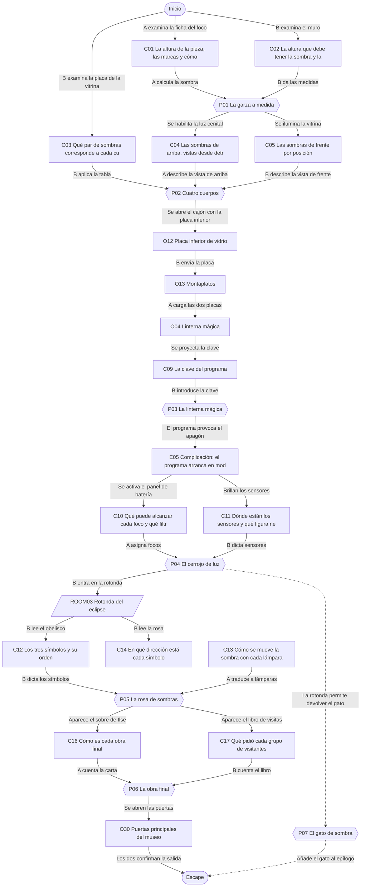
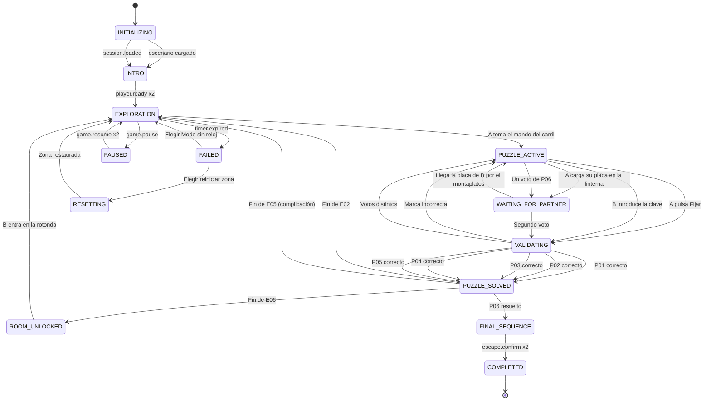

# ER08 · El museo de las sombras

Noche de ensayo en el Museo Lumen: la exposición Teatro de sombras de la artista Ilse Moraga se ha quedado congelada y el museo ha cerrado sus puertas en modo nocturno. A maneja los focos desde la cabina de luces; B, en la galería, interpreta las sombras que se proyectan. Juntos completan las piezas, superan un apagón con solo los focos de batería y eligen la obra final que reabrirá la exposición.

## A. Ficha técnica

| Campo | Valor |
|---|---|
| ID | ER08 |
| Nombre | El museo de las sombras |
| Versión | 1.0.0 |
| Género | Misterio artístico |
| Sinopsis | Noche de ensayo en el Museo Lumen: la exposición Teatro de sombras de la artista Ilse Moraga se ha quedado congelada y el museo ha cerrado sus puertas en modo nocturno. A maneja los focos desde la cabina de luces; B, en la galería, interpreta las sombras que se proyectan. Juntos completan las piezas, superan un apagón con solo los focos de batería y eligen la obra final que reabrirá la exposición. |
| Objetivo principal | OBJ01 Posar la sombra de la garza en su marco y abrir la vitrina de los cuatro cuerpos; OBJ02 Reiniciar el programa de sala con la linterna mágica; OBJ03 Abrir la rotonda durante el apagón y despertar el eclipse; OBJ04 Elegir la obra final y reabrir la exposición |
| Objetivos secundarios | OBJ05 Devolver la silueta del gato a su atril |
| Jugadores | 2 (A: Técnica o técnico de luces en la cabina; B: Intérprete de sombras en la galería) |
| Duración estimada | 45 min (despertar 4, descubrimiento 12, complicación 12, clímax 12, escape 5) |
| Dificultad | Media |
| Zonas | 3 |
| Acertijos | 6 principales y 1 microacertijos |
| Objetos interactivos | 24 (más 7 decorativos) |
| Finales | 4 |
| Competencias | Percepción espacial, Orientación y cambio de perspectiva, Descripción precisa de formas, Escucha activa, Razonamiento proporcional, Toma de decisiones compartida |
| Condiciones iniciales | A empieza en la Cabina de luces, elevada sobre la pared sur de la galería, con los mandos de los focos, la linterna mágica y una ventana inclinada hacia el suelo de la sala. B empieza en la Galería de las sombras, frente al muro de proyección. El programa de sala está congelado y la puerta de la rotonda cerrada. La llamada de voz está abierta; en la ficción, hablan por los auriculares de la visita guiada. |
| Condición de victoria | Completar OBJ01, OBJ02, OBJ03, OBJ04 |
| Condición de fallo | 45 min de cuenta atrás: Amanece y las sombras se desvanecen con la luz del día: los jugadores eligen seguir en Modo sin reloj o reiniciar la zona actual. No se pierde ningún acertijo resuelto. |
| Condición de reinicio | Cualquiera de los dos pulsa Reiniciar zona y el otro lo confirma; también se ofrece al agotarse el reloj. El reinicio completo vuelve al estado inicial y a la intro. |

## B. Guion narrativo

**1. Introducción cinematográfica.** Fundido desde negro: una sala alta con un muro blanco enorme. Un foco se enciende y la sombra de una garza de alambre crece sobre el muro, demasiado grande, desbordando un marco pintado. Suena un proyector antiguo y se detiene. En el muro aparece un rótulo: Teatro de sombras, de Ilse Moraga. Ensayo general. Las puertas se cierran con un clic suave.

**2. Por qué están aquí.** La pareja ha sido invitada como público de prueba al ensayo general de la exposición, la noche antes de abrirla. A subió a la cabina de luces a ver cómo se maneja el espectáculo y B se quedó en la galería. A mitad del ensayo, el programa de sala se congela y el museo entra en modo nocturno: todas las puertas se cierran hasta que el programa vuelva a funcionar.

**3. Situación inicial.** LUMEN, la guía automática del museo, explica que la exposición está incompleta: cada pieza tiene que mostrar su sombra correcta para que el programa pueda reiniciarse. Tomás, el vigilante de noche, habla por radio desde fuera: está bien, las puertas solo están cerradas por seguridad y esperará a que las abran.

**4. Objetivo.** Ajustar las sombras de las piezas de la galería, reiniciar el programa con la linterna mágica, abrir la rotonda con los focos de batería cuando falle la corriente, despertar el eclipse y elegir la obra que cerrará la exposición.

**5. Primer descubrimiento.** A encuentra la ficha del foco de carril con la altura de la garza y las marcas del carril. B ve en el muro el marco donde debe posarse la sombra y la distancia de la garza al muro. Ninguno puede ajustar la sombra solo.

**6. Progresión de los acontecimientos.**

- Con la garza en su marco, su pico señala la vitrina de los cuatro cuerpos y se encienden sus luces.
- B ve las sombras de frente en el cristal de la vitrina; A ve las sombras desde arriba, pero desde detrás. Juntos identifican los cuatro cuerpos.
- En la vitrina hay media placa de vidrio. B la sube a la cabina por el montaplatos y A la une con la otra mitad en la linterna mágica. El muro muestra la clave del programa.
- El programa se reinicia, pero el arranque provoca un apagón general: solo quedan los focos de batería de A y la pintura fosforescente.
- Con tres focos y sus filtros, A abre el cerrojo de luz de la rotonda siguiendo las indicaciones de B.
- En la rotonda, B lee la inscripción del obelisco y la rosa del suelo; A enciende las lámparas del anillo para que la sombra señale los símbolos en orden.
- Vuelve la corriente. La pareja elige cuál de las dos obras finales cerrará la exposición.

**7. Obstáculos narrativos.**

- Desde la cabina A no ve el muro de proyección ni el frontal de la vitrina; B no ve los mandos.
- La vista de A sobre la vitrina está invertida de izquierda a derecha.
- La clave del programa solo aparece con las dos placas unidas y bien orientadas.
- El apagón deja la galería a oscuras: solo brillan los sensores, la cuadrícula fosforescente y los focos de batería.

**8. Revelaciones.**

- Ilse Moraga dejó la exposición sin terminar a propósito: quería que las primeras personas en verla completaran las sombras.
- El apagón no es una avería: el programa de sala arranca en modo de ahorro y apaga la red general hasta que el eclipse de la rotonda se completa.
- Las dos obras finales son igual de queridas por la artista; nunca supo cuál elegir.

**9. Clímax.** En la rotonda, la sombra del obelisco recorre la Llave, la Luna y la Pluma. La corriente vuelve, A baja por la escalera de la cabina y los dos leen la carta de Ilse y el libro de visitas. Votan la obra final sin ver el voto del otro.

**10. Escena de escape.** La obra elegida se proyecta en la cúpula de la rotonda. Las puertas principales del museo se abren y entra la luz de la calle. Tomás saluda desde la escalinata. Los dos confirman la salida juntos.

**11. Epílogo.** Al día siguiente, la exposición abre con la obra elegida. En la cartela de la entrada se lee: Teatro de sombras, de Ilse Moraga. Completado en el ensayo general por su primer público.

### Diálogos y textos del sistema

Cada línea es un subtítulo. Las líneas de canal `document` quedan además guardadas en el registro de pistas.

| ID | Quién | Texto | Cuándo | Para | Canal |
|---|---|---|---|---|---|
| D01 | LUMEN | Bienvenidos al Museo Lumen. El programa de sala se ha detenido y el museo ha cerrado sus puertas en modo nocturno. No hay ningún peligro. | START | Ambos | audio_subtitled |
| D02 | LUMEN | La exposición está incompleta. Cada pieza debe mostrar su sombra correcta para que el programa pueda reiniciarse. | START | Ambos | audio_subtitled |
| D03 | Ilse Moraga (nota de voz) | Si estás en la cabina, tú decides dónde nace la luz. Pero la sombra la ve otra persona. Pregúntale siempre. | E01 | Jugador A | audio_subtitled |
| D04 | Tomás, vigilante (radio) | Aquí Tomás, en la puerta. Todo bien por fuera. Las puertas se abren solas cuando el programa termina; os espero con un café. | E01 | Ambos | audio_subtitled |
| D05 | Narrador | Estás en la galería. La sombra de la garza desborda su marco en el muro. Arriba, en un cristal oscuro, está la cabina de tu pareja. | START | Jugador B | subtitle |
| D06 | Narrador | Desde la cabina ves el suelo de la galería desde arriba. Una visera te tapa el muro: solo tu pareja puede ver las sombras. | START | Jugador A | subtitle |
| D07 | LUMEN | La garza se ha posado. Su pico señala la vitrina de los cuatro cuerpos. | E02 | Ambos | audio_subtitled |
| D08 | Ilse Moraga (nota de voz) | Una sombra sola miente un poco. Dos sombras de la misma cosa ya no pueden mentir. | E02 | Ambos | audio_subtitled |
| D09 | Sistema | Se abre el cajón de la vitrina. | E03 | Ambos | popup |
| D10 | LUMEN | Esta placa pertenece a la linterna de la cabina. El montaplatos de la esquina sube hasta allí. | E03 | Jugador B | audio_subtitled |
| D11 | Sistema | Falta la otra mitad. La linterna solo muestra trazos sueltos. | P03 | Ambos | popup |
| D12 | LUMEN | Programa de sala reiniciado. Arranque en modo de ahorro: desconecto la red general. | E05 | Ambos | audio_subtitled |
| D13 | Narrador | La galería queda a oscuras. Junto a la puerta de la rotonda brillan una cuadrícula y tres figuras. | E05 | Jugador B | subtitle |
| D14 | Narrador | En la cabina solo quedan encendidos tres mandos con la palabra BATERÍA. | E05 | Jugador A | subtitle |
| D15 | LUMEN | Cerrojo de luz: cada sensor necesita su figura. Los focos de batería son los únicos que responden. | E05 | Ambos | document |
| D16 | Sistema | El cerrojo de luz se abre. | E06 | Ambos | popup |
| D17 | Ilse Moraga (nota de voz) | En la rotonda la luz no se mira: se mira lo que la luz deja atrás. | E06 | Ambos | audio_subtitled |
| D18 | LUMEN | Eclipse completado. Restablezco la red general. La escalera de la cabina está abierta. | E07 | Ambos | audio_subtitled |
| D19 | Ilse Moraga (nota de voz) | Gracias por terminar lo que yo dejé a medias. Ahora os toca elegir el final. | E07 | Ambos | audio_subtitled |
| D20 | Sistema | Han votado distinto. Cuéntense lo que han leído y voten otra vez. | P06 | Ambos | popup |
| D21 | Tomás, vigilante (radio) | ¡Se han abierto las puertas! Qué bonito se ve desde aquí. Salid cuando queráis. | E08 | Ambos | audio_subtitled |
| D22 | LUMEN | Si necesitan una pista, pídanla. Mientras tanto, cuéntense lo que ve cada uno. | E09 | Ambos | audio_subtitled |
| D23 | Narrador | Entra la luz del amanecer y las sombras se suavizan. ¿Seguir sin reloj o reiniciar la zona? | E10 | Ambos | popup |
| D24 | Narrador | La sombra del gato se estira por la cúpula y parece bostezar. | E11 | Ambos | subtitle |

## C. Escenografía y planos

Coordenadas en metros con origen en la esquina suroeste del suelo de cada zona: `x` hacia el este, `y` hacia arriba, `z` hacia el norte.

### ROOM01 · Cabina de luces

Cabina estrecha y elevada sobre la pared sur de la galería, con una ventana inclinada hacia el suelo de la sala, la consola de mandos de los focos, una linterna mágica de latón junto a un portillo de proyección y una escalera de caracol cerrada hacia la rotonda.

**Medidas:** 5 × 3 m, altura 2.6 m. **Acceso:** A sí, B no. **Se abre:** desde el inicio.

**Qué ve cada jugador.** A: La cabina y, por la ventana inclinada, el suelo de la galería desde arriba y desde el sur: piezas, carril y la vitrina vista desde detrás. Una visera tapa el muro de proyección y el frontal de la vitrina.. B: No la ve; solo oye a A por los auriculares.

**Distribución.** Ventana inclinada en la pared norte, con la consola de mandos debajo: mando del foco de carril a la izquierda, luz cenital de la vitrina en el centro izquierda y panel de focos de batería en el centro. Linterna mágica junto al portillo, a la derecha de la ventana. Ficha del foco de carril en la pared oeste. Cajón con la placa superior al sureste. Consola de la rotonda en la pared este. Puerta de la escalera de caracol en la pared este, al sur. Rollos de filtros en la esquina suroeste y estante de bobinas en la pared sur.

| ID | Elemento | Tipo o pared | Posición (x, y, z) | Notas |
|---|---|---|---|---|
| DOOR01 | Puerta a Rotonda del eclipse | pared east | (5, 0, 0.8) | Se abre con P05_SOLVED |
| — | Ventana | pared north | (2, 1.4, 3) | Ventana inclinada hacia el suelo de la galería con visera superior; da la vista cenital de A |
| O01 | Mando del foco de carril | 8 Mecanismo cooperativo | (1, 1, 2.6) | Palanca deslizante con cinco muescas grabadas I, II, III, IV y V y un botón Fijar |
| O02 | Luz cenital de la vitrina | 6 Activar | (1.8, 1, 2.6) | Interruptor de rueda con la etiqueta Cenital vitrina y un piloto |
| O03 | Ficha del foco de carril | 2 Examinar | (0.1, 1.4, 1.5) | Ficha plastificada clavada en la pared oeste, con un dibujo del foco, la garza y el muro |
| O04 | Linterna mágica | 8 Mecanismo cooperativo | (3.5, 1.1, 2.7) | Proyector de latón con un portaplacas doble y una plaquita de instrucciones atornillada |
| O05 | Placa superior de vidrio | 3 Recoger | (4.2, 0.8, 1) | Placa rectangular de vidrio con muesca semicircular y trazos grabados |
| O07 | Panel de focos de batería | 8 Mecanismo cooperativo | (2.6, 1, 2.6) | Panel con tres focos, Norte, Centro y Sur; cada uno con dos ruedas (columna A a E y fila 1 a 5), un selector de filtro y un botón Encender |
| O08 | Consola de la rotonda | 8 Mecanismo cooperativo | (4.9, 1.2, 1.5) | Rosa de ocho botones con las letras N, NE, E, SE, S, SO, O y NO, un botón Borrar y un botón Proyectar |
| O09 | Sobre de Ilse | 2 Examinar | (2.5, 0.8, 0.6) | Sobre color crema con la firma de Ilse Moraga, que cae de la bobina del estante al volver la luz |
| O10 | Rollos de filtros de colores | 1 Decorativo | (0.5, 0, 0.4) | Rollos de gelatina de colores con etiquetas, apoyados en la esquina |
| O11 | Estante de bobinas | 1 Decorativo | (2.5, 1.8, 0.2) | Bobinas de película antiguas en latas con fechas escritas a mano |

| Luz | Tipo | Posición | Color | Intensidad | Uso |
|---|---|---|---|---|---|
| L01 | Luz de trabajo azulada | (2.5, 2.5, 1.5) | #AFC8FF | 0.35 | Tenue para no deslumbrar la sala; se apaga en el apagón |
| L02 | Retroiluminación de mandos | (2.2, 1, 2.6) | #FFE2A8 | 0.25 | Cada mando tiene etiqueta en texto; en el apagón solo quedan encendidos los de batería |
| L03 | Lámpara de la linterna mágica | (3.5, 1.1, 2.7) | #FFF4D6 | 0.6 | Se enciende al cargar las dos placas |

**Sonido ambiente:** Zumbido suave de equipos de luces y ventilador de la linterna. **Música:** Celesta y contrabajo pizzicato, misterioso pero amable.

**Cambios dinámicos:**

- E02: El mando de la luz cenital de la vitrina se ilumina
- E05: La luz de trabajo se apaga; quedan los mandos de batería con un piloto y la palabra BATERÍA
- E07: Vuelve la luz, aparece el sobre de Ilse y se abre la puerta de la escalera de caracol

**Para el motor:** Escena independiente para A. La vista por la ventana es una cámara fija desde el sur y desde arriba con un plano de recorte (visera) que oculta el muro norte y el frontal de la vitrina; la imagen no se espeja, así que la izquierda de A es el oeste. Los mandos son superficies de interfaz con estado sincronizado por el servidor. La linterna mágica proyecta en el muro de ROOM02 mediante un proyector de textura (decal o luz con cookie).

### ROOM02 · Galería de las sombras

Sala alta y blanca con un muro de proyección al norte, una garza de alambre sobre un carril de foco, la vitrina de los cuatro cuerpos con frontal esmerilado, un atril con el programa de sala, un biombo de papel y la puerta de la rotonda al este.

**Medidas:** 12 × 9 m, altura 4.5 m. **Acceso:** A no, B sí. **Se abre:** desde el inicio.

**Qué ve cada jugador.** A: Desde la cabina: el suelo, la garza, el carril y la vitrina vistos desde arriba y por detrás; no ve el muro ni el frontal de la vitrina. B: Toda la galería a ras de suelo: el muro, el frontal de la vitrina, placas y sensores; no ve los mandos de la cabina.

**Distribución.** Muro de proyección en la pared norte con el marco pintado de la garza a la izquierda. Garza de alambre a 3 m del muro, con el carril del foco hacia el sur. Vitrina de los cuatro cuerpos en el centro, con el frontal mirando al norte; su placa está en el frontal. Montaplatos en la esquina suroeste. Bancos en el centro sur. Atril del programa al sureste. Biombo de papel en la esquina sureste. Puerta de la rotonda en la pared este, al norte, con la cuadrícula de sensores a su lado. Cartela de bienvenida en la pared oeste. Ventana de la cabina en lo alto de la pared sur.

| ID | Elemento | Tipo o pared | Posición (x, y, z) | Notas |
|---|---|---|---|---|
| DOOR02 | Puerta a Rotonda del eclipse | pared east | (12, 0, 7) | Se abre con P04_SOLVED |
| — | Ventana | pared south | (2, 3.4, 0) | Ventana de la cabina de luces, en lo alto; desde abajo solo se ve un cristal oscuro |
| O12 | Placa inferior de vidrio | 3 Recoger | (7.5, 0.6, 5.2) | Placa rectangular de vidrio con muesca cuadrada y trazos grabados, en el cajón de la vitrina |
| O13 | Montaplatos | 8 Mecanismo cooperativo | (0.5, 0.8, 0.5) | Pequeño ascensor de madera con puertecilla y un botón Subir, que comunica la galería con la cabina |
| O14 | Garza de alambre | 2 Examinar | (3, 0, 6) | Escultura de alambre de 0,6 m de una garza sobre una pata, sobre una peana baja |
| O15 | Muro de proyección | 2 Examinar | (3, 2, 8.95) | Muro blanco de 4 m de alto con un marco pintado en línea de puntos con una garza dibujada, y una cinta luminosa en el suelo |
| O16 | Vitrina de los cuatro cuerpos | 8 Mecanismo cooperativo | (7.5, 0, 4.5) | Vitrina alargada con frontal de cristal esmerilado, cuatro etiquetas de posición del 1 al 4 y un teclado de cuatro botones con dibujos de cubo, cilindro, cono y pirámide |
| O17 | Placa de la vitrina | 2 Examinar | (7.5, 1, 5) | Placa de latón en el frontal de la vitrina con cuatro dibujos de cuerpos y sus dos sombras |
| O18 | Atril del programa de sala | 8 Mecanismo cooperativo | (10, 0, 2) | Atril de madera con una pantalla congelada que dice Programa detenido y un teclado de cuatro cifras |
| O19 | Puerta de la rotonda | 7 Bloqueado | (11.9, 0, 7) | Puerta de doble hoja con la cuadrícula A–E por 1–5 pintada al lado y tres sensores con forma de triángulo, cuadrado y círculo |
| O20 | Silueta del gato | 3 Recoger | (11, 0.5, 0.8) | Recorte de cartón negro de un gato sentado, caído detrás del biombo |
| O21 | Bancos de la galería | 1 Decorativo | (6, 0, 2) | Dos bancos largos de madera clara |
| O22 | Cartela de bienvenida | 1 Decorativo | (0.1, 1.6, 4.5) | Cartel con el texto Teatro de sombras, desde 1906, y un retrato de Ilse Moraga con un farolillo |
| O23 | Biombo de papel | 1 Decorativo | (10.5, 0, 1) | Biombo de tres hojas con siluetas de árboles pintadas |

| Luz | Tipo | Posición | Color | Intensidad | Uso |
|---|---|---|---|---|---|
| L04 | Foco de carril | (3, 0.3, 5) | #FFF1D6 | 1 | Proyecta la sombra de la garza; se desplaza por el carril entre z 5,5 y z 3 según la marca; tiene batería |
| L05 | Bañadores generales | (6, 4.3, 4.5) | #F2F2F2 | 0.4 | Luz general tenue para no lavar las sombras; se apagan en el apagón |
| L06 | Lámpara trasera de la vitrina | (7.5, 0.6, 4.1) | #FFFFFF | 0.5 | Se enciende al resolver P01 y proyecta las sombras de frente en el cristal |
| L07 | Focos de batería Norte, Centro y Sur | (6, 4.2, 2) | #FFFFFF | 0.9 | Apagados hasta el apagón; luego son la única luz controlable |
| L08 | Pintura fosforescente | (11.9, 1.5, 6) | #C8FFB0 | 0.12 | Cuadrícula, sensores y bordes del suelo; solo destaca en el apagón |

**Sonido ambiente:** Sala grande en silencio, eco leve de pasos y el tictac de un proyector apagado. **Música:** Celesta y contrabajo pizzicato, misterioso pero amable.

**Cambios dinámicos:**

- E02: La sombra de la garza se posa en su marco y la vitrina se ilumina por detrás
- E03: El cajón de la vitrina se abre con la placa inferior
- E04: El muro muestra un telón que se abre: el programa arranca
- E05: Apagón general: se apagan los bañadores; brillan la cuadrícula, los sensores y los bordes del suelo
- E06: Los tres sensores brillan a la vez y la puerta de la rotonda se abre

**Para el motor:** Escena independiente para B. Todas las sombras son proyecciones reales o decals sincronizados, pero cada figura tiene además un contorno grueso opcional y una descripción en texto al apuntarla. Los acertijos de esta zona se validan aunque la entrada esté en la cabina (P01 y P04): pertenecen a la galería porque las sombras se ven aquí. En el apagón la exposición pasa a un perfil de iluminación nocturno sin cambiar de escena.

### ROOM03 · Rotonda del eclipse

Sala circular con cúpula, un obelisco negro en el centro, una rosa de sombras grabada en el suelo, ocho lámparas en el borde y dos pedestales con las obras finales cubiertas. Las puertas principales del museo están en el norte.

**Medidas:** 10 × 10 m, altura 6 m. **Acceso:** A sí, B sí. **Se abre:** P04_SOLVED.

**Qué ve cada jugador.** A: Hasta P05 no la ve: la cabina no tiene ventana hacia la rotonda y solo maneja sus lámparas desde la consola. Después baja y la ve entera.. B: Toda la rotonda; con el apagón, la rosa y la inscripción se leen por la pintura fosforescente.

**Distribución.** Obelisco en el centro, con la inscripción en su cara sur. Rosa de sombras en el suelo alrededor del obelisco. Ocho lámparas en el borde, una por dirección. Llegada de B por la puerta oeste y de A por la escalera de la puerta sur. Atril vacío del gato al suroeste. Libro de visitas al sureste. Pedestal de La Bandada al noroeste y de El Faro al noreste. Puertas principales del museo en la pared norte, centro. Banco curvo al oeste.

| ID | Elemento | Tipo o pared | Posición (x, y, z) | Notas |
|---|---|---|---|---|
| DOOR03 | Puerta a Galería de las sombras | pared west | (0, 0, 5) | Se abre con P04_SOLVED |
| DOOR04 | Puerta a Cabina de luces | pared south | (5, 0, 0) | Se abre con P05_SOLVED |
| DOOR05 | Puerta de salida | pared north | (5, 0, 10) | Se abre con P06_SOLVED |
| — | Ventana | pared north | (5, 4, 10) | Montante de cristal sobre las puertas principales; deja ver la farola de la calle |
| O24 | Obelisco | 2 Examinar | (5, 0, 5) | Obelisco negro de 2,5 m con una inscripción en pintura fosforescente en su cara sur |
| O25 | Rosa de sombras | 2 Examinar | (5, 0, 3.5) | Círculo grabado en el suelo con ocho símbolos y la letra de cada dirección |
| O26 | Libro de visitas del ensayo | 2 Examinar | (8, 1, 2) | Libro abierto sobre un atril con dibujos y notas de los grupos que vieron los ensayos |
| O27 | Atril vacío del gato | 5 Combinar | (2, 0, 2) | Atril pequeño con una silueta de gato dibujada en tiza y un foco diminuto encima |
| O28 | Obra final: La Bandada | 9 Elemento narrativo | (2, 0, 8) | Pedestal con una tela que cubre una jaula abierta llena de pájaros de papel |
| O29 | Obra final: El Faro | 9 Elemento narrativo | (8, 0, 8) | Pedestal con una tela que cubre una torre de cristal con una lámpara giratoria |
| O30 | Puertas principales del museo | 10 Objeto de salida | (5, 0, 9.9) | Puertas altas de madera con vidrieras; un indicador sobre ellas pasa de CERRADO a ABIERTO |
| O31 | Lámparas del anillo | 1 Decorativo | (5, 2, 0.5) | Ocho faroles de latón en el borde de la rotonda, cada uno con su letra de dirección |
| O32 | Banco curvo | 1 Decorativo | (1, 0, 5.5) | Banco de piedra que sigue la curva de la pared oeste |

| Luz | Tipo | Posición | Color | Intensidad | Uso |
|---|---|---|---|---|---|
| L09 | Anillo de ocho lámparas | (5, 2, 5) | #FFE7B0 | 0.9 | Una por dirección en el borde (radio 4,5 m); con batería; las controla A desde la cabina |
| L10 | Luz de cúpula | (5, 5.8, 5) | #D7E3FF | 0.5 | Apagada durante el apagón; vuelve en E07 y proyecta la obra final en E08 |
| L11 | Pintura fosforescente de la rosa | (5, 0.02, 5) | #C8FFB0 | 0.15 | Letras de dirección y símbolos legibles en el apagón |

**Sonido ambiente:** Reverberación de cúpula y viento muy lejano en los montantes. **Música:** Tema final: cuerdas y celesta en crescendo luminoso.

**Cambios dinámicos:**

- E06: B entra; solo brillan la rosa fosforescente y la inscripción
- E07: La sombra del obelisco recorre los tres símbolos, vuelve la luz de cúpula y aparecen el libro de visitas y la puerta de A
- E08: La obra elegida se proyecta en la cúpula y se abren las puertas principales

**Para el motor:** Escena compartida tras E07. La sombra del obelisco se calcula con la lámpara encendida (dirección opuesta) y se muestra también como una flecha fosforescente sobre la rosa con el nombre del símbolo señalado. La entrada de P05 está en la consola de la cabina (O08); el acertijo pertenece a la rotonda porque la sombra se ve aquí.

## D. Inventario de objetos

| object_id | Nombre | Descripción visual | Zona | Posición | Tipo | Estado inicial | Acción | Activación | Resultado | Pista | Acertijo | Jugador | Estado final |
|---|---|---|---|---|---|---|---|---|---|---|---|---|---|
| O01 | Mando del foco de carril | Palanca deslizante con cinco muescas grabadas I, II, III, IV y V y un botón Fijar | ROOM01 | (1, 1, 2.6) | 8 Mecanismo cooperativo | FREE | Deslizar a una marca y pulsar Fijar | — | Mueve el foco de carril de la galería; al fijar, se comprueba si la sombra llena el marco | — | P01 | Jugador A | FIXED |
| O02 | Luz cenital de la vitrina | Interruptor de rueda con la etiqueta Cenital vitrina y un piloto | ROOM01 | (1.8, 1, 2.6) | 6 Activar | OFF | Encender | P01_SOLVED | Enciende una luz sobre la vitrina: A ve por la ventana las sombras de los cuerpos sobre su fondo (C04) | C04 | P02 | Jugador A | ON |
| O03 | Ficha del foco de carril | Ficha plastificada clavada en la pared oeste, con un dibujo del foco, la garza y el muro | ROOM01 | (0.1, 1.4, 1.5) | 2 Examinar | DEFAULT | Examinar | — | Guarda la pista C01 | C01 | P01 | Jugador A | EXAMINED |
| O04 | Linterna mágica | Proyector de latón con un portaplacas doble y una plaquita de instrucciones atornillada | ROOM01 | (3.5, 1.1, 2.7) | 8 Mecanismo cooperativo | EMPTY | Examinar e insertar placas | — | Con las dos placas bien orientadas proyecta la imagen compuesta en el muro de la galería | C07 | P03 | Jugador A | COMBINED |
| O05 | Placa superior de vidrio | Placa rectangular de vidrio con muesca semicircular y trazos grabados | ROOM01 | (4.2, 0.8, 1) | 3 Recoger | FOUND | Recoger | — | Pasa al inventario de A y guarda la pista C06 | C06 | P03 | Jugador A | COLLECTED |
| O07 | Panel de focos de batería | Panel con tres focos, Norte, Centro y Sur; cada uno con dos ruedas (columna A a E y fila 1 a 5), un selector de filtro y un botón Encender | ROOM01 | (2.6, 1, 2.6) | 8 Mecanismo cooperativo | OFF | Elegir columna, fila y filtro de cada foco y pulsar Encender los tres | P03_SOLVED | Con el apagón se activa; si los tres sensores reciben su luz, la puerta de la rotonda se abre | C10 | P04 | Jugador A | AIMED |
| O08 | Consola de la rotonda | Rosa de ocho botones con las letras N, NE, E, SE, S, SO, O y NO, un botón Borrar y un botón Proyectar | ROOM01 | (4.9, 1.2, 1.5) | 8 Mecanismo cooperativo | LOCKED | Pulsar tres direcciones en orden y pulsar Proyectar | P04_SOLVED | Enciende las lámparas del anillo en ese orden; la sombra del obelisco recorre la rosa | C13 | P05 | Jugador A | DONE |
| O09 | Sobre de Ilse | Sobre color crema con la firma de Ilse Moraga, que cae de la bobina del estante al volver la luz | ROOM01 | (2.5, 0.8, 0.6) | 2 Examinar | HIDDEN | Abrir y leer | P05_SOLVED | Guarda la pista C16 | C16 | P06 | Jugador A | VISIBLE |
| O10 | Rollos de filtros de colores | Rollos de gelatina de colores con etiquetas, apoyados en la esquina | ROOM01 | (0.5, 0, 0.4) | 1 Decorativo | STATIC | none | — | Sin interacción | — | — | Nadie | STATIC |
| O11 | Estante de bobinas | Bobinas de película antiguas en latas con fechas escritas a mano | ROOM01 | (2.5, 1.8, 0.2) | 1 Decorativo | STATIC | none | — | Sin interacción | — | — | Nadie | STATIC |
| O12 | Placa inferior de vidrio | Placa rectangular de vidrio con muesca cuadrada y trazos grabados, en el cajón de la vitrina | ROOM02 | (7.5, 0.6, 5.2) | 3 Recoger | HIDDEN | Recoger y enviar por el montaplatos | P02_SOLVED | Aparece al abrir la vitrina; al recogerla se guarda C08; B la envía a la cabina por el montaplatos | C08 | P03 | Jugador B | SENT |
| O13 | Montaplatos | Pequeño ascensor de madera con puertecilla y un botón Subir, que comunica la galería con la cabina | ROOM02 | (0.5, 0.8, 0.5) | 8 Mecanismo cooperativo | DOWN | Meter un objeto y pulsar Subir | — | El objeto llega a la cabina, al alcance de A | — | P03 | Jugador B | UP |
| O14 | Garza de alambre | Escultura de alambre de 0,6 m de una garza sobre una pata, sobre una peana baja | ROOM02 | (3, 0, 6) | 2 Examinar | DEFAULT | Examinar | — | Muestra su cartela: Garza, alambre, 0,6 m | — | P01 | Jugador B | DEFAULT |
| O15 | Muro de proyección | Muro blanco de 4 m de alto con un marco pintado en línea de puntos con una garza dibujada, y una cinta luminosa en el suelo | ROOM02 | (3, 2, 8.95) | 2 Examinar | DEFAULT | Examinar | — | Guarda la pista C02; más tarde muestra la proyección compuesta (C09) | C02 | P01 | Jugador B | EXAMINED |
| O16 | Vitrina de los cuatro cuerpos | Vitrina alargada con frontal de cristal esmerilado, cuatro etiquetas de posición del 1 al 4 y un teclado de cuatro botones con dibujos de cubo, cilindro, cono y pirámide | ROOM02 | (7.5, 0, 4.5) | 8 Mecanismo cooperativo | DARK | Mirar el frontal y marcar cuatro cuerpos en orden | P01_SOLVED | Iluminada por detrás muestra las sombras de frente (C05); con la secuencia correcta se abre su cajón | C05 | P02 | Jugador B | OPEN |
| O17 | Placa de la vitrina | Placa de latón en el frontal de la vitrina con cuatro dibujos de cuerpos y sus dos sombras | ROOM02 | (7.5, 1, 5) | 2 Examinar | DEFAULT | Examinar | — | Guarda la pista C03 | C03 | P02 | Jugador B | EXAMINED |
| O18 | Atril del programa de sala | Atril de madera con una pantalla congelada que dice Programa detenido y un teclado de cuatro cifras | ROOM02 | (10, 0, 2) | 8 Mecanismo cooperativo | FROZEN | Introducir clave de cuatro cifras | — | Con la clave correcta reinicia el programa de sala | — | P03 | Jugador B | RESTARTED |
| O19 | Puerta de la rotonda | Puerta de doble hoja con la cuadrícula A–E por 1–5 pintada al lado y tres sensores con forma de triángulo, cuadrado y círculo | ROOM02 | (11.9, 0, 7) | 7 Bloqueado | LOCKED | Examinar | — | Antes del apagón dice: Se abre con el programa de sala. En el apagón brillan la cuadrícula y los sensores (C11) | C11 | P04 | Jugador B | OPEN |
| O20 | Silueta del gato | Recorte de cartón negro de un gato sentado, caído detrás del biombo | ROOM02 | (11, 0.5, 0.8) | 3 Recoger | FOUND | Recoger | — | Pasa al inventario de B y guarda la pista C18 | C18 | P07 | Jugador B | PLACED |
| O21 | Bancos de la galería | Dos bancos largos de madera clara | ROOM02 | (6, 0, 2) | 1 Decorativo | STATIC | none | — | Sin interacción | — | — | Nadie | STATIC |
| O22 | Cartela de bienvenida | Cartel con el texto Teatro de sombras, desde 1906, y un retrato de Ilse Moraga con un farolillo | ROOM02 | (0.1, 1.6, 4.5) | 1 Decorativo | STATIC | none | — | Sin interacción | — | — | Nadie | STATIC |
| O23 | Biombo de papel | Biombo de tres hojas con siluetas de árboles pintadas | ROOM02 | (10.5, 0, 1) | 1 Decorativo | STATIC | none | — | Sin interacción | — | — | Nadie | STATIC |
| O24 | Obelisco | Obelisco negro de 2,5 m con una inscripción en pintura fosforescente en su cara sur | ROOM03 | (5, 0, 5) | 2 Examinar | DEFAULT | Examinar | — | Guarda la pista C12 | C12 | P05 | Jugador B | EXAMINED |
| O25 | Rosa de sombras | Círculo grabado en el suelo con ocho símbolos y la letra de cada dirección | ROOM03 | (5, 0, 3.5) | 2 Examinar | DEFAULT | Examinar | — | Guarda la pista C14 | C14 | P05 | Jugador B | EXAMINED |
| O26 | Libro de visitas del ensayo | Libro abierto sobre un atril con dibujos y notas de los grupos que vieron los ensayos | ROOM03 | (8, 1, 2) | 2 Examinar | HIDDEN | Leer | P05_SOLVED | Guarda la pista C17 | C17 | P06 | Jugador B | VISIBLE |
| O27 | Atril vacío del gato | Atril pequeño con una silueta de gato dibujada en tiza y un foco diminuto encima | ROOM03 | (2, 0, 2) | 5 Combinar | EMPTY | Colocar objeto | P04_SOLVED | Con la silueta del gato, su sombra se proyecta sobre la cúpula y el gato parece estirarse | — | P07 | Jugador B | OCCUPIED |
| O28 | Obra final: La Bandada | Pedestal con una tela que cubre una jaula abierta llena de pájaros de papel | ROOM03 | (2, 0, 8) | 9 Elemento narrativo | COVERED | Ver de cerca | — | Si se elige, se descubre y se proyecta en la cúpula | — | — | Ambos | SHOWN |
| O29 | Obra final: El Faro | Pedestal con una tela que cubre una torre de cristal con una lámpara giratoria | ROOM03 | (8, 0, 8) | 9 Elemento narrativo | COVERED | Ver de cerca | — | Si se elige, se descubre y se proyecta en la cúpula | — | — | Ambos | SHOWN |
| O30 | Puertas principales del museo | Puertas altas de madera con vidrieras; un indicador sobre ellas pasa de CERRADO a ABIERTO | ROOM03 | (5, 0, 9.9) | 10 Objeto de salida | LOCKED | Salir | P06_SOLVED | Cada jugador confirma su salida | — | — | Ambos | OPEN |
| O31 | Lámparas del anillo | Ocho faroles de latón en el borde de la rotonda, cada uno con su letra de dirección | ROOM03 | (5, 2, 0.5) | 1 Decorativo | STATIC | none | — | Sin interacción directa; se manejan desde la consola de la cabina | — | — | Nadie | STATIC |
| O32 | Banco curvo | Banco de piedra que sigue la curva de la pared oeste | ROOM03 | (1, 0, 5.5) | 1 Decorativo | STATIC | none | — | Sin interacción | — | — | Nadie | STATIC |

## E. Pistas

| clue_id | Contenido exacto | Alternativa accesible | Ubicación | Descubrimiento | Quién | Acertijo | Revela | Depende de | Se habilita | Nivel | Descubierta cuando |
|---|---|---|---|---|---|---|---|---|---|---|---|
| C01 | Ficha del foco de carril. La garza mide 0,6 m de alto. Marcas del carril, medidas desde la garza hacia el foco: I a 0,5 m. II a 1,0 m. III a 1,5 m. IV a 2,0 m. V a 3,0 m. Altura de la sombra en el muro = altura de la pieza × distancia del foco al muro ÷ distancia del foco a la pieza. La distancia del foco al muro es la del foco a la pieza más la de la pieza al muro. | Texto grande y lectura en voz: garza 0,6 m; marcas I 0,5, II 1,0, III 1,5, IV 2,0, V 3,0 m; fórmula de la sombra explicada en palabras con un dibujo de dos triángulos. | O03 Ficha del foco de carril | A examina la ficha de la pared oeste | Jugador A | P01 | La altura de la pieza, las marcas y cómo calcular la sombra | — | — | 0 | O03_EXAMINED |
| C02 | En el muro norte, un marco en línea de puntos con una garza dibujada: Aquí debe posarse la sombra de la garza. Altura del marco: 2,4 m. En el suelo, una cinta luminosa va de la peana de la garza al muro con la leyenda: De la garza al muro, 3,0 m. | Texto: marco de 2,4 m de alto; distancia de la garza al muro, 3,0 m. Al apuntar al muro se describe la sombra actual: más alta que el marco, más baja o justa. | O15 Muro de proyección | B examina el muro de proyección | Jugador B | P01 | La altura que debe tener la sombra y la distancia de la garza al muro | — | — | 0 | O15_EXAMINED |
| C03 | Placa de la vitrina. Cuatro cuerpos. Cada cuerpo se reconoce por dos sombras, la de frente y la de arriba. Cubo: frente cuadrado, arriba cuadrado. Cilindro (tan alto como ancho): frente cuadrado, arriba círculo. Cono: frente triángulo, arriba círculo. Pirámide: frente triángulo, arriba cuadrado. Para abrir, marquen los cuatro cuerpos en orden, de la posición 1 a la 4. | Tabla de cuatro filas con nombre, sombra de frente y sombra de arriba, en texto y con dibujos en relieve. | O17 Placa de la vitrina | B examina la placa de la vitrina | Jugador B | P02 | Qué par de sombras corresponde a cada cuerpo | — | — | 0 | O17_EXAMINED |
| C04 | Con la luz cenital encendida ves, por la ventana de la cabina, las sombras de los cuatro cuerpos sobre el fondo de la vitrina. La cabina está detrás de la vitrina: lo que tú ves a tu izquierda, un visitante que mira el frontal lo ve a su derecha. Las etiquetas de posición solo están en el frontal. De tu izquierda a tu derecha: cuadrado, cuadrado, círculo, círculo. | Texto: vista desde detrás, izquierda y derecha invertidas respecto al frontal. De izquierda a derecha de A: cuadrado, cuadrado, círculo, círculo. Cada sombra tiene contorno grueso. | O02 Luz cenital de la vitrina | A enciende la luz cenital y mira por la ventana | Jugador A | P02 | Las sombras de arriba, vistas desde detrás | — | P01_SOLVED | 0 | O02_ON |
| C05 | En el cristal esmerilado del frontal se ven cuatro sombras de frente, cada una sobre su etiqueta. Posición 1: triángulo. Posición 2: cuadrado. Posición 3: cuadrado. Posición 4: triángulo. Las posiciones van del 1 al 4 de izquierda a derecha mirando el frontal. | Texto: 1 triángulo, 2 cuadrado, 3 cuadrado, 4 triángulo. Cada sombra se puede resaltar con contorno grueso y leer en voz. | O16 Vitrina de los cuatro cuerpos | B mira el frontal cuando la vitrina se ilumina | Jugador B | P02 | Las sombras de frente por posición | — | P01_SOLVED | 0 | O16_LIT |
| C06 | Placa superior: vidrio con muesca semicircular en una esquina. Lleva trazos sueltos, las mitades de arriba de cuatro cifras. Sola, no se puede leer ninguna cifra con seguridad. | Texto: placa con muesca semicircular y mitades superiores de cuatro cifras ilegibles por separado. | O05 Placa superior de vidrio | A recoge la placa del cajón de la cabina | Jugador A | P03 | Que hace falta otra placa | — | — | 0 | O05_COLLECTED |
| C07 | Plaquita de la linterna mágica: Linterna de doble placa. Coloquen las dos placas juntas con las muescas arriba a la izquierda: la semicircular delante y la cuadrada detrás. Si una placa está girada, la imagen sale descompuesta y no se lee. | Texto grande con un dibujo de las dos muescas arriba a la izquierda; semicircular delante, cuadrada detrás. | O04 Linterna mágica | A examina la linterna | Jugador A | P03 | Cómo orientar las placas | — | — | 0 | — |
| C08 | Placa inferior: vidrio con muesca cuadrada. Lleva trazos sueltos, las mitades de abajo de cuatro cifras, y una etiqueta: Para la linterna de la cabina. Sola, no se puede leer ninguna cifra. | Texto: placa con muesca cuadrada, mitades inferiores de cuatro cifras, destino la linterna de la cabina. | O12 Placa inferior de vidrio | B recoge la placa del cajón de la vitrina | Jugador B | P03 | Que la placa va a la cabina | — | P02_SOLVED | 0 | O16_OPEN |
| C09 | Sobre el muro norte aparece, nítida, la imagen de las dos placas unidas: un telón de teatro y, debajo, cuatro cifras: 3 8 0 6. Bajo las cifras, en letra pequeña: Clave del programa de sala. | Texto y lectura en voz: cifras 3, 8, 0, 6, clave del programa de sala; las cifras tienen contorno grueso en alto contraste. | O15 Muro de proyección | Aparece en el muro cuando A proyecta las dos placas bien orientadas | Jugador B | P03 | La clave del programa | — | O04_COMBINED | 0 | O04_COMBINED |
| C10 | Panel de focos de batería. Foco Norte: alcanza las columnas A, B y C; lleva filtro ÁMBAR con triángulos y filtro AZUL con círculos. Foco Centro: alcanza B, C y D; lleva filtro VERDE con cuadrados y filtro AZUL con círculos. Foco Sur: alcanza D y E; lleva filtro ÁMBAR con triángulos y filtro AZUL con círculos. Cada foco ilumina un solo punto, elegido por columna y fila. | Tabla de tres focos con columnas alcanzables y filtros nombrados por color y por figura: ámbar triángulos, azul círculos, verde cuadrados. | O07 Panel de focos de batería | A examina el panel cuando se activa en el apagón | Jugador A | P04 | Qué puede alcanzar cada foco y qué filtros tiene | — | P03_SOLVED | 0 | O07_STANDBY |
| C11 | Con el apagón, junto a la puerta de la rotonda brilla una cuadrícula fosforescente de columnas A a E y filas 1 a 5. Hay tres sensores: un triángulo en B4, un cuadrado en C1 y un círculo en E2. Rótulo: Cerrojo de luz. Cada sensor se abre con luz que lleve su misma figura. Los tres a la vez. | Texto: sensor triángulo en B4, sensor cuadrado en C1, sensor círculo en E2; cada uno necesita luz con su misma figura; los tres a la vez. | O19 Puerta de la rotonda | B examina la puerta en el apagón | Jugador B | P04 | Dónde están los sensores y qué figura necesita cada uno | — | P03_SOLVED | 0 | O19_DARK_LOCKED |
| C12 | Inscripción del obelisco: Para despertar el eclipse, la sombra del obelisco debe señalar, por este orden, la Llave, la Luna y la Pluma. | Texto grande y lectura en voz: Llave, Luna, Pluma, en este orden. | O24 Obelisco | B examina la cara sur del obelisco | Jugador B | P05 | Los tres símbolos y su orden | — | — | 0 | O24_EXAMINED |
| C13 | Consola de la rotonda. Ocho lámparas en el borde, nombradas por su dirección desde el obelisco: N, NE, E, SE, S, SO, O, NO. Se encienden de una en una, en el orden en que se pulsan. La sombra del obelisco cae siempre hacia el lado contrario de la lámpara encendida: con la lámpara N, la sombra señala al S. | Texto con un dibujo de la rosa de ocho direcciones y una flecha de ejemplo: lámpara N, sombra al S. | O08 Consola de la rotonda | A examina la consola cuando se activa | Jugador A | P05 | Cómo se mueve la sombra con cada lámpara | — | P04_SOLVED | 0 | O08_READY |
| C14 | Rosa de sombras del suelo, con la letra de cada dirección junto a su símbolo: N Ciervo. NE Ancla. E Llave. SE Pez. S Luna. SO Campana. O Pluma. NO Ojo. | Lista en texto y voz de las ocho direcciones con su símbolo; cada símbolo tiene contorno en relieve fosforescente. | O25 Rosa de sombras | B examina la rosa del suelo | Jugador B | P05 | En qué dirección está cada símbolo | — | — | 0 | O25_EXAMINED |
| C15 | LUMEN: La sombra crece cuanto más cerca está el foco de la pieza. Comparen la ficha de la cabina con el marco del muro. | Subtítulo y registro de eventos con la misma frase. | O03 Ficha del foco de carril | Ayuda contextual si pasan 2 minutos sin progreso en P01 | Ambos | P01 | Que A y B deben combinar la ficha y el marco | — | IDLE_120 | 1 | IDLE_120 |
| C16 | Carta de Ilse Moraga: Dejo dos finales para la exposición y no sé elegir. La Bandada: todas las siluetas de la galería se convierten en pájaros que cruzan los muros a la vez; es alegre y un poco bulliciosa. El Faro: una sola luz gira despacio por la sala y cada pieza cuenta su historia por turnos; es tranquila y larga. Elijan ustedes la que se queda. | Texto de la carta en grande con un icono por obra: pájaro y faro. | O09 Sobre de Ilse | A abre el sobre al volver la luz | Jugador A | P06 | Cómo es cada obra final | — | P05_SOLVED | 0 | O09_VISIBLE |
| C17 | Libro de visitas del ensayo. Taller infantil del sábado: ¡Queremos que los pájaros vuelen por toda la sala! Grupo de visita tranquila del jueves: Pedimos una luz lenta, para mirar cada pieza con calma. | Las dos notas en texto grande con el nombre del grupo que firma. | O26 Libro de visitas del ensayo | B lee el libro cuando aparece | Jugador B | P06 | Qué pidió cada grupo de visitantes | — | P05_SOLVED | 0 | O26_VISIBLE |
| C18 | Etiqueta en la silueta del gato: Me caí del atril de la rotonda. Allí mi sombra se estira hasta la cúpula. | Texto de la etiqueta en grande. | O20 Silueta del gato | B recoge la silueta detrás del biombo | Jugador B | P07 | Dónde va la silueta | — | — | 0 | O20_COLLECTED |
| C19 | LUMEN: Recuerden que la cabina mira la vitrina desde detrás. Lo que para uno es la izquierda, para el otro es la derecha. | Subtítulo y registro de eventos con la misma frase. | O02 Luz cenital de la vitrina | Ayuda contextual si pasan 2 minutos sin progreso en P02 | Ambos | P02 | Que la vista de A está invertida | — | P01_SOLVED, IDLE_120 | 1 | IDLE_120 |

### Ayudas progresivas por acertijo

| Acertijo | Nivel 1: dónde mirar | Nivel 2: principio | Nivel 3: ayuda concreta |
|---|---|---|---|
| P01 La garza a medida | A tiene la fórmula y B las medidas del muro: hace falta juntar las dos cosas. | La distancia del foco al muro es la marca más 3,0 m. | Busquen una marca donde la sombra sea cuatro veces la garza: 0,6 × 4 = 2,4. |
| P02 Cuatro cuerpos | Cada cuerpo necesita dos sombras: B tiene una y A la otra. | A mira desde detrás de la vitrina: su izquierda es la posición 4. | La posición 1 tiene triángulo de frente y círculo arriba: es el cono. |
| P03 La linterna mágica | Cada uno tiene media placa: hay que juntarlas en la cabina. | El montaplatos de la esquina suroeste sube objetos a la cabina. | Las dos muescas van arriba a la izquierda; si el muro muestra trazos rotos, giren una placa. |
| P04 El cerrojo de luz | B ve los sensores y A los focos: comparen casillas y figuras. | Empiecen por el sensor que solo puede alcanzar un foco. | Solo un foco tiene filtro de cuadrados. |
| P05 La rosa de sombras | B ve los símbolos y A maneja las lámparas. | La sombra cae al lado contrario de la lámpara encendida. | La Llave está al E: hay que encender la lámpara O. |
| P06 La obra final | A tiene la carta de Ilse y B el libro de visitas. | No hay obra incorrecta: elijan la que más les guste. | Voten la misma obra en las dos pantallas. |
| P07 El gato de sombra | Hay algo caído detrás del biombo. | La etiqueta dice de dónde se cayó. | El atril vacío está al suroeste de la rotonda. |

## F. Acertijos

### P01 · La garza a medida

1. **ID.** P01
2. **Nombre.** La garza a medida
3. **Narrativa.** La sombra de la garza desborda su marco. Ilse quiso que se posara justo dentro, ni más grande ni más pequeña.
4. **Objetivo.** Colocar el foco de carril en la marca que hace que la sombra mida exactamente lo que el marco.
5. **Situación.** A tiene el mando del carril y la ficha con la altura de la garza, las marcas y la fórmula. B ve el marco del muro, su altura y la distancia de la garza al muro.
6. **Elementos necesarios.** O01 Mando del foco de carril, O03 Ficha del foco de carril, O14 Garza de alambre, O15 Muro de proyección
7. **Información de A.** Garza de 0,6 m; marcas I 0,5, II 1,0, III 1,5, IV 2,0, V 3,0 m; fórmula de la sombra (C01).
8. **Información de B.** Marco de 2,4 m y distancia de la garza al muro de 3,0 m (C02).
9. **Qué deben comunicarse.** B da la altura del marco y la distancia al muro; A calcula la sombra de cada marca y elige; B confirma en el muro si la sombra encaja.
10. **Reglas.** El foco se puede mover libremente; solo cuenta la marca al pulsar Fijar. Si la sombra no encaja, el foco vuelve a la marca V sin más consecuencias. B ve la sombra en directo y su descripción en texto: más alta, más baja o justa.
11. **Pasos.** (1) B examina el muro y lee el marco y la cinta del suelo. (2) A examina la ficha. (3) A calcula: con II, 0,6 × (1,0 + 3,0) ÷ 1,0 = 2,4 m. (4) A mueve el foco a II y pulsa Fijar.
12. **Respuesta correcta.** II (position; Marca del carril en números romanos al pulsar Fijar)
13. **Respuestas incorrectas posibles.** I: 0,6 × 3,5 ÷ 0,5 = 4,2 m: la sombra desborda el marco.; III: 0,6 × 4,5 ÷ 1,5 = 1,8 m: se queda corta.; V: 0,6 × 6,0 ÷ 3,0 = 1,2 m: es la mitad del marco.
14. **Validación.** Al pulsar Fijar, el servidor calcula la sombra de la marca elegida con la altura y las marcas de C01 y la distancia de C02, y acepta si coincide con la altura del marco de C02 (variante activa). Introduce: Jugador A. Pistas exigidas: C01, C02. Modelo M1 Información dividida.
15. **Al resolverlo.** La sombra de la garza se posa en su marco. Su pico señala la vitrina. Eventos: E02. Estado: O01_FIXED.
16. **Al fallar.** La sombra no encaja en el marco. El foco vuelve al final del carril. El foco vuelve a la marca V; nada más cambia.
17. **Intentos.** ilimitados; pausa de 10 s cada 3 fallos seguidos
18. **Sistema de pistas.** Pistas C01, C02 y tres niveles de ayuda (tabla de ayudas).
19. **Tiempo estimado.** 6 min
20. **Desbloquea.** P02
21. **Reinicio.** Tras un fallo el foco vuelve a V. Un reinicio de zona deja el mando en FREE y el foco en V.
22. **Casos límite.** A fija antes de que B haya examinado el muro: se rechaza con Faltan las medidas del muro y no cuenta como fallo. A mueve el foco entre marcas: la sombra cambia en directo para B, pero solo se valida al fijar. Doble pulsación de Fijar: se ignora la segunda.

**Requisitos previos:** START. **Zona:** ROOM02.

**Por qué la solución es válida:** Con h = 0,6 y 3,0 m de la garza al muro, la sombra de cada marca es 0,6 × (d + 3,0) ÷ d: I 4,2; II 2,4; III 1,8; IV 1,5; V 1,2. Solo II da 2,4 m. A no conoce el marco ni la distancia al muro, y B no conoce la altura de la garza, las marcas ni la fórmula.

### P02 · Cuatro cuerpos

1. **ID.** P02
2. **Nombre.** Cuatro cuerpos
3. **Narrativa.** La vitrina guarda cuatro cuerpos ocultos tras un cristal esmerilado. Solo sus sombras dicen qué son.
4. **Objetivo.** Identificar los cuatro cuerpos de la posición 1 a la 4 y marcarlos en el teclado de la vitrina.
5. **Situación.** B ve las sombras de frente en el cristal y tiene la placa con el par de sombras de cada cuerpo. A, desde la cabina, ve las sombras de arriba, pero desde detrás.
6. **Elementos necesarios.** O16 Vitrina de los cuatro cuerpos, O17 Placa de la vitrina, O02 Luz cenital de la vitrina
7. **Información de A.** Sombras de arriba de izquierda a derecha de A: cuadrado, cuadrado, círculo, círculo; y que su vista está invertida (C04).
8. **Información de B.** Sombras de frente por posición: triángulo, cuadrado, cuadrado, triángulo (C05); tabla de cuerpos (C03).
9. **Qué deben comunicarse.** A describe sus sombras y advierte que ve desde detrás; los dos invierten el orden para que coincida con las posiciones del frontal; B combina cada par con la tabla y marca.
10. **Reglas.** Se marcan cuatro cuerpos seguidos, de la posición 1 a la 4. Si la secuencia es incorrecta, el teclado se borra con un tono suave. La vista de A no se puede espejar desde la interfaz: hay que razonarlo.
11. **Pasos.** (1) A enciende la luz cenital y describe: cuadrado, cuadrado, círculo, círculo. (2) Invierten: posiciones 1 a 4 desde arriba son círculo, círculo, cuadrado, cuadrado. (3) B combina con el frontal: 1 triángulo y círculo, cono; 2 cuadrado y círculo, cilindro; 3 cuadrado y cuadrado, cubo; 4 triángulo y cuadrado, pirámide. (4) B marca cono, cilindro, cubo, pirámide.
12. **Respuesta correcta.** CONO · CILINDRO · CUBO · PIRAMIDE (sequence; Sin tildes; lista de cuerpos de la posición 1 a la 4)
13. **Respuestas incorrectas posibles.** PIRAMIDE · CUBO · CILINDRO · CONO: Usa la vista de A sin invertir: empareja la posición 1 con lo que A ve a su izquierda, que es la posición 4.; CONO · CUBO · CILINDRO · PIRAMIDE: Confunde las posiciones 2 y 3: la 2 tiene sombra de arriba circular.; PIRAMIDE · CILINDRO · CUBO · CONO: Intercambia cono y pirámide: los dos dan triángulo de frente, pero difieren arriba.
14. **Validación.** La secuencia de B debe coincidir con los cuerpos que resultan de combinar, por posición, la sombra de frente de C05 con la sombra de arriba de C04 invertida, según la tabla de C03 (variante activa). Se exige C04 descubierta por A. Introduce: Jugador B. Pistas exigidas: C03, C04, C05. Modelo M4 Perspectivas complementarias.
15. **Al resolverlo.** La vitrina hace clic y se abre un cajón bajo el frontal. Eventos: E03. Estado: O16_OPEN.
16. **Al fallar.** El teclado se borra con un tono suave. Revisen qué ve cada uno y desde dónde. La secuencia vuelve a cero.
17. **Intentos.** ilimitados; pausa de 10 s cada 3 fallos seguidos
18. **Sistema de pistas.** Pistas C03, C04, C05 y tres niveles de ayuda (tabla de ayudas).
19. **Tiempo estimado.** 7 min
20. **Desbloquea.** P03
21. **Reinicio.** Tras un fallo se borra el teclado. Un reinicio de zona apaga la luz cenital y deja la vitrina en LIT.
22. **Casos límite.** B marca antes de que A encienda la luz cenital: se rechaza con Falta la vista de arriba y no cuenta como fallo. B marca más de cuatro cuerpos: solo cuentan los cuatro primeros tras el último borrado. A apaga y enciende la luz cenital: no cambia nada; la pista ya está en su registro.

**Requisitos previos:** P01_SOLVED. **Zona:** ROOM02.

**Por qué la solución es válida:** Cada sombra de frente encaja con dos cuerpos (triángulo: cono o pirámide; cuadrado: cubo o cilindro) y cada sombra de arriba con otros dos (círculo: cilindro o cono; cuadrado: cubo o pirámide), así que ninguno puede decidir solo. Invirtiendo la vista de A, las sombras de arriba por posición son círculo, círculo, cuadrado, cuadrado; con el frontal triángulo, cuadrado, cuadrado, triángulo, la tabla de C03 da un único cuerpo por posición: cono, cilindro, cubo, pirámide.

### P03 · La linterna mágica

1. **ID.** P03
2. **Nombre.** La linterna mágica
3. **Narrativa.** La clave del programa de sala está partida en dos placas de vidrio: una en la cabina y otra en la vitrina. Solo la linterna mágica puede unirlas.
4. **Objetivo.** Unir las dos placas en la linterna, proyectar la clave y reiniciar el programa en el atril.
5. **Situación.** A tiene la placa superior y la linterna. B encuentra la placa inferior en el cajón de la vitrina, la envía por el montaplatos y ve el muro donde se proyecta la imagen.
6. **Elementos necesarios.** O04 Linterna mágica, O05 Placa superior de vidrio, O12 Placa inferior de vidrio, O13 Montaplatos, O18 Atril del programa de sala
7. **Información de A.** Placa superior con muesca semicircular (C06) y la regla de orientación de la linterna (C07).
8. **Información de B.** Placa inferior con muesca cuadrada (C08) y, después, la imagen compuesta en el muro (C09).
9. **Qué deben comunicarse.** B avisa de que envía la placa; A la recibe y la coloca según la plaquita; B describe lo que ve en el muro; si sale descompuesta, A gira la placa hasta que B lea las cifras; B introduce la clave.
10. **Reglas.** La linterna solo proyecta con dos placas cargadas. Si una placa está girada, el muro muestra trazos descompuestos y no hay clave legible. El atril acepta cuatro cifras; un error borra la entrada.
11. **Pasos.** (1) B recoge la placa inferior y la mete en el montaplatos. (2) A la recibe y carga las dos placas con las muescas arriba a la izquierda, la semicircular delante. (3) B lee en el muro 3 8 0 6. (4) B teclea 3806 en el atril.
12. **Respuesta correcta.** 3806 (code; Cuatro cifras sin espacios)
13. **Respuestas incorrectas posibles.** 1906: Es el año de la cartela de bienvenida, no la clave proyectada.; 6083: Son las cifras al revés.; 3608: Intercambia la segunda y la cuarta cifra.
14. **Validación.** El código de B debe ser igual a las cifras de C09 (variante activa). Solo se acepta si O04 está en COMBINED, es decir, si A cargó la placa de A y la de B con la orientación de C07. Introduce: Jugador B. Pistas exigidas: C06, C07, C08, C09. Modelo M5 Objetos complementarios.
15. **Al resolverlo.** El atril se ilumina: Programa de sala reiniciado. En el muro se abre un telón. Eventos: E04, E05. Estado: O18_RESTARTED.
16. **Al fallar.** Clave incorrecta. La entrada se borra. El teclado vuelve a vacío; las placas siguen en la linterna.
17. **Intentos.** ilimitados; pausa de 10 s cada 3 fallos seguidos
18. **Sistema de pistas.** Pistas C06, C07, C08, C09 y tres niveles de ayuda (tabla de ayudas).
19. **Tiempo estimado.** 7 min
20. **Desbloquea.** P04
21. **Reinicio.** Tras un fallo se borra el teclado. Un reinicio de zona devuelve la placa inferior al cajón, vacía la linterna y deja el atril en FROZEN.
22. **Casos límite.** A intenta proyectar con una sola placa: la linterna muestra trazos sueltos y se indica que falta la otra mitad. B envía otro objeto por el montaplatos: llega a la cabina y A puede devolverlo; no afecta al acertijo. A carga la placa inferior girada: el muro muestra trazos descompuestos y O04 no pasa a COMBINED hasta corregirla. B introduce la clave antes de que se proyecte: se rechaza con Clave no proyectada y no cuenta como fallo.

**Requisitos previos:** P02_SOLVED. **Zona:** ROOM02.

**Por qué la solución es válida:** Ninguna placa por separado permite leer una cifra: una tiene las mitades de arriba y la otra las de abajo. Solo la proyección combinada, que requiere el objeto de cada jugador y la orientación de C07, muestra 3806. El 1906 de la cartela es un distractor visible desde el principio.

### P04 · El cerrojo de luz

1. **ID.** P04
2. **Nombre.** El cerrojo de luz
3. **Narrativa.** Al reiniciarse, el programa apaga la red general. La galería queda a oscuras y solo responden los tres focos de batería de A. La puerta de la rotonda tiene un cerrojo de luz para estos casos.
4. **Objetivo.** Apuntar los tres focos de batería, con el filtro correcto, a los tres sensores de la puerta a la vez.
5. **Situación.** B ve en la oscuridad la cuadrícula fosforescente y los tres sensores. A tiene el panel de focos con el alcance y los filtros de cada uno, pero no ve el muro.
6. **Elementos necesarios.** O07 Panel de focos de batería, O19 Puerta de la rotonda
7. **Información de A.** Alcance y filtros de cada foco (C10).
8. **Información de B.** Posición y figura de cada sensor (C11).
9. **Qué deben comunicarse.** B dicta cada sensor con su casilla y su figura; A comprueba qué foco puede llegar y qué foco tiene el filtro de esa figura; los dos repasan las tres asignaciones antes de encender.
10. **Reglas.** Cada foco ilumina un solo punto. Un sensor solo cuenta si recibe luz con su misma figura. Se encienden los tres a la vez con un solo botón; si algún sensor no se activa, los focos se apagan y se puede repetir.
11. **Pasos.** (1) B lee: triángulo en B4, cuadrado en C1, círculo en E2. (2) A ve que solo el Foco Centro tiene filtro de cuadrados y llega a C: Centro a C1 con verde. (3) Solo el Sur llega a E: Sur a E2 con azul. (4) El triángulo B4 queda para el Norte con ámbar. (5) A pulsa Encender los tres.
12. **Respuesta correcta.** {"NORTE":{"punto":"B4","filtro":"AMBAR_TRIANGULOS"},"CENTRO":{"punto":"C1","filtro":"VERDE_CUADRADOS"},"SUR":{"punto":"E2","filtro":"AZUL_CIRCULOS"}} (position; Punto y filtro de cada foco al pulsar Encender los tres)
13. **Respuestas incorrectas posibles.** {"NORTE":{"punto":"C1","filtro":"AZUL_CIRCULOS"},"CENTRO":{"punto":"B4","filtro":"VERDE_CUADRADOS"},"SUR":{"punto":"E2","filtro":"AZUL_CIRCULOS"}}: El Norte no tiene filtro de cuadrados y el Centro no tiene de triángulos: dos sensores no se activan.; {"NORTE":{"punto":"B4","filtro":"AMBAR_TRIANGULOS"},"CENTRO":{"punto":"C1","filtro":"VERDE_CUADRADOS"},"SUR":{"punto":"E2","filtro":"AMBAR_TRIANGULOS"}}: El sensor de E2 es un círculo: necesita el filtro azul de círculos.
14. **Validación.** Al encender, cada sensor de C11 debe recibir luz de un foco que lo alcance según C10 y con el filtro de su misma figura; los tres sensores a la vez. Introduce: Jugador A. Pistas exigidas: C10, C11.
15. **Al resolverlo.** Los tres sensores brillan a la vez. El cerrojo de luz se abre y la puerta de la rotonda cede. Eventos: E06. Estado: O07_AIMED, O19_OPEN.
16. **Al fallar.** Algún sensor no ha recibido su luz. Los focos se apagan; revisen alcances y filtros. Los focos se apagan; las ruedas y los filtros se quedan como estaban.
17. **Intentos.** ilimitados; pausa de 10 s cada 3 fallos seguidos
18. **Sistema de pistas.** Pistas C10, C11 y tres niveles de ayuda (tabla de ayudas).
19. **Tiempo estimado.** 7 min
20. **Desbloquea.** P05, P07
21. **Reinicio.** Tras un fallo los focos se apagan. Un reinicio de zona devuelve el panel a STANDBY con las ruedas en A1 y la puerta en DARK_LOCKED.
22. **Casos límite.** A enciende antes de que B haya leído los sensores: se rechaza con Faltan los sensores y no cuenta como fallo. Dos focos apuntan al mismo sensor: cuenta como fallo de asignación y se indica qué sensor quedó a oscuras. B se acerca a un sensor iluminado: se le describe en texto qué figura de luz recibe.

**Requisitos previos:** P03_SOLVED. **Zona:** ROOM02.

**Por qué la solución es válida:** El sensor cuadrado C1 solo puede abrirse con el filtro verde, que solo lleva el Foco Centro, y el Centro llega a C. El sensor círculo E2 está en la columna E, que solo alcanza el Sur, y el Sur tiene filtro azul de círculos. El triángulo B4 queda para el Norte, que alcanza B y tiene ámbar. La asignación es única. A no ve los sensores y B no conoce los focos.

### P05 · La rosa de sombras

1. **ID.** P05
2. **Nombre.** La rosa de sombras
3. **Narrativa.** En la rotonda a oscuras, el obelisco espera. Su sombra debe recorrer tres símbolos para despertar el eclipse y devolver la corriente al museo.
4. **Objetivo.** Encender tres lámparas del anillo en el orden que hace que la sombra señale la Llave, la Luna y la Pluma.
5. **Situación.** B lee la inscripción y la rosa del suelo. A tiene en la cabina la consola de las ocho lámparas y sabe hacia dónde cae la sombra.
6. **Elementos necesarios.** O08 Consola de la rotonda, O24 Obelisco, O25 Rosa de sombras
7. **Información de A.** Las ocho lámparas y la regla: la sombra cae al lado contrario (C13).
8. **Información de B.** Los símbolos en orden (C12) y en qué dirección está cada símbolo (C14).
9. **Qué deben comunicarse.** B dice en qué dirección está cada símbolo; A traduce cada dirección a la lámpara contraria y la repite; B confirma en el suelo hacia dónde apunta la sombra.
10. **Reglas.** Se pulsan tres direcciones en orden y después Proyectar. Si el recorrido no coincide, la sombra se desvanece y se puede repetir. Borrar no cuenta como fallo.
11. **Pasos.** (1) B lee: Llave, Luna, Pluma. (2) B lee la rosa: Llave al E, Luna al S, Pluma al O. (3) A traduce a las lámparas contrarias: O, N, E. (4) A pulsa O, N, E y Proyectar.
12. **Respuesta correcta.** O · N · E (sequence; Lista de direcciones en mayúsculas, O es oeste)
13. **Respuestas incorrectas posibles.** E · S · O: Enciende las lámparas en la dirección de los símbolos: la sombra señalaría Pluma, Ciervo y Llave.; N · O · E: Orden cambiado: la sombra señalaría primero la Luna.; O · E · N: Las tres lámparas correctas en otro orden: el recorrido no coincide con la inscripción.
14. **Validación.** Para cada símbolo de C12, en orden, se toma su dirección en C14 y la dirección opuesta según C13. La secuencia de A debe coincidir (variante activa). Introduce: Jugador A. Pistas exigidas: C12, C13, C14. Modelo M1 Información dividida.
15. **Al resolverlo.** La sombra del obelisco recorre la Llave, la Luna y la Pluma. Un eclipse de luz se abre en la cúpula y vuelve la corriente. Eventos: E07. Estado: O08_DONE.
16. **Al fallar.** La sombra se desvanece. Recuerden que cae al lado contrario de la lámpara. La secuencia se borra.
17. **Intentos.** ilimitados; pausa de 10 s cada 3 fallos seguidos
18. **Sistema de pistas.** Pistas C12, C13, C14 y tres niveles de ayuda (tabla de ayudas).
19. **Tiempo estimado.** 6 min
20. **Desbloquea.** P06
21. **Reinicio.** Tras un fallo se borra la secuencia. Un reinicio de zona deja la consola en READY.
22. **Casos límite.** A proyecta antes de que B haya leído la inscripción: se rechaza con Falta la inscripción y no cuenta como fallo. A pulsa más de tres direcciones: solo cuentan las tres primeras desde el último Borrar. Con modo de movimiento reducido, la sombra salta de símbolo en símbolo y el nombre del símbolo señalado aparece en texto.

**Requisitos previos:** P04_SOLVED. **Zona:** ROOM03.

**Por qué la solución es válida:** C14 da una dirección única por símbolo: Llave E, Luna S, Pluma O. C13 dice que la sombra cae al lado contrario, así que las lámparas son O, N y E, en el orden de C12. Encender en la dirección del símbolo es el error típico. B no maneja las lámparas ni conoce la regla del panel; A no ve la rosa ni la inscripción.

### P06 · La obra final

1. **ID.** P06
2. **Nombre.** La obra final
3. **Narrativa.** Ilse dejó dos finales y nunca eligió. La exposición abrirá con el que decidan sus primeros espectadores.
4. **Objetivo.** Elegir juntos la obra que cerrará la exposición.
5. **Situación.** A, ya en la rotonda, tiene la carta de Ilse. B tiene el libro de visitas. Votan sin ver el voto del otro.
6. **Elementos necesarios.** O09 Sobre de Ilse, O26 Libro de visitas del ensayo, O28 Obra final: La Bandada, O29 Obra final: El Faro
7. **Información de A.** Cómo es cada obra según su autora (C16).
8. **Información de B.** Qué pidieron los grupos de visitantes (C17).
9. **Qué deben comunicarse.** Cada uno cuenta lo que ha leído y deciden juntos.
10. **Reglas.** Votan los dos. Si votan distinto, se borran los votos y se pide que hablen. Las dos obras son válidas y abren las puertas del museo.
11. **Pasos.** (1) A lee la carta. (2) B lee el libro de visitas. (3) Hablan y votan la misma obra.
12. **Respuesta correcta.** Decisión compartida: BANDADA (La Bandada: Todas las siluetas se convierten en pájaros que cruzan la galería; el epílogo muestra al taller infantil en la inauguración.); FARO (El Faro: Una luz lenta recorre la sala y cada pieza cuenta su historia; el epílogo muestra al grupo de visita tranquila en la inauguración.)
13. **Respuestas incorrectas posibles.** No aplica: cualquier opción acordada es válida
14. **Validación.** Se acepta cuando los votos de A y B coinciden; se guarda la opción elegida. Introduce: Jugador A y Jugador B. Pistas exigidas: C16, C17. Modelo M6 Decisión compartida.
15. **Al resolverlo.** La obra elegida se proyecta en la cúpula. Las puertas principales del museo se abren. Eventos: E08. Estado: O30_OPEN.
16. **Al fallar.** Han votado distinto. Cuéntense lo que han leído y voten otra vez. Se borran los dos votos.
17. **Intentos.** ilimitados; pausa de 5 s cada 3 fallos seguidos
18. **Sistema de pistas.** Pistas C16, C17 y tres niveles de ayuda (tabla de ayudas).
19. **Tiempo estimado.** 3 min
20. **Desbloquea.** —
21. **Reinicio.** Un reinicio de zona borra los votos y cubre las obras.
22. **Casos límite.** Un jugador vota y el otro se desconecta: el voto se conserva hasta que vuelva. Un jugador cambia su voto antes de que vote el otro: cuenta el último. Se agota el reloj durante la votación: se ofrece Modo sin reloj y se conservan los votos.

**Requisitos previos:** P05_SOLVED. **Zona:** ROOM03.

**Por qué la solución es válida:** Es una decisión compartida: cualquier obra en la que coincidan es válida. Solo cambia el epílogo y las dos abren la salida.

### P07 · El gato de sombra (microacertijo)

1. **ID.** P07
2. **Nombre.** El gato de sombra
3. **Narrativa.** Una silueta de gato se cayó de su atril durante los ensayos y quedó detrás del biombo.
4. **Objetivo.** Devolver la silueta al atril de la rotonda.
5. **Situación.** B encuentra la silueta en la galería y la lleva a la rotonda.
6. **Elementos necesarios.** O20 Silueta del gato, O27 Atril vacío del gato
7. **Información de A.** Desde la cabina A ve un recorte negro detrás del biombo y puede indicárselo a B.
8. **Información de B.** La silueta y su etiqueta (C18).
9. **Qué deben comunicarse.** A puede orientar a B hacia el biombo si no encuentra la silueta.
10. **Reglas.** Es opcional y no bloquea nada. Se puede completar antes o después del eclipse.
11. **Pasos.** (1) B recoge la silueta. (2) B entra en la rotonda. (3) B la coloca en el atril vacío.
12. **Respuesta correcta.** O20 · O27 (combine; Objeto del inventario usado sobre el objeto destino)
13. **Respuestas incorrectas posibles.** O20 · O24: El obelisco no tiene atril.
14. **Validación.** B tiene O20 en COLLECTED y lo usa sobre O27 en EMPTY. Introduce: Jugador B. Pistas exigidas: C18.
15. **Al resolverlo.** La sombra del gato se estira hasta la cúpula y parece bostezar. Eventos: E11. Estado: O20_PLACED, O27_OCCUPIED.
16. **Al fallar.** Eso no va ahí. Ninguno.
17. **Intentos.** ilimitados; pausa de 5 s cada 3 fallos seguidos
18. **Sistema de pistas.** Pistas C18 y tres niveles de ayuda (tabla de ayudas).
19. **Tiempo estimado.** 2 min
20. **Desbloquea.** —
21. **Reinicio.** Reinicio de zona: la silueta vuelve detrás del biombo.
22. **Casos límite.** B la coloca en el apagón: se acepta; la sombra aparece cuando vuelve la luz. B intenta colocarla tras confirmar la salida: ya no se ofrece.

**Requisitos previos:** P04_SOLVED. **Zona:** ROOM03.

**Por qué la solución es válida:** Solo hay una silueta y un atril vacío; la etiqueta indica el destino. Es opcional y añade un detalle al epílogo.

## G. Dependencia real entre los jugadores

### M01 · La fórmula y el marco (M1 Información dividida, P01)

- **Por qué no lo resuelve una sola persona.** A tiene la altura de la garza, las marcas y la fórmula; B tiene el marco y la distancia al muro.
- **Qué tiene A.** Altura, marcas y fórmula.
- **Qué tiene B.** Altura del marco y distancia de la garza al muro.
- **Qué comunica A.** La sombra calculada para la marca que propone.
- **Qué comunica B.** Las dos medidas del muro y si la sombra encaja.
- **Qué hace A.** Mover el foco y fijarlo.
- **Qué hace B.** Comprobar la sombra en el muro.
- **Cómo se valida la cooperación.** La entrada viene de A y exige C02 descubierta por B.
- **Si se comunican mal.** Si confunden la distancia al muro con la marca, la sombra no encaja, el foco vuelve y la ayuda explica que hay que sumar 3,0 m.
- **Para que nadie domine.** A calcula pero no ve el resultado; B ve el resultado pero no puede mover el foco.
- **Con distinta habilidad.** La ayuda de nivel 3 reduce el cálculo a buscar el factor 4; la descripción en texto de la sombra (más alta, más baja, justa) permite probar marcas sin cálculo.

### M02 · De frente y desde arriba (M4 Perspectivas complementarias, P02)

- **Por qué no lo resuelve una sola persona.** Cada sombra encaja con dos cuerpos; solo la vista de frente de B y la de arriba de A juntas dan uno.
- **Qué tiene A.** Sombras de arriba, vistas desde detrás.
- **Qué tiene B.** Sombras de frente y tabla de cuerpos.
- **Qué comunica A.** Sus cuatro sombras y que su izquierda es la derecha de B.
- **Qué comunica B.** Las sombras de frente por posición y la tabla.
- **Qué hace A.** Encender la luz cenital y describir.
- **Qué hace B.** Combinar y marcar en el teclado.
- **Cómo se valida la cooperación.** La entrada viene de B y exige C04 descubierta por A.
- **Si se comunican mal.** Si no invierten el orden, obtienen pirámide, cubo, cilindro, cono; el teclado se borra y la ayuda de nivel 2 recuerda la inversión.
- **Para que nadie domine.** Quien marca no ve la vista de arriba y quien la ve no tiene el teclado.
- **Con distinta habilidad.** Las sombras son figuras simples con nombre; la inversión se explica en la propia pista de A.

### M03 · Dos mitades de vidrio (M5 Objetos complementarios, P03)

- **Por qué no lo resuelve una sola persona.** La placa superior está en la cabina y la inferior en la vitrina; solo juntas en la linterna se lee la clave, que se proyecta donde solo la ve B.
- **Qué tiene A.** Placa superior y regla de orientación.
- **Qué tiene B.** Placa inferior y la imagen del muro.
- **Qué comunica A.** Que ha cargado las dos placas y cómo.
- **Qué comunica B.** Que envía la placa y qué se ve en el muro.
- **Qué hace A.** Recibir la placa, orientar y cargar las dos.
- **Qué hace B.** Enviar la placa por el montaplatos e introducir la clave.
- **Cómo se valida la cooperación.** O04 solo pasa a COMBINED con O05 de A y O12 de B bien orientadas; la clave la introduce B.
- **Si se comunican mal.** Si una placa va girada, B describe trazos rotos y A corrige; nada se pierde.
- **Para que nadie domine.** Cada uno aporta un objeto indispensable y una acción distinta.
- **Con distinta habilidad.** La orientación se muestra con dibujo y texto; la ayuda de nivel 3 indica exactamente qué girar.

### M04 · Símbolos y lámparas (M1 Información dividida, P05)

- **Por qué no lo resuelve una sola persona.** B ve la inscripción y la rosa; A maneja las lámparas y conoce la regla de la sombra.
- **Qué tiene A.** Lámparas y regla del lado contrario.
- **Qué tiene B.** Orden de símbolos y su dirección.
- **Qué comunica A.** La lámpara que encenderá para cada símbolo.
- **Qué comunica B.** La dirección de cada símbolo y hacia dónde apunta la sombra.
- **Qué hace A.** Pulsar las tres direcciones.
- **Qué hace B.** Leer y comprobar en el suelo.
- **Cómo se valida la cooperación.** La entrada viene de A y exige C12 y C14 descubiertas por B.
- **Si se comunican mal.** Si encienden en la dirección del símbolo, la sombra señala otros símbolos y B lo ve; la ayuda recuerda el lado contrario.
- **Para que nadie domine.** Tras P04, de nuevo A ejecuta, pero B decide qué se busca y verifica el resultado.
- **Con distinta habilidad.** La rosa tiene letras y símbolos; la regla tiene un ejemplo resuelto.

### M05 · Elegir la obra final (M6 Decisión compartida, P06)

- **Por qué no lo resuelve una sola persona.** A conoce la visión de la artista y B lo que pidió el público; la votación exige a los dos.
- **Qué tiene A.** Carta de Ilse.
- **Qué tiene B.** Libro de visitas.
- **Qué comunica A.** Cómo es cada obra.
- **Qué comunica B.** Qué pidió cada grupo.
- **Qué hace A.** Votar.
- **Qué hace B.** Votar.
- **Cómo se valida la cooperación.** Solo se aplica una opción cuando los dos votos coinciden.
- **Si se comunican mal.** Si votan distinto, se borran los votos y se pide hablar; sin penalización.
- **Para que nadie domine.** El voto es secreto hasta que votan los dos.
- **Con distinta habilidad.** No hay respuesta correcta; solo hace falta acordar.

## Mapa de dependencias

Las flechas continuas son obligatorias y las discontinuas opcionales; la etiqueta es la condición para avanzar.

| Desde | Hacia | Condición | Tipo |
|---|---|---|---|
| START | C01 | A examina la ficha del foco | obligatoria |
| START | C02 | B examina el muro | obligatoria |
| C01 | P01 | A calcula la sombra | obligatoria |
| C02 | P01 | B da las medidas | obligatoria |
| P01 | C04 | Se habilita la luz cenital | obligatoria |
| P01 | C05 | Se ilumina la vitrina | obligatoria |
| START | C03 | B examina la placa de la vitrina | obligatoria |
| C03 | P02 | B aplica la tabla | obligatoria |
| C04 | P02 | A describe la vista de arriba | obligatoria |
| C05 | P02 | B describe la vista de frente | obligatoria |
| P02 | O12 | Se abre el cajón con la placa inferior | obligatoria |
| O12 | O13 | B envía la placa | obligatoria |
| O13 | O04 | A carga las dos placas | obligatoria |
| O04 | C09 | Se proyecta la clave | obligatoria |
| C09 | P03 | B introduce la clave | obligatoria |
| P03 | E05 | El programa provoca el apagón | obligatoria |
| E05 | C10 | Se activa el panel de batería | obligatoria |
| E05 | C11 | Brillan los sensores | obligatoria |
| C10 | P04 | A asigna focos | obligatoria |
| C11 | P04 | B dicta sensores | obligatoria |
| P04 | ROOM03 | B entra en la rotonda | obligatoria |
| ROOM03 | C12 | B lee el obelisco | obligatoria |
| ROOM03 | C14 | B lee la rosa | obligatoria |
| C12 | P05 | B dicta los símbolos | obligatoria |
| C13 | P05 | A traduce a lámparas | obligatoria |
| P05 | C16 | Aparece el sobre de Ilse | obligatoria |
| P05 | C17 | Aparece el libro de visitas | obligatoria |
| C16 | P06 | A cuenta la carta | obligatoria |
| C17 | P06 | B cuenta el libro | obligatoria |
| P06 | O30 | Se abren las puertas | obligatoria |
| O30 | ESCAPE | Los dos confirman la salida | obligatoria |
| P04 | P07 | La rotonda permite devolver el gato | opcional |
| P07 | ESCAPE | Añade el gato al epílogo | opcional |

## Máquina de estados del escenario

Usa la máquina común del documento maestro; estas son las transiciones propias de este escenario.

| Origen | Evento | Condiciones | Validaciones | Efectos | Destino | Mensaje |
|---|---|---|---|---|---|---|
| INITIALIZING | session.loaded | Los dos jugadores conectados y con rol asignado | Rol A y rol B distintos | Reproduce la intro de la garza desbordada | INTRO | Teatro de sombras. Ensayo general. |
| INTRO | player.ready x2 | Los dos pulsan Listo o saltan la intro | Ambos conectados | Arranca el reloj de 45 min; E01 con LUMEN, Ilse y Tomás | EXPLORATION | El programa de sala está detenido. |
| EXPLORATION | A toma el mando del carril | P01 disponible | Jugador A | B ve la sombra en directo con su descripción | PUZZLE_ACTIVE | Foco de carril |
| PUZZLE_ACTIVE | A pulsa Fijar | Marca elegida | validatePuzzle(P01) con C02 descubierta por B | Bloquea el mando mientras valida | VALIDATING | Comprobando la sombra… |
| VALIDATING | Marca incorrecta | Sombra distinta del marco | Contador de fallos | Foco a V | PUZZLE_ACTIVE | La sombra no encaja. |
| VALIDATING | P01 correcto | Marca II | C01 y C02 descubiertas | E02 | PUZZLE_SOLVED | La garza se posa en su marco. |
| PUZZLE_SOLVED | Fin de E02 | Vitrina en LIT | Ninguna | Música con una capa más | EXPLORATION | La vitrina se ilumina. |
| VALIDATING | P02 correcto | Cono, cilindro, cubo, pirámide | C03, C04 y C05 descubiertas | E03: cajón con la placa inferior | PUZZLE_SOLVED | La vitrina se abre. |
| PUZZLE_ACTIVE | A carga su placa en la linterna | Falta la placa de B | O05 en COLLECTED | La linterna muestra trazos sueltos en el muro | WAITING_FOR_PARTNER | Falta la otra mitad. Esperando el montaplatos… |
| WAITING_FOR_PARTNER | Llega la placa de B por el montaplatos | O13 en UP | O12 en SENT | A puede cargar la segunda placa | PUZZLE_ACTIVE | Ha llegado la placa inferior. |
| PUZZLE_ACTIVE | B introduce la clave | O04 en COMBINED | validatePuzzle(P03) | Bloquea el atril | VALIDATING | Comprobando clave… |
| VALIDATING | P03 correcto | Clave 3806 | C06 a C09 descubiertas | E04 y E05 | PUZZLE_SOLVED | Programa de sala reiniciado. |
| PUZZLE_SOLVED | Fin de E05 (complicación) | Apagón general | O07 en STANDBY y O19 en DARK_LOCKED | Perfil de luz nocturno; solo focos de batería | EXPLORATION | Apagón. Solo quedan los focos de batería. |
| VALIDATING | P04 correcto | Tres sensores a la vez | C10 de A y C11 de B | E06 | PUZZLE_SOLVED | El cerrojo de luz se abre. |
| PUZZLE_SOLVED | Fin de E06 | Exit_conditions de ROOM02 cumplidas | Ninguna | Carga ROOM03 para B y activa la consola de la rotonda | ROOM_UNLOCKED | La rotonda está abierta. |
| ROOM_UNLOCKED | B entra en la rotonda | Escena cargada | Ninguna | La rosa y la inscripción brillan | EXPLORATION | El obelisco espera. |
| VALIDATING | P05 correcto | O, N, E | C12, C13 y C14 descubiertas | E07: vuelve la corriente y se abre la escalera de A | PUZZLE_SOLVED | El eclipse despierta. |
| PUZZLE_ACTIVE | Un voto de P06 | Falta el voto del otro | Jugador con C16 o C17 | Guarda el voto oculto | WAITING_FOR_PARTNER | Esperando el voto de tu pareja… |
| WAITING_FOR_PARTNER | Segundo voto | Los dos votaron | submitDecision | Compara votos | VALIDATING | Comprobando… |
| VALIDATING | Votos distintos | Opciones distintas | Ninguna | Borra los votos | PUZZLE_ACTIVE | Han votado distinto. Hablen y voten otra vez. |
| PUZZLE_SOLVED | P06 resuelto | Votos coincidentes | Ninguna | E08: obra en la cúpula y puertas abiertas | FINAL_SEQUENCE | La exposición está lista. |
| FINAL_SEQUENCE | escape.confirm x2 | Los dos cruzan las puertas principales | O30 en OPEN | Calcula el final según P06 y P07 | COMPLETED | El museo reabre mañana. |
| EXPLORATION | timer.expired | Reloj a cero en modo con reloj | Hora del servidor | E10: amanecer | FAILED | Amanece. ¿Seguir sin reloj o reiniciar la zona? |
| FAILED | Elegir Modo sin reloj | Los dos aceptan | Ninguna | Oculta el reloj; conserva todo | EXPLORATION | Sigan a su ritmo. |
| FAILED | Elegir reiniciar zona | Los dos aceptan | Ninguna | Aplica reset_rules de la zona actual | RESETTING | Reiniciando la zona… |
| RESETTING | Zona restaurada | Estado restaurado | Ninguna | Reloj con 10 min extra | EXPLORATION | Zona reiniciada. |
| ANY | game.pause | Cualquiera pulsa Pausa | Ninguna | Congela el reloj, las sombras animadas y las entradas | PAUSED | Pausado. |
| PAUSED | game.resume x2 | Los dos pulsan Reanudar | Ambos conectados | Vuelve al estado anterior a la pausa | EXPLORATION | Reanudado. |

## Escenografía dinámica y eventos

| ID | Se activa con | Estado previo | Acción | Afecta | Duración | Sonido | Efecto visual | Termina cuando | Si se interrumpe | Repetición |
|---|---|---|---|---|---|---|---|---|---|---|
| E01 | START | INTRO | LUMEN presenta la situación, suena la nota de voz de Ilse en la cabina y Tomás habla por radio | ROOM01, ROOM02 | 30 s | A06 Voces de LUMEN (cálida y pausada), Ilse (grabación con grano) y Tomás (radio) | — | Terminan las tres intervenciones | Si se pausa, se reanuda donde se quedó; el texto ya está en el historial | Se puede volver a escuchar desde el historial |
| E02 | P01_SOLVED | PUZZLE_SOLVED | La sombra de la garza se posa en el marco y gira el pico hacia la vitrina, que se ilumina por detrás | O01, O16, O02, ROOM02 | 6 s | A07 Campanilla suave cuando la sombra encaja | V01 La sombra de la garza se encoge hasta el marco y gira el pico hacia la vitrina | O16 en LIT | Se aplica el estado final | Una sola vez |
| E03 | P02_SOLVED | PUZZLE_SOLVED | Se abre el cajón de la vitrina con la placa inferior | O16, O12 | 4 s | A08 Clic de cerradura y cajón de madera que se desliza | — | O12 en FOUND | Se aplica el estado final | Una sola vez |
| E04 | P03_SOLVED | PUZZLE_SOLVED | El programa de sala arranca: en el muro se abre un telón proyectado | O18, O15, ROOM02 | 8 s | A09 Proyector antiguo que arranca con traqueteo rítmico | V02 Telón proyectado que se abre en el muro | Telón abierto | Se aplica el estado final | Una sola vez |
| E05 | P03_SOLVED | PUZZLE_SOLVED | Complicación: el programa arranca en modo de ahorro y apaga la red general; quedan los focos de batería de A, la pintura fosforescente y el foco de carril | ROOM01, ROOM02, O07, O19 | 6 s | A10 Descenso suave de la red eléctrica, sin golpe ni chispazo | V03 Apagón progresivo de los bañadores y aparición de la pintura fosforescente | O07 en STANDBY y O19 en DARK_LOCKED | Se aplica el estado final | Una sola vez |
| E06 | P04_SOLVED | PUZZLE_SOLVED | Los tres sensores brillan y la puerta de la rotonda se abre; la consola de la rotonda se activa en la cabina | O19, O07, O08, DOOR02, ROOM03 | 6 s | A11 Tres notas ascendentes y una puerta que cede | V04 Tres haces de luz con figura llegando a los sensores, que brillan con su contorno | B puede entrar en ROOM03 y O08 en READY | Se aplica el estado final | Una sola vez |
| E07 | P05_SOLVED | PUZZLE_SOLVED | La sombra recorre los tres símbolos, se forma un eclipse de luz en la cúpula y vuelve la corriente; aparecen el sobre de Ilse y el libro de visitas; se abre la escalera de A | O08, O09, O26, DOOR01, ROOM01, ROOM02, ROOM03 | 15 s | A12 Acorde largo y luminoso mientras vuelve la corriente | V05 La sombra del obelisco gira de símbolo en símbolo y se forma un anillo de luz en la cúpula | O09 y O26 en VISIBLE; A puede bajar | Se aplica el estado final | Una sola vez |
| E08 | P06_SOLVED | PUZZLE_SOLVED | La obra elegida se descubre y se proyecta en la cúpula; las puertas principales se abren | O28, O29, O30, DOOR05 | 25 s | A05 Tema final: cuerdas y celesta en crescendo luminoso | V06 Proyección animada de la obra elegida en la cúpula: pájaros en vuelo o un haz que gira | O30 en OPEN | Las puertas quedan abiertas | Una sola vez |
| E09 | IDLE_120 | EXPLORATION | LUMEN ofrece la ayuda de nivel 1 del acertijo activo | ROOM01, ROOM02, ROOM03 | 5 s | A06 Voces de LUMEN (cálida y pausada), Ilse (grabación con grano) y Tomás (radio) | — | Aviso mostrado | Se descarta | Cada 2 min sin progreso, una vez por nivel de ayuda |
| E10 | TIMER_EXPIRED | EXPLORATION | Entra luz de amanecer por los montantes, las sombras se suavizan y se ofrecen Modo sin reloj o reiniciar zona | ROOM01, ROOM02, ROOM03 | 8 s | — | V07 Luz de amanecer entrando por los montantes | Los dos eligen | Se vuelve a mostrar la elección | Una vez por partida con reloj |
| E11 | P07_SOLVED | PUZZLE_SOLVED | La sombra del gato se estira por la cúpula | O20, O27 | 4 s | A13 Ronroneo breve y suave | — | O27 en OCCUPIED | Queda en el atril | Una sola vez |

### Audio

| ID | Tipo | Descripción | Bucle | Subtítulo |
|---|---|---|---|---|
| A01 | ambient | Zumbido suave de equipos de luces y ventilador de la linterna | sí | [zumbido de equipos] |
| A02 | music | Celesta y contrabajo pizzicato, misterioso pero amable | sí | — |
| A03 | ambient | Sala grande en silencio, eco leve de pasos y el tictac de un proyector apagado | sí | [silencio de museo] |
| A04 | ambient | Reverberación de cúpula y viento muy lejano en los montantes | sí | [eco de la cúpula] |
| A05 | music | Tema final: cuerdas y celesta en crescendo luminoso | sí | [música luminosa] |
| A06 | voice | Voces de LUMEN (cálida y pausada), Ilse (grabación con grano) y Tomás (radio) | no | Ver diálogos |
| A07 | sfx | Campanilla suave cuando la sombra encaja | no | [campanilla] |
| A08 | sfx | Clic de cerradura y cajón de madera que se desliza | no | [se abre un cajón] |
| A09 | sfx | Proyector antiguo que arranca con traqueteo rítmico | no | [arranca el proyector] |
| A10 | sfx | Descenso suave de la red eléctrica, sin golpe ni chispazo | no | [se apaga la corriente] |
| A11 | sfx | Tres notas ascendentes y una puerta que cede | no | [tres notas y la puerta se abre] |
| A12 | sfx | Acorde largo y luminoso mientras vuelve la corriente | no | [vuelve la luz] |
| A13 | sfx | Ronroneo breve y suave | no | [ronroneo] |
| A14 | sfx | Tono suave de error, nunca estridente | no | [tono suave] |

### Efectos visuales

| ID | Descripción | Alternativa con movimiento reducido |
|---|---|---|
| V01 | La sombra de la garza se encoge hasta el marco y gira el pico hacia la vitrina | La sombra aparece ya encajada con una flecha fija hacia la vitrina |
| V02 | Telón proyectado que se abre en el muro | Imagen fija del telón abierto |
| V03 | Apagón progresivo de los bañadores y aparición de la pintura fosforescente | Cambio directo al perfil nocturno con fundido corto |
| V04 | Tres haces de luz con figura llegando a los sensores, que brillan con su contorno | Los sensores se muestran encendidos con un marco grueso y texto ACTIVADO |
| V05 | La sombra del obelisco gira de símbolo en símbolo y se forma un anillo de luz en la cúpula | La sombra salta a cada símbolo con su nombre en texto y la cúpula se ilumina sin animación |
| V06 | Proyección animada de la obra elegida en la cúpula: pájaros en vuelo o un haz que gira | Imagen fija de la obra con su título |
| V07 | Luz de amanecer entrando por los montantes | Cambio de color sin transición |

## Finales y rejugabilidad

| ID | Final | Tipo | Condición | Texto |
|---|---|---|---|---|
| END01 | La exposición reabre | main | O30_OPEN | Las puertas principales se abren a la calle. Tomás los recibe en la escalinata y, al día siguiente, Teatro de sombras abre al público completa. |
| END02 | La Bandada | decision | P06_OPT_BANDADA, O30_OPEN | En la inauguración, todas las siluetas de la galería se vuelven pájaros y cruzan los muros. El taller infantil aplaude en el suelo de la rotonda. |
| END03 | El Faro | decision | P06_OPT_FARO, O30_OPEN | En la inauguración, una luz lenta recorre la sala y cada pieza cuenta su historia. El grupo de visita tranquila se queda hasta el último giro. |
| END04 | El gato vuelve a su atril | alternative | P07_SOLVED, O30_OPEN | Se añade al epílogo: en la rotonda, la sombra de un gato se estira sobre la cúpula cada vez que alguien entra. |

El resumen final muestra objetivos completados, acertijos resueltos con quién aportó cada parte, duración total, ayudas usadas por nivel y la lista de mecanismos cooperativos superados. No califica a los jugadores ni a la pareja.

**Recomendaciones para una segunda partida:**

- Intercambien los papeles: quien manejó la luz, que interprete las sombras.
- Elijan la otra obra para ver el otro epílogo.
- Busquen la silueta del gato si no la encontraron.
- Prueben el modo difícil: la sombra de la garza no se describe en texto mientras el foco se mueve.
- Jueguen otra variante: cambian el marco, las sombras de frente, la inscripción y la clave.

| Variante | Qué cambia | Pistas que cambian | Respuestas que cambian | Ayudas y textos de la variante |
|---|---|---|---|---|
| VAR01 | El marco de la garza es más pequeño | C02: En el muro norte, un marco en línea de puntos con una garza dibujada: Aquí debe posarse la sombra de la garza. Altura del marco: 1,8 m. En el suelo, una cinta luminosa va de la peana de la garza al muro con la leyenda: De la garza al muro, 3,0 m. | P01: III | P01 ayudas: A tiene la fórmula y B las medidas del muro: hace falta juntar las dos cosas. · La distancia del foco al muro es la marca más 3,0 m. · Busquen una marca donde la sombra sea tres veces la garza: 0,6 × 3 = 1,8. |
| VAR02 | Cambian los símbolos de la inscripción del obelisco | C12: Inscripción del obelisco: Para despertar el eclipse, la sombra del obelisco debe señalar, por este orden, la Campana, el Ojo y el Ancla. | P05: NE · SE · SO | P05 ayudas: B ve los símbolos y A maneja las lámparas. · La sombra cae al lado contrario de la lámpara encendida. · La Campana está al SO: hay que encender la lámpara NE. / P05 al resolver: La sombra del obelisco recorre la Campana, el Ojo y el Ancla. Un eclipse de luz se abre en la cúpula y vuelve la corriente. |
| VAR03 | Cambian las sombras de frente de la vitrina | C05: En el cristal esmerilado del frontal se ven cuatro sombras de frente, cada una sobre su etiqueta. Posición 1: cuadrado. Posición 2: triángulo. Posición 3: cuadrado. Posición 4: triángulo. Las posiciones van del 1 al 4 de izquierda a derecha mirando el frontal. | P02: CILINDRO · CONO · CUBO · PIRAMIDE | P02 ayudas: Cada cuerpo necesita dos sombras: B tiene una y A la otra. · A mira desde detrás de la vitrina: su izquierda es la posición 4. · La posición 1 tiene cuadrado de frente y círculo arriba: es el cilindro. |
| VAR04 | Cambia la clave grabada en las placas | C09: Sobre el muro norte aparece, nítida, la imagen de las dos placas unidas: un telón de teatro y, debajo, cuatro cifras: 5 2 7 9. Bajo las cifras, en letra pequeña: Clave del programa de sala. | P03: 5279 | P03 ayudas: Cada uno tiene media placa: hay que juntarlas en la cabina. · El montaplatos de la esquina suroeste sube objetos a la cabina. · Las dos muescas van arriba a la izquierda; si el muro muestra trazos rotos, giren una placa. |

## Balance de dificultad

| Fase | Minutos |
|---|---|
| Despertar | 4 |
| Descubrimiento | 12 |
| Complicación | 12 |
| Clímax | 12 |
| Escape y epílogo | 5 |
| Total | 45 |

**Modo fácil:** La descripción en texto de la sombra de la garza incluye su altura en metros. La vista de A sobre la vitrina muestra una flecha con el texto Frontal hacia aquí. La consola de la rotonda muestra, al pulsar una lámpara, hacia qué dirección caerá la sombra. La ayuda de nivel 1 se ofrece a los 90 s sin progreso.

**Modo difícil:** La sombra de la garza solo se describe en texto al fijar, no mientras se mueve (la alternativa accesible completa se mantiene si está activada). La ficha del foco no recuerda que hay que sumar la distancia de la pieza al muro. Los sensores del cerrojo de luz solo brillan 10 s cada 30 s en el apagón. La ayuda solo se ofrece si se pide.

## Reinicio

| Alcance | Objetivo | Restaura | Conserva |
|---|---|---|---|
| puzzle | P01 | Foco de carril en la marca V | Pistas C01 y C02 |
| puzzle | P03 | Teclado del atril vacío; las placas siguen cargadas | Pistas C06 a C09 |
| puzzle | P04 | Focos apagados; ruedas y filtros como estaban | Pistas C10 y C11 |
| room | ROOM02 | P01 a P04 y P07 sin resolver, vitrina en DARK, placa inferior en el cajón, linterna vacía, atril en FROZEN, red general encendida, gato detrás del biombo | Pistas de la cabina descubiertas por A |
| room | ROOM03 | P05 y P06 sin resolver, consola de la rotonda en READY, votos borrados, obras cubiertas; B vuelve a la puerta oeste | Todo lo resuelto en la galería |
| full | ALL | Estado inicial completo e intro | Nada salvo los ajustes de accesibilidad |

## Plan de pruebas

| ID | Categoría | Prueba | Pasos | Resultado esperado | Cubre |
|---|---|---|---|---|---|
| T01 | 1 Inicio | Inicio correcto | Cargar ER08 → A y B pulsan Listo | A en ROOM01, B en ROOM02, reloj en 45:00, E01 una vez con D01 a D04 | ROOM01, ROOM02, E01, D01 |
| T02 | 2 Pistas obligatorias | Pistas obligatorias descubribles | Recorrer la ruta de victoria → Revisar el registro de pistas de cada jugador | C01 a C14, C16 y C17 descubiertas por su jugador; C15 y C19 solo tras inactividad | C01, C02, C03, C04, C05, C06, C07, C08, C09, C10, C11, C12, C13, C14, C16, C17 |
| T03 | 3 Resolución correcta | P01 correcto | B examina el muro → A examina la ficha, mueve el foco a II y fija | P01 resuelto, O16 LIT, E02 una vez | P01, M01, E02 |
| T04 | 4 Rechazo de incorrectas | P01 en la marca III | A fija en III | Rechazo; el foco vuelve a V; fails = 1 | P01 |
| T05 | 6 Validación cooperativa | P01 sin las medidas de B | B no examina el muro → A fija en II | Rechazo MISSING_CLUE Faltan las medidas del muro; no cuenta como fallo | P01, M01, C02 |
| T06 | 4 Rechazo de incorrectas | P02 sin invertir la vista | Resolver P01 → B marca pirámide, cubo, cilindro, cono | Rechazo con tono suave; teclado borrado | P02, M02, C04 |
| T07 | 3 Resolución correcta | P02 correcto | A enciende la cenital → B marca cono, cilindro, cubo, pirámide | P02 resuelto, E03, O12 en FOUND | P02, M02, E03, O12 |
| T08 | 5 Acciones prematuras | Marcar la vitrina antes de la garza | Al inicio, B pulsa el teclado de la vitrina | La vitrina está en DARK; se indica que la garza aún no se ha posado; no cuenta como fallo | P02, O16 |
| T09 | 6 Validación cooperativa | P03 con una sola placa | Resolver P02 → A carga solo la placa superior y proyecta | WAITING_FOR_PARTNER; trazos sueltos en el muro y D11; C09 no se descubre | P03, M03, D11, O04 |
| T10 | 3 Resolución correcta | P03 correcto con placas unidas | B envía la placa por el montaplatos → A carga las dos con las muescas arriba a la izquierda → B teclea 3806 | O04 COMBINED, C09 para B, P03 resuelto, E04 y E05 | P03, M03, O13, C09, E04, E05 |
| T11 | 4 Rechazo de incorrectas | P03 con la fecha de la cartela | Con la clave proyectada, B teclea 1906 | Rechazo; teclado borrado | P03 |
| T12 | 12 Errores de secuencia | Clave antes de proyectar | Resolver P02 → B teclea 3806 sin que A haya cargado las placas | Rechazo Clave no proyectada (O04 en EMPTY); no cuenta como fallo | P03, O18 |
| T13 | 3 Resolución correcta | P04 correcto tras el apagón | Tras E05, A pone Norte B4 ámbar, Centro C1 verde, Sur E2 azul → A pulsa Encender los tres | P04 resuelto, E06, ROOM03 desbloqueada | P04, E06, ROOM03, C10, C11 |
| T14 | 4 Rechazo de incorrectas | P04 con filtro equivocado | A pone Sur E2 con ámbar y los demás bien | Rechazo indicando que el sensor E2 no se activó; focos apagados | P04 |
| T15 | 6 Validación cooperativa | P05 encendiendo hacia los símbolos y luego al contrario | A pulsa E, S, O y Proyectar → A pulsa O, N, E y Proyectar | Primero rechazo con la sombra en Pluma, Ciervo y Llave; después P05 resuelto y E07 | P05, M04, E07, C13 |
| T16 | 6 Validación cooperativa | Votos distintos y luego iguales en P06 | A vota BANDADA, B vota FARO → Los dos votan FARO | Primero D20 y votos borrados; después P06 resuelto con FARO y E08 | P06, M05, D20, E08 |
| T17 | 7 Simultaneidad | Votos separados en el tiempo | A vota BANDADA → B vota BANDADA 50 s después | WAITING_FOR_PARTNER hasta el segundo voto; después resuelto. Este escenario no tiene acciones simultáneas con ventana: no caduca | P06, M05 |
| T18 | 8 Desbloqueos duplicados | Doble envío de la clave | B envía 3806 dos veces con el mismo actionId y luego con otro | E04 y E05 una sola vez; segunda respuesta ALREADY_SOLVED | P03, E05 |
| T19 | 9 Pausa y reanudación | Pausa durante el apagón | Resolver P03 → B pausa durante E05 → Reanudar | Reloj congelado; al reanudar, perfil nocturno aplicado y O07 en STANDBY | E05, O07 |
| T20 | 10 Reinicio | Reinicio completo | Resolver P01 a P04 → Reinicio completo | Red general encendida, objetos y pistas en estado inicial, reloj a 45:00 e intro | P01, P02, P03, P04 |
| T21 | 11 Final exitoso | Final con La Bandada y el gato | Resolver todo con BANDADA y P07 → Los dos confirman salida | COMPLETED con END01, END02 y END04 en el resumen | END01, END02, END04, P07, O30, E11 |
| T22 | 13 Desconexión | Desconexión de A con la placa en el montaplatos | B envía la placa → A se desconecta 30 s y vuelve | O13 sigue en UP y A recibe la placa al volver; nada se pierde | O13, O12, P03 |
| T23 | 14 Accesibilidad | Sombras y sensores sin depender del color ni del audio | Activar modo daltónico, alto contraste, lector de pantalla y silencio → Leer C02, C05, C10, C11 y C14 | Cada sombra tiene contorno y texto; los filtros se nombran por figura además de color; los sensores por figura y casilla; la rosa con letras y relieve | C02, C05, C10, C11, C14, V04 |
| T24 | 15 Rutas sin salida | Validador sin rutas sin salida y variantes | Ejecutar validate.mjs ER08 → Aplicar VAR01 a VAR04 y recalcular P01, P02, P03 y P05 | Todos los acertijos principales y finales alcanzables; cada variante tiene una única respuesta coherente | P01, P02, P03, P04, P05, P06, P07 |

### Trazabilidad

| Requisito | Acertijo | Eventos | Objetos | Pruebas |
|---|---|---|---|---|
| OBJ01 Posar la sombra de la garza en su marco y abrir la vitrina de los cuatro cuerpos | P01 La garza a medida | E02 | O01, O03, O14, O15 | T03, T04, T05, T20, T24 |
| OBJ01 Posar la sombra de la garza en su marco y abrir la vitrina de los cuatro cuerpos | P02 Cuatro cuerpos | E03 | O16, O17, O02 | T06, T07, T08, T20, T24 |
| OBJ02 Reiniciar el programa de sala con la linterna mágica | P03 La linterna mágica | E04, E05 | O04, O05, O12, O13, O18 | T09, T10, T11, T12, T18, T20, T22, T24 |
| OBJ03 Abrir la rotonda durante el apagón y despertar el eclipse | P04 El cerrojo de luz | E06 | O07, O19 | T13, T14, T20, T24 |
| OBJ03 Abrir la rotonda durante el apagón y despertar el eclipse | P05 La rosa de sombras | E07 | O08, O24, O25 | T15, T24 |
| OBJ04 Elegir la obra final y reabrir la exposición | P06 La obra final | E08 | O09, O26, O28, O29 | T16, T17, T24 |
| OBJ05 Devolver la silueta del gato a su atril | P07 El gato de sombra | E11 | O20, O27 | T21, T24 |
| Cooperación M1 Información dividida | P01 | E02 | O01, O03, O14, O15 | T03, T05 |
| Cooperación M4 Perspectivas complementarias | P02 | E03 | O16, O17, O02 | T06, T07 |
| Cooperación M5 Objetos complementarios | P03 | E04, E05 | O04, O05, O12, O13, O18 | T09, T10 |
| Cooperación M1 Información dividida | P05 | E07 | O08, O24, O25 | T15 |
| Cooperación M6 Decisión compartida | P06 | E08 | O09, O26, O28, O29 | T16, T17 |

## Recursos que hay que producir

| Tipo | Lista |
|---|---|
| Modelos 3D | Cabina de luces con consola, ventana inclinada y visera, Linterna mágica de latón con portaplacas doble, Dos placas de vidrio grabadas con muescas distintas, Galería con muro de proyección, carril de foco y garza de alambre, Vitrina con frontal esmerilado y cuatro cuerpos (cubo, cilindro, cono, pirámide), Montaplatos de madera, Atril del programa, Puerta con cuadrícula y tres sensores, Rotonda con obelisco, rosa del suelo y ocho faroles, Dos obras finales cubiertas, Silueta de gato |
| Texturas | Pintura fosforescente para cuadrícula, sensores y rosa, Cristal esmerilado, Filtros con patrones de triángulos, cuadrados y círculos además de color, Papel y cartón negro para siluetas |
| Sonidos | A01 a A14 |
| Animaciones | Foco moviéndose por el carril, Sombra de la garza creciendo y encogiendo, Cajón de la vitrina, Montaplatos subiendo, Telón proyectado, Apagón progresivo, Haces con figura hacia los sensores, Sombra del obelisco girando, Obra final en la cúpula |
| Interfaz | Mando deslizante con cinco marcas, Interruptor de luz cenital, Vista cenital desde detrás, Teclado de cuatro cuerpos, Portaplacas con orientación, Teclado de cuatro cifras, Panel de tres focos con columna, fila y filtro, Rosa de ocho botones, Votación oculta de dos opciones |
| Efectos | V01 a V07 |
| Diálogos | 24 líneas subtituladas |
| Mecanismos | Proporción de sombras por distancia, Identificación por dos proyecciones con vista invertida, Composición de dos placas, Asignación de focos por alcance y filtro, Dirección opuesta de la sombra, Votación compartida, Usar objeto sobre objeto |

Especificación programable: `design/escape-rooms/ER08.json`.
