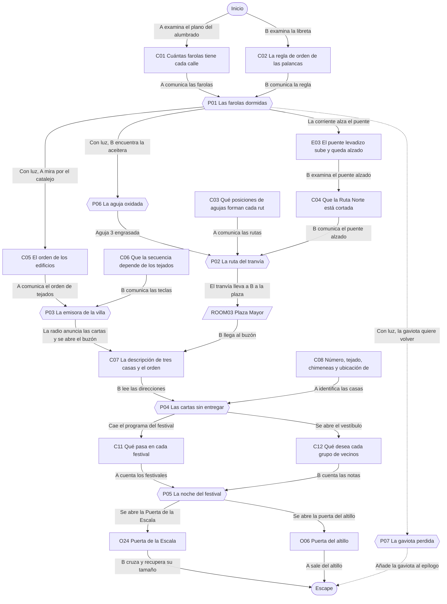
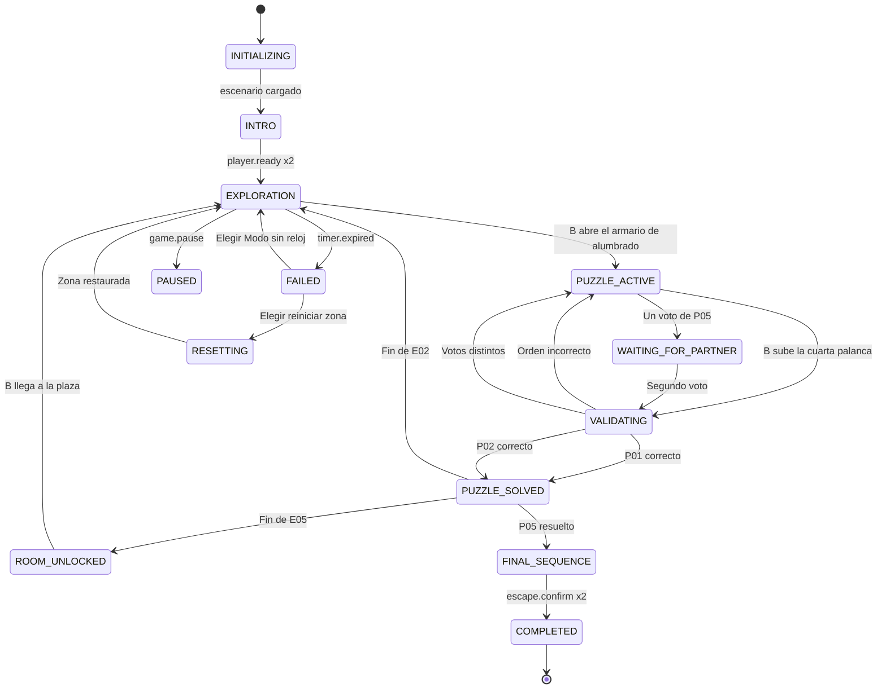

# ER09 · La ciudad en miniatura

En el taller del maquetista Ezequiel Alba, la maqueta de Villa Lucero se ha quedado sin luz, sin tranvía y sin radio. El Jugador B queda encogido dentro de la ciudad y el Jugador A, desde el altillo, tiene los planos. Juntos devuelven la vida a la villa para que B recupere su tamaño.

## A. Ficha técnica

| Campo | Valor |
|---|---|
| ID | ER09 |
| Nombre | La ciudad en miniatura |
| Versión | 1.0.0 |
| Género | Fantasía urbana |
| Sinopsis | En el taller del maquetista Ezequiel Alba, la maqueta de Villa Lucero se ha quedado sin luz, sin tranvía y sin radio. El Jugador B queda encogido dentro de la ciudad y el Jugador A, desde el altillo, tiene los planos. Juntos devuelven la vida a la villa para que B recupere su tamaño. |
| Objetivo principal | OBJ01 Restaurar el alumbrado, el tranvía y la radio de Villa Lucero; OBJ02 Abrir el Ayuntamiento y elegir el festival de la noche; OBJ03 Salir: A por la puerta del altillo y B por la Puerta de la Escala |
| Objetivos secundarios | OBJ04 Devolver la gaviota de madera a su nido en el faro |
| Jugadores | 2 (A: Gigante del altillo con los planos; B: Visitante encogido dentro de la villa) |
| Duración estimada | 40 min (despertar 4, descubrimiento 10, complicación 12, clímax 10, escape 4) |
| Dificultad | Fácil |
| Zonas | 3 |
| Acertijos | 5 principales y 2 microacertijos |
| Objetos interactivos | 21 (más 7 decorativos) |
| Finales | 4 |
| Competencias | Distribución de responsabilidades, Comunicación clara, Escucha activa, Observación y análisis, Toma de decisiones compartida |
| Condiciones iniciales | A empieza en el altillo del taller con acceso a los planos, la mesa de control y el catalejo. B empieza encogido en el Barrio del Puerto de la maqueta y solo ve la ciudad a ras de suelo. Las farolas, el tranvía y la radio están apagados. La llamada de voz está abierta; en la ficción, A habla por el megáfono del taller y B por la radio de bolsillo del farolero. |
| Condición de victoria | Completar OBJ01, OBJ02, OBJ03 |
| Condición de fallo | 40 min de cuenta atrás: Amanece en la villa y la magia se adormece: los jugadores eligen reiniciar la zona actual o seguir en Modo sin reloj. No se pierde ningún acertijo ya resuelto. |
| Condición de reinicio | Cualquiera de los dos pulsa Reiniciar zona y el otro lo confirma; también se ofrece al agotarse el reloj. El reinicio completo vuelve al estado inicial y a la intro. |

## B. Guion narrativo

**1. Introducción cinematográfica.** Plano cenital lento sobre una maqueta enorme: un puerto, una plaza con fuente, un faro y vías de tranvía, todo a oscuras. Una lámpara de taller parpadea. Se oye lluvia suave en el tragaluz y una caja de música que se detiene. La cámara baja hasta una puertecita dorada en la pared de la maqueta con un rótulo: Puerta de la Escala.

**2. Por qué están aquí.** La pareja ha ido al Taller Alba a recoger la maqueta que el viejo maquetista prometió prestar a la feria del barrio. La puerta del taller estaba abierta y no hay nadie. B toca la Puerta de la Escala para ver si se abre y, con un destello, aparece dentro de la ciudad, del tamaño de una figurita. A se queda en el altillo, con los planos de Ezequiel.

**3. Situación inicial.** La puerta del altillo se ha cerrado con el destello y la Puerta de la Escala ya no responde. Una grabadora en la mesa explica que la villa está dormida y que solo despertará si vuelven su luz, su tranvía y su voz.

**4. Objetivo.** Encender las farolas, llevar el tranvía hasta la Plaza Mayor, sintonizar la radio, abrir el Ayuntamiento y celebrar el festival que devuelve la magia a la maqueta, para que B recupere su tamaño y los dos puedan salir.

**5. Primer descubrimiento.** B encuentra junto al armario de alumbrado la libreta del farolero, con la regla para subir las palancas. A, en la pared del altillo, encuentra el plano del alumbrado con cuántas farolas tiene cada calle. Ninguno puede encender la luz sin lo que tiene el otro.

**6. Progresión de los acontecimientos.**

- Con las farolas encendidas, la maqueta recupera corriente: los tejados de la plaza empiezan a parpadear y la radio del puerto se ilumina.
- La misma corriente levanta el puente levadizo, que lleva años atascado. B lo ve desde la calle; en el plano de A el puente sigue bajado.
- B engrasa la aguja oxidada y, guiado por el plano del tranvía de A, coloca las cuatro agujas de la ruta que evita el puente. El tranvía lleva a B hasta la Plaza Mayor.
- A observa con el catalejo el orden en que se encienden los tejados y B lo marca en la radio. La emisora de la villa vuelve a sonar con un mensaje de Ezequiel.
- El mensaje habla de tres cartas que el cartero no llegó a entregar. B las encuentra en el buzón de Correos y A identifica las casas en el catastro para abrir el Ayuntamiento.
- En el balcón del Ayuntamiento, la pareja decide qué festival celebra la villa.

**7. Obstáculos narrativos.**

- Las calles están a oscuras: desde el suelo B solo ve la farola que tiene al lado y no puede contarlas.
- El puente levadizo sube por sorpresa y deja inútil la ruta norte del tranvía.
- La aguja 3 está oxidada y no se mueve hasta engrasarla.
- Los tejados solo se ven desde arriba y las teclas de la radio solo tienen dibujos, no nombres.

**8. Revelaciones.**

- Ezequiel no se fue: la grabación de la radio revela que se quedó dormido dentro de la maqueta hace años y que la villa le guarda un sitio en el banco de la plaza.
- La Puerta de la Escala no es una trampa: se abre cuando la villa celebra una fiesta, porque así la diseñó Ezequiel para que sus visitas pudieran entrar y salir.
- Las cartas sin entregar son invitaciones al festival que el cartero nunca repartió.

**9. Clímax.** Con el Ayuntamiento abierto, A recibe el programa del festival y B lee las notas de los vecinos. Los dos votan el festival. Cuando coinciden, la plaza se llena de vecinos de madera que vuelven a moverse.

**10. Escena de escape.** La música del festival sube, la Puerta de la Escala se abre con luz dorada y B la cruza recuperando su tamaño en una secuencia de crecimiento suave. A la vez, la puerta del altillo se desbloquea. Los dos confirman la salida y se encuentran en la escalera del taller.

**11. Epílogo.** Desde la escalera ven cómo la maqueta sigue encendida. En el banco de la plaza aparece una figurita nueva: un maquetista con delantal que saluda. Sobre la mesa queda una nota: La maqueta es vuestra para la feria. Cuidad de que nunca le falte una fiesta.

### Diálogos y textos del sistema

Cada línea es un subtítulo. Las líneas de canal `document` quedan además guardadas en el registro de pistas.

| ID | Quién | Texto | Cuándo | Para | Canal |
|---|---|---|---|---|---|
| D01 | Narrador | El Taller Alba está abierto y en silencio. En la mesa grande duerme una ciudad entera. | START | Ambos | subtitle |
| D02 | Ezequiel Alba (grabación) | Si estáis oyendo esto, la villa se ha quedado dormida otra vez. Le pasa cuando nadie la cuida. | E01 | Jugador A | audio_subtitled |
| D03 | Ezequiel Alba (grabación) | Para despertarla necesita tres cosas: luz, su tranvía y su voz. El resto os lo dirá ella. | E01 | Jugador A | audio_subtitled |
| D04 | Ezequiel Alba (grabación) | Y si alguien ha cruzado la Puerta de la Escala, tranquilos: se abre siempre que hay fiesta. | E01 | Jugador A | audio_subtitled |
| D05 | Narrador | Has encogido. Las calles del puerto parecen enormes y todo está a oscuras. Oyes la voz de tu pareja desde muy arriba. | START | Jugador B | subtitle |
| D06 | Narrador | Desde el altillo ves la maqueta entera, pero no distingues los carteles. Tu pareja está ahí abajo, en el muelle. | START | Jugador A | subtitle |
| D07 | Sistema | Las farolas se encienden calle por calle. | E02 | Ambos | popup |
| D08 | Narrador | Un chirrido largo: el puente levadizo del canal se alza y se queda arriba. | E03 | Jugador B | subtitle |
| D09 | Narrador | Los tejados de la plaza empiezan a encenderse por turnos. | E04 | Jugador A | subtitle |
| D10 | Sistema | Suena la campana. El tranvía arranca hacia el Túnel del Mercado. | E05 | Ambos | popup |
| D11 | Ezequiel Alba (radio) | Aquí Radio Villa Lucero. Me quedé dormido en el banco de la plaza y la villa conmigo. Perdonad el desorden. | E06 | Ambos | audio_subtitled |
| D12 | Ezequiel Alba (radio) | Tobías, el cartero, dejó tres cartas en el buzón aquella noche. Son las invitaciones del festival. Con sus direcciones el alcalde abre su puerta. | E06 | Ambos | document |
| D13 | Sistema | La cerradura del Ayuntamiento gira sola. Algo cae por la chimenea del taller. | E07 | Ambos | popup |
| D14 | Panadera Rosa (figurita) | ¿Habrá fiesta esta noche? Decidid vosotros, que la habéis despertado. | E07 | Jugador B | audio_subtitled |
| D15 | Sistema | Han votado distinto. Cuéntense lo que han leído y voten otra vez. | P05 | Ambos | popup |
| D16 | Narrador | La plaza se llena de vecinos que vuelven a moverse. La Puerta de la Escala brilla como un sol pequeño. | E08 | Ambos | subtitle |
| D17 | Ezequiel Alba (radio) | Gracias. Cuando crucéis la puerta, no miréis atrás demasiado rato: la villa es tímida con los gigantes. | E08 | Ambos | audio_subtitled |
| D18 | Ezequiel Alba (radio) | Si queréis ver la plaza, mirad lo que la plaza quiere que veáis. Los tejados nunca mienten. | E09 | Ambos | audio_subtitled |
| D19 | Narrador | Amanece en la maqueta y la magia se adormece. ¿Reiniciar la zona o seguir sin reloj? | E10 | Ambos | popup |
| D20 | Narrador | La gaviota de madera canta una vez y se acomoda en su nido. | E11 | Ambos | subtitle |

## C. Escenografía y planos

Coordenadas en metros con origen en la esquina suroeste del suelo de cada zona: `x` hacia el este, `y` hacia arriba, `z` hacia el norte.

### ROOM01 · Altillo del maquetista

Altillo de madera con tragaluz, una mesa de control con interruptores de latón y una barandilla al norte desde la que se ve la maqueta entera desde arriba.

**Medidas:** 6 × 5 m, altura 3 m. **Acceso:** A sí, B no. **Se abre:** desde el inicio.

**Qué ve cada jugador.** A: Todo el altillo y la maqueta desde arriba: tejados, calles y vías, pero sin detalle de fachadas ni carteles. B: No lo ve; solo oye la voz de A como si llegara por un megáfono desde el cielo.

**Distribución.** Puerta de salida en la pared sur, centro. Mesa de control en el centro. Planos clavados en la pared oeste. Tablón de corcho en la pared este. Barandilla y catalejo en el borde norte, sobre la maqueta. Estantería decorativa en la esquina suroeste.

| ID | Elemento | Tipo o pared | Posición (x, y, z) | Notas |
|---|---|---|---|---|
| DOOR01 | Puerta de salida | pared south | (3, 0, 0) | Se abre con P05_SOLVED |
| — | Ventana | pared north | (3, 2.9, 4) | Tragaluz en el techo con lluvia suave; no es interactivo |
| O01 | Plano del alumbrado | 2 Examinar | (0.1, 1.5, 1.8) | Lámina de papel amarillento con las cuatro calles del puerto y farolas dibujadas como círculos con su número |
| O02 | Plano del tranvía | 2 Examinar | (0.1, 1.5, 3.4) | Lámina azul con la red de vías, las cuatro agujas numeradas y dos rutas marcadas, Norte y Sur |
| O03 | Catastro de Villa Lucero | 2 Examinar | (3.6, 0.9, 2.3) | Cuaderno abierto sobre la mesa con las casas vistas desde arriba, cada una con su número, tejado y chimeneas |
| O04 | Mesa de control | 6 Activar | (3, 0.9, 2.5) | Mesa de madera con interruptores de latón y un dial de tres ruedas con la placa Llave del alcalde |
| O05 | Catalejo de latón | 4 Usar | (3, 1.2, 4.8) | Catalejo sobre trípode junto a la barandilla norte, apuntando a la plaza |
| O06 | Puerta del altillo | 10 Objeto de salida | (3, 0, 0.05) | Puerta de madera con cerradura dorada que brilla igual que la Puerta de la Escala |
| O07 | Flexo de taller | 1 Decorativo | (2.2, 0.9, 2.8) | Flexo verde con pinzas para piezas |
| O08 | Estantería con trenes de juguete | 1 Decorativo | (0.4, 0, 0.6) | Estantería baja con locomotoras de hojalata y botes de pintura |
| O09 | Grabadora de Ezequiel | 9 Elemento narrativo | (2.6, 0.9, 2.2) | Grabadora de cinta con una etiqueta escrita a mano: Para quien venga a por la maqueta |
| O22 | Programa del festival | 2 Examinar | (5.9, 1.6, 1.5) | Hoja ilustrada con dos festivales, clavada en el corcho de la pared este |

| Luz | Tipo | Posición | Color | Intensidad | Uso |
|---|---|---|---|---|---|
| L01 | Lámpara colgante cálida | (3, 2.6, 2.5) | #FFD9A0 | 0.8 | Parpadea durante la intro y se estabiliza al empezar |
| L02 | Flexo de mesa | (2.2, 1.3, 2.6) | #FFF1D6 | 0.5 | Ilumina la mesa de control y la grabadora |

**Sonido ambiente:** Lluvia suave en el tragaluz y tictac de un reloj de pared. **Música:** Caja de música lenta, muy baja.

**Cambios dinámicos:**

- E02: La maqueta bajo la barandilla se ilumina con las farolas del puerto
- E07: El programa del festival cae por la chimenea del taller y queda clavado en el corcho
- E08: La lámpara pasa a luz dorada y la puerta del altillo se desbloquea

**Para el motor:** Escena separada de la maqueta. La vista de A sobre la maqueta es una cámara cenital fija con zoom limitado: muestra tejados y vías y oculta carteles y fachadas (capa de detalle desactivada para A). El catalejo es una segunda cámara con más zoom sobre los tejados de la plaza.

### ROOM02 · Barrio del Puerto

Muelle de la maqueta a escala de B: calles empedradas, barcas amarradas, un faro con escalera, la torre de radio y un puesto de agujas del tranvía. Todo está a oscuras salvo la luna.

**Medidas:** 10 × 8 m, altura 4 m. **Acceso:** A no, B sí. **Se abre:** desde el inicio.

**Qué ve cada jugador.** A: Desde arriba: calles, vías y tejados del puerto, sin carteles ni el estado del puente. B: A ras de suelo: carteles, palancas, el puente y lo que tiene a unos metros; no ve los tejados.

**Distribución.** Medidas en la escala de B. Armario de alumbrado en la pared oeste. Muelle y barcas al sureste. Aguja 3 en el centro de las vías. Puesto de agujas al noreste. Puente levadizo en la esquina noreste. Torre de radio al noroeste y faro con nido en la esquina noroeste alta. Salida del tranvía hacia la plaza en la pared norte, centro.

| ID | Elemento | Tipo o pared | Posición (x, y, z) | Notas |
|---|---|---|---|---|
| DOOR02 | Puerta a Plaza Mayor | pared north | (5, 0, 8) | Se abre con P02_SOLVED |
| O10 | Armario de alumbrado | 8 Mecanismo cooperativo | (0.3, 0, 4) | Armario de hierro con cuatro palancas; cada una lleva un símbolo en relieve y su nombre: ancla, pez, faro y ola |
| O11 | Libreta del farolero | 2 Examinar | (1.6, 0.5, 3.2) | Libreta de tapas de hule sobre un banco, atada con un cordel |
| O12 | Aceitera | 3 Recoger | (7.8, 0.3, 1.2) | Aceitera de latón con pico largo, entre las cajas de pescado |
| O13 | Aguja 3 oxidada | 4 Usar | (5, 0, 2.2) | Palanca de cambio de vía con óxido naranja y una placa con el número 3 |
| O14 | Puesto de agujas | 8 Mecanismo cooperativo | (6.5, 0, 5.5) | Caseta con cuatro palancas numeradas del 1 al 4 que muestran IZQ o DER en una ventanilla, y una palanca roja de Salida del tranvía |
| O15 | Puente levadizo | 2 Examinar | (9, 0, 7.4) | Puente de madera con contrapesos sobre el canal; bajado al inicio |
| O16 | Cabina de la radio | 8 Mecanismo cooperativo | (2.5, 0, 7.2) | Cabina al pie de la torre de radio con cuatro teclas grandes: barra de pan, libro abierto, máscara de teatro y sobre |
| O17 | Barcas amarradas | 1 Decorativo | (8.5, 0, 0.6) | Tres barcas de colores meciéndose en el muelle |
| O18 | Cajas de pescado | 1 Decorativo | (8.6, 0, 1.6) | Pila de cajas de madera vacías con redes |
| O27 | Gaviota de madera | 3 Recoger | (7.2, 0.4, 0.5) | Gaviota tallada sobre la proa de una barca, con una etiqueta atada a la pata |
| O28 | Nido del faro | 5 Combinar | (0.6, 3.5, 7.6) | Nido de ramitas en la barandilla de lo alto del faro, solo visible al subir la escalera |

| Luz | Tipo | Posición | Color | Intensidad | Uso |
|---|---|---|---|---|---|
| L03 | Luz de luna direccional | (5, 4, 4) | #8FA8D8 | 0.25 | Única luz al inicio; suficiente para leer de cerca |
| L04 | Farolas del puerto (grupo) | (5, 3, 4) | #FFC46B | 0.9 | Apagadas hasta P01; se encienden calle por calle |

**Sonido ambiente:** Olas pequeñas, cuerdas de barcas y gaviotas lejanas. **Música:** Tema de la villa: guitarra y celesta, sube de capas con cada sistema restaurado.

**Cambios dinámicos:**

- E02: Las farolas se encienden en cascada en el orden de las palancas
- E03: El puente levadizo sube con chirrido y queda alzado
- E05: El tranvía llega iluminado, recoge a B y se abre la salida norte

**Para el motor:** Escena en tercera persona o primera persona a escala de figurita. El faro tiene una escalera transitable hasta el nido. Las palancas del armario y del puesto de agujas son interactuables por separado y muestran su posición con forma y texto, no solo color.

### ROOM03 · Plaza Mayor

Plaza cuadrada con fuente, bancos, la oficina de Correos, el Ayuntamiento con balcón y las fachadas del Teatro, la Escuela y la Panadería. En la pared este brilla la Puerta de la Escala.

**Medidas:** 10 × 10 m, altura 5 m. **Acceso:** A no, B sí. **Se abre:** P02_SOLVED.

**Qué ve cada jugador.** A: Desde arriba y con el catalejo: los cuatro tejados que parpadean y la forma de la plaza. B: Fachadas, buzón, puertas y tablones a ras de suelo; no ve los tejados.

**Distribución.** Medidas en la escala de B. Llegada del tranvía por el sur, centro. Fuente en el centro. Buzón de Correos en la pared oeste. Ayuntamiento en la pared norte, centro, con el tablón de vecinos en su vestíbulo. Puerta de la Escala en la pared este, centro. Fachadas a lo largo de las paredes.

| ID | Elemento | Tipo o pared | Posición (x, y, z) | Notas |
|---|---|---|---|---|
| DOOR03 | Puerta a Barrio del Puerto | pared south | (5, 0, 0) | Se abre con P02_SOLVED |
| DOOR04 | Puerta de salida | pared east | (10, 0, 5) | Se abre con P05_SOLVED |
| O19 | Buzón de Correos | 2 Examinar | (0.4, 0, 5) | Buzón amarillo con trampilla y la palabra CORREOS en relieve |
| O20 | Puerta del Ayuntamiento | 7 Bloqueado | (5, 0, 9.8) | Doble puerta verde con escudo de la villa y una cerradura de tres ruedas |
| O21 | Tablón de los vecinos | 2 Examinar | (5, 1.5, 9.6) | Tablón de corcho en el vestíbulo del Ayuntamiento con dos notas clavadas |
| O24 | Puerta de la Escala | 10 Objeto de salida | (9.8, 0, 5) | Puertecita dorada con el rótulo Puerta de la Escala y un rayo de sol grabado |
| O25 | Fuente de la plaza | 1 Decorativo | (5, 0, 5) | Fuente de piedra con un pez que echa agua |
| O26 | Banco de la plaza | 1 Decorativo | (3, 0, 3) | Banco de hierro forjado vacío; en el epílogo aparece en él la figurita de Ezequiel |
| O29 | Fachadas de la plaza | 1 Decorativo | (5, 0, 9.9) | Fachadas del Teatro, la Escuela, la Panadería y Correos con letreros pintados |

| Luz | Tipo | Posición | Color | Intensidad | Uso |
|---|---|---|---|---|---|
| L05 | Farolas de la plaza (grupo) | (5, 3, 5) | #FFC46B | 0.8 | Encendidas desde P01 |
| L06 | Luz del balcón del Ayuntamiento | (5, 3.5, 9.5) | #FFE7B0 | 0.6 | Se enciende al abrir el Ayuntamiento |
| L07 | Brillo de la Puerta de la Escala | (9.8, 1, 5) | #FFD34D | 0.3 | Tenue al inicio; intenso en la secuencia final |

**Sonido ambiente:** Fuente de la plaza y brisa. **Música:** Tema de la villa: guitarra y celesta, sube de capas con cada sistema restaurado.

**Cambios dinámicos:**

- E07: Se abren las puertas del Ayuntamiento y se ilumina el vestíbulo con el tablón
- E08: Los vecinos de madera llenan la plaza y empieza el festival elegido

**Para el motor:** Escena cargada al resolver P02. P04 se valida en la mesa de control de A (ROOM01) aunque la puerta esté en esta zona: el acertijo pertenece a la plaza y la entrada llega desde el altillo. Los tejados visibles para A son una capa propia de esta escena que solo renderiza la cámara de A.

## D. Inventario de objetos

| object_id | Nombre | Descripción visual | Zona | Posición | Tipo | Estado inicial | Acción | Activación | Resultado | Pista | Acertijo | Jugador | Estado final |
|---|---|---|---|---|---|---|---|---|---|---|---|---|---|
| O01 | Plano del alumbrado | Lámina de papel amarillento con las cuatro calles del puerto y farolas dibujadas como círculos con su número | ROOM01 | (0.1, 1.5, 1.8) | 2 Examinar | DEFAULT | Examinar | — | Abre la lámina a pantalla completa y guarda la pista C01 | C01 | P01 | Jugador A | EXAMINED |
| O02 | Plano del tranvía | Lámina azul con la red de vías, las cuatro agujas numeradas y dos rutas marcadas, Norte y Sur | ROOM01 | (0.1, 1.5, 3.4) | 2 Examinar | DEFAULT | Examinar | — | Abre la lámina y guarda la pista C03 | C03 | P02 | Jugador A | EXAMINED |
| O03 | Catastro de Villa Lucero | Cuaderno abierto sobre la mesa con las casas vistas desde arriba, cada una con su número, tejado y chimeneas | ROOM01 | (3.6, 0.9, 2.3) | 2 Examinar | DEFAULT | Examinar | — | Abre el cuaderno y guarda la pista C08 | C08 | P04 | Jugador A | EXAMINED |
| O04 | Mesa de control | Mesa de madera con interruptores de latón y un dial de tres ruedas con la placa Llave del alcalde | ROOM01 | (3, 0.9, 2.5) | 6 Activar | OFF | Girar las tres ruedas del dial y pulsar Abrir | P03_SOLVED | Envía el número al Ayuntamiento de la maqueta | — | P04 | Jugador A | ON |
| O05 | Catalejo de latón | Catalejo sobre trípode junto a la barandilla norte, apuntando a la plaza | ROOM01 | (3, 1.2, 4.8) | 4 Usar | IDLE | Usar para mirar los tejados | — | Cambia a la cámara del catalejo; con corriente muestra los tejados que parpadean (C05) y el nido vacío del faro (C14) | C05 | P03 | Jugador A | IN_USE |
| O06 | Puerta del altillo | Puerta de madera con cerradura dorada que brilla igual que la Puerta de la Escala | ROOM01 | (3, 0, 0.05) | 10 Objeto de salida | LOCKED | Salir | P05_SOLVED | Confirma la salida de A | — | — | Jugador A | OPEN |
| O07 | Flexo de taller | Flexo verde con pinzas para piezas | ROOM01 | (2.2, 0.9, 2.8) | 1 Decorativo | STATIC | none | — | Sin interacción | — | — | Nadie | STATIC |
| O08 | Estantería con trenes de juguete | Estantería baja con locomotoras de hojalata y botes de pintura | ROOM01 | (0.4, 0, 0.6) | 1 Decorativo | STATIC | none | — | Sin interacción | — | — | Nadie | STATIC |
| O09 | Grabadora de Ezequiel | Grabadora de cinta con una etiqueta escrita a mano: Para quien venga a por la maqueta | ROOM01 | (2.6, 0.9, 2.2) | 9 Elemento narrativo | STOPPED | Reproducir | — | Reproduce los diálogos D02 a D04 y los guarda en el historial | — | — | Jugador A | PLAYED |
| O10 | Armario de alumbrado | Armario de hierro con cuatro palancas; cada una lleva un símbolo en relieve y su nombre: ancla, pez, faro y ola | ROOM02 | (0.3, 0, 4) | 8 Mecanismo cooperativo | OFF | Subir palancas de una en una | — | Si el orden es correcto, enciende el alumbrado; si no, todas las palancas bajan | — | P01 | Jugador B | ON |
| O11 | Libreta del farolero | Libreta de tapas de hule sobre un banco, atada con un cordel | ROOM02 | (1.6, 0.5, 3.2) | 2 Examinar | DEFAULT | Examinar | — | Guarda la pista C02 | C02 | P01 | Jugador B | EXAMINED |
| O12 | Aceitera | Aceitera de latón con pico largo, entre las cajas de pescado | ROOM02 | (7.8, 0.3, 1.2) | 3 Recoger | FOUND | Recoger | — | Pasa al inventario de B | — | P06 | Jugador B | USED |
| O13 | Aguja 3 oxidada | Palanca de cambio de vía con óxido naranja y una placa con el número 3 | ROOM02 | (5, 0, 2.2) | 4 Usar | RUSTED | Usar objeto del inventario | — | Con la aceitera, la aguja queda suelta | C09 | P06 | Jugador B | OILED |
| O14 | Puesto de agujas | Caseta con cuatro palancas numeradas del 1 al 4 que muestran IZQ o DER en una ventanilla, y una palanca roja de Salida del tranvía | ROOM02 | (6.5, 0, 5.5) | 8 Mecanismo cooperativo | UNSET | Mover agujas y tirar de Salida | O13_OILED | Si las agujas forman una ruta transitable, el tranvía sale hacia la plaza | — | P02 | Jugador B | SET |
| O15 | Puente levadizo | Puente de madera con contrapesos sobre el canal; bajado al inicio | ROOM02 | (9, 0, 7.4) | 2 Examinar | DOWN | Examinar | — | Tras el evento E03 está alzado; examinarlo guarda la pista C04 | C04 | P02 | Jugador B | RAISED |
| O16 | Cabina de la radio | Cabina al pie de la torre de radio con cuatro teclas grandes: barra de pan, libro abierto, máscara de teatro y sobre | ROOM02 | (2.5, 0, 7.2) | 8 Mecanismo cooperativo | OFF | Pulsar teclas | P01_SOLVED | Con corriente acepta una secuencia de cuatro teclas | C06 | P03 | Jugador B | TUNED |
| O17 | Barcas amarradas | Tres barcas de colores meciéndose en el muelle | ROOM02 | (8.5, 0, 0.6) | 1 Decorativo | STATIC | none | — | Sin interacción | — | — | Nadie | STATIC |
| O18 | Cajas de pescado | Pila de cajas de madera vacías con redes | ROOM02 | (8.6, 0, 1.6) | 1 Decorativo | STATIC | none | — | Sin interacción | — | — | Nadie | STATIC |
| O19 | Buzón de Correos | Buzón amarillo con trampilla y la palabra CORREOS en relieve | ROOM03 | (0.4, 0, 5) | 2 Examinar | CLOSED | Abrir y examinar | P03_SOLVED | Tras el mensaje de la radio la trampilla se abre y aparecen tres cartas (C07) | C07 | P04 | Jugador B | OPEN |
| O20 | Puerta del Ayuntamiento | Doble puerta verde con escudo de la villa y una cerradura de tres ruedas | ROOM03 | (5, 0, 9.8) | 7 Bloqueado | LOCKED | Examinar (se abre desde la mesa de control de A) | — | Muestra el texto: Se abre con la llave del alcalde | — | P04 | Jugador B | OPEN |
| O21 | Tablón de los vecinos | Tablón de corcho en el vestíbulo del Ayuntamiento con dos notas clavadas | ROOM03 | (5, 1.5, 9.6) | 2 Examinar | HIDDEN | Examinar | P04_SOLVED | Guarda la pista C12 | C12 | P05 | Jugador B | VISIBLE |
| O22 | Programa del festival | Hoja ilustrada con dos festivales, clavada en el corcho de la pared este | ROOM01 | (5.9, 1.6, 1.5) | 2 Examinar | HIDDEN | Examinar | P04_SOLVED | Guarda la pista C11 | C11 | P05 | Jugador A | VISIBLE |
| O24 | Puerta de la Escala | Puertecita dorada con el rótulo Puerta de la Escala y un rayo de sol grabado | ROOM03 | (9.8, 0, 5) | 10 Objeto de salida | LOCKED | Cruzar | P05_SOLVED | Devuelve a B a su tamaño y confirma su salida | — | — | Jugador B | OPEN |
| O25 | Fuente de la plaza | Fuente de piedra con un pez que echa agua | ROOM03 | (5, 0, 5) | 1 Decorativo | STATIC | none | — | Sin interacción | — | — | Nadie | STATIC |
| O26 | Banco de la plaza | Banco de hierro forjado vacío; en el epílogo aparece en él la figurita de Ezequiel | ROOM03 | (3, 0, 3) | 1 Decorativo | STATIC | none | — | Sin interacción | — | — | Nadie | STATIC |
| O27 | Gaviota de madera | Gaviota tallada sobre la proa de una barca, con una etiqueta atada a la pata | ROOM02 | (7.2, 0.4, 0.5) | 3 Recoger | ON_BOAT | Recoger | — | Pasa al inventario de B y guarda la pista C15 | C15 | P07 | Jugador B | PLACED |
| O28 | Nido del faro | Nido de ramitas en la barandilla de lo alto del faro, solo visible al subir la escalera | ROOM02 | (0.6, 3.5, 7.6) | 5 Combinar | EMPTY | Colocar objeto | P01_SOLVED | Con la gaviota, la gaviota canta y queda en el nido | — | P07 | Jugador B | OCCUPIED |
| O29 | Fachadas de la plaza | Fachadas del Teatro, la Escuela, la Panadería y Correos con letreros pintados | ROOM03 | (5, 0, 9.9) | 1 Decorativo | STATIC | none | — | Sin interacción | — | — | Nadie | STATIC |

## E. Pistas

| clue_id | Contenido exacto | Alternativa accesible | Ubicación | Descubrimiento | Quién | Acertijo | Revela | Depende de | Se habilita | Nivel | Descubierta cuando |
|---|---|---|---|---|---|---|---|---|---|---|---|
| C01 | Red de alumbrado del puerto. Calle del Ancla: 12 farolas. Calle del Pez: 7 farolas. Calle del Faro: 15 farolas. Calle de la Ola: 9 farolas. | Lista leída en voz alta y en texto grande: Ancla 12, Pez 7, Faro 15, Ola 9. | O01 Plano del alumbrado | A examina el plano del alumbrado en la pared oeste | Jugador A | P01 | Cuántas farolas tiene cada calle | — | — | 0 | O01_EXAMINED |
| C02 | Libreta del farolero: Cuando falte la luz, subid las palancas empezando por la calle que más farolas tiene y terminando por la que menos. Si se sube una fuera de orden, todas bajan. | La misma regla en texto grande y con lectura en voz. | O11 Libreta del farolero | B examina la libreta sobre el banco | Jugador B | P01 | La regla de orden de las palancas | — | — | 0 | O11_EXAMINED |
| C03 | Red del tranvía. De la Cochera a la Plaza Mayor hay dos rutas. Ruta Norte, por el Puente Levadizo: aguja 1 IZQ, aguja 2 IZQ, aguja 3 DER, aguja 4 IZQ. Ruta Sur, por el Túnel del Mercado: aguja 1 DER, aguja 2 DER, aguja 3 IZQ, aguja 4 DER. | Tabla de dos filas, Norte y Sur, con la posición de cada aguja escrita como IZQ o DER y flechas. | O02 Plano del tranvía | A examina el plano del tranvía en la pared oeste | Jugador A | P02 | Qué posiciones de agujas forman cada ruta y qué ruta usa el puente | — | — | 0 | O02_EXAMINED |
| C04 | El Puente Levadizo está alzado y no baja. Un cartel dice: Puente en mantenimiento, tranvías por el Túnel del Mercado. | Texto del cartel y descripción: el puente está levantado, no se puede cruzar. | O15 Puente levadizo | B examina el puente tras el evento E03 | Jugador B | P02 | Que la Ruta Norte está cortada | — | P01_SOLVED | 0 | O15_RAISED |
| C05 | Desde el catalejo se ven cuatro tejados que se iluminan por turnos, siempre en este orden: Teatro, Correos, Panadería, Escuela. Después hay una pausa de 3 segundos y vuelve a empezar. | Además del destello, cada tejado muestra un número grande del 1 al 4 con su nombre: 1 Teatro, 2 Correos, 3 Panadería, 4 Escuela. | O05 Catalejo de latón | A mira por el catalejo cuando la villa tiene corriente | Jugador A | P03 | El orden de los edificios | — | P01_SOLVED | 0 | O05_IN_USE |
| C06 | Letrero de la radio: Para sintonizar la emisora de la villa, pulsad las teclas en el orden en que se encienden los tejados de la plaza. Teclas: barra de pan, libro abierto, máscara de teatro, sobre. | Cada tecla tiene además su forma en relieve y una palabra: PAN, LIBRO, MÁSCARA, SOBRE. | O16 Cabina de la radio | B examina la cabina de la radio | Jugador B | P03 | Que la secuencia depende de los tejados y qué dibujo tiene cada tecla | — | — | 0 | — |
| C07 | Tres cartas con sellos numerados. Sello 1: Para la casa de tejado verde con lunares que mira a la fuente. Sello 2: Para la casa de dos chimeneas pegada al Teatro. Sello 3: Para la casa que está junto al faro. Al dorso: El alcalde abre su puerta con los números de estas casas, en el orden de los sellos. | Las tres direcciones en texto grande; el tejado se describe por color y por dibujo (verde con lunares). | O19 Buzón de Correos | B abre el buzón cuando la radio anuncia las cartas | Jugador B | P04 | La descripción de tres casas y el orden | — | P03_SOLVED | 0 | O19_OPEN |
| C08 | Catastro, vista desde arriba. Casa 2: tejado rojo con rayas, una chimenea, junto al faro. Casa 4: tejado verde con lunares, una chimenea, frente a la fuente. Casa 5: tejado verde con lunares, dos chimeneas, junto a la Escuela. Casa 7: tejado azul con cuadros, dos chimeneas, pegada al Teatro. Casa 8: tejado rojo con rayas, dos chimeneas, junto al puente. | Tabla de cinco filas: número, tejado (color y dibujo), chimeneas y lugar. | O03 Catastro de Villa Lucero | A examina el catastro sobre la mesa | Jugador A | P04 | Número, tejado, chimeneas y ubicación de cada casa | — | — | 0 | O03_EXAMINED |
| C09 | La aguja 3 está dura por el óxido y no se mueve. Huele a hierro viejo. | Texto: aguja 3 bloqueada por óxido; necesita aceite. | O13 Aguja 3 oxidada | B intenta mover la aguja 3 | Jugador B | P06 | Que la aguja necesita aceite | — | — | 0 | — |
| C10 | Ezequiel por la radio: Si queréis ver la plaza, mirad lo que la plaza quiere que veáis. Los tejados nunca mienten. | Subtítulo y registro de eventos con la misma frase. | O09 Grabadora de Ezequiel | Ayuda contextual que el sistema ofrece si nadie usa el catalejo en 2 minutos tras encender la luz | Ambos | P03 | Que A debe usar el catalejo | — | P01_SOLVED, IDLE_120 | 1 | IDLE_120 |
| C11 | Programa del festival. Festival de Faroles: los vecinos sueltan farolillos desde la plaza y el puerto queda iluminado toda la noche. Festival de Música: la radio toca y el tranvía recorre la villa con la banda. | Dos tarjetas con icono y texto: farolillo y nota musical. | O22 Programa del festival | A examina el programa que cae por la chimenea | Jugador A | P05 | Qué pasa en cada festival | — | P04_SOLVED | 0 | O22_VISIBLE |
| C12 | Notas de los vecinos. Panadera Rosa: Que suene la banda, hace años que no bailamos. Pescadores del muelle: Queremos ver el puerto iluminado desde las barcas. | Las dos notas en texto grande con el nombre de quien la firma. | O21 Tablón de los vecinos | B examina el tablón del vestíbulo | Jugador B | P05 | Qué desea cada grupo de vecinos | — | P04_SOLVED | 0 | O21_VISIBLE |
| C14 | En lo alto del faro hay un nido vacío. Desde arriba se ve una pluma blanca enganchada en la barca roja del muelle. | Texto: nido vacío en el faro; pluma en la barca roja. | O05 Catalejo de latón | A mira el faro con el catalejo cuando hay luz | Jugador A | P07 | Dónde va la gaviota y dónde está | — | P01_SOLVED | 0 | O05_IN_USE |
| C15 | Etiqueta en la pata de la gaviota: Vuelvo a casa cuando la villa tiene luz. | Texto de la etiqueta en grande. | O27 Gaviota de madera | B recoge la gaviota de la barca | Jugador B | P07 | Que la gaviota tiene un hogar al que volver | — | — | 0 | O27_COLLECTED |

### Ayudas progresivas por acertijo

| Acertijo | Nivel 1: dónde mirar | Nivel 2: principio | Nivel 3: ayuda concreta |
|---|---|---|---|
| P01 Las farolas dormidas | B tiene la regla y A tiene el plano: léanse lo que ven. | La regla ordena las calles por su número de farolas, de mayor a menor. | La primera palanca es la de la calle con 15 farolas. |
| P06 La aguja oxidada | Busca algo con aceite cerca del muelle. | El óxido se suelta engrasando. | La aceitera está entre las cajas de pescado. |
| P02 La ruta del tranvía | Comparen lo que ve B en la calle con lo que dice el plano de A. | Una de las dos rutas ya no se puede usar; el plano no lo sabe. | El puente está alzado: usen la ruta que va por el túnel. |
| P03 La emisora de la villa | Los tejados solo se ven desde arriba, con el catalejo. | Cada edificio tiene un dibujo que lo representa en las teclas. | El primer tejado es el del Teatro: su tecla es la máscara. |
| P07 La gaviota perdida | Hay algo en las barcas del muelle. | La gaviota quiere volver a un nido alto. | El nido está en lo alto del faro. |
| P04 Las cartas sin entregar | Las cartas las tiene B y el catastro A. | Cada carta tiene dos o tres condiciones; una casa solo vale si las cumple todas. | Hay dos casas verdes: solo una está frente a la fuente. |
| P05 La noche del festival | A tiene el programa y B las notas de los vecinos. | No hay opción incorrecta: elijan la que les apetezca más. | Voten la misma opción en las dos pantallas. |

## F. Acertijos

### P01 · Las farolas dormidas

1. **ID.** P01
2. **Nombre.** Las farolas dormidas
3. **Narrativa.** La villa necesita luz antes que nada. El farolero dejó su regla en una libreta, pero desde el suelo B no puede contar las farolas de las calles a oscuras.
4. **Objetivo.** Subir las cuatro palancas del armario de alumbrado en el orden correcto.
5. **Situación.** B está frente al armario de alumbrado con cuatro palancas: Ancla, Pez, Faro y Ola. A tiene en la pared el plano con las farolas de cada calle.
6. **Elementos necesarios.** O10 Armario de alumbrado, O01 Plano del alumbrado, O11 Libreta del farolero
7. **Información de A.** Número de farolas por calle (C01): Ancla 12, Pez 7, Faro 15, Ola 9.
8. **Información de B.** La regla del farolero (C02): de la calle con más farolas a la que menos; y las palancas del armario.
9. **Qué deben comunicarse.** B lee la regla a A; A dicta las calles ordenadas por número de farolas; B confirma cada palanca antes de subirla.
10. **Reglas.** Las palancas se suben de una en una. Si una palanca se sube fuera de orden, las cuatro bajan y se puede empezar de nuevo. Bajar palancas no cuenta como fallo.
11. **Pasos.** (1) B examina la libreta y lee la regla. (2) A examina el plano del alumbrado. (3) Ordenan las calles de más a menos farolas: Faro 15, Ancla 12, Ola 9, Pez 7. (4) B sube Faro, Ancla, Ola y Pez.
12. **Respuesta correcta.** FARO · ANCLA · OLA · PEZ (sequence; Se compara la lista de palancas en el orden en que se subieron)
13. **Respuestas incorrectas posibles.** ANCLA · PEZ · FARO · OLA: Es el orden en que aparecen en el armario, no el de farolas.; PEZ · OLA · ANCLA · FARO: Es de menos a más farolas, al revés de la regla.
14. **Validación.** Cada palanca se valida al subirla contra la posición que le toca en el orden descendente de farolas de C01 (en la variante activa). Se acepta solo si la secuencia completa coincide. Introduce: Jugador B. Pistas exigidas: C01, C02. Modelo M1 Información dividida.
15. **Al resolverlo.** Las farolas se encienden calle por calle. Eventos: E02, E03, E04. Estado: O10_ON.
16. **Al fallar.** Las palancas bajan con un clac. La libreta dice que hay que empezar por la calle con más farolas. Las cuatro palancas vuelven abajo; nada más cambia.
17. **Intentos.** ilimitados; pausa de 10 s cada 3 fallos seguidos
18. **Sistema de pistas.** Pistas C01, C02 y tres niveles de ayuda (tabla de ayudas).
19. **Tiempo estimado.** 5 min
20. **Desbloquea.** P06, P03, P07
21. **Reinicio.** Las palancas bajan solas tras un error. Un reinicio de zona deja el armario en OFF y las farolas apagadas.
22. **Casos límite.** B sube palancas antes de que A haya leído el plano: se permite; solo se valida la secuencia. Doble pulsación sobre la misma palanca: se ignora la segunda (actionId repetido). B baja una palanca a mitad: la secuencia vuelve a cero sin contar como fallo. Desconexión de A a mitad: la secuencia de B se conserva en el servidor.

**Requisitos previos:** START. **Zona:** ROOM02.

**Por qué la solución es válida:** C01 da cuatro números distintos (15, 12, 9, 7), así que el orden descendente es único: Faro, Ancla, Ola, Pez. El orden del armario y el orden ascendente contradicen la regla de C02. B no puede contar las farolas porque la calle está a oscuras, y A no conoce la regla, así que la solución exige a los dos.

### P06 · La aguja oxidada (microacertijo)

1. **ID.** P06
2. **Nombre.** La aguja oxidada
3. **Narrativa.** La aguja 3 lleva años sin moverse. Sin ella el tranvía no puede cambiar de ruta.
4. **Objetivo.** Soltar la aguja 3 con aceite.
5. **Situación.** B intenta mover la aguja 3 y está bloqueada. Entre las cajas de pescado hay una aceitera.
6. **Elementos necesarios.** O12 Aceitera, O13 Aguja 3 oxidada
7. **Información de A.** Desde arriba A ve un brillo de latón junto a las cajas de pescado y puede decírselo a B.
8. **Información de B.** B sabe que la aguja está oxidada (C09) y puede recoger la aceitera.
9. **Qué deben comunicarse.** A puede orientar a B hacia el brillo de la aceitera si B no la encuentra.
10. **Reglas.** Solo la aceitera suelta la aguja. Usar otro objeto no gasta nada.
11. **Pasos.** (1) B examina la aguja 3. (2) B recoge la aceitera. (3) B usa la aceitera sobre la aguja 3.
12. **Respuesta correcta.** O12 · O13 (combine; Objeto del inventario usado sobre el objeto destino)
13. **Respuestas incorrectas posibles.** O27 · O13: La gaviota no suelta el óxido.
14. **Validación.** B tiene O12 en estado COLLECTED y lo usa sobre O13 en estado RUSTED. Introduce: Jugador B. Pistas exigidas: C09.
15. **Al resolverlo.** La aguja 3 cruje y por fin se mueve. Eventos: —. Estado: O13_OILED, O12_USED.
16. **Al fallar.** Eso no sirve para el óxido. Ninguno.
17. **Intentos.** ilimitados; pausa de 5 s cada 3 fallos seguidos
18. **Sistema de pistas.** Pistas C09 y tres niveles de ayuda (tabla de ayudas).
19. **Tiempo estimado.** 2 min
20. **Desbloquea.** P02
21. **Reinicio.** Reinicio de zona: la aceitera vuelve a las cajas y la aguja a RUSTED.
22. **Casos límite.** B usa la aceitera antes de examinar la aguja: se acepta y se guarda C09 a la vez. Usar la aceitera dos veces: la segunda no hace nada.

**Requisitos previos:** P01_SOLVED. **Zona:** ROOM02.

**Por qué la solución es válida:** Es el único objeto con aceite del escenario y la aguja solo admite el estado OILED. Es un microacertijo de enlace: no cuenta como acertijo principal.

### P02 · La ruta del tranvía

1. **ID.** P02
2. **Nombre.** La ruta del tranvía
3. **Narrativa.** Con la luz, el tranvía despierta en la cochera, pero el puente levadizo se ha alzado. Hay que mandarlo a la plaza por otro camino.
4. **Objetivo.** Poner las cuatro agujas en una ruta transitable y dar la salida al tranvía.
5. **Situación.** B está en el puesto de agujas, con cuatro palancas numeradas que muestran IZQ o DER. A tiene el plano del tranvía con dos rutas, pero en su plano el puente aparece bajado.
6. **Elementos necesarios.** O14 Puesto de agujas, O02 Plano del tranvía, O15 Puente levadizo
7. **Información de A.** Las dos rutas y la posición de las agujas para cada una (C03).
8. **Información de B.** El puente está alzado y el cartel desvía por el túnel (C04); el puesto de agujas.
9. **Qué deben comunicarse.** B avisa de que el puente está alzado; A elige la Ruta Sur en el plano y dicta las cuatro posiciones; B las coloca y las repite antes de dar la salida.
10. **Reglas.** Las agujas se pueden mover libremente antes de dar la salida. Al tirar de Salida, el tranvía recorre la ruta que forman las agujas. Si la ruta pasa por el puente alzado o queda incompleta, el tranvía se para y vuelve a la cochera.
11. **Pasos.** (1) B examina el puente y lee el cartel. (2) A examina el plano del tranvía. (3) Descartan la Ruta Norte porque cruza el puente. (4) B pone 1 DER, 2 DER, 3 IZQ, 4 DER. (5) B tira de Salida.
12. **Respuesta correcta.** {"1":"DER","2":"DER","3":"IZQ","4":"DER"} (position; Estado de las cuatro agujas en el momento de tirar de Salida)
13. **Respuestas incorrectas posibles.** {"1":"IZQ","2":"IZQ","3":"DER","4":"IZQ"}: Es la Ruta Norte: el tranvía se para ante el puente alzado.; {"1":"DER","2":"DER","3":"DER","4":"DER"}: Con la aguja 3 a la derecha la vía no conecta con el túnel.
14. **Validación.** Al tirar de Salida, el servidor compara las cuatro posiciones con la Ruta Sur de C03. La Ruta Norte se rechaza porque O15 está en RAISED. Introduce: Jugador B. Pistas exigidas: C03, C04. Modelo M4 Perspectivas complementarias.
15. **Al resolverlo.** Suena la campana y el tranvía arranca hacia el Túnel del Mercado. Eventos: E05. Estado: O14_SET.
16. **Al fallar.** El tranvía avanza, se detiene en la aguja que no conecta y vuelve despacio a la cochera. Las agujas se quedan como estaban para que puedan corregirlas.
17. **Intentos.** ilimitados; pausa de 10 s cada 3 fallos seguidos
18. **Sistema de pistas.** Pistas C03, C04 y tres niveles de ayuda (tabla de ayudas).
19. **Tiempo estimado.** 6 min
20. **Desbloquea.** P04
21. **Reinicio.** Tras un fallo el tranvía vuelve a la cochera; un reinicio de zona pone las agujas en IZQ y el puesto en UNSET.
22. **Casos límite.** B tira de Salida antes de engrasar la aguja 3: la palanca no se mueve y se muestra C09. B tira de Salida dos veces seguidas: la segunda se ignora mientras el tranvía está en marcha. A dicta la Ruta Norte sin saber lo del puente: el fallo muestra el puente alzado en la animación, lo que orienta sin castigar.

**Requisitos previos:** P06_SOLVED. **Zona:** ROOM02.

**Por qué la solución es válida:** Solo hay dos rutas en C03 y C04 corta la Norte, así que la única configuración válida es la Sur: 1 DER, 2 DER, 3 IZQ, 4 DER. A no ve el puente alzado y B no ve el plano: ninguno elige la ruta solo.

### P03 · La emisora de la villa

1. **ID.** P03
2. **Nombre.** La emisora de la villa
3. **Narrativa.** La radio tiene corriente, pero nadie sabe sintonizar la emisora. Los tejados de la plaza guardan la secuencia.
4. **Objetivo.** Pulsar las cuatro teclas de la radio en el orden de los tejados.
5. **Situación.** B está en la cabina de la radio con cuatro teclas de dibujos. A puede ver con el catalejo los tejados que parpadean en orden.
6. **Elementos necesarios.** O16 Cabina de la radio, O05 Catalejo de latón
7. **Información de A.** El orden en que se encienden los tejados (C05): Teatro, Correos, Panadería, Escuela.
8. **Información de B.** Las teclas tienen dibujos y no nombres (C06): pan, libro, máscara, sobre; y la regla de la radio.
9. **Qué deben comunicarse.** A dice el orden de los edificios; los dos relacionan cada edificio con su dibujo; B pulsa.
10. **Reglas.** Se pulsan cuatro teclas seguidas. Si la secuencia es incorrecta suena un zumbido suave y se vuelve a empezar.
11. **Pasos.** (1) A usa el catalejo y anota el orden de los tejados. (2) B lee el letrero de la radio. (3) Relacionan Teatro con máscara, Correos con sobre, Panadería con pan y Escuela con libro. (4) B pulsa máscara, sobre, pan, libro.
12. **Respuesta correcta.** MASCARA · SOBRE · PAN · LIBRO (sequence; Sin tildes ni mayúsculas; se compara la lista de teclas)
13. **Respuestas incorrectas posibles.** PAN · LIBRO · MASCARA · SOBRE: Es el orden de las teclas en el panel, no el de los tejados.; LIBRO · PAN · SOBRE · MASCARA: Es la secuencia al revés.
14. **Validación.** La secuencia de B debe coincidir con el orden de C05 (variante activa) traducido a dibujos: Teatro máscara, Correos sobre, Panadería pan, Escuela libro. Se registra que A tenía C05 descubierta. Introduce: Jugador B. Pistas exigidas: C05, C06. Modelo M2 Observación y ejecución.
15. **Al resolverlo.** La radio silba y suena la emisora de Villa Lucero. Eventos: E06. Estado: O16_TUNED.
16. **Al fallar.** La radio da un zumbido suave. Prueben otra vez. La secuencia vuelve a cero.
17. **Intentos.** ilimitados; pausa de 10 s cada 3 fallos seguidos
18. **Sistema de pistas.** Pistas C05, C06 y tres niveles de ayuda (tabla de ayudas).
19. **Tiempo estimado.** 6 min
20. **Desbloquea.** P04
21. **Reinicio.** La secuencia se borra tras un fallo. Reinicio de zona: la radio vuelve a POWERED.
22. **Casos límite.** B pulsa antes de que haya corriente: las teclas no responden y se muestra que falta luz. A mira por el catalejo antes de P01: los tejados están apagados y se indica que falta corriente. B pulsa cinco teclas: solo cuentan las cuatro primeras tras el último reinicio de secuencia.

**Requisitos previos:** P01_SOLVED. **Zona:** ROOM02.

**Por qué la solución es válida:** El orden de C05 es fijo y se repite en bucle. Cada edificio tiene un dibujo inequívoco (máscara para el teatro, sobre para correos, pan para la panadería y libro para la escuela), así que la secuencia es única. B no ve los tejados y A no ve las teclas.

### P07 · La gaviota perdida (microacertijo)

1. **ID.** P07
2. **Nombre.** La gaviota perdida
3. **Narrativa.** Una gaviota de madera espera en una barca a que la villa tenga luz para volver a su nido.
4. **Objetivo.** Llevar la gaviota al nido del faro.
5. **Situación.** B puede recoger la gaviota y subir al faro. A ve el nido desde arriba.
6. **Elementos necesarios.** O27 Gaviota de madera, O28 Nido del faro
7. **Información de A.** Dónde está el nido y que está vacío (C14).
8. **Información de B.** La gaviota y su etiqueta (C15).
9. **Qué deben comunicarse.** A indica que el nido está en lo alto del faro; B sube y la coloca.
10. **Reglas.** Es opcional y no bloquea nada. Solo funciona con luz en la villa.
11. **Pasos.** (1) B recoge la gaviota. (2) A mira el faro con el catalejo. (3) B sube al faro y coloca la gaviota en el nido.
12. **Respuesta correcta.** O27 · O28 (combine; Objeto del inventario usado sobre el objeto destino)
13. **Respuestas incorrectas posibles.** O12 · O28: La aceitera no es un pájaro.
14. **Validación.** B tiene O27 en COLLECTED y lo usa sobre O28 con la villa encendida. Introduce: Jugador B. Pistas exigidas: C14, C15.
15. **Al resolverlo.** La gaviota canta y se acomoda en el nido. Eventos: E11. Estado: O27_PLACED, O28_OCCUPIED.
16. **Al fallar.** Eso no va en el nido. Ninguno.
17. **Intentos.** ilimitados; pausa de 5 s cada 3 fallos seguidos
18. **Sistema de pistas.** Pistas C14, C15 y tres niveles de ayuda (tabla de ayudas).
19. **Tiempo estimado.** 2 min
20. **Desbloquea.** —
21. **Reinicio.** Reinicio de zona: la gaviota vuelve a la barca.
22. **Casos límite.** B coloca la gaviota antes de que haya luz: no se acepta y se muestra la etiqueta. Se completa después de abrir la plaza: se acepta igual.

**Requisitos previos:** P01_SOLVED. **Zona:** ROOM02.

**Por qué la solución es válida:** Solo hay un nido y un pájaro en el escenario; la etiqueta indica la condición de luz. Es opcional y cambia el epílogo.

### P04 · Las cartas sin entregar

1. **ID.** P04
2. **Nombre.** Las cartas sin entregar
3. **Narrativa.** La radio cuenta que el cartero dejó tres cartas en el buzón la noche en que la villa se durmió. Sus direcciones abren la puerta del alcalde.
4. **Objetivo.** Identificar las tres casas y marcar sus números en la llave del alcalde.
5. **Situación.** B tiene las cartas con descripciones de casas vistas desde la calle. A tiene el catastro con las casas vistas desde arriba y la mesa con el dial.
6. **Elementos necesarios.** O19 Buzón de Correos, O03 Catastro de Villa Lucero, O04 Mesa de control, O20 Puerta del Ayuntamiento
7. **Información de A.** El catastro (C08): número, tejado, chimeneas y lugar de cinco casas.
8. **Información de B.** Las tres cartas (C07): descripciones y orden de los sellos.
9. **Qué deben comunicarse.** B lee cada dirección con su número de sello; A busca en el catastro la casa que cumple todas las condiciones y marca el número en el dial.
10. **Reglas.** El dial tiene tres ruedas del 0 al 9. Se valida al pulsar Abrir. Cada casa debe cumplir todas las condiciones de su carta.
11. **Pasos.** (1) B abre el buzón y lee las tres cartas. (2) A abre el catastro. (3) Sello 1: tejado verde frente a la fuente es la casa 4 (la 5 es verde, pero está junto a la Escuela). (4) Sello 2: dos chimeneas pegada al Teatro es la casa 7. (5) Sello 3: junto al faro es la casa 2 (la 8 está junto al puente). (6) A marca 4-7-2 y pulsa Abrir.
12. **Respuesta correcta.** 472 (code; Tres cifras sin espacios)
13. **Respuestas incorrectas posibles.** 572: La casa 5 es verde pero está junto a la Escuela, no frente a la fuente.; 478: La casa 8 está junto al puente, no junto al faro.; 274: Son las casas correctas en el orden contrario a los sellos.
14. **Validación.** El número marcado por A debe ser igual a los números de casa de C08 que cumplen cada carta de C07, en el orden de los sellos (variante activa). Introduce: Jugador A. Pistas exigidas: C07, C08. Modelo M1 Información dividida.
15. **Al resolverlo.** La cerradura del Ayuntamiento gira sola y las puertas se abren. Eventos: E07. Estado: O20_OPEN.
16. **Al fallar.** El dial vuelve a cero con un clic. Comprueben cada condición de las cartas. El dial se reinicia; las cartas y el catastro siguen en el registro.
17. **Intentos.** ilimitados; pausa de 10 s cada 3 fallos seguidos
18. **Sistema de pistas.** Pistas C07, C08 y tres niveles de ayuda (tabla de ayudas).
19. **Tiempo estimado.** 7 min
20. **Desbloquea.** P05
21. **Reinicio.** Reinicio de zona: el dial a 000, el buzón cerrado y el Ayuntamiento cerrado.
22. **Casos límite.** A marca el código antes de que B abra el buzón: se rechaza con el mensaje Faltan las cartas y no cuenta como fallo. A pulsa Abrir dos veces con el código correcto: la segunda no repite el evento. B intenta abrir la puerta desde la plaza: se muestra que se abre con la llave del alcalde, en el altillo.

**Requisitos previos:** P02_SOLVED, P03_SOLVED. **Zona:** ROOM03.

**Por qué la solución es válida:** Cada carta tiene condiciones que solo cumple una casa del catastro: verde frente a la fuente (4, la 5 no está frente a la fuente), dos chimeneas pegada al Teatro (7) y junto al faro (2, la 8 está junto al puente). El orden de los sellos fija 472. B no tiene los números de las casas y A no tiene las direcciones.

### P05 · La noche del festival

1. **ID.** P05
2. **Nombre.** La noche del festival
3. **Narrativa.** El Ayuntamiento abierto devuelve el ánimo a la villa. Falta una fiesta para que la magia despierte del todo.
4. **Objetivo.** Elegir juntos qué festival celebra la villa.
5. **Situación.** A tiene el programa con lo que hace cada festival. B tiene las notas de los vecinos. Los dos votan en su pantalla.
6. **Elementos necesarios.** O21 Tablón de los vecinos, O22 Programa del festival
7. **Información de A.** Qué ocurre en cada festival (C11).
8. **Información de B.** Qué pide cada grupo de vecinos (C12).
9. **Qué deben comunicarse.** Cada uno cuenta lo que ha leído y deciden una opción.
10. **Reglas.** Los dos votan. Si votan distinto, se pide que hablen y vuelvan a votar. Las dos opciones son válidas y abren las salidas.
11. **Pasos.** (1) A lee el programa. (2) B lee el tablón. (3) Hablan y votan la misma opción.
12. **Respuesta correcta.** Decisión compartida: FAROLES (Festival de Faroles: Los pescadores ven el puerto iluminado; el epílogo muestra la villa llena de farolillos.); MUSICA (Festival de Música: La panadera baila con la banda; el epílogo muestra el tranvía con músicos.)
13. **Respuestas incorrectas posibles.** No aplica: cualquier opción acordada es válida
14. **Validación.** Se acepta cuando los votos de A y B coinciden; se registra la opción elegida. Introduce: Jugador A y Jugador B. Pistas exigidas: C11, C12. Modelo M6 Decisión compartida.
15. **Al resolverlo.** La plaza se llena de vecinos de madera que vuelven a moverse. Eventos: E08. Estado: —.
16. **Al fallar.** Han votado distinto. Cuéntense lo que han leído y voten otra vez. Se borran los dos votos.
17. **Intentos.** ilimitados; pausa de 5 s cada 3 fallos seguidos
18. **Sistema de pistas.** Pistas C11, C12 y tres niveles de ayuda (tabla de ayudas).
19. **Tiempo estimado.** 3 min
20. **Desbloquea.** —
21. **Reinicio.** Reinicio de zona: se borran los votos.
22. **Casos límite.** Un jugador vota y el otro se desconecta: el voto se conserva hasta que vuelva. Un jugador cambia su voto antes de que el otro vote: cuenta el último.

**Requisitos previos:** P04_SOLVED. **Zona:** ROOM03.

**Por qué la solución es válida:** Es una decisión compartida: cualquier opción en la que coincidan es válida. Cambia el epílogo y no bloquea la salida.

## G. Dependencia real entre los jugadores

### M01 · Regla y recuento de farolas (M1 Información dividida, P01)

- **Por qué no lo resuelve una sola persona.** B no puede contar farolas en calles a oscuras y A no conoce la regla del farolero ni ve las palancas.
- **Qué tiene A.** Número de farolas por calle.
- **Qué tiene B.** Regla de orden y palancas.
- **Qué comunica A.** Los cuatro números de farolas.
- **Qué comunica B.** La regla y qué palancas existen.
- **Qué hace A.** Ordenar las calles y dictar el orden.
- **Qué hace B.** Subir las palancas.
- **Cómo se valida la cooperación.** El servidor solo acepta la secuencia si C01 está descubierta por A y C02 por B, y la entrada viene de B.
- **Si se comunican mal.** Si se ordenan al revés o en el orden del panel, las palancas bajan y la ayuda de nivel 2 recuerda que la regla es de más a menos.
- **Para que nadie domine.** Cada uno tiene la mitad indispensable y la entrada solo está en el lado de B.
- **Con distinta habilidad.** La comparación de cuatro números es sencilla; la ayuda de nivel 3 da la primera palanca sin dar las demás.

### M02 · Plano contra calle (M4 Perspectivas complementarias, P02)

- **Por qué no lo resuelve una sola persona.** El plano de A no muestra el puente alzado y B no conoce las rutas.
- **Qué tiene A.** Rutas y posiciones de agujas.
- **Qué tiene B.** Estado real del puente y del cartel.
- **Qué comunica A.** Las posiciones de la ruta elegida.
- **Qué comunica B.** Que el puente está alzado.
- **Qué hace A.** Elegir la ruta en el plano.
- **Qué hace B.** Colocar las agujas y dar la salida.
- **Cómo se valida la cooperación.** La salida exige C03 (A) y C04 (B) descubiertas y las cuatro agujas en la Ruta Sur.
- **Si se comunican mal.** Si eligen la Ruta Norte, la animación muestra el tranvía parado ante el puente alzado y no se pierde nada.
- **Para que nadie domine.** A decide la ruta solo después de que B informe; B ejecuta y repite las posiciones.
- **Con distinta habilidad.** Las posiciones están escritas en el plano; el reto es contrastar dos vistas, no calcular.

### M03 · El vigía y el radiotelegrafista (M2 Observación y ejecución, P03)

- **Por qué no lo resuelve una sola persona.** Los tejados solo se ven con el catalejo del altillo y las teclas solo están en la cabina del puerto.
- **Qué tiene A.** Orden de los tejados.
- **Qué tiene B.** Dibujos de las teclas y la regla.
- **Qué comunica A.** El orden de los cuatro edificios.
- **Qué comunica B.** Qué dibujo tiene cada tecla.
- **Qué hace A.** Observar con el catalejo.
- **Qué hace B.** Pulsar la secuencia.
- **Cómo se valida la cooperación.** La entrada debe venir de B y C05 debe estar descubierta por A antes del intento.
- **Si se comunican mal.** Si B pulsa en el orden del panel suena un zumbido y la ayuda sugiere relacionar edificios y dibujos.
- **Para que nadie domine.** El que observa no puede pulsar y el que pulsa no puede observar.
- **Con distinta habilidad.** El orden se repite en bucle sin límite de tiempo; los números de los tejados ayudan a quien tenga dificultad con secuencias.

### M04 · Direcciones y catastro (M1 Información dividida, P04)

- **Por qué no lo resuelve una sola persona.** Las cartas describen casas a pie de calle y solo el catastro de A tiene los números.
- **Qué tiene A.** Catastro con cinco casas.
- **Qué tiene B.** Tres cartas con condiciones y orden.
- **Qué comunica A.** Qué casa cumple cada condición.
- **Qué comunica B.** Las condiciones de cada carta y su sello.
- **Qué hace A.** Marcar el número en el dial.
- **Qué hace B.** Leer y comprobar las cartas.
- **Cómo se valida la cooperación.** La entrada viene de A y exige C07 descubierta por B.
- **Si se comunican mal.** Si confunden las casas verdes, el dial vuelve a cero y la ayuda de nivel 3 señala la diferencia.
- **Para que nadie domine.** Aquí la entrada pasa a A, al revés que en los acertijos del puerto, para que los dos ejecuten algo importante.
- **Con distinta habilidad.** Las condiciones son explícitas y verificables una a una.

### M05 · Elegir la fiesta (M6 Decisión compartida, P05)

- **Por qué no lo resuelve una sola persona.** A sabe qué hace cada festival y B sabe qué quieren los vecinos; la votación exige a los dos.
- **Qué tiene A.** Programa del festival.
- **Qué tiene B.** Notas de los vecinos.
- **Qué comunica A.** Qué pasará con cada opción.
- **Qué comunica B.** Qué pide cada vecino.
- **Qué hace A.** Votar.
- **Qué hace B.** Votar.
- **Cómo se valida la cooperación.** Solo se aplica una opción cuando los dos votos coinciden.
- **Si se comunican mal.** Si votan distinto se borran los votos y se pide hablar; no hay penalización.
- **Para que nadie domine.** El voto es secreto hasta que votan los dos, así ninguno impone su opción.
- **Con distinta habilidad.** No hay respuesta correcta; solo hace falta ponerse de acuerdo.

## Mapa de dependencias

Las flechas continuas son obligatorias y las discontinuas opcionales; la etiqueta es la condición para avanzar.

| Desde | Hacia | Condición | Tipo |
|---|---|---|---|
| START | C01 | A examina el plano del alumbrado | obligatoria |
| START | C02 | B examina la libreta | obligatoria |
| C01 | P01 | A comunica las farolas | obligatoria |
| C02 | P01 | B comunica la regla | obligatoria |
| P01 | E03 | La corriente alza el puente | obligatoria |
| E03 | C04 | B examina el puente alzado | obligatoria |
| P01 | C05 | Con luz, A mira por el catalejo | obligatoria |
| P01 | P06 | Con luz, B encuentra la aceitera | obligatoria |
| P06 | P02 | Aguja 3 engrasada | obligatoria |
| C03 | P02 | A comunica las rutas | obligatoria |
| C04 | P02 | B comunica el puente alzado | obligatoria |
| C05 | P03 | A comunica el orden de tejados | obligatoria |
| C06 | P03 | B comunica las teclas | obligatoria |
| P01 | P07 | Con luz, la gaviota quiere volver | opcional |
| P02 | ROOM03 | El tranvía lleva a B a la plaza | obligatoria |
| P03 | C07 | La radio anuncia las cartas y se abre el buzón | obligatoria |
| ROOM03 | C07 | B llega al buzón | obligatoria |
| C07 | P04 | B lee las direcciones | obligatoria |
| C08 | P04 | A identifica las casas | obligatoria |
| P04 | C11 | Cae el programa del festival | obligatoria |
| P04 | C12 | Se abre el vestíbulo | obligatoria |
| C11 | P05 | A cuenta los festivales | obligatoria |
| C12 | P05 | B cuenta las notas | obligatoria |
| P05 | O24 | Se abre la Puerta de la Escala | obligatoria |
| P05 | O06 | Se abre la puerta del altillo | obligatoria |
| O24 | ESCAPE | B cruza y recupera su tamaño | obligatoria |
| O06 | ESCAPE | A sale del altillo | obligatoria |
| P07 | ESCAPE | Añade la gaviota al epílogo | opcional |

## Máquina de estados del escenario

Usa la máquina común del documento maestro; estas son las transiciones propias de este escenario.

| Origen | Evento | Condiciones | Validaciones | Efectos | Destino | Mensaje |
|---|---|---|---|---|---|---|
| INTRO | player.ready x2 | Los dos pulsan Listo o saltan la intro | Ambos jugadores conectados y asignados | Arranca el reloj de 40 min; suena la grabadora (E01) | EXPLORATION | Villa Lucero duerme. Devuélvanle la luz. |
| EXPLORATION | B abre el armario de alumbrado | P01 disponible | Jugador B | Muestra las cuatro palancas | PUZZLE_ACTIVE | Armario de alumbrado |
| PUZZLE_ACTIVE | B sube la cuarta palanca | Cuatro palancas arriba | validatePuzzle(P01) | Bloquea el armario mientras valida | VALIDATING | Comprobando… |
| VALIDATING | Orden incorrecto | Secuencia distinta de la solución | Contador de fallos | Las palancas bajan | PUZZLE_ACTIVE | Las palancas bajan con un clac. |
| VALIDATING | P01 correcto | Secuencia correcta | C01 y C02 descubiertas | E02, E03 y E04 | PUZZLE_SOLVED | Las farolas se encienden calle por calle. |
| PUZZLE_SOLVED | Fin de E02 | Quedan acertijos en el puerto | Ninguna | Música del puerto con luz | EXPLORATION | La villa tiene corriente. |
| VALIDATING | P02 correcto | Ruta Sur | C03 y C04 descubiertas; O13 en OILED | E05 | PUZZLE_SOLVED | El tranvía arranca hacia el túnel. |
| PUZZLE_SOLVED | Fin de E05 | Exit_conditions de ROOM02 cumplidas | Ninguna | Carga ROOM03 y mueve a B a la plaza | ROOM_UNLOCKED | Bienvenidos a la Plaza Mayor. |
| ROOM_UNLOCKED | B llega a la plaza | Escena cargada | Ninguna | A puede ver la plaza desde arriba | EXPLORATION | La plaza está en silencio. |
| PUZZLE_ACTIVE | Un voto de P05 | Falta el voto del otro | Jugador con C11 o C12 | Guarda el voto oculto | WAITING_FOR_PARTNER | Esperando el voto de tu pareja… |
| WAITING_FOR_PARTNER | Segundo voto | Los dos votaron | submitDecision | Compara votos | VALIDATING | Comprobando… |
| VALIDATING | Votos distintos | Opciones distintas | Ninguna | Borra los votos | PUZZLE_ACTIVE | Han votado distinto. Hablen y voten otra vez. |
| PUZZLE_SOLVED | P05 resuelto | Votos coincidentes | Ninguna | E08: festival y apertura de salidas | FINAL_SEQUENCE | ¡Que empiece el festival! |
| FINAL_SEQUENCE | escape.confirm x2 | A cruza la puerta del altillo y B la Puerta de la Escala | O06 y O24 en OPEN | Calcula el final según P05 y P07 | COMPLETED | Villa Lucero está despierta. |
| EXPLORATION | timer.expired | Reloj a cero en modo con reloj | Hora del servidor | E10: amanecer | FAILED | Amanece y la villa se adormece. ¿Reiniciar la zona o seguir sin reloj? |
| FAILED | Elegir Modo sin reloj | Los dos aceptan | Ninguna | Oculta el reloj; conserva todo | EXPLORATION | Sigan a su ritmo. |
| FAILED | Elegir reiniciar zona | Los dos aceptan | Ninguna | Aplica reset_rules de la zona | RESETTING | Volviendo al inicio de la zona… |
| RESETTING | Zona restaurada | Estado restaurado | Ninguna | Reloj con 15 min extra | EXPLORATION | Zona reiniciada. |
| ANY | game.pause | Cualquiera pulsa Pausa | Ninguna | Congela el reloj y las entradas | PAUSED | Pausado. |

## Escenografía dinámica y eventos

| ID | Se activa con | Estado previo | Acción | Afecta | Duración | Sonido | Efecto visual | Termina cuando | Si se interrumpe | Repetición |
|---|---|---|---|---|---|---|---|---|---|---|
| E01 | START | INTRO | La grabadora de Ezequiel se reproduce sola | O09, ROOM01 | 25 s | A06 Voz de Ezequiel, anciano y amable, con grano de cinta o radio | — | Termina la cinta | Si se pausa, se reanuda donde se quedó; el texto ya está en el historial | A puede volver a reproducirla desde la grabadora |
| E02 | P01_SOLVED | PUZZLE_SOLVED | Las farolas se encienden en cascada calle por calle | O10, ROOM02, ROOM03 | 6 s | A04 Clac metálico de palanca seguido de zumbido de farolas | V01 Cascada de farolas encendiéndose con halo cálido | Todas las farolas encendidas | Si se pausa, al reanudar quedan todas encendidas | Una sola vez |
| E03 | P01_SOLVED | PUZZLE_SOLVED | El puente levadizo sube y queda alzado | O15 | 5 s | A11 Chirrido largo de engranajes y contrapesos | — | O15 en RAISED | Se aplica el estado final | Una sola vez |
| E04 | P01_SOLVED | EXPLORATION | Los tejados de la plaza parpadean en bucle en el orden de C05 | O05, ROOM03 | 12 s | — | V02 Destello de tejados por turnos con su número grande encima | Se detiene al resolver P03 | El bucle se reanuda desde el primer tejado | En bucle cada 12 s hasta P03 |
| E05 | P02_SOLVED | PUZZLE_SOLVED | El tranvía recoge a B y viaja por el túnel hasta la plaza | O14, ROOM03, DOOR02 | 15 s | A05 Campana y traqueteo del tranvía | V03 Tranvía iluminado cruzando el túnel con chispas suaves en el pantógrafo | B en ROOM03 | Si B se desconecta, aparece en la plaza al volver | Una sola vez; después B puede ir y volver andando por DOOR02 |
| E06 | P03_SOLVED | PUZZLE_SOLVED | La radio emite el mensaje de Ezequiel sobre las cartas y se abre el buzón | O16, O19 | 30 s | A06 Voz de Ezequiel, anciano y amable, con grano de cinta o radio | — | Termina el mensaje | El mensaje queda completo en el historial | Se puede volver a escuchar en la radio |
| E07 | P04_SOLVED | PUZZLE_SOLVED | Se abre el Ayuntamiento; el programa del festival cae en el corcho del altillo | O20, O21, O22 | 6 s | — | — | O20 en OPEN y O21, O22 en VISIBLE | Se aplica el estado final | Una sola vez |
| E08 | P05_SOLVED | PUZZLE_SOLVED | Empieza el festival elegido y se abren las dos salidas | ROOM03, O24, O06 | 20 s | A07 Música del festival: acordeón y vientos alegres | V04 Farolillos o confeti según el festival y crecimiento dorado de B al cruzar | O06 y O24 en OPEN | Las salidas quedan abiertas | Una sola vez |
| E09 | IDLE_120 | EXPLORATION | Se ofrece la ayuda de nivel 1 del acertijo activo con una frase de Ezequiel | ROOM01, ROOM02 | 5 s | — | — | Aviso mostrado | Se descarta | Cada 2 min sin progreso, máximo una vez por nivel de ayuda |
| E10 | TIMER_EXPIRED | EXPLORATION | Amanece en la maqueta y se ofrecen reiniciar zona o seguir sin reloj | ROOM01, ROOM02, ROOM03 | 8 s | — | V05 Luz de amanecer rosada que entra por el tragaluz | Los dos eligen | Se vuelve a mostrar la elección | Una vez por partida con reloj |
| E11 | P07_SOLVED | PUZZLE_SOLVED | La gaviota canta y da una vuelta sobre el puerto | O27, O28 | 4 s | A10 Canto corto de gaviota, suave | — | La gaviota en el nido | Queda en el nido | Una sola vez |

### Audio

| ID | Tipo | Descripción | Bucle | Subtítulo |
|---|---|---|---|---|
| A01 | ambient | Lluvia suave en el tragaluz y tictac de un reloj de pared | sí | [lluvia suave] |
| A02 | music | Caja de música lenta, muy baja | sí | — |
| A03 | ambient | Olas pequeñas, cuerdas de barcas y gaviotas lejanas | sí | [olas y gaviotas] |
| A04 | sfx | Clac metálico de palanca seguido de zumbido de farolas | no | [las farolas zumban] |
| A05 | sfx | Campana y traqueteo del tranvía | no | [campana del tranvía] |
| A06 | voice | Voz de Ezequiel, anciano y amable, con grano de cinta o radio | no | Ver diálogos |
| A07 | music | Música del festival: acordeón y vientos alegres | sí | [música de fiesta] |
| A09 | ambient | Fuente de la plaza y brisa | sí | [la fuente corre] |
| A10 | sfx | Canto corto de gaviota, suave | no | [canto de gaviota] |
| A11 | sfx | Chirrido largo de engranajes y contrapesos | no | [chirrido del puente] |
| A12 | music | Tema de la villa: guitarra y celesta, sube de capas con cada sistema restaurado | sí | — |
| A13 | sfx | Zumbido corto y suave de error, nunca estridente | no | [zumbido suave] |

### Efectos visuales

| ID | Descripción | Alternativa con movimiento reducido |
|---|---|---|
| V01 | Cascada de farolas encendiéndose con halo cálido | Las farolas se encienden a la vez sin cascada |
| V02 | Destello de tejados por turnos con su número grande encima | El tejado activo se queda iluminado fijo 2 s con su número; sin parpadeo |
| V03 | Tranvía iluminado cruzando el túnel con chispas suaves en el pantógrafo | Fundido a negro y llegada a la plaza |
| V04 | Farolillos o confeti según el festival y crecimiento dorado de B al cruzar | Imagen fija del festival y fundido dorado |
| V05 | Luz de amanecer rosada que entra por el tragaluz | Cambio de color sin transición |

## Finales y rejugabilidad

| ID | Final | Tipo | Condición | Texto |
|---|---|---|---|---|
| END01 | Villa Lucero despierta | main | O06_OPEN, O24_OPEN | B cruza la Puerta de la Escala y recupera su tamaño en la escalera del taller, junto a A. Abajo, la maqueta sigue encendida. |
| END02 | Noche de faroles | decision | P05_OPT_FAROLES, O24_OPEN | Desde la escalera ven cientos de farolillos subir sobre el puerto. Los pescadores saludan desde las barcas. |
| END03 | Noche de música | decision | P05_OPT_MUSICA, O24_OPEN | El tranvía recorre la villa con la banda a bordo y la panadera Rosa baila en la plaza. |
| END04 | La gaviota en casa | alternative | P07_SOLVED, O24_OPEN | Se añade al epílogo: en lo alto del faro, una gaviota de madera vigila el puerto. |

El resumen final muestra objetivos completados, acertijos resueltos con quién aportó cada parte, duración total, ayudas usadas por nivel y la lista de mecanismos cooperativos superados. No califica a los jugadores ni a la pareja.

**Recomendaciones para una segunda partida:**

- Intercambien los papeles: quien fue gigante, que entre en la villa.
- Prueben el otro festival para ver el otro epílogo.
- Jueguen en modo difícil: el tejado se ve solo una vez por ciclo y sin números.
- Busquen la gaviota si no la encontraron.

| Variante | Qué cambia | Pistas que cambian | Respuestas que cambian | Ayudas y textos de la variante |
|---|---|---|---|---|
| VAR01 | Cambia el número de farolas por calle | C01: Red de alumbrado del puerto. Calle del Ancla: 8 farolas. Calle del Pez: 14 farolas. Calle del Faro: 6 farolas. Calle de la Ola: 11 farolas. | P01: PEZ · OLA · ANCLA · FARO | P01 ayudas: B tiene la regla y A tiene el plano: léanse lo que ven. · La regla ordena las calles por su número de farolas, de mayor a menor. · La primera palanca es la de la calle con 14 farolas. |
| VAR02 | Cambia el orden de los tejados | C05: Desde el catalejo se ven cuatro tejados que se iluminan por turnos, siempre en este orden: Escuela, Panadería, Correos, Teatro. Después hay una pausa de 3 segundos y vuelve a empezar. | P03: LIBRO · PAN · SOBRE · MASCARA | P03 ayudas: Los tejados solo se ven desde arriba, con el catalejo. · Cada edificio tiene un dibujo que lo representa en las teclas. · El primer tejado es el de la Escuela: su tecla es el libro. |
| VAR03 | Cambia la numeración del catastro | C08: Catastro, vista desde arriba. Casa 1: tejado rojo con rayas, una chimenea, junto al faro. Casa 3: tejado verde con lunares, una chimenea, frente a la fuente. Casa 6: tejado verde con lunares, dos chimeneas, junto a la Escuela. Casa 9: tejado azul con cuadros, dos chimeneas, pegada al Teatro. Casa 5: tejado rojo con rayas, dos chimeneas, junto al puente. | P04: 391 | P04 ayudas: Las cartas las tiene B y el catastro A. · Cada carta tiene dos o tres condiciones; una casa solo vale si las cumple todas. · Hay dos casas verdes: solo una está frente a la fuente. |

## Balance de dificultad

| Fase | Minutos |
|---|---|
| Despertar | 4 |
| Descubrimiento | 10 |
| Complicación | 12 |
| Clímax | 10 |
| Escape y epílogo | 4 |
| Total | 40 |

**Modo fácil:** Los tejados muestran número y nombre durante todo el destello. La ayuda de nivel 1 se ofrece a los 90 s de inactividad. El dial del alcalde marca en verde cada cifra correcta cuando las tres están puestas.

**Modo difícil:** Los tejados se encienden una sola vez por ciclo de 20 s y sin números (se mantiene la alternativa accesible si está activada). El catastro incluye dos casas distractoras más. La ayuda solo se ofrece si se pide.

## Reinicio

| Alcance | Objetivo | Restaura | Conserva |
|---|---|---|---|
| puzzle | P01 | Las cuatro palancas abajo | Pistas C01 y C02 |
| puzzle | P02 | El tranvía en la cochera; las agujas como las dejaron | Pistas y aguja 3 engrasada |
| room | ROOM02 | Acertijos P01, P06, P02, P03 y P07 sin resolver, objetos en su estado inicial, farolas apagadas | Pistas descubiertas por A en ROOM01 |
| room | ROOM03 | P04 y P05 sin resolver, buzón y Ayuntamiento cerrados, votos borrados; B vuelve a la parada del tranvía | Todo lo resuelto en el puerto |
| full | ALL | Estado inicial completo e intro | Nada salvo los ajustes de accesibilidad |

## Plan de pruebas

| ID | Categoría | Prueba | Pasos | Resultado esperado | Cubre |
|---|---|---|---|---|---|
| T01 | 1 Inicio | Inicio correcto | Cargar ER09 → A y B pulsan Listo | A en ROOM01, B en ROOM02, reloj en 40:00, E01 suena una vez | ROOM01, ROOM02, E01 |
| T02 | 2 Pistas obligatorias | Todas las pistas obligatorias se pueden descubrir | Recorrer la ruta de victoria → Revisar el registro de pistas de cada jugador | C01–C09, C11, C12 descubiertas por su jugador; C10 solo aparece tras inactividad | C01, C02, C03, C04, C05, C06, C07, C08, C09, C11, C12 |
| T03 | 3 Resolución correcta | P01 correcto | B sube FARO, ANCLA, OLA, PEZ | P01 resuelto, E02, E03 y E04 una vez cada uno | P01, M01, E02, E03, E04 |
| T04 | 4 Rechazo de incorrectas | P01 en orden del panel | B sube ANCLA, PEZ, FARO, OLA | Las palancas bajan, fails = 1, nada más cambia | P01 |
| T05 | 5 Acciones prematuras | Salida del tranvía con la aguja oxidada | Resolver P01 → B tira de Salida sin engrasar | Rechazo LOCKED con C09; no cuenta como fallo | P02, P06, O13 |
| T06 | 6 Validación cooperativa | P02 por la Ruta Norte y luego Sur | B pone la Ruta Norte y tira de Salida → B pone la Ruta Sur y tira de Salida | Primer intento rechazado con animación del puente; segundo resuelve P02 | P02, M02, C04 |
| T07 | 6 Validación cooperativa | P03 sin que A haya mirado por el catalejo | Resolver P01 → B pulsa MASCARA, SOBRE, PAN, LIBRO sin C05 descubierta | Rechazo MISSING_CLUE con indicación de mirar desde arriba | P03, M03, C05 |
| T08 | 3 Resolución correcta | P03 correcto | A usa el catalejo → B pulsa la secuencia correcta | P03 resuelto, E06, buzón abierto | P03, E06, O19 |
| T09 | 3 Resolución correcta | P04 correcto y rechazo de 572 | A marca 572 → A marca 472 | Primero rechazado; después O20 OPEN y E07 | P04, M04, E07 |
| T10 | 7 Simultaneidad | Votos de P05 separados en el tiempo | A vota FAROLES → B vota FAROLES 40 s después | WAITING_FOR_PARTNER hasta el segundo voto; después P05 resuelto. P05 no usa ventana, así que no caduca | P05, M05 |
| T11 | 6 Validación cooperativa | Votos distintos en P05 | A vota FAROLES → B vota MUSICA | Se borran los votos y aparece D15 | P05, M05, D15 |
| T12 | 8 Desbloqueos duplicados | Doble envío de la secuencia correcta | B envía la secuencia de P03 dos veces con el mismo actionId y luego con otro | E06 se dispara una sola vez; segunda respuesta ALREADY_SOLVED | P03, E06 |
| T13 | 9 Pausa y reanudación | Pausa durante el viaje del tranvía | Resolver P02 → A pausa durante E05 → Reanudar | El reloj se congela; al reanudar B está en ROOM03 | E05, ROOM03 |
| T14 | 10 Reinicio | Reinicio completo | Resolver P01 a P04 → Reinicio completo | Todos los objetos y pistas en estado inicial, reloj a 40:00 | P01, P02, P03, P04 |
| T15 | 11 Final exitoso | Final con faroles y gaviota | Resolver todo con FAROLES y P07 → A y B confirman salida | COMPLETED con END01, END02 y END04 en el resumen | END01, END02, END04, P07, O06, O24 |
| T16 | 12 Errores de secuencia | Código del alcalde antes de abrir el buzón | Resolver P02 y P03 sin abrir el buzón → A marca 472 | Rechazo MISSING_CLUE (Faltan las cartas); no cuenta como fallo | P04, C07 |
| T17 | 13 Desconexión | Desconexión de B en el puesto de agujas | B coloca dos agujas → B se desconecta 30 s y vuelve | Las agujas conservan su posición y B recibe el estado completo | O14, P02 |
| T18 | 14 Accesibilidad | Pistas esenciales con lector de pantalla y sin color | Activar alto contraste y modo daltónico → Leer C05 y C08 | C05 se ofrece con números y nombres; C08 describe los tejados por dibujo además del color | C05, C08, V02 |
| T19 | 15 Rutas sin salida | Validador de rutas sin salida | Ejecutar validate.mjs ER09 | Todos los acertijos principales y finales alcanzables | P01, P02, P03, P04, P05, P06, P07 |
| T20 | 3 Resolución correcta | Microacertijo de la aguja | B recoge la aceitera y la usa en la aguja 3 | O13 en OILED y O12 en USED | P06, O12, O13 |

### Trazabilidad

| Requisito | Acertijo | Eventos | Objetos | Pruebas |
|---|---|---|---|---|
| OBJ01 Restaurar el alumbrado, el tranvía y la radio de Villa Lucero | P01 Las farolas dormidas | E02, E03, E04 | O10, O01, O11 | T03, T04, T14, T19 |
| Progreso hacia P02 | P06 La aguja oxidada | — | O12, O13 | T05, T19, T20 |
| OBJ01 Restaurar el alumbrado, el tranvía y la radio de Villa Lucero | P02 La ruta del tranvía | E05 | O14, O02, O15 | T05, T06, T14, T17, T19 |
| OBJ01 Restaurar el alumbrado, el tranvía y la radio de Villa Lucero | P03 La emisora de la villa | E06 | O16, O05 | T07, T08, T12, T14, T19 |
| OBJ04 Devolver la gaviota de madera a su nido en el faro | P07 La gaviota perdida | E11 | O27, O28 | T15, T19 |
| OBJ02 Abrir el Ayuntamiento y elegir el festival de la noche | P04 Las cartas sin entregar | E07 | O19, O03, O04, O20 | T09, T14, T16, T19 |
| OBJ02 Abrir el Ayuntamiento y elegir el festival de la noche | P05 La noche del festival | E08 | O21, O22 | T10, T11, T19 |
| Cooperación M1 Información dividida | P01 | E02, E03, E04 | O10, O01, O11 | T03 |
| Cooperación M4 Perspectivas complementarias | P02 | E05 | O14, O02, O15 | T06 |
| Cooperación M2 Observación y ejecución | P03 | E06 | O16, O05 | T07 |
| Cooperación M1 Información dividida | P04 | E07 | O19, O03, O04, O20 | T09 |
| Cooperación M6 Decisión compartida | P05 | E08 | O21, O22 | T10, T11 |

## Recursos que hay que producir

| Tipo | Lista |
|---|---|
| Modelos 3D | Altillo de madera con barandilla y tragaluz, Mesa de control con interruptores y dial de tres ruedas, Catalejo con trípode, Grabadora de cinta, Maqueta del puerto: calles, farolas, barcas, faro con escalera, torre de radio, puente levadizo animado, Armario de alumbrado con cuatro palancas, Puesto de agujas y vías con cuatro agujas, Tranvía animado, Plaza Mayor: fuente, bancos, Correos, Ayuntamiento, Teatro, Escuela, Panadería, Buzón con trampilla, Puerta de la Escala, Figuritas de vecinos y gaviota |
| Texturas | Madera de taller, Papel de planos envejecido, Empedrado, Tejados con patrones (rayas, lunares, cuadros) además de color, Óxido y latón |
| Sonidos | A01 a A13 |
| Animaciones | Palancas, Farolas en cascada, Puente levadizo, Tranvía, Tejados en bucle, Puerta del Ayuntamiento, Vecinos de festival, Crecimiento de B |
| Interfaz | Vista cenital de A con zoom limitado, Vista de catalejo, Panel de palancas, Panel de agujas con IZQ y DER, Teclado de dibujos, Dial de tres ruedas, Votación oculta de dos opciones |
| Efectos | V01 a V05 |
| Diálogos | 20 líneas subtituladas |
| Mecanismos | Secuencia de palancas, Configuración de agujas, Secuencia de teclas, Código de tres ruedas, Votación compartida, Usar objeto sobre objeto |

Especificación programable: `design/escape-rooms/ER09.json`.
