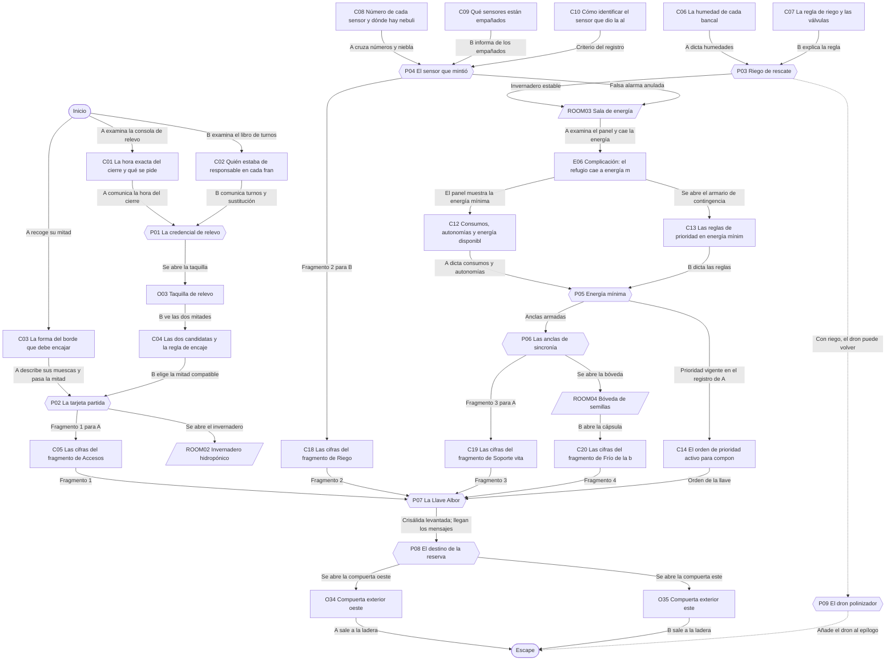
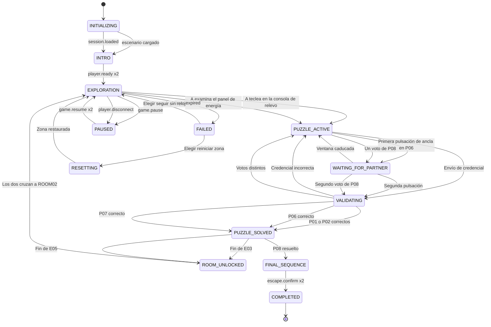

# ER10 · El último refugio

El Refugio Albor, un invernadero y banco de semillas excavado en una ladera, ha activado por error el Protocolo Crisálida: en sesenta minutos quedará sellado durante toda la estación. La pareja, recién llegada para su primer turno de guardianes, recorre la esclusa, el invernadero, la sala de energía y la bóveda reuniendo los cuatro fragmentos de la Llave Albor. En cada zona el panel principal lo maneja uno distinto, y al final deben decidir juntos qué hacer con la reserva de semillas.

## A. Ficha técnica

| Campo | Valor |
|---|---|
| ID | ER10 |
| Nombre | El último refugio |
| Versión | 1.0.0 |
| Género | Ciencia ficción esperanzadora |
| Sinopsis | El Refugio Albor, un invernadero y banco de semillas excavado en una ladera, ha activado por error el Protocolo Crisálida: en sesenta minutos quedará sellado durante toda la estación. La pareja, recién llegada para su primer turno de guardianes, recorre la esclusa, el invernadero, la sala de energía y la bóveda reuniendo los cuatro fragmentos de la Llave Albor. En cada zona el panel principal lo maneja uno distinto, y al final deben decidir juntos qué hacer con la reserva de semillas. |
| Objetivo principal | OBJ01 Recuperar la credencial de relevo, la tarjeta Albor y el invernadero; OBJ02 Repartir la energía mínima y conectar la bóveda de semillas; OBJ03 Levantar el Protocolo Crisálida con la Llave Albor y decidir el destino de la reserva; OBJ04 Salir a la ladera: A por la compuerta oeste y B por la compuerta este |
| Objetivos secundarios | OBJ05 Devolver el dron polinizador Abejorro-2 a su base de carga |
| Jugadores | 2 (A: Guardiana o guardián de la cabina: lee datos de los sistemas; B: Guardiana o guardián de campo: recorre el suelo y lee los documentos) |
| Duración estimada | 60 min (despertar 6, descubrimiento 16, complicación 16, clímax 16, escape 6) |
| Dificultad | Difícil |
| Zonas | 4 |
| Acertijos | 8 principales y 1 microacertijos |
| Objetos interactivos | 27 (más 9 decorativos) |
| Finales | 5 |
| Competencias | Coordinación bajo presión moderada, Integración de información de varias fuentes, Priorización de tareas, Comunicación precisa de datos, Sincronización de acciones, Toma de decisiones compartida |
| Condiciones iniciales | Los dos jugadores empiezan en la Esclusa de acceso, separados por la mampara de cuarentena que el Protocolo Crisálida ha bajado: A en la cabina de control (mitad oeste) y B en la cámara de descontaminación (mitad este). Se ven a través del cristal y hablan por el intercomunicador (en el juego, la llamada de voz y el chat rápido). La cuenta atrás de Crisálida marca 60:00. La energía es normal hasta que A examina el panel de la Sala de energía. Ninguno lleva objetos. |
| Condición de victoria | Completar OBJ01, OBJ02, OBJ03, OBJ04 |
| Condición de fallo | 60 min de cuenta atrás: La cuenta atrás de Crisálida llega a cero, pero VEGA detecta a dos personas dentro y abre una ventana de mantenimiento: los jugadores eligen seguir sin reloj o reiniciar la zona actual con 15 minutos extra. No se pierde ningún acertijo resuelto ni ningún fragmento conseguido. |
| Condición de reinicio | Cualquiera de los dos pulsa Reiniciar zona y el otro lo confirma; también se ofrece al agotarse el reloj. El reinicio completo exige la confirmación de los dos y vuelve al estado inicial y a la intro. |

## B. Guion narrativo

**1. Introducción cinematográfica.** Amanecer gris sobre una ladera desnuda. La cámara se acerca a una cúpula de cristal medio enterrada entre rocas: el Refugio Albor. Dentro brillan hileras de plantas y, más abajo, una bóveda con miles de sobres de semillas. Un pitido suave, una luz ámbar y una voz tranquila: Protocolo Crisálida activado. Sellado de larga duración en sesenta minutos. Las mamparas de cristal bajan una a una.

**2. Por qué están aquí.** La pareja ha llegado al refugio para su primer turno como guardianes voluntarios. Mientras cruzaban la esclusa, un sensor del invernadero dio una alarma de fuga falsa y VEGA, la inteligencia que cuida el refugio, activó el cierre automático. La mampara de cuarentena bajó justo entre los dos.

**3. Situación inicial.** A queda en la cabina de control de la esclusa y B en la cámara de descontaminación. Se ven a través del cristal. VEGA explica que el cierre solo se levanta con la Llave Albor, una autorización partida en cuatro fragmentos, uno por zona, que el fundador Tomás Velarde dejó repartidos para que nadie pudiera abrir el refugio en solitario.

**4. Objetivo.** Recorrer las cuatro zonas, conseguir los cuatro fragmentos de la Llave Albor, componerla en la consola de la bóveda antes de que acabe la cuenta atrás y decidir qué hacer con la reserva de semillas de la temporada.

**5. Primer descubrimiento.** A encuentra en la consola de relevo la hora exacta del cierre; B encuentra el libro de turnos con una nota pegada. Ninguno de los dos sabe quién era la persona responsable a esa hora hasta que juntan lo que tienen.

**6. Progresión de los acontecimientos.**

- Con la credencial de Daniela Ruiz se abre la taquilla de relevo de B. Dentro hay dos medias tarjetas; A tiene la otra mitad en su cajón.
- La tarjeta Albor completa abre el invernadero. La consola imprime el primer fragmento para A.
- En el invernadero el panel principal es de B: riega los bancales más secos con lo que A lee desde la pasarela.
- A, desde la pasarela, y B, a ras de suelo, descubren qué sensor dio la falsa alarma. La alarma se anula y B recibe el segundo fragmento.
- En la Sala de energía, al examinar A el panel, el refugio cae a energía mínima: las prioridades cambian y la placa grabada ya no sirve.
- A reparte la energía mínima con la tarjeta de contingencia que lee B, y los dos cierran a la vez las anclas de sincronía. A recibe el tercer fragmento.
- En la bóveda, B encuentra el cuarto fragmento en la cápsula del fundador y compone la Llave Albor con lo que le dicta A.
- Con Crisálida levantada llegan los mensajes de los valles. Los dos deciden el destino de la reserva y se abren las compuertas exteriores.

**7. Obstáculos narrativos.**

- La mampara de cuarentena separa a los dos en cada zona: lo que uno ve, el otro no lo alcanza.
- El libro de turnos tiene una sustitución que cambia quién era la persona responsable.
- Hay dos medias tarjetas en la taquilla y solo una encaja con la de A.
- Desde la pasarela no se ve si un sensor está empañado y desde el suelo no se leen sus números.
- La caída a energía mínima invalida el orden de prioridades grabado en la placa y obliga a recalcularlo.
- Las anclas de sincronía solo cierran si se pulsan a la vez y cada una en el canal que conoce el otro.

**8. Revelaciones.**

- La alarma no fue una fuga: el nebulizador del bancal de maíz empañó un sensor viejo. El refugio nunca estuvo en peligro.
- Tomás Velarde partió la Llave Albor en cuatro para que el refugio solo se abriera por decisión de al menos dos personas que se escucharan.
- La reserva de semillas no es un tesoro para guardar sin más: Tomás la dejó para que los guardianes decidieran a quién dar la siguiente cosecha.

**9. Clímax.** En la bóveda, con la cuenta atrás en sus últimos minutos, B introduce la Llave Albor con los fragmentos que le dicta A en el orden de prioridad vigente. Las mamparas suben a la vez en todo el refugio. VEGA abre el canal exterior y los mensajes de los valles llenan la pantalla de A. Los dos votan qué hacer con la reserva.

**10. Escena de escape.** La luz de la bóveda pasa de ámbar a blanco cálido y las dos compuertas exteriores se abren a la ladera. A y B salen cada uno por su compuerta y se encuentran fuera, sin cristal entre ellos, mientras el sol asoma entre las nubes.

**11. Epílogo.** Desde la ladera se ve la cúpula encendida. VEGA lee la última nota de Tomás: Un refugio no sirve para esconderse, sino para volver a empezar. El epílogo continúa según el destino elegido para la reserva.

### Diálogos y textos del sistema

Cada línea es un subtítulo. Las líneas de canal `document` quedan además guardadas en el registro de pistas.

| ID | Quién | Texto | Cuándo | Para | Canal |
|---|---|---|---|---|---|
| D01 | Narrador | Una cúpula de cristal entre las rocas. Dentro, plantas y semillas. Fuera, una ladera que espera. | START | Ambos | subtitle |
| D02 | VEGA | Buenas tardes, guardianes. Soy VEGA. El Protocolo Crisálida se ha activado por un aviso de fuga. | E01 | Ambos | audio_subtitled |
| D03 | VEGA | Dentro de sesenta minutos el refugio quedará sellado toda la estación. No hay ningún peligro para ustedes. | E01 | Ambos | audio_subtitled |
| D04 | VEGA | Para levantar el cierre necesito la Llave Albor: cuatro fragmentos, uno por zona. Tomás quiso que hicieran falta dos personas. | E01 | Ambos | audio_subtitled |
| D05 | Narrador | La mampara ha bajado justo entre vosotros. Tienes la consola de relevo delante. | START | Jugador A | subtitle |
| D06 | Narrador | Estás en la cámara de descontaminación. En el atril hay un libro de turnos abierto. | START | Jugador B | subtitle |
| D07 | Sistema | Taquilla de relevo abierta. | E02 | Ambos | popup |
| D08 | VEGA | Fragmento 1 impreso en la consola de relevo. Guárdenlo bien: el orden importará al final. | E03 | Jugador A | audio_subtitled |
| D09 | Narrador | El aire del invernadero huele a tierra mojada que se está secando. Las hojas empiezan a doblarse. | ROOM02_UNLOCKED | Ambos | subtitle |
| D10 | VEGA | El panel de riego queda en manos de quien está en el suelo. Quien está arriba ve lo que el suelo no ve. | ROOM02_UNLOCKED | Ambos | audio_subtitled |
| D11 | Sistema | Riego de rescate en marcha. | E04 | Ambos | popup |
| D12 | VEGA | Falsa alarma confirmada. Era condensación. Fragmento 2 impreso en la consola de riego. | E05 | Ambos | audio_subtitled |
| D13 | VEGA | Atención: paso a energía mínima. Con tan poca energía, las prioridades ya no son las de la placa. | E06 | Ambos | audio_subtitled |
| D14 | Narrador | Las luces se apagan y queda un resplandor ámbar. El armario de contingencia se abre con un clic. | E06 | Jugador B | subtitle |
| D15 | Narrador | Tu panel muestra cuatro sistemas críticos y doce unidades de energía. No llega para todo. | E06 | Jugador A | subtitle |
| D16 | VEGA | Prioridades aceptadas. El riego espera: las plantas que regasteis aguantarán medio día. | E07 | Ambos | audio_subtitled |
| D17 | VEGA | Las anclas se sueltan si no se cierran juntas. Cuenten en voz alta. | P06 | Ambos | audio_subtitled |
| D18 | VEGA | Bus de la bóveda cerrado. Fragmento 3 impreso en el panel de energía. | E08 | Ambos | audio_subtitled |
| D19 | Tomás Velarde (nota) | Si habéis llegado hasta aquí es porque os habéis escuchado. El resto es fácil. | C20_DISCOVERED | Jugador B | document |
| D20 | VEGA | Llave Albor aceptada. Protocolo Crisálida levantado. Gracias, guardianes. | E09 | Ambos | audio_subtitled |
| D21 | VEGA | Han llegado mensajes de los valles. La reserva de esta temporada está lista. ¿Qué hacemos con ella? | E09 | Ambos | audio_subtitled |
| D22 | Sistema | Han votado distinto. Cuéntense lo que han leído y voten otra vez. | P08 | Ambos | popup |
| D23 | VEGA | Decisión registrada. Abro las compuertas. Fuera ha dejado de llover. | E10 | Ambos | audio_subtitled |
| D24 | VEGA | La cuenta atrás ha terminado, pero sigo aquí con ustedes. Les abro una ventana de mantenimiento. | E12 | Ambos | audio_subtitled |
| D25 | VEGA | Si me permiten una pista: miren lo que el otro no puede ver. | E11 | Ambos | audio_subtitled |
| D26 | Narrador | Abejorro-2 zumba, da una vuelta sobre los tomates y se posa en una flor. | E13 | Ambos | subtitle |

## C. Escenografía y planos

Coordenadas en metros con origen en la esquina suroeste del suelo de cada zona: `x` hacia el este, `y` hacia arriba, `z` hacia el norte.

### ROOM01 · Esclusa de acceso

Sala blanca y estrecha de entrada al refugio, dividida por la mampara de cuarentena: al oeste la cabina de control con la consola de relevo, al este la cámara de descontaminación con taquillas y una ducha de aire.

**Medidas:** 8 × 6 m, altura 3.2 m. **Acceso:** A sí, B sí. **Se abre:** desde el inicio.

**Qué ve cada jugador.** A: La cabina oeste completa y, a través del cristal, la silueta de B y la taquilla sin poder leer textos del otro lado. B: La cámara este completa y, a través del cristal, la consola de A sin poder leer su pantalla.

**Distribución.** Mampara de cristal de norte a sur en x = 4, con un pasaobjetos a media altura en el centro. Mitad oeste (A): consola de relevo junto a la pared oeste, cajón de la cabina al suroeste, perchero al noroeste. Mitad este (B): libro de turnos en el atril central, taquilla de relevo en la pared este, ducha de aire al sureste y lector de tarjetas junto a la puerta noreste. Compuerta de entrada sellada en la pared sur. Dos puertas en la pared norte hacia el invernadero, una por mitad. Altavoz de VEGA sobre la mampara.

| ID | Elemento | Tipo o pared | Posición (x, y, z) | Notas |
|---|---|---|---|---|
| DOOR01 | Puerta a Invernadero hidropónico | pared north | (2, 0, 6) | Se abre con P02_SOLVED |
| DOOR02 | Puerta a Invernadero hidropónico | pared north | (6, 0, 6) | Se abre con P02_SOLVED |
| — | Ventana | pared south | (6, 2, 0) | Ojo de buey en la compuerta sellada con vista a la ladera; no es interactivo |
| O01 | Consola de relevo | 4 Usar | (0.4, 1, 3) | Consola inclinada con pantalla ámbar, teclado numérico y una pequeña impresora térmica |
| O02 | Libro de turnos | 2 Examinar | (6, 1, 3.5) | Cuaderno grueso de tapas verdes abierto en un atril, con una nota amarilla pegada en la página de hoy |
| O03 | Taquilla de relevo | 7 Bloqueado | (7.8, 1, 2) | Taquilla metálica con teclado y una pegatina con una hoja; dentro, una bandeja con dos medias tarjetas |
| O04 | Media tarjeta izquierda | 3 Recoger | (0.6, 0.8, 1.2) | Mitad izquierda de una tarjeta azul con el texto ALB- y tres muescas en el borde derecho |
| O05 | Media tarjeta derecha OR-12 | 5 Combinar | (7.8, 1.2, 2) | Mitad derecha azul con el texto OR-12 y muescas triangular, redonda y cuadrada de arriba abajo |
| O06 | Media tarjeta derecha OR-07 | 5 Combinar | (7.8, 1.1, 2.1) | Mitad derecha azul con el texto OR-07 y muescas cuadrada, redonda y triangular de arriba abajo |
| O07 | Lector de la puerta interior | 4 Usar | (6.8, 1.2, 5.9) | Lector de tarjetas con una ranura y un anillo de luz junto a la puerta noreste |
| O08 | Pasaobjetos | 8 Mecanismo cooperativo | (4, 1, 3) | Cajón de acero que atraviesa la mampara a media altura, con una ranura a cada lado y una flecha grabada |
| O09 | Altavoz de VEGA | 9 Elemento narrativo | (4, 2.8, 5.5) | Esfera blanca con un anillo de luz que late cuando VEGA habla y una pantalla con la cuenta atrás |
| O10 | Ducha de aire | 1 Decorativo | (6.8, 0, 0.8) | Cabina de descontaminación con rejillas y un cartel con un pictograma de brazos en cruz |
| O11 | Perchero con monos de trabajo | 1 Decorativo | (0.4, 0, 5.5) | Dos monos verdes con el emblema de una semilla y los nombres tapados con cinta |
| O12 | Compuerta de entrada sellada | 1 Decorativo | (6, 0, 0.1) | Compuerta circular con ojo de buey y una franja ámbar que dice Sellado por Crisálida |

| Luz | Tipo | Posición | Color | Intensidad | Uso |
|---|---|---|---|---|---|
| L01 | Panel LED de techo, mitad oeste | (2, 3.1, 3) | #EAF4FF | 0.8 | Pasa a ámbar 0.4 en energía mínima (E06) |
| L02 | Panel LED de techo, mitad este | (6, 3.1, 3) | #EAF4FF | 0.8 | Pasa a ámbar 0.4 en energía mínima (E06) |
| L03 | Baliza de Crisálida sobre la mampara | (4, 3, 5.5) | #FFB347 | 0.5 | Pulso lento de 4 s mientras dura el cierre; se apaga en E09 |

**Sonido ambiente:** Ventilación suave y un pitido lejano cada 30 s. **Música:** Pad de sintetizador cálido con notas de piano espaciadas.

**Cambios dinámicos:**

- E01: La mampara de cuarentena termina de bajar y la baliza ámbar empieza a latir
- E02: La taquilla de relevo se abre con un siseo y una luz interior
- E03: Las dos puertas norte se abren y la consola de relevo imprime el Fragmento 1
- E06: La luz baja a ámbar tenue por la energía mínima
- E09: La mampara sube y la baliza se apaga

**Para el motor:** Una sola escena con un colisionador invisible en x = 4 que impide cruzar la mampara; el cristal es transparente pero los textos del otro lado se renderizan desenfocados para el jugador que no está en esa mitad (capa de detalle por jugador). El pasaobjetos es un volumen compartido con dos ranuras: lo que A deja en la suya aparece en la de B tras una animación de 1,5 s. Autoridad del servidor para la taquilla y el lector.

### ROOM02 · Invernadero hidropónico

Nave de cristal con cuatro bancales de cultivo, una fuente central con nebulizadores y una pasarela elevada que rodea la nave por el oeste y el norte. Tras el cierre, el riego se detuvo y las plantas empiezan a doblarse.

**Medidas:** 14 × 10 m, altura 5 m. **Acceso:** A sí, B sí. **Se abre:** P02_SOLVED.

**Qué ve cada jugador.** A: Desde la pasarela: tapas de los sensores, etiquetas de humedad sobre los bancales y nubes de nebulización vistas desde arriba; no ve los cristales frontales de los sensores ni la consola de riego. B: Desde el suelo: cristales frontales de los sensores, válvulas con dibujos de cultivos y el dron; no ve las tapas numeradas ni las etiquetas de humedad.

**Distribución.** Bancales: tomates al noroeste, lentejas al noreste, maíz al suroeste y quinoa al sureste; fuente con sensor central en el centro. Pasarela de A a 3 m de altura junto a las paredes oeste y norte, con barandilla de observación, mapa vivo de sensores y terminal de alarmas. B recorre el suelo: consola de riego en la pared sur, sensores a la altura de las rodillas, dron y base de carga al este. Puertas hacia la Sala de energía en la pared norte: una en la pasarela (A) y otra a nivel de suelo (B).

| ID | Elemento | Tipo o pared | Posición (x, y, z) | Notas |
|---|---|---|---|---|
| DOOR03 | Puerta a Sala de energía | pared north | (2, 3, 10) | Se abre con P03_SOLVED + P04_SOLVED |
| DOOR04 | Puerta a Sala de energía | pared north | (12, 0, 10) | Se abre con P03_SOLVED + P04_SOLVED |
| — | Ventana | pared east | (14, 3, 5) | Pared de cristal hacia la ladera; luz natural gris |
| O13 | Barandilla de observación | 2 Examinar | (7, 3, 9.4) | Barandilla de la pasarela desde la que se ven los cuatro bancales con etiquetas flotantes de humedad |
| O14 | Consola de riego | 4 Usar | (7, 1, 0.4) | Consola en la pared sur con cuatro válvulas de volante, cada una con el dibujo de un cultivo, y una pantalla de reglas |
| O15 | Terminal de alarmas de la pasarela | 4 Usar | (1, 3, 9.5) | Terminal de pie con teclado numérico y el registro de VEGA en pantalla |
| O16 | Mapa vivo de sensores | 2 Examinar | (10, 3, 9.4) | Pantalla en la barandilla norte con la vista cenital del invernadero, las tapas numeradas de los sensores y las nubes de nebulización |
| O17 | Sensores de humedad a ras de suelo | 2 Examinar | (7, 0.4, 5) | Cinco postes cortos con un cristal frontal; algunos tienen gotas en el cristal y el icono de gotas encendido |
| O18 | Dron polinizador Abejorro-2 | 3 Recoger | (12, 0.3, 1) | Dron del tamaño de un puño con forma de abejorro y una etiqueta colgando de una pata |
| O19 | Base de carga del dron | 4 Usar | (13.8, 1.2, 5) | Soporte en la pared este con un hueco con forma de hexágono y una luz apagada |
| O20 | Regaderas y macetas apiladas | 1 Decorativo | (2, 0, 0.6) | Torre de macetas de barro y dos regaderas de latón |
| O21 | Banco de trabajo con plantones | 1 Decorativo | (12.5, 0, 8.5) | Mesa con bandejas de plantones etiquetados a mano |

| Luz | Tipo | Posición | Color | Intensidad | Uso |
|---|---|---|---|---|---|
| L04 | Luz natural difusa por el techo de cristal | (7, 5, 5) | #D9E4EC | 0.6 | Constante |
| L05 | Lámparas de cultivo sobre los bancales (grupo) | (7, 4.5, 5) | #F2C9FF | 0.7 | Se apagan en energía mínima (E06); la escena sigue legible con L04 |
| L06 | Tira LED de la pasarela | (0.5, 3.2, 9.5) | #FFFFFF | 0.4 | Ilumina la barandilla y el terminal de A |

**Sonido ambiente:** Goteo, hojas que rozan el cristal y un zumbido de bombas paradas. **Música:** Marimba suave y cuerdas en pizzicato, tempo lento.

**Cambios dinámicos:**

- E04: Las válvulas abiertas riegan y las plantas de esos bancales se enderezan en 5 s
- E05: La nube de nebulización se disipa, el aviso de fuga desaparece y se abren las puertas norte
- E06: Las lámparas de cultivo se apagan; queda la luz natural
- E13: El dron despega de su base y poliniza las flores de los tomates

**Para el motor:** Dos niveles de navegación: la malla de la pasarela solo es transitable para A y la del suelo para B. Las etiquetas de humedad y las tapas de los sensores son una capa visible solo para A; los cristales empañados son una capa visible solo para B (con icono de gotas y la palabra Empañado, nunca solo un cambio de color). Las nubes de nebulización son partículas con un volumen simple que A ve desde arriba; en el modo de movimiento reducido son discos fijos semitransparentes con la palabra Niebla.

### ROOM03 · Sala de energía

Sala técnica de techo bajo con baterías de reserva, un gran panel de distribución al oeste, un armario de contingencia al este y dos anclas de sincronía en las esquinas del sur. Una mampara de cristal la divide de norte a sur.

**Medidas:** 10 × 8 m, altura 4 m. **Acceso:** A sí, B sí. **Se abre:** P03_SOLVED + P04_SOLVED.

**Qué ve cada jugador.** A: Su mitad, el panel con consumos y autonomías y su ancla; ve a B y su ancla a través del cristal pero no lee su etiqueta. B: Su mitad, el armario de contingencia y su ancla; ve el panel de A al fondo sin poder leerlo.

**Distribución.** Mampara en x = 5 con la placa de prioridades normales grabada en su marco norte, legible desde los dos lados. Mitad oeste (A): panel de energía en la pared oeste, ancla de sincronía oeste en la esquina suroeste, baterías de reserva al noroeste. Mitad este (B): armario de contingencia en la pared este, ancla de sincronía este en la esquina sureste. Ventilador de techo en el centro. Dos puertas en la pared norte hacia la bóveda, una por mitad.

| ID | Elemento | Tipo o pared | Posición (x, y, z) | Notas |
|---|---|---|---|---|
| DOOR05 | Puerta a Bóveda de semillas | pared north | (2.5, 0, 8) | Se abre con P06_SOLVED |
| DOOR06 | Puerta a Bóveda de semillas | pared north | (7.5, 0, 8) | Se abre con P06_SOLVED |
| O22 | Panel de energía | 4 Usar | (0.3, 1.3, 4) | Panel de distribución de pared con cuatro ranuras de prioridad, una pantalla de consumos y una impresora |
| O23 | Armario de contingencia | 7 Bloqueado | (9.7, 1.2, 5) | Armario de pared con cerradura magnética que se abre en energía mínima; dentro, una tarjeta plastificada |
| O24 | Placa de prioridades normales | 2 Examinar | (5, 1.8, 7.6) | Placa de latón grabada en el marco de la mampara, legible por los dos lados |
| O25 | Ancla de sincronía oeste | 8 Mecanismo cooperativo | (0.6, 1, 0.6) | Pulsador grande con tapa y un selector de canales con formas y números; etiqueta en la base |
| O26 | Ancla de sincronía este | 8 Mecanismo cooperativo | (9.4, 1, 0.6) | Pulsador gemelo del oeste con su propio selector y su etiqueta |
| O27 | Baterías de reserva | 1 Decorativo | (2.5, 0, 7.4) | Seis armarios de baterías con indicadores de nivel en barras y porcentaje |
| O28 | Ventilador de techo | 1 Decorativo | (5, 3.7, 3) | Ventilador industrial de aspas anchas que se detiene en energía mínima |

| Luz | Tipo | Posición | Color | Intensidad | Uso |
|---|---|---|---|---|---|
| L07 | Luminarias industriales (grupo) | (5, 3.8, 4) | #F5F5F0 | 0.8 | Se apagan en E06 |
| L08 | Luz de emergencia ámbar | (5, 3.7, 7.5) | #FFB347 | 0.45 | Se enciende en E06; suficiente para leer de cerca |
| L09 | Indicadores del panel de energía | (0.3, 1.6, 4) | #9FE3B0 | 0.3 | Cada sistema muestra también su estado en texto: Alimentado o En espera |

**Sonido ambiente:** Zumbido grave de baterías; en energía mínima baja de volumen y tono. **Música:** Pulso lento de bajo con arpegio de celesta; presión moderada, sin sobresaltos.

**Cambios dinámicos:**

- E06: Las luminarias se apagan, se enciende la luz de emergencia, el ventilador se detiene y se abre el armario de contingencia
- E07: El panel alimenta los sistemas en el orden elegido; el riego queda En espera
- E08: Las anclas se cierran con un doble clac y se abren las puertas norte

**Para el motor:** Mismo patrón de mampara que ROOM01. La caída a energía mínima es un cambio de perfil de iluminación (L07 a 0, L08 a 0.45) con un fundido de 3 s; en movimiento reducido el cambio es instantáneo. Las anclas son botones con un selector de 12 canales (forma por número) y se sincronizan por el reloj del servidor.

### ROOM04 · Bóveda de semillas

Cámara fría excavada en la roca, con estanterías de tarros y sobres de semillas, la cápsula del fundador, la consola Albor y dos compuertas que salen a la ladera. Una mampara la divide de norte a sur hasta que se levanta Crisálida.

**Medidas:** 12 × 9 m, altura 3.5 m. **Acceso:** A sí, B sí. **Se abre:** P06_SOLVED.

**Qué ve cada jugador.** A: Su mitad y el monitor de mensajes; ve la consola Albor a través del cristal sin poder leerla. B: Su mitad, la cápsula, el registro y la consola Albor; no ve el monitor de A.

**Distribución.** Mampara en x = 6. Mitad oeste (A): monitor de mensajes en la pared oeste, estanterías de tarros al noroeste, compuerta exterior oeste en la pared norte. Mitad este (B): cápsula del fundador al sureste, registro de la reserva en la pared este, consola Albor junto a la pared norte, compuerta exterior este en la pared norte. Mural de la ladera en la pared sur, lado este.

| ID | Elemento | Tipo o pared | Posición (x, y, z) | Notas |
|---|---|---|---|---|
| DOOR07 | Puerta de salida | pared north | (3, 0, 9) | Se abre con P08_SOLVED |
| DOOR08 | Puerta de salida | pared north | (9, 0, 9) | Se abre con P08_SOLVED |
| O29 | Cápsula del fundador | 2 Examinar | (10, 1, 2.5) | Cilindro de vidrio y madera con una semilla tallada en la tapa; dentro, una tarjeta y una nota de Tomás Velarde |
| O30 | Consola Albor | 4 Usar | (9, 1.1, 7.6) | Consola de piedra pulida con un teclado de dieciséis teclas y cuatro ranuras luminosas |
| O31 | Monitor de mensajes | 4 Usar | (0.3, 1.4, 5) | Pantalla grande en la pared oeste con el canal exterior y un botón de voto |
| O32 | Registro de la reserva | 4 Usar | (11.7, 1.3, 5) | Terminal de pared junto a las estanterías con el inventario de la temporada y un botón de voto |
| O33 | Estanterías de tarros de semillas | 1 Decorativo | (0.6, 0, 7.5) | Estanterías de madera hasta el techo con tarros etiquetados por especie y año |
| O34 | Compuerta exterior oeste | 10 Objeto de salida | (3, 0, 8.9) | Compuerta redonda con un volante y una franja que pasa de ámbar a blanco |
| O35 | Compuerta exterior este | 10 Objeto de salida | (9, 0, 8.9) | Compuerta gemela de la oeste |
| O36 | Mural de la ladera | 1 Decorativo | (9, 1.5, 0.1) | Mural pintado de la ladera cubierta de árboles, con la firma T. V. |

| Luz | Tipo | Posición | Color | Intensidad | Uso |
|---|---|---|---|---|---|
| L10 | Luz fría de bóveda (grupo) | (6, 3.4, 4.5) | #BFE3FF | 0.5 | Ámbar 0.35 mientras dure la energía mínima; blanco cálido en E10 |
| L11 | Foco sobre la cápsula del fundador | (10, 3.3, 3) | #FFE7B8 | 0.6 | Se enciende al entrar B |
| L12 | Luz exterior por las compuertas | (6, 2.5, 8.8) | #FFF4D6 | 0.9 | Solo tras E10, cuando se abren las compuertas |

**Sonido ambiente:** Silencio frío con crujidos suaves de estanterías. **Música:** Tema esperanzador: piano y cuerdas que crecen al levantar Crisálida.

**Cambios dinámicos:**

- E09: La mampara sube, la cuenta atrás se detiene y llegan los mensajes de los valles al monitor de A
- E10: La luz pasa a blanco cálido y se abren las dos compuertas exteriores

**Para el motor:** La mampara de esta zona se anima hacia el techo en E09 y desde entonces los dos pueden moverse por toda la bóveda, pero cada terminal sigue autorizado solo para su jugador. Las compuertas exteriores son el final de la escena: al cruzarlas se carga la secuencia de epílogo con el destino elegido. La votación de P08 se muestra en el monitor de A y en el registro de B con el voto oculto hasta que votan los dos.

## D. Inventario de objetos

| object_id | Nombre | Descripción visual | Zona | Posición | Tipo | Estado inicial | Acción | Activación | Resultado | Pista | Acertijo | Jugador | Estado final |
|---|---|---|---|---|---|---|---|---|---|---|---|---|---|
| O01 | Consola de relevo | Consola inclinada con pantalla ámbar, teclado numérico y una pequeña impresora térmica | ROOM01 | (0.4, 1, 3) | 4 Usar | DEFAULT | Examinar | — | Muestra el mensaje de Crisálida (C01); tras P01 se desbloquea y tras P02 imprime el Fragmento 1 (C05) | C01 | P01 | Jugador A | PRINTED |
| O02 | Libro de turnos | Cuaderno grueso de tapas verdes abierto en un atril, con una nota amarilla pegada en la página de hoy | ROOM01 | (6, 1, 3.5) | 2 Examinar | DEFAULT | Examinar | — | Abre el libro a pantalla completa con la nota y guarda C02 | C02 | P01 | Jugador B | EXAMINED |
| O03 | Taquilla de relevo | Taquilla metálica con teclado y una pegatina con una hoja; dentro, una bandeja con dos medias tarjetas | ROOM01 | (7.8, 1, 2) | 7 Bloqueado | LOCKED | Abrir | — | Se abre sola al introducir A la credencial correcta y muestra C04 | C04 | P02 | Jugador B | OPEN |
| O04 | Media tarjeta izquierda | Mitad izquierda de una tarjeta azul con el texto ALB- y tres muescas en el borde derecho | ROOM01 | (0.6, 0.8, 1.2) | 3 Recoger | DEFAULT | Recoger y dejar en el pasaobjetos | — | A la recoge del cajón de la cabina (C03) y la pasa a B por el pasaobjetos | C03 | P02 | Jugador A | COMBINED |
| O05 | Media tarjeta derecha OR-12 | Mitad derecha azul con el texto OR-12 y muescas triangular, redonda y cuadrada de arriba abajo | ROOM01 | (7.8, 1.2, 2) | 5 Combinar | HIDDEN | Recoger y unir | — | No encaja con la mitad de A: las muescas chocan y se rechaza | — | P02 | Jugador B | VISIBLE |
| O06 | Media tarjeta derecha OR-07 | Mitad derecha azul con el texto OR-07 y muescas cuadrada, redonda y triangular de arriba abajo | ROOM01 | (7.8, 1.1, 2.1) | 5 Combinar | HIDDEN | Recoger y unir | — | Encaja con la mitad de A y forma la tarjeta ALBOR completa | — | P02 | Jugador B | COMBINED |
| O07 | Lector de la puerta interior | Lector de tarjetas con una ranura y un anillo de luz junto a la puerta noreste | ROOM01 | (6.8, 1.2, 5.9) | 4 Usar | WAITING | Pasar tarjeta | — | Con la tarjeta completa correcta abre las dos puertas norte | — | P02 | Jugador B | ACCEPTED |
| O08 | Pasaobjetos | Cajón de acero que atraviesa la mampara a media altura, con una ranura a cada lado y una flecha grabada | ROOM01 | (4, 1, 3) | 8 Mecanismo cooperativo | IDLE | Dejar o recoger objeto | — | Lo que deja un jugador aparece al otro lado tras 1,5 s | — | P02 | Ambos | USED |
| O09 | Altavoz de VEGA | Esfera blanca con un anillo de luz que late cuando VEGA habla y una pantalla con la cuenta atrás | ROOM01 | (4, 2.8, 5.5) | 9 Elemento narrativo | SPEAKING | Escuchar | — | Reproduce los avisos de VEGA y los guarda en el registro de los dos | — | — | Ambos | IDLE |
| O10 | Ducha de aire | Cabina de descontaminación con rejillas y un cartel con un pictograma de brazos en cruz | ROOM01 | (6.8, 0, 0.8) | 1 Decorativo | STATIC | none | — | Sin interacción | — | — | Nadie | STATIC |
| O11 | Perchero con monos de trabajo | Dos monos verdes con el emblema de una semilla y los nombres tapados con cinta | ROOM01 | (0.4, 0, 5.5) | 1 Decorativo | STATIC | none | — | Sin interacción | — | — | Nadie | STATIC |
| O12 | Compuerta de entrada sellada | Compuerta circular con ojo de buey y una franja ámbar que dice Sellado por Crisálida | ROOM01 | (6, 0, 0.1) | 1 Decorativo | STATIC | none | — | Sin interacción | — | — | Nadie | STATIC |
| O13 | Barandilla de observación | Barandilla de la pasarela desde la que se ven los cuatro bancales con etiquetas flotantes de humedad | ROOM02 | (7, 3, 9.4) | 2 Examinar | DEFAULT | Examinar | — | Muestra las etiquetas de humedad de los bancales y guarda C06 | C06 | P03 | Jugador A | EXAMINED |
| O14 | Consola de riego | Consola en la pared sur con cuatro válvulas de volante, cada una con el dibujo de un cultivo, y una pantalla de reglas | ROOM02 | (7, 1, 0.4) | 4 Usar | DEFAULT | Abrir válvulas | — | Muestra la regla de riego (C07); tras P03 riega y tras resolver P03 y P04 imprime el Fragmento 2 (C18) | C07 | P03 | Jugador B | PRINTED |
| O15 | Terminal de alarmas de la pasarela | Terminal de pie con teclado numérico y el registro de VEGA en pantalla | ROOM02 | (1, 3, 9.5) | 4 Usar | DEFAULT | Leer registro e introducir número de sensor | — | Muestra el registro de la alarma (C10) y acepta el número del sensor a anular | C10 | P04 | Jugador A | CLEARED |
| O16 | Mapa vivo de sensores | Pantalla en la barandilla norte con la vista cenital del invernadero, las tapas numeradas de los sensores y las nubes de nebulización | ROOM02 | (10, 3, 9.4) | 2 Examinar | DEFAULT | Examinar | — | Abre la vista cenital y guarda C08 | C08 | P04 | Jugador A | EXAMINED |
| O17 | Sensores de humedad a ras de suelo | Cinco postes cortos con un cristal frontal; algunos tienen gotas en el cristal y el icono de gotas encendido | ROOM02 | (7, 0.4, 5) | 2 Examinar | DEFAULT | Examinar | — | B recorre los cinco sensores; la vista resume su estado y guarda C09 | C09 | P04 | Jugador B | EXAMINED |
| O18 | Dron polinizador Abejorro-2 | Dron del tamaño de un puño con forma de abejorro y una etiqueta colgando de una pata | ROOM02 | (12, 0.3, 1) | 3 Recoger | DEFAULT | Recoger | — | B lo recoge y lee su etiqueta (C24) | C24 | P09 | Jugador B | DOCKED |
| O19 | Base de carga del dron | Soporte en la pared este con un hueco con forma de hexágono y una luz apagada | ROOM02 | (13.8, 1.2, 5) | 4 Usar | EMPTY | Colocar dron | — | Con el dron colocado, la luz se enciende y el dron vuelve a volar | C23 | P09 | Jugador B | OCCUPIED |
| O20 | Regaderas y macetas apiladas | Torre de macetas de barro y dos regaderas de latón | ROOM02 | (2, 0, 0.6) | 1 Decorativo | STATIC | none | — | Sin interacción | — | — | Nadie | STATIC |
| O21 | Banco de trabajo con plantones | Mesa con bandejas de plantones etiquetados a mano | ROOM02 | (12.5, 0, 8.5) | 1 Decorativo | STATIC | none | — | Sin interacción | — | — | Nadie | STATIC |
| O22 | Panel de energía | Panel de distribución de pared con cuatro ranuras de prioridad, una pantalla de consumos y una impresora | ROOM03 | (0.3, 1.3, 4) | 4 Usar | DEFAULT | Examinar y asignar prioridades | — | Al examinarlo dispara la caída a energía mínima (E06); muestra C12, acepta el orden de prioridad, guarda C14 y tras P06 imprime el Fragmento 3 (C19) | C12 | P05 | Jugador A | PRINTED |
| O23 | Armario de contingencia | Armario de pared con cerradura magnética que se abre en energía mínima; dentro, una tarjeta plastificada | ROOM03 | (9.7, 1.2, 5) | 7 Bloqueado | LOCKED | Abrir y leer | — | Se abre solo en energía mínima y muestra la tarjeta de contingencia (C13) | C13 | P05 | Jugador B | OPEN |
| O24 | Placa de prioridades normales | Placa de latón grabada en el marco de la mampara, legible por los dos lados | ROOM03 | (5, 1.8, 7.6) | 2 Examinar | DEFAULT | Examinar | — | Muestra el orden de energía normal (C11) | C11 | P05 | Ambos | EXAMINED |
| O25 | Ancla de sincronía oeste | Pulsador grande con tapa y un selector de canales con formas y números; etiqueta en la base | ROOM03 | (0.6, 1, 0.6) | 8 Mecanismo cooperativo | OPEN_LATCH | Elegir canal y pulsar | — | Si las dos anclas se pulsan a la vez en su canal, cierra el bus de la bóveda | C15 | P06 | Jugador A | LOCKED_IN |
| O26 | Ancla de sincronía este | Pulsador gemelo del oeste con su propio selector y su etiqueta | ROOM03 | (9.4, 1, 0.6) | 8 Mecanismo cooperativo | OPEN_LATCH | Elegir canal y pulsar | — | Si las dos anclas se pulsan a la vez en su canal, cierra el bus de la bóveda | C16 | P06 | Jugador B | LOCKED_IN |
| O27 | Baterías de reserva | Seis armarios de baterías con indicadores de nivel en barras y porcentaje | ROOM03 | (2.5, 0, 7.4) | 1 Decorativo | STATIC | none | — | Sin interacción | — | — | Nadie | STATIC |
| O28 | Ventilador de techo | Ventilador industrial de aspas anchas que se detiene en energía mínima | ROOM03 | (5, 3.7, 3) | 1 Decorativo | STATIC | none | — | Sin interacción | — | — | Nadie | STATIC |
| O29 | Cápsula del fundador | Cilindro de vidrio y madera con una semilla tallada en la tapa; dentro, una tarjeta y una nota de Tomás Velarde | ROOM04 | (10, 1, 2.5) | 2 Examinar | DEFAULT | Examinar | — | B abre la cápsula y guarda el Fragmento 4 (C20) y la nota de Tomás | C20 | P07 | Jugador B | EXAMINED |
| O30 | Consola Albor | Consola de piedra pulida con un teclado de dieciséis teclas y cuatro ranuras luminosas | ROOM04 | (9, 1.1, 7.6) | 4 Usar | DEFAULT | Introducir la Llave Albor | — | Muestra C17 y acepta la llave de ocho cifras; al aceptarla levanta Crisálida | C17 | P07 | Jugador B | AUTHORIZED |
| O31 | Monitor de mensajes | Pantalla grande en la pared oeste con el canal exterior y un botón de voto | ROOM04 | (0.3, 1.4, 5) | 4 Usar | OFFLINE | Leer mensajes y votar | — | Tras levantar Crisálida muestra los mensajes de los valles (C21) y el voto de A | C21 | P08 | Jugador A | VOTED |
| O32 | Registro de la reserva | Terminal de pared junto a las estanterías con el inventario de la temporada y un botón de voto | ROOM04 | (11.7, 1.3, 5) | 4 Usar | OFFLINE | Leer registro y votar | — | Tras levantar Crisálida muestra el estado de la reserva (C22) y el voto de B | C22 | P08 | Jugador B | VOTED |
| O33 | Estanterías de tarros de semillas | Estanterías de madera hasta el techo con tarros etiquetados por especie y año | ROOM04 | (0.6, 0, 7.5) | 1 Decorativo | STATIC | none | — | Sin interacción | — | — | Nadie | STATIC |
| O34 | Compuerta exterior oeste | Compuerta redonda con un volante y una franja que pasa de ámbar a blanco | ROOM04 | (3, 0, 8.9) | 10 Objeto de salida | LOCKED | Salir | P08_SOLVED | Confirma la salida de A a la ladera | — | — | Jugador A | OPEN |
| O35 | Compuerta exterior este | Compuerta gemela de la oeste | ROOM04 | (9, 0, 8.9) | 10 Objeto de salida | LOCKED | Salir | P08_SOLVED | Confirma la salida de B a la ladera | — | — | Jugador B | OPEN |
| O36 | Mural de la ladera | Mural pintado de la ladera cubierta de árboles, con la firma T. V. | ROOM04 | (9, 1.5, 0.1) | 1 Decorativo | STATIC | none | — | Sin interacción | — | — | Nadie | STATIC |

## E. Pistas

| clue_id | Contenido exacto | Alternativa accesible | Ubicación | Descubrimiento | Quién | Acertijo | Revela | Depende de | Se habilita | Nivel | Descubierta cuando |
|---|---|---|---|---|---|---|---|---|---|---|---|
| C01 | PROTOCOLO CRISÁLIDA ACTIVO. Hora del cierre: 19:40. Para abrir la taquilla de relevo, introduzca la credencial de cuatro cifras de la persona responsable del refugio en el momento del cierre. | Texto grande con lectura en voz: hora del cierre 19:40; introducir la credencial de quien era responsable a esa hora. | O01 Consola de relevo | A examina la consola de relevo | Jugador A | P01 | La hora exacta del cierre y qué se pide | — | — | 0 | O01_EXAMINED |
| C02 | Libro de turnos de hoy. Turno de mañana, de 06:00 a 14:00: Nuria Peña, credencial 4127. Turno de tarde, de 14:00 a 21:00: Ciro Lamas, credencial 3906. Turno de noche, de 21:00 a 06:00: Inés Galván, credencial 7354. Nota amarilla pegada, con otra letra: Ciro se ha ido a las 19:00 por la tormenta de polen. Desde las 19:00 y hasta que llegue Inés, la responsable es Daniela Ruiz, credencial 5821. | Tabla de tres turnos con horario, nombre y credencial, y la nota leída aparte: desde las 19:00 hasta las 21:00, Daniela Ruiz, 5821. | O02 Libro de turnos | B examina el libro de turnos del atril | Jugador B | P01 | Quién estaba de responsable en cada franja, con la sustitución | — | — | 0 | O02_EXAMINED |
| C03 | Media tarjeta izquierda. Texto: ALB-. Borde derecho con tres muescas; de arriba abajo: cuadrada, redonda, triangular. | Descripción en texto y relieve ampliado: muescas de arriba abajo cuadrada, redonda, triangular. | O04 Media tarjeta izquierda | A abre el cajón de la cabina y examina la media tarjeta | Jugador A | P02 | La forma del borde que debe encajar | — | — | 0 | — |
| C04 | Bandeja de la taquilla de relevo. Dos medias tarjetas derechas. OR-12: borde izquierdo con muescas, de arriba abajo, triangular, redonda, cuadrada. OR-07: de arriba abajo, cuadrada, redonda, triangular. Grabado en la bandeja: Las mitades solo encajan si cada muesca coincide con la de la misma altura. | Lista en texto de las dos medias tarjetas con sus muescas de arriba abajo y la regla de encaje. | O03 Taquilla de relevo | B mira la bandeja de la taquilla abierta | Jugador B | P02 | Las dos candidatas y la regla de encaje | — | P01_SOLVED | 0 | O03_OPEN |
| C05 | Fragmento de autorización 1 de 4. Zona: Esclusa. Sistema: Accesos y esclusas. Figura: hexágono. Cifras: 38. | Tarjeta impresa en texto grande con lectura en voz: Fragmento 1, Accesos, hexágono, 38. | O01 Consola de relevo | La consola de relevo lo imprime para A al abrirse las puertas | Jugador A | P07 | Las cifras del fragmento de Accesos | — | — | 0 | P02_SOLVED |
| C06 | Etiquetas de humedad vistas desde la pasarela. Bancal noroeste, tomates (icono de círculo): 12 %. Bancal noreste, lentejas (icono de triángulo): 35 %. Bancal suroeste, maíz (icono de cuadrado): 8 %. Bancal sureste, quinoa (icono de rombo): 21 %. | Tabla de cuatro filas con bancal, cultivo, icono y porcentaje, leída en voz. | O13 Barandilla de observación | A mira los bancales desde la barandilla de observación | Jugador A | P03 | La humedad de cada bancal | — | — | 0 | O13_EXAMINED |
| C07 | Consola de riego de rescate. Cuatro válvulas con el dibujo de su cultivo: tomate, lenteja, mazorca de maíz y espiga de quinoa. Regla: el depósito de reserva solo permite abrir tres válvulas. Riegue del bancal más seco al menos seco y no riegue ningún bancal que esté por encima del 30 %. Si abre una válvula fuera de orden, todas se cierran. | Regla en texto grande; cada válvula tiene además el nombre del cultivo en relieve. | O14 Consola de riego | B examina la consola de riego | Jugador B | P03 | La regla de riego y las válvulas | — | — | 0 | O14_EXAMINED |
| C08 | Vista cenital del invernadero. Número en la tapa de cada sensor: bancal de tomates, 14; bancal de lentejas, 27; fuente central, 31; bancal de maíz, 46; bancal de quinoa, 58. Nubes de nebulización activas: sobre el bancal de maíz y sobre el bancal de tomates. | Lista en texto de los cinco sensores con su número y lugar, y de los dos lugares con niebla activa (marcados con la palabra Niebla). | O16 Mapa vivo de sensores | A examina el mapa vivo de sensores | Jugador A | P04 | Número de cada sensor y dónde hay nebulización | — | — | 0 | O16_EXAMINED |
| C09 | Cristales frontales de los sensores, a ras de suelo. Empañados: el del bancal de lentejas y el del bancal de maíz. Limpios: tomates, fuente central y quinoa. Las tapas con número no se ven desde abajo. | Lista en texto con la palabra Empañado o Limpio para cada sensor; el icono de gotas acompaña al texto, nunca lo sustituye. | O17 Sensores de humedad a ras de suelo | B recorre los sensores del suelo | Jugador B | P04 | Qué sensores están empañados | — | — | 0 | O17_EXAMINED |
| C10 | Registro de VEGA, 19:40. Aviso de fuga emitido por un sensor con el cristal empañado y una nube de nebulización activa encima. Revisión: probable falsa alarma por condensación. Para anularla, introduzca el número de ese sensor. | Texto del registro con lectura en voz. | O15 Terminal de alarmas de la pasarela | A lee el terminal de alarmas | Jugador A | P04 | Cómo identificar el sensor que dio la alarma | — | — | 0 | O15_EXAMINED |
| C11 | Placa grabada. Orden de prioridad con energía normal: 1 Accesos y esclusas, 2 Soporte vital, 3 Riego del invernadero, 4 Frío de la bóveda. | Texto de la placa leído en voz y en letra grande. | O24 Placa de prioridades normales | Cualquiera de los dos lee la placa del marco de la mampara | Ambos | P05 | El orden antiguo, que solo vale con energía normal | — | — | 0 | O24_EXAMINED |
| C12 | ENERGÍA MÍNIMA. Disponible: 12 unidades. Sistemas críticos, con su consumo y su autonomía sin energía: Soporte vital de las salas ocupadas, 4 unidades, aguanta 20 minutos. Frío de la bóveda, 3 unidades, aguanta 60 minutos. Accesos y esclusas, 4 unidades, aguanta 60 minutos. Riego del invernadero, 3 unidades, aguanta 12 horas. Coloque los cuatro sistemas en las posiciones de prioridad 1 a 4. El panel los alimenta en ese orden hasta agotar la energía; lo que no quepa queda En espera. | Tabla de cuatro filas: sistema, consumo en unidades y autonomía; la regla del panel debajo, todo con lectura en voz. | O22 Panel de energía | Aparece en el panel de A al caer a energía mínima | Jugador A | P05 | Consumos, autonomías y energía disponible | — | — | 0 | E06_DONE |
| C13 | Tarjeta de contingencia de VEGA. Con energía mínima: 1. Va primero el sistema que menos tiempo aguanta sin energía. 2. Si dos sistemas aguantan lo mismo, va primero el que consume menos. 3. No deje ningún sistema crítico fuera de la lista, aunque vaya a quedar En espera. 4. La placa grabada solo vale con energía normal. | Las cuatro reglas numeradas en texto grande y con lectura en voz. | O23 Armario de contingencia | B lee la tarjeta del armario de contingencia abierto | Jugador B | P05 | Las reglas de prioridad en energía mínima | — | E06_DONE | 0 | O23_OPEN |
| C14 | Prioridad vigente en energía mínima: 1 Soporte vital, 2 Frío de la bóveda, 3 Accesos y esclusas, 4 Riego del invernadero (En espera). | Lista numerada en texto y en voz. | O22 Panel de energía | El panel la guarda en el registro de A al aceptar el orden | Jugador A | P07 | El orden de prioridad activo para componer la Llave Albor | — | — | 0 | P05_SOLVED |
| C15 | Etiqueta del ancla oeste. Para tu compañero: el ancla este va en el canal TRIÁNGULO 2. Las dos anclas cierran solo si se pulsan a la vez, con menos de 2 segundos de diferencia, y cada una en su canal. | Texto de la etiqueta con lectura en voz; el canal se dice como forma y número: triángulo dos. | O25 Ancla de sincronía oeste | A lee la etiqueta de su ancla | Jugador A | P06 | El canal del ancla de B | — | — | 0 | O25_ARMED |
| C16 | Etiqueta del ancla este. Para tu compañero: el ancla oeste va en el canal CÍRCULO 4. Las dos anclas cierran solo si se pulsan a la vez, con menos de 2 segundos de diferencia, y cada una en su canal. | Texto de la etiqueta con lectura en voz; el canal se dice como forma y número: círculo cuatro. | O26 Ancla de sincronía este | B lee la etiqueta de su ancla | Jugador B | P06 | El canal del ancla de A | — | — | 0 | O26_ARMED |
| C17 | CONSOLA ALBOR. Para levantar el Protocolo Crisálida, introduzca la Llave Albor: los cuatro fragmentos de autorización, de dos cifras cada uno, seguidos y en el orden de prioridad que el refugio tenga activo en este momento. Tras tres intentos fallidos la consola espera 30 segundos. | Texto de la consola en letra grande con lectura en voz. | O30 Consola Albor | B examina la consola Albor | Jugador B | P07 | Cómo se compone la Llave Albor | — | — | 0 | O30_EXAMINED |
| C18 | Fragmento de autorización 2 de 4. Zona: Invernadero. Sistema: Riego del invernadero. Figura: hoja. Cifras: 05. | Tarjeta impresa en texto grande con lectura en voz: Fragmento 2, Riego, hoja, cero cinco. | O14 Consola de riego | La consola de riego lo imprime para B al anular la alarma | Jugador B | P07 | Las cifras del fragmento de Riego | — | — | 0 | P03_SOLVED, P04_SOLVED |
| C19 | Fragmento de autorización 3 de 4. Zona: Energía. Sistema: Soporte vital. Figura: espiral. Cifras: 71. | Tarjeta impresa en texto grande con lectura en voz: Fragmento 3, Soporte vital, espiral, 71. | O22 Panel de energía | El panel de energía lo imprime para A al cerrarse las anclas | Jugador A | P07 | Las cifras del fragmento de Soporte vital | — | — | 0 | P06_SOLVED |
| C20 | Fragmento de autorización 4 de 4. Zona: Bóveda. Sistema: Frío de la bóveda. Figura: copo de nieve. Cifras: 62. Nota de Tomás Velarde: Si habéis llegado hasta aquí es porque os habéis escuchado. El resto es fácil. | Tarjeta en texto grande con lectura en voz: Fragmento 4, Frío de la bóveda, copo, 62; y la nota. | O29 Cápsula del fundador | B abre la cápsula del fundador | Jugador B | P07 | Las cifras del fragmento de Frío de la bóveda | — | — | 0 | O29_EXAMINED |
| C21 | Mensajes recibidos durante el cierre. Cooperativa del Valle Alto: La helada se llevó la cosecha; si nos enviáis semillas, sembraremos en primavera. Escuela de Río Claro: Queremos un huerto escolar. Observatorio de la ladera: La ladera sigue desnuda; si se siembra alrededor del refugio, en diez años habrá sombra y agua. | Los tres mensajes en texto con lectura en voz. | O31 Monitor de mensajes | Llegan al monitor de A al levantarse Crisálida | Jugador A | P08 | Quién pide semillas y para qué | — | — | 0 | P07_SOLVED |
| C22 | Estado de la reserva de temporada: 1.200 sobres listos y en buen estado. Si se envían, la caravana sale mañana al amanecer. Si se conservan, la bóveda guarda una copia de seguridad para cualquier emergencia futura. Si se siembran en la ladera, el refugio necesitará a sus guardianes durante la próxima estación. | Texto del registro con lectura en voz. | O32 Registro de la reserva | Aparece en el registro de B al levantarse Crisálida | Jugador B | P08 | Qué supone cada destino de la reserva | — | — | 0 | P07_SOLVED |
| C23 | Desde la pasarela: en la pared este hay una base de carga con un hueco en forma de hexágono y la luz apagada. Sobre la base, un rótulo: Abejorro-2. | Texto descriptivo con lectura en voz; la forma del hueco se nombra, no solo se dibuja. | O19 Base de carga del dron | A mira la pared este desde la pasarela | Jugador A | P09 | Dónde está la base del dron | — | — | 0 | P03_SOLVED |
| C24 | Etiqueta del dron: Soy Abejorro-2. Si me quedo sin batería, llevadme a la base que tiene mi nombre. | Texto de la etiqueta en letra grande con lectura en voz. | O18 Dron polinizador Abejorro-2 | B recoge el dron | Jugador B | P09 | Que el dron debe volver a su base | — | — | 0 | O18_COLLECTED |
| C25 | VEGA: La placa grabada es de los días tranquilos. Con energía mínima, preguntad a la tarjeta de contingencia y mirad cuánto aguanta cada sistema. | Subtítulo y registro de eventos con la misma frase. | O09 Altavoz de VEGA | Ayuda contextual que el sistema ofrece si nadie progresa 3 minutos con energía mínima | Ambos | P05 | Que deben usar C12 y C13 y no la placa | — | E06_DONE, IDLE_180 | 1 | IDLE_180 |

### Ayudas progresivas por acertijo

| Acertijo | Nivel 1: dónde mirar | Nivel 2: principio | Nivel 3: ayuda concreta |
|---|---|---|---|
| P01 La credencial de relevo | La consola sabe la hora; el libro sabe quién estaba. Junten las dos cosas. | Lean la nota pegada en el libro de turnos: cambia el turno de tarde. | A las 19:40 ya se había ido Ciro y todavía no había llegado Inés. |
| P02 La tarjeta partida | Cada uno tiene una parte de la tarjeta: comparen los bordes. | Lean las muescas en el mismo sentido, de arriba abajo. | La mitad que encaja empieza por la muesca cuadrada. |
| P03 Riego de rescate | B tiene la regla y A los números: necesitan los dos. | Descarten primero el bancal que está por encima del 30 %. | Empiecen por el maíz, que está al 8 %. |
| P04 El sensor que mintió | Desde arriba y desde abajo se ve una mitad distinta de la misma pista. | El registro pide dos cosas a la vez: cristal empañado y niebla encima. | Solo un bancal aparece en las dos listas: el del maíz. |
| P05 Energía mínima | La placa es de los días tranquilos; busquen las reglas de energía mínima. | Ordenen por cuánto aguanta cada sistema sin energía y, si empatan, por lo que consume. | Primero el soporte vital, que solo aguanta 20 minutos. |
| P06 Las anclas de sincronía | Vuestra etiqueta habla del ancla del otro. | Dictaos el canal y comprobad que cada uno lo repite. | A pone círculo 4, B pone triángulo 2, y pulsan contando hasta tres. |
| P07 La Llave Albor | Cada fragmento dice a qué sistema pertenece. | El orden es el que dejó el panel de energía, no el de las zonas. | Empieza por el fragmento del soporte vital, 71. |
| P08 El destino de la reserva | A tiene los mensajes y B el registro de la reserva. | No hay opción incorrecta: las tres ayudan a alguien. | Voten la misma opción en los dos terminales. |
| P09 El dron polinizador | Algo pequeño se ha quedado quieto cerca de la quinoa. | La etiqueta del dron habla de una base con su nombre. | La base está en la pared este; A la ve desde arriba. |

## F. Acertijos

### P01 · La credencial de relevo

1. **ID.** P01
2. **Nombre.** La credencial de relevo
3. **Narrativa.** La taquilla de relevo guarda lo necesario para abrir la esclusa, pero solo responde a la credencial de quien estaba al cargo cuando saltó Crisálida.
4. **Objetivo.** Introducir en la consola de relevo la credencial de la persona responsable a las 19:40.
5. **Situación.** A tiene la consola con la hora del cierre y el teclado. B tiene el libro de turnos con una nota pegada. El cristal impide que se pasen los papeles.
6. **Elementos necesarios.** O01 Consola de relevo, O02 Libro de turnos, O03 Taquilla de relevo
7. **Información de A.** La hora del cierre, 19:40, y qué pide la consola (C01).
8. **Información de B.** Los tres turnos con sus credenciales y la sustitución desde las 19:00 (C02).
9. **Qué deben comunicarse.** A dice la hora del cierre; B lee los turnos y la nota; juntos sitúan las 19:40 dentro de la sustitución y B dicta la credencial.
10. **Reglas.** La credencial tiene cuatro cifras. Solo vale la persona responsable a la hora exacta del cierre. Cada intento fallido muestra Credencial no válida para esa hora.
11. **Pasos.** (1) A examina la consola de relevo. (2) B examina el libro de turnos y la nota. (3) A comunica que el cierre fue a las 19:40. (4) B comprueba que a las 19:40 la responsable era Daniela Ruiz. (5) A introduce 5821.
12. **Respuesta correcta.** 5821 (code; Cuatro cifras sin espacios)
13. **Respuestas incorrectas posibles.** 3906: Ciro Lamas figura en el turno de tarde, pero la nota dice que se fue a las 19:00, antes del cierre.; 7354: El turno de noche de Inés Galván empieza a las 21:00, después del cierre.; 4127: El turno de mañana terminó a las 14:00.
14. **Validación.** La consola compara la entrada con la credencial cuyo intervalo, aplicando la nota de C02, contiene la hora de C01 (variante activa). Se exige que C02 esté descubierta por B. Introduce: Jugador A. Pistas exigidas: C01, C02. Modelo M1 Información dividida.
15. **Al resolverlo.** Credencial aceptada: Daniela Ruiz. Taquilla de relevo abierta. Eventos: E02. Estado: —.
16. **Al fallar.** Credencial no válida para la hora del cierre. El teclado se borra; no se pierde nada.
17. **Intentos.** ilimitados; pausa de 15 s cada 3 fallos seguidos
18. **Sistema de pistas.** Pistas C01, C02 y tres niveles de ayuda (tabla de ayudas).
19. **Tiempo estimado.** 5 min
20. **Desbloquea.** P02
21. **Reinicio.** Reinicio de zona: la consola vuelve a pedir la credencial y la taquilla se cierra.
22. **Casos límite.** A introduce una credencial antes de que B haya abierto el libro: se rechaza con aviso Falta información del libro de turnos y no cuenta como fallo. B intenta abrir la taquilla a mano: está bloqueada y muestra Se abre desde la consola de relevo. Introducen 5821 dos veces seguidas: la segunda se ignora con ALREADY_SOLVED.

**Requisitos previos:** —. **Zona:** ROOM01.

**Por qué la solución es válida:** Con C01 la hora es 19:40. En C02, la franja 14:00–21:00 sería de Ciro (3906), pero la nota la recorta: desde las 19:00 hasta que llegue Inés (21:00) la responsable es Daniela Ruiz, 5821. 19:40 cae en esa franja y en ninguna otra, así que 5821 es la única respuesta. Sin la nota saldría 3906; sin la hora no se puede elegir entre Ciro y Daniela.

### P02 · La tarjeta partida

1. **ID.** P02
2. **Nombre.** La tarjeta partida
3. **Narrativa.** La tarjeta Albor que abre la puerta interior está partida en dos: una mitad quedó en el cajón de la cabina y en la taquilla hay dos mitades derechas, de las que solo una es la buena.
4. **Objetivo.** Unir la media tarjeta de A con la mitad derecha que encaja y pasarla por el lector.
5. **Situación.** A tiene la media tarjeta izquierda y el pasaobjetos. B tiene la taquilla abierta con dos medias derechas y el lector de la puerta.
6. **Elementos necesarios.** O04 Media tarjeta izquierda, O06 Media tarjeta derecha OR-07, O07 Lector de la puerta interior, O08 Pasaobjetos
7. **Información de A.** La forma de las muescas de su mitad (C03).
8. **Información de B.** Las muescas de las dos mitades derechas y la regla de encaje (C04).
9. **Qué deben comunicarse.** A describe sus muescas de arriba abajo; B compara con las dos mitades; A deja su mitad en el pasaobjetos; B une las piezas correctas y pasa la tarjeta.
10. **Reglas.** Cada mitad solo la puede tocar su jugador hasta que pasa por el pasaobjetos. Las mitades encajan si las muescas coinciden a la misma altura. El lector rechaza una tarjeta mal unida y devuelve las piezas.
11. **Pasos.** (1) A recoge la media tarjeta del cajón y lee sus muescas. (2) B lee las dos mitades de la taquilla. (3) Comparan: cuadrada, redonda, triangular coincide con OR-07. (4) A deja su mitad en el pasaobjetos. (5) B une ALB- con OR-07 y pasa la tarjeta por el lector.
12. **Respuesta correcta.** O04 · O06 · O07 (combine; Las dos mitades unidas en el inventario de B y usadas sobre el lector)
13. **Respuestas incorrectas posibles.** O04 · O05 · O07: OR-12 tiene las muescas en orden inverso (triangular, redonda, cuadrada): no coinciden a la misma altura y el lector la rechaza.; O06 · O07: Media tarjeta sola: el lector pide una tarjeta completa.
14. **Validación.** El lector acepta solo si O04 llegó a B por el pasaobjetos (O04 en TRANSFERRED) y se unió con la mitad cuyas muescas de C04 coinciden con las de C03 en la variante activa. Introduce: Jugador B. Pistas exigidas: C03, C04. Modelo M5 Objetos complementarios.
15. **Al resolverlo.** Tarjeta ALBOR aceptada. Se abren las puertas del invernadero. Eventos: E03. Estado: O04_COMBINED, O06_COMBINED.
16. **Al fallar.** Las piezas no encajan. El lector las devuelve. Las dos mitades vuelven al inventario de B separadas.
17. **Intentos.** ilimitados; pausa de 10 s cada 3 fallos seguidos
18. **Sistema de pistas.** Pistas C03, C04 y tres niveles de ayuda (tabla de ayudas).
19. **Tiempo estimado.** 6 min
20. **Desbloquea.** P03, P04
21. **Reinicio.** Reinicio de zona: la mitad izquierda vuelve al cajón y las derechas a la taquilla.
22. **Casos límite.** B intenta pasar una media tarjeta sola: el lector dice Tarjeta incompleta y no cuenta como fallo. A deja en el pasaobjetos algo que no es la tarjeta: no hay más objetos recogibles en su mitad, así que no ocurre. A recoge su mitad pero no la pasa: B ve el pasaobjetos vacío y la ayuda de nivel 1 recuerda que lo que falta está al otro lado del cristal. B se desconecta con la mitad de A en el inventario: la mitad se conserva y reaparece al volver.

**Requisitos previos:** P01_SOLVED. **Zona:** ROOM01.

**Por qué la solución es válida:** C03 da cuadrada, redonda, triangular de arriba abajo. De las dos mitades de C04, solo OR-07 tiene la misma secuencia a la misma altura; OR-12 la tiene invertida. Las dos mitades están en manos distintas y el pasaobjetos es la única vía, así que ninguno puede abrir la puerta solo.

### P03 · Riego de rescate

1. **ID.** P03
2. **Nombre.** Riego de rescate
3. **Narrativa.** Sin riego desde el cierre, las plantas se doblan. El depósito de reserva solo da para tres válvulas.
4. **Objetivo.** Abrir en orden las válvulas de los bancales que necesitan agua, del más seco al menos seco.
5. **Situación.** El panel principal del invernadero es de B: la consola de riego está a ras de suelo, con válvulas que solo tienen dibujos. A ve desde la pasarela las etiquetas de humedad.
6. **Elementos necesarios.** O13 Barandilla de observación, O14 Consola de riego
7. **Información de A.** La humedad de cada bancal (C06).
8. **Información de B.** La regla de riego y las válvulas con dibujos (C07).
9. **Qué deben comunicarse.** A lee las cuatro humedades; B explica la regla; deciden excluir lentejas (35 %) y ordenar de más seco a menos seco; B abre las válvulas mientras A confirma cada una desde arriba.
10. **Reglas.** Solo se pueden abrir tres válvulas. No se riega ningún bancal por encima del 30 %. Una válvula fuera de orden cierra todas.
11. **Pasos.** (1) A mira los bancales desde la barandilla. (2) B examina la consola de riego. (3) A dicta: maíz 8 %, tomates 12 %, quinoa 21 %, lentejas 35 %. (4) B abre mazorca, tomate y espiga en ese orden.
12. **Respuesta correcta.** MAIZ · TOMATE · QUINOA (sequence; Lista de válvulas en el orden en que se abren)
13. **Respuestas incorrectas posibles.** TOMATE · LENTEJA · MAIZ: Es el orden de la consola, no el de humedad, e incluye lentejas por encima del 30 %.; MAIZ · TOMATE · QUINOA · LENTEJA: Lentejas está al 35 % y además el depósito solo admite tres válvulas.; QUINOA · TOMATE · MAIZ: Orden inverso: empieza por el menos seco.
14. **Validación.** Cada válvula se valida al abrirla contra la lista de C06 filtrada a 30 % o menos y ordenada de menor a mayor humedad (variante activa). Exige C06 descubierta por A. Introduce: Jugador B. Pistas exigidas: C06, C07. Modelo M2 Observación y ejecución.
15. **Al resolverlo.** El agua corre por los tres bancales. Las plantas se enderezan. Eventos: E04. Estado: —.
16. **Al fallar.** La válvula no corresponde. Todas se cierran. Las válvulas vuelven a cerrado; el depósito no se gasta.
17. **Intentos.** ilimitados; pausa de 10 s cada 3 fallos seguidos
18. **Sistema de pistas.** Pistas C06, C07 y tres niveles de ayuda (tabla de ayudas).
19. **Tiempo estimado.** 6 min
20. **Desbloquea.** P09
21. **Reinicio.** Reinicio de zona: válvulas cerradas y plantas dobladas otra vez.
22. **Casos límite.** B abre la válvula de lentejas en cualquier momento: se cierran todas y se recuerda el límite del 30 %. A intenta tocar la consola desde la pasarela: no está a su alcance. Un jugador pausa con dos válvulas abiertas: al reanudar siguen abiertas.

**Requisitos previos:** —. **Zona:** ROOM02.

**Por qué la solución es válida:** De C06, los bancales al 30 % o menos son maíz (8), tomates (12) y quinoa (21); lentejas (35) queda fuera. Ordenados de más seco a menos seco: maíz, tomate, quinoa. Son exactamente tres, lo que coincide con el límite del depósito, y no hay empates. B no ve las humedades y A no ve las válvulas ni la regla.

### P04 · El sensor que mintió

1. **ID.** P04
2. **Nombre.** El sensor que mintió
3. **Narrativa.** Crisálida se activó por un aviso de fuga. VEGA sospecha que fue una falsa alarma por condensación, pero necesita que alguien le diga qué sensor fue.
4. **Objetivo.** Introducir en el terminal de la pasarela el número del sensor que dio la falsa alarma.
5. **Situación.** A, en la pasarela, ve las tapas numeradas y las nubes de nebulización, y tiene el terminal. B, en el suelo, ve qué cristales están empañados.
6. **Elementos necesarios.** O15 Terminal de alarmas de la pasarela, O16 Mapa vivo de sensores, O17 Sensores de humedad a ras de suelo
7. **Información de A.** Número de cada sensor, dónde hay nebulización (C08) y el criterio del registro (C10).
8. **Información de B.** Qué sensores tienen el cristal empañado (C09).
9. **Qué deben comunicarse.** A lee el criterio y las nubes; B dice qué sensores están empañados; buscan el único que cumple las dos condiciones y A teclea su número.
10. **Reglas.** Hay que cumplir a la vez cristal empañado y nebulización encima. Cada intento fallido muestra Ese sensor no emitió el aviso. El número se introduce en el terminal de la pasarela.
11. **Pasos.** (1) A lee el registro del terminal. (2) A examina el mapa vivo de sensores. (3) B recorre los sensores del suelo. (4) Cruzan: empañados lentejas y maíz; con niebla maíz y tomates; coincide maíz. (5) A introduce 46.
12. **Respuesta correcta.** 46 (code; Dos cifras sin espacios)
13. **Respuestas incorrectas posibles.** 27: El sensor de lentejas está empañado, pero no tiene nebulización encima.; 14: El de tomates tiene nebulización encima, pero su cristal está limpio.; 31: El sensor de la fuente está limpio y sin niebla encima, aunque esté junto a los nebulizadores.
14. **Validación.** El terminal acepta el número del sensor que está a la vez en la lista de empañados de C09 y bajo una nube de C08 (variante activa). Exige C09 descubierta por B. Introduce: Jugador A. Pistas exigidas: C08, C09, C10. Modelo M4 Perspectivas complementarias.
15. **Al resolverlo.** Falsa alarma anulada. Sensor marcado para revisión. Eventos: E05. Estado: —.
16. **Al fallar.** Ese sensor no emitió el aviso. Se borra el número.
17. **Intentos.** ilimitados; pausa de 15 s cada 3 fallos seguidos
18. **Sistema de pistas.** Pistas C08, C09, C10 y tres niveles de ayuda (tabla de ayudas).
19. **Tiempo estimado.** 7 min
20. **Desbloquea.** P05
21. **Reinicio.** Reinicio de zona: el aviso de fuga vuelve al terminal.
22. **Casos límite.** A introduce un número antes de que B haya mirado los sensores: se rechaza con Falta la vista desde el suelo y no cuenta como fallo. Resuelven P04 antes que P03: se acepta; las puertas norte esperan a los dos. B intenta leer las tapas agachándose: la tapa no es visible desde su cámara.

**Requisitos previos:** —. **Zona:** ROOM02.

**Por qué la solución es válida:** C09 da dos empañados: lentejas y maíz. C08 da niebla sobre maíz y tomates. La intersección es solo maíz, cuyo sensor es el 46 según C08. 27 cumple solo una condición, 14 la otra, 31 ninguna. A no ve los cristales y B no ve los números ni las nubes desde arriba.

### P05 · Energía mínima

1. **ID.** P05
2. **Nombre.** Energía mínima
3. **Narrativa.** Al tocar el panel de energía, el refugio cae a energía mínima. Ya no hay luz para todo y la placa de prioridades grabada deja de servir.
4. **Objetivo.** Colocar los cuatro sistemas críticos en las posiciones de prioridad correctas.
5. **Situación.** El panel principal de esta zona vuelve a A: ve consumos y autonomías. B tiene en su armario la tarjeta de contingencia con las reglas. La placa antigua la ven los dos.
6. **Elementos necesarios.** O22 Panel de energía, O23 Armario de contingencia
7. **Información de A.** Energía disponible, consumo y autonomía de cada sistema (C12).
8. **Información de B.** Las reglas de prioridad en energía mínima (C13).
9. **Qué deben comunicarse.** B lee las reglas; A lee las autonomías y consumos; juntos ordenan por autonomía y deshacen el empate por consumo; A coloca el orden y B lo repite antes de confirmar.
10. **Reglas.** Los cuatro sistemas deben ocupar una posición. El panel alimenta por orden hasta agotar 12 unidades. La placa grabada no es válida con energía mínima.
11. **Pasos.** (1) A examina el panel y se produce la caída a energía mínima. (2) B abre el armario y lee la tarjeta. (3) Ordenan por autonomía: soporte vital (20 min), luego frío y accesos (60 min), luego riego (12 h). (4) Empate a 60 min: frío (3 u) antes que accesos (4 u). (5) A coloca Soporte vital, Frío, Accesos, Riego y confirma.
12. **Respuesta correcta.** SOPORTE · FRIO · ACCESOS · RIEGO (sequence; Sistemas en las posiciones 1 a 4 al pulsar Confirmar)
13. **Respuestas incorrectas posibles.** ACCESOS · SOPORTE · RIEGO · FRIO: Es el orden de la placa de energía normal, que la tarjeta declara no válido.; SOPORTE · ACCESOS · FRIO · RIEGO: Deshace el empate al revés: accesos consume 4 y frío 3, así que va antes el frío.; FRIO · RIEGO · SOPORTE · ACCESOS: Ordena solo por consumo y deja el soporte vital, que aguanta 20 minutos, en tercer lugar.
14. **Validación.** El panel ordena los sistemas de C12 por autonomía ascendente y, en empate, por consumo ascendente (variante activa), y compara con las cuatro posiciones. Exige C13 descubierta por B. Introduce: Jugador A. Pistas exigidas: C12, C13.
15. **Al resolverlo.** Prioridades aceptadas. Alimentados: soporte vital, frío de la bóveda y accesos (11 de 12 unidades). Riego en espera. Eventos: E07. Estado: —.
16. **Al fallar.** Ese orden pone en riesgo un sistema que aguanta menos. Las posiciones se vacían; la energía mínima se mantiene.
17. **Intentos.** ilimitados; pausa de 15 s cada 3 fallos seguidos
18. **Sistema de pistas.** Pistas C12, C13 y tres niveles de ayuda (tabla de ayudas).
19. **Tiempo estimado.** 8 min
20. **Desbloquea.** P06
21. **Reinicio.** Reinicio de zona: el refugio vuelve a energía normal hasta que A examine de nuevo el panel.
22. **Casos límite.** A coloca el orden antes de que B abra el armario: se rechaza con Falta la tarjeta de contingencia y no cuenta como fallo. Dejan una posición vacía: Confirmar está deshabilitado hasta que estén las cuatro. Pausan durante la caída de energía: al reanudar la sala ya está en energía mínima y el armario abierto.

**Requisitos previos:** E06_DONE. **Zona:** ROOM03.

**Por qué la solución es válida:** Por la regla 1 de C13 y las autonomías de C12: soporte vital (20 min) va primero y riego (12 h) último. Frío y accesos empatan a 60 min; por la regla 2 va antes el que consume menos, frío (3) frente a accesos (4). El resultado es único: Soporte, Frío, Accesos, Riego. Con 12 unidades se alimentan 4+3+4 = 11 y riego (3) queda En espera, lo que la regla 3 permite. B no ve consumos ni autonomías y A no tiene las reglas.

### P06 · Las anclas de sincronía

1. **ID.** P06
2. **Nombre.** Las anclas de sincronía
3. **Narrativa.** Con la energía repartida, falta cerrar el bus que lleva la corriente a la bóveda. Las dos anclas de sincronía están en esquinas opuestas, una a cada lado del cristal.
4. **Objetivo.** Poner cada ancla en su canal y pulsarlas a la vez.
5. **Situación.** Cada uno tiene un ancla con un selector de canales (forma y número) y una etiqueta que dice el canal del ancla del otro, no el suyo.
6. **Elementos necesarios.** O25 Ancla de sincronía oeste, O26 Ancla de sincronía este
7. **Información de A.** El canal del ancla de B: TRIÁNGULO 2 (C15).
8. **Información de B.** El canal del ancla de A: CÍRCULO 4 (C16).
9. **Qué deben comunicarse.** Cada uno lee al otro el canal de su etiqueta; los dos lo eligen; se ven por el cristal y cuentan tres, dos, uno para pulsar a la vez.
10. **Reglas.** Cada ancla debe estar en el canal que indica la etiqueta del otro. Las dos pulsaciones deben caer dentro de una ventana de 2000 ms. Si solo pulsa uno, su ancla espera 10 s y se suelta.
11. **Pasos.** (1) A lee su etiqueta y dice a B: triángulo 2. (2) B lee la suya y dice a A: círculo 4. (3) A pone CÍRCULO 4 y B pone TRIÁNGULO 2. (4) Cuentan juntos y pulsan a la vez.
12. **Respuesta correcta.** {"A":"Ancla oeste en CÍRCULO 4 y pulsar","B":"Ancla este en TRIÁNGULO 2 y pulsar"} (simultaneous; Canal de cada ancla en el momento de pulsar y diferencia entre pulsaciones menor de 2000 ms)
13. **Respuestas incorrectas posibles.** {"A":"Ancla oeste en TRIÁNGULO 2 y pulsar","B":"Ancla este en CÍRCULO 4 y pulsar"}: Cada uno puso el canal de su propia etiqueta, que es el del otro.; {"A":"Ancla oeste en CÍRCULO 4 y pulsar","B":"Ancla este en TRIÁNGULO 2 y pulsar 3,5 s después"}: Canales correctos, pero fuera de la ventana de 2000 ms.
14. **Validación.** El servidor registra la hora de cada pulsación y el canal de cada ancla; acepta si los canales son los de C16 para A y C15 para B (variante activa) y la diferencia es menor de 2000 ms. Introduce: Jugador A y Jugador B. Pistas exigidas: C15, C16. Modelo M3 Acciones simultáneas, ventana 2000 ms.
15. **Al resolverlo.** Doble clac. El bus de la bóveda está cerrado y el frío vuelve a las semillas. Eventos: E08. Estado: —.
16. **Al fallar.** Las anclas se sueltan. Revisen los canales o pulsen más a la vez. Las anclas vuelven a ARMED; los canales se conservan para corregirlos.
17. **Intentos.** ilimitados; pausa de 10 s cada 3 fallos seguidos
18. **Sistema de pistas.** Pistas C15, C16 y tres niveles de ayuda (tabla de ayudas).
19. **Tiempo estimado.** 4 min
20. **Desbloquea.** P07
21. **Reinicio.** Tras un fallo las anclas vuelven a ARMED; el reinicio de zona las devuelve a OPEN_LATCH.
22. **Casos límite.** Uno pulsa y el otro no: estado WAITING_FOR_PARTNER durante 10 s; después se suelta sin contar como fallo. Pulsan dentro de la ventana con un canal mal: se rechaza y se indica qué ancla tiene el canal incorrecto con texto, no solo con color. Latencia alta: se usa la hora del servidor al recibir cada pulsación y se añade a la ventana la latencia medida, hasta 300 ms.

**Requisitos previos:** P05_SOLVED. **Zona:** ROOM03.

**Por qué la solución es válida:** C15 (de A) da el canal del ancla este, TRIÁNGULO 2; C16 (de B) da el del ancla oeste, CÍRCULO 4. Cada etiqueta habla del otro, así que nadie conoce su propio canal sin oír a su pareja, y la ventana de 2000 ms exige pulsar los dos. Cualquier otra combinación de canales o una diferencia mayor se rechaza.

### P07 · La Llave Albor

1. **ID.** P07
2. **Nombre.** La Llave Albor
3. **Narrativa.** En la bóveda espera la consola Albor. La llave está hecha de los cuatro fragmentos que han ido ganando, pero el orden importa.
4. **Objetivo.** Introducir los cuatro fragmentos de dos cifras en el orden de prioridad vigente.
5. **Situación.** El panel principal de la bóveda es de B. B tiene los fragmentos 2 y 4 y la consola. A tiene los fragmentos 1 y 3 y la prioridad vigente que se guardó al resolver la energía mínima.
6. **Elementos necesarios.** O30 Consola Albor, O29 Cápsula del fundador
7. **Información de A.** Fragmento 1 Accesos 38 (C05), fragmento 3 Soporte vital 71 (C19) y la prioridad vigente (C14).
8. **Información de B.** La regla de la consola (C17), fragmento 2 Riego 05 (C18) y fragmento 4 Frío 62 (C20).
9. **Qué deben comunicarse.** B lee la regla; A dicta la prioridad vigente y sus dos fragmentos con su sistema; B coloca cada par de cifras según el sistema y lee la llave completa antes de enviarla.
10. **Reglas.** La llave tiene ocho cifras: cuatro pares. El orden es el de la prioridad activa, no el de las zonas ni el de la placa. Tres fallos seguidos bloquean la consola 30 s.
11. **Pasos.** (1) B examina la consola y abre la cápsula del fundador. (2) A lee la prioridad vigente: Soporte vital, Frío, Accesos, Riego. (3) A dicta Soporte vital 71 y Accesos 38. (4) B añade Frío 62 y Riego 05. (5) B introduce 71 62 38 05.
12. **Respuesta correcta.** 71623805 (code; Ocho cifras sin espacios)
13. **Respuestas incorrectas posibles.** 38057162: Es el orden de las zonas (fragmentos 1, 2, 3, 4), no el de prioridad.; 38710562: Es el orden de la placa de energía normal (Accesos, Soporte, Riego, Frío).; 71386205: Deshace el empate al revés y pone Accesos antes que Frío.
14. **Validación.** La consola concatena las cifras de los fragmentos ordenados según C14 (variante activa) y compara. Exige C05, C14 y C19 descubiertas por A y C18 y C20 por B. Introduce: Jugador B. Pistas exigidas: C05, C14, C17, C18, C19, C20. Modelo M1 Información dividida.
15. **Al resolverlo.** Llave Albor aceptada. Protocolo Crisálida levantado. Eventos: E09. Estado: —.
16. **Al fallar.** La llave no corresponde a la prioridad activa. Se borra la entrada; al tercer fallo la consola espera 30 s.
17. **Intentos.** ilimitados; pausa de 30 s cada 3 fallos seguidos
18. **Sistema de pistas.** Pistas C05, C14, C17, C18, C19, C20 y tres niveles de ayuda (tabla de ayudas).
19. **Tiempo estimado.** 8 min
20. **Desbloquea.** P08
21. **Reinicio.** Reinicio de zona: la consola vuelve a pedir la llave; los fragmentos se conservan.
22. **Casos límite.** B introduce la llave antes de abrir la cápsula: se rechaza con Faltan fragmentos y no cuenta como fallo. La cuenta atrás llega a cero durante la entrada: se completa la entrada y se aplica fail_condition después, sin perder lo escrito. A se desconecta: sus fragmentos y la prioridad siguen en su registro y B puede esperar en WAITING_FOR_PARTNER.

**Requisitos previos:** —. **Zona:** ROOM04.

**Por qué la solución es válida:** C14 fija el orden Soporte vital, Frío de la bóveda, Accesos, Riego. Los fragmentos dicen su sistema: Soporte 71 (C19), Frío 62 (C20), Accesos 38 (C05), Riego 05 (C18). Concatenados: 71 62 38 05 = 71623805. El orden de zonas da 38057162 y la placa da 38710562, ambos distintos. B tiene solo dos fragmentos y no conoce la prioridad; A no tiene la consola ni los otros dos.

### P08 · El destino de la reserva

1. **ID.** P08
2. **Nombre.** El destino de la reserva
3. **Narrativa.** Con Crisálida levantada, VEGA abre el canal exterior. La reserva de la temporada está lista y el refugio necesita que sus guardianes decidan qué hacer con ella.
4. **Objetivo.** Votar juntos el destino de la reserva de semillas.
5. **Situación.** A tiene en el monitor los mensajes de los valles. B tiene el registro de la reserva con lo que supone cada opción. Los dos votan en su terminal y el voto es oculto hasta que votan ambos.
6. **Elementos necesarios.** O31 Monitor de mensajes, O32 Registro de la reserva
7. **Información de A.** Quién pide semillas y para qué (C21).
8. **Información de B.** Estado de la reserva y consecuencias de cada destino (C22).
9. **Qué deben comunicarse.** Cada uno cuenta lo que ha leído y eligen juntos una opción.
10. **Reglas.** Los dos votan. Si votan distinto se pide hablar y votar otra vez. Las tres opciones son válidas y abren las compuertas.
11. **Pasos.** (1) A lee los mensajes. (2) B lee el registro. (3) Hablan y votan la misma opción.
12. **Respuesta correcta.** Decisión compartida: ENVIAR (Enviar la reserva a los valles: La caravana sale al amanecer hacia la cooperativa y la escuela; epílogo de la caravana.); CONSERVAR (Conservarla en la bóveda: La bóveda guarda la copia de seguridad para el futuro; epílogo de la memoria de la bóveda.); SEMBRAR (Sembrar la ladera: Los guardianes siembran alrededor del refugio; epílogo de la ladera verde.)
13. **Respuestas incorrectas posibles.** No aplica: cualquier opción acordada es válida
14. **Validación.** Se acepta cuando los votos de A y B coinciden; se registra la opción elegida. Introduce: Jugador A y Jugador B. Pistas exigidas: C21, C22. Modelo M6 Decisión compartida.
15. **Al resolverlo.** Decisión registrada. Se abren las compuertas exteriores. Eventos: E10. Estado: —.
16. **Al fallar.** Han votado distinto. Cuéntense lo que han leído y voten otra vez. Se borran los dos votos.
17. **Intentos.** ilimitados; pausa de 5 s cada 3 fallos seguidos
18. **Sistema de pistas.** Pistas C21, C22 y tres niveles de ayuda (tabla de ayudas).
19. **Tiempo estimado.** 4 min
20. **Desbloquea.** —
21. **Reinicio.** Reinicio de zona: se borran los votos.
22. **Casos límite.** Un jugador vota y el otro se desconecta: el voto se conserva hasta que vuelva. Un jugador cambia su voto antes de que vote el otro: cuenta el último. La cuenta atrás ya no corre: Crisálida está levantada, así que la decisión no tiene prisa.

**Requisitos previos:** P07_SOLVED. **Zona:** ROOM04.

**Por qué la solución es válida:** Es una decisión compartida: cualquier opción en la que coincidan es válida, cambia el epílogo y abre las mismas compuertas. Ninguna castiga: todas son esperanzadoras.

### P09 · El dron polinizador (microacertijo)

1. **ID.** P09
2. **Nombre.** El dron polinizador
3. **Narrativa.** Abejorro-2, el dron que poliniza los tomates, se quedó sin batería en un rincón cuando se cortó el riego.
4. **Objetivo.** Devolver el dron a su base de carga.
5. **Situación.** B puede recoger el dron y llevarlo; A ve la base desde la pasarela.
6. **Elementos necesarios.** O18 Dron polinizador Abejorro-2, O19 Base de carga del dron
7. **Información de A.** Dónde está la base y su forma (C23).
8. **Información de B.** El dron y su etiqueta (C24).
9. **Qué deben comunicarse.** A indica que la base está en la pared este con un hueco hexagonal; B lleva el dron y lo coloca.
10. **Reglas.** Es opcional y no bloquea nada. Solo se puede hacer con el riego restaurado.
11. **Pasos.** (1) B recoge el dron. (2) A localiza la base desde la pasarela. (3) B coloca el dron en la base.
12. **Respuesta correcta.** O18 · O19 (combine; Objeto del inventario usado sobre el destino)
13. **Respuestas incorrectas posibles.** O18 · O14: La consola de riego no es la base de carga.
14. **Validación.** B tiene O18 en COLLECTED y lo usa sobre O19. Introduce: Jugador B. Pistas exigidas: C23, C24.
15. **Al resolverlo.** Abejorro-2 se recarga y vuelve a zumbar entre las flores. Eventos: E13. Estado: O18_DOCKED, O19_OCCUPIED.
16. **Al fallar.** Eso no es la base del dron. Ninguno.
17. **Intentos.** ilimitados; pausa de 5 s cada 3 fallos seguidos
18. **Sistema de pistas.** Pistas C23, C24 y tres niveles de ayuda (tabla de ayudas).
19. **Tiempo estimado.** 2 min
20. **Desbloquea.** —
21. **Reinicio.** Reinicio de zona: el dron vuelve al suelo.
22. **Casos límite.** B intenta recogerlo antes del riego: está apagado y muestra Esperando agua para las flores. Se completa después de salir del invernadero volviendo por la puerta: se acepta igual.

**Requisitos previos:** P03_SOLVED. **Zona:** ROOM02.

**Por qué la solución es válida:** Solo hay un dron y una base en la escena; la etiqueta y la vista de A los relacionan. Es opcional y añade un detalle al epílogo.

## G. Dependencia real entre los jugadores

### M01 · Hora y turno (M1 Información dividida, P01)

- **Por qué no lo resuelve una sola persona.** La hora del cierre solo está en la consola de A y los turnos con la sustitución solo en el libro de B.
- **Qué tiene A.** Hora del cierre y teclado.
- **Qué tiene B.** Turnos, credenciales y nota.
- **Qué comunica A.** La hora 19:40.
- **Qué comunica B.** Las franjas y la sustitución desde las 19:00.
- **Qué hace A.** Introducir la credencial.
- **Qué hace B.** Localizar la franja y dictar la credencial.
- **Cómo se valida la cooperación.** La consola exige C02 descubierta por B y la entrada viene de A.
- **Si se comunican mal.** Si ignoran la nota y teclean 3906, el mensaje dice Credencial no válida para esa hora y la ayuda de nivel 2 señala la nota.
- **Para que nadie domine.** B tiene el dato decisivo y A el único teclado: ninguno resuelve sin el otro.
- **Con distinta habilidad.** Comparar una hora con tres franjas es directo; la ayuda de nivel 3 descarta a Ciro sin dar el número.

### M02 · Dos mitades de una tarjeta (M5 Objetos complementarios, P02)

- **Por qué no lo resuelve una sola persona.** Cada mitad de la tarjeta está a un lado del cristal; solo el pasaobjetos las reúne.
- **Qué tiene A.** La mitad izquierda y sus muescas.
- **Qué tiene B.** Dos mitades derechas y la regla de encaje.
- **Qué comunica A.** Las muescas de arriba abajo.
- **Qué comunica B.** Cuál de las dos mitades coincide.
- **Qué hace A.** Pasar su mitad por el pasaobjetos.
- **Qué hace B.** Unir las mitades correctas y pasar la tarjeta por el lector.
- **Cómo se valida la cooperación.** El lector exige O04 en TRANSFERRED (lo hizo A) y la unión con la mitad compatible, en manos de B.
- **Si se comunican mal.** Si eligen OR-12, el lector devuelve las piezas con una animación que muestra las muescas chocando.
- **Para que nadie domine.** El objeto de A es imprescindible y la ejecución final es de B.
- **Con distinta habilidad.** Las muescas tienen forma y nombre; la tarea es comparar tres elementos en orden.

### M03 · La pasarela y la válvula (M2 Observación y ejecución, P03)

- **Por qué no lo resuelve una sola persona.** Las humedades solo se ven desde la pasarela y las válvulas solo están en el suelo.
- **Qué tiene A.** Humedades por bancal.
- **Qué tiene B.** Regla de riego y válvulas.
- **Qué comunica A.** Las cuatro humedades.
- **Qué comunica B.** La regla: tres válvulas, nada por encima del 30 %, de más seco a menos.
- **Qué hace A.** Observar y confirmar cada válvula desde arriba.
- **Qué hace B.** Abrir las válvulas en orden.
- **Cómo se valida la cooperación.** La entrada debe venir de B y C06 debe estar descubierta por A antes del intento.
- **Si se comunican mal.** Si B abre lentejas, todas se cierran y se recuerda el límite del 30 %; no se gasta agua.
- **Para que nadie domine.** El que observa no ejecuta y el que ejecuta no observa; aquí el panel principal es de B.
- **Con distinta habilidad.** Los porcentajes son números simples; la ayuda de nivel 3 da la primera válvula.

### M04 · Arriba y abajo (M4 Perspectivas complementarias, P04)

- **Por qué no lo resuelve una sola persona.** La misma escena se ve distinta: desde arriba hay números y niebla, desde abajo cristales empañados.
- **Qué tiene A.** Números de tapas, niebla y el criterio.
- **Qué tiene B.** Cristales empañados.
- **Qué comunica A.** Dónde hay niebla y qué número tiene cada sensor.
- **Qué comunica B.** Qué sensores están empañados.
- **Qué hace A.** Cruzar las dos listas y teclear el número.
- **Qué hace B.** Recorrer los sensores e informar.
- **Cómo se valida la cooperación.** El terminal exige C09 descubierta por B; la entrada es de A.
- **Si se comunican mal.** Si eligen un sensor que cumple solo una condición, el terminal dice Ese sensor no emitió el aviso y la ayuda de nivel 2 recuerda las dos condiciones.
- **Para que nadie domine.** B aporta la mitad de la intersección y A la otra; la entrada pasa a A dentro de la zona de B para que ambos ejecuten algo.
- **Con distinta habilidad.** Cinco sensores y dos condiciones; las listas se pueden comparar en voz alta una por una.

### M05 · Pulsar a la vez (M3 Acciones simultáneas, P06)

- **Por qué no lo resuelve una sola persona.** Las anclas están a cada lado del cristal y cada etiqueta da el canal del otro.
- **Qué tiene A.** Canal del ancla de B.
- **Qué tiene B.** Canal del ancla de A.
- **Qué comunica A.** Triángulo 2.
- **Qué comunica B.** Círculo 4.
- **Qué hace A.** Elegir círculo 4 y pulsar.
- **Qué hace B.** Elegir triángulo 2 y pulsar.
- **Cómo se valida la cooperación.** El servidor exige las dos pulsaciones dentro de 2000 ms y los canales cruzados correctos.
- **Si se comunican mal.** Si cada uno pone su propia etiqueta, el panel dice qué ancla tiene el canal equivocado con texto.
- **Para que nadie domine.** Los dos pulsan y los dos dependen del dato del otro.
- **Con distinta habilidad.** La ventana es amplia, la cuenta atrás se hace en voz y en el modo fácil se amplía a 3000 ms.

### M06 · Qué hacer con la reserva (M6 Decisión compartida, P08)

- **Por qué no lo resuelve una sola persona.** A sabe quién pide semillas y B sabe qué supone cada destino; la votación exige a los dos.
- **Qué tiene A.** Mensajes de los valles.
- **Qué tiene B.** Registro de la reserva.
- **Qué comunica A.** Quién pide y para qué.
- **Qué comunica B.** Qué pasa con cada destino.
- **Qué hace A.** Votar.
- **Qué hace B.** Votar.
- **Cómo se valida la cooperación.** Solo se aplica una opción cuando los dos votos coinciden.
- **Si se comunican mal.** Si votan distinto se borran los votos y se pide hablar; no hay penalización.
- **Para que nadie domine.** El voto es oculto hasta que votan los dos, así ninguno impone su opción.
- **Con distinta habilidad.** No hay respuesta correcta; solo hace falta ponerse de acuerdo.

### M07 · Integrar la Llave Albor (M1 Información dividida, P07)

- **Por qué no lo resuelve una sola persona.** Los fragmentos se repartieron alternando jugador por zona y la prioridad vigente quedó en el registro de A; la consola es de B.
- **Qué tiene A.** Fragmentos 1 y 3 y la prioridad vigente.
- **Qué tiene B.** Fragmentos 2 y 4 y la regla de la consola.
- **Qué comunica A.** La prioridad y sus dos fragmentos con su sistema.
- **Qué comunica B.** La regla y sus dos fragmentos.
- **Qué hace A.** Dictar la prioridad y sus cifras.
- **Qué hace B.** Componer la llave y enviarla.
- **Cómo se valida la cooperación.** La consola exige C05, C14 y C19 descubiertas por A, C18 y C20 por B, y la entrada viene de B.
- **Si se comunican mal.** Si usan el orden de zonas o el de la placa, la consola dice que no corresponde a la prioridad activa; la ayuda de nivel 2 señala el panel de energía.
- **Para que nadie domine.** Cada uno aporta la mitad de los fragmentos y la prioridad viene de la zona en la que A tuvo el panel.
- **Con distinta habilidad.** Son cuatro pares de cifras con su sistema escrito; B puede leer la llave completa en voz antes de enviarla.

## Mapa de dependencias

Las flechas continuas son obligatorias y las discontinuas opcionales; la etiqueta es la condición para avanzar.

| Desde | Hacia | Condición | Tipo |
|---|---|---|---|
| START | C01 | A examina la consola de relevo | obligatoria |
| START | C02 | B examina el libro de turnos | obligatoria |
| C01 | P01 | A comunica la hora del cierre | obligatoria |
| C02 | P01 | B comunica turnos y sustitución | obligatoria |
| P01 | O03 | Se abre la taquilla | obligatoria |
| O03 | C04 | B ve las dos mitades | obligatoria |
| START | C03 | A recoge su mitad | obligatoria |
| C03 | P02 | A describe sus muescas y pasa la mitad | obligatoria |
| C04 | P02 | B elige la mitad compatible | obligatoria |
| P02 | C05 | Fragmento 1 para A | obligatoria |
| P02 | ROOM02 | Se abre el invernadero | obligatoria |
| C06 | P03 | A dicta humedades | obligatoria |
| C07 | P03 | B explica la regla | obligatoria |
| C08 | P04 | A cruza números y niebla | obligatoria |
| C09 | P04 | B informa de los empañados | obligatoria |
| C10 | P04 | Criterio del registro | obligatoria |
| P03 | P09 | Con riego, el dron puede volver | opcional |
| P03 | ROOM03 | Invernadero estable | obligatoria |
| P04 | ROOM03 | Falsa alarma anulada | obligatoria |
| P04 | C18 | Fragmento 2 para B | obligatoria |
| ROOM03 | E06 | A examina el panel y cae la energía | obligatoria |
| E06 | C12 | El panel muestra la energía mínima | obligatoria |
| E06 | C13 | Se abre el armario de contingencia | obligatoria |
| C12 | P05 | A dicta consumos y autonomías | obligatoria |
| C13 | P05 | B dicta las reglas | obligatoria |
| P05 | C14 | Prioridad vigente en el registro de A | obligatoria |
| P05 | P06 | Anclas armadas | obligatoria |
| P06 | C19 | Fragmento 3 para A | obligatoria |
| P06 | ROOM04 | Se abre la bóveda | obligatoria |
| ROOM04 | C20 | B abre la cápsula | obligatoria |
| C05 | P07 | Fragmento 1 | obligatoria |
| C18 | P07 | Fragmento 2 | obligatoria |
| C19 | P07 | Fragmento 3 | obligatoria |
| C20 | P07 | Fragmento 4 | obligatoria |
| C14 | P07 | Orden de la llave | obligatoria |
| P07 | P08 | Crisálida levantada; llegan los mensajes | obligatoria |
| P08 | O34 | Se abre la compuerta oeste | obligatoria |
| P08 | O35 | Se abre la compuerta este | obligatoria |
| O34 | ESCAPE | A sale a la ladera | obligatoria |
| O35 | ESCAPE | B sale a la ladera | obligatoria |
| P09 | ESCAPE | Añade el dron al epílogo | opcional |

## Máquina de estados del escenario

Usa la máquina común del documento maestro; estas son las transiciones propias de este escenario.

| Origen | Evento | Condiciones | Validaciones | Efectos | Destino | Mensaje |
|---|---|---|---|---|---|---|
| INITIALIZING | session.loaded | Escenario ER10 y variante cargados | Dos jugadores asignados a A y B | Carga ROOM01 con la mampara bajada | INTRO | Conectando con el Refugio Albor… |
| INTRO | player.ready x2 | Los dos pulsan Listo o saltan la intro | Ambos conectados | Arranca la cuenta atrás de 60 min; E01 | EXPLORATION | Protocolo Crisálida activo. Sellado en 60:00. |
| EXPLORATION | A teclea en la consola de relevo | P01 disponible | Jugador A | Abre el teclado | PUZZLE_ACTIVE | Introduzca la credencial. |
| PUZZLE_ACTIVE | Envío de credencial | Cuatro cifras | validatePuzzle(P01); C02 descubierta | Bloquea el teclado mientras valida | VALIDATING | Comprobando… |
| VALIDATING | Credencial incorrecta | Distinta de la solución | Contador de fallos | Borra el teclado; enfriamiento tras 3 fallos | PUZZLE_ACTIVE | Credencial no válida para la hora del cierre. |
| VALIDATING | P01 o P02 correctos | Respuesta válida | Pistas exigidas descubiertas | E02 o E03 | PUZZLE_SOLVED | Aceptado. |
| PUZZLE_SOLVED | Fin de E03 | exit_conditions de ROOM01 cumplidas | Ninguna | Abre DOOR01 y DOOR02; carga ROOM02 | ROOM_UNLOCKED | El invernadero está abierto. |
| ROOM_UNLOCKED | Los dos cruzan a ROOM02 | Escena cargada | Ninguna | A aparece en la pasarela y B en el suelo | EXPLORATION | El riego está parado. |
| PUZZLE_SOLVED | Fin de E05 | P03 y P04 resueltos | Ninguna | Abre DOOR03 y DOOR04; carga ROOM03 | ROOM_UNLOCKED | Pasen a la Sala de energía. |
| EXPLORATION | A examina el panel de energía | ROOM03 accesible | Jugador A | E06: energía mínima; abre el armario de contingencia | PUZZLE_ACTIVE | Energía mínima. Las prioridades han cambiado. |
| PUZZLE_ACTIVE | Primera pulsación de ancla en P06 | Falta la del otro | Canal registrado | Abre la ventana de 2000 ms; el ancla espera 10 s | WAITING_FOR_PARTNER | Esperando el ancla de tu pareja… |
| WAITING_FOR_PARTNER | Segunda pulsación | Dentro de 2000 ms | validatePuzzle(P06) | Compara canales y tiempos | VALIDATING | Comprobando sincronía… |
| WAITING_FOR_PARTNER | Ventana caducada | Pasan 10 s sin la segunda pulsación o llega fuera de ventana | Ninguna | Suelta el ancla; no cuenta como fallo si no llegó la segunda | PUZZLE_ACTIVE | Las anclas se sueltan. Pulsen a la vez. |
| VALIDATING | P06 correcto | Canales cruzados y diferencia < 2000 ms | C15 y C16 descubiertas | E08; abre la bóveda | PUZZLE_SOLVED | Bus de la bóveda cerrado. |
| VALIDATING | P07 correcto | Llave igual a la de C14 | C05, C14, C18, C19 y C20 descubiertas | E09; se detiene la cuenta atrás | PUZZLE_SOLVED | Protocolo Crisálida levantado. |
| PUZZLE_ACTIVE | Un voto de P08 | Falta el voto del otro | Jugador con C21 o C22 | Guarda el voto oculto | WAITING_FOR_PARTNER | Esperando el voto de tu pareja… |
| WAITING_FOR_PARTNER | Segundo voto de P08 | Los dos votaron | submitDecision | Compara votos | VALIDATING | Comprobando… |
| VALIDATING | Votos distintos | Opciones diferentes | Ninguna | Borra los votos | PUZZLE_ACTIVE | Han votado distinto. Hablen y voten otra vez. |
| PUZZLE_SOLVED | P08 resuelto | Votos coincidentes | Ninguna | E10: abre O34 y O35 | FINAL_SEQUENCE | Las compuertas se abren a la ladera. |
| FINAL_SEQUENCE | escape.confirm x2 | A cruza O34 y B cruza O35 | O34 y O35 en OPEN | Calcula el final según P08 y P09 | COMPLETED | El refugio respira. |
| EXPLORATION | timer.expired | Cuenta atrás a cero antes de P07 | Hora del servidor | E12: ventana de mantenimiento | FAILED | Crisálida se ha activado, pero VEGA os ha abierto una ventana de mantenimiento. |
| FAILED | Elegir seguir sin reloj | Los dos aceptan | Ninguna | Oculta el reloj; conserva todo | EXPLORATION | Sigan a su ritmo. |
| FAILED | Elegir reiniciar zona | Los dos aceptan | Ninguna | Aplica reset_rules de la zona actual | RESETTING | Restaurando la zona… |
| RESETTING | Zona restaurada | Estado restaurado | Ninguna | Reloj con 15 min extra | EXPLORATION | Zona reiniciada. |
| ANY | game.pause | Cualquiera pulsa Pausa | Ninguna | Congela la cuenta atrás, las ventanas M3 y las entradas | PAUSED | Pausado. |
| PAUSED | game.resume x2 | Los dos pulsan Continuar | Ambos conectados | Reanuda el reloj; una ventana M3 abierta se descarta | EXPLORATION | Continuamos. |
| ANY | player.disconnect | Un jugador pierde la conexión | Latido ausente 5 s | Pausa automática; se conservan votos, canales e inventario | PAUSED | Tu pareja se ha desconectado. Esperando… |

## Escenografía dinámica y eventos

| ID | Se activa con | Estado previo | Acción | Afecta | Duración | Sonido | Efecto visual | Termina cuando | Si se interrumpe | Repetición |
|---|---|---|---|---|---|---|---|---|---|---|
| E01 | START | INTRO | VEGA anuncia el Protocolo Crisálida, termina de bajar la mampara y arranca la cuenta atrás | O09, ROOM01 | 20 s | A09 Voz de VEGA, tranquila y cercana, siempre subtitulada | V01 Mampara de cristal que baja despacio con un reflejo ámbar | Termina el aviso de VEGA | Si se pausa, se reanuda donde se quedó; el texto ya está en el registro | VEGA puede repetir el aviso desde el altavoz |
| E02 | P01_SOLVED | PUZZLE_SOLVED | La taquilla de relevo se abre y muestra las dos mitades derechas | O03, O05, O06 | 3 s | A13 Campanilla de aceptación de dos notas | — | O03 en OPEN | Se aplica el estado final | Una sola vez |
| E03 | P02_SOLVED | PUZZLE_SOLVED | Se abren las puertas norte de la esclusa y la consola de relevo imprime el Fragmento 1 | DOOR01, DOOR02, O01, C05 | 6 s | A13 Campanilla de aceptación de dos notas | V02 Impresión animada del fragmento con su figura brillando un instante | Puertas abiertas y C05 en el registro de A | Se aplica el estado final | Una sola vez |
| E04 | P03_SOLVED | PUZZLE_SOLVED | El agua corre por los tres bancales regados y las plantas se enderezan | O14, ROOM02 | 6 s | A10 Agua que corre por tuberías y gotea en tierra | V03 Plantas que se enderezan y gotas que brillan sobre las hojas | Plantas erguidas | Se aplica el estado final | Una sola vez |
| E05 | P03_SOLVED, P04_SOLVED | PUZZLE_SOLVED | La niebla se disipa, desaparece el aviso de fuga, se abren las puertas norte y la consola de riego imprime el Fragmento 2 | DOOR03, DOOR04, O14, C18 | 6 s | A13 Campanilla de aceptación de dos notas | — | Puertas abiertas y C18 en el registro de B | Se aplica el estado final | Una sola vez |
| E06 | O22_EXAMINED | EXPLORATION | Complicación: el refugio cae a energía mínima. Se apagan luces y ventilador, se abre el armario de contingencia y el panel pide nuevas prioridades | ROOM01, ROOM02, ROOM03, ROOM04, O22, O23 | 8 s | A11 Descenso suave de tono eléctrico y clic de relé (sin chispazos) | V04 Luces que se apagan en cascada hasta quedar el ámbar de emergencia | O22 en MINIMUM y O23 en OPEN | Si se pausa, al reanudar la sala está ya en energía mínima | Una sola vez por partida (se repite tras reiniciar ROOM03) |
| E07 | P05_SOLVED | PUZZLE_SOLVED | El panel alimenta soporte vital, frío y accesos; el riego pasa a En espera y se arman las anclas | O22, O25, O26 | 4 s | A13 Campanilla de aceptación de dos notas | — | O25 y O26 en ARMED | Se aplica el estado final | Una sola vez |
| E08 | P06_SOLVED | PUZZLE_SOLVED | Las anclas se cierran, vuelve el frío a la bóveda, se abren las puertas y el panel imprime el Fragmento 3 | O25, O26, DOOR05, DOOR06, C19 | 5 s | A12 Doble clac metálico de las anclas | V05 Línea de luz que recorre el bus desde las anclas hasta la puerta de la bóveda | Puertas abiertas y C19 en el registro de A | Se aplica el estado final | Una sola vez |
| E09 | P07_SOLVED | PUZZLE_SOLVED | Crisálida se levanta: las mamparas suben en todo el refugio, la cuenta atrás se detiene y llegan los mensajes de los valles | ROOM01, ROOM02, ROOM03, ROOM04, O31, O32 | 10 s | A08 Tema esperanzador: piano y cuerdas que crecen al levantar Crisálida | V06 Mamparas que suben a la vez en todo el refugio y luz que pasa de ámbar a blanco | Mamparas arriba y O31, O32 en ONLINE | Se aplica el estado final | Una sola vez |
| E10 | P08_SOLVED | PUZZLE_SOLVED | Se aplica el destino elegido y se abren las dos compuertas exteriores | O34, O35, ROOM04 | 12 s | A08 Tema esperanzador: piano y cuerdas que crecen al levantar Crisálida | — | O34 y O35 en OPEN | Las compuertas quedan abiertas | Una sola vez |
| E11 | IDLE_180 | EXPLORATION | VEGA ofrece la ayuda de nivel 1 del acertijo activo (con energía mínima, C25) | ROOM01, ROOM02, ROOM03, ROOM04 | 5 s | A09 Voz de VEGA, tranquila y cercana, siempre subtitulada | — | Aviso mostrado en subtítulo y registro | Se descarta | Cada 3 min sin progreso, como máximo una vez por nivel de ayuda |
| E12 | TIMER_EXPIRED | EXPLORATION | La cuenta atrás llega a cero; VEGA abre una ventana de mantenimiento y ofrece seguir sin reloj o reiniciar la zona | ROOM01, ROOM02, ROOM03, ROOM04 | 8 s | A09 Voz de VEGA, tranquila y cercana, siempre subtitulada | — | Los dos eligen una opción | Se vuelve a mostrar la elección | Una vez por partida con reloj |
| E13 | P09_SOLVED | PUZZLE_SOLVED | Abejorro-2 se recarga y poliniza las flores de los tomates | O18, O19 | 5 s | A14 Zumbido de dron pequeño | — | El dron en vuelo | Queda en la base cargando | Una sola vez |

### Audio

| ID | Tipo | Descripción | Bucle | Subtítulo |
|---|---|---|---|---|
| A01 | ambient | Ventilación suave y un pitido lejano cada 30 s | sí | [ventilación suave] |
| A02 | music | Pad de sintetizador cálido con notas de piano espaciadas | sí | — |
| A03 | ambient | Goteo, hojas que rozan el cristal y un zumbido de bombas paradas | sí | [goteo y hojas] |
| A04 | music | Marimba suave y cuerdas en pizzicato, tempo lento | sí | — |
| A05 | ambient | Zumbido grave de baterías; en energía mínima baja de volumen y tono | sí | [zumbido de baterías] |
| A06 | music | Pulso lento de bajo con arpegio de celesta; presión moderada, sin sobresaltos | sí | — |
| A07 | ambient | Silencio frío con crujidos suaves de estanterías | sí | [silencio frío] |
| A08 | music | Tema esperanzador: piano y cuerdas que crecen al levantar Crisálida | no | — |
| A09 | voice | Voz de VEGA, tranquila y cercana, siempre subtitulada | no | [VEGA habla] |
| A10 | sfx | Agua que corre por tuberías y gotea en tierra | no | [agua corriendo] |
| A11 | sfx | Descenso suave de tono eléctrico y clic de relé (sin chispazos) | no | [la energía baja] |
| A12 | sfx | Doble clac metálico de las anclas | no | [doble clac] |
| A13 | sfx | Campanilla de aceptación de dos notas | no | [campanilla] |
| A14 | sfx | Zumbido de dron pequeño | no | [zumbido de dron] |
| A15 | sfx | Tono grave breve de rechazo, sin estridencias | no | [tono de rechazo] |

### Efectos visuales

| ID | Descripción | Alternativa con movimiento reducido |
|---|---|---|
| V01 | Mampara de cristal que baja despacio con un reflejo ámbar | La mampara aparece ya bajada con un fundido de 0,5 s |
| V02 | Impresión animada del fragmento con su figura brillando un instante | El fragmento aparece impreso, sin brillo |
| V03 | Plantas que se enderezan y gotas que brillan sobre las hojas | Corte directo a las plantas erguidas |
| V04 | Luces que se apagan en cascada hasta quedar el ámbar de emergencia | Cambio instantáneo de iluminación con aviso en texto Energía mínima |
| V05 | Línea de luz que recorre el bus desde las anclas hasta la puerta de la bóveda | La puerta de la bóveda cambia a Abierta con un icono fijo |
| V06 | Mamparas que suben a la vez en todo el refugio y luz que pasa de ámbar a blanco | Fundido a blanco cálido de 1 s con las mamparas ya arriba |

## Finales y rejugabilidad

| ID | Final | Tipo | Condición | Texto |
|---|---|---|---|---|
| END01 | El refugio respira | main | O34_OPEN, O35_OPEN | A y B salen a la ladera y se encuentran sin cristal entre ellos. Detrás, la cúpula brilla con luz blanca. VEGA se despide: Hasta mañana, guardianes. |
| END02 | La caravana de las semillas | decision | P08_OPT_ENVIAR, O34_OPEN, O35_OPEN | Al amanecer, una caravana baja la ladera con 1.200 sobres de semillas. Semanas después llega una foto: niños de Río Claro plantando su primer huerto. |
| END03 | La memoria de la bóveda | decision | P08_OPT_CONSERVAR, O34_OPEN, O35_OPEN | La reserva queda en la bóveda como copia de seguridad. Años más tarde, cuando una plaga arrasa un valle lejano, el refugio tiene justo lo que hace falta para empezar de nuevo. |
| END04 | La ladera verde | decision | P08_OPT_SEMBRAR, O34_OPEN, O35_OPEN | Los guardianes siembran alrededor de la cúpula. El epílogo avanza diez años: la ladera está cubierta de árboles jóvenes, igual que en el mural de Tomás. |
| END05 | El zumbido del Abejorro | alternative | P09_SOLVED, O34_OPEN, O35_OPEN | En la última toma, Abejorro-2 sale por la compuerta detrás de ellos y poliniza la primera flor silvestre de la ladera. |

El resumen final muestra objetivos completados, acertijos resueltos con quién aportó cada parte, duración total, ayudas usadas por nivel y la lista de mecanismos cooperativos superados. No califica a los jugadores ni a la pareja.

**Recomendaciones para una segunda partida:**

- Intercambien los papeles: el panel principal de cada zona pasará al otro jugador.
- Prueben otro destino para la reserva: hay tres epílogos distintos.
- Jueguen con una variante: cambian la hora del cierre, las autonomías de la energía mínima o la niebla del invernadero, y con ellas las respuestas.
- Busquen a Abejorro-2 si no lo encontraron: añade una escena al final.
- En modo difícil, intenten no apuntar nada: los fragmentos solo se ven una vez.

| Variante | Qué cambia | Pistas que cambian | Respuestas que cambian | Ayudas y textos de la variante |
|---|---|---|---|---|
| VAR01 | Cambia la hora del cierre: el responsable pasa a ser Ciro Lamas | C01: PROTOCOLO CRISÁLIDA ACTIVO. Hora del cierre: 18:50. Para abrir la taquilla de relevo, introduzca la credencial de cuatro cifras de la persona responsable del refugio en el momento del cierre. / C10: Registro de VEGA, 18:50. Aviso de fuga emitido por un sensor con el cristal empañado y una nube de nebulización activa encima. Revisión: probable falsa alarma por condensación. Para anularla, introduzca el número de ese sensor. | P01: 3906 | P01 ayudas: La consola sabe la hora; el libro sabe quién estaba. Junten las dos cosas. · Lean la nota pegada en el libro de turnos y comprueben si el cierre fue antes o después del cambio que anuncia. · A las 18:50 Ciro todavía no se había ido: la nota solo cambia el turno desde las 19:00. / P01 al resolver: Credencial aceptada: Ciro Lamas. Taquilla de relevo abierta. |
| VAR02 | Cambian las autonomías y consumos de la energía mínima: Accesos pasa por delante de Frío, lo que cambia también la Llave Albor | C12: ENERGÍA MÍNIMA. Disponible: 12 unidades. Sistemas críticos, con su consumo y su autonomía sin energía: Soporte vital de las salas ocupadas, 4 unidades, aguanta 20 minutos. Frío de la bóveda, 5 unidades, aguanta 45 minutos. Accesos y esclusas, 2 unidades, aguanta 45 minutos. Riego del invernadero, 3 unidades, aguanta 12 horas. Coloque los cuatro sistemas en las posiciones de prioridad 1 a 4. El panel los alimenta en ese orden hasta agotar la energía; lo que no quepa queda En espera. / C14: Prioridad vigente en energía mínima: 1 Soporte vital, 2 Accesos y esclusas, 3 Frío de la bóveda, 4 Riego del invernadero (En espera). | P05: SOPORTE · ACCESOS · FRIO · RIEGO / P07: 71386205 | P05 ayudas: La placa es de los días tranquilos; busquen las reglas de energía mínima. · Ordenen por cuánto aguanta cada sistema sin energía y, si empatan, por lo que consume. · Primero el soporte vital, que solo aguanta 20 minutos; luego deshagan el empate a 45 minutos por consumo. / P05 al resolver: Prioridades aceptadas. Alimentados: soporte vital, accesos y frío de la bóveda (11 de 12 unidades). Riego en espera. / P07 ayudas: Cada fragmento dice a qué sistema pertenece. · El orden es el que dejó el panel de energía, no el de las zonas. · Empieza por el fragmento del soporte vital, 71; el siguiente es el de los accesos. |
| VAR03 | Cambia dónde hay nebulización: el sensor culpable pasa a ser el de lentejas | C08: Vista cenital del invernadero. Número en la tapa de cada sensor: bancal de tomates, 14; bancal de lentejas, 27; fuente central, 31; bancal de maíz, 46; bancal de quinoa, 58. Nubes de nebulización activas: sobre el bancal de lentejas y sobre el bancal de quinoa. | P04: 27 | P04 ayudas: Desde arriba y desde abajo se ve una mitad distinta de la misma pista. · El registro pide dos cosas a la vez: cristal empañado y niebla encima. · Solo un bancal aparece en las dos listas: el de las lentejas. |

## Balance de dificultad

| Fase | Minutos |
|---|---|
| Despertar | 6 |
| Descubrimiento | 16 |
| Complicación | 16 |
| Clímax | 16 |
| Escape y epílogo | 6 |
| Total | 60 |

**Modo fácil:** La ventana de las anclas sube a 3000 ms. La ayuda de nivel 1 se ofrece a los 90 s sin progreso. La consola Albor muestra junto a cada ranura el nombre del sistema que va en esa posición una vez descubiertos los cuatro fragmentos. La cuenta atrás es de 75 minutos.

**Modo difícil:** Los fragmentos impresos se ven 20 s y después solo queda el nombre del sistema en el registro, no las cifras; quien lo recibió debe haberlas anotado o recordarlas (con la opción de accesibilidad Sin límite de lectura se mantienen). La placa grabada se muestra también en el panel de A como Orden recomendado, para que la trampa sea más fuerte. La ayuda solo se ofrece si se pide. Sin enfriamiento reducido: tres fallos seguidos en cualquier consola dan 30 s de espera.

## Reinicio

| Alcance | Objetivo | Restaura | Conserva |
|---|---|---|---|
| puzzle | P01 | Teclado de la consola de relevo vacío | C01 y C02 |
| puzzle | P02 | Mitades separadas en el inventario de B | Taquilla abierta, C03 y C04 |
| puzzle | P03 | Válvulas cerradas | C06 y C07 |
| puzzle | P05 | Posiciones de prioridad vacías | Energía mínima, C12, C13 |
| puzzle | P06 | Anclas en ARMED | Canales elegidos y C15, C16 |
| puzzle | P07 | Entrada de la consola Albor vacía | Los cuatro fragmentos y C14 |
| room | ROOM01 | P01 y P02 sin resolver, taquilla cerrada, mitades en su sitio | Ajustes de accesibilidad |
| room | ROOM02 | P03, P04 y P09 sin resolver, plantas dobladas, aviso de fuga activo | Fragmento 1 y todo lo de ROOM01 |
| room | ROOM03 | Energía normal, P05 y P06 sin resolver, armario cerrado; E06 se repetirá al examinar el panel | Fragmentos 1 y 2 y lo resuelto antes |
| room | ROOM04 | P07 y P08 sin resolver, votos borrados, cápsula cerrada | Fragmentos 1 a 3, C14 y lo resuelto antes |
| full | ALL | Estado inicial completo, intro y cuenta atrás a 60:00 | Nada salvo los ajustes de accesibilidad |

## Plan de pruebas

| ID | Categoría | Prueba | Pasos | Resultado esperado | Cubre |
|---|---|---|---|---|---|
| T01 | 1 Inicio | Inicio correcto | Cargar ER10 → A y B pulsan Listo | Los dos en ROOM01 a cada lado de la mampara, cuenta atrás 60:00, E01 una vez con D02–D04 | ROOM01, E01, O09 |
| T02 | 2 Pistas obligatorias | Pistas obligatorias descubribles | Recorrer la ruta de victoria → Revisar el registro de cada jugador | C01–C24 descubiertas por su jugador; C25 solo aparece por inactividad | C01, C02, C03, C04, C05, C06, C07, C08, C09, C10, C11, C12, C13, C14, C15, C16, C17, C18, C19, C20, C21, C22 |
| T03 | 3 Resolución correcta | P01 correcto | A examina la consola → B examina el libro → A introduce 5821 | P01 resuelto, E02, taquilla abierta | P01, M01, E02, O03 |
| T04 | 4 Rechazo de incorrectas | P01 con la credencial de Ciro | A introduce 3906 | Rechazo Credencial no válida para la hora del cierre; fails = 1; nada más cambia | P01 |
| T05 | 6 Validación cooperativa | P02 con la mitad equivocada y luego la buena | A pasa su mitad → B une con OR-12 y pasa → B une con OR-07 y pasa | Primero rechazo y piezas devueltas; después P02 resuelto, E03 y C05 para A | P02, M02, O08, C05 |
| T06 | 5 Acciones prematuras | P02 sin pasar la mitad de A | Resolver P01 → B pasa OR-07 sola por el lector | Rechazo Tarjeta incompleta; no cuenta como fallo | P02, O07 |
| T07 | 3 Resolución correcta | P03 correcto | A lee humedades → B abre maíz, tomate, quinoa | P03 resuelto, E04 una vez | P03, M03, E04 |
| T08 | 4 Rechazo de incorrectas | P03 incluyendo lentejas | B abre maíz, tomate, lenteja | Las válvulas se cierran al abrir lenteja; fails = 1 | P03 |
| T09 | 6 Validación cooperativa | P04 sin vista desde el suelo | A introduce 46 sin C09 descubierta | Rechazo MISSING_CLUE Falta la vista desde el suelo; no cuenta como fallo | P04, M04, C09 |
| T10 | 3 Resolución correcta | P04 correcto y rechazo de 27 | B examina sensores → A introduce 27 → A introduce 46 | Primero rechazo; después P04 resuelto; con P03 resuelto se dispara E05 y C18 para B | P04, E05, C18 |
| T11 | 12 Errores de secuencia | P05 antes de la caída de energía | Entrar en ROOM03 → Intentar asignar prioridades sin examinar el panel | El panel no muestra ranuras hasta E06; al examinarlo se dispara E06 una sola vez | P05, E06, O22 |
| T12 | 4 Rechazo de incorrectas | P05 con el orden de la placa | Tras E06, A coloca Accesos, Soporte, Riego, Frío | Rechazo; las posiciones se vacían; se mantiene la energía mínima | P05, C11 |
| T13 | 3 Resolución correcta | P05 correcto | A coloca Soporte, Frío, Accesos, Riego | P05 resuelto; E07; riego En espera; C14 en el registro de A; anclas ARMED | P05, E07, C14, O25, O26 |
| T14 | 7 Simultaneidad | Anclas dentro y fuera de ventana | A pone CÍRCULO 4 y B TRIÁNGULO 2 → Pulsan con 3500 ms de diferencia → Pulsan con 800 ms de diferencia | Primer intento caduca a WAITING_FOR_PARTNER y se suelta; segundo resuelve P06 y dispara E08 | P06, M05, E08 |
| T15 | 6 Validación cooperativa | Anclas con canales sin cruzar | A pone TRIÁNGULO 2 y B CÍRCULO 4 → Pulsan a la vez | Rechazo con texto que indica qué ancla tiene el canal incorrecto | P06, M05, C15, C16 |
| T16 | 12 Errores de secuencia | Llave Albor en orden de zonas | Resolver hasta P06 → B introduce 38057162 | Rechazo La llave no corresponde a la prioridad activa | P07, M07 |
| T17 | 3 Resolución correcta | Llave Albor correcta | B abre la cápsula → A dicta prioridad y fragmentos → B introduce 71623805 | P07 resuelto; E09; cuenta atrás detenida; mamparas arriba | P07, M07, E09, C20 |
| T18 | 8 Desbloqueos duplicados | Doble envío de la Llave Albor | B envía 71623805 dos veces con el mismo actionId y luego con otro | E09 se dispara una sola vez; segunda respuesta ALREADY_SOLVED | P07, E09 |
| T19 | 6 Validación cooperativa | Votos distintos en P08 | A vota ENVIAR → B vota SEMBRAR | Se borran los votos y aparece D22 | P08, M06, D22 |
| T20 | 11 Final exitoso | Final con siembra y dron | Resolver P09 → Resolver todo votando SEMBRAR → A cruza O34 y B cruza O35 | COMPLETED con END01, END04 y END05 | END01, END04, END05, P09, O34, O35, E13 |
| T21 | 11 Final exitoso | Finales de enviar y conservar | Partida con ENVIAR → Partida con CONSERVAR | END02 y END03 respectivamente, junto a END01 | END02, END03, P08 |
| T22 | 9 Pausa y reanudación | Pausa durante la caída de energía | A examina el panel → B pausa durante E06 → Reanudar los dos | Reloj congelado; al reanudar la sala está en energía mínima y el armario abierto | E06, O23 |
| T23 | 10 Reinicio | Reinicio completo | Resolver P01 a P06 → Reinicio completo confirmado por los dos | Todo vuelve al estado inicial, fragmentos borrados, energía normal, cuenta atrás 60:00 | P01, P02, P03, P04, P05, P06 |
| T24 | 13 Desconexión | Desconexión de A con fragmentos | Resolver P06 → A se desconecta 40 s y vuelve | Pausa automática; C05, C14 y C19 siguen en el registro de A; P07 sigue disponible | C05, C14, C19, P07 |
| T25 | 14 Accesibilidad | Pistas esenciales sin color ni audio | Activar modo daltónico, sin sonido y lector de pantalla → Leer C06, C09, C15 y C16 | Humedades con icono y número, empañado con la palabra, canales como forma y número en texto | C06, C09, C15, C16, V04 |
| T26 | 15 Rutas sin salida | Validador de rutas sin salida y expiración | Ejecutar validate.mjs ER10 → Forzar TIMER_EXPIRED en ROOM03 y elegir seguir sin reloj | Todos los acertijos principales y finales alcanzables; tras E12 se puede completar la partida | P01, P02, P03, P04, P05, P06, P07, P08, P09, E12 |

### Trazabilidad

| Requisito | Acertijo | Eventos | Objetos | Pruebas |
|---|---|---|---|---|
| OBJ01 Recuperar la credencial de relevo, la tarjeta Albor y el invernadero | P01 La credencial de relevo | E02 | O01, O02, O03 | T03, T04, T23, T26 |
| OBJ01 Recuperar la credencial de relevo, la tarjeta Albor y el invernadero | P02 La tarjeta partida | E03 | O04, O06, O07, O08 | T05, T06, T23, T26 |
| OBJ01 Recuperar la credencial de relevo, la tarjeta Albor y el invernadero | P03 Riego de rescate | E04 | O13, O14 | T07, T08, T23, T26 |
| OBJ01 Recuperar la credencial de relevo, la tarjeta Albor y el invernadero | P04 El sensor que mintió | E05 | O15, O16, O17 | T09, T10, T23, T26 |
| OBJ02 Repartir la energía mínima y conectar la bóveda de semillas | P05 Energía mínima | E07 | O22, O23 | T11, T12, T13, T23, T26 |
| OBJ02 Repartir la energía mínima y conectar la bóveda de semillas | P06 Las anclas de sincronía | E08 | O25, O26 | T14, T15, T23, T26 |
| OBJ03 Levantar el Protocolo Crisálida con la Llave Albor y decidir el destino de la reserva | P07 La Llave Albor | E09 | O30, O29 | T16, T17, T18, T24, T26 |
| OBJ03 Levantar el Protocolo Crisálida con la Llave Albor y decidir el destino de la reserva | P08 El destino de la reserva | E10 | O31, O32 | T19, T21, T26 |
| OBJ05 Devolver el dron polinizador Abejorro-2 a su base de carga | P09 El dron polinizador | E13 | O18, O19 | T20, T26 |
| Cooperación M1 Información dividida | P01 | E02 | O01, O02, O03 | T03 |
| Cooperación M5 Objetos complementarios | P02 | E03 | O04, O06, O07, O08 | T05 |
| Cooperación M2 Observación y ejecución | P03 | E04 | O13, O14 | T07 |
| Cooperación M4 Perspectivas complementarias | P04 | E05 | O15, O16, O17 | T09 |
| Cooperación M3 Acciones simultáneas | P06 | E08 | O25, O26 | T14, T15 |
| Cooperación M6 Decisión compartida | P08 | E10 | O31, O32 | T19 |
| Cooperación M1 Información dividida | P07 | E09 | O30, O29 | T16, T17 |

## Recursos que hay que producir

| Tipo | Lista |
|---|---|
| Modelos 3D | Esclusa con mampara, consola de relevo, taquilla, ducha de aire y pasaobjetos, Media tarjeta (tres variantes de muescas) y lector, Invernadero con cuatro bancales, fuente, nebulizadores y pasarela elevada, Consola de riego con cuatro válvulas, Sensores con tapa numerada y cristal frontal, Dron Abejorro-2 y base de carga, Panel de energía con cuatro ranuras, Armario de contingencia, Anclas de sincronía con selector, Baterías y ventilador, Bóveda con estanterías, cápsula del fundador, consola Albor y compuertas exteriores, Altavoz de VEGA |
| Texturas | Cristal con reflejos, Metal cepillado, Tierra húmeda y seca, Hojas sanas y dobladas, Roca de bóveda, Papel de libro de turnos y nota amarilla, Mural pintado de la ladera |
| Sonidos | A01 a A15 |
| Animaciones | Mampara que baja y sube, Taquilla, Pasaobjetos, Válvulas y riego, Plantas que se enderezan, Niebla que se disipa, Caída de energía, Anclas, Cápsula, Compuertas, Vuelo del dron |
| Interfaz | Teclado numérico, Inventario con unión de piezas, Selector de válvulas con dibujo y nombre, Ranuras de prioridad arrastrables, Selector de canal forma y número con cuenta atrás compartida, Teclado de ocho cifras con lectura en voz, Votación oculta de tres opciones, Registro de pistas por jugador, Cuenta atrás de Crisálida |
| Efectos | V01 a V06 |
| Diálogos | 26 líneas subtituladas |
| Mecanismos | Código por hora y turno, Unión de objetos complementarios, Secuencia de válvulas, Intersección de dos vistas, Orden de prioridad con desempate, Pulsación simultánea con canales cruzados, Llave de fragmentos ordenados, Votación compartida |

Especificación programable: `design/escape-rooms/ER10.json`.
